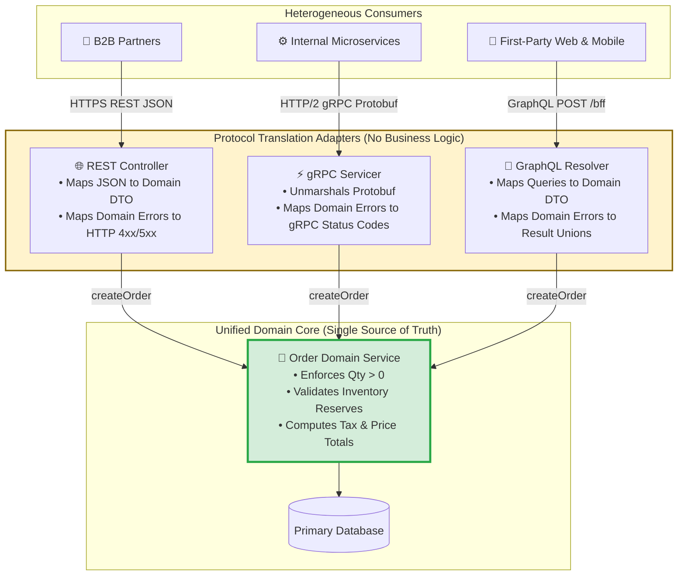
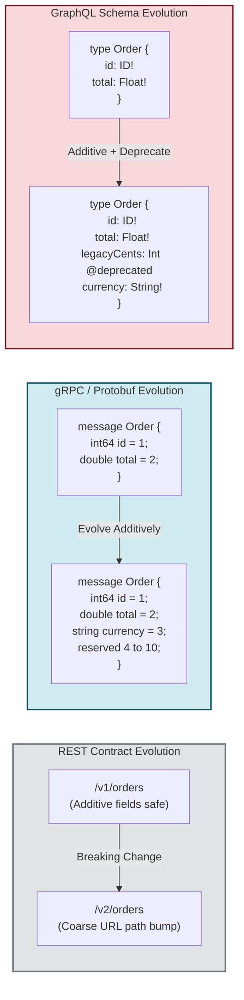
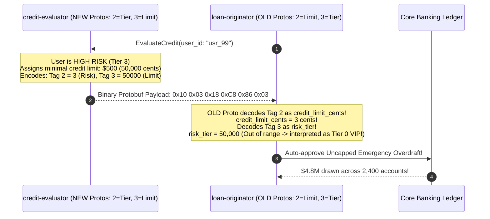

# Module 10: API Design Tradeoffs in Practice

> **Prerequisites**: [00-beyond-rest-when-and-why](../00-beyond-rest-when-and-why/README.md), [01-grpc-fundamentals](../01-grpc-fundamentals/README.md), [03-graphql-fundamentals](../03-graphql-fundamentals/README.md), and [09-api-gateways-and-bff](../09-api-gateways-and-bff/README.md).  
> **Estimated Reading Time**: 35 minutes  
> **Target Audience**: Staff Software Engineers, Systems Architects, and Technical Leads operating unified, multi-paradigm enterprise architectures.

---

> [!TIP]
> **The Golden Rule of Multi-Paradigm Architecture**  
> Enforce the rule of **One Domain, Many Edges**. Never let business validation logic fork across communication protocols. Domain rules live in a single, protocol-agnostic domain layer; REST routes, gRPC handlers, and GraphQL resolvers are merely thin **ports and adapters** that translate wire formats and status codes. Furthermore, respect each paradigm's native evolution mechanism: version REST via explicit coarse paths (`/v1`), version Protobuf via **immutable field tag numbers**, and version GraphQL via an **additive schema backed by `@deprecated`**. Never apply one paradigm's versioning rules to another.

---

## Visual Mental Models & Architecture

### One Domain, Many Edges: The Hexagonal Edge Architecture

Business logic must never be copy-pasted or rewritten across protocol handlers. Instead, the core domain model exposes clean interfaces; each paradigm adapter translates wire contracts to domain invocations.



---

### Contract Evolution Across Paradigms



---

## Systematic Reference Grids

### Cross-Paradigm Architectural Comparison Grid

| Dimension | REST | gRPC (Protobuf) | GraphQL |
| :--- | :--- | :--- | :--- |
| **Primary Consumer** | External B2B partners, public integrations, third-party developers. | Internal service-to-service, high-throughput microservices. | First-party client apps (Web SPA, Mobile iOS/Android) via BFF. |
| **Contract Artifact** | OpenAPI 3.1 Specification (`openapi.json` / YAML). | Protocol Buffer file (`.proto`). | Schema Definition Language (`schema.graphql` / SDL). |
| **Versioning Unit** | Explicit URL Prefix (`/v1/`, `/v2/`) or Header. | **Field Tag Number** (Integer ID on wire). | **Single Evolving Schema** with Field Deprecation. |
| **Safe Additive Change** | Add optional response field; add optional query parameter. | Add new field with **new unallocated tag number**. | Add new field; add optional argument; relax input nullability. |
| **Catastrophic Breaking Change** | Renaming/removing a field without a new `/v2` path. | **Renumbering or reusing an existing tag number**. | Weakening output nullability (`T!` &rarr; `T`); removing a field. |
| **Field Deprecation** | Deprecation HTTP header (`Sunset`, `Deprecation`). | `reserved` keyword for tag numbers and field names. | `@deprecated(reason: "Use alternative field.")`. |
| **Transport Protocol** | HTTP/1.1 or HTTP/2 over TLS. | HTTP/2 (Multiplexed streams, binary framing). | HTTP/1.1 or HTTP/2 POST (or GET for Persisted Queries). |
| **Wire Encoding** | Textual JSON. | Binary Protobuf (varint, length-delimited wire types). | Textual JSON. |
| **Error Signaling** | HTTP Status Codes (`400`, `401`, `403`, `404`, `422`, `500`). | Canonical gRPC Status Codes (`INVALID_ARGUMENT`, `NOT_FOUND`). | Result Unions in `data`, or generic masked entries in `errors[]`. |
| **Documentation Tooling** | Swagger UI, Redoc, Stoplight (OpenAPI generated). | `protoc-gen-doc`, generated client SDK stubs. | GraphiQL, Apollo Studio, SpectaQL (SDL generated). |

---

## Production Incident War Story: The Silent Protobuf Tag Swap

### Incident Post-Mortem: SEV-1

* **Incident ID**: INC-4419
* **Severity Level**: SEV-1 (Severe Financial Data Corruption)
* **Detection Time**: 48 hours after release
* **Time to Recovery (TTR)**: 120 minutes (data rollback required 6 days)
* **Impact**: \$4.8M in fraudulent credit advances issued due to silent wire-level field transposition.

#### 1. What Happened
A lending platform maintained an internal microservice `credit-evaluator` that evaluated user loan applications and returned credit score parameters to `loan-originator` over gRPC.

The `.proto` definition originally stood as:
```protobuf
message CreditEvaluationResponse {
  string user_id = 1;
  int64 credit_limit_cents = 2; // Tag 2: e.g. 500000 ($5,000.00)
  int32 risk_tier = 3;          // Tag 3: Risk tier (1=low, 2=med, 3=high)
}
```

During a refactoring to alphabetize fields, a junior engineer altered the schema without understanding binary protobuf wire serialization:
```protobuf
message CreditEvaluationResponse {
  string user_id = 1;
  int32 risk_tier = 2;          // Tag 2: Renumbered from Tag 3!
  int64 credit_limit_cents = 3; // Tag 3: Renumbered from Tag 2!
}
```
The developer rebuilt the `credit-evaluator` service and deployed it to production. However, `loan-originator` was NOT immediately redeployed and continued running with the old Protobuf stub definition.



#### 2. Root Cause Analysis
1. **Renumbering Wire Tags**: Protobuf does NOT transmit field names over the wire; it transmits only **field tag numbers and wire types**. Swapping tags 2 and 3 transposed `risk_tier` and `credit_limit_cents` silently on the wire without raising any compilation or deserialization errors.
2. **Failure to Use `reserved`**: When retiring or altering field positions, tags must be permanently marked `reserved` to prevent reuse.
3. **Absence of Breaking Change CI Gate**: The CI pipeline lacked `buf breaking` checks to reject any PR modifying tag numbers on existing Protobuf messages.

#### 3. The Architectural Hardening & Resolution
1. **Proto Tag Immutability**: Enforced the rule that once a tag number is assigned, it can **never be changed or reassigned**.
2. **Buf Breaking Linting in CI**: Integrated `buf breaking --against '.git#branch=main'` into all Git repositories. Any PR that renumbers or reuses a tag fails CI immediately.
3. **Use of `reserved` Directive**: Updated all legacy schemas to explicitly reserve decommissioned tags:
```protobuf
message CreditEvaluationResponse {
  string user_id = 1;
  reserved 2, 3;
  reserved "credit_limit_cents", "risk_tier";
  int64 approved_credit_limit_cents = 4;
  RiskTier user_risk_tier = 5;
}
```

---

## Multi-Language Production Code Tabs: One Domain, Many Edges

The following examples demonstrate the **Ports and Adapters** pattern in production: a single, shared domain function (`CreateOrder`) exposed simultaneously via REST, gRPC, and GraphQL without duplicating business logic.

```
### Language Tabs
1. Go (Shared Domain + Gin REST + gRPC Servicer + gqlgen)
2. Node.js / TypeScript (Domain Service + Express + @grpc/grpc-js + Apollo)
3. Python (Domain Function + FastAPI + grpcio + Strawberry)
4. C# (Domain Service + Minimal APIs + Grpc.AspNetCore + Hot Chocolate)
```

### Go
```go
package main

import (
	"context"
	"errors"
	"fmt"
	"net"
	"net/http"

	"github.com/gin-gonic/gin"
	"google.golang.org/grpc"
	"google.golang.org/grpc/codes"
	"google.golang.org/grpc/status"
)

// ==========================================
// 1. DOMAIN LAYER (Pure Business Logic)
// ==========================================
type Order struct {
	ID     string
	UserID string
	Qty    int
	Total  float64
}

var ErrInvalidQuantity = errors.New("quantity must be strictly greater than zero")

func CreateOrderDomain(userID string, qty int, unitPrice float64) (*Order, error) {
	if qty <= 0 {
		return nil, ErrInvalidQuantity
	}
	return &Order{
		ID:     fmt.Sprintf("ord_%d", time.Now().UnixNano()),
		UserID: userID,
		Qty:    qty,
		Total:  float64(qty) * unitPrice,
	}, nil
}

// ==========================================
// 2. REST ADAPTER (Public Edge)
// ==========================================
func RegisterRestAdapter(r *gin.Engine) {
	r.POST("/v1/orders", func(c *gin.Context) {
		var req struct {
			UserID string  `json:"user_id" binding:"required"`
			Qty    int     `json:"qty" binding:"required"`
			Price  float64 `json:"price" binding:"required"`
		}
		if err := c.ShouldBindJSON(&req); err != nil {
			c.JSON(http.StatusBadRequest, gin.H{"error": err.Error()})
			return
		}

		order, err := CreateOrderDomain(req.UserID, req.Qty, req.Price)
		if err != nil {
			if errors.Is(err, ErrInvalidQuantity) {
				c.JSON(http.StatusUnprocessableEntity, gin.H{"error": err.Error()})
				return
			}
			c.JSON(http.StatusInternalServerError, gin.H{"error": "Internal error"})
			return
		}

		c.JSON(http.StatusCreated, gin.H{"id": order.ID, "total": order.Total})
	})
}

// ==========================================
// 3. gRPC ADAPTER (Internal Service Mesh)
// ==========================================
type OrderGrpcServer struct {
	UnimplementedOrderServiceServer
}

func (s *OrderGrpcServer) CreateOrder(ctx context.Context, req *CreateOrderRequest) (*OrderResponse, error) {
	order, err := CreateOrderDomain(req.GetUserId(), int(req.GetQty()), req.GetPrice())
	if err != nil {
		if errors.Is(err, ErrInvalidQuantity) {
			return nil, status.Error(codes.InvalidArgument, "Quantity must be greater than zero")
		}
		return nil, status.Error(codes.Internal, "Internal processing error")
	}
	return &OrderResponse{Id: order.ID, Total: order.Total}, nil
}
```

### Node.js / TypeScript
```typescript
// ==========================================
// 1. DOMAIN LAYER (Pure Business Logic)
// ==========================================
export interface Order {
  id: string;
  userId: string;
  quantity: number;
  total: number;
}

export class DomainValidationError extends Error {
  constructor(message: string) {
    super(message);
    this.name = 'DomainValidationError';
  }
}

export function executeCreateOrder(userId: string, quantity: number, unitPrice: number): Order {
  if (quantity <= 0) {
    throw new DomainValidationError('Order quantity must be strictly positive');
  }
  return {
    id: `ord_${Date.now()}`,
    userId,
    quantity,
    total: quantity * unitPrice,
  };
}

// ==========================================
// 2. REST ADAPTER (Express /v1)
// ==========================================
import express, { Request, Response } from 'express';
export const restRouter = express.Router();

restRouter.post('/v1/orders', (req: Request, res: Response) => {
  try {
    const { userId, quantity, price } = req.body;
    const order = executeCreateOrder(userId, quantity, price);
    return res.status(201).json({ id: order.id, total: order.total });
  } catch (err) {
    if (err instanceof DomainValidationError) {
      return res.status(422).json({ error: err.message, code: 'INVALID_QUANTITY' });
    }
    return res.status(500).json({ error: 'Internal server error' });
  }
});

// ==========================================
// 3. GRAPHQL ADAPTER (Apollo BFF)
// ==========================================
export const graphqlResolvers = {
  Mutation: {
    createOrder: (_: any, { userId, qty, price }: { userId: string; qty: number; price: number }) => {
      try {
        const order = executeCreateOrder(userId, qty, price);
        return { __typename: 'OrderSuccess', order };
      } catch (err) {
        if (err instanceof DomainValidationError) {
          return { __typename: 'InvalidQuantityError', message: err.message };
        }
        throw err;
      }
    },
  },
};
```

### Python (FastAPI + gRPC + Strawberry)
```python
# ==========================================
# 1. DOMAIN LAYER (Single Source of Truth)
# ==========================================
from dataclasses import dataclass
import uuid
from typing import Annotated, Union
import grpc
from fastapi import FastAPI, HTTPException, status
import strawberry

@dataclass
class Order:
    id: str
    user_id: str
    qty: int
    total: float

class InvalidQuantityError(Exception):
    pass

def create_order_domain(user_id: str, qty: int, unit_price: float) -> Order:
    if qty <= 0:
        raise InvalidQuantityError("Quantity must be greater than zero")
    return Order(id=f"ord_{uuid.uuid4().hex[:8]}", user_id=user_id, qty=qty, total=qty * unit_price)

# ==========================================
# 2. REST ADAPTER (FastAPI)
# ==========================================
app = FastAPI()

@app.post("/v1/orders", status_code=status.HTTP_201_CREATED)
def rest_create_order(user_id: str, qty: int, price: float):
    try:
        order = create_order_domain(user_id, qty, price)
        return {"id": order.id, "total": order.total}
    except InvalidQuantityError as e:
        raise HTTPException(status_code=status.HTTP_422_UNPROCESSABLE_ENTITY, detail=str(e))

# ==========================================
# 3. GRAPHQL ADAPTER (Strawberry BFF)
# ==========================================
@strawberry.type
class OrderType:
    id: strawberry.ID
    total: float

@strawberry.type
class InvalidQtyResult:
    message: str

OrderResult = Annotated[Union[OrderType, InvalidQtyResult], strawberry.union("OrderResult")]

@strawberry.type
class Mutation:
    @strawberry.mutation
    def create_order(self, user_id: str, qty: int, price: float) -> OrderResult:
        try:
            o = create_order_domain(user_id, qty, price)
            return OrderType(id=strawberry.ID(o.id), total=o.total)
        except InvalidQuantityError as e:
            return InvalidQtyResult(message=str(e))
```

### C#
```csharp
using Grpc.Core;
using HotChocolate.Types;
using Microsoft.AspNetCore.Builder;
using Microsoft.AspNetCore.Http;

// ==========================================
// 1. DOMAIN LAYER (Single Source of Truth)
// ==========================================
public record Order(string Id, string UserId, int Qty, decimal Total);

public class DomainValidationException : Exception
{
    public DomainValidationException(string message) : base(message) { }
}

public static class OrderDomainService
{
    public static Order CreateOrder(string userId, int qty, decimal price)
    {
        if (qty <= 0)
            throw new DomainValidationException("Quantity must be strictly greater than zero");

        return new Order($"ord_{Guid.NewGuid():N}"[..12], userId, qty, qty * price);
    }
}

// ==========================================
// 2. REST ADAPTER (Minimal API /v1)
// ==========================================
public static class RestEndpoints
{
    public static void MapOrderEndpoints(WebApplication app)
    {
        app.MapPost("/v1/orders", (CreateOrderDto dto) =>
        {
            try
            {
                var order = OrderDomainService.CreateOrder(dto.UserId, dto.Qty, dto.Price);
                return Results.Created($"/v1/orders/{order.Id}", order);
            }
            catch (DomainValidationException ex)
            {
                return Results.UnprocessableEntity(new { error = ex.Message });
            }
        });
    }
}
public record CreateOrderDto(string UserId, int Qty, decimal Price);
```

---

## Practical Hands-On Verification Workflows

### 1. Verify Error Translation Across Protocols

Verify that the same validation failure (`qty <= 0`) surfaces idiomatically across both REST and GraphQL without altering domain code.

```bash
# Test REST Adapter
curl -s -i -X POST http://localhost:8000/v1/orders \
  -H "Content-Type: application/json" \
  -d '{"user_id": "usr_10", "qty": 0, "price": 19.99}'
```

**Expected HTTP Response (REST):**
```http
HTTP/1.1 422 Unprocessable Entity
Content-Type: application/json

{"detail":"Quantity must be greater than zero"}
```

```bash
# Test GraphQL BFF Adapter
curl -s -X POST http://localhost:8000/graphql \
  -H "Content-Type: application/json" \
  -d '{"query": "mutation { createOrder(userId: \"usr_10\", qty: 0, price: 19.99) { __typename ... on InvalidQtyResult { message } ... on OrderType { id total } } }"}' | jq .
```

**Expected JSON Response (GraphQL Result Union):**
```json
{
  "data": {
    "createOrder": {
      "__typename": "InvalidQtyResult",
      "message": "Quantity must be greater than zero"
    }
  }
}
```

---

## Operational Validation Checkpoints (Scenario Quizzes)

<details>
<summary><strong>Checkpoint 1: The Multi-Paradigm Versioning Trap</strong></summary>

**Scenario:** An engineering team manages three API interfaces:
1. A public REST API for external third-party merchants.
2. An internal gRPC microservice topology.
3. A GraphQL BFF serving a mobile iOS application.

The team needs to deprecate an old field `billingZipCode` in favor of a new structured address object `billingAddress { postalCode country }`. How must this change be executed across each of the three paradigms to guarantee zero downtime and no breaking changes?

**Answer:**
- **In REST:** Add the new `billing_address` object additively to the existing `/v1/` endpoint. Retain `billing_zip_code` in `/v1/` while returning a `Deprecation` and `Sunset` HTTP header. Schedule the removal of `billing_zip_code` for `/v2/` with a minimum 6-month partner migration window.
- **In gRPC (Protobuf):** Add the new `BillingAddress` message with a **new tag number** (e.g. `tag = 14`). Do NOT renumber or delete the old tag; mark the old string field as `[deprecated = true]`. When decommissioning the field, mark tag 12 as `reserved 12;` and `reserved "billing_zip_code";`.
- **In GraphQL:** Add `billingAddress: Address!` to the schema. Mark the existing field as `@deprecated(reason: "Use billingAddress.postalCode. Scheduled removal Q4 2027.")`. Monitor client field usage via telemetry until mobile app versions querying `billingZipCode` reach 0% traffic before deleting the field.
</details>

<details>
<summary><strong>Checkpoint 2: The Leaky Internal Model Anti-Pattern</strong></summary>

**Scenario:** A development team builds a GraphQL BFF in front of an internal gRPC `UserMicroservice`. In the BFF, the resolver returns the auto-generated Protobuf message object directly to the GraphQL client. A backend developer refactors the internal gRPC schema by renaming a Protobuf field from `user_full_name` to `display_name`. What happens to the mobile application, and what architectural rule was violated?

**Answer:**
The mobile application **breaks immediately with field resolution errors**.
- **The Violated Architectural Rule**: **Never leak internal service schemas directly to external or BFF clients**.
- Internal gRPC contracts evolve at a rapid, internal release cadence. Public or BFF contracts evolve under slow, strict backward-compatibility constraints.
- **The Fix**: The BFF must act as a **translation boundary**. The resolver must explicitly map fields from the internal gRPC message DTO to a dedicated, decoupled GraphQL type. An internal gRPC refactor will then be adapted inside the resolver without altering the external GraphQL contract.
</details>

<details>
<summary><strong>Checkpoint 3: The Forked Business Logic Incident</strong></summary>

**Scenario:** An e-commerce platform allows customers to place orders via a web UI (GraphQL BFF) and allows enterprise partners to place orders via a REST API (`POST /v1/orders`). A business rule states: *"Orders exceeding \$10,000 require manual compliance approval."* The REST controller implements this check, but the GraphQL resolver forgot to implement it. What architectural pattern prevents this bug from recurring?

**Answer:**
The **Ports and Adapters (Hexagonal Architecture)** pattern.
- Controllers, resolvers, and RPC handlers must be **pure transport adapters** containing **zero business rules**.
- The compliance check must be implemented inside a single domain function: `OrderService.PlaceOrder(cmd)`.
- Both the REST controller and the GraphQL mutation resolver simply validate request syntax, pass unmarshaled data to `OrderService.PlaceOrder`, and map the domain outcome to their respective protocol formats. Business rules can never fork because there is only one place where domain logic executes.
</details>

---

## Cumulative Review

Closed-book. Don't reopen modules 00–07 while attempting these — this is the track's second cumulative review (the first covered 00–03), and the point is to find out what stuck across the *whole* arc: choosing paradigms, gRPC, GraphQL, update mechanisms, the edge, and putting it all together.

1. A new product has: partners reselling your inventory, a web + mobile app showing a data-rich "my account" screen, an internal `pricing-service` called ~10,000×/sec during checkout, and a requirement that buyers see inventory counts update live. Assign a paradigm *and* (where relevant) an update mechanism to each edge, and justify each against the module-00 framework.
2. Three changes ship on the same day: a REST field is renamed in `/v1`, a Protobuf field is renumbered from tag 2 to tag 3, and a GraphQL field's type is changed from `Int` to `String`. Rank them by danger, say which are silent vs loud, and give the compatible way to achieve each intended change.
3. Explain why **authorization** lives on the route in REST (track 02) but on the field/resolver in GraphQL (module 04), and how an **API gateway** (module 06) changes where authentication happens for both.
4. A browser dashboard needs order status "within a minute"; a partner backend needs to know the instant an order ships; a trading UI needs live ticks. Name the update mechanism for each (module 05) and the one framework question that decides the partner-vs-browser difference.
5. Contrast the N+1 problem (module 03) and a leaked gRPC stream (module 02): what each is, the interaction paradigm each occurs in, and the specific defense for each. Then name the one discipline both defenses share.
6. A team runs six services, each re-validating JWTs and each with its own drifted rate limiter, and exposes a GraphQL endpoint to untrusted third parties. Diagnose against modules 00, 04, and 06, and prescribe the corrected edge.
7. Trace a mobile app fetching an "order summary" through the full mature topology: name every hop (client → … → data), the paradigm/protocol on each hop, and what each layer is responsible for — and say which layer resolves the over-/under-fetch and which enforces the rate limit.
8. Justify, as a growth sequence, why a two-person startup with one web client and a CRUD app should *not* start with gRPC + GraphQL + a gateway, and name the concrete pain that would later justify adding each of those three.

<details>
<summary>Answers</summary>

1. Partners → **REST** (public/third-party: universal, cacheable, low integration cost — framework Q1). The account screen for web + mobile → a **GraphQL BFF** (own frontends, rich/variable relational data, collapses aggregation, serves two clients with different shapes — Q1 + Q3). `pricing-service` at 10,000×/sec → **gRPC** (internal, extreme throughput, low latency, typed stubs — Q1 internal + Q4 performance). Live inventory counts to buyers (browsers) → a **push** mechanism, **SSE** or a **GraphQL subscription** if they already talk to the BFF (server-initiated, browser can't be called inbound — module 05).
2. Danger: **renumbering the Protobuf tag is worst** (silent wire corruption, no error), then the **GraphQL `Int`→`String` retype** (breaks clients but surfaces as errors — loud-ish), then the **REST rename** (visibly absent field, managed by versioning — loud). Compatible versions: Protobuf — add a *new* field with a *new* tag and `reserved` the old, never renumber; GraphQL — add a new correctly-typed field and `@deprecate` the old, don't retype in place; REST — add the new field and retire the old across a `/v2` + deprecation window, don't rename in `/v1`.
3. REST has a **route per resource/operation**, so auth can guard the route (a router dependency, track 02). GraphQL has **one endpoint** and one query can traverse from a public field into a sensitive one, so authorization must live **per field/resolver** using the current user from context (module 04). An **API gateway** hoists *authentication* to the edge — it validates the credential once and forwards verified identity — so services/BFF trust it instead of each re-validating; authorization (who-can-do-what) still lives in the service/field logic.
4. Browser dashboard, ~1 min tolerance → **polling** (cheap, REST-native, bounded freshness is fine). Partner backend, "instant" on ship → **webhook** (server-to-server push). Trading UI, live ticks → **SSE/WebSocket** (persistent push to a browser). The deciding framework question for partner-vs-browser: **can the consumer receive an inbound HTTP call?** — the partner server can (so a webhook works), the browser can't (so it polls or holds a socket open).
5. **N+1** (module 03, **GraphQL**): a per-item field resolver fires one data-source query per parent (100 books → 100 author lookups); defense = a **per-request DataLoader** that batches the keyed loads into one query. **Leaked stream** (module 02, **gRPC server-streaming**): the server keeps producing after the client has disconnected; defense = check `context.is_active()` and bound/exit the loop. Shared discipline: **bound the work one request/connection can cause** — batch it or stop it — rather than trusting the naive path to scale.
6. Against **module 06**: six copies of JWT validation and six drifted rate limiters are duplicated edge policy → introduce **one API gateway** that terminates auth once and enforces one rate-limit/quota policy, routing to services that trust forwarded identity. Against **module 00 / 04**: exposing a GraphQL endpoint to *untrusted third parties* is the wrong consumer for GraphQL — public/partner integrators should get **REST** (cacheable, low integration cost, smaller abuse surface); reserve GraphQL for your own apps as a **BFF**. Corrected edge: gateway (authN, rate limit, routing) → REST for partners, a GraphQL BFF for first-party apps → gRPC to internal services.
7. **Client (mobile) → API gateway → BFF → services → data.** Client → gateway: over the public edge (HTTPS); the **gateway** terminates auth, enforces the **rate limit**, and routes. Gateway → **BFF** (GraphQL): the BFF aggregates and **resolves the over-/under-fetch**, shaping one screen response. BFF → **services** over **gRPC** (typed, fast, same datacenter); services own domain logic. Services → **data** (DB/cache). The **BFF** resolves over-/under-fetch; the **gateway** enforces the rate limit; the **services** own the domain.
8. With one client and a CRUD app there's **no concrete pain** any of the three solves: gRPC's typing/throughput matters between *chatty internal services* they don't have; a GraphQL BFF's field-picking matters for *rich/multiple clients* they don't have; a gateway's centralized edge policy matters across *many services/partners* they don't have — each would add ops burden, a hop/SPOF, or a learning curve for a benefit that isn't yet needed (module 00). Later triggers: add **gRPC** when internal service-to-service traffic becomes a measured JSON/HTTP tax; add a **GraphQL BFF** when a rich or second client suffers over-/under-fetch; add a **gateway** when edge policy is duplicated across enough services or a partner program needs central key/quota management.

</details>

---

## Further Reading & Next Steps

* [Google API Design Guide](https://cloud.google.com/apis/design) - Canonical enterprise standard for multi-paradigm consistency.
* [Google AIP-180: Backwards Compatibility](https://google.aip.dev/180) - Concrete behavioral definitions of breaking vs additive changes.
* [Martin Fowler: Ports and Adapters Pattern](https://martinfowler.com/bliki/HexagonalArchitecture.html) - Structural decoupling of domain logic from transport protocols.
* Next up: [11-edge-computing-and-webassembly](../11-edge-computing-and-webassembly/README.md) to explore execution environments at the physical network edge using WebAssembly isolates.
