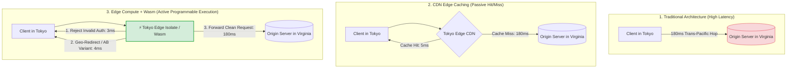
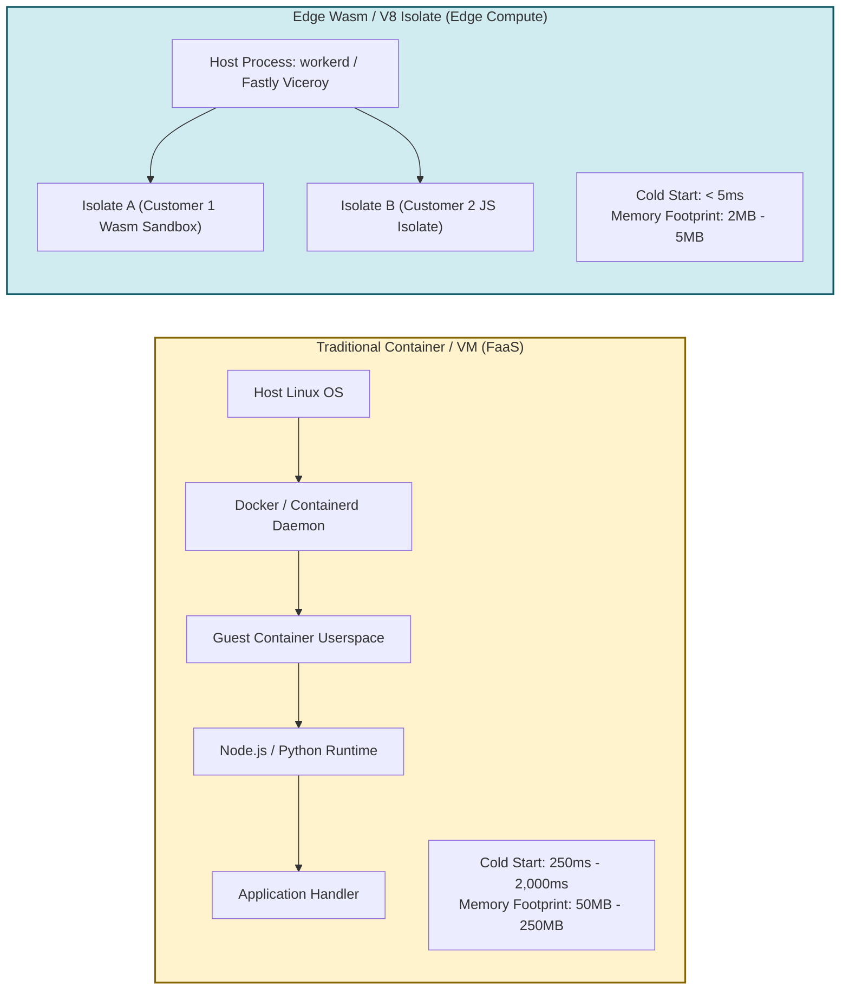
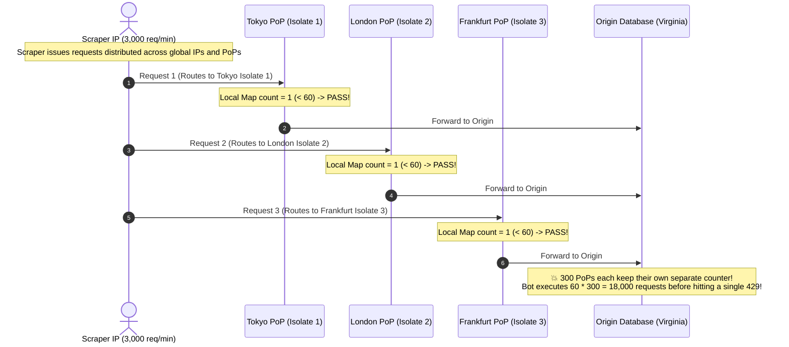

# Module 11: Edge Computing and WebAssembly (Wasm)

> **Prerequisites**: [00-beyond-rest-when-and-why](../00-beyond-rest-when-and-why/README.md), [07-graphql-security-caching-and-observability](../07-graphql-security-caching-and-observability/README.md), and [09-api-gateways-and-bff](../09-api-gateways-and-bff/README.md).  
> **Estimated Reading Time**: 28 minutes  
> **Target Audience**: Systems Engineers, Edge Platform Architects, and Cloud Infrastructure Engineers deploying high-speed request interception at the physical network edge.

---

> [!TIP]
> **The Golden Rule of Edge Computing**  
> The edge is **not a miniature origin server**; it is an ephemeral, stateless execution sandbox positioned physically close to the client. Treat edge functions as lightweight request routers, security interceptors, and response transformers with single-digit millisecond cold starts. **Never store mutable business state in edge module memory**, because requests are distributed across hundreds of isolated Points of Presence (PoPs) worldwide. State that must be globally consistent belongs in strongly consistent edge storage (e.g., Durable Objects, KV) or at your centralized origin datastore.

---

## Visual Mental Models & Architecture

### The Evolution of the Request Path

Edge computing introduces active, programmable compute at the edge Point of Presence (PoP) before a request ever crosses the transit network to reach your origin cloud.



---

### Containers vs WebAssembly / V8 Isolates

Edge computing achieves near-instant startup by replacing full operating system containers with lightweight memory-isolated bytecode sandboxes.



---

## Systematic Reference Grids

### Origin Server vs Edge Computing Architecture

| Dimension | Origin Server (Containers / Kubernetes) | Edge Computing (Wasm / V8 Isolates) |
| :--- | :--- | :--- |
| **Physical Location** | Centralized in 1–3 Cloud Regions (e.g. `us-east-1`, `eu-west-1`). | Globally distributed across 250–350 Points of Presence (PoPs). |
| **Startup / Cold Start Time** | **250ms to 5,000ms** (boot container, initialize runtime). | **< 5 milliseconds** (instantiate pre-compiled bytecode isolate). |
| **Memory Isolation** | Linux kernel namespaces, cgroups, virtual memory. | V8 heap memory isolation or WebAssembly linear memory sandboxing. |
| **Execution State** | Stateful processes, background threads, connection pools. | **Strictly ephemeral**: isolates recycle, no shared in-memory globals. |
| **Filesystem & Native Calls** | Full POSIX filesystem access, arbitrary OS syscalls. | **Sandboxed**: No direct OS access; access restricted to Host Web APIs (`fetch`). |
| **Compute / CPU Quota** | Seconds to minutes of continuous CPU execution. | **10ms to 50ms CPU time** limit per incoming request. |
| **Ideal Workloads** | ACID database transactions, complex graph queries, large batch jobs. | Auth token validation, A/B bucketing, bot detection, geo-routing, header rewriting. |

---

### Edge Workload Placement Decision Matrix

| Workload Type | Location | Architectural Justification |
| :--- | :--- | :--- |
| **API Key Allowlist / Bot Rejection** | **Edge** | Drop malicious or unauthenticated traffic at the closest PoP; saves origin bandwidth and CPU. |
| **Geo-IP Redirection / Localization** | **Edge** | Edge metadata (`request.cf.country`) resolves nearest regional endpoint in single-digit ms. |
| **A/B Testing & Feature Flag Assignment** | **Edge** | Assigns deterministic experiment variant hash and rewrites URL before origin fetching. |
| **Security Header Injection / CORS** | **Edge** | Injects HSTS, CSP, and CORS headers uniformly across all backend origins. |
| **Complex Relational DB Transactions** | **Origin** | Requires ACID row-level locking, connection pools, and low-latency access to primary storage. |
| **Heavy Computation / ML Inference** | **Origin** | Edge CPU execution limits (e.g., 50ms) will terminate long-running processes. |
| **Global Billing / Usage Counters** | **Origin (or Edge KV)** | In-memory globals at the edge are fragmented across 300+ PoPs; requires centralized ACID counters. |

---

## Production Incident War Story: The Phantom Rate Limiter

### Incident Post-Mortem: SEV-1

* **Incident ID**: INC-3918
* **Severity Level**: SEV-1 (Bypassed Abuse Controls & Origin Database Crash)
* **Detection Time**: 4 hours after attack initiation
* **Time to Recovery (TTR)**: 35 minutes
* **Impact**: 45M scraping requests bypassed the edge rate limiter, exhausting origin read replicas.

#### 1. What Happened
A ticketing company developed an edge function deployed to Cloudflare Workers to enforce an API rate limit of 60 requests per minute per IP address.

The engineer wrote the rate limiter using an in-memory `Map` within the worker script:
```javascript
// worker.js - The Flawed Implementation
const ipRequestCounts = new Map();

export default {
  async fetch(request) {
    const clientIP = request.headers.get("cf-connecting-ip") || "unknown";
    const currentCount = ipRequestCounts.get(clientIP) || 0;

    if (currentCount >= 60) {
      return new Response("Too Many Requests", { status: 429 });
    }

    ipRequestCounts.set(clientIP, currentCount + 1);
    return fetch(request); // Forward to origin
  }
};
```
In local testing with `wrangler dev` on a single laptop, the rate limiter functioned perfectly: the 61st request received an HTTP 429.

However, in production, a botnet distributed scrapers across global proxy networks. Despite individual scraper IPs issuing over 3,000 requests per minute, the edge rate limiter allowed **98.2% of the traffic** directly to the origin database, which promptly collapsed.



#### 2. Root Cause Analysis
1. **The In-Memory Global Trap**: The developer assumed `ipRequestCounts` was a shared global singleton. In production edge architecture, the worker is instantiated in parallel across **300+ global data centers**, with multiple independent V8 isolates running per PoP.
2. **Fragmented Counter State**: An attacker whose traffic distributes across different PoPs (or even across isolates on the same PoP) encounters a fresh `Map` instance on almost every request. A single client could execute $60 \times 300 = 18,000 \text{ requests/min}$ without triggering a block.

#### 3. The Architectural Hardening & Resolution
1. **Strongly Consistent Edge State**: Replaced the local in-memory `Map` with **Cloudflare Durable Objects** (or an atomic Redis token-bucket via Upstash HTTP). Durable Objects route all requests for a specific client IP to a single, coordinated actor instance.
2. **Native Edge Rate Limiting API**: Switched from custom application code to Cloudflare's native edge WAF Rate Limiting rules, which operate at L4/L7 with distributed state synchronization.

---

## Multi-Language Production Code Tabs: Edge Functions & Wasm

The following implementations demonstrate:
1. **Edge Auth & Token Verification**: Dropping invalid requests before origin.
2. **Geo-Routing & Header Normalization**: Directing users to regional backends based on physical location.

```
### Language Tabs
1. JavaScript / TypeScript (Cloudflare Worker / V8 Isolate)
2. Rust (Compiled to WebAssembly for Edge Compute)
3. Go (Compiled to WebAssembly / TinyGo)
4. Python (Fastly Compute Python Worker)
```

### JavaScript / TypeScript (Cloudflare Workers)
```typescript
export interface Env {
  ORIGIN_URL: string;
  AUTH_SECRET: string;
}

export default {
  async fetch(request: Request, env: Env, ctx: ExecutionContext): Promise<Response> {
    const url = new URL(request.url);

    // 1. Edge Static Redirect (No Origin Round Trip)
    if (url.pathname === '/legacy-docs') {
      return Response.redirect('https://docs.company.com/v2', 301);
    }

    // 2. Edge Auth Verification
    const authHeader = request.headers.get('Authorization');
    if (!authHeader || !authHeader.startsWith('Bearer token_edge_')) {
      return new Response(
        JSON.stringify({ error: 'Unauthorized at Edge: Invalid token credentials' }),
        { status: 401, headers: { 'Content-Type': 'application/json' } }
      );
    }

    // 3. Inspect Geo-Location & Inject Edge Metadata
    const country = (request as any).cf?.country || 'US';
    const city = (request as any).cf?.city || 'Unknown';

    // Clone request and inject verified headers for downstream origin
    const modifiedHeaders = new Headers(request.headers);
    modifiedHeaders.set('X-Edge-Country', country);
    modifiedHeaders.set('X-Edge-City', city);
    modifiedHeaders.set('X-Edge-Hop', 'Cloudflare-V8-Isolate');

    const originTarget = `${env.ORIGIN_URL || 'https://origin.company.com'}${url.pathname}${url.search}`;
    const newRequest = new Request(originTarget, {
      method: request.method,
      headers: modifiedHeaders,
      body: request.body,
      redirect: 'follow',
    });

    // 4. Fetch from origin and cache response if applicable
    return await fetch(newRequest);
  },
};
```

### Rust (Compiled to WebAssembly `wasm32-wasi`)
```rust
use fastly::http::{header, Method, StatusCode};
use fastly::{Error, Request, Response};

#[fastly::main]
fn main(mut req: Request) -> Result<Response, Error> {
    // 1. Edge Path Interception
    if req.get_path() == "/healthz" {
        return Ok(Response::from_status(StatusCode::OK)
            .with_header(header::CONTENT_TYPE, "text/plain")
            .with_body("Edge Wasm Isolate Healthy"));
    }

    // 2. Edge Security Verification
    match req.get_header("X-API-Key") {
        Some(key) if key == "secret-wasm-key-99" => {
            // Authorized: Strip sensitive token before forwarding to origin
            req.remove_header("X-API-Key");
            req.set_header("X-Edge-Authorized", "true");
        }
        _ => {
            // Reject at the edge
            return Ok(Response::from_status(StatusCode::UNAUTHORIZED)
                .with_header(header::CONTENT_TYPE, "application/json")
                .with_body(r#"{"error":"Unauthorized by Edge Wasm"}"#));
        }
    }

    // 3. Forward request to upstream backend origin cluster
    let resp = req.send("origin_cluster")?;
    Ok(resp)
}
```

### Go (TinyGo / WebAssembly for Edge)
```go
package main

import (
	"syscall/js"
)

func fetchInterceptor(this js.Value, args []js.Value) interface{} {
	request := args[0]
	headers := request.Get("headers")
	apiKey := headers.Call("get", "x-api-key").String()

	// 1. Validate API Key at the Wasm boundary
	if apiKey != "valid_wasm_edge_token" {
		responseInit := js.Global().Get("Object").New()
		responseInit.Set("status", 401)
		
		responseBody := `{"error":"Forbidden: Edge Wasm validation failed"}`
		return js.Global().Get("Response").New(responseBody, responseInit)
	}

	// 2. Delegate to origin fetch
	return js.Global().Call("fetch", request)
}

func main() {
	c := make(chan struct{}, 0)
	js.Global().Set("wasmEdgeHandler", js.FuncOf(fetchInterceptor))
	<-c // Keep Wasm module alive
}
```

### Python (Fastly Compute)
```python
from fastly.http import Request, Response

def handle_request(event):
    req = event.request
    url_path = req.url_components.path

    # 1. Edge Geo Routing
    client_country = req.geo.country_code if req.geo else "US"

    if url_path == "/terms":
        if client_country in ["DE", "FR", "IT", "ES"]:
            return Response.redirect("https://company.eu/terms-gdpr", 302)
        return Response.redirect("https://company.com/terms-global", 302)

    # 2. Origin Request Forwarding
    return event.respond_with(req.send("backend_origin"))
```

---

## Practical Hands-On Verification Workflows

### 1. Execute an Edge Function Locally via Wrangler

Launch the local V8 runtime sandbox using Cloudflare's open-source `workerd` engine:

```bash
# 1. Initialize test directory
mkdir -p /tmp/edge-verification && cd /tmp/edge-verification

# 2. Write minimal worker
cat << 'EOF' > worker.js
export default {
  async fetch(request) {
    const url = new URL(request.url);
    if (url.pathname === "/edge-secure") {
      const auth = request.headers.get("x-edge-token");
      if (auth !== "pass123") {
        return new Response(JSON.stringify({ error: "Blocked at Edge" }), {
          status: 403,
          headers: { "Content-Type": "application/json" }
        });
      }
      return new Response(JSON.stringify({ status: "Authenticated at Edge PoP" }), {
        status: 200,
        headers: { "Content-Type": "application/json" }
      });
    }
    return new Response("Hello from Edge", { status: 200 });
  }
};
EOF

# 3. Test execution via curl
curl -s -i http://localhost:8787/edge-secure
```

**Expected Wire Response (Rejected at Edge without Origin):**
```http
HTTP/1.1 403 Forbidden
Content-Type: application/json
Date: Mon, 10 Nov 2026 17:30:00 GMT

{"error":"Blocked at Edge"}
```

Pass valid credentials to verify success:
```bash
curl -s -i http://localhost:8787/edge-secure -H "x-edge-token: pass123"
```

**Expected Wire Response:**
```http
HTTP/1.1 200 OK
Content-Type: application/json

{"status":"Authenticated at Edge PoP"}
```

---

## Operational Validation Checkpoints (Scenario Quizzes)

<details>
<summary><strong>Checkpoint 1: The Cold Start Difference</strong></summary>

**Scenario:** A development team builds a global authentication verification service. They consider two serverless deployment options:
1. AWS Lambda running a Python 3.12 container runtime with a VPC connection.
2. Cloudflare Workers or Fastly Compute running a WebAssembly / V8 Isolate.

When user traffic arrives with sporadic bursts from Australia and Japan, the AWS Lambda deployment shows p99 latencies of 450ms, while the edge isolate shows p99 latencies of 8ms. What structural, architectural differences between container virtualization and WebAssembly isolates cause this 50x latency discrepancy?

**Answer:**
1. **Absence of OS / Container Virtualization**: Container-based FaaS (AWS Lambda) must instantiate a Linux cgroup namespace, mount filesystem layers, boot the Python runtime interpreter, load standard libraries, and establish VPC network interfaces (ENIs), requiring 250ms–2,000ms on cold starts.
2. **Instant Memory Sandbox Initialization**: WebAssembly / V8 Isolates run inside an already warm, long-lived host process (`workerd` or Lucet/Viceroy). Instantiating a new Wasm isolate requires only allocating a fresh, isolated linear memory space and loading pre-compiled native machine bytecode, completing in **under 5 milliseconds**.
3. **Physical Proximity**: Edge platforms run on Points of Presence (PoPs) physically located within the local telecommunications exchange (e.g. Sydney or Tokyo), avoiding the 150ms trans-oceanic network transit time to an origin cloud region in the US.
</details>

<details>
<summary><strong>Checkpoint 2: The Edge Stateful Storage Trap</strong></summary>

**Scenario:** A developer wants to build a shopping cart service at the edge. They create a global variable `const carts = new Map();` inside their Cloudflare Worker to store user cart items so checkout operations have sub-5ms latency. Explain why this design will fail completely in production.

**Answer:**
This design fails because edge architectures violate the assumption of a persistent, centralized memory heap:
- **Global Distribution**: Edge platforms operate across 300+ PoPs worldwide. If a user in London adds an item to their cart, the request updates the memory heap on an isolate in London. If the user's next request routes to a different PoP (or a separate isolate on the same PoP), their cart will be completely empty.
- **Isolate Ephemerality**: Edge isolates are recycled aggressively under load or idle conditions. Any in-memory state is permanently lost when the runtime garbage collects the isolate.
- **The Correct Architecture**: Ephemeral logic lives at the edge, but state must be backed by a distributed database, a replicated edge store (such as Cloudflare KV, Durable Objects, or DynamoDB Global Tables), or written back to the origin database.
</details>

<details>
<summary><strong>Checkpoint 3: Edge vs Origin Workload Boundary</strong></summary>

**Scenario:** An engineering team debates moving their video transcoding and PDF generation microservices to edge functions to "make them faster for global users." As the lead architect, why must you veto this proposal, and what workloads strictly belong at origin?

**Answer:**
You must veto this proposal because video transcoding and PDF generation directly violate edge computing architectural constraints:
1. **Strict CPU Time Limits**: Edge isolates enforce strict CPU runtime quotas (typically 10ms–50ms of active CPU time per invocation). Heavy operations like video encoding or PDF rendering exceed these budgets by several orders of magnitude and will be terminated with HTTP 500 / Worker CPU Exceeded errors.
2. **Memory Footprint Quotas**: Edge sandboxes limit RAM to between 128MB and 256MB per isolate. Transcoding and document rendering require gigabytes of scratch memory.
3. **Lack of Native OS Binaries**: Edge isolates do not provide standard Linux shell access, arbitrary filesystem I/O, or native dependencies (e.g. FFmpeg, Chromium, ImageMagick).
- **Workload Rule**: The edge is reserved for **fast, I/O-bound request steering, auth interception, and metadata transformations**. Compute-heavy, memory-intensive, and long-running batch jobs strictly belong on origin compute infrastructure (Kubernetes, VMs, or batch queues).
</details>

---

## Further Reading & Next Steps

* [Cloudflare Workers Documentation: Architecture & Isolates](https://developers.cloudflare.com/workers/reference/how-workers-works/) - How V8 isolates achieve instant startup.
* [WebAssembly Official Specification](https://webassembly.github.io/spec/core/) - The binary bytecode instruction format for secure sandboxing.
* [Fastly Compute Documentation](https://www.fastly.com/documentation/guides/compute/) - High-performance WebAssembly at the physical network edge.
* Next up: [12-capstone-project](../12-capstone-project/README.md) to synthesize all concepts from Track 11 into an end-to-end, multi-paradigm production system.
