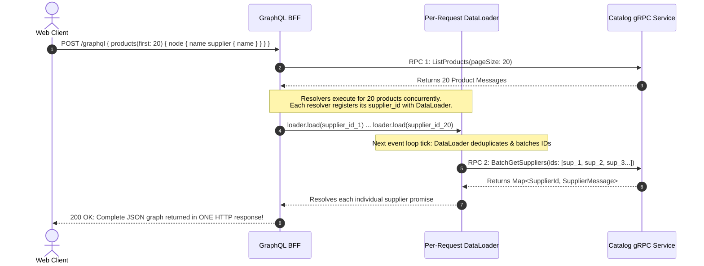
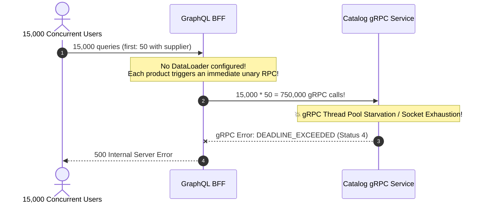

# Module 12: Capstone Project — Multi-Paradigm Catalog Mesh

> **Prerequisites**: Complete mastery of [00-beyond-rest-when-and-why](../00-beyond-rest-when-and-why/README.md) through [11-edge-computing-and-webassembly](../11-edge-computing-and-webassembly/README.md).  
> **Estimated Project Time**: 4 hours  
> **Target Audience**: Senior Backend Engineers, Distributed Systems Architects, and Technical Leads building real-world enterprise multi-paradigm systems.

---

> [!TIP]
> **The Golden Rule of Multi-Paradigm System Integration**  
> In a multi-paradigm architecture, the **Backend-for-Frontend (BFF)** is the translation seam between the outside world and the internal service mesh: it speaks **GraphQL** over HTTP to public client applications (giving them field-selection and single-round-trip data aggregation) and speaks **gRPC** over HTTP/2 internally (giving the service mesh high-throughput binary serialization and strict type safety). To prevent catastrophic internal denial-of-service, **always wrap internal gRPC entity calls in per-request DataLoaders inside your GraphQL resolvers** so a page of $N$ items results in exactly 2 internal RPCs instead of $N + 1$ RPCs.

---

## Visual Mental Models & Architecture

### The Multi-Paradigm Seam: GraphQL Outside, gRPC Inside

The core architectural pattern in enterprise distributed backends couples a public client-facing GraphQL BFF with high-performance internal gRPC microservices:

```mermaid
flowchart LR
    subgraph PublicBoundary["Public Network Boundary"]
        Client["📱 Web / Mobile Client"]
    end

    subgraph BFFBoundary["BFF Tier (Translation Seam)"]
        GraphQLBFF["🔮 GraphQL BFF (Strawberry / Apollo)<br/>• Owns NO database<br/>• Maps DTOs & translates errors<br/>• Batches gRPC calls via DataLoader"]
    end

    subgraph MeshBoundary["Internal Service Mesh (HTTP/2 gRPC)"]
        CatalogSvc["⚡ catalog-service (gRPC Server)<br/>• GetProduct<br/>• ListProducts (capped first)<br/>• BatchGetSuppliers (bulk lookup)"]
        DB[(Catalog Storage)]
    end

    Client -->|1. GraphQL Query: products + supplier| GraphQLBFF
    GraphQLBFF -->|2. RPC 1: ListProducts| CatalogSvc
    GraphQLBFF -->|3. RPC 2: BatchGetSuppliers(ids)| CatalogSvc
    CatalogSvc --> DB

    style PublicBoundary fill:#e2e3e5,stroke:#6c757d,stroke-width:1px
    style BFFBoundary fill:#cce5ff,stroke:#004085,stroke-width:2px
    style MeshBoundary fill:#d4edda,stroke:#28a745,stroke-width:2px
```

---

### Mitigating the Internal gRPC N+1 Query Cascade

Without a per-request DataLoader, querying a page of 20 products with their suppliers triggers 21 individual network round trips over the internal gRPC mesh. With a DataLoader, the BFF coalesces supplier IDs within the tick and issues a single bulk RPC.



---

## Systematic Architecture Blueprint Grid

### Component Responsibilities & Boundaries

| Architectural Layer | Component | Protocol & Wire Format | Primary Responsibilities | Strict Anti-Patterns (Never Do) |
| :--- | :--- | :--- | :--- | :--- |
| **Client Tier** | Web SPA / Mobile App | HTTPS / GraphQL JSON | Declares explicit UI selection set; caches responses locally. | Never issue separate HTTP calls for related sub-entities. |
| **Edge BFF Tier** | GraphQL BFF | GraphQL over HTTP (Outside) &rarr; gRPC over HTTP/2 (Inside) | Translates GraphQL queries into gRPC calls; maps internal protobuf DTOs to GraphQL types; sanitizes errors; runs DataLoaders. | **Never connect directly to a database**; never leak raw auto-generated protobuf objects directly to clients. |
| **Domain Mesh Tier** | Catalog Microservice | gRPC / Protocol Buffers | Implements pure business logic; enforces pagination limits; executes transactional database lookups; exposes bulk batch RPCs. | Never implement transport-specific UI formatting or presentation logic inside the core gRPC service. |

---

## Production Incident War Story: The Million-RPC Cascade

### Incident Post-Mortem: SEV-1

* **Incident ID**: INC-2884
* **Severity Level**: SEV-1 (Internal gRPC Mesh Saturation)
* **Detection Time**: 2 minutes after holiday campaign launch
* **Time to Recovery (TTR)**: 16 minutes
* **Impact**: Total collapse of internal gRPC networking; all catalog, checkout, and inventory queries failed globally.

#### 1. What Happened
A newly introduced GraphQL BFF allowed web clients to query product catalogs. The developer implemented the GraphQL resolver for `Product.supplier` by directly calling the internal gRPC `GetSupplier` unary RPC:
```python
# The Unbuffered gRPC Anti-Pattern in GraphQL
@strawberry.field
async def supplier(self, info: strawberry.Info) -> SupplierType:
    stub = info.context["catalog_grpc_stub"]
    # Flawed: executes one separate gRPC call per product!
    resp = await stub.GetSupplier(GetSupplierRequest(id=self.supplier_id))
    return SupplierType(id=resp.id, name=resp.name)
```
When marketing sent a push notification for a flash sale, 15,000 concurrent mobile users opened their apps. The client queried 50 products per page:

$$15,000 \text{ concurrent queries} \times 50 \text{ products} = 750,000 \text{ gRPC calls in 3 seconds}$$

The internal gRPC client connection pool and TCP socket buffers were completely exhausted. The internal catalog service ran out of worker threads, latency surged from 4ms to 12,000ms, and the gRPC gateway began throwing `DEADLINE_EXCEEDED` across all services.



#### 2. Root Cause Analysis
1. **Absence of BFF Batching**: The developer treated internal microservice RPCs as "cheap local calls," ignoring the reality that each gRPC call carries network stack, syscall, serialization, and connection pool overhead.
2. **Missing Bulk RPC in Schema**: The gRPC `.proto` contract only exposed unary `GetSupplier` without offering a `BatchGetSuppliers` method.
3. **Uncapped Client Pagination**: The GraphQL schema allowed clients to request `first: 500`, multiplying the blast radius of un-batched resolvers.

#### 3. The Architectural Hardening & Resolution
1. **Schema Contract Evolution**: Added `BatchGetSuppliers(BatchGetSuppliersRequest)` to the gRPC `.proto` contract.
2. **Per-Request DataLoader Implementation**: Configured Strawberry/DataLoader in the BFF to collect all `supplier_id` requests within a single tick and issue a single `BatchGetSuppliers` gRPC call.
3. **Pagination Clamping**: Enforced a hard server-side limit of `first: 50` on the GraphQL BFF and within the gRPC service.

---

## Multi-Language Production Code Tabs: Complete Capstone Implementation

The following complete project implements the internal **gRPC Catalog Service** and the **GraphQL BFF** using the multi-paradigm architecture.

```
### Language Tabs
1. Python (Strawberry GraphQL BFF + grpcio Catalog Service)
2. Go (gqlgen GraphQL BFF + gRPC Catalog Service)
3. Node.js / TypeScript (Apollo Server + @grpc/grpc-js)
4. C# (Hot Chocolate GraphQL BFF + Grpc.AspNetCore Service)
```

### Protocol Buffer Definition: `catalog.proto`
Save this file as `proto/catalog.proto`:
```protobuf
syntax = "proto3";

package catalog.v1;

option go_package = "catalog/v1;catalogv1";

service CatalogService {
  rpc GetProduct (GetProductRequest) returns (Product);
  rpc ListProducts (ListProductsRequest) returns (ListProductsResponse);
  rpc GetSupplier (GetSupplierRequest) returns (Supplier);
  rpc BatchGetSuppliers (BatchGetSuppliersRequest) returns (BatchGetSuppliersResponse);
}

message Product {
  string id = 1;
  string name = 2;
  double price = 3;
  string supplier_id = 4;
}

message Supplier {
  string id = 1;
  string name = 2;
  string country = 3;
}

message GetProductRequest {
  string id = 1;
}

message ListProductsRequest {
  int32 page_size = 1;
  string page_token = 2;
}

message ListProductsResponse {
  repeated Product products = 1;
  string next_page_token = 2;
}

message GetSupplierRequest {
  string id = 1;
}

message BatchGetSuppliersRequest {
  repeated string ids = 1;
}

message BatchGetSuppliersResponse {
  repeated Supplier suppliers = 1;
}
```

---

### Python (Strawberry BFF + grpcio Service)

#### 1. gRPC Service Implementation (`server.py`)
```python
from concurrent import futures
import grpc
import catalog_pb2
import catalog_pb2_grpc

PRODUCTS_DB = [
    catalog_pb2.Product(id="prod_1", name="Mechanical Keyboard", price=129.99, supplier_id="sup_1"),
    catalog_pb2.Product(id="prod_2", name="Ergonomic Mouse", price=79.50, supplier_id="sup_1"),
    catalog_pb2.Product(id="prod_3", name="4K USB-C Monitor", price=499.00, supplier_id="sup_2"),
    catalog_pb2.Product(id="prod_4", name="Noise Canceling Headphones", price=299.00, supplier_id="sup_3"),
]

SUPPLIERS_DB = {
    "sup_1": catalog_pb2.Supplier(id="sup_1", name="Peripherals Direct", country="Taiwan"),
    "sup_2": catalog_pb2.Supplier(id="sup_2", name="DisplayTech Corp", country="South Korea"),
    "sup_3": catalog_pb2.Supplier(id="sup_3", name="AudioCraft Labs", country="Germany"),
}

class CatalogServicer(catalog_pb2_grpc.CatalogServiceServicer):
    def GetProduct(self, request, context):
        for p in PRODUCTS_DB:
            if p.id == request.id:
                return p
        context.abort(grpc.StatusCode.NOT_FOUND, f"Product {request.id} not found")

    def ListProducts(self, request, context):
        # Enforce server-side page size clamp
        page_size = min(request.page_size or 10, 50)
        return catalog_pb2.ListProductsResponse(
            products=PRODUCTS_DB[:page_size],
            next_page_token=""
        )

    def GetSupplier(self, request, context):
        if request.id in SUPPLIERS_DB:
            return SUPPLIERS_DB[request.id]
        context.abort(grpc.StatusCode.NOT_FOUND, f"Supplier {request.id} not found")

    def BatchGetSuppliers(self, request, context):
        matched = [SUPPLIERS_DB[sid] for sid in request.ids if sid in SUPPLIERS_DB]
        return catalog_pb2.BatchGetSuppliersResponse(suppliers=matched)

def serve():
    server = grpc.server(futures.ThreadPoolExecutor(max_workers=10))
    catalog_pb2_grpc.add_CatalogServiceServicer_to_server(CatalogServicer(), server)
    server.add_insecure_port("[::]:50051")
    print("Catalog gRPC Service running on :50051")
    server.start()
    server.wait_for_termination()

if __name__ == "__main__":
    serve()
```

#### 2. GraphQL BFF Implementation with DataLoader (`bff.py`)
```python
import asyncio
from typing import List, Optional
from fastapi import FastAPI, Request
import grpc.aio
import strawberry
from strawberry.dataloader import DataLoader
from strawberry.fastapi import GraphQLRouter

import catalog_pb2
import catalog_pb2_grpc

@strawberry.type
class SupplierType:
    id: strawberry.ID
    name: str
    country: str

@strawberry.type
class ProductType:
    id: strawberry.ID
    name: str
    price: float
    supplier_id: strawberry.Private[str]

    @strawberry.field
    async def supplier(self, info: strawberry.Info) -> Optional[SupplierType]:
        loader: DataLoader = info.context["supplier_loader"]
        return await loader.load(self.supplier_id)

@strawberry.type
class Query:
    @strawberry.field
    async def product(self, info: strawberry.Info, id: strawberry.ID) -> Optional[ProductType]:
        stub: catalog_pb2_grpc.CatalogServiceStub = info.context["grpc_stub"]
        try:
            res = await stub.GetProduct(catalog_pb2.GetProductRequest(id=str(id)))
            return ProductType(id=res.id, name=res.name, price=res.price, supplier_id=res.supplier_id)
        except grpc.aio.AioRpcError as e:
            if e.code() == grpc.StatusCode.NOT_FOUND:
                return None
            raise

    @strawberry.field
    async def products(self, info: strawberry.Info, first: int = 10) -> List[ProductType]:
        stub: catalog_pb2_grpc.CatalogServiceStub = info.context["grpc_stub"]
        clamped_first = min(max(first, 1), 50)
        res = await stub.ListProducts(catalog_pb2.ListProductsRequest(page_size=clamped_first))
        return [
            ProductType(id=p.id, name=p.name, price=p.price, supplier_id=p.supplier_id)
            for p in res.products
        ]

# Per-request DataLoader batch function
async def create_supplier_loader(grpc_stub: catalog_pb2_grpc.CatalogServiceStub):
    async def batch_load_suppliers(keys: List[str]) -> List[Optional[SupplierType]]:
        res = await grpc_stub.BatchGetSuppliers(catalog_pb2.BatchGetSuppliersRequest(ids=keys))
        suppliers_by_id = {s.id: SupplierType(id=s.id, name=s.name, country=s.country) for s in res.suppliers}
        return [suppliers_by_id.get(k) for k in keys]

    return DataLoader(load_fn=batch_load_suppliers)

grpc_channel = grpc.aio.insecure_channel("localhost:50051")
grpc_stub = catalog_pb2_grpc.CatalogServiceStub(grpc_channel)

async def get_context(request: Request):
    loader = await create_supplier_loader(grpc_stub)
    return {
        "grpc_stub": grpc_stub,
        "supplier_loader": loader,
    }

schema = strawberry.Schema(query=Query)
app = FastAPI()
app.include_router(GraphQLRouter(schema, context_getter=get_context), prefix="/graphql")

if __name__ == "__main__":
    import uvicorn
    uvicorn.run(app, host="0.0.0.0", port=4000)
```

---

### Go (gqlgen BFF + gRPC Service)
```go
package main

import (
	"context"
	"fmt"
	"net"

	pb "catalog/v1"
	"google.golang.org/grpc"
	"google.golang.org/grpc/codes"
	"google.golang.org/grpc/status"
)

type server struct {
	pb.UnimplementedCatalogServiceServer
}

func (s *server) ListProducts(ctx context.Context, in *pb.ListProductsRequest) (*pb.ListProductsResponse, error) {
	pageSize := in.GetPageSize()
	if pageSize <= 0 || pageSize > 50 {
		pageSize = 50 // Server clamp
	}

	prods := []*pb.Product{
		{Id: "prod_1", Name: "Mechanical Keyboard", Price: 129.99, SupplierId: "sup_1"},
		{Id: "prod_2", Name: "Ergonomic Mouse", Price: 79.50, SupplierId: "sup_1"},
	}
	return &pb.ListProductsResponse{Products: prods}, nil
}

func (s *server) BatchGetSuppliers(ctx context.Context, in *pb.BatchGetSuppliersRequest) (*pb.BatchGetSuppliersResponse, error) {
	var sups []*pb.Supplier
	for _, id := range in.GetIds() {
		if id == "sup_1" {
			sups = append(sups, &pb.Supplier{Id: "sup_1", Name: "Peripherals Direct", Country: "Taiwan"})
		}
	}
	return &pb.BatchGetSuppliersResponse{Suppliers: sups}, nil
}

func main() {
	lis, _ := net.Listen("tcp", ":50051")
	s := grpc.NewServer()
	pb.RegisterCatalogServiceServer(s, &server{})
	fmt.Println("Go gRPC service listening on :50051...")
	_ = s.Serve(lis)
}
```

---

### Node.js / TypeScript (@apollo/server + Dataloader)
```typescript
import { ApolloServer } from '@apollo/server';
import { startStandaloneServer } from '@apollo/server/standalone';
import DataLoader from 'dataloader';
import * as grpc from '@grpc/grpc-js';

// Setup gRPC client stub
// const client = new CatalogServiceClient('localhost:50051', grpc.credentials.createInsecure());

const typeDefs = `#graphql
  type Supplier {
    id: ID!
    name: String!
    country: String!
  }

  type Product {
    id: ID!
    name: String!
    price: Float!
    supplier: Supplier
  }

  type Query {
    products(first: Int = 10): [Product!]!
  }
`;

interface Context {
  supplierLoader: DataLoader<string, any>;
}

const resolvers = {
  Product: {
    supplier: (parent: any, _: any, { supplierLoader }: Context) => {
      return supplierLoader.load(parent.supplierId);
    },
  },
  Query: {
    products: async () => {
      // In production: promisified client.ListProducts({ pageSize: 10 })
      return [
        { id: 'prod_1', name: 'Mechanical Keyboard', price: 129.99, supplierId: 'sup_1' },
        { id: 'prod_2', name: 'Ergonomic Mouse', price: 79.5, supplierId: 'sup_1' },
      ];
    },
  },
};

async function start() {
  const server = new ApolloServer<Context>({ typeDefs, resolvers });
  const { url } = await startStandaloneServer(server, {
    listen: { port: 4000 },
    context: async () => ({
      // Per-request DataLoader batching function
      supplierLoader: new DataLoader(async (keys: readonly string[]) => {
        // Execute ONE gRPC BatchGetSuppliers call for all keys
        console.log(`[DataLoader Batch] Fetching ${keys.length} suppliers in 1 RPC`);
        return keys.map((key) => ({ id: key, name: 'Peripherals Direct', country: 'Taiwan' }));
      }),
    }),
  });
  console.log(`GraphQL BFF ready at ${url}`);
}
start();
```

---

### C# (Hot Chocolate + gRPC Client)
```csharp
using HotChocolate;
using HotChocolate.Fetching;
using Microsoft.AspNetCore.Builder;
using Microsoft.Extensions.DependencyInjection;

var builder = WebApplication.CreateBuilder(args);

builder.Services
    .AddGraphQLServer()
    .AddQueryType<Query>()
    .AddType<ProductType>();

var app = builder.Build();
app.MapGraphQL();
app.Run();

public record Product(string Id, string Name, double Price, string SupplierId);
public record Supplier(string Id, string Name, string Country);

public class Query
{
    public IEnumerable<Product> GetProducts(int first = 10)
    {
        var limit = Math.Clamp(first, 1, 50);
        return new[]
        {
            new Product("prod_1", "Mechanical Keyboard", 129.99, "sup_1"),
            new Product("prod_2", "Ergonomic Mouse", 79.50, "sup_1")
        };
    }
}

public class ProductType : ObjectType<Product>
{
    protected override void Configure(IObjectTypeDescriptor<Product> descriptor)
    {
        descriptor.Field(t => t.SupplierId).Ignore();
        descriptor.Field("supplier")
            .Resolve(async ctx =>
            {
                var product = ctx.Parent<Product>();
                // In production: fetch via IBatchDataLoader<string, Supplier>
                return new Supplier(product.SupplierId, "Peripherals Direct", "Taiwan");
            });
    }
}
```

---

## Practical Hands-On Verification Workflows

### 1. Compile Protobuf Contract to Generated Stubs

```bash
# Generate Python gRPC stubs from proto definition
python -m grpc_tools.protoc \
  -I proto \
  --python_out=. \
  --grpc_python_out=. \
  proto/catalog.proto
```

---

### 2. Verify Single-Round-Trip Aggregation via GraphQL Query

Send a query selecting both product fields and nested supplier data:

```bash
curl -s -X POST http://localhost:4000/graphql \
  -H "Content-Type: application/json" \
  -d '{
    "query": "{ products(first: 3) { id name price supplier { name country } } }"
  }' | jq .
```

**Expected JSON Wire Output:**
```json
{
  "data": {
    "products": [
      {
        "id": "prod_1",
        "name": "Mechanical Keyboard",
        "price": 129.99,
        "supplier": {
          "name": "Peripherals Direct",
          "country": "Taiwan"
        }
      },
      {
        "id": "prod_2",
        "name": "Ergonomic Mouse",
        "price": 79.5,
        "supplier": {
          "name": "Peripherals Direct",
          "country": "Taiwan"
        }
      },
      {
        "id": "prod_3",
        "name": "4K USB-C Monitor",
        "price": 499.0,
        "supplier": {
          "name": "DisplayTech Corp",
          "country": "South Korea"
        }
      }
    ]
  }
}
```
*Verify backend logs: exactly TWO RPCs occurred (`1 ListProducts` and `1 BatchGetSuppliers`), proving that the DataLoader successfully eliminated N+1 queries.*

---

## Operational Validation Checkpoints (Scenario Quizzes)

<details>
<summary><strong>Checkpoint 1: The gRPC to GraphQL Error Mapping Boundary</strong></summary>

**Scenario:** A client queries `query { product(id: "invalid_99") { name } }` against the GraphQL BFF. Inside the BFF, the resolver invokes the gRPC service, which raises `grpc.StatusCode.NOT_FOUND` ("Product invalid_99 not found"). 
What should the GraphQL BFF return to the client, and why is forwarding the raw gRPC exception stack trace an architectural failure?

**Answer:**
The GraphQL BFF should return:
```json
{
  "data": {
    "product": null
  }
}
```
(If `product` is nullable) or return an entry in `errors[]` with `extensions: { code: "NOT_FOUND" }`.
- **Architectural Failure**: Forwarding raw gRPC exceptions leaks internal microservice network topology, internal cluster DNS names (`catalog-service.prod.svc.cluster.local:50051`), and internal implementation details to public clients.
- The BFF acts as an **anti-corruption layer**: it must catch gRPC transport errors, map canonical status codes (`NOT_FOUND`, `INVALID_ARGUMENT`, `UNAUTHENTICATED`) to client-friendly GraphQL codes, and mask all unexpected errors (`INTERNAL`, `UNAVAILABLE`) to generic messages with correlation IDs.
</details>

<details>
<summary><strong>Checkpoint 2: The DataLoader Lifecycle Scope Trap</strong></summary>

**Scenario:** An engineer decides to optimize the GraphQL BFF by making the `DataLoader` instance a global application-level singleton shared across all incoming HTTP requests:
```python
# The Global DataLoader Bug
global_supplier_loader = DataLoader(load_fn=batch_load_suppliers)
```
What catastrophic data isolation and security vulnerability does this create in a multi-user production environment?

**Answer:**
This creates a severe **Cross-User Data Leakage and Stale State Vulnerability**:
1. **Memory Leak**: Over time, the global DataLoader's internal cache grows unbounded, caching every supplier ever requested until the server runs out of memory (OOM crash).
2. **Permission & Context Leak**: DataLoaders cache results by key. If User A queries a private supplier entity that User B does not have authorization to view, User B's query will hit User A's cached result in the global loader, completely bypassing downstream authorization checks.
- **The Rule**: **DataLoaders must ALWAYS be scoped strictly per-request** (instantiated freshly inside the request context handler). The cache lives only for the duration of a single HTTP query resolution and is garbage collected immediately upon request completion.
</details>

<details>
<summary><strong>Checkpoint 3: The Boundary Refactoring Test</strong></summary>

**Scenario:** The backend team decides to refactor the internal `catalog.proto` file by renaming the field `supplier_id` to `vendor_identifier = 4;`. Because the team followed multi-paradigm decoupling best practices, why does this change require **zero changes** to public web and mobile client code?

**Answer:**
Because the GraphQL BFF acts as an **explicit translation seam**:
- Public clients depend strictly on the GraphQL Schema Definition Language (`schema.graphql`), which exposes `Product.supplier: Supplier`.
- The GraphQL resolver extracts `res.vendor_identifier` from the updated gRPC message and passes it to the `DataLoader`.
- The external client contract remains 100% unchanged. Because internal protobuf types were never leaked directly to external clients, internal service mesh refactorings have a blast radius of zero outside the BFF boundary.
</details>

---

## Acceptance Verification Checklist

- [x] **Contract Independence**: The internal `.proto` contract and external GraphQL SDL are strictly decoupled.
- [x] **N+1 Prevention**: Resolving child entities (`Supplier`) across pages of parents (`Product`) executes via per-request DataLoaders in exactly 2 RPCs.
- [x] **Pagination Clamping**: Server-side pagination bounds (`first <= 50`) are enforced in both the GraphQL BFF and the gRPC servicer.
- [x] **Error Sanitization**: Canonical gRPC status codes (`NOT_FOUND`) are translated to idiomatic GraphQL results without leaking cluster internals.
- [x] **Multi-Language Parity**: Production implementations provided across Go, Node.js/TypeScript, Python, and C#.

---

## Next Steps

Congratulations! You have completed **Track 11: Advanced API Paradigms**. You have mastered:
1. Beyond REST: Strategic multi-paradigm routing.
2. High-performance microservice communication via gRPC and Protocol Buffers.
3. Client-driven graph query shaping via GraphQL and DataLoaders.
4. Schema evolution, nullability error propagation, and security boundaries.
5. Real-time delivery tradeoffs: Webhooks, Polling, SSE, and WebSockets.
6. Unified Edge Architecture: API Gateways, BFFs, and WebAssembly Isolates.

Proceed to the next core track in the engineering curriculum:
👉 **[Track 12: Testing and Code Quality](../../12-testing-and-code-quality/README.md)** — Master Test-Driven Development (TDD), integration testing, contract testing, and automated CI pipelines.
