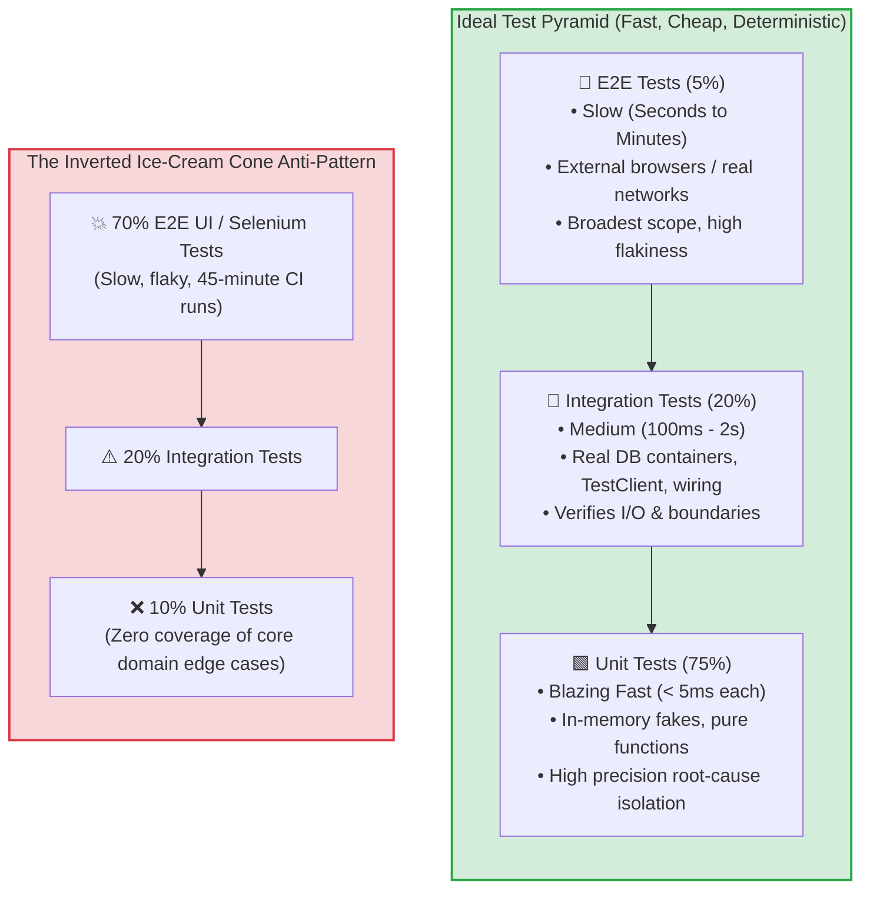
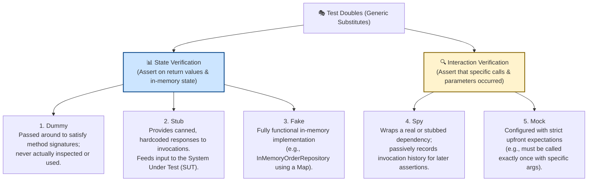
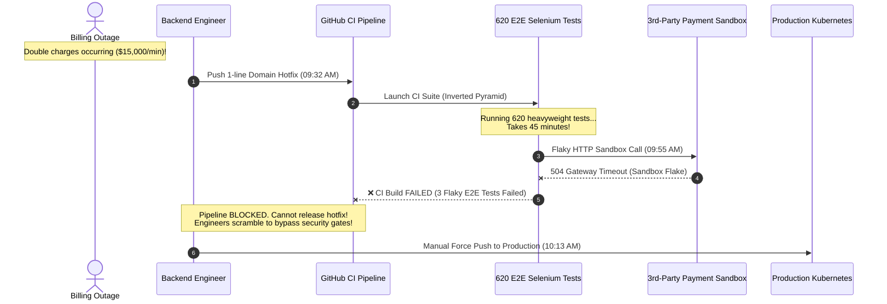

# Module 00: Testing Fundamentals and the Test Pyramid

> **Prerequisites**: Solid understanding of backend application architecture and service layers from [02-api-layer-and-request-handling](../../02-api-layer-and-request-handling/README.md).  
> **Estimated Reading Time**: 30 minutes  
> **Target Audience**: Backend Engineers, Platform Engineers, and Technical Leads building sustainable, rapid-feedback test automation suites for mission-critical systems.

---

> [!TIP]
> **The Golden Rule of Test Suite Architecture**  
> Push verification down to the lowest, fastest layer of the test pyramid that can definitively prove correctness. Unit tests must execute in single-digit milliseconds without touching the network, disk, or system clock. Prefer **State Verification** (using lightweight in-memory **Fakes** and **Stubs**) over fragile **Interaction Verification** (Mocks and Spies) whenever possible. Never let your test suite invert into an "ice-cream cone" where slow, flaky End-to-End (E2E) tests outnumber isolated unit tests.

---

## Visual Mental Models & Architecture

### The Test Pyramid vs The Inverted Ice-Cream Cone

The test pyramid dictates the distribution of automated tests across your codebase. Inverting this pyramid creates a fragile, slow CI pipeline that degrades developer velocity and masks regressions.



---

### Taxonomy of Test Doubles: State vs Interaction Verification

Gerard Meszaros' classic taxonomy categorizes the five distinct types of test doubles and their verification mechanisms:



---

## Systematic Reference Grids

### Pyramid Layer Comparison Matrix

| Dimension | Unit Tests | Integration Tests | End-to-End (E2E) Tests |
| :--- | :--- | :--- | :--- |
| **Primary Scope** | A single function, method, or domain entity class in complete isolation. | Multiple real collaborating units, database queries, wire serialization. | The entire assembled distributed system, from client UI/gateway to database. |
| **Execution Latency** | **< 1 to 5 milliseconds** per test. | **50 milliseconds to 2 seconds** per test. | **5 to 60+ seconds** per test scenario. |
| **Collaborators** | Replaced with test doubles (Fakes, Stubs). | Real test database (Testcontainers/SQLite), local HTTP client. | Live deployed services, real cloud infrastructure, message brokers. |
| **Determinism** | **100% Deterministic** (No clock, network, or disk variance). | High (Dependent on DB transaction isolation). | **Prone to Flakiness** (Network latency, timeouts, async race conditions). |
| **Root Cause Precision** | **Pinpoint**: Test failure names the exact broken line or logic branch. | **Moderate**: Identifies broken component boundary or query. | **Vague**: Failure shows "500 Internal Error" or timeout without identifying cause. |
| **Recommended Proportion** | **70% to 80%** of total test count. | **15% to 25%** of total test count. | **5% to 10%** of total test count. |

---

### The Five Test Doubles: Systematic Selection Matrix

| Double Type | Primary Intent | Internal State | Typical Assertion | When to Use |
| :--- | :--- | :--- | :--- | :--- |
| **Dummy** | Satisfy parameter list. | None. | None. | Method requires a parameter (e.g. `logger`, `context`) that is irrelevant to the test case. |
| **Stub** | Feed canned input to SUT. | Hardcoded constants. | Assert on SUT return value. | Simulating external query results (e.g., `stockService.getStock() -> 10`). |
| **Fake** | Working lightweight substitute. | In-memory map or array. | Assert on SUT state or Fake contents. | Simulating repositories, caches, or datastores without disk/database I/O. |
| **Spy** | Inspect call records post-facto. | List of captured calls. | `assert spy.callCount == 1`. | Verifying telemetry metrics, audit logs, or optional notification side effects. |
| **Mock** | Enforce mandatory call contract. | Pre-configured expectations. | `mock.verify()`. | Testing essential external side effects where failure to call constitutes a bug (e.g. `paymentGateway.charge()`). |

---

## Production Incident War Story: The 45-Minute CI Freeze

### Incident Post-Mortem: SEV-1

* **Incident ID**: INC-8012
* **Severity Level**: SEV-1 (Critical Active Data Corruption)
* **Detection Time**: 10 minutes after initial deployment
* **Time to Recovery (TTR)**: 58 minutes
* **Impact**: \$680,000 in double-charged customer accounts; hotfix deployment blocked for 45 minutes by failing E2E tests.

#### 1. What Happened
A billing bug in a payment processing microservice was inadvertently deployed to production at 09:15 AM. The bug caused users checking out with debit cards to be charged twice.

At 09:25 AM, SREs alerted engineering. A backend engineer wrote a one-line fix in the domain billing calculation logic at 09:32 AM.

However, the organization operated an **inverted test pyramid**:
- The repository contained only 18 unit tests.
- The CI pipeline ran 620 full-system End-to-End browser tests (using Selenium and Cypress against staging microservices and third-party payment sandboxes).

When the engineer pushed the one-line hotfix, the CI pipeline required **45 minutes** to execute. Worse, during the run, 3 unrelated E2E tests failed due to a transient network timeout in the third-party staging sandbox. The CI pipeline rejected the build. The team was forced to manually bypass branch protection rules to deploy the hotfix, while 1,400 additional customer accounts were double-charged.



#### 2. Root Cause Analysis
1. **Inverted Test Pyramid (Ice-Cream Cone)**: Business logic validation was tested exclusively via high-level E2E browser tests rather than fast, isolated unit tests.
2. **Nondeterministic Third-Party Dependencies in CI**: E2E tests made network calls to volatile staging sandbox APIs, causing intermittent, false-positive test failures.
3. **Absence of Fast Feedback Loop**: Engineers had no mechanism to verify domain correctness locally in seconds before pushing to CI.

#### 3. The Architectural Hardening & Resolution
1. **Pyramid Restructuring**: Re-architected the test suite into a true pyramid. Moved 500+ business rule validations out of E2E browser tests into **pure in-memory unit tests** executing in under 2 seconds.
2. **Decoupled Staging from CI**: Prohibited all external network I/O in the primary pre-merge CI pipeline. Third-party sandboxes were replaced with deterministic in-memory stubs and WireMock fixtures.
3. **Emergency Hotfix Fast-Path**: Created an isolated `unit-test-only` CI check capable of validating domain logic and promoting critical hotfixes in under 90 seconds.

---

## Multi-Language Production Code Tabs: The AAA Pattern with In-Memory Fakes

The following code tabs demonstrate the gold-standard **Arrange-Act-Assert (AAA)** pattern using an **in-memory Fake Repository** to test a domain `OrderService` without touching a database, network, or clock.

```
### Language Tabs
1. Go (testing package with struct-based Fake)
2. Node.js / TypeScript (Jest / Vitest with TypeScript Fake)
3. Python (pytest with in-memory dict Fake)
4. C# (xUnit with in-memory ConcurrentDictionary Fake)
```

### Go
```go
package domain_test

import (
	"errors"
	"testing"
)

// ==========================================
// 1. DOMAIN UNDER TEST
// ==========================================
type Order struct {
	ID     string
	UserID string
	Amount float64
}

type OrderRepository interface {
	Save(order Order) error
	FindByID(id string) (*Order, error)
}

var ErrOrderNotFound = errors.New("order not found")

type OrderService struct {
	repo OrderRepository
}

func (s *OrderService) CreateOrder(id, userID string, amount float64) error {
	if amount <= 0 {
		return errors.New("order amount must be strictly positive")
	}
	return s.repo.Save(Order{ID: id, UserID: userID, Amount: amount})
}

// ==========================================
// 2. IN-MEMORY FAKE (Test Double)
// ==========================================
type FakeOrderRepository struct {
	orders map[string]Order
}

func NewFakeOrderRepository() *FakeOrderRepository {
	return &FakeOrderRepository{orders: make(map[string]Order)}
}

func (f *FakeOrderRepository) Save(order Order) error {
	f.orders[order.ID] = order
	return nil
}

func (f *FakeOrderRepository) FindByID(id string) (*Order, error) {
	if order, exists := f.orders[id]; exists {
		return &order, nil
	}
	return nil, ErrOrderNotFound
}

// ==========================================
// 3. UNIT TESTS (Arrange - Act - Assert)
// ==========================================
func TestCreateOrder_ValidAmount_SavesSuccessfully(t *testing.T) {
	// Arrange
	fakeRepo := NewFakeOrderRepository()
	service := &OrderService{repo: fakeRepo}

	// Act
	err := service.CreateOrder("ord_101", "usr_ada", 150.00)

	// Assert
	if err != nil {
		t.Fatalf("expected no error, got: %v", err)
	}

	saved, err := fakeRepo.FindByID("ord_101")
	if err != nil {
		t.Fatalf("expected order to be persisted in fake, got error: %v", err)
	}
	if saved.Amount != 150.00 {
		t.Errorf("expected amount 150.00, got %f", saved.Amount)
	}
}

func TestCreateOrder_NegativeAmount_ReturnsError(t *testing.T) {
	// Arrange
	fakeRepo := NewFakeOrderRepository()
	service := &OrderService{repo: fakeRepo}

	// Act
	err := service.CreateOrder("ord_102", "usr_ada", -25.00)

	// Assert
	if err == nil {
		t.Fatal("expected error for negative amount, got nil")
	}
}
```

### Node.js / TypeScript (Vitest / Jest)
```typescript
import { describe, it, expect } from 'vitest';

// ==========================================
// 1. DOMAIN UNDER TEST
// ==========================================
export interface Order {
  id: string;
  userId: string;
  amount: number;
}

export interface OrderRepository {
  save(order: Order): Promise<void>;
  findById(id: string): Promise<Order | null>;
}

export class OrderService {
  constructor(private readonly repo: OrderRepository) {}

  async createOrder(id: string, userId: string, amount: number): Promise<void> {
    if (amount <= 0) {
      throw new Error('Order amount must be strictly positive');
    }
    await this.repo.save({ id, userId, amount });
  }
}

// ==========================================
// 2. IN-MEMORY FAKE (Test Double)
// ==========================================
export class FakeOrderRepository implements OrderRepository {
  private readonly store = new Map<string, Order>();

  async save(order: Order): Promise<void> {
    this.store.set(order.id, { ...order });
  }

  async findById(id: string): Promise<Order | null> {
    return this.store.get(id) || null;
  }
}

// ==========================================
// 3. UNIT TESTS (Arrange - Act - Assert)
// ==========================================
describe('OrderService Unit Tests', () => {
  it('should persist order when amount is valid (AAA Pattern)', async () => {
    // Arrange
    const fakeRepo = new FakeOrderRepository();
    const service = new OrderService(fakeRepo);

    // Act
    await service.createOrder('ord_201', 'usr_turing', 249.99);

    // Assert
    const saved = await fakeRepo.findById('ord_201');
    expect(saved).not.toBeNull();
    expect(saved?.amount).toBe(249.99);
    expect(saved?.userId).toBe('usr_turing');
  });

  it('should reject order creation when amount is zero or negative', async () => {
    // Arrange
    const fakeRepo = new FakeOrderRepository();
    const service = new OrderService(fakeRepo);

    // Act & Assert
    await expect(service.createOrder('ord_202', 'usr_turing', 0)).rejects.toThrow(
      'Order amount must be strictly positive'
    );
  });
});
```

### Python (pytest)
```python
import pytest
from dataclasses import dataclass
from typing import Optional, Dict

# ==========================================
# 1. DOMAIN UNDER TEST
# ==========================================
@dataclass
class Order:
    id: str
    user_id: str
    amount: float

class InsufficientStockError(Exception):
    def __init__(self, sku: str):
        self.sku = sku
        super().__init__(f"Insufficient stock for SKU: {sku}")

class OrderService:
    def __init__(self, repo):
        self.repo = repo

    def place_order(self, order_id: str, user_id: str, sku: str, qty: int, price: float) -> Order:
        if qty <= 0:
            raise ValueError("Quantity must be greater than zero")
        
        available_stock = self.repo.get_stock(sku)
        if available_stock < qty:
            raise InsufficientStockError(sku=sku)
            
        order = Order(id=order_id, user_id=user_id, amount=qty * price)
        self.repo.save_order(order)
        self.repo.decrement_stock(sku, qty)
        return order

# ==========================================
# 2. IN-MEMORY FAKE (Test Double)
# ==========================================
class FakeOrderRepository:
    def __init__(self, initial_stock: Optional[Dict[str, int]] = None):
        self.stock = initial_stock or {}
        self.orders: Dict[str, Order] = {}

    def get_stock(self, sku: str) -> int:
        return self.stock.get(sku, 0)

    def decrement_stock(self, sku: str, qty: int):
        self.stock[sku] -= qty

    def save_order(self, order: Order):
        self.orders[order.id] = order

# ==========================================
# 3. UNIT TESTS (Arrange - Act - Assert)
# ==========================================
def test_place_order_success_persists_order_and_decrements_stock():
    # Arrange
    fake_repo = FakeOrderRepository(initial_stock={"sku_ram": 10})
    svc = OrderService(repo=fake_repo)

    # Act
    order = svc.place_order(order_id="ord_1", user_id="usr_grace", sku="sku_ram", qty=2, price=45.0)

    # Assert
    assert order.id == "ord_1"
    assert order.amount == 90.0
    assert fake_repo.get_stock("sku_ram") == 8
    assert fake_repo.orders["ord_1"] == order

def test_place_order_raises_insufficient_stock_when_oversold():
    # Arrange
    fake_repo = FakeOrderRepository(initial_stock={"sku_ram": 1})
    svc = OrderService(repo=fake_repo)

    # Act & Assert
    with pytest.raises(InsufficientStockError) as exc_info:
        svc.place_order(order_id="ord_2", user_id="usr_grace", sku="sku_ram", qty=5, price=45.0)
    
    assert exc_info.value.sku == "sku_ram"
```

### C# (xUnit)
```csharp
using System;
using System.Collections.Concurrent;
using System.Threading.Tasks;
using Xunit;

// ==========================================
// 1. DOMAIN UNDER TEST
// ==========================================
public record Order(string Id, string UserId, decimal Amount);

public interface IOrderRepository
{
    Task SaveAsync(Order order);
    Task<Order?> FindByIdAsync(string id);
}

public class OrderService
{
    private readonly IOrderRepository _repo;
    public OrderService(IOrderRepository repo) => _repo = repo;

    public async Task CreateOrderAsync(string id, string userId, decimal amount)
    {
        if (amount <= 0)
            throw new ArgumentException("Amount must be strictly positive", nameof(amount));

        await _repo.SaveAsync(new Order(id, userId, amount));
    }
}

// ==========================================
// 2. IN-MEMORY FAKE (Test Double)
// ==========================================
public class FakeOrderRepository : IOrderRepository
{
    private readonly ConcurrentDictionary<string, Order> _store = new();

    public Task SaveAsync(Order order)
    {
        _store[order.Id] = order;
        return Task.CompletedTask;
    }

    public Task<Order?> FindByIdAsync(string id)
    {
        _store.TryGetValue(id, out var order);
        return Task.FromResult(order);
    }
}

// ==========================================
// 3. UNIT TESTS (Arrange - Act - Assert)
// ==========================================
public class OrderServiceTests
{
    [Fact]
    public async Task CreateOrderAsync_ValidParameters_PersistsOrderCorrectly()
    {
        // Arrange
        var fakeRepo = new FakeOrderRepository();
        var service = new OrderService(fakeRepo);

        // Act
        await service.CreateOrderAsync("ord_301", "usr_hamilton", 199.95m);

        // Assert
        var order = await fakeRepo.FindByIdAsync("ord_301");
        Assert.NotNull(order);
        Assert.Equal(199.95m, order.Amount);
        Assert.Equal("usr_hamilton", order.UserId);
    }

    [Fact]
    public async Task CreateOrderAsync_NegativeAmount_ThrowsArgumentException()
    {
        // Arrange
        var fakeRepo = new FakeOrderRepository();
        var service = new OrderService(fakeRepo);

        // Act & Assert
        await Assert.ThrowsAsync<ArgumentException>(() => 
            service.CreateOrderAsync("ord_302", "usr_hamilton", -10.00m));
    }
}
```

---

## Practical Hands-On Verification Workflows

### 1. Execute Unit Tests with Millisecond Feedback

Run the test suite across supported runtimes and verify that isolated unit tests execute in single-digit milliseconds:

```bash
# Python (pytest)
pytest -v -k "test_place_order"
```

**Expected Terminal Output:**
```text
============================= test session starts ==============================
collected 2 items

tests/test_services.py::test_place_order_success_persists_order_and_decrements_stock PASSED [ 50%]
tests/test_services.py::test_place_order_raises_insufficient_stock_when_oversold PASSED    [100%]

============================== 2 passed in 0.02s ===============================
```

```bash
# Go
go test -v -run TestCreateOrder ./...
```

**Expected Terminal Output:**
```text
=== RUN   TestCreateOrder_ValidAmount_SavesSuccessfully
--- PASS: TestCreateOrder_ValidAmount_SavesSuccessfully (0.00s)
=== RUN   TestCreateOrder_NegativeAmount_ReturnsError
--- PASS: TestCreateOrder_NegativeAmount_ReturnsError (0.00s)
PASS
ok      domain_test    0.003s
```

---

## Operational Validation Checkpoints (Scenario Quizzes)

<details>
<summary><strong>Checkpoint 1: The Flaky Clock Anti-Pattern</strong></summary>

**Scenario:** A developer writes a unit test for a subscription renewal service:
```python
def test_renew_subscription_sets_expiration():
    service = SubscriptionService()
    sub = service.renew(user_id="usr_1")
    expected = datetime.now() + timedelta(days=30)
    assert sub.expires_at == expected
```
This test passes on the developer's laptop but fails randomly in CI with errors like:
`assert datetime(2026, 11, 10, 12, 0, 0, 104) == datetime(2026, 11, 10, 12, 0, 0, 102)`.
Why is this test nondeterministic, and how do you achieve 100% determinism?

**Answer:**
- **The Cause**: The test directly invokes the host operating system clock (`datetime.now()`) in both the service and the test assertion. Microsecond execution delays between the two calls cause sub-second timestamp mismatches.
- **The Architectural Fix**:
  1. Inject a **Clock abstraction** (or use libraries like `freezegun` / `time-machine`).
  2. The service accepts an explicit reference time or clock dependency: `service.renew(user_id, now=fixed_time)`.
  3. In the unit test, freeze the clock to a constant instant (`fixed_time = datetime(2026, 11, 10, 12, 0, 0)`), ensuring the calculation yields identical results regardless of when or where the test executes.
</details>

<details>
<summary><strong>Checkpoint 2: Mocking vs Faking in Refactoring</strong></summary>

**Scenario:** Team A tests their `UserService` by creating strict mocks for every internal database method call (`mockDb.expects('query').with('SELECT * FROM users WHERE id = ?')`). Team B tests their `UserService` using an in-memory `FakeUserRepository` that implements a clean interface.
When the engineering team decides to replace raw SQL queries with a new ORM repository layer, what happens to Team A's tests compared to Team B's tests?

**Answer:**
- **Team A's tests suffer complete catastrophic breakage**: Because Team A used **Interaction Verification** tightly coupled to implementation details (raw SQL string parameters), changing the internal query mechanism breaks 100% of their unit tests, even though the external business behavior of `UserService` did not change.
- **Team B's tests remain completely green and unaffected**: Team B used **State Verification** against a `FakeUserRepository` implementing a domain interface. As long as `UserService` continues to store and retrieve user models correctly, internal refactoring does not break a single test.
- **The Rule**: *Test behavior, not implementation details. Prefer Fakes and state verification over strict query-level mocks.*
</details>

<details>
<summary><strong>Checkpoint 3: The Danger of Test Slices in CI</strong></summary>

**Scenario:** A company’s monolithic CI suite takes 60 minutes. An engineering manager suggests: *"Let's only run unit tests in CI for pull requests, and only run integration and E2E tests once a week on Sunday night."* What critical failure modes does this strategy introduce?

**Answer:**
1. **Deferred Bug Discovery & TTR Escalation**: If integration tests (which verify database schema migrations, serialization, and SQL queries) only run on Sunday, a breaking change introduced on Tuesday will go unnoticed for 5 days. Identifying which of 200 merged commits caused the Sunday failure requires hours of Git bisecting.
2. **Broken Mainline Branch**: The `main` branch will frequently enter broken, un-deployable states, blocking emergency production hotfixes.
3. **The Sustainable Solution**: Retain fast unit tests (&le; 2 minutes) as a blocking PR check, run integration tests against ephemeral databases in parallel CI containers (&le; 5 minutes), and prune bloated, redundant E2E tests down to a focused synthetic smoke test suite (&le; 3 minutes).
</details>

---

## Further Reading & Next Steps

* [Martin Fowler: The Practical Test Pyramid](https://martinfowler.com/articles/practical-test-pyramid.html) - Structural guide to test distribution and scope.
* [Martin Fowler: Mocks Aren't Stubs](https://martinfowler.com/articles/mocksArentStubs.html) - Canonical analysis of the five test doubles and verification styles.
* [Gerard Meszaros: xUnit Test Patterns](http://xunitpatterns.com/) - The authoritative encyclopedia of test automation patterns and smells.
* Next up: [01-unit-testing-in-depth](../01-unit-testing-in-depth/README.md) to master reusable fixtures, scope boundaries, test parametrization, and branch coverage analysis.
