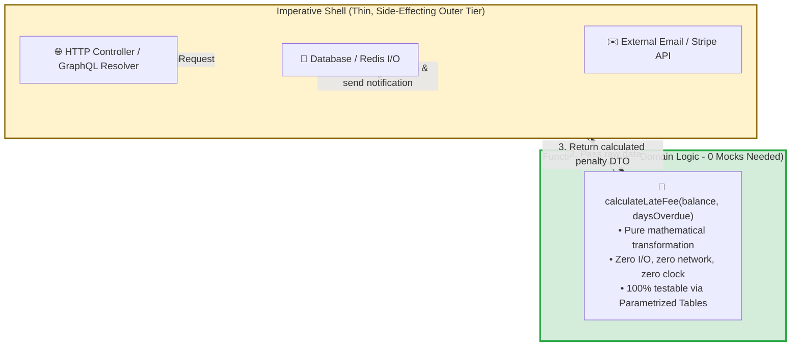
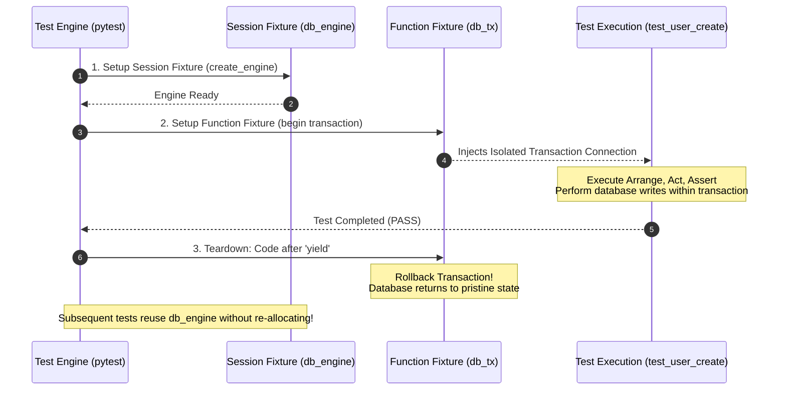
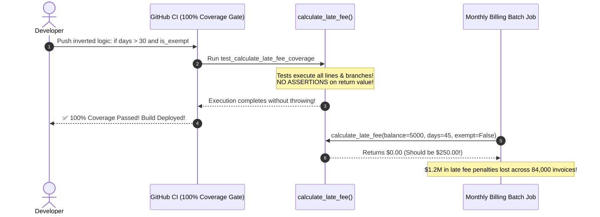

# Module 01: Unit Testing in Depth

> **Prerequisites**: [00-testing-fundamentals-and-the-test-pyramid](../00-testing-fundamentals-and-the-test-pyramid/README.md).  
> **Estimated Reading Time**: 30 minutes  
> **Target Audience**: Backend Software Engineers, Test Automation Specialists, and Technical Leads building robust, maintainable, and high-velocity unit test suites.

---

> [!TIP]
> **The Golden Rule of Unit Testing Depth**  
> Architect software around the **Functional Core, Imperative Shell** pattern: isolate complex business decisions into pure, stateless domain functions that can be tested exhaustively via table-driven parametrization without mocks, and relegate I/O and state mutations to a thin outer shell. Treat code coverage as a **map of untested vulnerabilities**, never as a gamified vanity metric. Mandate **Branch Coverage** over Line Coverage, and remember that 100% line execution without rigorous assertions provides zero safety.

---

## Visual Mental Models & Architecture

### The Functional Core, Imperative Shell

Separating pure decision logic from side-effecting I/O drastically simplifies testing and collapses test suite maintenance overhead:



---

### Fixture Dependency Graph and Lifecycle Execution

Fixtures in modern test runners (`pytest`, xUnit, Vitest) form a directed acyclic graph (DAG), ensuring clean setup, dependency injection, and guaranteed teardown:



---

## Systematic Reference Grids

### Fixture Scope Hierarchy & Resource Lifecycle

| Scope Name | Execution Frequency | Memory Lifecycle | Isolation Guarantee | Best Used For | Risk / Anti-Pattern |
| :--- | :--- | :--- | :--- | :--- | :--- |
| **`function`** (Default) | Once per test function. | Instantiated and destroyed for every single test. | **Maximum Isolation**: Impossible for one test to pollute another. | In-memory fakes, transaction rollbacks, fresh entity models. | Heavy CPU/IO setup (e.g., spinning up a Docker container) will cause tests to crawl. |
| **`class`** | Once per test class. | Shared across all methods inside a test class. | Medium: Methods within class share state. | Read-only fixtures shared across related scenarios. | Mutating class attributes will cause order-dependent test failures. |
| **`module`** | Once per test file (`test_*.py`). | Reused for all test cases within the file. | Coarse: Shared across the whole module. | Building shared SQLite schemas, read-only seed data tables. | Leaks state if any test executes non-transactional SQL updates. |
| **`session`** | Once per full test run. | Created at runner start; destroyed at process exit. | **Zero Isolation**: Global singleton. | Initializing Docker testcontainers, compiling Protobuf stubs. | **High Risk**: Storing mutable application data here breaks suite parallelization (`-n auto`). |

---

### Code Coverage Metrics: Capabilities & Blind Spots

| Coverage Metric | What It Measures | What It Misses | False Sense of Security |
| :--- | :--- | :--- | :--- |
| **Line Coverage** | Percentage of code lines executed by at least one test. | Completely misses un-executed conditional branches (e.g., missing `else` statements or compound boolean logic). | **Extremely High**: An assertion-free test that executes lines achieves 100% line coverage while verifying zero behavior. |
| **Branch Coverage** (`--cov-branch`) | Evaluates whether every boolean branch (`true` and `false` path) was traversed. | Misses state combination permutations (e.g. `if A and B` where only `(T,T)` and `(F,F)` are exercised). | **Medium**: Proves control flow branches were touched, but does not prove return values were validated. |
| **Mutation Testing** (e.g. `mutmut`, Stryker) | Intentionally mutates source code (swapping `+` to `-`, changing `<` to `<=`) and verifies that tests fail ("kill the mutant"). | Computationally expensive; slow to run across massive codebases. | **Minimal**: True gold standard for asserting that test suites actually detect functional behavioral bugs. |

---

## Production Incident War Story: The 100% Coverage Illusion

### Incident Post-Mortem: SEV-1

* **Incident ID**: INC-7291
* **Severity Level**: SEV-1 (Financial Calculation Defect)
* **Detection Time**: 14 days after month-end financial reconciliation
* **Time to Recovery (TTR)**: 3 hours (database ledger audit required 5 days)
* **Impact**: \$1.2M in uncollected customer interest penalties; 84,000 invoices calculated with zero late fees.

#### 1. What Happened
A lending platform released an updated late-fee calculation module. In pull request reviews, the engineering team celebrated achieving **100% Line and Branch Coverage** on the new module:
```python
# fee_calculator.py
def calculate_late_fee(balance: float, days_overdue: int, is_grace_period_exempt: bool) -> float:
    fee = 0.0
    if days_overdue > 30 and not is_grace_period_exempt:
        # Business Requirement: 5% penalty, minimum $25 fee
        calculated = balance * 0.05
        fee = calculated if calculated > 25.0 else 25.0
    return fee
```

The test file accompanying the PR exercised every line and branch:
```python
# test_fee_calculator.py - The Flawed Test Suite
@pytest.mark.parametrize("balance, days, exempt", [
    (1000.0, 45, False), # Triggers the inner calculation
    (500.0, 10, False),  # Triggers days <= 30
    (500.0, 45, True),   # Triggers is_exempt True
])
def test_calculate_late_fee_coverage(balance, days, exempt):
    try:
        calculate_late_fee(balance, days, exempt)
    except Exception as e:
        pytest.fail(f"Unexpected exception: {e}")
```

Notice that the test **asserted nothing** about the return value! It only asserted that the code executed without raising an unhandled exception.

A developer subsequently refactored `fee_calculator.py` to fix a linter warning, accidentally inverting a condition:
```python
if days_overdue > 30 and is_grace_period_exempt: # BUG: 'not' was removed!
```
The test suite ran, all tests passed green, branch coverage remained at 100%, and the PR was auto-merged. In production, 84,000 overdue accounts were charged \$0.00 in late fees for an entire billing cycle.



#### 2. Root Cause Analysis
1. **Assertion-Free Test Suite**: Tests were written to satisfy a mandated CI coverage target rather than to verify contractual behavior.
2. **False Equivalence of Coverage with Quality**: CI checked only that lines were executed, not that test assertions validated outputs against boundary conditions.
3. **Absence of Mutation Testing**: A simple mutation testing pass would have immediately caught that changing the boolean expression failed to break any test.

#### 3. The Architectural Hardening & Resolution
1. **Table-Driven Parametrization with Exact Expected Values**: Replaced assertion-free tests with explicit input-output assertion matrices checking every boundary condition.
2. **Linter Rule: Reject Assertion-Free Tests**: Configured `flake8-assert` and ESLint `jest/expect-expect` to fail any test function that does not contain an assertion statement.
3. **Mutation Testing in Nightly CI**: Integrated `mutmut` into nightly builds to verify that alterations to arithmetic and boolean operators kill mutants.

---

## Multi-Language Production Code Tabs: Table-Driven Parametrized Testing

The following implementations demonstrate how to structure table-driven tests that cleanly test boundary conditions, edge cases, and exception paths without code duplication.

```
### Language Tabs
1. Python (pytest.mark.parametrize with boundary cases)
2. Go (Table-Driven Subtests with t.Run)
3. Node.js / TypeScript (Vitest / Jest test.each)
4. C# (xUnit [Theory] and [InlineData])
```

### Python (pytest)
```python
import pytest
from decimal import Decimal

# ==========================================
# 1. PURE FUNCTION UNDER TEST
# ==========================================
def calculate_discount(price_cents: int, discount_pct: int) -> int:
    """Calculates discounted price in integer cents, rounding down."""
    if price_cents < 0:
        raise ValueError("Price cannot be negative")
    if not (0 <= discount_pct <= 100):
        raise ValueError("Discount percentage must be between 0 and 100")
        
    discount = (price_cents * discount_pct) // 100
    return price_cents - discount

# ==========================================
# 2. PARAMETRIZED VALID CASES
# ==========================================
@pytest.mark.parametrize(
    "price, pct, expected, case_id",
    [
        (10000, 10, 9000, "normal_10_percent_discount"),
        (10000, 0, 10000, "zero_discount_returns_original"),
        (10000, 100, 0, "full_100_percent_discount_free"),
        (99, 10, 90, "integer_floor_rounding_99_cents"),
        (0, 50, 0, "zero_price_remains_zero"),
    ],
    ids=lambda case_id: case_id
)
def test_calculate_discount_valid_boundaries(price, pct, expected, case_id):
    result = calculate_discount(price_cents=price, discount_pct=pct)
    assert result == expected

# ==========================================
# 3. PARAMETRIZED EXCEPTION CASES
# ==========================================
@pytest.mark.parametrize(
    "price, pct, match_err",
    [
        (-100, 10, "Price cannot be negative"),
        (1000, -1, "Discount percentage must be between 0 and 100"),
        (1000, 101, "Discount percentage must be between 0 and 100"),
    ]
)
def test_calculate_discount_invalid_inputs(price, pct, match_err):
    with pytest.raises(ValueError) as exc:
        calculate_discount(price_cents=price, discount_pct=pct)
    assert match_err in str(exc.value)
```

### Go (Table-Driven Subtests)
```go
package pricing_test

import (
	"errors"
	"testing"
)

// ==========================================
// 1. PURE FUNCTION UNDER TEST
// ==========================================
var (
	ErrNegativePrice   = errors.New("price cannot be negative")
	ErrInvalidDiscount = errors.New("discount percentage must be between 0 and 100")
)

func CalculateDiscount(priceCents int, discountPct int) (int, error) {
	if priceCents < 0 {
		return 0, ErrNegativePrice
	}
	if discountPct < 0 || discountPct > 100 {
		return 0, ErrInvalidDiscount
	}
	discount := (priceCents * discountPct) / 100
	return priceCents - discount, nil
}

// ==========================================
// 2. TABLE-DRIVEN UNIT TESTS
// ==========================================
func TestCalculateDiscount(t *testing.T) {
	tests := []struct {
		name        string
		price       int
		discount    int
		expected    int
		expectedErr error
	}{
		{
			name:        "10% discount on 10000 cents",
			price:       10000,
			discount:    10,
			expected:    9000,
			expectedErr: nil,
		},
		{
			name:        "0% discount retains full price",
			price:       5000,
			discount:    0,
			expected:    5000,
			expectedErr: nil,
		},
		{
			name:        "100% discount results in 0",
			price:       5000,
			discount:    100,
			expected:    0,
			expectedErr: nil,
		},
		{
			name:        "Negative price returns error",
			price:       -500,
			discount:    10,
			expected:    0,
			expectedErr: ErrNegativePrice,
		},
		{
			name:        "Discount over 100% returns error",
			price:       1000,
			discount:    150,
			expected:    0,
			expectedErr: ErrInvalidDiscount,
		},
	}

	for _, tc := range tests {
		tc := tc // Capture range variable
		t.Run(tc.name, func(t *testing.T) {
			result, err := CalculateDiscount(tc.price, tc.discount)

			if tc.expectedErr != nil {
				if !errors.Is(err, tc.expectedErr) {
					t.Fatalf("expected error %v, got %v", tc.expectedErr, err)
				}
				return
			}

			if err != nil {
				t.Fatalf("unexpected error: %v", err)
			}
			if result != tc.expected {
				t.Errorf("expected %d, got %d", tc.expected, result)
			}
		})
	}
}
```

### Node.js / TypeScript (Vitest / Jest)
```typescript
import { describe, it, expect } from 'vitest';

export function calculateDiscount(priceCents: number, discountPct: number): number {
  if (priceCents < 0) throw new RangeError('Price cannot be negative');
  if (discountPct < 0 || discountPct > 100) {
    throw new RangeError('Discount percentage must be between 0 and 100');
  }
  const discount = Math.floor((priceCents * discountPct) / 100);
  return priceCents - discount;
}

describe('calculateDiscount Table-Driven Tests', () => {
  it.each([
    { price: 10000, pct: 10, expected: 9000, desc: '10% on 10000' },
    { price: 5000, pct: 0, expected: 5000, desc: '0% discount' },
    { price: 5000, pct: 100, expected: 0, desc: '100% free' },
    { price: 99, pct: 10, expected: 90, desc: 'integer floor rounding' },
    { price: 0, pct: 50, expected: 0, desc: 'zero price remains zero' },
  ])('$desc: calculateDiscount($price, $pct) -> $expected', ({ price, pct, expected }) => {
    expect(calculateDiscount(price, pct)).toBe(expected);
  });

  it.each([
    { price: -100, pct: 10, errMsg: 'Price cannot be negative' },
    { price: 1000, pct: -5, errMsg: 'Discount percentage must be between 0 and 100' },
    { price: 1000, pct: 105, errMsg: 'Discount percentage must be between 0 and 100' },
  ])('should throw RangeError for invalid input: price=$price, pct=$pct', ({ price, pct, errMsg }) => {
    expect(() => calculateDiscount(price, pct)).toThrowError(errMsg);
  });
});
```

### C# (xUnit Theory)
```csharp
using System;
using Xunit;

public static class DiscountCalculator
{
    public static int CalculateDiscount(int priceCents, int discountPct)
    {
        if (priceCents < 0) throw new ArgumentOutOfRangeException(nameof(priceCents), "Price cannot be negative");
        if (discountPct < 0 || discountPct > 100) 
            throw new ArgumentOutOfRangeException(nameof(discountPct), "Discount percentage must be between 0 and 100");

        int discount = (priceCents * discountPct) / 100;
        return priceCents - discount;
    }
}

public class DiscountCalculatorTests
{
    [Theory]
    [InlineData(10000, 10, 9000)]
    [InlineData(5000, 0, 5000)]
    [InlineData(5000, 100, 0)]
    [InlineData(99, 10, 90)]
    [InlineData(0, 50, 0)]
    public void CalculateDiscount_ValidBoundaries_CalculatesCorrectly(int price, int pct, int expected)
    {
        int actual = DiscountCalculator.CalculateDiscount(price, pct);
        Assert.Equal(expected, actual);
    }

    [Theory]
    [InlineData(-50, 10)]
    [InlineData(1000, -1)]
    [InlineData(1000, 101)]
    public void CalculateDiscount_InvalidBoundaries_ThrowsArgumentOutOfRangeException(int price, int pct)
    {
        Assert.Throws<ArgumentOutOfRangeException>(() => 
            DiscountCalculator.CalculateDiscount(price, pct));
    }
}
```

---

## Practical Hands-On Verification Workflows

### 1. Execute Branch Coverage Analysis via CLI

Run `pytest-cov` and inspect uncovered branches directly from the terminal:

```bash
pytest --cov=app --cov-branch --cov-report=term-missing
```

**Expected Terminal Output:**
```text
Name                Stmts   Miss Branch BrPart  Cover   Missing
---------------------------------------------------------------
app/__init__.py         0      0      0      0   100%
app/pricing.py         12      0      6      0   100%
app/services.py        24      1      8      1    94%   42->45, 48
---------------------------------------------------------------
TOTAL                  36      1     14      1    96%
```
*Notice column `BrPart`: identifies branches that only ever evaluated in one direction (e.g. `if` was executed, but `else` branch was never traversed).*

---

### 2. Inspecting Individual Parametrized Test Results

```bash
pytest -v -k "test_calculate_discount_valid_boundaries"
```

**Expected Terminal Output:**
```text
tests/test_pricing.py::test_calculate_discount_valid_boundaries[normal_10_percent_discount] PASSED    [ 20%]
tests/test_pricing.py::test_calculate_discount_valid_boundaries[zero_discount_returns_original] PASSED [ 40%]
tests/test_pricing.py::test_calculate_discount_valid_boundaries[full_100_percent_discount_free] PASSED [ 60%]
tests/test_pricing.py::test_calculate_discount_valid_boundaries[integer_floor_rounding_99_cents] PASSED [ 80%]
tests/test_pricing.py::test_calculate_discount_valid_boundaries[zero_price_remains_zero] PASSED       [100%]
```

---

## Operational Validation Checkpoints (Scenario Quizzes)

<details>
<summary><strong>Checkpoint 1: The Shared Mutable Fixture Bug</strong></summary>

**Scenario:** A developer configures a shared test fixture with `scope="module"`:
```python
@pytest.fixture(scope="module")
def admin_user():
    return User(id=1, name="Alice", roles=["ADMIN"])
```
In `test_a`, the test verifies that removing a role revokes permissions:
```python
def test_a(admin_user):
    admin_user.roles.clear()
    assert len(admin_user.roles) == 0
```
In `test_b`, the test verifies that admin users can access the dashboard:
```python
def test_b(admin_user):
    assert "ADMIN" in admin_user.roles
```
When running `pytest -k test_b`, the test passes. When running the entire suite together (`pytest`), `test_b` fails. Why did this occur, and what is the fix?

**Answer:**
- **The Cause**: `admin_user` has `scope="module"`, meaning the exact same in-memory Python object reference is shared across all tests in the file. `test_a` executed first and mutated the object (`admin_user.roles.clear()`), polluting the fixture. When `test_b` ran subsequently, the user had no roles.
- **The Fix**:
  1. Mutable domain entities must always use the default **`scope="function"`**, guaranteeing that each test receives a fresh, isolated instance.
  2. Reserve `module` and `session` scopes strictly for **immutable or read-only resources** (e.g., database connection pools, compiled schemas).
</details>

<details>
<summary><strong>Checkpoint 2: The Limitation of 100% Line Coverage</strong></summary>

**Scenario:** Consider the following authentication check:
```python
def is_authorized(user, resource):
    if user.is_admin or (user.is_owner and resource.is_public):
        return True
    return False
```
A developer writes a single test: `assert is_authorized(admin_user, private_resource) is True`.
What is the Line Coverage percentage of this function, what critical vulnerability is completely untested, and what coverage tool exposes the gap?

**Answer:**
- **Line Coverage**: **100%**. Lines 1, 2, and 3 are all executed during the single test invocation.
- **Untested Vulnerability**: The compound condition `(user.is_owner and resource.is_public)` was never evaluated, nor was the default `return False` branch ever executed. If a bug allows non-owner users to access private resources, the test suite will remain 100% green.
- **The Diagnostic Tool**: **Branch Coverage** (`--cov-branch`) will flag that `is_authorized` has partial branch execution (only 1 of 4 possible decision paths was taken). A table-driven test covering `(admin=F, owner=T, public=T)`, `(admin=F, owner=T, public=F)`, and `(admin=F, owner=F, public=F)` is required to achieve complete branch safety.
</details>

<details>
<summary><strong>Checkpoint 3: Testing Side Effects vs Pure Logic</strong></summary>

**Scenario:** A developer writes a function `send_payment_receipt(order)`:
```python
def send_payment_receipt(order, email_client):
    if order.status == "PAID" and order.total > 100:
        discount_coupon = "VIP20"
        body = f"Thanks for your order! Use coupon {discount_coupon} for 20% off."
        email_client.send(order.customer_email, body)
```
The developer complains that testing this function requires setting up complex mocks for `email_client` to verify whether the discount coupon is included in the string. How should this function be refactored according to the **Functional Core, Imperative Shell** principle?

**Answer:**
Refactor the function by separating the pure decision logic from the network side effect:
1. **Functional Core (Pure Function)**:
   ```python
   def generate_receipt_content(status: str, total: float) -> Optional[str]:
       if status == "PAID" and total > 100:
           return "Thanks for your order! Use coupon VIP20 for 20% off."
       return None
   ```
   *This pure function can now be tested across all boundary conditions (`total=100`, `total=100.01`, `status="PENDING"`) using a simple table-driven test without mocking `email_client`.*
2. **Imperative Shell (Thin Side Effect Wrapper)**:
   ```python
   def send_payment_receipt(order, email_client):
       body = generate_receipt_content(order.status, order.total)
       if body:
           email_client.send(order.customer_email, body)
   ```
   *Only a single interaction test is needed to verify that `email_client.send` is invoked when `body` is present.*
</details>

---

## Further Reading & Next Steps

* [pytest Documentation: Fixture References & Scopes](https://docs.pytest.org/en/stable/how-to/fixtures.html) - Complete lifecycle hooks and composition.
* [Gary Bernhardt: Boundaries (Functional Core, Imperative Shell)](https://www.destroyallsoftware.com/talks/boundaries) - Architectural foundation for isolatable testing.
* [Martin Fowler: Test Coverage](https://martinfowler.com/bliki/TestCoverage.html) - Why coverage is a compass, not a target.
* Next up: [02-test-driven-development-in-practice](../02-test-driven-development-in-practice/README.md) to practice the Red-Green-Refactor rhythm, triangulation techniques, and test-first API design.
