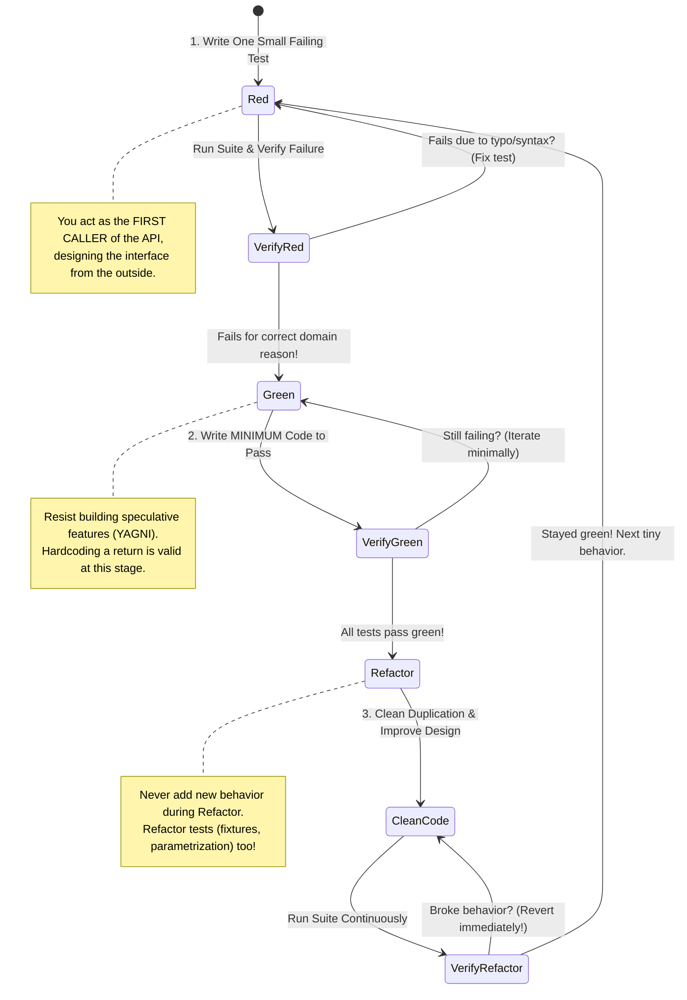
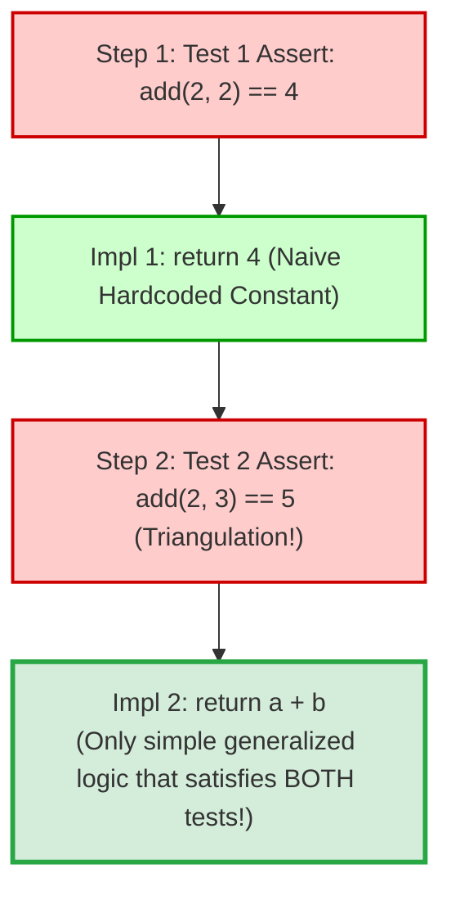
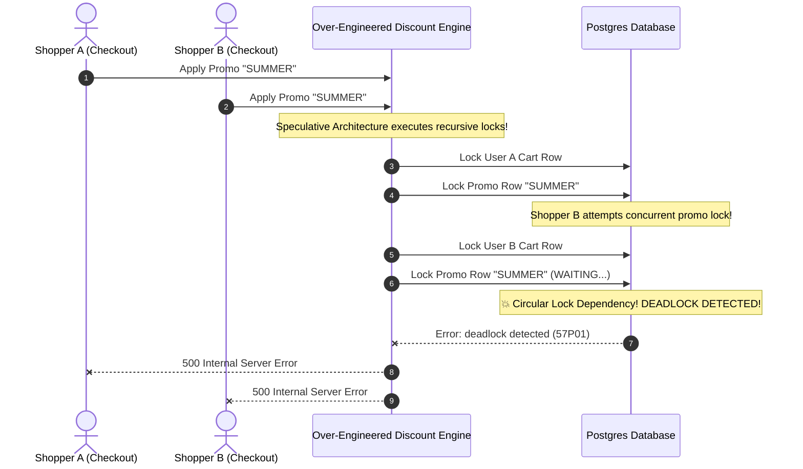

# Module 02: Test-Driven Development (TDD) in Practice

> **Prerequisites**: [00-testing-fundamentals-and-the-test-pyramid](../00-testing-fundamentals-and-the-test-pyramid/README.md) and [01-unit-testing-in-depth](../01-unit-testing-in-depth/README.md).  
> **Estimated Reading Time**: 32 minutes  
> **Target Audience**: Software Engineers, Backend Developers, and Technical Architects seeking to master test-first engineering, interface design pressure, and rapid refactoring cycles.

---

> [!TIP]
> **The Golden Rule of Test-Driven Development**  
> Never write a line of production code unless it is to make a **demonstrably failing test turn green**. A test you have not personally seen fail for the exact expected reason cannot be trusted. Write the **minimum code** necessary to pass the test—using **triangulation** to drive generalization only when forced by multiple distinct test assertions. Always execute the **Refactor** beat under a green suite, restructuring both implementation and test code without introducing new behavior.

---

## Visual Mental Models & Architecture

### The Red-Green-Refactor Rhythm

TDD is an iterative engineering rhythm designed to maintain constant forward momentum while keeping the codebase permanently in a known-good, deployable state.



---

### The Triangulation Technique: Driving Generalization Honestly

Triangulation prevents developers from making premature algorithmic assumptions. By adding distinct assertions one at a time, the real generalized logic is forced into existence.



---

## Systematic Reference Grids

### TDD (Test-First) vs Test-After Development

| Dimension | Test-Driven Development (TDD) | Test-After Development |
| :--- | :--- | :--- |
| **API Interface Design** | Designed from the **caller's perspective**; produces minimal, ergonomic public APIs. | Biased by internal implementation details; often results in clunky, leaky interfaces. |
| **Test Verification** | **Guaranteed valid**: Every test is observed failing before turning green. | **Unverified**: Tests frequently pass immediately, risking testing nothing or masking bugs. |
| **Code Modularity** | Code is inherently modular and decoupled; tight coupling makes writing the test impossible. | Code often becomes tightly coupled to databases, global state, or framework singletons. |
| **YAGNI Enforcement** | **High**: Developers only write code required to satisfy the failing test. | **Low**: Developers frequently write speculative, unused helper methods and parameters. |
| **Refactoring Confidence** | **Total**: A rich regression suite is created as a natural side effect of development. | **Fragile**: Refactoring often avoided because test suite is incomplete or written hastily. |

---

### When to TDD vs When to Spike (Decision Matrix)

| Problem Domain | Recommended Approach | Architectural Justification |
| :--- | :--- | :--- |
| **Complex Business Rules & Calculations** (e.g., Tax Brackets, Insurance Premiums, Pricing) | **Strict TDD** | Edge cases and boundary conditions are explicitly defined as discrete test specifications. |
| **State Machines & Workflow Engines** (e.g., Order Status Transitions, Circuit Breakers) | **Strict TDD** | Verifies valid transitions, state invariants, and illegal transition rejections step by step. |
| **Data Parsing & String Formatting** (e.g., Markdown parsers, slug generators, duration decoders) | **Strict TDD** | Perfect fit for triangulation and table-driven parametrization. |
| **Exploratory Research / Unfamiliar 3rd-Party APIs** (e.g., "What does this new SDK return?") | **Spike First (No Tests)** | Requirements and data shapes are unknown; writing tests upfront produces throwaway churn. |
| **Trivial Pass-Through Glue Code** (e.g., Forwarding a DTO from Controller to Service) | **Test-After or Skip Unit** | Zero branching or calculation logic; verified more effectively via Integration Tests. |

---

## Production Incident War Story: The Speculative Refactor Lockup

### Incident Post-Mortem: SEV-1

* **Incident ID**: INC-6104
* **Severity Level**: SEV-1 (Database Thread Exhaustion & Deadlock)
* **Detection Time**: 15 minutes after deployment
* **Time to Recovery (TTR)**: 40 minutes (via rollback)
* **Impact**: 100% of checkout operations frozen; 2,400 concurrent database locks blocked all warehouse fulfillment orders.

#### 1. What Happened
A backend team was tasked with adding a new promo code rule: *"If a user applies a code, calculate discounts based on cart item categories."*

Instead of practicing TDD with tiny, incremental steps, the developer engaged in a "big-bang refactor":
- Over 3 days, the developer restructured 1,800 lines of code across 14 files without running tests.
- To make the system "flexible and future-proof," the developer introduced a complex abstract factory, generic visitor patterns, and an asynchronous event dispatcher with recursive database locks.
- Once the code compiled, the developer wrote a few happy-path tests that passed immediately.

In production under high concurrent load, two carts checking out with overlapping promo codes triggered recursive parent-child database locking, leading to catastrophic thread pool deadlocks across the PostgreSQL database.



#### 2. Root Cause Analysis
1. **Speculative Over-Engineering (Violation of YAGNI)**: The developer introduced hundreds of lines of unrequested architectural complexity without a single failing test demanding it.
2. **Missing Test-First Feedback Loop**: The developer worked for days disconnected from executable feedback, allowing subtle concurrency and ordering bugs to compound undetected.
3. **Refactoring and Behavior Modification in One Big Bang**: Architectural restructuring was mixed with new business rules, making root-cause isolation impossible.

#### 3. The Architectural Hardening & Resolution
1. **Rollback & TDD Reconstruction**: Rolled back the PR. Rebuilt the feature strictly test-first in 4 hours using small, isolated red-green-refactor cycles.
2. **Strict Incremental Pull Requests**: Mandated that PRs be limited to &le; 250 lines of code, with git commit histories clearly reflecting test-first commits (`test: add failing assertion for category discount`, followed by `feat: implement minimum category filter`).
3. **Separation of Refactor from Feature Branches**: Teams are required to execute pure structural refactorings under a green test suite in separate, dedicated PRs before introducing new business logic.

---

## Multi-Language Production Code Tabs: Complete TDD Cycle

The following examples demonstrate an end-to-end TDD progression building a **Password Policy Validator** from scratch, following the Red-Green-Refactor sequence.

```
### Language Tabs
1. Python (pytest TDD Cycle)
2. Go (testing package TDD Cycle)
3. Node.js / TypeScript (Vitest TDD Cycle)
4. C# (xUnit TDD Cycle)
```

### Python (pytest)

#### Beat 1: The Red Phase (Write failing test first)
```python
# tests/test_password_policy.py
import pytest
from app.password_policy import validate_password

def test_password_shorter_than_8_chars_returns_error():
    # Act
    errors = validate_password("Short1!")
    # Assert
    assert "Password must be at least 8 characters long" in errors
```

#### Beat 2: The Green Phase (Minimum code to pass)
```python
# app/password_policy.py
def validate_password(password: str) -> list[str]:
    # Minimum code necessary to turn test green
    if len(password) < 8:
        return ["Password must be at least 8 characters long"]
    return []
```

#### Beat 3: Triangulation & The Refactor Phase
We add rules for uppercase letters, numbers, and common passwords one test at a time, then refactor the implementation cleanly under green.

```python
# app/password_policy.py (Final Refactored Architecture under 100% Green Suite)
from typing import Callable, List, Tuple

COMMON_PASSWORDS = {"password123", "admin12345", "welcome123"}

Rule = Tuple[Callable[[str], bool], str]

RULES: List[Rule] = [
    (lambda p: len(p) >= 8, "Password must be at least 8 characters long"),
    (lambda p: any(c.isupper() for c in p), "Password must contain at least one uppercase letter"),
    (lambda p: any(c.isdigit() for c in p), "Password must contain at least one numeric digit"),
    (lambda p: p.lower() not in COMMON_PASSWORDS, "Password is too common and easily guessed"),
]

def validate_password(password: str) -> List[str]:
    """Pure domain function driven entirely by TDD."""
    return [message for predicate, message in RULES if not predicate(password)]
```

```python
# tests/test_password_policy.py (Refactored Parametrized Suite)
import pytest
from app.password_policy import validate_password

@pytest.mark.parametrize(
    "password, expected_error",
    [
        ("Abc1234", "Password must be at least 8 characters long"),
        ("lowercase123!", "Password must contain at least one uppercase letter"),
        ("NO_DIGITS_HERE!", "Password must contain at least one numeric digit"),
        ("Password123", "Password is too common and easily guessed"),
    ]
)
def test_validate_password_violations(password, expected_error):
    errors = validate_password(password)
    assert expected_error in errors

def test_validate_password_valid_returns_empty_list():
    assert validate_password("SuperSecret99!") == []
```

---

### Go (testing package)
```go
package security_test

import (
	"strings"
	"testing"
	"unicode"
)

// ==========================================
// 1. REFACTORED DOMAIN ENGINE (Post-TDD)
// ==========================================
type Rule struct {
	check   func(string) bool
	message string
}

var commonPasswords = map[string]bool{
	"password123": true,
	"admin12345":  true,
}

var rules = []Rule{
	{
		check:   func(p string) bool { return len(p) >= 8 },
		message: "Password must be at least 8 characters long",
	},
	{
		check: func(p string) bool {
			for _, r := range p {
				if unicode.IsUpper(r) {
					return true
				}
			}
			return false
		},
		message: "Password must contain at least one uppercase letter",
	},
	{
		check: func(p string) bool {
			for _, r := range p {
				if unicode.IsDigit(r) {
					return true
				}
			}
			return false
		},
		message: "Password must contain at least one numeric digit",
	},
	{
		check:   func(p string) bool { return !commonPasswords[strings.ToLower(p)] },
		message: "Password is too common and easily guessed",
	},
}

func ValidatePassword(password string) []string {
	var errors []string
	for _, rule := range rules {
		if !rule.check(password) {
			errors = append(errors, rule.message)
		}
	}
	return errors
}

// ==========================================
// 2. TDD TEST SPECIFICATIONS
// ==========================================
func TestValidatePassword_Violations(t *testing.T) {
	tests := []struct {
		name          string
		password      string
		expectedError string
	}{
		{
			name:          "Fails when length < 8",
			password:      "Short1!",
			expectedError: "Password must be at least 8 characters long",
		},
		{
			name:          "Fails when uppercase missing",
			password:      "lowercase123!",
			expectedError: "Password must contain at least one uppercase letter",
		},
		{
			name:          "Fails when numeric digit missing",
			password:      "NoDigitsHere!",
			expectedError: "Password must contain at least one numeric digit",
		},
		{
			name:          "Fails when in common password list",
			password:      "Password123",
			expectedError: "Password is too common and easily guessed",
		},
	}

	for _, tc := range tests {
		t.Run(tc.name, func(t *testing.T) {
			errors := ValidatePassword(tc.password)
			found := false
			for _, err := range errors {
				if err == tc.expectedError {
					found = true
					break
				}
			}
			if !found {
				t.Errorf("expected error %q not found in %v", tc.expectedError, errors)
			}
		})
	}
}

func TestValidatePassword_ValidPassword_ReturnsNoErrors(t *testing.T) {
	errors := ValidatePassword("StrongP@ssw0rd99")
	if len(errors) != 0 {
		t.Errorf("expected 0 errors, got: %v", errors)
	}
}
```

---

### Node.js / TypeScript (Vitest / Jest)
```typescript
import { describe, it, expect } from 'vitest';

// ==========================================
// 1. REFACTORED DOMAIN ENGINE (Post-TDD)
// ==========================================
interface PasswordRule {
  predicate: (p: string) => boolean;
  message: string;
}

const COMMON_PASSWORDS = new Set(['password123', 'admin12345']);

const RULES: PasswordRule[] = [
  {
    predicate: (p) => p.length >= 8,
    message: 'Password must be at least 8 characters long',
  },
  {
    predicate: (p) => /[A-Z]/.test(p),
    message: 'Password must contain at least one uppercase letter',
  },
  {
    predicate: (p) => /[0-9]/.test(p),
    message: 'Password must contain at least one numeric digit',
  },
  {
    predicate: (p) => !COMMON_PASSWORDS.has(p.toLowerCase()),
    message: 'Password is too common and easily guessed',
  },
];

export function validatePassword(password: string): string[] {
  return RULES.filter((rule) => !rule.predicate(password)).map((rule) => rule.message);
}

// ==========================================
// 2. TDD TEST SPECIFICATIONS
// ==========================================
describe('validatePassword TDD Specifications', () => {
  it.each([
    { pw: 'Short1!', expected: 'Password must be at least 8 characters long' },
    { pw: 'lowercase123!', expected: 'Password must contain at least one uppercase letter' },
    { pw: 'NODIGITSHERE!', expected: 'Password must contain at least one numeric digit' },
    { pw: 'Password123', expected: 'Password is too common and easily guessed' },
  ])('should report violation: $expected for input: $pw', ({ pw, expected }) => {
    const violations = validatePassword(pw);
    expect(violations).toContain(expected);
  });

  it('should return an empty list for a valid secure password', () => {
    expect(validatePassword('SuperSecureP@ss99')).toHaveLength(0);
  });
});
```

---

### C# (xUnit)
```csharp
using System;
using System.Collections.Generic;
using System.Linq;
using Xunit;

public class PasswordValidator
{
    private static readonly HashSet<string> CommonPasswords = new(StringComparer.OrdinalIgnoreCase)
    {
        "password123", "admin12345"
    };

    private record Rule(Func<string, bool> Predicate, string Message);

    private static readonly List<Rule> Rules = new()
    {
        new(p => p.Length >= 8, "Password must be at least 8 characters long"),
        new(p => p.Any(char.IsUpper), "Password must contain at least one uppercase letter"),
        new(p => p.Any(char.IsDigit), "Password must contain at least one numeric digit"),
        new(p => !CommonPasswords.Contains(p), "Password is too common and easily guessed")
    };

    public static List<string> Validate(string password)
    {
        return Rules.Where(r => !r.Predicate(password)).Select(r => r.Message).ToList();
    }
}

public class PasswordValidatorTests
{
    [Theory]
    [InlineData("Short1!", "Password must be at least 8 characters long")]
    [InlineData("lowercase123!", "Password must contain at least one uppercase letter")]
    [InlineData("NO_DIGITS_HERE!", "Password must contain at least one numeric digit")]
    [InlineData("Password123", "Password is too common and easily guessed")]
    public void Validate_ViolatesRule_ReturnsExpectedError(string password, string expectedError)
    {
        var errors = PasswordValidator.Validate(password);
        Assert.Contains(expectedError, errors);
    }

    [Fact]
    public void Validate_CompliantPassword_ReturnsZeroErrors()
    {
        var errors = PasswordValidator.Validate("P@ssw0rd2026Secure!");
        Assert.Empty(errors);
    }
}
```

---

## Practical Hands-On Verification Workflows

### 1. Tight Feedback Loop: Re-Running Last Failed Test

Execute only the test currently driving the Red beat:

```bash
# Run pytest re-running only failed tests
pytest --lf -v
```

**Expected Terminal Output During RED Phase:**
```text
============================= test session starts ==============================
collected 2 items
run-last-failure: rerun previous 1 failure

tests/test_password_policy.py::test_password_shorter_than_8_chars_returns_error FAILED [100%]

=================================== FAILURES ===================================
_________________ test_password_shorter_than_8_chars_returns_error ______________

    def test_password_shorter_than_8_chars_returns_error():
>       errors = validate_password("Short1!")
E       NameError: name 'validate_password' is not defined

============================== 1 failed in 0.01s ===============================
```
*Notice that the failure is expected and verified before writing `validate_password`.*

---

## Operational Validation Checkpoints (Scenario Quizzes)

<details>
<summary><strong>Checkpoint 1: The False Sense of Green</strong></summary>

**Scenario:** A developer is asked to add a feature to prevent users under age 18 from registering. The developer writes:
```python
def test_age_restriction():
    assert register_user(birth_year=2015) != "SUCCESS"
```
The developer runs the test, and it immediately passes green on the first run. The developer commits the code and marks the task complete. Why is this a dangerous violation of TDD principles?

**Answer:**
- **The Violation**: The developer **never observed the test fail (skipped the RED beat)**.
- **The Hidden Bug**: `register_user` might be returning `{"error": "Missing email parameter"}` or crashing with a validation exception, which satisfies `!= "SUCCESS"` purely by accident. The age restriction logic was never actually exercised or implemented.
- **The Rule**: A test that passes on its first run proves nothing. You must write an assertion that specifies the exact failure reason (e.g. `assert result.error == "USER_UNDERAGE"`), observe it fail in red, and only then write the code to make it green.
</details>

<details>
<summary><strong>Checkpoint 2: Premature Generalization vs Triangulation</strong></summary>

**Scenario:** A developer begins building a tax calculation function for a single municipality:
```python
def test_calculates_standard_sales_tax():
    assert calculate_tax(amount=100.0, state="CA") == 7.25
```
Before making this test pass, the developer designs a dynamic database-backed rules engine with XML configuration parsers and external geolocation APIs. Explain why this violates TDD's green beat discipline and how triangulation should be used instead.

**Answer:**
- **The Violation**: Violates the **YAGNI (You Aren't Gonna Need It)** principle and the Green beat rule ("write the minimum code to pass"). Building speculative architecture before tests demand it wastes time, introduces bugs, and delays feedback.
- **The Correct TDD Approach**:
  1. Pass Test 1 with the simplest possible code: `if state == "CA": return 7.25`.
  2. Write Test 2 to **triangulate**: `assert calculate_tax(amount=100.0, state="NY") == 4.0`.
  3. Only when multiple distinct tests demand lookup logic do you generalize to a dictionary or repository mapping. Let the tests pull the architecture into existence.
</details>

<details>
<summary><strong>Checkpoint 3: Refactoring vs Adding Features</strong></summary>

**Scenario:** During the Refactor phase of a payment service, a developer notices that international payments lack currency exchange rate conversion. The developer implements currency conversion directly while cleaning up the class methods. Why must behavior additions never occur during the Refactor phase?

**Answer:**
- **Refactoring Definition**: Changing the **internal structure** of code without altering its **observable external behavior**.
- **The Failure Mode**: If you add new behavior (currency conversion) while simultaneously refactoring class methods, and the test suite turns red, it is impossible to determine whether the failure was caused by a regression in your refactoring or a bug in your new currency logic.
- **The Discipline**: Keep the beats strictly isolated:
  1. Complete the structural refactoring under green and commit.
  2. Enter a brand-new TDD cycle: write a failing test for currency conversion (RED), make it pass (GREEN), and refactor (REFACTOR).
</details>

---

## Further Reading & Next Steps

* [Kent Beck: Test-Driven Development by Example](https://www.oreilly.com/library/view/test-driven-development/0321146530/) - The foundational text on TDD and triangulation.
* [Martin Fowler: Refactoring](https://refactoring.com/) - The authoritative catalog of behavior-preserving structural improvements.
* [Uncle Bob: The Three Rules of TDD](http://butunclebob.com/ArticlesUncleBob.TheThreeRulesOfTdd) - The strict laws of test-first discipline.
* Next up: [03-integration-testing](../03-integration-testing/README.md) to leave the isolated unit layer and wire real components together using real test databases and containerized fixtures.
