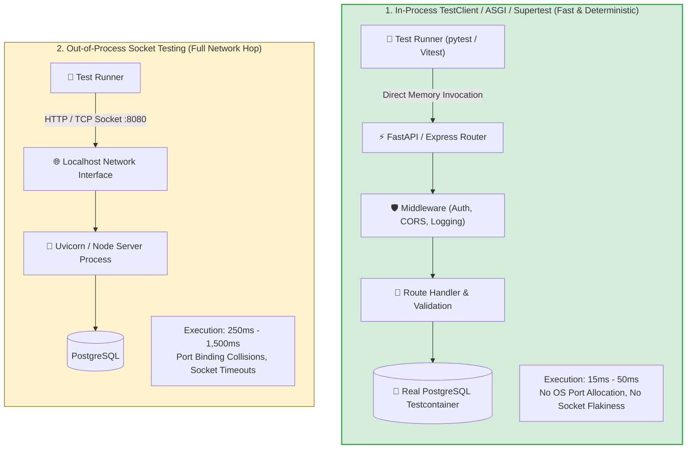
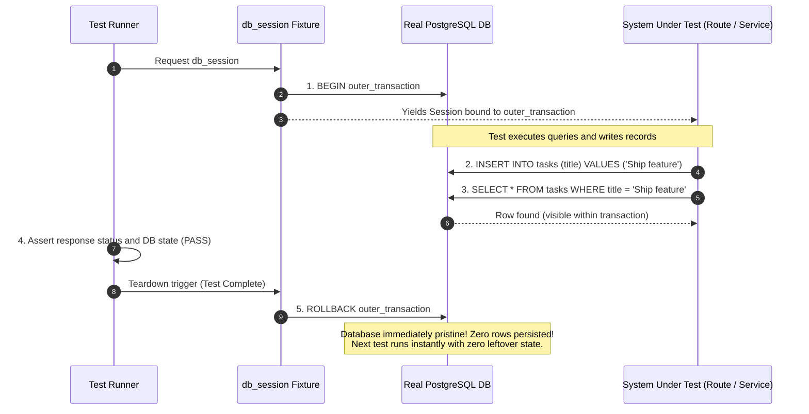
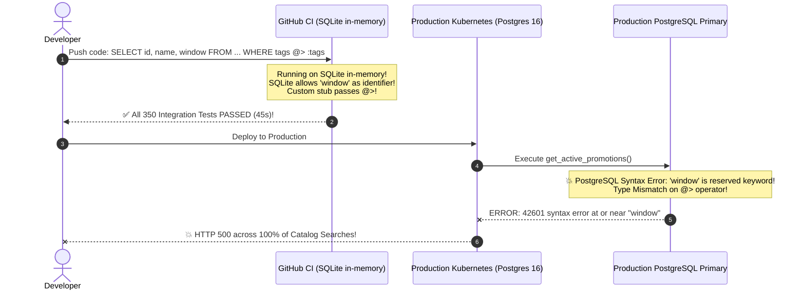

# Module 03: Integration Testing

> **Prerequisites**: [00-testing-fundamentals-and-the-test-pyramid](../00-testing-fundamentals-and-the-test-pyramid/README.md) and [01-unit-testing-in-depth](../01-unit-testing-in-depth/README.md).  
> **Estimated Reading Time**: 32 minutes  
> **Target Audience**: Backend Engineers, Systems Architects, and Reliability Engineers designing high-fidelity tests across databases, web frameworks, and service boundaries.

---

> [!TIP]
> **The Golden Rule of Integration Testing**  
> Never test against an in-memory database engine (such as SQLite) if your production workload runs on PostgreSQL or MySQL. Subtle dialect differences, JSONB operator parsing, transaction isolation semantics, and foreign-key cascade behaviors make in-memory SQLite a false oracle. Run integration tests against **real, containerized database instances (via Testcontainers)** using **transaction-rollback per test** for lightning-fast isolation, reserving table truncation only for tests that explicitly verify multi-transaction commit semantics.

---

## Visual Mental Models & Architecture

### In-Process TestClient vs Out-of-Process Socket Testing

Integration tests verify the real web application stack without paying the networking latency and port collision costs of opening an external TCP socket.



---

### Database Test Isolation: The Transaction Rollback Pattern

To execute hundreds of integration tests against a real database in seconds, tests execute inside an outer uncommitted transaction that rolls back automatically during fixture teardown.



---

## Systematic Reference Grids

### Database Isolation Strategies Comparison

| Dimension | Transaction Rollback per Test | Table Truncation (`TRUNCATE`) | Fresh Schema / Migration per Test |
| :--- | :--- | :--- | :--- |
| **Mechanic** | Run test inside `BEGIN`; issue `ROLLBACK` in fixture teardown. | Allow test to `COMMIT`; run `TRUNCATE TABLE ... CASCADE` across all tables in teardown. | Drop and re-run all Alembic/Flyway migrations for every single test. |
| **Execution Latency** | **< 2 milliseconds** per test. | **20 to 80 milliseconds** per test. | **500 to 3,000+ milliseconds** per test. |
| **DB State Fidelity** | High (Transactions are standard SQL). | Exact production commit semantics. | Exact production schema build. |
| **Limitation** | Cannot test code that manages its own internal `connection.commit()` or multi-threaded background workers. | Slower than rollback; requires foreign key cascade awareness. | Wildly impractical for large suites (&gt; 50 tests would take minutes). |
| **Recommended Use Case** | **90% of standard repository and API route tests**. | Background job tests, Celery task tests, multi-transaction sagas. | **Session-scoped once at startup** to initialize the testcontainer schema. |

---

### What Belongs in Integration vs Unit Tests

| Scenario / Behavior | Layer | Reasoning |
| :--- | :--- | :--- |
| **Complex Discount Math (e.g., 15% off carts &gt; \$100)** | **Unit Test** | Pure business logic; testing through database adds delay without testing any new seam. |
| **PostgreSQL JSONB Operator / GIN Index Querying** | **Integration Test** | SQLite and mocks cannot replicate Postgres JSONB indexing and operator semantics (`@>`, `?&`). |
| **Unique Constraint Race Condition & Foreign Key Cascades** | **Integration Test** | Verifies database engine enforcement and transaction isolation behavior. |
| **FastAPI Request Validation (Pydantic / Zod serialization)** | **Integration Test (In-Process)** | Proves HTTP wire serialization, header parsing, and `422 Unprocessable Entity` formatting. |
| **Third-Party Payment SDK Integration (Stripe / PayPal)** | **Unit (with Fake) + Contract** | Real payment calls charge money and are flaky; fake at the boundary. |

---

## Production Incident War Story: The SQLite Dialect Trap

### Incident Post-Mortem: SEV-1

* **Incident ID**: INC-4991
* **Severity Level**: SEV-1 (Production Database Crash & Service Outage)
* **Detection Time**: 2 minutes after production deployment
* **Time to Recovery (TTR)**: 24 minutes
* **Impact**: Total failure of product search and filtering across all mobile and web applications.

#### 1. What Happened
A software engineering team migrated their integration test suite to in-memory SQLite (`sqlite:///:memory:`) to speed up CI pipelines from 12 minutes to 45 seconds.

A backend engineer added a new query to fetch active promotions:
```python
# repository.py
def get_active_promotions(session: Session, tags: list[str]):
    # Uses PostgreSQL array containment and reserved column name 'window'
    return session.execute(
        text("SELECT id, name, window FROM promotions WHERE tags @> :tags"),
        {"tags": tags}
    ).fetchall()
```

When tests ran against in-memory SQLite in CI, a custom SQLite user-defined function stubbed the `@>` operator, and SQLite permitted the unquoted reserved keyword `window`. All 350 integration tests passed green in 45 seconds.

Upon deployment to production on PostgreSQL 16:
1. PostgreSQL failed to parse `window` because it is a reserved SQL keyword for window functions, throwing a syntax error: `ERROR: syntax error at or near "window"`.
2. PostgreSQL rejected the `@>` operator because the column was defined as a `VARCHAR` string instead of a native `VARCHAR[]` array in the production migration.

Every search request failed with HTTP 500 Internal Server Error, taking down the entire product catalog.



#### 2. Root Cause Analysis
1. **Engine Divergence (The SQLite Trap)**: Integration testing used SQLite while production operated PostgreSQL. SQLite's permissive type affinity and relaxed keyword grammar hid fatal PostgreSQL syntax and typing bugs.
2. **False Confidence from Mocked Operators**: Stubbing database-specific operators in SQLite masked missing database migration types.
3. **Absence of Ephemeral Containerized Parity**: The team prioritized test speed over architectural fidelity.

#### 3. The Architectural Hardening & Resolution
1. **Adoption of Testcontainers**: Replaced in-memory SQLite with containerized PostgreSQL (`testcontainers.postgres.PostgresContainer("postgres:16")`) running in Docker.
2. **Transaction Rollback Fixtures**: Optimized PostgreSQL testcontainer execution using session-scoped containers with function-scoped transaction rollback, running the 350 tests in 8 seconds.
3. **CI Architectural Ban on SQLite**: Added a CI pre-flight check failing any PR configuring `sqlite://` in backend integration test suites.

---

## Multi-Language Production Code Tabs: Real Integration Tests with Testcontainers

The following implementations demonstrate production-grade integration testing:
1. Spinning up a disposable PostgreSQL container (or ephemeral engine).
2. Applying the **Transaction Rollback per Test** pattern.
3. Driving HTTP routes via in-process test clients with dependency overrides.

```
### Language Tabs
1. Python (FastAPI + SQLAlchemy + Testcontainers + TestClient)
2. Go (net/http + testcontainers-go + pgx transaction rollback)
3. Node.js / TypeScript (Express + testcontainers + pg + Supertest)
4. C# (ASP.NET Core WebApplicationFactory + Testcontainers.PostgreSql)
```

### Python (pytest + Testcontainers + FastAPI)
```python
import pytest
from fastapi import FastAPI, Depends, HTTPException, status
from fastapi.testclient import TestClient
from sqlalchemy import create_engine, Column, Integer, String, select
from sqlalchemy.orm import declarative_base, sessionmaker, Session
from testcontainers.postgres import PostgresContainer

Base = declarative_base()

class TaskModel(Base):
    __tablename__ = "tasks"
    id = Column(Integer, primary_key=True, autoincrement=True)
    title = Column(String(100), unique=True, nullable=False)

# App Setup
app = FastAPI()

def get_db():
    raise NotImplementedError("Replaced by dependency override")

@app.post("/v1/tasks", status_code=status.HTTP_201_CREATED)
def create_task(title: str, db: Session = Depends(get_db)):
    existing = db.execute(select(TaskModel).where(TaskModel.title == title)).scalar_one_or_none()
    if existing:
        raise HTTPException(status_code=409, detail="Task title already exists")
    task = TaskModel(title=title)
    db.add(task)
    db.flush()
    return {"id": task.id, "title": task.title}

# ==========================================
# TESTCONTAINER FIXTURE STACK
# ==========================================
@pytest.fixture(scope="session")
def postgres_engine():
    with PostgresContainer("postgres:16-alpine") as postgres:
        engine = create_engine(postgres.get_connection_url())
        Base.metadata.create_all(bind=engine)
        yield engine
        engine.dispose()

@pytest.fixture
def db_session(postgres_engine):
    """Transaction rollback per test: guarantees complete isolation."""
    connection = postgres_engine.connect()
    transaction = connection.begin()
    session = Session(bind=connection)

    yield session

    session.close()
    transaction.rollback() # Rollback everything written during the test
    connection.close()

@pytest.fixture
def client(db_session):
    """Injects rollback-isolated session into FastAPI routing stack."""
    def override_get_db():
        yield db_session

    app.dependency_overrides[get_db] = override_get_db
    with TestClient(app) as test_client:
        yield test_client
    app.dependency_overrides.clear()

# ==========================================
# INTEGRATION TESTS
# ==========================================
@pytest.mark.integration
def test_create_task_persists_and_returns_201(client, db_session):
    response = client.post("/v1/tasks?title=Deploy%20Service")
    assert response.status_code == 201
    assert response.json()["title"] == "Deploy Service"

    # Verify directly against database
    persisted = db_session.execute(select(TaskModel).where(TaskModel.title == "Deploy Service")).scalar_one()
    assert persisted.id == response.json()["id"]

@pytest.mark.integration
def test_create_duplicate_task_returns_409(client):
    # First create succeeds
    res1 = client.post("/v1/tasks?title=Unique%20Job")
    assert res1.status_code == 201

    # Second create with duplicate title returns 409 Conflict
    res2 = client.post("/v1/tasks?title=Unique%20Job")
    assert res2.status_code == 409
```

### Go (testcontainers-go + pgx)
```go
package integration_test

import (
	"context"
	"database/sql"
	"fmt"
	"testing"
	"time"

	_ "github.com/jackc/pgx/v5/stdlib"
	"github.com/testcontainers/testcontainers-go"
	"github.com/testcontainers/testcontainers-go/modules/postgres"
	"github.com/testcontainers/testcontainers-go/wait"
)

var globalDB *sql.DB

func TestMain(m *testing.M) {
	ctx := context.Background()
	// 1. Spin up real PostgreSQL container once per session
	pgContainer, err := postgres.RunContainer(ctx,
		testcontainers.WithImage("postgres:16-alpine"),
		postgres.WithDatabase("testdb"),
		postgres.WithUsername("postgres"),
		postgres.WithPassword("password"),
		testcontainers.WithWaitStrategy(
			wait.ForLog("database system is ready to accept connections").
				WithOccurrence(2).WithStartupTimeout(15*time.Second)),
	)
	if err != nil {
		panic(fmt.Sprintf("failed to start container: %v", err))
	}
	defer pgContainer.Terminate(ctx)

	connStr, _ := pgContainer.ConnectionString(ctx, "sslmode=disable")
	globalDB, _ = sql.Open("pgx", connStr)
	defer globalDB.Close()

	// Initialize Schema
	_, _ = globalDB.Exec(`CREATE TABLE tasks (id SERIAL PRIMARY KEY, title TEXT UNIQUE NOT NULL);`)

	m.Run()
}

func TestTaskRepository_TransactionRollback(t *testing.T) {
	ctx := context.Background()

	// Begin outer transaction for test
	tx, err := globalDB.BeginTx(ctx, nil)
	if err != nil {
		t.Fatalf("failed to begin tx: %v", err)
	}
	defer tx.Rollback() // Guarantees zero leftover rows

	// Act: Insert row inside transaction
	_, err = tx.ExecContext(ctx, "INSERT INTO tasks (title) VALUES ($1);", "Order Verification")
	if err != nil {
		t.Fatalf("expected insert to succeed, got: %v", err)
	}

	// Assert: Read back inside transaction
	var count int
	_ = tx.QueryRowContext(ctx, "SELECT COUNT(*) FROM tasks WHERE title = $1;", "Order Verification").Scan(&count)
	if count != 1 {
		t.Errorf("expected count 1, got %d", count)
	}
	// On exit, tx.Rollback() restores DB to pristine state
}
```

### Node.js / TypeScript (Supertest + Testcontainers)
```typescript
import { describe, it, expect, beforeAll, afterAll, beforeEach, afterEach } from 'vitest';
import { PostgreSqlContainer, StartedPostgreSqlContainer } from '@testcontainers/postgresql';
import { Pool, PoolClient } from 'pg';
import express from 'express';
import request from 'supertest';

let container: StartedPostgreSqlContainer;
let pool: Pool;
let client: PoolClient;
let app: express.Express;

beforeAll(async () => {
  // 1. Start disposable PostgreSQL testcontainer
  container = await new PostgreSqlContainer('postgres:16-alpine').start();
  pool = new Pool({ connectionString: container.getConnectionUri() });

  await pool.query(`CREATE TABLE tasks (id SERIAL PRIMARY KEY, title VARCHAR(100) UNIQUE NOT NULL);`);

  // 2. Initialize in-process Express app
  app = express();
  app.use(express.json());
  app.post('/tasks', async (req, res) => {
    try {
      const result = await client.query('INSERT INTO tasks (title) VALUES ($1) RETURNING *;', [req.body.title]);
      res.status(201).json(result.rows[0]);
    } catch (err: any) {
      if (err.code === '23505') return res.status(409).json({ error: 'Duplicate' });
      res.status(500).json({ error: err.message });
    }
  });
}, 30000);

afterAll(async () => {
  await pool.end();
  await container.stop();
});

beforeEach(async () => {
  // 3. Begin transaction before each test
  client = await pool.connect();
  await client.query('BEGIN');
});

afterEach(async () => {
  // 4. Rollback transaction after each test
  await client.query('ROLLBACK');
  client.release();
});

describe('Tasks API Integration Tests', () => {
  it('should persist task and return 201', async () => {
    const res = await request(app).post('/tasks').send({ title: 'Containerized Test' });
    expect(res.status).toBe(201);
    expect(res.body.title).toBe('Containerized Test');
  });

  it('should reject duplicate titles with 409 Conflict', async () => {
    await request(app).post('/tasks').send({ title: 'Unique Task' });
    const res = await request(app).post('/tasks').send({ title: 'Unique Task' });
    expect(res.status).toBe(409);
  });
});
```

### C# (ASP.NET Core WebApplicationFactory + Testcontainers)
```csharp
using System.Net;
using System.Net.Http.Json;
using Microsoft.AspNetCore.Mvc.Testing;
using Microsoft.EntityFrameworkCore;
using Microsoft.Extensions.DependencyInjection;
using Testcontainers.PostgreSql;
using Xunit;

public class TaskItem { public int Id { get; set; } public string Title { get; set; } = ""; }

public class AppDbContext : DbContext
{
    public AppDbContext(DbContextOptions<AppDbContext> opts) : base(opts) { }
    public DbSet<TaskItem> Tasks => Set<TaskItem>();
}

public class IntegrationTestFixture : IAsyncLifetime
{
    public PostgreSqlContainer Container { get; } = new PostgreSqlBuilder()
        .WithImage("postgres:16-alpine")
        .Build();

    public async Task InitializeAsync() => await Container.StartAsync();
    public async Task DisposeAsync() => await Container.DisposeAsync();
}

public class TaskApiTests : IClassFixture<IntegrationTestFixture>
{
    private readonly IntegrationTestFixture _fixture;

    public TaskApiTests(IntegrationTestFixture fixture) => _fixture = fixture;

    [Fact]
    public async Task PostTask_Returns201AndPersists()
    {
        var factory = new WebApplicationFactory<Program>().WithWebHostBuilder(builder =>
        {
            builder.ConfigureServices(services =>
            {
                // Swap DbContext to Point to Postgres Container
                services.AddDbContext<AppDbContext>(opts =>
                    opts.UseNpgsql(_fixture.Container.GetConnectionString()));
            });
        });

        var client = factory.CreateClient();
        var response = await client.PostAsJsonAsync("/tasks", new { Title = "Ship dotnet API" });

        Assert.Equal(HttpStatusCode.Created, response.StatusCode);
    }
}
```

---

## Practical Hands-On Verification Workflows

### 1. Execute Integration Tests via Pytest Markers

Filter test execution to run fast unit tests by default, and execute the integration suite against Docker testcontainers when requested:

```bash
# Run ONLY unit tests (0 I/O, blazing fast)
pytest -m "not integration" -v
```

**Expected Terminal Output:**
```text
collected 14 items / 2 deselected / 12 selected
tests/test_pricing.py::test_discount_valid PASSED               [ 50%]
tests/test_policy.py::test_password_policy PASSED               [100%]
====================== 12 passed, 2 deselected in 0.08s =======================
```

```bash
# Run ONLY containerized integration tests
pytest -m "integration" -v
```

**Expected Terminal Output:**
```text
collected 14 items / 12 deselected / 2 selected
tests/test_tasks_api.py::test_create_task_persists_and_returns_201 PASSED [ 50%]
tests/test_tasks_api.py::test_create_duplicate_task_returns_409 PASSED    [100%]
====================== 2 passed, 12 deselected in 1.45s =======================
```

---

## Operational Validation Checkpoints (Scenario Quizzes)

<details>
<summary><strong>Checkpoint 1: The Transaction Rollback Leaking Seam</strong></summary>

**Scenario:** A developer implements transaction rollback per test. In their FastAPI route handler:
```python
@app.post("/tasks")
def create_task(title: str, db: Session = Depends(get_db)):
    task = TaskModel(title=title)
    db.add(task)
    db.commit() # Notice the explicit commit!
    return task
```
When running the integration test suite, tests begin failing with duplicate key errors because the rollback fixture no longer cleans up the rows. Why did this occur, and how must database transaction fixtures be structured when application code calls `db.commit()`?

**Answer:**
- **The Cause**: The application code explicitly invoked `db.commit()`. In standard SQL, committing an active transaction terminates the transaction boundary and makes all changes permanent, rendering the outer fixture's subsequent `rollback()` call ineffective.
- **The Fix**:
  1. Use **Nested Transactions (Savepoints)** in SQLAlchemy / Hibernate:
     ```python
     @pytest.fixture
     def db_session(engine):
         connection = engine.connect()
         trans = connection.begin()
         session = Session(bind=connection, join_transaction_mode="create_savepoint")
         yield session
         session.close()
         trans.rollback()
         connection.close()
     ```
     With savepoints (`SAVEPOINT my_savepoint`), application `db.commit()` calls merely release the inner savepoint without committing the outer physical database transaction.
  2. If savepoints are unsupported by your ORM, switch from the Rollback strategy to the **Table Truncation (`TRUNCATE`)** strategy in fixture teardown.
</details>

<details>
<summary><strong>Checkpoint 2: The Shared Test Database Race Condition</strong></summary>

**Scenario:** An engineering team configures their CI runners to execute tests in parallel using `pytest -n auto` (running across 8 worker processes). All 8 processes point to a single static staging PostgreSQL database. The tests randomly fail with `UniqueViolation` and foreign-key missing errors. What architectural change resolves this flakiness?

**Answer:**
- **The Cause**: Multiple concurrent test workers are executing read, write, and truncate operations simultaneously against the exact same database tables. Worker 1 inserts a row with `id=10`, while Worker 2 truncates the table, causing Worker 1 to fail unexpectedly.
- **The Resolution**:
  1. **Dynamic Database Isolation per Worker**: When using testcontainers with parallel workers, each worker process must either spin up its own isolated container or create its own isolated database instance (e.g. `test_db_worker_1`, `test_db_worker_2`).
  2. In pytest-xdist, use the `worker_id` fixture to dynamically assign and migrate a dedicated database schema per process: `create_database(f"test_db_{worker_id}")`.
</details>

<details>
<summary><strong>Checkpoint 3: The False Equivalence of Unit and Integration Tests</strong></summary>

**Scenario:** A developer proposes: *"We have 100% unit test coverage using mock repositories for our User registration endpoint. Therefore, writing an integration test against a real PostgreSQL database is redundant waste."* Name three critical failure modes that only a real integration test can detect.

**Answer:**
1. **Schema Migration & Mapping Desynchronization**: A unit test with mocks cannot verify whether the SQLAlchemy/Entity Framework column mappings match the real PostgreSQL column names, types, or nullability constraints.
2. **SQL Constraint Violations**: Uncaught foreign-key violations (`FOREIGN KEY constraint failed`), unique index collisions, and check constraints (`CHECK (age >= 18)`) are enforced strictly by the database engine and remain completely invisible to unit mocks.
3. **Session Lifecycle & Transaction Commits**: A unit test cannot prove that the HTTP request handler properly acquired, committed, and closed the database connection session without leaking connections in the connection pool.
</details>

---

## Further Reading & Next Steps

* [Testcontainers Official Documentation](https://testcontainers.com/) - Multi-language libraries for containerized integration testing.
* [FastAPI Documentation: Testing with Databases](https://fastapi.tiangolo.com/advanced/testing-database/) - Dependency overrides and transactional session wiring.
* [Martin Fowler: Integration Testing](https://martinfowler.com/bliki/IntegrationTest.html) - Structural concepts and scope boundaries.
* Next up: [04-mocking-and-dependency-injection-for-testability](../04-mocking-and-dependency-injection-for-testability/README.md) to control external services, third-party payment gateways, and the system clock.
