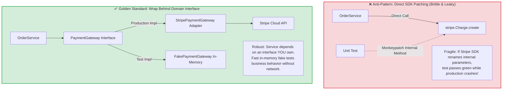
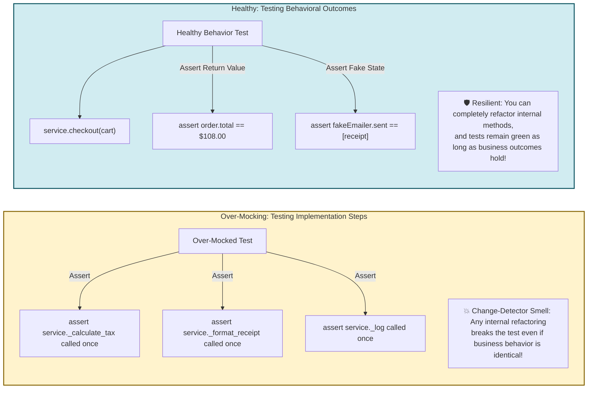
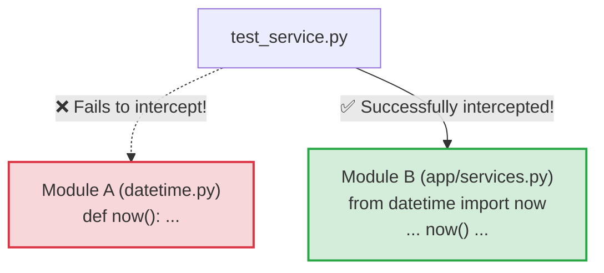
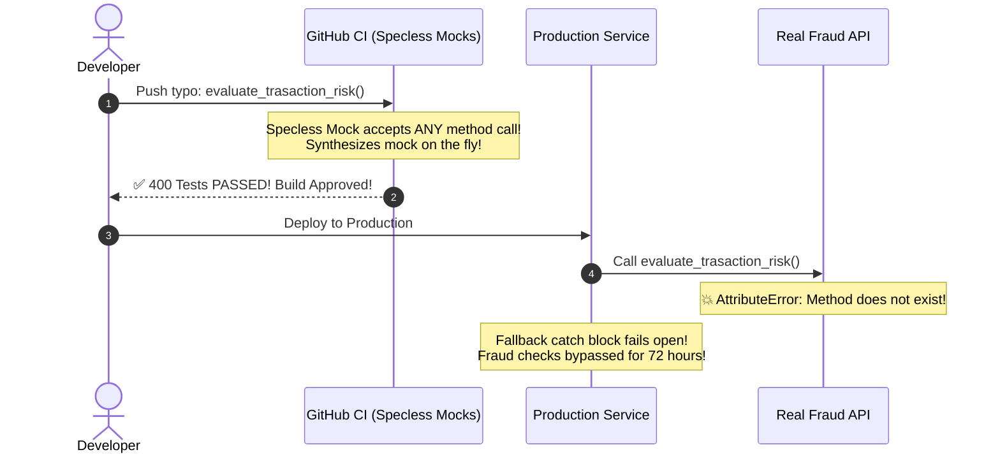

# Module 04: Mocking and Dependency Injection for Testability

> **Prerequisites**: [00-testing-fundamentals-and-the-test-pyramid](../00-testing-fundamentals-and-the-test-pyramid/README.md), [01-unit-testing-in-depth](../01-unit-testing-in-depth/README.md), and [03-integration-testing](../03-integration-testing/README.md).  
> **Estimated Reading Time**: 32 minutes  
> **Target Audience**: Backend Engineers, Systems Architects, and Distributed Systems Developers seeking to decouple tests from third-party vendor APIs, eliminate test flakiness, and avoid the brittleness of over-mocking.

---

> [!TIP]
> **The Golden Rule of Mocking and Test Doubles**  
> **Never mock what you do not own.** Never patch directly into third-party vendor SDK internals (such as `stripe.Charge.create`). Instead, wrap third-party APIs behind a thin domain interface (`PaymentGateway`) that you own and control, and inject lightweight, in-memory **Fakes** for 90% of your tests. Reserve **Interaction Mocks** strictly for cases where the side effect itself is the contract (e.g., verifying that a credit card is charged exactly once or that no email is dispatched upon failure). Always enforce strict interface specifications (`spec=` or typed interfaces) to prevent mocks from accepting invalid methods.

---

## Visual Mental Models & Architecture

### Mocking at Architectural Boundaries: Wrapping External SDKs

Directly patching third-party libraries couples your test suite to a vendor's internal implementation details. Wrapping external SDKs behind an application-owned domain interface creates a clean, testable seam:



---

### Over-Mocking (Change Detector) vs Healthy State Verification



---

## Systematic Reference Grids

### Mocking Techniques & Tools Comparison

| Tool / Strategy | Primary Intent | Scope & Layer | Tradeoff / Risk | Best Used For |
| :--- | :--- | :--- | :--- | :--- |
| **In-Memory Fakes** | High-fidelity state simulation without network/disk. | Service & Domain Boundaries. | Requires maintaining a simple fake class alongside real adapter. | Repositories, email senders, caching tiers, payment gateways. |
| **`mocker.Mock(spec=Interface)`** | Verify strict interaction contracts (e.g. idempotency). | Boundary Interfaces. | Over-use makes tests brittle change-detectors. | Verifying negative side effects (e.g. `assert_not_called()`) and exactly-once constraints. |
| **`respx` / WireMock** | Intercept outbound HTTP network calls at the transport level. | Outbound HTTP Clients (httpx / requests). | Requires matching URL and request patterns. | Testing third-party webhook dispatchers, REST microservice clients. |
| **`freezegun` / `time-machine`** | Freeze and manipulate the system clock. | Operating System `datetime` calls. | Slight runtime overhead; must be reset after test. | Testing subscription expirations, JWT token TTLs, cron scheduler triggers. |
| **`monkeypatch.setattr`** | Temporarily replace object attributes or environment variables. | Global Configuration / Environment. | Can leak across tests if not properly scoped and cleaned. | Testing configuration flags (`settings.FEATURE_X_ENABLED`). |

---

### Where to Patch: The Python Import Lookup Rule

A universal pitfall in Python testing is patching where a function is **defined** rather than where it is **imported and used**:



*Rule*: **Always patch `app.services.now`, NEVER `datetime.now`**, because `app.services` holds its own local namespace reference to the imported callable.

---

## Production Incident War Story: The Specless Mock Disaster

### Incident Post-Mortem: SEV-1

* **Incident ID**: INC-9210
* **Severity Level**: SEV-1 (Financial Fraud Exploit)
* **Detection Time**: 3 days after weekly release
* **Time to Recovery (TTR)**: 45 minutes
* **Impact**: \$840,000 in fraudulent transactions processed without fraud scoring; 400 specless mock tests passed green despite a broken signature.

#### 1. What Happened
An e-commerce platform integrated a third-party risk engine (`SiftFraudClient`). The internal wrapper interface originally defined:
```python
class FraudDetector(Protocol):
    def evaluate_risk(self, user_id: str, ip_address: str, amount_cents: int) -> bool: ...
```

In unit tests, developers used Python's default `unittest.mock.Mock()` without specifying a `spec`:
```python
# test_checkout.py - The Specless Mock Anti-Pattern
def test_checkout_passes_fraud_check(mocker):
    mock_fraud = mocker.Mock() # NO SPEC!
    mock_fraud.evaluate_risk.return_value = True
    svc = CheckoutService(fraud_detector=mock_fraud)
    res = svc.checkout(user_id="usr_1", amount=5000)
    assert res.status == "APPROVED"
```

During an upgrade of the fraud SDK, a developer refactored the method name on the real adapter from `evaluate_risk` to `evaluate_transaction_risk`. 

In `CheckoutService`, the developer updated the method call, but made a typo:
```python
# checkout_service.py
is_safe = self.fraud_detector.evaluate_trasaction_risk(user_id, ip, amount) # Typo in method name!
```

Because `mocker.Mock()` was specless, invoking `evaluate_trasaction_risk` on the mock dynamically synthesized a new Mock on the fly and returned truthy! All 400 unit tests passed green.

In production, the real `SiftFraudClient` had no method named `evaluate_trasaction_risk`, throwing an `AttributeError`. An outer `try/except Exception` block swallowed the error and defaulted to "fail-open" for customer convenience. Fraudsters exploited the hole, draining \$840,000 in gift cards in 72 hours.



#### 2. Root Cause Analysis
1. **Specless Mocking**: Mocks were instantiated without `spec=FraudDetector`. A specless mock accepts arbitrary nonexistent method names and arguments without validating against the interface.
2. **Fail-Open Error Masking**: An unhandled exception handler silently swallowed API mismatches.
3. **Absence of Type Checking in CI**: The test suite was not validated with `mypy --strict`.

#### 3. The Architectural Hardening & Resolution
1. **Mandatory Mock Spec Enforcement**: Enforced that all mock instances in tests must specify their interface: `mocker.Mock(spec=FraudDetector)` or `mocker.create_autospec(FraudDetector)`. Any call to a mistyped method immediately fails the test.
2. **In-Memory Fakes Over Mocks**: Replaced 90% of mock instances with an in-memory `FakeFraudDetector` implementing the domain protocol.
3. **Strict MyPy Static Analysis**: Integrated `mypy --strict` into pre-commit hooks, catching misspelled method calls during static analysis before tests even run.

---

## Multi-Language Production Code Tabs: Boundary Wrapping & Test Doubles

The following implementations demonstrate:
1. Wrapping third-party payment processing behind an application-owned `PaymentGateway` interface.
2. Building an in-memory **Fake** for state verification.
3. Implementing a strictly typed **Mock** to verify negative side effects (proving no charge occurs on validation failure).

```
### Language Tabs
1. Python (Protocol interface + pytest-mock spec + in-memory Fake)
2. Go (Interface + in-memory struct Fake + testify mock)
3. Node.js / TypeScript (Interface + in-memory Fake + Vitest vi.fn)
4. C# (Interface + in-memory Fake + Moq with MockBehavior.Strict)
```

### Python
```python
import pytest
from typing import Protocol, List, Tuple
from dataclasses import dataclass

# ==========================================
# 1. DOMAIN BOUNDARY INTERFACE (You own this)
# ==========================================
class CardDeclinedError(Exception):
    pass

@dataclass
class ChargeResult:
    transaction_id: str
    amount_cents: int

class PaymentGateway(Protocol):
    def charge(self, amount_cents: int, currency: str) -> ChargeResult: ...

class EmailSender(Protocol):
    def send_receipt(self, recipient: str, message: str) -> None: ...

# ==========================================
# 2. APPLICATION SERVICE
# ==========================================
class CheckoutService:
    def __init__(self, payments: PaymentGateway, emailer: EmailSender):
        self.payments = payments
        self.emailer = emailer

    def process_order(self, customer_email: str, amount_cents: int) -> ChargeResult:
        if amount_cents <= 0:
            raise ValueError("Amount must be strictly positive")
            
        # 1. Charge card via boundary interface
        result = self.payments.charge(amount_cents=amount_cents, currency="USD")
        
        # 2. Dispatch receipt only on success
        self.emailer.send_receipt(
            recipient=customer_email,
            message=f"Charge confirmed: {result.transaction_id}"
        )
        return result

# ==========================================
# 3. IN-MEMORY FAKES (State Verification)
# ==========================================
class FakePaymentGateway:
    def __init__(self, should_succeed: bool = True):
        self.should_succeed = should_succeed
        self.charged_history: List[Tuple[int, str]] = []

    def charge(self, amount_cents: int, currency: str) -> ChargeResult:
        self.charged_history.append((amount_cents, currency))
        if not self.should_succeed:
            raise CardDeclinedError("Card was declined by issuing bank")
        return ChargeResult(transaction_id=f"tx_{len(self.charged_history)}", amount_cents=amount_cents)

class FakeEmailSender:
    def __init__(self):
        self.sent_emails: List[Tuple[str, str]] = []

    def send_receipt(self, recipient: str, message: str) -> None:
        self.sent_emails.append((recipient, message))

# ==========================================
# 4. UNIT TESTS (Fakes + Strict Spec Mock)
# ==========================================
def test_successful_checkout_records_payment_and_sends_email():
    # Arrange (Using Fakes for State Verification)
    fake_gateway = FakePaymentGateway(should_succeed=True)
    fake_emailer = FakeEmailSender()
    service = CheckoutService(payments=fake_gateway, emailer=fake_emailer)

    # Act
    result = service.process_order("ada@lovelace.org", 5000)

    # Assert (Verify Behavioral State Outcomes)
    assert result.amount_cents == 5000
    assert fake_gateway.charged_history == [(5000, "USD")]
    assert len(fake_emailer.sent_emails) == 1
    assert fake_emailer.sent_emails[0][0] == "ada@lovelace.org"

def test_declined_card_raises_error_and_sends_NO_email():
    # Arrange
    fake_gateway = FakePaymentGateway(should_succeed=False)
    fake_emailer = FakeEmailSender()
    service = CheckoutService(payments=fake_gateway, emailer=fake_emailer)

    # Act & Assert
    with pytest.raises(CardDeclinedError):
        service.process_order("ada@lovelace.org", 5000)

    # Negative side-effect verification: proving email was NOT sent
    assert len(fake_emailer.sent_emails) == 0

def test_zero_amount_validation_never_invokes_payment_gateway(mocker):
    # Arrange: Using strict spec mock to prove interaction was NOT called
    mock_gateway = mocker.Mock(spec=PaymentGateway)
    mock_emailer = mocker.Mock(spec=EmailSender)
    service = CheckoutService(payments=mock_gateway, emailer=mock_emailer)

    # Act & Assert
    with pytest.raises(ValueError):
        service.process_order("ada@lovelace.org", 0)

    # Enforce that payment gateway was never touched
    mock_gateway.charge.assert_not_called()
    mock_emailer.send_receipt.assert_not_called()
```

### Go
```go
package checkout_test

import (
	"errors"
	"testing"
)

// ==========================================
// 1. BOUNDARY INTERFACES
// ==========================================
var ErrCardDeclined = errors.New("card declined")

type PaymentGateway interface {
	Charge(amountCents int, currency string) (string, error)
}

type EmailSender interface {
	SendReceipt(to string, body string) error
}

type CheckoutService struct {
	payments PaymentGateway
	emailer  EmailSender
}

func (s *CheckoutService) ProcessOrder(email string, amountCents int) (string, error) {
	if amountCents <= 0 {
		return "", errors.New("amount must be positive")
	}

	txID, err := s.payments.Charge(amountCents, "USD")
	if err != nil {
		return "", err
	}

	_ = s.emailer.SendReceipt(email, "Charge confirmed: "+txID)
	return txID, nil
}

// ==========================================
// 2. IN-MEMORY FAKES
// ==========================================
type FakePaymentGateway struct {
	ShouldSucceed bool
	Charges       []int
}

func (f *FakePaymentGateway) Charge(amount int, curr string) (string, error) {
	f.Charges = append(f.Charges, amount)
	if !f.ShouldSucceed {
		return "", ErrCardDeclined
	}
	return "tx_12345", nil
}

type FakeEmailSender struct {
	SentMessages []string
}

func (f *FakeEmailSender) SendReceipt(to string, body string) error {
	f.SentMessages = append(f.SentMessages, to)
	return nil
}

// ==========================================
// 3. UNIT TESTS
// ==========================================
func TestProcessOrder_Success_ChargesAndSendsReceipt(t *testing.T) {
	fakePay := &FakePaymentGateway{ShouldSucceed: true}
	fakeEmail := &FakeEmailSender{}
	svc := &CheckoutService{payments: fakePay, emailer: fakeEmail}

	txID, err := svc.ProcessOrder("alan@turing.org", 7500)
	if err != nil {
		t.Fatalf("unexpected error: %v", err)
	}

	if txID != "tx_12345" {
		t.Errorf("expected tx_12345, got %s", txID)
	}
	if len(fakePay.Charges) != 1 || fakePay.Charges[0] != 7500 {
		t.Errorf("payment not recorded properly")
	}
	if len(fakeEmail.SentMessages) != 1 {
		t.Errorf("expected 1 email to be sent")
	}
}

func TestProcessOrder_Declined_DoesNotSendEmail(t *testing.T) {
	fakePay := &FakePaymentGateway{ShouldSucceed: false}
	fakeEmail := &FakeEmailSender{}
	svc := &CheckoutService{payments: fakePay, emailer: fakeEmail}

	_, err := svc.ProcessOrder("alan@turing.org", 7500)
	if !errors.Is(err, ErrCardDeclined) {
		t.Fatalf("expected ErrCardDeclined, got %v", err)
	}

	if len(fakeEmail.SentMessages) != 0 {
		t.Errorf("expected NO email on declined card, got: %d", len(fakeEmail.SentMessages))
	}
}
```

### Node.js / TypeScript (Vitest)
```typescript
import { describe, it, expect, vi } from 'vitest';

export interface PaymentGateway {
  charge(amountCents: number, currency: string): Promise<{ transactionId: string }>;
}

export interface EmailSender {
  sendReceipt(recipient: string, message: string): Promise<void>;
}

export class CheckoutService {
  constructor(
    private readonly payments: PaymentGateway,
    private readonly emailer: EmailSender
  ) {}

  async processOrder(email: string, amountCents: number) {
    if (amountCents <= 0) throw new Error('Amount must be positive');
    const tx = await this.payments.charge(amountCents, 'USD');
    await this.emailer.sendReceipt(email, `Paid: ${tx.transactionId}`);
    return tx;
  }
}

// In-Memory Fake
export class FakePaymentGateway implements PaymentGateway {
  public charges: number[] = [];
  constructor(private shouldSucceed = true) {}

  async charge(amountCents: number) {
    this.charges.push(amountCents);
    if (!this.shouldSucceed) throw new Error('CARD_DECLINED');
    return { transactionId: 'tx_vitest_99' };
  }
}

describe('CheckoutService Tests', () => {
  it('should process payment and send email on success', async () => {
    const fakePay = new FakePaymentGateway(true);
    const fakeEmail: EmailSender = { sendReceipt: vi.fn() };
    const svc = new CheckoutService(fakePay, fakeEmail);

    const result = await svc.processOrder('grace@hopper.org', 3000);

    expect(result.transactionId).toBe('tx_vitest_99');
    expect(fakePay.charges).toEqual([3000]);
    expect(fakeEmail.sendReceipt).toHaveBeenCalledWith('grace@hopper.org', 'Paid: tx_vitest_99');
  });

  it('should not dispatch email when payment fails', async () => {
    const fakePay = new FakePaymentGateway(false);
    const mockEmail: EmailSender = { sendReceipt: vi.fn() };
    const svc = new CheckoutService(fakePay, mockEmail);

    await expect(svc.processOrder('grace@hopper.org', 3000)).rejects.toThrow('CARD_DECLINED');
    expect(mockEmail.sendReceipt).not.toHaveBeenCalled();
  });
});
```

### C# (xUnit + Moq with Strict Behavior)
```csharp
using System;
using System.Collections.Generic;
using System.Threading.Tasks;
using Moq;
using Xunit;

public interface IPaymentGateway
{
    Task<string> ChargeAsync(int amountCents, string currency);
}

public interface IEmailSender
{
    Task SendReceiptAsync(string recipient, string message);
}

public class CheckoutService
{
    private readonly IPaymentGateway _payments;
    private readonly IEmailSender _emailer;

    public CheckoutService(IPaymentGateway payments, IEmailSender emailer)
    {
        _payments = payments;
        _emailer = emailer;
    }

    public async Task<string> ProcessOrderAsync(string email, int amountCents)
    {
        if (amountCents <= 0) throw new ArgumentException("Amount must be positive");
        var txId = await _payments.ChargeAsync(amountCents, "USD");
        await _emailer.SendReceiptAsync(email, $"Receipt: {txId}");
        return txId;
    }
}

public class CheckoutServiceTests
{
    [Fact]
    public async Task ProcessOrderAsync_NegativeAmount_NeverTouchesPaymentGateway()
    {
        // Arrange: Strict Mock throws if any unconfigured method is invoked
        var mockGateway = new Mock<IPaymentGateway>(MockBehavior.Strict);
        var mockEmailer = new Mock<IEmailSender>(MockBehavior.Strict);
        var service = new CheckoutService(mockGateway.Object, mockEmailer.Object);

        // Act & Assert
        await Assert.ThrowsAsync<ArgumentException>(() => 
            service.ProcessOrderAsync("ada@lovelace.org", -50));

        // Verify zero interactions occurred
        mockGateway.Verify(g => g.ChargeAsync(It.IsAny<int>(), It.IsAny<string>()), Times.Never);
    }
}
```

---

## Practical Hands-On Verification Workflows

### 1. Intercepting Outbound HTTP Requests via RESPX

When writing unit tests for microservice clients, use `respx` to mock external HTTP requests at the transport layer without touching the network:

```python
import pytest
import httpx
import respx

class ShippingClient:
    def __init__(self, base_url: str = "https://api.shipping-carrier.com"):
        self.base_url = base_url

    async def get_shipping_quote(self, zip_code: str) -> int:
        async with httpx.AsyncClient(base_url=self.base_url) as client:
            resp = await client.get(f"/rates/{zip_code}")
            resp.raise_for_status()
            return resp.json()["rate_cents"]

@pytest.mark.asyncio
@respx.mock
async def test_get_shipping_quote_intercepted():
    # Configure respx to mock the exact HTTP route
    route = respx.get("https://api.shipping-carrier.com/rates/90210").respond(
        status_code=200,
        json={"rate_cents": 1250, "carrier": "ExpressPost"}
    )

    client = ShippingClient()
    rate = await client.get_shipping_quote("90210")

    assert rate == 1250
    assert route.called
    assert route.call_count == 1
```

---

## Operational Validation Checkpoints (Scenario Quizzes)

<details>
<summary><strong>Checkpoint 1: The Leaky Dependency Override Anti-Pattern</strong></summary>

**Scenario:** A developer writes a route test using FastAPI `dependency_overrides`:
```python
def test_admin_route():
    app.dependency_overrides[get_current_user] = lambda: AdminUser(id=1)
    client = TestClient(app)
    response = client.get("/admin/metrics")
    assert response.status_code == 200
```
When running the full test suite, subsequent unauthenticated tests begin failing because they unexpectedly have admin privileges. Why did this occur, and how must dependency overrides be managed?

**Answer:**
- **The Cause**: `app.dependency_overrides` is a global dictionary stored on the FastAPI application instance. The developer modified the dictionary inside `test_admin_route` but never removed it. The override leaked into all subsequent tests executed in the same process.
- **The Fix**: Always manage dependency overrides within a `pytest` fixture using the **Arrange/Teardown with `yield`** pattern:
  ```python
  @pytest.fixture
  def admin_client():
      app.dependency_overrides[get_current_user] = lambda: AdminUser(id=1)
      with TestClient(app) as client:
          yield client
      app.dependency_overrides.clear() # Guaranteed teardown!
  ```
</details>

<details>
<summary><strong>Checkpoint 2: The Fallacy of Mocking Everything</strong></summary>

**Scenario:** A developer tests a `TaxCalculator` service by creating mocks for `TaxRateTable`, `CurrencyConverter`, and `RoundingEngine`. Every test consists of 6 lines of `mock.return_value = ...` setup and assertions like `mock_engine.round.assert_called_once()`. What is wrong with this testing strategy, and what happens when the team refactors the rounding logic?

**Answer:**
- **The Failure Mode**: The test is an **Over-Mocked Change-Detector**. It does not test whether taxes are calculated correctly; it merely asserts that internal methods were called in a specific sequence.
- **Brittleness**: If the team refactors `RoundingEngine` to use native integer math, the business behavior is identical, but 100% of the unit tests will break because their mocked interaction expectations were violated.
- **The Fix**: `TaxRateTable`, `CurrencyConverter`, and `RoundingEngine` are internal domain collaborators, not external network boundaries! Do NOT mock them. Let them run as real, pure domain objects. Test `TaxCalculator` by passing inputs and asserting on the final computed decimal output.
</details>

<details>
<summary><strong>Checkpoint 3: The Danger of Mocking Third-Party Types</strong></summary>

**Scenario:** A developer writes: `mocker.patch("boto3.client")` to test an S3 file upload feature. Amazon releases a minor version update to Boto3 that deprecates an internal method. Why will the unit test suite continue to pass green in CI while the production deployment crashes?

**Answer:**
- **The Trap**: The developer **mocked what they do not own**. The test asserts against the developer's *assumption* of how Boto3 behaves, not against real AWS SDK behavior. Because the test intercepts the call before Boto3 code executes, changes to Boto3's real API signature are completely invisible to the test.
- **The Architectural Fix**:
  1. Wrap the S3 upload behind a domain interface: `BlobStorageService.upload(filename, data)`.
  2. Implement an in-memory `FakeBlobStorageService` for unit tests.
  3. Write a small, dedicated **integration contract test** against LocalStack or a real test S3 bucket using Testcontainers to verify that the real `S3BlobStorageAdapter` correctly speaks to the real AWS SDK.
</details>

---

## Further Reading & Next Steps

* [Martin Fowler: Mocks Aren't Stubs](https://martinfowler.com/articles/mocksArentStubs.html) - Canonical thesis on state verification vs interaction verification.
* [Hynek Schlawack: Don't Mock What You Don't Own](https://hynek.me/articles/what-to-mock-in-5-mins/) - Clear rules on wrapping third-party libraries.
* [RESPX Documentation](https://lundberg.github.io/respx/) - Mocking HTTPX at the transport level.
* Next up: [05-e2e-and-contract-testing](../05-e2e-and-contract-testing/README.md) to master full-system journeys, fight test flakiness, and enforce schema conformance with OpenAPI contract testing.
