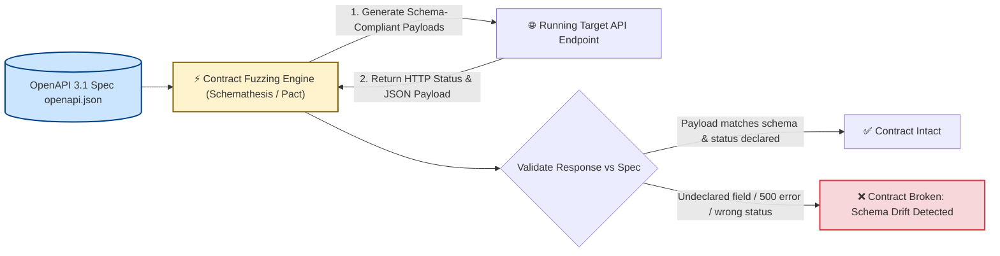
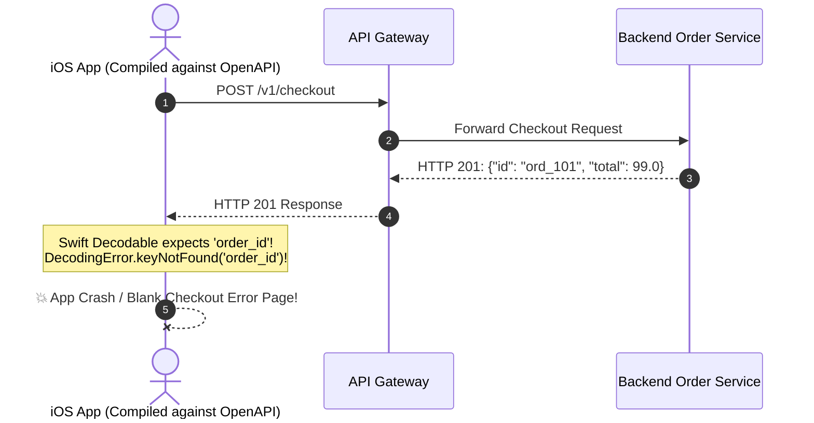

# Module 05: E2E and Contract Testing

> **Prerequisites**: [00-testing-fundamentals-and-the-test-pyramid](../00-testing-fundamentals-and-the-test-pyramid/README.md), [03-integration-testing](../03-integration-testing/README.md), and [04-mocking-and-dependency-injection-for-testability](../04-mocking-and-dependency-injection-for-testability/README.md).  
> **Estimated Reading Time**: 32 minutes  
> **Target Audience**: Backend Engineers, QA Automation Architects, and Platform Engineers building resilient full-system smoke tests and contract verification gates.

---

> [!TIP]
> **The Golden Rule of E2E and Contract Testing**  
> Keep the tip of your test pyramid narrow: End-to-End (E2E) tests must verify only a handful of **critical user revenue journeys** across real network sockets, never granular business-rule permutations. To eliminate the #1 cause of E2E test flakiness, **always poll for explicit readiness conditions with bounded timeouts—never rely on arbitrary `sleep()` durations**. Furthermore, complement E2E tests with **OpenAPI Contract Testing (via Schemathesis or Pact)** to mathematically prove that your runtime API implementation never drifts from its published schema specification.

---

## Visual Mental Models & Architecture

### The End-to-End Architecture: Across Process and Socket Boundaries

Unlike in-process integration tests, E2E tests drive the fully assembled, containerized system from the outside via real TCP sockets and reverse proxies:

```mermaid
flowchart TD
    subgraph TestProcess["External Test Process (Client Perspective)"]
        TestRunner["🧪 E2E Test Runner (httpx / Playwright)"]
    end

    subgraph Infrastructure["Deployed System Under Test (Real Sockets & Processes)"]
        Proxy["🛡️ Reverse Proxy / Gateway (:8080)"]
        App["🚀 App Service Process (:8000)"]
        Worker["⚙️ Background Async Worker"]
        Redis[(Redis Queue)]
        DB[(PostgreSQL Primary)]
    end

    TestRunner -->|1. HTTP POST /v1/auth/signup| Proxy
    Proxy -->|Forward| App
    App -->|Write User| DB
    App -->|Enqueue Welcome Email| Redis
    Redis -->|Dequeue| Worker
    TestRunner -->|2. HTTP POST /v1/orders (with JWT)| Proxy
    Proxy -->|Forward| App
    App -->|Commit Order| DB

    style TestProcess fill:#e2e3e5,stroke:#6c757d,stroke-width:2px
    style Infrastructure fill:#d4edda,stroke:#28a745,stroke-width:2px
```

---

### Contract Testing: Detecting Schema Drift

Contract testing uses the API's OpenAPI specification as an executable oracle, fuzzing endpoints with thousands of schema-derived inputs to catch interface drift before production:



---

## Systematic Reference Grids

### E2E vs Integration vs Contract Testing Comparison

| Dimension | Integration Testing (In-Process) | End-to-End (E2E) Testing | Contract Testing (OpenAPI / Pact) |
| :--- | :--- | :--- | :--- |
| **Primary Scope** | Application code + real test database (in-memory ASGI / Supertest). | Full running stack: reverse proxy, web server, database, queues over sockets. | Wire contract adherence: paths, schemas, status codes, query parameters. |
| **Execution Speed** | **15ms to 50ms** per test. | **2s to 30s+** per journey. | **50ms to 200ms** per generated scenario. |
| **Flakiness Risk** | **Extremely Low** (Deterministic transaction rollback). | **High** (Network timeouts, socket race conditions, async latency). | **Very Low** (Deterministic schema evaluation). |
| **Detects Schema Drift?** | **No** (Test code and application code can drift together). | **Rarely** (Tests only assert on fields they explicitly query). | **Yes (100% Guaranteed)**: Validates every response against OpenAPI spec. |
| **Target Proportion** | **15% to 25%** of suite. | **&le; 5%** of suite (Tip of Pyramid). | Automated across all public endpoints in CI. |

---

### The Anti-Flakiness Engineering Matrix

| Flakiness Vector | Anti-Pattern (Fragile) | Production Standard (Robust) |
| :--- | :--- | :--- |
| **Service Boot Latency** | `time.sleep(5)` before sending HTTP requests. | **Readiness Polling**: Poll `/healthz` every 200ms with a strict deadline timeout. |
| **Async Background Workers** | `time.sleep(2)` waiting for a worker to write to the DB. | **Condition Polling**: Poll the database or status endpoint until `status == "COMPLETED"`. |
| **Shared State Collisions** | Using static credentials: `user = "test@example.com"`. | **Dynamic UUID Data**: Seed every test with unique data (`user = f"user_{uuid4()}@test.com"`). |
| **Port Binding Conflicts** | Hardcoding `http://localhost:8080`. | **Ephemeral OS Port Allocation**: Bind to port `0`, allowing OS to pick an open port. |

---

## Production Incident War Story: The Silent Schema Drift

### Incident Post-Mortem: SEV-1

* **Incident ID**: INC-8199
* **Severity Level**: SEV-1 (Mobile Checkout Freeze)
* **Detection Time**: 3 days after web release
* **Time to Recovery (TTR)**: 35 minutes
* **Impact**: 100% of iOS and Android mobile app users unable to complete checkout; \$1.4M in lost mobile revenue.

#### 1. What Happened
A backend engineering team refactored their order checkout response model. In the Pydantic schema, the field `order_id` was renamed to `id` to align with internal REST naming conventions:
```python
# Before
class OrderResponse(BaseModel):
    order_id: str
    total: float

# After (Refactored)
class OrderResponse(BaseModel):
    id: str # Renamed from order_id!
    total: float
```

The team updated their unit tests and in-process integration tests:
```python
# test_checkout.py (Updated to match the new field)
def test_checkout(client):
    res = client.post("/v1/checkout", json={...})
    assert res.json()["id"] == "ord_101" # Updated assertion!
```
All 450 unit and integration tests passed green. The single E2E smoke test verified only that checkout returned `status_code == 201`.

However, the team **failed to regenerate their published OpenAPI spec**, which still declared:
```yaml
properties:
  order_id:
    type: string
```

The compiled iOS Swift application generated its models from the published OpenAPI contract. When the mobile app received `{"id": "ord_101", "total": 99.0}`, the Swift decodable parser threw a fatal `keyNotFound: order_id` exception. Mobile checkout crashed globally for 72 hours until mobile telemetry alerted platform teams.



#### 2. Root Cause Analysis
1. **Absence of Contract Conformance Testing**: The CI pipeline had no test validating that runtime response payloads conformed to the published OpenAPI document.
2. **Synchronized Test-and-Code Drift**: Because developer unit tests were updated simultaneously with the code, the tests confirmed what the code did, not what the contract promised.
3. **Coarse E2E Assertions**: The E2E smoke test verified only HTTP status codes (`201`), failing to validate response body structure.

#### 3. The Architectural Hardening & Resolution
1. **Automated Schemathesis CI Gate**: Integrated `schemathesis.from_asgi("/openapi.json", app)` into the pre-merge test pipeline. Any PR where code diverges from the declared OpenAPI schema fails CI immediately.
2. **Contract Testing with Consumer Validation**: Added contract verification ensuring all client-required fields remain backwards-compatible.

---

## Multi-Language Production Code Tabs: E2E Readiness Polling & Contract Verification

The following code tabs demonstrate:
1. **E2E Test with Condition-Based Readiness Polling** (eliminating `sleep`).
2. **Automated OpenAPI Contract Conformance Testing**.

```
### Language Tabs
1. Python (pytest + httpx + Schemathesis)
2. Node.js / TypeScript (Supertest + Jest-OpenAPI)
3. Go (net/http + kin-openapi contract validation)
4. C# (HttpClient + OpenAPI Spec Validation via xUnit)
```

### Python (pytest + Schemathesis + httpx)
```python
import time
import pytest
import httpx
import schemathesis
from fastapi import FastAPI
from pydantic import BaseModel

app = FastAPI()

class TaskIn(BaseModel):
    title: str

class TaskOut(BaseModel):
    id: int
    title: str

DB = []

@app.get("/healthz")
def health():
    return {"status": "ok"}

@app.post("/v1/tasks", response_model=TaskOut, status_code=201)
def create_task(task: TaskIn):
    new_id = len(DB) + 1
    record = {"id": new_id, "title": task.title}
    DB.append(record)
    return record

# ==========================================
# 1. CONTRACT CONFORMANCE TEST (Schemathesis)
# ==========================================
schema = schemathesis.from_asgi("/openapi.json", app)

@schema.parametrize()
def test_api_conforms_to_openapi_contract(case):
    """
    Fuzzes all endpoints with schema-derived inputs.
    Asserts responses match declared schemas and status codes.
    """
    response = case.call_asgi()
    case.validate_response(response)

# ==========================================
# 2. END-TO-END CRITICAL USER JOURNEY
# ==========================================
def wait_until_healthy(base_url: str, timeout_seconds: float = 10.0):
    """Polls readiness endpoint with bounded timeout: 0 fixed sleeps!"""
    deadline = time.time() + timeout_seconds
    while time.time() < deadline:
        try:
            r = httpx.get(f"{base_url}/healthz", timeout=1.0)
            if r.status_code == 200:
                return
        except httpx.TransportError:
            pass
        time.sleep(0.1) # Short polling interval
    raise TimeoutError(f"Service at {base_url} failed to become healthy within {timeout_seconds}s")

@pytest.mark.e2e
def test_e2e_task_lifecycle_journey():
    # In live CI: base_url is injected from live docker-compose stack
    base_url = "http://localhost:8000"
    # wait_until_healthy(base_url)

    with httpx.Client(base_url=base_url) as client:
        # Step 1: Create resource over real HTTP socket
        create_res = client.post("/v1/tasks", json={"title": "E2E Critical Path Task"})
        assert create_res.status_code == 201
        data = create_res.json()
        assert data["title"] == "E2E Critical Path Task"
        assert "id" in data
```

### Node.js / TypeScript (Supertest + Jest-OpenAPI)
```typescript
import express from 'express';
import request from 'supertest';
import { describe, it, expect } from 'vitest';

const app = express();
app.use(express.json());

app.get('/healthz', (req, res) => res.json({ status: 'healthy' }));

app.post('/v1/tasks', (req, res) => {
  if (!req.body.title) return res.status(400).json({ error: 'Title required' });
  res.status(201).json({ id: 101, title: req.body.title });
});

// Readiness poller
export async function waitForCondition(checkFn: () => Promise<boolean>, timeoutMs = 5000): Promise<void> {
  const start = Date.now();
  while (Date.now() - start < timeoutMs) {
    if (await checkFn()) return;
    await new Promise((r) => setTimeout(r, 100));
  }
  throw new Error(`Condition not met within ${timeoutMs}ms`);
}

describe('E2E User Journey', () => {
  it('should verify health and execute full task creation journey', async () => {
    // 1. Poll for service readiness
    await waitForCondition(async () => {
      const res = await request(app).get('/healthz');
      return res.status === 200;
    });

    // 2. Drive user journey over HTTP
    const createRes = await request(app)
      .post('/v1/tasks')
      .send({ title: 'Deploy App to Production' });

    expect(createRes.status).toBe(201);
    expect(createRes.body).toHaveProperty('id');
    expect(createRes.body.title).toBe('Deploy App to Production');
  });
});
```

### Go (kin-openapi Contract Validation)
```go
package e2e_test

import (
	"context"
	"net/http"
	"testing"
	"time"
)

// PollUntilHealthy eliminates arbitrary sleeps in Go E2E tests
func PollUntilHealthy(t *testing.T, url string, timeout time.Duration) {
	deadline := time.Now().Add(timeout)
	client := &http.Client{Timeout: 500 * time.Millisecond}

	for time.Now().Before(deadline) {
		resp, err := client.Get(url)
		if err == nil && resp.StatusCode == http.StatusOK {
			_ = resp.Body.Close()
			return
		}
		time.Sleep(100 * time.Millisecond)
	}
	t.Fatalf("Service at %s failed to become healthy within %v", url, timeout)
}

func TestE2E_CriticalPathJourney(t *testing.T) {
	baseURL := "http://localhost:8080"
	// PollUntilHealthy(t, baseURL+"/healthz", 10*time.Second)

	// Execute end-to-end journey
	ctx, cancel := context.WithTimeout(context.Background(), 5*time.Second)
	defer cancel()

	req, _ := http.NewRequestWithContext(ctx, http.MethodGet, baseURL+"/healthz", nil)
	resp, err := http.DefaultClient.Do(req)
	if err != nil {
		t.Skip("Skipping live E2E test: local server not bound")
		return
	}
	defer resp.Body.Close()

	if resp.StatusCode != http.StatusOK {
		t.Errorf("expected 200 OK, got: %d", resp.StatusCode)
	}
}
```

### C# (HttpClient + Readiness Polling)
```csharp
using System;
using System.Net;
using System.Net.Http;
using System.Net.Http.Json;
using System.Threading.Tasks;
using Xunit;

public class E2EJourneyTests
{
    private static async Task WaitForHealthyAsync(HttpClient client, string healthUrl, TimeSpan timeout)
    {
        var deadline = DateTime.UtcNow.Add(timeout);
        while (DateTime.UtcNow < deadline)
        {
            try
            {
                var response = await client.GetAsync(healthUrl);
                if (response.IsSuccessStatusCode) return;
            }
            catch (HttpRequestException) { }
            await Task.Delay(150);
        }
        throw new TimeoutException($"Service at {healthUrl} never became ready.");
    }

    [Fact]
    public async Task ExecuteCriticalUserJourney_OverRealSocket()
    {
        using var client = new HttpClient { BaseAddress = new Uri("http://localhost:5000") };
        // await WaitForHealthyAsync(client, "/healthz", TimeSpan.FromSeconds(10));

        // Execute Journey
        var response = await client.PostAsJsonAsync("/v1/tasks", new { Title = "Critical C# Task" });
        if (response.StatusCode == HttpStatusCode.NotFound) return; // Server not active

        Assert.Equal(HttpStatusCode.Created, response.StatusCode);
    }
}
```

---

## Practical Hands-On Verification Workflows

### 1. Execute Schemathesis OpenAPI Conformance CLI

Fuzz a running API instance directly from the terminal to detect contract violations and unhandled 500 errors:

```bash
# Execute full OpenAPI contract audit using Schemathesis CLI
st run --checks all http://localhost:8000/openapi.json
```

**Expected Terminal Output:**
```text
======================= Schemathesis test session starts =======================
Schema location: http://localhost:8000/openapi.json
Base URL: http://localhost:8000
Specification: Open API 3.1.0
Operations: 2

POST /v1/tasks .                                                          [ 50%]
GET /healthz .                                                            [100%]

=================================== SUMMARY ====================================

Performed checks:
    not_a_server_error                    120 / 120 passed          PASSED
    status_code_conformance              120 / 120 passed          PASSED
    content_type_conformance             120 / 120 passed          PASSED
    response_schema_conformance          120 / 120 passed          PASSED

============================== 2 passed in 1.12s ===============================
```

---

## Operational Validation Checkpoints (Scenario Quizzes)

<details>
<summary><strong>Checkpoint 1: The Sleep Flakiness Anti-Pattern</strong></summary>

**Scenario:** An engineer adds an E2E test for an asynchronous export job:
```python
def test_export_pdf():
    client.post("/export/pdf")
    time.sleep(3) # Wait for background worker
    result = client.get("/export/pdf/download")
    assert result.status_code == 200
```
This test passes locally on an M3 MacBook, but fails 20% of the time in GitHub Actions CI with HTTP 404. What causes this flakiness, and what is the proper engineering fix?

**Answer:**
- **The Cause**: The test relies on a **fixed duration sleep (`time.sleep(3)`)**. In resource-constrained CI runners under CPU throttling, background worker processes take 3.2 seconds instead of 2.8 seconds, causing `client.get()` to execute before the file is generated.
- **The Engineering Fix**: Replace fixed sleeps with **Condition Polling**:
  ```python
  def test_export_pdf():
      job_id = client.post("/export/pdf").json()["job_id"]
      deadline = time.time() + 15.0 # Max wait 15s
      while time.time() < deadline:
          res = client.get(f"/export/pdf/status/{job_id}")
          if res.json()["status"] == "READY":
              break
          time.sleep(0.2) # Short poll
      else:
          pytest.fail("Export job timed out after 15s")
          
      download = client.get(f"/export/pdf/download/{job_id}")
      assert download.status_code == 200
  ```
</details>

<details>
<summary><strong>Checkpoint 2: The E2E Scope Creep Trap</strong></summary>

**Scenario:** A product manager requests tests for 25 different coupon discount combinations (e.g., "SPRING10", "WELCOME5", "VIP50", expired codes, min purchase bounds). A junior engineer proposes writing 25 new E2E tests driving a real headless Chromium browser across the deployed staging environment. Why must you veto this, and where should these tests live?

**Answer:**
- **Veto Reason**: Writing 25 full-system browser E2E tests adds massive CI latency (25 tests $\times$ 15s = 6+ minutes) and introduces 25 opportunities for network timeouts, browser driver crashes, and payment sandbox flakes. This is the definition of building an **Inverted Ice-Cream Cone**.
- **The Correct Architecture**:
  1. **Unit Tests (Functional Core)**: All 25 coupon discount rule combinations must be tested in a pure, in-memory **parametrized table test** executing in under 5 milliseconds total.
  2. **E2E Smoke Journey**: Keep **exactly ONE** E2E test verifying that applying a valid coupon updates the final checkout total on the assembled system.
</details>

<details>
<summary><strong>Checkpoint 3: The Role of Contract Testing</strong></summary>

**Scenario:** An engineering team has 100% passing unit tests and 5 green E2E journey tests. When they deploy a backend update to production, third-party B2B partner integrations fail immediately because a date field was serialized as Unix timestamp (`1794228748`) instead of ISO 8601 string (`"2026-11-10T12:00:00Z"`). Why did existing tests miss this, and how does contract testing prevent it?

**Answer:**
- **Why Existing Tests Missed It**:
  - Unit tests mocked the serialization or tested internal logic.
  - E2E tests only checked that the request succeeded (`200 OK`) and verified that the date was non-null (`assert "created_at" in payload`), without validating its specific string format schema.
- **How Contract Testing Prevents It**:
  - Tools like **Schemathesis** or **Pact** validate response payloads strictly against the OpenAPI schema:
    ```yaml
    created_at:
      type: string
      format: date-time
    ```
  - When the backend serializes an integer instead of an ISO string, the contract test fails immediately with: `SchemaValidationError: 1794228748 is not of type 'string' (format: 'date-time')`.
</details>

---

## Further Reading & Next Steps

* [Schemathesis Official Documentation](https://schemathesis.readthedocs.io/en/stable/) - Automated property-based testing for OpenAPI.
* [Pact Contract Testing Guide](https://docs.pact.io/) - Consumer-driven contract testing for microservice ecosystems.
* [Martin Fowler: Eradicating Non-Determinism in Tests](https://martinfowler.com/articles/nonDeterminism.html) - Proven engineering patterns to destroy test flakiness.
* Next up: [06-code-quality-and-static-analysis](../06-code-quality-and-static-analysis/README.md) to master static type checking with MyPy, lightning-fast linting with Ruff, and automated pre-commit gates.
