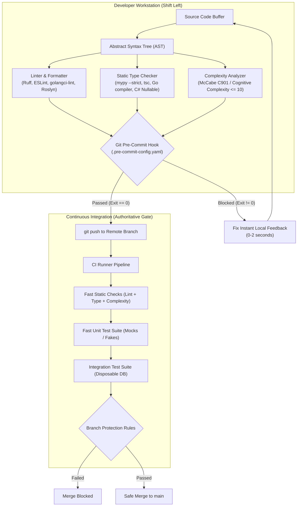
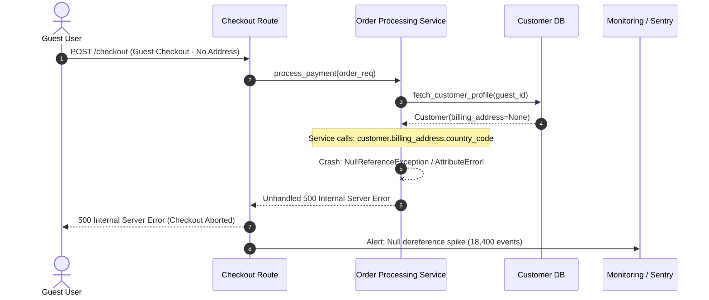

# Module 06: Code Quality and Static Analysis

> **Prerequisites:** [00-testing-fundamentals-and-the-test-pyramid](../00-testing-fundamentals-and-the-test-pyramid/README.md), [01-unit-testing-in-depth](../01-unit-testing-in-depth/README.md), basic static typing annotations, and Git command-line basics.  
> **Estimated Reading Time:** 25 minutes  
> **Target Audience:** Backend engineers, platform architects, and engineering leads designing automated quality gates and shift-left static analysis pipelines.

> [!TIP]
> **Golden Rule of Code Quality:** Treat static analysis as the immutable mechanical floor, not the aspirational ceiling. Linters, type checkers, and complexity metrics eliminate stylistic bike-shedding, unhandled nullable dereferences, and combinatorial path explosions before tests or human reviewers execute a single line.

---

## Visual Mental Models & Architecture

### The Quality Pipeline: Static Verification vs Dynamic Execution

Tests verify **dynamic runtime behavior on selected inputs**, but they cannot inspect code they do not execute, nor can they quantify structural decay. **Static analysis inspects code structure across 100% of source files without running them**, catching structural footguns, type mismatches, dead branches, and excessive complexity in milliseconds.



---

## Systematic Taxonomic Reference Grids

### Static Analysis Categorization & Toolchain Matrix

| Category | Primary Mission | Failure Modes Caught | Execution Overhead | Tooling Ecosystems |
| :--- | :--- | :--- | :--- | :--- |
| **Mechanical Formatter** | Canonical layout & whitespace uniformity | Formatting debates, messy git diffs, inconsistent indentation | Sub-second (<500ms) | Ruff format, Prettier, Black, gofumpt, dotnet-format |
| **Static Linter** | Enforce idiom rules, dead code, bug patterns | Mutable defaults (`[]`), unhandled errors, shadowed builtins, unused imports | Fast (<2s) | Ruff check, ESLint, golangci-lint, SonarLint |
| **Static Type Checker** | Verify sound data flow & contract boundaries | `None`/`nil` dereference, missing union branches, wrong parameter types | Moderate (2-10s) | mypy (`--strict`), Pyright, tsc (`strict`), Roslyn analyzers |
| **Cyclomatic Complexity (C901)** | Bound decision paths per function | Untestable branches, unmaintainable logic, combinatorial bugs | Fast (<1s) | Ruff McCabe (`C901`), Radon, ESLint `complexity`, Gocyclo |
| **SAST Security Scanner** | Detect vulnerable dependencies & bad idioms | Hardcoded credentials, SQL injection, unsafe deserialization | Moderate (5-30s) | Bandit, Semgrep, Snyk, CodeQL, Trivy |

### Cyclomatic Complexity vs Cognitive Complexity Benchmarks

Cyclomatic complexity counts linearly independent execution paths ($M = E - N + 2P$ or branches $+ 1$). Cognitive complexity weights nested control flow higher to mirror human working-memory limits.

| Metric Threshold | Cyclomatic Score (McCabe) | Cognitive Score | Structural Risk & Maintainability Profile | Required Engineering Action |
| :--- | :--- | :--- | :--- | :--- |
| **Low / Clean** | 1 – 5 | 1 – 4 | Linear or single-branch flow; trivial to test exhaustively. | None; ideal maintainable target. |
| **Moderate / Acceptable** | 6 – 10 | 5 – 9 | Well-bounded decision logic; tests cover all branches easily. | Permissible; monitor during code reviews. |
| **High / Risk Boundary** | 11 – 20 | 10 – 19 | Nested conditionals or looping switches; difficult to test completely. | **Refactor:** Extract helper functions or use table dispatch. |
| **Extreme / Tech Debt** | 21+ | 20+ | Untestable monster method; high regression and production bug rate. | **Block CI:** Must decompose into strategy or polymorphic patterns. |

---

## Production War Stories: Incident Post-Mortem

### SEV-1 Post-Mortem: The 100% Test-Covered Null Dereference Crash

#### Incident Overview
* **Severity:** SEV-1 (Critical Revenue Drop)
* **Detection Time:** 42 minutes post-deployment
* **Resolution Time:** 1 hour 18 minutes
* **Impact:** 18,400 checkout attempts failed with HTTP 500 across 3 payment regions; \$412,000 lost in abandoned transactions.

#### What Happened
During a checkout refactoring, an engineer introduced an optional guest-checkout path where `customer.billing_address` was nullable (`None`/`nil`) if the customer opted for one-click digital delivery. The team’s test suite had 100% line coverage because all legacy test fixtures passed a complete customer profile with an initialized address object. The code was tested, but the *absence* of the address was never exercised in tests. 

At deployment, thousands of unauthenticated guest users triggered an unhandled dereference:
`AttributeError: 'NoneType' object has no attribute 'country_code'`.



#### Root Cause Analysis
1. **Dynamic Blind Spot:** The dynamic codebase had no static type checking (`mypy --strict` or strict compiler nullability) enforced in CI.
2. **False Confidence from Test Coverage:** The unit test suite boasted 100% coverage, proving that every line executed when inputs were happy, but masking that branch variations on nullable fields were completely unverified.
3. **Linter Configuration Gap:** Linters were configured only for formatting (`black`), omitting semantic linters and type verifiers.

#### The Fix & Architectural Hardening
1. **Mandatory Strict Null Checking:** Configured `mypy --strict` with `strict_optional = True`, C# `#nullable enable`, and TypeScript `strictNullChecks`. The static type checker immediately flags any direct attribute access on `Address | None` without an explicit null guard.
2. **Pre-Commit Static Quality Gate:** Installed pre-commit hooks that run the full static analyzer suite locally in <2 seconds.
3. **Complexity Ceilings:** Set McCabe cyclomatic complexity limit to 10 (`max-complexity = 10`), forcing engineers to extract branching logic into clean, guarded subroutines.

---

## Multi-Language Production Code Tabs

The following examples demonstrate how to enforce static analysis standards, strict null checks, and McCabe cyclomatic complexity reduction (from a tangled $C=14$ monster method to clean, decoupled, low-complexity modules).

=== "Go"
    ```go
    // Package orders demonstrates strict nil safety and low cyclomatic complexity (gocyclo <= 10).
    package orders

    import (
    	"errors"
    	"fmt"
    )

    var (
    	ErrNilOrder        = errors.New("order cannot be nil")
    	ErrEmptyItems      = errors.New("order must contain at least one item")
    	ErrInvalidCurrency = errors.New("unsupported currency")
    )

    type Address struct {
    	CountryCode string
    	PostalCode  string
    }

    type Order struct {
    	ID             string
    	SubtotalCents  int64
    	Currency       string
    	BillingAddress *Address // Explicit pointer representing optionality
    	IsVIP          bool
    }

    type PriceResult struct {
    	SubtotalCents int64
    	DiscountCents int64
    	TaxCents      int64
    	TotalCents    int64
    }

    // CalculateFinalPrice keeps cyclomatic complexity = 4 by delegating calculation to pure functions.
    func CalculateFinalPrice(order *Order) (PriceResult, error) {
    	if order == nil {
    		return PriceResult{}, ErrNilOrder
    	}
    	if order.SubtotalCents <= 0 {
    		return PriceResult{}, ErrEmptyItems
    	}
    	if order.Currency != "USD" && order.Currency != "EUR" {
    		return PriceResult{}, fmt.Errorf("%w: %s", ErrInvalidCurrency, order.Currency)
    	}

    	discount := computeDiscount(order.SubtotalCents, order.IsVIP)
    	taxable := order.SubtotalCents - discount
    	tax := computeTax(taxable, order.BillingAddress)

    	return PriceResult{
    		SubtotalCents: order.SubtotalCents,
    		DiscountCents: discount,
    		TaxCents:      tax,
    		TotalCents:    taxable + tax,
    	}, nil
    }

    // computeDiscount has cyclomatic complexity = 2
    func computeDiscount(subtotal int64, isVIP bool) int64 {
    	if isVIP && subtotal > 10000 {
    		return subtotal * 15 / 100
    	}
    	return 0
    }

    // computeTax enforces strict nil guard; cyclomatic complexity = 3
    func computeTax(taxableBase int64, addr *Address) int64 {
    	if addr == nil {
    		// Safe fallback: default digital goods interstate tax
    		return taxableBase * 5 / 100
    	}
    	if addr.CountryCode == "US" {
    		return taxableBase * 8 / 100
    	}
    	return taxableBase * 10 / 100
    }
    ```

=== "Node.js/TypeScript"
    ```typescript
    // TypeScript configured with strict: true, noImplicitAny: true, strictNullChecks: true

    export interface Address {
      countryCode: string;
      postalCode: string;
    }

    export interface Order {
      id: string;
      subtotalCents: number;
      currency: "USD" | "EUR";
      billingAddress: Address | null; // Explicit union with null
      isVIP: boolean;
    }

    export interface PriceBreakdown {
      subtotalCents: number;
      discountCents: number;
      taxCents: number;
      totalCents: number;
    }

    export class PricingCalculator {
      /**
       * Calculates price breakdown.
       * McCabe Cyclomatic Complexity: 4 (Clean, testable)
       */
      public calculate(order: Order): PriceBreakdown {
        if (order.subtotalCents <= 0) {
          throw new Error("Invalid subtotal: must be greater than zero");
        }

        const discountCents = this.calculateDiscount(order.subtotalCents, order.isVIP);
        const taxableAmount = order.subtotalCents - discountCents;
        const taxCents = this.calculateTax(taxableAmount, order.billingAddress);

        return {
          subtotalCents: order.subtotalCents,
          discountCents,
          taxCents,
          totalCents: taxableAmount + taxCents,
        };
      }

      private calculateDiscount(subtotalCents: number, isVIP: boolean): number {
        return isVIP && subtotalCents > 10_000 ? Math.floor(subtotalCents * 0.15) : 0;
      }

      private calculateTax(taxableCents: number, address: Address | null): number {
        // Compiler error without the null guard when strictNullChecks is true
        if (!address) {
          return Math.floor(taxableCents * 0.05); // Default digital rate
        }
        return address.countryCode === "US"
          ? Math.floor(taxableCents * 0.08)
          : Math.floor(taxableCents * 0.10);
      }
    }
    ```

=== "Python"
    ```python
    """Production quality module configured for Ruff (lint + format) and mypy --strict."""

    from __future__ import annotations

    from dataclasses import dataclass
    from typing import Literal


    @dataclass(frozen=True, slots=True)
    class Address:
        country_code: str
        postal_code: str


    @dataclass(frozen=True, slots=True)
    class Order:
        order_id: str
        subtotal_cents: int
        currency: Literal["USD", "EUR"]
        billing_address: Address | None  # Optional type hint enforced by mypy
        is_vip: bool = False


    @dataclass(frozen=True, slots=True)
    class PriceBreakdown:
        subtotal_cents: int
        discount_cents: int
        tax_cents: int
        total_cents: int


    def calculate_price(order: Order) -> PriceBreakdown:
        """Calculate final order total with low McCabe complexity (C901 <= 4)."""
        if order.subtotal_cents <= 0:
            msg = "Subtotal must be greater than zero"
            raise ValueError(msg)

        discount = _compute_discount(order.subtotal_cents, is_vip=order.is_vip)
        taxable_base = order.subtotal_cents - discount
        tax = _compute_tax(taxable_base, order.billing_address)

        return PriceBreakdown(
            subtotal_cents=order.subtotal_cents,
            discount_cents=discount,
            tax_cents=tax,
            total_cents=taxable_base + tax,
        )


    def _compute_discount(subtotal: int, *, is_vip: bool) -> int:
        return subtotal * 15 // 100 if is_vip and subtotal > 10_000 else 0


    def _compute_tax(taxable_base: int, address: Address | None) -> int:
        # mypy --strict flags address.country_code as illegal if address is None
        if address is None:
            return taxable_base * 5 // 100
        if address.country_code == "US":
            return taxable_base * 8 // 100
        return taxable_base * 10 // 100
    ```

=== "C#"
    ```csharp
    #nullable enable
    namespace BackendRoadmap.Quality;

    using System;

    public record Address(string CountryCode, string PostalCode);

    public record Order(
        string OrderId,
        long SubtotalCents,
        string Currency,
        Address? BillingAddress, // Explicit nullable reference type
        bool IsVip = false
    );

    public record PriceBreakdown(
        long SubtotalCents,
        long DiscountCents,
        long TaxCents,
        long TotalCents
    );

    public static class PricingCalculator
    {
        /// <summary>
        /// Calculates final price. Cyclomatic Complexity is strictly bounded (<= 4).
        /// </summary>
        public static PriceBreakdown Calculate(Order order)
        {
            ArgumentNullException.ThrowIfNull(order);

            if (order.SubtotalCents <= 0)
                throw new ArgumentException("Subtotal must be greater than zero", nameof(order));

            long discount = ComputeDiscount(order.SubtotalCents, order.IsVip);
            long taxable = order.SubtotalCents - discount;
            long tax = ComputeTax(taxable, order.BillingAddress);

            return new PriceBreakdown(
                SubtotalCents: order.SubtotalCents,
                DiscountCents: discount,
                TaxCents: tax,
                TotalCents: taxable + tax
            );
        }

        private static long ComputeDiscount(long subtotal, bool isVip) =>
            isVip && subtotal > 10_000 ? subtotal * 15 / 100 : 0;

        private static long ComputeTax(long taxable, Address? address) =>
            address switch
            {
                null => taxable * 5 / 100, // Safe compiler-enforced pattern match
                { CountryCode: "US" } => taxable * 8 / 100,
                _ => taxable * 10 / 100
            };
    }
    ```

---

## Practical Hands-On Verification CLI Workflows

### Configuring the Modern Automated Toolchain

#### 1. Python Toolchain Configuration (`pyproject.toml`)
```toml
[tool.ruff]
line-length = 88
target-version = "py312"

[tool.ruff.lint]
select = [
    "E",    # pycodestyle errors
    "W",    # pycodestyle warnings
    "F",    # pyflakes (unused imports, variables)
    "I",    # isort (import ordering)
    "B",    # flake8-bugbear (common design footguns)
    "C901", # mccabe cyclomatic complexity
    "UP",   # pyupgrade
    "SIM",  # flake8-simplify
]

[tool.ruff.lint.mccabe]
max-complexity = 10

[tool.mypy]
python_version = "3.12"
strict = true
warn_return_any = true
warn_unused_ignores = true
disallow_untyped_defs = true
```

#### 2. Local Shift-Left Git Hook (`.pre-commit-config.yaml`)
```yaml
repos:
  - repo: https://github.com/astral-sh/ruff-pre-commit
    rev: v0.6.2
    hooks:
      - id: ruff
        args: [--fix]
      - id: ruff-format
  - repo: https://github.com/pre-commit/mirrors-mypy
    rev: v1.11.1
    hooks:
      - id: mypy
        additional_dependencies: [types-requests]
```

#### 3. Execution & Verification Commands

```bash
# Install git hooks
pre-commit install

# Run formatting & automated lint fixes across all files
ruff format .
ruff check --fix .

# Verify cyclomatic complexity bounds strictly
ruff check --select C901 .

# Run strict static type checking
mypy app/

# Multi-language equivalents:
# Go: golangci-lint run --enable=gocyclo,nilaway ./...
# Node/TS: npx eslint --max-warnings 0 src/ && npx tsc --noEmit
# C#: dotnet format --verify-no-changes && dotnet build -warnaserror
```

**Expected Wire Output (Clean Gate Pass):**
```text
All checks passed!
All 42 source files formatted.
Found 0 errors across 42 files (checked in 0.14s).
Success: no issues found in 42 source files (mypy --strict passed).
```

---

## Operational Validation Checkpoints (Scenario Quizzes)

### Checkpoint 1: The Passing Test Suite with the Latent Null Crash
<details>
<summary><strong>Scenario Assessment:</strong> A pull request modifies an order checkout service. The unit test suite passes with 100% line coverage and zero assertions failing. However, when deployed, guest orders without billing addresses crash the application. Why did unit tests fail to catch this, and how does static type checking structurally eliminate the defect?</summary>

<strong>Answer:</strong>
Unit test coverage measures **which lines of code were executed**, not which data states, edge cases, or permutations were validated. Because the test fixtures always populated a dummy `Address` object, the execution path `order.billing_address.country_code` was executed without ever passing `None`/`nil`.

A static type checker (`mypy --strict`, TypeScript `strictNullChecks`, or C# `#nullable enable`) evaluates the **type contract independent of runtime test fixtures**. When `billing_address` is declared as `Address | None`, the type checker parses the AST and detects that `.country_code` is being accessed on a union that includes `None`. It fails the build at compile/lint time with a type-mismatch error, requiring an explicit guard (`if order.billing_address is None: ...`) before the code can even be compiled or committed.
</details>

### Checkpoint 2: Shifting Quality Left (Pre-Commit vs CI Enforcement)
<details>
<summary><strong>Scenario Assessment:</strong> A developer submits a proposal to delete local pre-commit hooks, arguing: "CI runs Ruff, MyPy, and tests on every push anyway; running them locally slows down my git commit cadence." How do you defend retaining pre-commit hooks from an architectural and engineering economics standpoint?</summary>

<strong>Answer:</strong>
Relying solely on CI introduces a severe **feedback latency penalty and compute waste**:
1. **Feedback Delay:** A pre-commit hook runs in <500ms directly on the developer's CPU. CI requires pushing commits, scheduling an ephemeral runner, provisioning containers, and checking out dependencies—taking 3 to 10 minutes to notify the developer of a missing import or formatting issue.
2. **Context Switching:** Developers push and immediately switch tasks. Receiving a CI failure notification 8 minutes later forces an expensive cognitive context switch to fix trivial mechanical errors.
3. **Polluted Git History:** CI-only linting results in messy commit logs littered with "fix lint", "fix formatting typo", and "retry ci".
4. **CI Queue Starvation:** Running CI jobs that immediately abort due to easily preventable formatting or type errors consumes runner concurrency that blocks legitimate integration and deployment jobs for other team members.

Pre-commit hooks shift mechanical validation to the earliest possible point (seconds before commit), while CI serves as the authoritative, tamper-proof backstop.
</details>

### Checkpoint 3: Refactoring a McCabe Cyclomatic Complexity Violation
<details>
<summary><strong>Scenario Assessment:</strong> A function calculating insurance premiums contains 18 nested `if/elif/else` statements evaluating age, region, driving history, and credit score. The linter fails with `C901: 'calculate_premium' is too complex (19 > 10)`. An engineer proposes raising the threshold in `pyproject.toml` to `max-complexity = 25` to unblock deployment. How do you resolve this violation properly?</summary>

<strong>Answer:</strong>
Raising the McCabe ceiling to 25 normalizes technical debt and conceals untestable code. A cyclomatic complexity of 19 means there are **19 distinct execution branches**, requiring at least 19 distinct test cases just to achieve branch coverage.

The proper resolution is to decompose the function into independent, modular calculation strategies:
1. Extract independent domain rules into dedicated helper functions (e.g., `calculate_age_factor(age)`, `calculate_regional_surcharge(region)`, `calculate_violations_penalty(history)`).
2. Each helper function maintains a cyclomatic complexity $\le 4$, making each independently testable with targeted unit tests.
3. Replace nested conditionals with **table-driven lookups / dictionary dispatch** or a **rules pipeline pattern** (a list of pure functions executed sequentially: `functools.reduce`).
4. Keep the orchestration function linear and flat, reducing its McCabe score to $\le 3$, and retain the strict `max-complexity = 10` ceiling in the linter configuration.
</details>

---

## Summary & Further Study

- **Mechanical Floor vs Human Ceiling:** Linters, formatters, and type checkers eliminate mechanical noise so human code reviews can focus on business logic, naming precision, and architecture.
- **Strict Typing:** Always enable strict nullability checks (`strict = true`, `strictNullChecks`, `#nullable enable`) to prevent production `AttributeError`/`NullReferenceException` crashes.
- **Complexity Budgets:** Enforce McCabe cyclomatic complexity $\le 10$ to prevent unmaintainable monster methods.

### Further Reading
- [Ruff Documentation & Rule Reference](https://docs.astral.sh/ruff/)
- [Mypy Reference Manual — Strict Typing Guidelines](https://mypy.readthedocs.io/en/stable/)
- [Martin Fowler on Refactoring and Cyclomatic Complexity](https://martinfowler.com/articles/refactoring-2nd-ed.html)
- [Pre-Commit Framework Documentation](https://pre-commit.com/)
