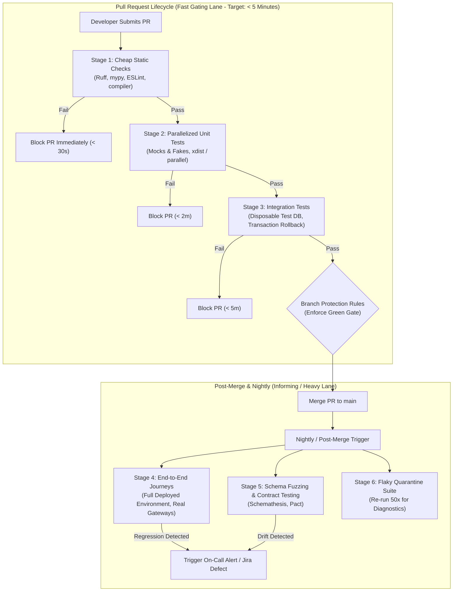
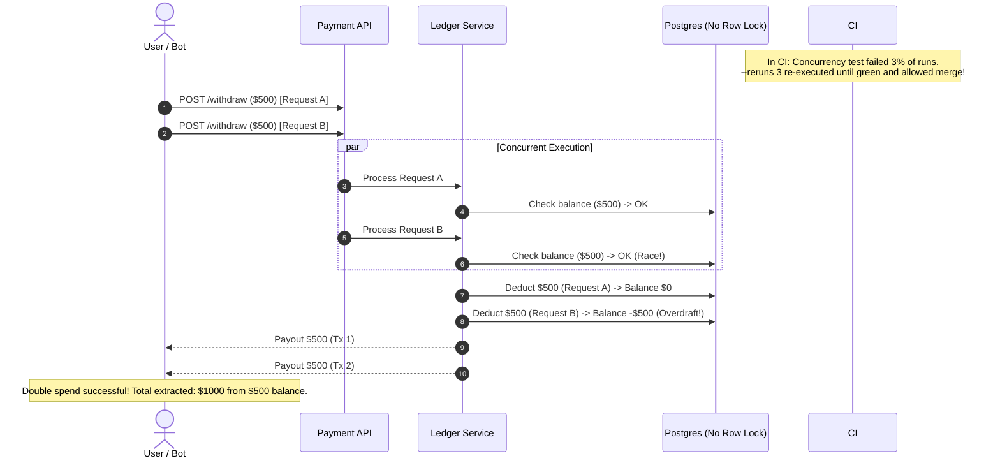

# Module 07: Testing in CI and Test Strategy

> **Prerequisites:** [00-testing-fundamentals-and-the-test-pyramid](../00-testing-fundamentals-and-the-test-pyramid/README.md) through [06-code-quality-and-static-analysis](../06-code-quality-and-static-analysis/README.md), familiarity with Git workflows, and basic containerization concepts.  
> **Estimated Reading Time:** 30 minutes  
> **Target Audience:** Senior backend engineers, DevOps/platform engineers, and engineering managers designing resilient CI verification pipelines and long-term testing strategies.

> [!TIP]
> **Golden Rule of CI Test Strategy:** A test suite is a living production system with finite latency and trust budgets. Never mask non-deterministic failures with blanket automatic test retries—quarantine flaky tests visibly, isolate their root causes, and enforce fast, fail-fast gating lanes on every pull request while reserving slow end-to-end journeys for asynchronous scheduled pipelines.

---

## Visual Mental Models & Architecture

### The Staged CI Pipeline: Gating Lane vs Informing Lane

To keep development velocity high without compromising production stability, modern CI pipelines split validation into **fast, merge-blocking gating lanes** and **slow, non-blocking informing lanes**.



---

## Systematic Taxonomic Reference Grids

### Pipeline Staging Matrix: Speed, Scope, and Enforcement

| Pipeline Lane | Trigger Event | Included Layers | Max Latency Target | Merge Blocker? | Failure Action |
| :--- | :--- | :--- | :--- | :--- | :--- |
| **Local Pre-Commit** | `git commit` | Formatter, linters, fast type checks | < 2 seconds | Yes (Local) | Aborts commit immediately |
| **Fast Gating PR** | `git push` / PR open | Linters, type checks, unit tests, fast integration | < 5 minutes | **Yes (Authoritative)** | Blocks branch merge via branch protection |
| **Merge to Main** | Push to `main` | Fast gating suite + smoke tests + container build | < 10 minutes | Yes (Deployment) | Halts staging deployment pipeline |
| **Nightly / Scheduled** | Cron (02:00 UTC) | Full E2E journeys, chaos tests, contract fuzzing | 30 – 60 minutes | No (Informing) | Emits PagerDuty / Slack alert to on-call |
| **Quarantine Lane** | Cron / Hourly | Marked flaky tests (`@flaky_quarantine`) | 15 minutes | No (Diagnostic) | Generates statistical flakiness metrics |

### The 4 Root Causes of Flaky Tests & Systematic Triage

| Root Cause Category | Mechanism of Flakiness | Anti-Pattern "Fix" (Dangerous) | Architectural Resolution (Standard) |
| :--- | :--- | :--- | :--- |
| **1. Timing & Asynchrony** | Asserting before background worker/event completes | Arbitrary `time.sleep(2)` | Explicit condition polling with exponential backoff & timeout (`wait_for_condition`) |
| **2. Shared State & Leakage** | Tests mutate shared DB rows, static globals, or file system | Re-running suite serially | Per-test transaction rollbacks, ephemeral schema isolation, clean fixture teardown |
| **3. Nondeterministic Inputs** | System clock drift, unseeded `random()`, unsorted hash maps | Rerunning failed tests 3 times | Dependency injection for clock/time providers; explicit random seeds; stable sorting |
| **4. External Dependencies** | Third-party API rate limits, network jitter, DNS drops | Ignoring failures when CI is red | Edge fakes, WireMock/Prism stubs, or mock contracts for external APIs |

---

## Production War Stories: Incident Post-Mortem

### SEV-1 Post-Mortem: The Blanket Retry That Hid a Double-Spend Race Condition

#### Incident Overview
* **Severity:** SEV-1 (Critical Financial Loss)
* **Detection Time:** 6 days post-deployment
* **Financial Impact:** \$1,240,000 in duplicate wallet payouts across 4,200 accounts
* **Resolution Time:** 4 hours 15 minutes (Database rollback & distributed lock patch)

#### What Happened
A backend payment service had a suite of 450 integration tests. During a sprint, an integration test verifying concurrent withdrawal transactions began failing intermittently in CI (~3% failure rate). Under pressure to meet a release deadline, an engineer configured the CI pipeline with a global retry flag: `pytest --reruns 3 --reruns-delay 1`.

The CI pipeline turned completely green. PRs merged cleanly.

In production, the intermittent failure was not a flaky test—it was a **real concurrency race condition** where two simultaneous withdrawal requests bypassed wallet balance validation due to missing row-level database locking (`SELECT ... FOR UPDATE`). In CI, the test had caught the race condition 3% of the time. The `--reruns 3` policy simply re-ran the test until it hit the 97% scenario where threads executed sequentially, hiding the defect and shipping it straight to production.



#### Root Cause Analysis
1. **Masking Defects with Blanket Retries:** Global automatic retries treat all non-deterministic failures as harmless infrastructure glitches, destroying the test suite's ability to detect race conditions and timing flaws.
2. **Missing Concurrency Hardening:** The ledger service relied on application-level balance checks without pessimistic row locking or database constraints.
3. **Absence of Quarantine Discipline:** The team had no formal quarantine process to track and triage intermittent test failures to their underlying root causes.

#### The Fix & Architectural Hardening
1. **Banned Global Retries:** Stripped all global `--reruns` flags from CI pipelines.
2. **Visible Quarantine Protocol:** Implemented a `@pytest.mark.flaky_quarantine` marker that isolates unstable tests into a separate diagnostic pipeline that does not gate PR merges but alerts the owning team.
3. **Database Concurrency Protection:** Added pessimistic locking (`SELECT balance FROM wallets WHERE id = $1 FOR UPDATE`) and database check constraints (`balance >= 0`).

---

## Multi-Language Production Code Tabs

The following code tabs illustrate production CI workflows and test suite configurations that enforce staged lanes, quarantine markers, and race detection.

=== "Go"
    ```yaml
    # .github/workflows/ci.yml - Go Staged CI Pipeline
    name: Go Test & Quality Gate
    on: [push, pull_request]

    jobs:
      fast-gate:
        name: Fast PR Gate
        runs-on: ubuntu-latest
        timeout-minutes: 5
        steps:
          - uses: actions/checkout@v4
          - uses: actions/setup-go@v5
            with:
              go-version: '1.22'
              cache: true

          - name: Static Analysis
            run: |
              go vet ./...
              # golangci-lint enforces styling, dead code, and complexity
              curl -sSfL https://raw.githubusercontent.com/golangci/golangci-lint/master/install.sh | sh -s -- -b $(go env GOPATH)/bin v1.59.1
              golangci-lint run --timeout 2m

          - name: Unit Tests with Race Detector (Fail Fast)
            # -race detects data races; exclude slow e2e/integration tags
            run: go test -v -race -timeout 2m -short ./...

      nightly-e2e:
        name: Nightly E2E & Quarantine Suite
        if: github.event_name == 'schedule' || github.ref == 'refs/heads/main'
        runs-on: ubuntu-latest
        timeout-minutes: 20
        steps:
          - uses: actions/checkout@v4
          - uses: actions/setup-go@v5
            with:
              go-version: '1.22'
          - name: Run E2E Integration Suite
            run: go test -v -tags=e2e -timeout 15m ./tests/e2e/...
    ```

=== "Node.js/TypeScript"
    ```yaml
    # .github/workflows/ci.yml - Node/TypeScript Staged CI Pipeline
    name: Node.js CI Pipeline
    on: [push, pull_request]

    jobs:
      fast-lane:
        name: Fast Gating Lane (< 4m)
        runs-on: ubuntu-latest
        timeout-minutes: 6
        steps:
          - uses: actions/checkout@v4
          - uses: actions/setup-node@v4
            with:
              node-version: 20
              cache: 'npm'

          - name: Install Pinned Dependencies
            run: npm ci

          - name: Lint & Typecheck
            run: |
              npm run lint
              npx tsc --noEmit

          - name: Parallel Unit Tests
            # vitest / jest configured to exclude e2e and quarantine tests
            run: npx vitest run --testPathIgnorePatterns=".*(e2e|quarantine).*" --bail=1 --coverage

      informing-e2e:
        name: Scheduled E2E & Flake Diagnostics
        if: github.ref == 'refs/heads/main'
        runs-on: ubuntu-latest
        timeout-minutes: 25
        steps:
          - uses: actions/checkout@v4
          - uses: actions/setup-node@v4
            with:
              node-version: 20
          - run: npm ci
          - name: Run E2E Test Suite
            run: npm run test:e2e
    ```

=== "Python"
    ```yaml
    # .github/workflows/ci.yml - Python Fast Gating vs Nightly Lanes
    name: Python CI Quality Gate
    on: [push, pull_request]

    jobs:
      fast-gate:
        name: Fast Gating Lane (< 4m)
        runs-on: ubuntu-latest
        timeout-minutes: 5
        steps:
          - uses: actions/checkout@v4
          - uses: actions/setup-python@v5
            with:
              python-version: "3.12"
              cache: "pip"

          - name: Install Locked Dependencies
            run: pip install -e ".[dev]"

          - name: Stage 1 - Cheap Static Checks
            run: |
              ruff check .
              ruff format --check .
              mypy app/

          - name: Stage 2 - Parallel Unit & Integration Tests
            # Exclude e2e and quarantined tests; parallelize with xdist
            run: |
              pytest -m "not e2e and not flaky_quarantine" \
                -n auto \
                --maxfail=1 \
                --durations=10 \
                --cov=app \
                --cov-report=term-missing

      nightly-e2e:
        name: Nightly E2E & Diagnostic Suite
        if: github.ref == 'refs/heads/main' || github.event_name == 'schedule'
        runs-on: ubuntu-latest
        timeout-minutes: 30
        steps:
          - uses: actions/checkout@v4
          - uses: actions/setup-python@v5
            with:
              python-version: "3.12"
          - run: pip install -e ".[dev]"
          - name: Run End-to-End Journeys
            run: pytest -m "e2e" --durations=0
          - name: Run Quarantined Flake Diagnostics (Non-Blocking)
            continue-on-error: true
            run: pytest -m "flaky_quarantine" --count=20
    ```

=== "C#"
    ```yaml
    # .github/workflows/ci.yml - .NET / C# Staged CI Pipeline
    name: .NET CI Pipeline
    on: [push, pull_request]

    jobs:
      fast-gate:
        name: Fast PR Gate (< 5m)
        runs-on: ubuntu-latest
        timeout-minutes: 6
        steps:
          - uses: actions/checkout@v4
          - uses: actions/setup-dotnet@v4
            with:
              dotnet-version: '8.0.x'

          - name: Code Formatting & Roslyn Analyzers
            run: |
              dotnet format --verify-no-changes
              dotnet build -c Release -warnaserror

          - name: Fast Unit Tests
            # Filter out slow E2E and Quarantined tests
            run: |
              dotnet test -c Release --no-build \
                --filter "Category!=E2E&Category!=FlakyQuarantine" \
                --logger "console;verbosity=normal"

      nightly-e2e:
        name: Nightly E2E Journeys
        if: github.ref == 'refs/heads/main'
        runs-on: ubuntu-latest
        timeout-minutes: 30
        steps:
          - uses: actions/checkout@v4
          - uses: actions/setup-dotnet@v4
            with:
              dotnet-version: '8.0.x'
          - name: Run Full E2E Journeys
            run: dotnet test -c Release --filter "Category=E2E"
    ```

---

## Practical Hands-On Verification CLI Workflows

### Triage and Elimination of Flaky Tests

#### 1. Diagnosing Slow and Flaky Tests Locally
```bash
# Identify top 10 slowest tests in the suite
pytest --durations=10

# Stress-test an intermittent test by executing it 30 times in random order
pytest -p randomly --count=30 tests/unit/test_order_processing.py

# Run tests in parallel across all available CPU cores
pytest -m "not e2e" -n auto
```

#### 2. Marking and Quarantining a Flaky Test (`tests/conftest.py`)
```python
# Quarantine marker declaration without hiding the test
# tests/integration/test_async_webhook.py
import pytest


@pytest.mark.flaky_quarantine(
    reason="Issue #482: Timing race condition in third-party webhook callback; assigned to @platform"
)
def test_async_webhook_arrival():
    # Test logic remains intact and executable
    pass
```

#### 3. Verification of Gating Separation
```bash
# Execute only fast gating tests (expected in PR CI)
pytest -m "not e2e and not flaky_quarantine" -q

# Execute quarantined diagnostics independently
pytest -m "flaky_quarantine" -v
```

**Expected Wire Output (Fast Gating Lane):**
```text
============================= test session starts ==============================
platform linux -- Python 3.12.2, pytest-8.3.1, pluggy-1.5.0
rootdir: /workspace/service
configfile: pyproject.toml
plugins: xdist-3.5.0, cov-5.0.0
42 passed, 2 deselected in 1.48s
======================== 42 passed, 2 deselected in 1.48s ========================
```

---

## Operational Validation Checkpoints (Scenario Quizzes)

### Checkpoint 1: The Danger of Blanket CI Test Retries
<details>
<summary><strong>Scenario Assessment:</strong> A test suite has 1,200 tests. Four integration tests fail unpredictably once every 20-30 CI runs. A tech lead proposes adding <code>--reruns 3</code> to the CI test step to "prevent spurious build breaks and keep developer momentum high." Why is this practice unacceptable in high-reliability backend systems, and what is the proper engineering response?</summary>

<strong>Answer:</strong>
A blanket `--reruns 3` policy is dangerous because it **destroys the detection fidelity of the test suite**:
1. **Concealing Real Production Defects:** Intermittent failures in integration suites are frequently caused by real race conditions, deadlocks, transaction isolation leaks, and unhandled async timeouts. Blanket retries rerun the code until lucky thread scheduling yields a passing run, allowing concurrency bugs to ship straight to production.
2. **False Trust:** Engineers learn that green CI does not mean correct software, while red CI can simply be ignored or retried.
3. **Severe CI Runtime Degradation:** When legitimate regressions occur, every failing test is rerun 3 times, tripling the execution time and causing CI runner starvation.

**Proper Engineering Response:**
1. **Quarantine Immediately:** Apply a custom `@pytest.mark.flaky_quarantine` marker to exclude the unstable tests from the merge-blocking PR gate.
2. **Track with Ownership:** File a high-priority defect issue linked directly to the quarantine marker with an assigned engineer and SLA.
3. **Execute in Diagnostic Lane:** Run quarantined tests in a non-blocking diagnostic CI job (e.g., repeating 50 times) to collect thread dumps, timing metrics, and logs.
4. **Root-Cause Fix:** Fix the underlying cause (replace `sleep` with event polling, fix database isolation, inject deterministic clocks) and remove the quarantine marker.
</details>

### Checkpoint 2: Structuring Fast Gating vs Nightly Informing Pipelines
<details>
<summary><strong>Scenario Assessment:</strong> An engineering team has 15 End-to-End (E2E) tests that provision real cloud infrastructure, initiate payments, and take 38 minutes to complete. These tests run on every pull request, causing massive developer frustration and leading teams to batch large PRs together. How should the team restructure its pipeline and test strategy?</summary>

<strong>Answer:</strong>
The team has built an inverted test pyramid (an "ice-cream cone") and misplaced its feedback loops:
1. **Split into Staged Lanes:**
   - **Fast Gating PR Lane (< 5 minutes):** Execute linters, type checkers (`mypy --strict`), unit tests with fakes, and fast integration tests using lightweight disposable test databases. This job runs on every push and gates the merge via branch protection.
   - **Informing Nightly / Post-Merge Lane (30-40 minutes):** Move the heavy 38-minute E2E cloud journeys to a scheduled nightly pipeline and post-merge staging trigger. Regressions trigger alerts to the on-call engineer rather than blocking developers during routine PR authoring.
2. **Push Verification Down:**
   - Analyze the 15 E2E tests: most are likely validating business rules, validation errors, or edge cases that do not require full cloud infrastructure.
   - Re-implement those edge scenarios as unit tests (for pure business logic) or integration tests with `TestClient` and mocks/fakes.
   - Retain only 1 or 2 critical smoke journeys (e.g., complete user registration to paid checkout) in the top E2E tier.
</details>

### Checkpoint 3: Branch Protection Enforcement Mechanics
<details>
<summary><strong>Scenario Assessment:</strong> A company has a comprehensive GitHub Actions CI workflow that runs linters, unit tests, and security scans. However, junior engineers frequently merge code that breaks the staging environment because tests failed during their PR. When questioned, they say: "The tests were red, but we needed to get the hotfix out immediately." What architectural control is missing?</summary>

<strong>Answer:</strong>
The repository is missing **enforced Branch Protection Rules**:
1. Without branch protection, CI is merely an **advisory reporter**; GitHub/GitLab will still allow developers with write access to click "Merge" even if every status check is red.
2. **Architectural Hardening:**
   - Configure Branch Protection on the default branch (`main` / `master`).
   - Enable **"Require status checks to pass before merging"** and explicitly designate the fast gating CI job (e.g., `fast-gate`) as a **Required Status Check**.
   - Enable **"Require branches to be up to date before merging"** to ensure code is validated against the latest HEAD of main.
   - Enable **"Do not allow bypassing the above settings"** (even for repository administrators) to eliminate accidental or unauthorized overrides.
</details>

---

## Cumulative Track Review

*Test your understanding across the entirety of Track 12 (Modules 00 through 07) before undertaking the Capstone Project.*

<details>
<summary><strong>1. Test Pyramid Layering & Doubles Selection:</strong> For each scenario, state its appropriate pyramid layer, the test double type to use (dummy, stub, spy, mock, fake), and its CI lane:</summary>

1. **Email address format validation (`user@example.com`):** Unit test; no test double (pure function); Fast Gating PR lane.
2. **Payment service charges third-party Stripe API exactly once on checkout:** Unit test; Mock with strict interface specification (`Mock(spec=PaymentGateway)`); Fast Gating PR lane.
3. **Order repository persists line items into PostgreSQL with foreign key constraints:** Integration test; Disposable test container / real PostgreSQL instance; Fast Gating PR lane.
4. **OpenAPI contract verification against schema drift:** Contract test (Schemathesis / Pact); Fast Gating PR lane or Nightly lane depending on execution time.
5. **Full multi-step user onboarding and credit card payment journey:** End-to-End (E2E) test; Fake third-party edge adapters; Nightly / Scheduled Informing lane.
</details>

<details>
<summary><strong>2. Latent Defect Detection Across Pyramid Nets:</strong> How can a codebase have 100% statement test coverage, pass all unit tests, and yet fail in production due to a SQL syntax error and a null dereference?</summary>

1. **Coverage vs Verification:** Unit tests mock out the database repository, so the real SQL query string is never parsed or executed by a real relational database engine during unit testing.
2. **Missing Integration Net:** Without integration tests against real PostgreSQL, dialect-specific syntax bugs or constraint violations remain undetected until runtime.
3. **Dynamic Typing Blind Spot:** If unit test fixtures always provide populated objects, dynamic attribute access (`user.profile.avatar_url`) executes fine in tests. Without static type checkers (`mypy --strict`, TypeScript `strictNullChecks`), the unhandled `None` path on optional fields crashes in production.
</details>

<details>
<summary><strong>3. The TDD Rhythm in Practice:</strong> Detail the Red-Green-Refactor cycle when adding a volume discount rule (10% off orders > $100):</summary>

1. **Red:** Write a failing test `test_order_discount_applied_above_threshold()` expecting a 10% discount on an order of $150. Run test; assert that it fails because the discount logic or function does not exist.
2. **Green:** Implement the simplest possible production code to make the test pass (e.g., `if order.subtotal > 100: return order.subtotal * 0.10; return 0`). Run tests; verify green.
3. **Refactor:** Parameterize the test using `@pytest.mark.parametrize` to cover boundary conditions ($99.99, $100.00, $100.01), extract magic numbers into domain constants, and ensure cyclomatic complexity remains low. All tests remain green throughout.
</details>

---

## Summary & Further Study

- **Staged CI Lanes:** Split verification into fast, merge-blocking PR gates (< 5 min) and deep, non-blocking nightly suites.
- **Flake Triage:** Never use blanket `--reruns`. Quarantine flaky tests visibly, diagnose the root cause (timing, state, nondeterminism, external), and repair the architecture.
- **Branch Protection:** Enforce green required checks so broken code can never physically merge into production branches.

### Further Reading
- [Martin Fowler on Continuous Integration](https://martinfowler.com/articles/continuousIntegration.html)
- [Martin Fowler on Eradicating Non-Determinism in Tests](https://martinfowler.com/articles/nonDeterminism.html)
- [Google Testing Blog: Flaky Tests at Google](https://testing.googleblog.com/2016/05/flaky-tests-at-google-and-how-we.html)
- [GitHub Actions Documentation: Managing Protected Branches](https://docs.github.com/en/repositories/configuring-branches-and-merges-in-your-repository/managing-protected-branches)
