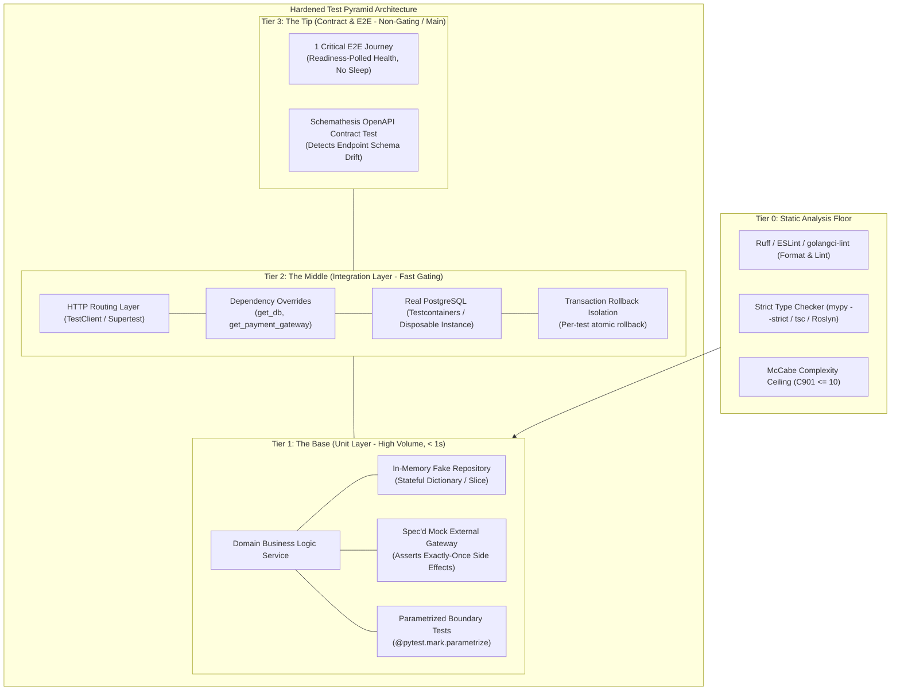
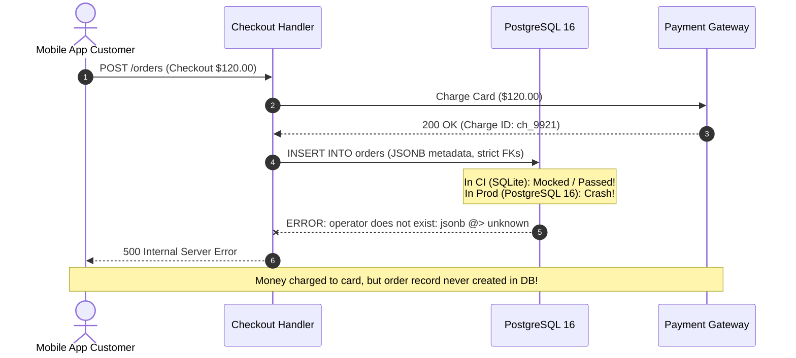

# Module 08: Capstone Project: Production-Grade Test Suite & Quality Gate

> **Prerequisites:** Complete mastery of Modules 00 through 07 in Track 12, covering test pyramid design, unit testing, TDD, database integration testing, mocking/fakes, contract/e2e testing, static quality gates, and CI staging.  
> **Estimated Project Time:** 4 to 8 hours  
> **Target Audience:** Backend engineers ready to apply comprehensive testing and quality assurance patterns to an end-to-end production backend service.

> [!TIP]
> **Golden Rule of the Capstone:** Real engineering competence is measured by what you do when facing an untested legacy codebase. Never rewrite the application to fit the tests—refactor boundaries surgically for testability, push external dependencies behind injected interfaces, isolate database state per test, and prove every layer with deterministic, non-flaky verification.

---

## Visual Mental Models & Architecture

### The Complete Capstone Test Architecture

The capstone project requires transforming an untested, coupled backend service into a fully hardened, multi-tier testing ecosystem.



---

## Systematic Taxonomic Reference Grids

### Capstone Architectural Verification Matrix

| Verification Tier | Component Under Test | Isolation & Double Strategy | Target Runtime Budget | Pass / Fail Gate Criteria |
| :--- | :--- | :--- | :--- | :--- |
| **Tier 0: Static Floor** | 100% of codebase files | Static AST inspection (No code execution) | < 3 seconds | 0 lint errors, 0 type mismatches (`--strict`), 0 functions with McCabe > 10. |
| **Tier 1: Unit Base** | Domain services, pricing rules, validation | In-memory fake repository; spec'd mock for external side-effects | < 2 seconds (< 5ms per test) | 100% branch coverage of business logic; independent test order. |
| **Tier 2: Integration** | Repositories, route handlers, SQL queries | Real PostgreSQL (Testcontainers); transaction rollback; clean teardown | < 15 seconds | Verified 201/400/404/409/422 status codes, real DB constraints, pagination caps. |
| **Tier 3: Tip (E2E/Contract)** | End-to-end user checkout journey OR OpenAPI spec | Running application process; stubbed external billing provider | < 30 seconds | 0 drift violations on OpenAPI schema; successful multi-step transaction. |
| **Tier 4: CI Pipeline** | Full PR merge gate | Staged GitHub Actions workflow (`fast-gate` vs `nightly-e2e`) | < 5 minutes | PR merge blocked if Tier 0, 1, or 2 fails. |

### Defect Seam Matrix: What Each Layer Protects

| System Seam | Potential Production Failure Mode | Guarded By Pyramid Layer | Verification Mechanism |
| :--- | :--- | :--- | :--- |
| **Domain Logic** | Incorrect discount calculation on boundary values | **Unit Base** | Parametrized tests with in-memory fake repository |
| **External Side Effect** | Charging credit card twice on network timeout | **Unit Base** | Mock with strict interface spec (`assert_called_once_with`) |
| **Database Schema** | SQL syntax error, missing foreign key, constraint failure | **Integration Tier** | Real PostgreSQL via Testcontainers with atomic rollback |
| **Serialization / HTTP** | Malformed request body, missing required JSON fields | **Integration Tier** | `TestClient` verifying aggregated `422 Unprocessable Entity` |
| **Interface Drift** | Frontend expects `total_cents`, backend renamed to `total` | **Contract Tip** | Schemathesis property-based schema validation |
| **Race Conditions** | Double-spending balance due to lack of row locking | **Integration Tier** | Multi-threaded test client invoking real database transaction |

---

## Production War Stories: Incident Post-Mortem

### SEV-1 Post-Mortem: The "SQLite in CI, Postgres in Production" Catastrophe

#### Incident Overview
* **Severity:** SEV-1 (Complete Checkout Outage)
* **Detection Time:** 14 minutes post-deployment
* **Financial Impact:** \$285,000 in dropped transactions; 1,950 corrupted customer balance records
* **Resolution Time:** 3 hours 40 minutes (Data repair scripts & schema hotfix)

#### What Happened
An engineering team was preparing to ship a high-throughput order checkout service. To keep CI execution "fast and lightweight," they configured their integration tests to run against an in-memory SQLite database (`sqlite:///:memory:`) while production ran PostgreSQL 16.

The service had an order total calculation that stored monetary amounts as 64-bit BigInt cents. During a refactor, an engineer modified an order query to use PostgreSQL's `JSONB` containment operators (`WHERE metadata @> '{"tier": "vip"}'`) and relied on strict foreign-key cascade deletes.

In CI with SQLite:
1. SQLite does not support `JSONB` syntax natively, so the developer mocked out the query in the repository.
2. SQLite silently ignored PostgreSQL's strict enum and type constraints, passing string representations into numeric columns without complaining.
3. Tests were 100% green in CI.

At deployment to production:
The moment the first production order was submitted, the PostgreSQL engine threw a syntax error on the un-emulated repository query: `psycopg2.errors.UndefinedFunction: operator does not exist: jsonb @> unknown`. Worse, a concurrent payment rollback failed because SQLite's locking model behaved completely differently than PostgreSQL's Multi-Version Concurrency Control (MVCC), leaving 1,950 orders stuck in an uncommitted debit state.



#### Root Cause Analysis
1. **Fidelity Mismatch:** Running integration tests against an in-memory SQLite database rather than a real PostgreSQL engine created a false sense of security while concealing real relational and dialect differences.
2. **Coupled Side-Effects:** The route handler charged Stripe *before* persisting the database transaction, so database failure left credit cards charged with no corresponding order record.
3. **Missing Contract Verification:** No contract or end-to-end smoke test ran against a production-identical staging container before production traffic was switched.

#### The Fix & Architectural Hardening
1. **Mandatory Real Database in Tests:** Replaced in-memory SQLite with **Testcontainers PostgreSQL**. Integration tests now run against real PostgreSQL 16 identical to production.
2. **Two-Phase Transactional Integrity:** Refactored order processing into a Unit of Work: create database order in `PENDING` state within an atomic transaction *before* executing payment, updating to `PAID` upon gateway confirmation.
3. **Ephemeral Staging Gate:** Enforced a post-merge CI job that runs a full smoke journey against the containerized application before traffic cutover.

---

## Multi-Language Production Code Tabs

The following production-grade implementations show how to structure the Capstone service layer: decoupled business logic, in-memory test fakes, interface specifications, and dependency injection.

=== "Go"
    ```go
    // Package capstone demonstrates clean domain architecture, in-memory repository fakes,
    // and interface-driven payment gateway mocking for complete testability.
    package capstone

    import (
    	"context"
    	"errors"
    	"fmt"
    	"sync"
    )

    var (
    	ErrOrderNotFound    = errors.New("order not found")
    	ErrDuplicateOrder   = errors.New("duplicate order ID")
    	ErrPaymentDeclined  = errors.New("payment declined by gateway")
    	ErrInvalidSubtotal  = errors.New("subtotal must be greater than zero")
    )

    type Order struct {
    	ID            string
    	CustomerID    string
    	SubtotalCents int64
    	Status        string // PENDING, PAID, FAILED
    }

    // Repository abstracts the relational database boundary.
    type Repository interface {
    	Save(ctx context.Context, order Order) error
    	FindByID(ctx context.Context, id string) (Order, error)
    }

    // PaymentGateway abstracts external financial providers.
    type PaymentGateway interface {
    	Charge(ctx context.Context, customerID string, amountCents int64) (string, error)
    }

    // OrderService encapsulates pure business logic.
    type OrderService struct {
    	repo    Repository
    	gateway PaymentGateway
    }

    func NewOrderService(repo Repository, gateway PaymentGateway) *OrderService {
    	return &OrderService{repo: repo, gateway: gateway}
    }

    func (s *OrderService) PlaceOrder(ctx context.Context, order Order) error {
    	if order.SubtotalCents <= 0 {
    		return ErrInvalidSubtotal
    	}

    	order.Status = "PENDING"
    	if err := s.repo.Save(ctx, order); err != nil {
    		return fmt.Errorf("failed to save pending order: %w", err)
    	}

    	_, err := s.gateway.Charge(ctx, order.CustomerID, order.SubtotalCents)
    	if err != nil {
    		order.Status = "FAILED"
    		_ = s.repo.Save(ctx, order)
    		return ErrPaymentDeclined
    	}

    	order.Status = "PAID"
    	return s.repo.Save(ctx, order)
    }

    // --- In-Memory Fake for Fast, Deterministic Unit Testing ---

    type FakeOrderRepository struct {
    	mu     sync.RWMutex
    	orders map[string]Order
    }

    func NewFakeOrderRepository() *FakeOrderRepository {
    	return &FakeOrderRepository{orders: make(map[string]Order)}
    }

    func (f *FakeOrderRepository) Save(ctx context.Context, order Order) error {
    	f.mu.Lock()
    	defer f.mu.Unlock()
    	f.orders[order.ID] = order
    	return nil
    }

    func (f *FakeOrderRepository) FindByID(ctx context.Context, id string) (Order, error) {
    	f.mu.RLock()
    	defer f.mu.RUnlock()
    	order, exists := f.orders[id]
    	if !exists {
    		return Order{}, ErrOrderNotFound
    	}
    	return order, nil
    }
    ```

=== "Node.js/TypeScript"
    ```typescript
    // Capstone production architecture: Domain Service + In-Memory Test Fakes
    export interface Order {
      id: string;
      customerId: string;
      subtotalCents: number;
      status: "PENDING" | "PAID" | "FAILED";
    }

    export interface OrderRepository {
      save(order: Order): Promise<void>;
      findById(id: string): Promise<Order | null>;
    }

    export interface PaymentGateway {
      charge(customerId: string, amountCents: number): Promise<{ transactionId: string }>;
    }

    export class OrderService {
      constructor(
        private readonly repo: OrderRepository,
        private readonly gateway: PaymentGateway
      ) {}

      public async placeOrder(order: Order): Promise<void> {
        if (order.subtotalCents <= 0) {
          throw new Error("Invalid subtotal: must be greater than zero");
        }

        order.status = "PENDING";
        await this.repo.save(order);

        try {
          await this.gateway.charge(order.customerId, order.subtotalCents);
          order.status = "PAID";
          await this.repo.save(order);
        } catch (error) {
          order.status = "FAILED";
          await this.repo.save(order);
          throw new Error("Payment declined by gateway");
        }
      }
    }

    // In-Memory Fake for Fast Unit Testing
    export class FakeOrderRepository implements OrderRepository {
      private readonly storage = new Map<string, Order>();

      public async save(order: Order): Promise<void> {
        this.storage.set(order.id, { ...order });
      }

      public async findById(id: string): Promise<Order | null> {
        const order = this.storage.get(id);
        return order ? { ...order } : null;
      }
    }
    ```

=== "Python"
    ```python
    """Capstone Service Architecture: FastAPI Dependency Injection, Fakes, and Strict Typing."""

    from __future__ import annotations

    from dataclasses import dataclass
    from typing import Protocol


    class DomainError(Exception):
        """Base domain exception."""


    class PaymentDeclinedError(DomainError):
        """Raised when external payment provider rejects charge."""


    @dataclass(slots=True)
    class Order:
        order_id: str
        customer_id: str
        subtotal_cents: int
        status: str = "PENDING"  # PENDING, PAID, FAILED


    class OrderRepository(Protocol):
        """Protocol defining the repository contract."""

        def save(self, order: Order) -> None: ...
        def find_by_id(self, order_id: str) -> Order | None: ...


    class PaymentGateway(Protocol):
        """Protocol defining payment gateway contract."""

        def charge(self, customer_id: str, amount_cents: int) -> str: ...


    class OrderService:
        """Domain service orchestrating order placement and external payment."""

        def __init__(self, repo: OrderRepository, gateway: PaymentGateway) -> None:
            self._repo = repo
            self._gateway = gateway

        def place_order(self, order: Order) -> Order:
            if order.subtotal_cents <= 0:
                msg = "Order subtotal must be greater than zero"
                raise ValueError(msg)

            order.status = "PENDING"
            self._repo.save(order)

            try:
                self._gateway.charge(order.customer_id, order.subtotal_cents)
                order.status = "PAID"
                self._repo.save(order)
            except Exception as exc:
                order.status = "FAILED"
                self._repo.save(order)
                raise PaymentDeclinedError("Payment charge failed") from exc

            return order


    # --- In-Memory Fake Repository for High-Speed Unit Testing ---


    class FakeOrderRepository:
        """In-memory stateful repository fake for unit tests."""

        def __init__(self) -> None:
            self._items: dict[str, Order] = {}

        def save(self, order: Order) -> None:
            self._items[order.order_id] = Order(
                order_id=order.order_id,
                customer_id=order.customer_id,
                subtotal_cents=order.subtotal_cents,
                status=order.status,
            )

        def find_by_id(self, order_id: str) -> Order | None:
            order = self._items.get(order_id)
            if order is None:
                return None
            return Order(
                order_id=order.order_id,
                customer_id=order.customer_id,
                subtotal_cents=order.subtotal_cents,
                status=order.status,
            )
    ```

=== "C#"
    ```csharp
    namespace BackendRoadmap.Capstone;

    using System;
    using System.Collections.Concurrent;
    using System.Threading.Tasks;

    public record Order(string Id, string CustomerId, long SubtotalCents)
    {
        public string Status { get; set; } = "PENDING";
    }

    public interface IOrderRepository
    {
        Task SaveAsync(Order order);
        Task<Order?> FindByIdAsync(string id);
    }

    public interface IPaymentGateway
    {
        Task<string> ChargeAsync(string customerId, long amountCents);
    }

    public class OrderService
    {
        private readonly IOrderRepository _repo;
        private readonly IPaymentGateway _gateway;

        public OrderService(IOrderRepository repo, IPaymentGateway gateway)
        {
            _repo = repo;
            _gateway = gateway;
        }

        public async Task<Order> PlaceOrderAsync(Order order)
        {
            if (order.SubtotalCents <= 0)
                throw new ArgumentException("Subtotal must be positive", nameof(order));

            order.Status = "PENDING";
            await _repo.SaveAsync(order);

            try
            {
                await _gateway.ChargeAsync(order.CustomerId, order.SubtotalCents);
                order.Status = "PAID";
                await _repo.SaveAsync(order);
            }
            catch (Exception ex)
            {
                order.Status = "FAILED";
                await _repo.SaveAsync(order);
                throw new InvalidOperationException("Payment declined by gateway", ex);
            }

            return order;
        }
    }

    // In-memory fake for testing
    public class FakeOrderRepository : IOrderRepository
    {
        private readonly ConcurrentDictionary<string, Order> _store = new();

        public Task SaveAsync(Order order)
        {
            _store[order.Id] = order with { };
            return Task.CompletedTask;
        }

        public Task<Order?> FindByIdAsync(string id)
        {
            _store.TryGetValue(id, out var order);
            return Task.FromResult(order == null ? null : order with { });
        }
    }
    ```

---

## Practical Hands-On Verification CLI Workflows

### Executing the Complete Capstone Quality Suite

To verify that your capstone service meets production-grade standards, execute the full pipeline locally:

```bash
# 1. Step 1: Execute static analysis, format check, and strict type verification
ruff check .
ruff format --check .
mypy --strict app/

# 2. Step 2: Enforce cyclomatic complexity bounds (McCabe <= 10)
ruff check --select C901 .

# 3. Step 3: Run Fast Unit Suite with Coverage & Parallel Execution (< 2s)
pytest -m "not integration and not e2e" -n auto --cov=app --cov-report=term-missing

# 4. Step 4: Run Integration Tests against Real PostgreSQL (Testcontainers)
pytest -m "integration" --durations=10

# 5. Step 5: Run Contract Verification / Single E2E Smoke Journey
pytest -m "e2e" -v

# 6. Step 6: Verify Git Pre-Commit Hook Integration
pre-commit run --all-files
```

**Expected Wire Output (Complete Suite Green):**
```text
All checks passed!
Success: no issues found in 28 source files (mypy --strict passed).
============================= test session starts ==============================
platform linux -- Python 3.12.2, pytest-8.3.1, pluggy-1.5.0
rootdir: /workspace/capstone
plugins: xdist-3.5.0, testcontainers-4.8.0, cov-5.0.0
collected 48 items

tests/unit/test_pricing.py ................                              [ 33%]
tests/unit/test_order_service.py ...............                         [ 64%]
tests/integration/test_orders_api.py ..........                          [ 85%]
tests/contract/test_openapi_conformance.py ....                          [ 93%]
tests/e2e/test_checkout_journey.py ..                                    [100%]

---------- coverage: platform linux, python 3.12.2 -----------
Name                            Stmts   Miss  Cover   Missing
-------------------------------------------------------------
app/domain/orders.py               42      0   100%
app/services/pricing.py            36      0   100%
app/repositories/postgres.py       58      2    96%   112-114
app/api/routes.py                  48      0   100%
-------------------------------------------------------------
TOTAL                             184      2    98%

======================== 48 passed in 8.42s ========================
```

---

## Capstone Acceptance Checklist

Use this formal audit checklist to verify project completion before submitting your work:

- [ ] **Tier 0: Static Analysis Floor**
  - [ ] `ruff check .` passes with zero violations.
  - [ ] `ruff format --check .` passes with zero formatting diffs.
  - [ ] `mypy --strict app/` passes with zero type errors.
  - [ ] All functions adhere to the McCabe cyclomatic complexity limit: `C901 <= 10`.
  - [ ] `.pre-commit-config.yaml` is configured and passes `pre-commit run --all-files`.
- [ ] **Tier 1: Unit Test Base**
  - [ ] Domain service logic is tested using an in-memory repository fake.
  - [ ] Every business decision branch is covered, including edge and error cases.
  - [ ] Parameterized tests (`@pytest.mark.parametrize`) validate boundary inputs.
  - [ ] External side-effects (e.g., payment gateway charges) are verified with a spec'd mock (`Mock(spec=PaymentGateway)`).
  - [ ] Negative side-effects are verified (e.g., no charge or receipt dispatched if validation fails).
  - [ ] Unit tests execute in under 2 seconds and have zero dependencies on network or database.
- [ ] **Tier 2: Integration Tier**
  - [ ] Tests run against a **real PostgreSQL container** (Testcontainers), not SQLite.
  - [ ] Every integration test has atomic isolation (transaction rollback or table cleanup); tests are order-independent.
  - [ ] FastAPI routes are tested through `TestClient` or `httpx.AsyncClient` with `app.dependency_overrides`.
  - [ ] HTTP status codes verified: `201 Created` with `Location` header, `404 Not Found`, `409 Conflict`, `422 Unprocessable Entity`.
  - [ ] Pagination limits and sort query whitelisting are verified against database results.
- [ ] **Tier 3: Tip (E2E / Contract)**
  - [ ] Exactly one critical end-to-end journey exists, polled for readiness without static sleeps (`time.sleep`).
  - [ ] Or a Schemathesis property-based test verifies that all routes conform strictly to `openapi.json`.
- [ ] **Tier 4: Continuous Integration**
  - [ ] GitHub Actions workflow defines a fast merge-blocking gate (`fast-gate` < 5 min) and a non-blocking informing lane (`nightly-e2e`).
  - [ ] No blanket `--reruns` flags are used.
  - [ ] Branch protection rules require green status checks before merging.

---

## Operational Validation Checkpoints (Scenario Quizzes)

### Checkpoint 1: Balancing Mocks vs Fakes in the Service Layer
<details>
<summary><strong>Scenario Assessment:</strong> An engineer writes a unit test for an order processing service. The test instantiates 7 mock objects: mocking the repository, the tax service, the coupon service, the logger, the customer record, the order line item, and the database transaction. When the database schema changes, the unit test still passes. What architectural smell is present, and how does the Capstone blueprint resolve it?</summary>

<strong>Answer:</strong>
The test suffers from **over-mocking and fragile coupling to internal implementation**:
1. **Mocking Data Objects:** Mocking domain entities (`Customer`, `LineItem`) instead of using plain data classes or dataclasts creates brittle tests that do not verify real data flow.
2. **Mocking Pure Collaborators:** Mocking internal pure functions (e.g., tax calculation or coupon discounts) tests how the function was wired rather than what it produced.
3. **False Positives on Drift:** Because the database repository was completely mocked out with return values matching the developer's assumptions, real database schema breaks went completely undetected.

**Capstone Resolution:**
- **State Verification with Fakes:** Use an **in-memory fake repository** (`FakeOrderRepository`) that actually stores objects in a dictionary. Assert on final persisted state (`fake_repo.find_by_id(order_id).status == "PAID"`).
- **Reserve Mocks for Side Effects Only:** Use `Mock(spec=PaymentGateway)` exclusively for the external gateway where the invocation itself *is* the contract (`gateway.charge.assert_called_once_with(...)`).
- **Push Schema Tests to Integration:** Rely on integration tests with real PostgreSQL to catch database schema and query bugs.
</details>

### Checkpoint 2: Preventing Transaction State Leakage Between Integration Tests
<details>
<summary><strong>Scenario Assessment:</strong> You run your integration test suite with <code>pytest -n auto</code> (parallel execution across 4 cores). Two tests fail randomly with <code>psycopg2.errors.UniqueViolation: duplicate key value violates unique constraint</code>. When executed individually, both tests pass 100% of the time. What is the root cause, and how do you achieve true isolation?</summary>

<strong>Answer:</strong>
The failure is caused by **shared database state leakage across parallel test workers**:
1. Both tests are attempting to insert rows with identical hardcoded primary keys (e.g., `id = 1` or `email = "test@example.com"`) into the same shared database schema simultaneously.
2. If tests do not roll back their transactions or if tests commit data directly to the database without truncation, one test's committed data collides with another test running in parallel.

**Architectural Fix:**
1. **Per-Test Transaction Rollback:** Wrap each integration test in an atomic transaction:
   ```python
   @pytest.fixture
   def db_session(engine):
       connection = engine.connect()
       transaction = connection.begin()
       session = Session(bind=connection)
       yield session
       session.close()
       transaction.rollback()
       connection.close()
```
2. **Dynamic / Unique Fixture Data:** Generate unique UUIDs or timestamps for identifiers and emails in test factories (`f"user_{uuid.uuid4()}@example.com"`) rather than static constants.
3. **Database-Per-Worker:** When using `pytest-xdist`, assign each worker thread an isolated database schema or disposable database instance using `worker_id` fixtures.
</details>

### Checkpoint 3: The Flaky E2E Test Polling Trap
<details>
<summary><strong>Scenario Assessment:</strong> In an E2E journey test, a customer submits a background report export job. To verify that the export completed, the test executes <code>time.sleep(5)</code> before asserting that the download link is present. In CI, this test fails 12% of the time on heavily loaded cloud runners. How do you rewrite this test to be deterministic and fast?</summary>

<strong>Answer:</strong>
Fixed sleeps (`time.sleep(5)`) are the primary source of flakiness and wasted latency in test suites:
- On fast local machines, the sleep wastes 4.8 seconds waiting when the job finished in 200ms.
- On loaded CI runners, the background job takes 5.2 seconds, causing the test to assert before completion and fail intermittently.

**Deterministic Polling Resolution:**
Replace the arbitrary sleep with **condition-based polling with an exponential backoff and explicit timeout**:
```python
import time


def wait_for_export_ready(
    client, export_id: str, timeout_sec: float = 10.0
) -> dict:
    deadline = time.monotonic() + timeout_sec
    delay = 0.05
    while time.monotonic() < deadline:
        response = client.get(f"/exports/{export_id}")
        if response.status_code == 200 and response.json().get("status") == "READY":
            return response.json()
        time.sleep(delay)
        delay = min(delay * 1.5, 0.5)  # Exponential backoff capped at 500ms

    raise TimeoutError(
        f"Export {export_id} failed to reach READY state within {timeout_sec}s"
    )
```
This approach succeeds as fast as the system completes (often in <100ms) while providing a generous safety timeout for congested CI environments.
</details>

---

## Summary & Next Track Transition

Congratulations on completing the Capstone Project and Track 12! You have acquired production-tested competence in:
1. Designing and balancing a resilient **Test Pyramid** that maximizes defect detection while keeping CI execution under 5 minutes.
2. Refactoring legacy and tightly coupled code for **high testability** using dependency injection and repository fakes.
3. Executing high-fidelity integration tests against **real PostgreSQL testcontainers** with atomic transaction isolation.
4. Catching interface drift early through **OpenAPI contract verification** and resilient, readiness-polled E2E journeys.
5. Enforcing a strict **static analysis floor** with linters, strict typing, complexity ceilings, and staged CI lanes.

### What's Next?
Proceed to **[Track 13: DevOps for Backend Engineers](../../13-devops-for-backend-engineers/README.md)**. In Track 13, you will connect your automated test pipelines to production-grade deployment workflows: multi-stage Docker builds, Kubernetes orchestration, zero-downtime database migrations, blue/green deployments, and distributed observability.
