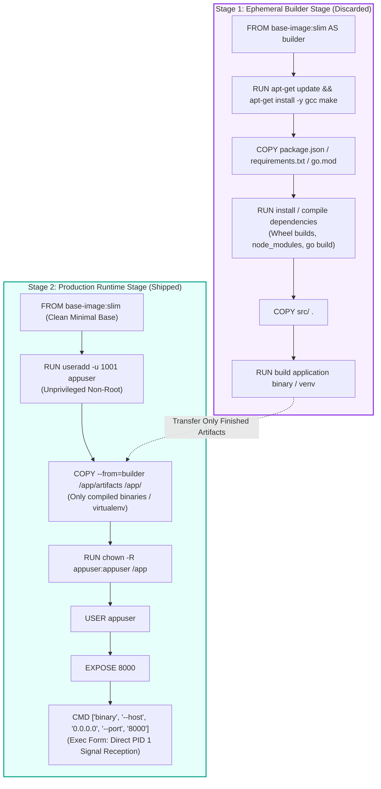
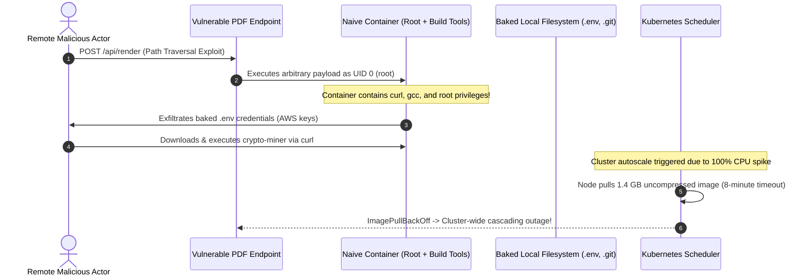

# Module 00: Containerizing a Backend App

> **Prerequisites:** Basic command-line familiarity, HTTP backend fundamentals, and basic concepts of operating system processes and dependencies.  
> **Estimated Reading Time:** 25 minutes  
> **Target Audience:** Backend engineers, software architects, and platform developers containerizing microservices for modern container runtimes and Kubernetes.

> [!TIP]
> **Golden Rule of Containerization:** A container image is an immutable, environment-agnostic binary artifact. Order your `Dockerfile` instructions from least-frequently changed (system dependencies and package manifests) to most-frequently changed (application source code), compile in a disposable builder stage, and run as an unprivileged non-root user.

---

## Visual Mental Models & Architecture

### Multi-Stage Build Architecture and Layer Caching

A Docker image is built as a stack of immutable, content-addressed filesystem layers. By splitting the build into a **builder stage** (containing compilers, build tools, and package caches) and a **runtime stage** (containing only the minimal OS and compiled artifacts), you drastically reduce image size and attack surface.



---

## Systematic Taxonomic Reference Grids

### Base Image Comparison Matrix

| Base Image Flavor | Typical Uncompressed Size | C Runtime (`libc`) | Native Extension Wheel Compatibility | Shell & Debugging Tools Included | Recommended Use Case |
| :--- | :--- | :--- | :--- | :--- | :--- |
| **Full Debian / Ubuntu (`python:3.12`)** | ~1.0 GB – 1.2 GB | GNU `glibc` | 100% (Prebuilt manylinux wheels) | Yes (bash, curl, build tools) | Local prototyping only; avoid in production. |
| **Slim (`python:3.12-slim`)** | ~120 MB – 150 MB | GNU `glibc` | 100% (High compatibility) | Minimal (sh, coreutils; no gcc/curl) | **Default choice** for Python/Node backend services. |
| **Alpine (`python:3.12-alpine`)** | ~50 MB – 60 MB | `musl` libc | Low (Forces source compilation of C-extensions) | Busybox (`/bin/sh`) | Go, Rust, or statically compiled single binaries. |
| **Distroless (`gcr.io/distroless/...`)** | ~20 MB – 50 MB | Varies (minimal) | High if copied from glibc builder | None (No shell, no package manager) | Highly hardened enterprise production environments. |

### Dockerfile Directive Checklist & Layer Cache Rules

| Directive | Cache Invalidation Trigger | Security & Performance Rule | Common Anti-Pattern |
| :--- | :--- | :--- | :--- |
| `FROM` | Upstream tag digest changes | Always pin explicit semantic versions or SHA256 digests (`python:3.12.5-slim`). | Using `FROM python:latest` (non-reproducible). |
| `COPY <manifest>` | Hash of manifest file changes | Copy package manifests alone *before* copying application source code. | `COPY . .` at line 2 (invalidates dependency cache on every commit). |
| `RUN <install>` | Preceding layer changes | Concatenate commands and purge package manager caches (`rm -rf /var/lib/apt/lists/*`). | Multiple `RUN apt-get` commands creating bloated intermediate layers. |
| `USER` | Static layer | Always execute as non-root user (`USER 1001` or `USER appuser`). | Defaulting to `root` (UID 0), granting host-compromise footholds. |
| `CMD` | Static layer | Use **exec form** (`["app", "--host", "0.0.0.0"]`) so the app runs as PID 1. | **Shell form** (`CMD app`), which spawns `/bin/sh` and traps `SIGTERM`. |

---

## Production War Stories: Incident Post-Mortem

### SEV-1 Post-Mortem: The 1.4 GB Root Container Escape & Secret Exposure

#### Incident Overview
* **Severity:** SEV-1 (Critical Security Breach & Compute Degradation)
* **Detection Time:** 4 days post-deployment
* **Impact:** Staging and production container instances exploited via remote code execution (RCE); production AWS credentials compromised; Kubernetes worker node exhausted by 8-minute image pull latencies.
* **Resolution Time:** 3 hours 15 minutes

#### What Happened
A backend engineering team deployed an image created with a naive `Dockerfile`. The image used `FROM python:3.12` (full 1.1 GB base), did not define a `.dockerignore` file, ran as the default `root` user, and copied the entire workspace into `/app`, including `.env` and `.git/`. 

When an attacker discovered an unsanitized path traversal flaw in a PDF-rendering endpoint, the exploit allowed arbitrary command execution. Because the container was running as `root` (UID 0) and contained `gcc`, `curl`, and development toolchains, the attacker easily downloaded a crypto-miner payload. More critically, the attacker traversed the filesystem, found the baked `.env` file and `.git/config` containing production database passwords and AWS access keys, and exfiltrated them.

Simultaneously, during an autoscaling event triggered by the load, Kubernetes worker nodes timed out pulling the massive 1.4 GB image over the network, causing a cascading deployment failure across the cluster.



#### Root Cause Analysis
1. **Running as Root:** The container lacked a `USER appuser` directive. The process ran as UID 0, giving the attacker root privileges within the container namespace.
2. **Missing `.dockerignore`:** Secrets (`.env`, `.git`, AWS credentials) were copied directly into the image context during `COPY . .`.
3. **Bloated Base Image & Leftover Tooling:** Shipping `gcc`, `curl`, and package managers inside the production image provided the exact utilities the attacker needed to compile and stage payloads.
4. **Massive Layer Overhead:** Giant images without layer caching caused node disk pressure and exceeded pull timeouts during autoscaling.

#### The Fix & Architectural Hardening
1. **Multi-Stage Build:** Isolated compilers and build tools to a temporary builder stage, copying only the virtualenv into a minimal `python:3.12-slim` runtime image (reduced from 1.4 GB to 138 MB).
2. **Mandatory Non-Root User:** Added `RUN useradd -u 1001 appuser` and switched to `USER appuser`.
3. **Strict `.dockerignore`:** Excluded `.env*`, `.git/`, `tests/`, `*.pyc`, and temporary caches from the build context.
4. **Immutable Runtime:** Enforced read-only root filesystems and container security contexts in deployment configurations.

---

## Multi-Language Production Code Tabs

The following tabs provide battle-tested, production-grade multi-stage Dockerfiles for Go, Node.js/TypeScript, Python, and C# backend applications.

=== "Go"
    ```dockerfile
    # ---- Stage 1: Build binary statically ----
    FROM golang:1.22-alpine AS builder

    WORKDIR /build

    # Install git and ca-certificates if pulling private modules
    RUN apk add --no-cache ca-certificates git

    # Copy dependency manifests first for maximum layer cache reuse
    COPY go.mod go.sum ./
    RUN go mod download && go mod verify

    # Copy application source code
    COPY . .

    # Build statically linked binary without CGO dependencies
    RUN CGO_ENABLED=0 GOOS=linux GOARCH=amd64 go build \
        -ldflags="-w -s" \
        -o /build/bin/server ./cmd/server

    # ---- Stage 2: Distroless Minimal Non-Root Runtime ----
    FROM gcr.io/distroless/static-debian12:nonroot

    WORKDIR /app

    # Copy statically compiled binary and SSL root certificates
    COPY --from=builder /etc/ssl/certs/ca-certificates.crt /etc/ssl/certs/
    COPY --from=builder --chown=nonroot:nonroot /build/bin/server /app/server

    # Non-root user 65532 is built into distroless static:nonroot
    USER nonroot:nonroot

    EXPOSE 8080

    # Exec form: server runs as direct PID 1
    ENTRYPOINT ["/app/server"]
    ```

=== "Node.js/TypeScript"
    ```dockerfile
    # ---- Stage 1: Dependencies and Compilation ----
    FROM node:20-slim AS builder

    WORKDIR /app

    # Copy dependency manifests
    COPY package*.json tsconfig.json ./

    # Clean install all dependencies (including devDependencies for build)
    RUN npm ci

    # Copy application source and build TypeScript to dist/
    COPY src/ ./src
    RUN npm run build

    # Prune devDependencies to keep only production packages
    RUN npm prune --production

    # ---- Stage 2: Minimal Production Runtime ----
    FROM node:20-slim AS runtime

    WORKDIR /app

    ENV NODE_ENV=production

    # Install dumb-init for proper PID 1 signal forwarding and zombie reaping
    RUN apt-get update && apt-get install -y --no-install-recommends dumb-init \
        && rm -rf /var/lib/apt/lists/*

    # Copy production node_modules and compiled JavaScript from builder
    COPY --from=builder /app/node_modules ./node_modules
    COPY --from=builder /app/dist ./dist
    COPY --from=builder /app/package.json ./package.json

    # Use built-in unprivileged node user (UID 1000)
    USER node

    EXPOSE 3000

    # dumb-init forwards SIGTERM directly to node for graceful shutdown
    ENTRYPOINT ["/usr/bin/dumb-init", "--"]
    CMD ["node", "dist/index.js"]
    ```

=== "Python"
    ```dockerfile
    # ---- Stage 1: Ephemeral Builder Stage ----
    FROM python:3.12-slim AS builder

    ENV PYTHONDONTWRITEBYTECODE=1 \
        PYTHONUNBUFFERED=1 \
        PIP_NO_CACHE_DIR=1

    WORKDIR /app

    # Install C-compiler headers only needed for native C-extension wheels
    RUN apt-get update && apt-get install -y --no-install-recommends gcc libpq-dev \
        && rm -rf /var/lib/apt/lists/*

    # Create isolated virtualenv
    RUN python -m venv /opt/venv
    ENV PATH="/opt/venv/bin:$PATH"

    # Copy package manifest first to maximize Docker layer caching
    COPY requirements.txt .
    RUN pip install --upgrade pip && pip install -r requirements.txt

    # ---- Stage 2: Production Minimal Runtime Stage ----
    FROM python:3.12-slim AS runtime

    ENV PYTHONDONTWRITEBYTECODE=1 \
        PYTHONUNBUFFERED=1 \
        PATH="/opt/venv/bin:$PATH"

    WORKDIR /app

    # Install only runtime shared libraries (libpq without gcc/dev headers)
    RUN apt-get update && apt-get install -y --no-install-recommends libpq5 \
        && rm -rf /var/lib/apt/lists/*

    # Copy virtualenv from builder stage
    COPY --from=builder /opt/venv /opt/venv

    # Create unprivileged non-root user
    RUN useradd --create-home --uid 1001 appuser

    # Copy source code with non-root ownership
    COPY --chown=appuser:appuser . .

    USER appuser

    EXPOSE 8000

    # Exec form: uvicorn is PID 1, bound to all interfaces
    CMD ["uvicorn", "app.main:app", "--host", "0.0.0.0", "--port", "8000"]
    ```

=== "C#"
    ```dockerfile
    # ---- Stage 1: Build & Publish Application ----
    FROM mcr.microsoft.com/dotnet/sdk:8.0 AS builder

    WORKDIR /source

    # Copy solution/project files first for caching restore layer
    COPY *.csproj ./
    RUN dotnet restore --use-current-runtime

    # Copy source and publish Release binary
    COPY . ./
    RUN dotnet publish -c Release -o /app/publish \
        --no-restore \
        /p:UseAppHost=false

    # ---- Stage 2: Production Chiseled Non-Root Runtime ----
    FROM mcr.microsoft.com/dotnet/aspnet:8.0-chiseled AS runtime

    WORKDIR /app

    # Copy published binaries from builder
    COPY --from=builder /app/publish .

    # .NET Chiseled images run as non-root ($APP_UID / 1654) by default
    USER $APP_UID

    EXPOSE 8080
    ENV ASPNETCORE_HTTP_PORTS=8080

    ENTRYPOINT ["dotnet", "BackendRoadmap.Api.dll"]
    ```

---

## Practical Hands-On Verification CLI Workflows

### 1. Build Verification and Context Optimization

Create `.dockerignore` to prevent context leakage:
```gitignore
.git
.venv
__pycache__/
*.pyc
.pytest_cache/
tests/
.env*
Dockerfile*
README.md
```

Build the multi-stage image with BuildKit and inspect layer execution:
```bash
# Enable Docker BuildKit for parallelized stage execution
export DOCKER_BUILDKIT=1

# Build the tagged image
docker build -t myapp:1.0.0 .

# Inspect total image size
docker images myapp:1.0.0

# Analyze per-layer size contribution and identify bloat
docker history myapp:1.0.0
```

### 2. Runtime Verification: Non-Root Execution & Port Binding

```bash
# Run container in background, publishing port 8000
docker run -d --rm --name backend-verify -p 8000:8000 myapp:1.0.0

# Verify process runs as non-root (UID 1001 / non-zero)
docker exec backend-verify id

# Verify application binds 0.0.0.0 and responds over host network
curl -I http://localhost:8000/healthz

# Clean up
docker stop backend-verify
```

**Expected Wire Output:**
```text
uid=1001(appuser) gid=1001(appuser) groups=1001(appuser)
HTTP/1.1 200 OK
content-type: application/json
content-length: 18
```

---

## Operational Validation Checkpoints (Scenario Quizzes)

### Checkpoint 1: Diagnosing the Inverted Layer Cache Anti-Pattern
<details>
<summary><strong>Scenario Assessment:</strong> A developer notices that every time they fix a typo in <code>app/main.py</code>, their CI pipeline takes 4 minutes to rebuild the container image, repeatedly executing <code>pip install -r requirements.txt</code> from scratch. What structural mistake in the <code>Dockerfile</code> causes this, and how is it corrected?</summary>

<strong>Answer:</strong>
The `Dockerfile` has an inverted instruction order where application source code is copied *before* installing dependencies:
```dockerfile
# BROKEN ORDER
COPY . .
RUN pip install -r requirements.txt
```
Docker calculates the cache key for `COPY . .` based on the content hash of all workspace files. Changing a single character in `main.py` invalidates the layer cache for `COPY . .`. Because Docker invalidates every subsequent layer once a layer changes, `RUN pip install` must re-execute completely on every commit.

**The Fix:** Order layers from least-frequently changed to most-frequently changed:
```dockerfile
# OPTIMIZED CACHE ORDER
COPY requirements.txt .
RUN pip install --no-cache-dir -r requirements.txt
COPY . .
```
Now, changes to `main.py` only invalidate `COPY . .`. The expensive dependency installation layer returns `CACHED` in milliseconds.
</details>

### Checkpoint 2: The Binding Trap (127.0.0.1 vs 0.0.0.0)
<details>
<summary><strong>Scenario Assessment:</strong> A new backend service starts cleanly in Docker without errors (<code>Uvicorn running on http://127.0.0.1:8000</code>). However, when curling the port from the host machine via <code>curl http://localhost:8000</code>, the connection is instantly refused: <code>curl: (7) Failed to connect to localhost port 8000: Connection refused</code>. What networking rule was violated?</summary>

<strong>Answer:</strong>
The application bound its listening socket to **`127.0.0.1` (the loopback interface)** inside the container network namespace rather than **`0.0.0.0` (all available network interfaces)**.

In container networking:
- `127.0.0.1` inside a container routes traffic exclusively to and from processes running *inside that same container*.
- When Docker publishes a port (`-p 8000:8000`), the Docker proxy routes traffic from the host network interface to the container's virtual ethernet interface (`eth0`).
- Because the service was only listening on `127.0.0.1`, it refused packets arriving via `eth0`.

**The Fix:** Always instruct the server process to bind to `0.0.0.0`:
`CMD ["uvicorn", "app.main:app", "--host", "0.0.0.0", "--port", "8000"]`.
</details>

### Checkpoint 3: Exec Form vs Shell Form and the Dropped SIGTERM
<details>
<summary><strong>Scenario Assessment:</strong> During Kubernetes rolling deployments, in-flight customer checkout requests are abruptly terminated with HTTP 502 Bad Gateway errors. Investigation reveals that the application has a graceful shutdown handler registered, but it is never executed when the container stops. The Dockerfile terminates with: <code>CMD uvicorn app.main:app --port 8000</code>. Why is the shutdown handler ignored?</summary>

<strong>Answer:</strong>
The `Dockerfile` used the **shell form** of `CMD` (`CMD command arg1 arg2`) instead of the **exec form** (`CMD ["command", "arg1", "arg2"]`).

When using the shell form, the container runtime executes `/bin/sh -c "command..."`. As a result:
1. `/bin/sh` runs as **PID 1** inside the container.
2. The actual application process (`uvicorn`) runs as a child process of the shell.
3. Standard Linux shells do not forward POSIX signals (`SIGTERM`) to child processes by default.
4. When the platform terminates the container, it sends `SIGTERM` to PID 1 (`/bin/sh`). The shell swallows the signal without notifying `uvicorn`.
5. After the grace period (e.g., 30s), the platform sends `SIGKILL` (kill -9), killing `uvicorn` instantly and severing in-flight connections.

**The Fix:** Always use the JSON array **exec form**:
`CMD ["uvicorn", "app.main:app", "--host", "0.0.0.0", "--port", "8000"]`.
This ensures `uvicorn` runs as PID 1 and directly receives `SIGTERM` to execute its draining logic.
</details>

---

## Summary & Further Study

- **Immutable Build Artifacts:** Multi-stage builds keep compilers, tests, and build tools out of production images, shrinking attack surfaces and container footprint.
- **Cache Discipline:** Copy package manifests before source code to ensure fast rebuilds in local dev and CI.
- **Security & Portability:** Always run as non-root (`USER appuser`), bind `0.0.0.0`, and use exec-form `CMD` for graceful shutdown.

### Further Reading
- [Docker Documentation: Multi-Stage Builds](https://docs.docker.com/build/building/multi-stage/)
- [OpenContainers (OCI) Image Specification](https://github.com/opencontainers/image-spec)
- [Google Container Tools: Distroless Images](https://github.com/GoogleContainerTools/distroless)
- [OWASP Docker Security Cheat Sheet](https://cheatsheetseries.owasp.org/cheatsheets/Docker_Security_Cheat_Sheet.html)
