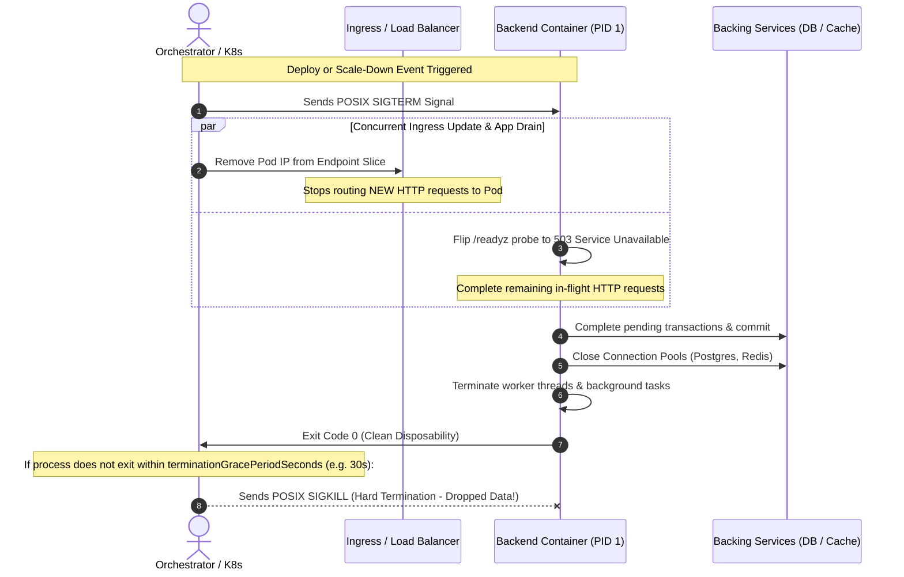
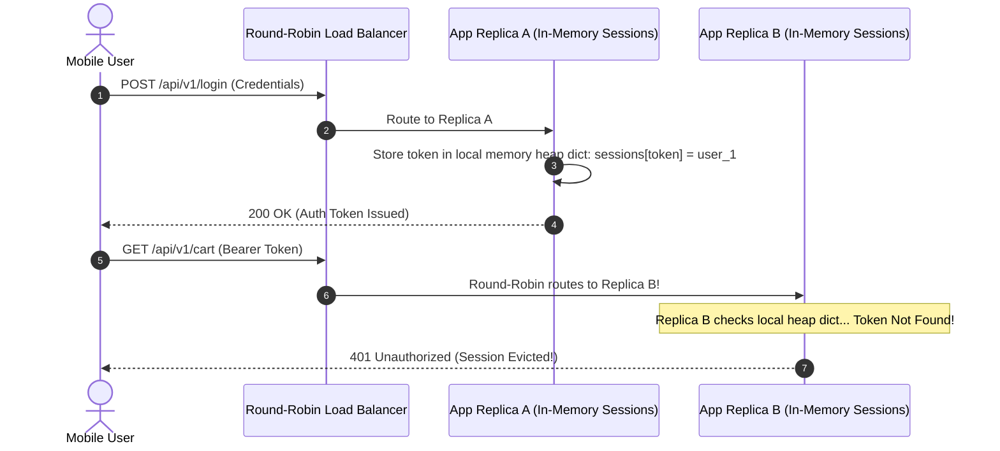

# Module 01: The 12-Factor App in a Container

> **Prerequisites:** [00-containerizing-a-backend-app](../00-containerizing-a-backend-app/README.md), [The 12-Factor App](../../08-observability-and-operational-readiness/10-the-12-factor-app/README.md), and [Graceful Shutdown](../../08-observability-and-operational-readiness/09-graceful-shutdown/README.md).  
> **Estimated Reading Time:** 28 minutes  
> **Target Audience:** Backend engineers and systems architects designing microservices for elastic, multi-replica container orchestration environments.

> [!TIP]
> **Golden Rule of Containerized 12-Factor Systems:** A container process must assume its local filesystem is ephemeral and its lifespan is disposable. Never bake environment configurations into the image, never rely on in-memory or node-local storage across requests, and handle `SIGTERM` deterministically to drain in-flight transactions before orchestrator timeouts expire.

---

## Visual Mental Models & Architecture

### The Container Termination Protocol: Graceful Drain vs SIGKILL

Under Kubernetes, Docker Swarm, or cloud container runtimes, containers are scheduled, scaled up, scaled down, or evicted continuously. When a deployment or autoscaler terminates a pod, it executes a strict POSIX signaling protocol.



---

## Systematic Taxonomic Reference Grids

### 12-Factor Container Execution Matrix

| Twelve-Factor Principle | Containerized Implementation | Failure Mode if Violated in Container | Enforcing Container Primitive |
| :--- | :--- | :--- | :--- |
| **III. Config** | Injected at runtime via environment variables & secret mounts. | Single environment locked into image; secrets leaked in Docker history. | `docker run -e`, K8s `ConfigMap` & `Secret`. |
| **IV. Backing Services** | Attached via network connection strings (`DATABASE_URL`). | Hardcoded `localhost`; unable to point to managed cloud databases. | Environment variable injection; dynamic DNS. |
| **VI. Stateless Processes** | Share-nothing architecture; zero local disk or in-memory persistence. | State wiped during pod reschedule; requests produce inconsistent data across replicas. | Backing stores (Postgres, Redis, Object Storage S3). |
| **VII. Port Binding** | Self-contained HTTP/gRPC server binding to `0.0.0.0:<PORT>`. | Unreachable via container bridge networking; requires injected web server. | ASGI/Kestrel/Gin server embedded in container. |
| **VIII. Concurrency** | Scale horizontally by launching additional container replicas. | Node resource exhaustion; inability to scale elastically under traffic spikes. | ReplicaSets, Autoscalers (HPA), multiple container processes. |
| **IX. Disposability** | Sub-second startup and deterministic `SIGTERM` draining. | 502 Bad Gateway during deployments; orphaned database transactions. | Exec-form `CMD`, POSIX signal traps, graceful shutdown handlers. |
| **XI. Logs as Streams** | Output structured JSON to `stdout`/`stderr`. | Lost log files on container crash; disk exhaustion inside container layer. | Container runtime log drivers (fluentd, JSON-file, Datadog). |

### Storage Destination vs Lifecycle Matrix

| Storage Layer | Durability Lifetime | Scope Across Replicas | Concurrency Model | Permitted Backend Use Case |
| :--- | :--- | :--- | :--- | :--- |
| **Process Heap Memory** | Dies on request or container crash | Isolated to single container instance | In-memory locks / Mutex | Read-only static config caches, transient calculations. |
| **Container Layer Disk** | Wiped on pod reschedule / restart | Isolated to single container instance | POSIX file locking | `/tmp` scratch files during single request lifecycle only. |
| **Redis / Distributed Cache** | Independent of container lifespan | Shared across all container replicas | Single-threaded atomic ops / Lua scripts | Distributed sessions, rate-limit counters, transient job queues. |
| **Relational DB (Postgres)** | Persistent & ACID backed | Shared across all container replicas | MVCC / Row-level locking | Financial ledgers, user accounts, core domain entities. |
| **Object Storage (S3/GCS)** | Persistent & Globally distributed | Shared across all container replicas | Eventual/Strong object consistency | User document uploads, video media, large report exports. |

---

## Production War Stories: Incident Post-Mortem

### SEV-1 Post-Mortem: The Autoscaling In-Memory Session Collision

#### Incident Overview
* **Severity:** SEV-1 (Critical Authentication & Session Hijacking Outage)
* **Detection Time:** 18 minutes after marketing email blast
* **Impact:** 24,000 active users logged out; 1,420 users served other users' shopping carts; \$180,000 in lost orders.
* **Resolution Time:** 1 hour 45 minutes

#### What Happened
A retail backend was developed and tested locally with a single container instance (`docker run -p 8000:8000`). To optimize session validation speed, the developer stored user authentication tokens in an in-memory dictionary: `active_sessions: dict[str, SessionData] = {}`. Temporary invoice PDFs were written to `./static/invoices/`.

During a Black Friday marketing push, traffic surged 10x. The Kubernetes Horizontal Pod Autoscaler (HPA) automatically scaled the service from 1 replica to 12 replicas behind a round-robin load balancer.

Immediately, user sessions collapsed:
1. When a user logged in, their credentials were verified and their token was saved in the memory of **Replica A**.
2. Their next click hit the load balancer, which routed the request to **Replica B**.
3. Replica B had no record of the token in its local memory dictionary, returning an immediate `401 Unauthorized` and logging the user out.
4. Concurrently, invoice generation requests wrote files to Replica C's local filesystem, which resulted in `404 Not Found` when customers attempted to download the invoice from Replica D.



#### Root Cause Analysis
1. **Violation of Factor VI (Stateless Processes):** Storing mutable session state in local process memory violated share-nothing architecture. In a multi-replica container environment, replicas are interchangeable; state must never reside in process memory.
2. **Ephemeral Disk Abuse:** Storing generated invoices on local disk violated storage separation. Replicas cannot access each other's container filesystems.
3. **Missing Backing Service Integration:** The architecture lacked an external distributed cache (Redis) and object store (S3/GCS).

#### The Fix & Architectural Hardening
1. **Externalized Distributed Session Cache:** Migrated authentication sessions to a managed Redis cluster using atomic token expiration keys (`SETEX session:<token> 3600 <data>`).
2. **Decoupled Object Storage:** Refactored invoice generation to upload directly to S3/GCS, returning pre-signed URLs to clients.
3. **Multi-Replica Integration Testing:** Mandated that all staging integration tests run against at least 3 active container replicas behind a proxy to immediately expose state leakages.

---

## Multi-Language Production Code Tabs

The following production code examples demonstrate how to implement graceful `SIGTERM` draining, readiness probe de-registration, and externalized state integration in Go, Node.js/TypeScript, Python, and C#.

=== "Go"
    ```go
    // Package main implements 12-Factor container disposability (Factor IX)
    // with graceful SIGTERM termination and connection draining.
    package main

    import (
    	"context"
    	"errors"
    	"log/slog"
    	"net/http"
    	"os"
    	"os/signal"
    	"sync/atomic"
    	"syscall"
    	"time"
    )

    type ServerState struct {
    	isReady atomic.Bool
    }

    func main() {
    	logger := slog.New(slog.NewJSONHandler(os.Stdout, nil)) // Factor XI: Logs to stdout
    	slog.SetDefault(logger)

    	state := &ServerState{}
    	state.isReady.Store(true)

    	mux := http.NewServeMux()
    	
    	// Factor IX: Readiness probe endpoint
    	mux.HandleFunc("/readyz", func(w http.ResponseWriter, r *http.Request) {
    		if state.isReady.Load() {
    			w.WriteHeader(http.StatusOK)
    			_, _ = w.Write([]byte(`{"status":"ready"}`))
    			return
    		}
    		http.Error(w, `{"status":"draining"}`, http.StatusServiceUnavailable)
    	})

    	mux.HandleFunc("/api/work", func(w http.ResponseWriter, r *http.Request) {
    		time.Sleep(2 * time.Second) // Simulate in-flight transactional work
    		w.WriteHeader(http.StatusOK)
    		_, _ = w.Write([]byte(`{"result":"completed"}`))
    	})

    	server := &http.Server{
    		Addr:         ":8080", // Factor VII: Port binding
    		Handler:      mux,
    		ReadTimeout:  5 * time.Second,
    		WriteTimeout: 10 * time.Second,
    	}

    	// Trap POSIX SIGINT and SIGTERM
    	shutdownChan := make(chan os.Signal, 1)
    	signal.Notify(shutdownChan, os.Interrupt, syscall.SIGTERM)

    	go func() {
    		slog.Info("Starting server", "port", 8080)
    		if err := server.ListenAndServe(); err != nil && !errors.Is(err, http.ErrServerClosed) {
    			slog.Error("Server crash", "error", err)
    			os.Exit(1)
    		}
    	}()

    	// Block until SIGTERM received
    	<-shutdownChan
    	slog.Info("SIGTERM received: initiating graceful drain")

    	// 1. Flip readiness to 503 so load balancer stops routing new requests
    	state.isReady.Store(false)

    	// 2. Allow grace window for in-flight requests to complete
    	ctx, cancel := context.WithTimeout(context.Background(), 25*time.Second)
    	defer cancel()

    	if err := server.Shutdown(ctx); err != nil {
    		slog.Error("Graceful shutdown forced", "error", err)
    		_ = server.Close()
    	}

    	slog.Info("Shutdown complete: clean exit 0")
    }
    ```

=== "Node.js/TypeScript"
    ```typescript
    // Node.js 12-Factor Graceful Disposability & Structured Logging
    import http from "node:http";
    import express from "express";

    const app = express();
    let isReady = true;

    // Factor IX: Readiness probe
    app.get("/readyz", (req, res) => {
      if (isReady) {
        return res.status(200).json({ status: "ready" });
      }
      return res.status(503).json({ status: "draining" });
    });

    app.get("/api/work", async (req, res) => {
      await new Promise((resolve) => setTimeout(resolve, 2000));
      return res.status(200).json({ status: "completed" });
    });

    const PORT = process.env.PORT || 3000;
    const server = http.createServer(app);

    server.listen(PORT, () => {
      // Factor XI: JSON logging to stdout
      console.log(JSON.stringify({ level: "INFO", message: `Server listening on ${PORT}` }));
    });

    // Handle POSIX SIGTERM from orchestrator
    process.on("SIGTERM", async () => {
      console.log(JSON.stringify({ level: "INFO", message: "SIGTERM received. Starting drain." }));
      
      // 1. Ingress traffic cutoff: fail readiness probe
      isReady = false;

      // 2. Stop accepting new connections and drain active ones
      server.close((err) => {
        if (err) {
          console.error(JSON.stringify({ level: "ERROR", message: "Error closing server", error: err }));
          process.exit(1);
        }
        console.log(JSON.stringify({ level: "INFO", message: "All connections drained. Clean exit." }));
        process.exit(0);
      });

      // Safety timeout before hard exit
      setTimeout(() => {
        console.error(JSON.stringify({ level: "ERROR", message: "Forced timeout. Exiting." }));
        process.exit(1);
      }, 25000).unref();
    });
    ```

=== "Python"
    ```python
    """FastAPI 12-Factor Graceful Disposability & Backing Service Integration."""

    from __future__ import annotations

    import asyncio
    from contextlib import asynccontextmanager
    import logging
    import sys
    from typing import AsyncGenerator
    from fastapi import FastAPI, Response, status

    # Factor XI: Unbuffered JSON logs to stdout
    logging.basicConfig(stream=sys.stdout, level=logging.INFO, format="%(message)s")
    logger = logging.getLogger("app")

    is_ready = True


    @asynccontextmanager
    async def lifespan(app: FastAPI) -> AsyncGenerator[None, None]:
        # Startup: Open backing service connection pools (Postgres, Redis)
        logger.info('{"event": "startup", "status": "initializing_pools"}')
        yield
        # Shutdown: Triggered when Uvicorn (PID 1) receives SIGTERM
        global is_ready
        logger.info('{"event": "shutdown_signal", "msg": "SIGTERM received"}')
        is_ready = False  # Load balancer stops sending traffic

        # Drain in-flight tasks and close database connections
        await asyncio.sleep(1.0)  # Propagation window for endpoint slice removal
        logger.info('{"event": "shutdown_complete", "msg": "Pools closed, exit 0"}')


    app = FastAPI(lifespan=lifespan)


    @app.get("/readyz")
    async def readiness_probe(response: Response) -> dict[str, str]:
        if is_ready:
            return {"status": "ready"}
        response.status_code = status.HTTP_503_SERVICE_UNAVAILABLE
        return {"status": "draining"}


    @app.get("/api/work")
    async def process_work() -> dict[str, str]:
        await asyncio.sleep(2.0)  # In-flight transaction
        return {"status": "completed"}
    ```

=== "C#"
    ```csharp
    namespace BackendRoadmap.TwelveFactor;

    using System.Text.Json;
    using Microsoft.AspNetCore.Builder;
    using Microsoft.AspNetCore.Http;
    using Microsoft.Extensions.Hosting;

    public class Program
    {
        private static bool _isReady = true;

        public static void Main(string[] args)
        {
            var builder = WebApplication.CreateBuilder(args);
            var app = builder.Build();

            var lifetime = app.Lifetime;

            // Factor IX: Disposability through ApplicationStopping hook
            lifetime.ApplicationStopping.Register(() =>
            {
                Console.WriteLine(JsonSerializer.Serialize(new
                {
                    level = "INFO",
                    message = "SIGTERM received: setting readiness to false and draining"
                }));
                _isReady = false;
                Thread.Sleep(2000); // Allow load balancer propagation
            });

            // Readiness probe endpoint
            app.MapGet("/readyz", (HttpContext ctx) =>
            {
                if (_isReady)
                {
                    return Results.Ok(new { status = "ready" });
                }
                return Results.Json(new { status = "draining" }, statusCode: 503);
            });

            app.MapGet("/api/work", async () =>
            {
                await Task.Delay(2000);
                return Results.Ok(new { status = "completed" });
            });

            app.Run();
        }
    }
    ```

---

## Practical Hands-On Verification CLI Workflows

### Testing Disposability & Multi-Replica Statelessness

#### 1. Verifying Disposability with Simulated In-Flight Traffic
Start the containerized service:
```bash
docker run -d --rm --name twelve-factor-app -p 8000:8000 myapp:1.0.0
```

Initiate a long-running request in Terminal 1:
```bash
curl -w "\nHTTP Response: %{http_code} | Total Time: %{time_total}s\n" http://localhost:8000/api/work
```

Immediately send `SIGTERM` in Terminal 2:
```bash
# docker stop issues SIGTERM and waits up to 10s before SIGKILL
docker stop twelve-factor-app
```

**Expected Wire Output (Terminal 1 - In-Flight Request Drained Cleanly):**
```text
{"status":"completed"}
HTTP Response: 200 | Total Time: 2.08s
```

#### 2. Inspecting Real-Time Streamed JSON Logs
```bash
docker logs twelve-factor-app
```

**Expected Streamed Output:**
```json
{"event": "startup", "status": "initializing_pools"}
{"event": "shutdown_signal", "msg": "SIGTERM received"}
{"event": "shutdown_complete", "msg": "Pools closed, exit 0"}
```

---

## Operational Validation Checkpoints (Scenario Quizzes)

### Checkpoint 1: Statelessness vs Sticky Sessions
<details>
<summary><strong>Scenario Assessment:</strong> A legacy backend application stores user shopping cart contents in process memory. To support scaling to 4 container replicas without rewriting the code, a DevOps engineer configures "Sticky Sessions" (Session Affinity) on the Application Load Balancer (ALB). Why is this a dangerous temporary fix that still violates Factor VI?</summary>

<strong>Answer:</strong>
Sticky sessions bind a client's IP or cookie to a specific container instance, creating **severe operational fragility**:
1. **Broken Disposability (Factor IX):** Containers are ephemeral. When Kubernetes rolls out a new release or restarts an unhealthy node, the container holding the user's sticky session is destroyed, and the user's shopping cart is instantly lost.
2. **Defeating Horizontal Autoscaling (Factor VIII):** Sticky sessions create severe load imbalances. If a high-volume client or spider is pinned to Replica 1, Replica 1 becomes CPU-starved while Replicas 2, 3, and 4 sit idle.
3. **Broken Rolling Deploys:** During a rolling update, replicas must be decommissioned one by one. Sticky sessions force a choice between terminating user sessions prematurely or stalling deployments indefinitely waiting for sticky sessions to disconnect.

**Proper Architecture:** Externalize the shopping cart to Redis or PostgreSQL, allowing any replica to process any request interchangeably.
</details>

### Checkpoint 2: The Silent Buffer Trap (`PYTHONUNBUFFERED=1`)
<details>
<summary><strong>Scenario Assessment:</strong> An application crashes in production with an out-of-memory (OOM) error. However, when engineers check the centralized logging dashboard, the last 45 seconds of logs leading up to the crash are completely missing. The containerized application writes logs via standard <code>print()</code> or <code>sys.stdout.write()</code>. What container configuration was omitted?</summary>

<strong>Answer:</strong>
The container environment lacked the **`PYTHONUNBUFFERED=1`** configuration (or equivalent stdio flush directives in other languages).

By default, the C runtime library buffers output to standard streams (`stdout`/`stderr`) when output is redirected to a non-interactive pipe (such as the Docker container log driver). Instead of printing lines immediately, the runtime waits until the internal buffer (typically 4 KB or 8 KB) fills completely.

When the container experiences an uncatchable termination (such as an OOM kill by the Linux kernel or a `SIGKILL` timeout), the process terminates immediately without executing cleanup handlers. The in-memory buffer containing the critical debugging logs is destroyed before being flushed to the operating system pipe.

**The Fix:** Always set `ENV PYTHONUNBUFFERED=1` in the `Dockerfile`.
</details>

### Checkpoint 3: The Race Condition Between Ingress and SIGTERM
<details>
<summary><strong>Scenario Assessment:</strong> During rolling deployments, clients experience intermittent 502 Bad Gateway errors for approximately 500ms immediately after a pod termination begins. The application has an exec-form CMD and begins draining connections immediately upon receiving SIGTERM. Why does this 502 window occur, and how is it eliminated?</summary>

<strong>Answer:</strong>
This is the classic **distributed ingress propagation race condition**:
1. When a pod is terminated, the Kubernetes control plane performs two actions asynchronously:
   - It sends `SIGTERM` to the container process.
   - It notifies the Ingress controllers / kube-proxy to remove the pod's IP from the network endpoint slice.
2. Updating routing tables across hundreds of nodes and ingress load balancers takes 500ms to 2 seconds.
3. If the application receives `SIGTERM` and **immediately shuts down its listening socket**, the load balancer continues forwarding new client requests to that pod IP for the next 1-2 seconds, resulting in immediate TCP connection refusals (`502 Bad Gateway`).

**Architectural Fix:**
1. In the shutdown lifecycle handler, implement a **readiness failure and sleep delay**:
   - Immediately set the `/readyz` probe to return HTTP 503.
   - Wait 2 to 5 seconds (`sleep(2)`) *before* calling `server.close()`.
2. This brief window allows ingress controllers and cloud load balancers to finish removing the pod IP from routing tables before the pod stops accepting TCP traffic.
</details>

---

## Summary & Further Study

- **Ephemeral Lifecycles:** Treat containers as disposable entities that can be terminated at any second.
- **Externalize All State:** Backing services (Postgres, Redis, S3) are the only acceptable locations for durable or shared data.
- **Graceful Draining:** Pair exec-form `CMD` with readiness de-registration and `SIGTERM` signal handlers to eliminate deployment 502 errors.

### Further Reading
- [The Twelve-Factor App Methodology](https://12factor.net/)
- [Kubernetes Documentation: Container Lifecycle Hooks](https://kubernetes.io/docs/concepts/containers/container-lifecycle-hooks/)
- [Graceful Shutdown Patterns in Microservices](https://learn.microsoft.com/en-us/dotnet/architecture/microservices/multi-container-web-applications/background-tasks-with-ihostedservice)
