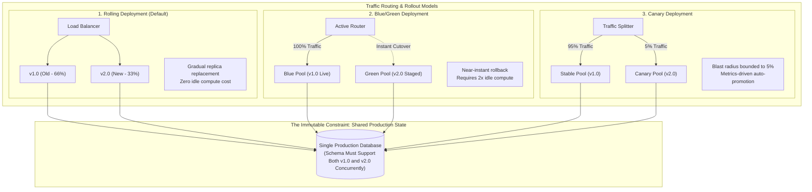
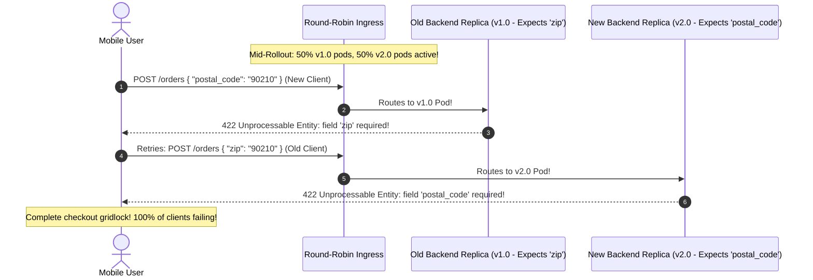

# Module 03: Deployment Strategies

> **Prerequisites:** [00-containerizing-a-backend-app](../00-containerizing-a-backend-app/README.md), [01-the-12-factor-app-in-a-container](../01-the-12-factor-app-in-a-container/README.md), and [02-ci-pipelines-for-backend-code](../02-ci-pipelines-for-backend-code/README.md).  
> **Estimated Reading Time:** 30 minutes  
> **Target Audience:** Backend engineers and site reliability engineers designing zero-downtime release pipelines, backward-compatible APIs, and automated traffic-shifting rollouts.

> [!TIP]
> **Golden Rule of Deployment Strategies:** During any deployment—rolling, blue/green, or canary—two distinct versions of your application code execute concurrently against the same shared database. Every code and API change must be strictly backward-compatible, migrations must be additive-first, and terminating pods must drain in-flight connections gracefully before shutdown.

---

## Visual Mental Models & Architecture

### Deployment Strategy Traffic Shifting & Shared Database Coexistence

All zero-downtime deployment strategies must handle concurrent version coexistence. The fundamental constraint is that while compute replicas can be replaced incrementally or switched via routing, there is only **one shared production database**.



---

## Systematic Taxonomic Reference Grids

### Deployment Strategies Architectural Comparison

| Strategy Metric | Rolling Update | Blue/Green Deployment | Canary Deployment | Recreate (Anti-Pattern) |
| :--- | :--- | :--- | :--- | :--- |
| **Traffic Shift Mechanism** | Incremental pod-by-pod replacement | Instant atomic cutover at router/DNS | Progressive weighted traffic split (5% $\rightarrow$ 100%) | Stop all old pods, start all new pods |
| **Downtime Profile** | Zero downtime (if drained properly) | Zero downtime | Zero downtime | **Explicit Outage Window** (Minutes) |
| **Compute Cost Overhead** | Minimal surge (~10-25% extra pods) | High (Requires 100% idle clone pool) | Minimal (~5-10% canary pods) | Zero |
| **Rollback Latency** | Minutes (Rolling deploy back to SHA) | **Sub-second** (Flip router back to Blue) | Seconds (Route 100% traffic to Stable) | Minutes (Re-deploy old image) |
| **Blast Radius of Bug** | Medium (Impacts proportional to pod ratio) | 100% of users immediately upon switch | **Extremely Low** (5% of users isolated) | 100% of users |
| **Backend Code Requirement** | v1 & v2 must share database concurrently | v1 & v2 must share database concurrently | v1 & v2 must share database concurrently | None (Old code dead before new starts) |

### Backward-Compatible API Evolution Matrix (Expand/Contract)

| API Modification Type | Dangerous Single-Deploy Change (Breaking) | Zero-Downtime Multi-Deploy Safe Pattern |
| :--- | :--- | :--- |
| **Field Rename** | Rename JSON key `name` $\rightarrow$ `full_name` in one PR. | **Deploy 1 (Expand):** Return both `name` and `full_name`.<br/>**Deploy 2 (Contract):** Clients migrate; drop `name` field. |
| **Field Deletion** | Delete endpoint response property `deprecated_id`. | **Deploy 1:** Mark field deprecated in OpenAPI; verify 0 consumer traffic.<br/>**Deploy 2:** Remove field from response payload. |
| **Requiredness Change** | Change optional query parameter to mandatory. | **Deploy 1:** Accept field optionally with fallback default.<br/>**Deploy 2:** Mandate field once all upstream clients send it. |
| **Data Type Change** | Change `amount` from integer cents to decimal string. | **Deploy 1 (Expand):** Add `amount_formatted` alongside `amount`.<br/>**Deploy 2 (Contract):** Deprecate integer field after migration. |
| **Endpoint Removal** | Delete `DELETE /v1/users/{id}`. | **Deploy 1:** Return HTTP 410 Gone with `Deprecation` headers.<br/>**Deploy 2:** Purge route handler in subsequent milestone. |

---

## Production War Stories: Incident Post-Mortem

### SEV-1 Post-Mortem: The Single-Deploy Breaking Field Rename

#### Incident Overview
* **Severity:** SEV-1 (Critical E-Commerce Checkout Outage)
* **Detection Time:** 6 minutes into a rolling deployment
* **Resolution Time:** 45 minutes
* **Financial Impact:** \$310,000 in dropped checkout transactions; mobile app crash loop for 14,000 customers.

#### What Happened
An engineering team improved the readability of their checkout API by renaming the billing postal code field in `POST /api/orders` from `zip` to `postal_code`. The backend pull request updated the Pydantic schema and the frontend SPA in the same repository.

The CI pipeline built both artifacts and initiated a standard Kubernetes rolling update across 20 backend pods.

During the 8-minute rollout window:
1. 10 pods were running the old image (expecting `zip`), and 10 pods were running the new image (expecting `postal_code`).
2. Single-Page Applications (SPAs) and mobile clients cached in user browsers began submitting checkout payloads.
3. If an old client sent `{ "zip": "90210" }` and was routed by the load balancer to a **new v2.0 pod**, the v2.0 pod rejected the request with `422 Unprocessable Entity: missing field postal_code`.
4. If a newly refreshed client sent `{ "postal_code": "90210" }` and was routed to an **old v1.0 pod**, the v1.0 pod rejected it with `422 Unprocessable Entity: missing field zip`.
5. Mobile apps crashed due to unexpected unhandled 422 schemas.



#### Root Cause Analysis
1. **Single-Deploy Breaking Change:** The team coupled a field rename into a single breaking deployment, failing to realize that rolling updates guarantee concurrent version execution.
2. **Missing Aliasing & Tolerant Reader:** The backend schema failed to accept both `zip` and `postal_code` simultaneously during the transition.
3. **No Canary Blast-Radius Shield:** Deploying directly to 100% of replicas via rolling update exposed all customers to the contract mismatch immediately.

#### The Fix & Architectural Hardening
1. **Immediate Rollback:** Executed `kubectl rollout undo deployment/order-service` to restore the stable v1.0 image.
2. **Expand/Contract API Pattern:** Re-implemented the schema to accept either `zip` or `postal_code` using field aliasing and fallback validators.
3. **Canary Validation Gate:** Mandated canary deployments with automated HTTP 4xx/5xx error rate monitoring for all public API contract modifications.

---

## Multi-Language Production Code Tabs

The following production code examples demonstrate how to implement the **Expand/Contract** pattern in Go, Node.js/TypeScript, Python, and C# to ensure zero-downtime rolling updates.

=== "Go"
    ```go
    // Package orders demonstrates backward-compatible JSON unmarshaling (Expand/Contract).
    // Accepts either legacy "zip" or modern "postal_code" seamlessly during rollout.
    package orders

    import (
    	"encoding/json"
    	"errors"
    )

    var ErrMissingPostalCode = errors.New("either 'postal_code' or 'zip' must be provided")

    type OrderRequest struct {
    	OrderID    string `json:"order_id"`
    	PostalCode string `json:"postal_code"`
    	LegacyZip  string `json:"zip,omitempty"` // Retained for backward-compatibility
    }

    // UnmarshalJSON implements dual-field tolerance during rolling deployments.
    func (o *OrderRequest) UnmarshalJSON(data []byte) error {
    	type Alias OrderRequest
    	aux := &struct {
    		*Alias
    	}{
    		Alias: (*Alias)(o),
    	}

    	if err := json.Unmarshal(data, aux); err != nil {
    		return err
    	}

    	// If modern postal_code is empty, fall back to legacy zip
    	if o.PostalCode == "" && o.LegacyZip != "" {
    		o.PostalCode = o.LegacyZip
    	}

    	if o.PostalCode == "" {
    		return ErrMissingPostalCode
    	}

    	// Always echo both during transition so older clients receive their expected key
    	o.LegacyZip = o.PostalCode
    	return nil
    }
    ```

=== "Node.js/TypeScript"
    ```typescript
    // TypeScript Zod Schema implementing Expand/Contract tolerance
    import { z } from "zod";

    export const OrderRequestSchema = z
      .object({
        orderId: z.string().uuid(),
        // Both fields optional at raw parser level to allow cross-version routing
        postalCode: z.string().optional(),
        zip: z.string().optional(),
      })
      .transform((data, ctx) => {
        const resolvedPostalCode = data.postalCode || data.zip;

        if (!resolvedPostalCode) {
          ctx.addIssue({
            code: z.ZodIssueCode.custom,
            message: "Must provide either 'postalCode' or legacy 'zip'",
            path: ["postalCode"],
          });
          return z.NEVER;
        }

        // Canonical internal representation: postalCode is guaranteed
        return {
          orderId: data.orderId,
          postalCode: resolvedPostalCode,
          zip: resolvedPostalCode, // Echo legacy field for response serialization
        };
      });

    export type OrderRequest = z.infer<typeof OrderRequestSchema>;
    ```

=== "Python"
    ```python
    """Production Pydantic v2 Expand/Contract Schema for Zero-Downtime Rollouts."""

    from __future__ import annotations

    from pydantic import BaseModel, Field, model_validator


    class OrderRequest(BaseModel):
        order_id: str
        postal_code: str | None = Field(default=None)
        zip: str | None = Field(default=None)  # Legacy alias during rollout

        @model_validator(mode="after")
        def harmonize_postal_code(self) -> OrderRequest:
            # Resolve value from either key
            resolved = self.postal_code or self.zip
            if not resolved:
                msg = "Must supply either 'postal_code' or legacy 'zip'"
                raise ValueError(msg)

            # Mirror to both fields so downstream code and response payloads satisfy all clients
            self.postal_code = resolved
            self.zip = resolved
            return self


    class OrderResponse(BaseModel):
        order_id: str
        postal_code: str
        zip: str  # Echo legacy field until Deploy 2 contracts it
    ```

=== "C#"
    ```csharp
    namespace BackendRoadmap.Deployments;

    using System;
    using System.Text.Json.Serialization;

    public class OrderRequest
    {
        [JsonPropertyName("order_id")]
        public string OrderId { get; set; } = string.Empty;

        [JsonPropertyName("postal_code")]
        public string? PostalCode { get; set; }

        [JsonPropertyName("zip")]
        public string? LegacyZip { get; set; }

        // Canonical domain property
        [JsonIgnore]
        public string EffectivePostalCode
        {
            get
            {
                var val = !string.IsNullOrWhiteSpace(PostalCode) ? PostalCode : LegacyZip;
                if (string.IsNullOrWhiteSpace(val))
                {
                    throw new InvalidOperationException("Must supply 'postal_code' or 'zip'");
                }
                return val;
            }
        }
    }
    ```

---

## Practical Hands-On Verification CLI Workflows

### Simulating a Rolling Deployment Under Load

#### 1. Launch Multi-Replica Service Behind NGINX Proxy
```bash
# Scale to 3 replicas running v1.0
docker compose up -d --scale app=3

# Start synthetic background traffic (10 req/sec) in Terminal 1
while true; do 
  curl -s -o /dev/null -w "%{http_code}\n" http://localhost:8080/api/checkout >> results.log
  sleep 0.1
done
```

#### 2. Execute Zero-Downtime Rolling Update
In Terminal 2, trigger a rolling update with zero allowed unavailable replicas:
```bash
# In Kubernetes:
kubectl set image deployment/checkout-service app=registry.example.com/myapp:git-4b8c91a
kubectl rollout status deployment/checkout-service

# Or in Docker Compose:
docker compose up -d --no-deps --scale app=4 --build app
docker compose up -d --no-deps --scale app=3 app
```

#### 3. Analyze Wire Log for Dropped Traffic
```bash
# Count response statuses recorded during the deployment
cat results.log | sort | uniq -c
```

**Expected Wire Output (Zero Outage):**
```text
3420 200
   0 502
   0 503
   0 504
```

---

## Operational Validation Checkpoints (Scenario Quizzes)

### Checkpoint 1: Blue/Green Deployment vs Database Concurrency
<details>
<summary><strong>Scenario Assessment:</strong> A platform engineer argues: "We are migrating to Blue/Green deployments so we no longer have to worry about backward compatibility. Because Blue/Green flips all traffic atomically in one instant, old and new code never run concurrently." What is the fundamental flaw in this reasoning?</summary>

<strong>Answer:</strong>
The engineer is confusing **HTTP ingress routing** with **database state coexistence**:
1. **Shared Database Reality:** Even if the router flips 100% of HTTP traffic from Blue to Green in 10 milliseconds, Blue and Green both connect to the **same single production database**.
2. **In-Flight Requests:** When the router flips to Green, Blue replicas are still finishing in-flight requests that were received 1 second prior. For that draining window (up to 30 seconds), Blue and Green are executing queries concurrently against the same tables.
3. **Rollback Compatibility:** If Green exhibits errors 5 minutes after cutover, the router flips traffic back to Blue. If Green executed a destructive database migration (e.g., dropping a column), Blue will crash immediately upon traffic return.

Therefore, Blue/Green deployments require the **exact same expand/contract backward-compatible database discipline** as rolling updates.
</details>

### Checkpoint 2: The MaxSurge and MaxUnavailable Knobs
<details>
<summary><strong>Scenario Assessment:</strong> A Kubernetes deployment has <code>replicas: 4</code>, <code>maxUnavailable: 2</code>, and <code>maxSurge: 0</code>. During peak traffic hours, a rolling deployment is triggered. The service suddenly experiences latency spikes, CPU throttling, and HTTP 504 Gateway Timeouts. What misconfiguration occurred?</summary>

<strong>Answer:</strong>
The misconfiguration is setting **`maxSurge: 0` combined with `maxUnavailable: 2`**:
1. With `maxSurge: 0`, Kubernetes is forbidden from provisioning any extra pods above the desired count (4).
2. With `maxUnavailable: 2`, Kubernetes immediately kills 2 existing pods before the 2 new replacement pods are even created or marked ready.
3. Total active capacity is instantly **slashed by 50%** (from 4 pods down to 2 pods).
4. Under peak traffic, the remaining 2 pods receive double their normal load, causing immediate CPU exhaustion, connection queue backups, and HTTP 504 timeouts.

**Zero-Downtime Rule:** For zero-downtime under load, always configure:
- **`maxUnavailable: 0`** (Never reduce current capacity).
- **`maxSurge: 1` or `25%`** (Provision new pods before decommissioning old ones).
</details>

### Checkpoint 3: Automated Canary Rollback Triggers
<details>
<summary><strong>Scenario Assessment:</strong> You deploy a canary release to 5% of traffic. How do you objectively decide whether to proceed with the rollout or automatically abort, and which metrics should trigger an instant rollback?</summary>

<strong>Answer:</strong>
Canary analysis requires **automated, statistically grounded metric comparisons** between the Canary pool (v2.0) and the Baseline pool (v1.0 running the same load):
1. **HTTP Error Rate (5xx):** If the canary pool's ratio of 5xx errors increases by more than 0.5% compared to baseline over a 5-minute window, trigger an immediate rollback.
2. **Latency Degradation (p95 / p99):** If p99 latency rises by >20% compared to baseline (indicating lock contention, memory leaks, or unoptimized database queries), halt the rollout.
3. **Application Core Dumps / Panics:** Any spike in unhandled process exceptions or OOM kills triggers an abort.
4. **Automated Rollback Action:** The canary controller (e.g., Flagger, Argo Rollouts) immediately sets canary traffic weight to 0% and routes 100% of requests to the stable baseline pool without requiring human on-call intervention.
</details>

---

## Cumulative Track Review

*Test your comprehension of Modules 00 through 03 before moving to Database Migrations.*

<details>
<summary><strong>1. Build-Time vs Runtime Layer Caching:</strong> A Python Dockerfile copies all source code before running <code>pip install -r requirements.txt</code>. Why does this ruin build velocity, and what is the fix?</summary>

Docker caches layers sequentially. Copying the entire workspace invalidates the cache for that layer on any code change. Consequently, `pip install` must re-execute completely on every commit. Fix: Copy `requirements.txt` first, run `pip install`, and then copy source code (`COPY . .`).
</details>

<details>
<summary><strong>2. Container Disposability & Multi-Replica State:</strong> A backend service stores user shopping carts in process heap memory. What two operational failures occur when deployed to 4 container replicas in Kubernetes?</summary>

1. **State Partitioning:** Subsequent requests from the same user hit different replicas via load-balancer round-robin, making carts appear empty (401/404).
2. **State Destruction on Pod Death:** When Kubernetes terminates a pod during a rolling update, all carts stored in that pod's memory are destroyed permanently.
</details>

<details>
<summary><strong>3. CI Pipeline Fail-Fast Ordering:</strong> What is the economic rationale for running linters and static type checks before executing unit and database integration tests?</summary>

Linters and type checks execute in seconds with minimal CPU overhead. Running them first fails broken pull requests immediately, saving runner compute minutes and providing instant feedback without running expensive, multi-minute integration test suites.
</details>

---

## Summary & Further Study

- **Version Coexistence:** Assume old and new versions run concurrently during every deployment.
- **Graceful Draining:** Pair exec-form `CMD` with readiness probes and SIGTERM traps to eliminate deployment 502s.
- **Expand/Contract:** Spread breaking API changes across multiple backward-compatible deployments.

### Further Reading
- [Martin Fowler on Canary Releases](https://martinfowler.com/bliki/CanaryRelease.html)
- [Kubernetes Documentation: Rolling Updates and Deployments](https://kubernetes.io/docs/concepts/workloads/controllers/deployment/)
- [Argo Rollouts: Progressive Delivery for Kubernetes](https://argoproj.github.io/argo-rollouts/)
- [Google SRE Book: Canarying Releases](https://sre.google/sre-book/release-engineering/)
