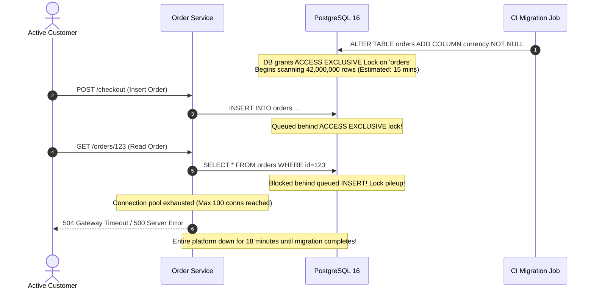

# Module 04: Database Migrations in Deployment Pipelines

> **Prerequisites:** [00-containerizing-a-backend-app](../00-containerizing-a-backend-app/README.md), [03-deployment-strategies](../03-deployment-strategies/README.md), and [Databases and Data Layer](../../04-databases-and-data-layer/00-relational-vs-non-relational/README.md).  
> **Estimated Reading Time:** 32 minutes  
> **Target Audience:** Backend engineers, data platform engineers, and site reliability engineers designing zero-downtime schema evolution and automated deployment migration workflows.

> [!TIP]
> **Golden Rule of Database Migrations in Pipelines:** Never perform in-place breaking schema changes in a live production environment. Decompose dangerous changes into the **Expand/Contract** pattern: add new schema elements additively *before* the application code deploys, backfill data in asynchronous idempotent batches, dual-write across both columns, and contract/drop obsolete structures in a separate deployment *after* all legacy replicas are decommissioned.

---

## Visual Mental Models & Architecture

### The Five-Phase Expand/Contract Schema Migration Lifecycle

Because zero-downtime rolling deployments guarantee that two application versions run concurrently against a single shared database, every schema change must keep data structures valid for both versions at every instant.

```mermaid
flowchart LR
    subgraph Phase1["Phase 1: Expand (Migration 1)"]
        direction TB
        Mig1["Run Additive Migration\n(ALTER TABLE ADD COLUMN nullable)"]
        OldApp1["v1.0 Old App (Reads/Writes col_old)"]
        Note1["Old code ignores new column"]
        Mig1 --> OldApp1
    end

    subgraph Phase2["Phase 2: Dual-Write & Backfill (Deploy A)"]
        direction TB
        DeployA["Deploy v1.1 App (Dual-Write)"]
        DualWrite["Writes: col_old AND col_new\nReads: col_old"]
        Backfill["Idempotent Batched Backfill Job\n(UPDATE WHERE col_new IS NULL)"]
        DeployA --> DualWrite
        DeployA --> Backfill
    end

    subgraph Phase3["Phase 3: Shift Reads (Deploy B)"]
        direction TB
        DeployB["Deploy v1.2 App (Shift Reads)"]
        ShiftRead["Writes: col_old AND col_new\nReads: col_new"]
        DeployB --> ShiftRead
    end

    subgraph Phase4["Phase 4: Cease Old Writes (Deploy C)"]
        direction TB
        DeployC["Deploy v2.0 App (New Only)"]
        NewOnly["Writes: col_new ONLY\nReads: col_new ONLY"]
        DeployC --> NewOnly
    end

    subgraph Phase5["Phase 5: Contract (Migration 2)"]
        direction TB
        Mig2["Run Destructive Migration\n(ALTER TABLE DROP COLUMN col_old)"]
        SafeContract["Safe: Zero running replicas reference col_old"]
        Mig2 --> SafeContract
    end

    Phase1 --> Phase2
    Phase2 --> Phase3
    Phase3 --> Phase4
    Phase4 --> Phase5

    classDef expand fill:#e6fffa,stroke:#00a389,stroke-width:2px;
    classDef contract fill:#fff0f0,stroke:#e53e3e,stroke-width:2px;
    classDef code fill:#f0f4ff,stroke:#3182ce,stroke-width:2px;
    class Phase1 expand;
    class Phase5 contract;
    class Phase2,Phase3,Phase4 code;
```



---

## Systematic Taxonomic Reference Grids

### PostgreSQL DDL Lock Level & Downtime Matrix

Certain Data Definition Language (DDL) operations acquire heavy table-level locks (`ACCESS EXCLUSIVE`), blocking all concurrent reads (`SELECT`) and writes (`INSERT`, `UPDATE`, `DELETE`) until completion.

| DDL Operation | PostgreSQL Lock Acquired | Concurrent Read Impact | Concurrent Write Impact | Zero-Downtime Safe Solution |
| :--- | :--- | :--- | :--- | :--- |
| **`ADD COLUMN` (Nullable, no default)** | `ACCESS EXCLUSIVE` | Blocked during metadata update (< 5ms) | Blocked during metadata update (< 5ms) | Safe to run directly; sub-second lock. |
| **`ADD COLUMN ... DEFAULT <val>` (Postgres $\ge$ 11)** | `ACCESS EXCLUSIVE` | Blocked (< 10ms, constant time) | Blocked (< 10ms, constant time) | Safe in Postgres 11+ with constant defaults. |
| **`ADD COLUMN ... NOT NULL` (No default)** | `ACCESS EXCLUSIVE` | **Total Table Block** (Scans all rows) | **Total Table Block** (Fails inserts) | **Anti-Pattern!** Add as nullable, backfill, then apply `NOT NULL`. |
| **`CREATE INDEX` (Standard)** | `SHARE` | Allowed | **Blocked** for entire index build | Use `CREATE INDEX CONCURRENTLY` (No write block). |
| **`ALTER TABLE ADD CONSTRAINT ... CHECK / FK`** | `ACCESS EXCLUSIVE` | **Blocked** during table validation scan | **Blocked** during table validation scan | Add as `NOT VALID` (instant), then `VALIDATE CONSTRAINT`. |
| **`DROP COLUMN`** | `ACCESS EXCLUSIVE` | Blocked during metadata update (< 5ms) | Blocked during metadata update (< 5ms) | Only run in Phase 5 after code references are purged. |
| **`ALTER COLUMN TYPE`** | `ACCESS EXCLUSIVE` | **Total Outage** (Full table rewrite) | **Total Outage** (Full table rewrite) | Expand/Contract to a new column with backfill. |

### Migration Pipeline Execution Models

| Execution Model | Trigger Mechanism | Failure Blast Radius | Concurrency Race Hazard | Production Verdict |
| :--- | :--- | :--- | :--- | :--- |
| **In-Process App Startup (`CMD` / `lifespan`)** | Every pod executes `alembic upgrade` on start | High: Pod crash loops take down entire service | **Extreme:** 10 pods race DDL locks concurrently | **Strict Anti-Pattern.** Never run in app startup. |
| **Kubernetes Init Container** | Runs before app container in each pod | High: Delays pod startup by minutes | Moderate: Multi-pod rollout still races migrations | Discouraged for high-scale clusters. |
| **Pre-Deployment Pipeline Job (Factor XII)** | Dedicated CI/CD job or Kubernetes `Job` | Low: Pipeline halts before any code rollout begins | **Zero:** Exactly one process executes migrations | **Standard Industry Best Practice.** |
| **Dedicated Migration Operator (Argo Sync Waves)** | GitOps hook wave executing prior to deployment | Low: Controlled automated rollbacks | Zero: Handled by orchestrator sync waves | Excellent for enterprise GitOps environments. |

---

## Production War Stories: Incident Post-Mortem

### SEV-1 Post-Mortem: The 18-Minute `ACCESS EXCLUSIVE` Table Lock

#### Incident Overview
* **Severity:** SEV-1 (Complete Global Checkout Outage)
* **Detection Time:** 2 minutes post-deployment
* **Resolution Time:** 18 minutes (Database lock-queue pileup and connection pool exhaustion)
* **Financial Impact:** \$720,000 in dropped transactions; 62,000 connection timeout errors.

#### What Happened
A backend team deployed a migration on an `orders` table containing 42,000,000 rows. The migration script contained a single line of DDL intended to enforce multi-currency compliance:
```sql
ALTER TABLE orders ADD COLUMN currency VARCHAR(3) NOT NULL;
```

Because the column was declared `NOT NULL` without a default value on an existing table with 42 million rows:
1. PostgreSQL acquired an `ACCESS EXCLUSIVE` lock on the `orders` table.
2. An `ACCESS EXCLUSIVE` lock conflicts with **all other locks**, including standard reads (`SELECT`).
3. While PostgreSQL attempted to scan and rewrite 42 million rows to verify that no null values existed, incoming web traffic continued sending 800 HTTP requests per second to the checkout service.
4. Every incoming query stacked up in PostgreSQL's lock queue, waiting for the table lock to release.
5. In PostgreSQL, **locks in the lock queue block subsequent requests behind them**. Consequently, even fast primary-key reads were blocked behind the pending DDL lock.
6. The application's HikariCP/asyncpg connection pools exhausted within 40 seconds. Pods began crashing with `500 Internal Server Error` and `504 Gateway Timeout`.



#### Root Cause Analysis
1. **Unbuffered DDL Lock:** Executing an un-defaulted `NOT NULL` migration on a 42M-row table triggered an unavoidable whole-table scan under an `ACCESS EXCLUSIVE` lock.
2. **Missing Statement Timeouts:** The migration connection did not set a `lock_timeout`. A safe migration should set `SET lock_timeout = '2s'` to abort immediately if the lock cannot be acquired within 2 seconds, preventing queue starvation.
3. **Coupled Migration:** The team combined schema definition and constraint enforcement into a single blocking step instead of using the Expand/Contract lifecycle.

#### The Fix & Architectural Hardening
1. **Expand Step:** Added the column as **nullable** (`ALTER TABLE orders ADD COLUMN currency VARCHAR(3);`), which completes in <5 milliseconds as a pure metadata update in PostgreSQL.
2. **Dual-Write & Batched Backfill:** Configured the application to dual-write currency on all new orders, while a background worker updated legacy rows in chunks of 5,000.
3. **Safe Constraint Validation:** Once all rows were populated, applied the constraint in two lock-safe steps:
   ```sql
   ALTER TABLE orders ADD CONSTRAINT check_currency_not_null CHECK (currency IS NOT NULL) NOT VALID;
   ALTER TABLE orders VALIDATE CONSTRAINT check_currency_not_null;
   ```
   `VALIDATE CONSTRAINT` acquires only a `SHARE UPDATE EXCLUSIVE` lock, which **does not block concurrent reads or writes**.

---

## Multi-Language Production Code Tabs

The following code tabs demonstrate how to implement safe, zero-downtime database migrations, concurrent index creation, and batched backfills in Go, Node.js/TypeScript, Python, and C#.

=== "Go"
    ```go
    // Package migrations implements an idempotent, batched backfill worker in Go.
    // Chunked updates prevent database lock contention and connection pool exhaustion.
    package migrations

    import (
    	"context"
    	"database/sql"
    	"fmt"
    	"log/slog"
    	"time"
    )

    type BackfillWorker struct {
    	db        *sql.DB
    	batchSize int
    }

    func NewBackfillWorker(db *sql.DB, batchSize int) *BackfillWorker {
    	return &BackfillWorker{db: db, batchSize: batchSize}
    }

    // BackfillCurrency executes batched updates until all NULL records are populated.
    func (w *BackfillWorker) BackfillCurrency(ctx context.Context, defaultCurrency string) error {
    	for {
    		select {
    		case <-ctx.Done():
    			return ctx.Err()
    		default:
    		}

    		// Idempotent chunk: update only records where modern column is NULL
    		query := `
    			WITH rows_to_update AS (
    				SELECT id FROM orders 
    				WHERE currency IS NULL 
    				LIMIT $1 
    				FOR UPDATE SKIP LOCKED
    			)
    			UPDATE orders 
    			SET currency = $2 
    			FROM rows_to_update 
    			WHERE orders.id = rows_to_update.id;`

    		res, err := w.db.ExecContext(ctx, query, w.batchSize, defaultCurrency)
    		if err != nil {
    			return fmt.Errorf("backfill batch failed: %w", err)
    		}

    		rowsAffected, err := res.RowsAffected()
    		if err != nil {
    			return err
    		}

    		slog.Info("Backfill batch completed", "rows_updated", rowsAffected)

    		if rowsAffected == 0 {
    			slog.Info("Backfill completed successfully: 0 NULL records remaining")
    			break
    		}

    		// Backpressure delay to allow concurrent OLTP traffic priority
    		time.Sleep(100 * time.Millisecond)
    	}
    	return nil
    }
    ```

=== "Node.js/TypeScript"
    ```typescript
    // TypeScript migration helper using Knex for lock-safe index creation
    import { Knex } from "knex";

    export async function up(knex: Knex): Promise<void> {
      // Set lock timeout to 2 seconds to prevent lock queue pileup
      await knex.raw("SET lock_timeout = '2s';");

      // Phase 1 (Expand): Add column as nullable (instant metadata update)
      await knex.schema.alterTable("orders", (table) => {
        table.string("reference_code", 64).nullable();
      });

      // CONCURRENT index creation: does NOT block concurrent INSERT/UPDATE/DELETE
      // Note: Must disable transaction wrapper in knex migration config!
      await knex.raw(
        "CREATE INDEX CONCURRENTLY IF NOT EXISTS idx_orders_ref ON orders (reference_code);"
      );
    }

    export async function down(knex: Knex): Promise<void> {
      await knex.raw("SET lock_timeout = '2s';");
      await knex.raw("DROP INDEX CONCURRENTLY IF EXISTS idx_orders_ref;");
      await knex.schema.alterTable("orders", (table) => {
        table.dropColumn("reference_code");
      });
    }

    // Idempotent Batched Backfill Script
    export async function runBackfill(knex: Knex, batchSize = 1000): Promise<void> {
      let totalUpdated = 0;
      while (true) {
        const updated = await knex.raw(
          `
          WITH batch AS (
            SELECT id FROM orders 
            WHERE reference_code IS NULL 
            LIMIT ? 
            FOR UPDATE SKIP LOCKED
          )
          UPDATE orders 
          SET reference_code = ref 
          FROM batch 
          WHERE orders.id = batch.id;
        `,
          [batchSize]
        );

        const count = updated.rowCount || 0;
        totalUpdated += count;
        console.log(`Backfilled ${count} rows (Total: ${totalUpdated})`);

        if (count === 0) break;
        await new Promise((resolve) => setTimeout(resolve, 50));
      }
    }
    ```

=== "Python"
    ```python
    """Production Alembic Migration: Expand/Contract with Lock Timeout and CONCURRENTLY."""

    from alembic import op
    import sqlalchemy as sa

    # revision identifiers, used by Alembic.
    revision = "20261110_expand_ref"
    down_revision = "20261109_prev"


    def upgrade() -> None:
        # 1. Protect production: fail fast if lock cannot be acquired within 2s
        op.execute("SET lock_timeout = '2s';")

        # 2. Phase 1 (Expand): Add nullable column (sub-second metadata change)
        op.add_column(
            "orders", sa.Column("reference_code", sa.String(length=64), nullable=True)
        )

        # 3. Create index concurrently: must commit existing transaction first
        op.execute("COMMIT;")
        op.create_index(
            "ix_orders_reference_code",
            "orders",
            ["reference_code"],
            postgresql_concurrently=True,
        )


    def downgrade() -> None:
        op.execute("SET lock_timeout = '2s';")
        op.execute("COMMIT;")
        op.drop_index(
            "ix_orders_reference_code",
            table_name="orders",
            postgresql_concurrently=True,
        )
        op.drop_column("orders", "reference_code")


    # --- Idempotent Batched Backfill Runner ---
    def execute_batched_backfill(connection, batch_size: int = 2000) -> None:
        while True:
            result = connection.execute(
                sa.text("""
                WITH batch AS (
                    SELECT id FROM orders 
                    WHERE reference_code IS NULL 
                    LIMIT :batch_size 
                    FOR UPDATE SKIP LOCKED
                )
                UPDATE orders 
                SET reference_code = ref 
                FROM batch 
                WHERE orders.id = batch.id;
            """),
                {"batch_size": batch_size},
            )

            if result.rowcount == 0:
                break
            connection.commit()
    ```

=== "C#"
    ```csharp
    namespace BackendRoadmap.Migrations;

    using System;
    using System.Threading;
    using System.Threading.Tasks;
    using Npgsql;

    public class DatabaseBackfillWorker
    {
        private readonly string _connectionString;

        public DatabaseBackfillWorker(string connectionString)
        {
            _connectionString = connectionString;
        }

        public async Task ExecuteBackfillAsync(int batchSize = 1000, CancellationToken ct = default)
        {
            await using var conn = new NpgsqlConnection(_connectionString);
            await conn.OpenAsync(ct);

            const string sql = @"
                WITH batch AS (
                    SELECT id FROM orders 
                    WHERE reference_code IS NULL 
                    LIMIT @batchSize 
                    FOR UPDATE SKIP LOCKED
                )
                UPDATE orders 
                SET reference_code = ref 
                FROM batch 
                WHERE orders.id = batch.id;";

            while (!ct.IsCancellationRequested)
            {
                await using var cmd = new NpgsqlCommand(sql, conn);
                cmd.Parameters.AddWithValue("batchSize", batchSize);

                int affected = await cmd.ExecuteNonQueryAsync(ct);
                Console.WriteLine($"Processed chunk: {affected} records updated.");

                if (affected == 0)
                {
                    Console.WriteLine("Backfill complete: 0 NULL records remaining.");
                    break;
                }

                await Task.Delay(50, ct); // Backpressure sleep
            }
        }
    }
    ```

---

## Practical Hands-On Verification CLI Workflows

### Validating Lock-Free Indexing and Idempotent Backfills

#### 1. Verifying Lock Safety via `lock_timeout`
Always ensure your migration scripts enforce a lock timeout:
```sql
-- In PostgreSQL terminal:
SET lock_timeout = '2000ms';
ALTER TABLE orders ADD COLUMN reference_code VARCHAR(64) NULL;
```

#### 2. Running Idempotent Batched Backfill
```bash
# Execute the Python/Node/Go backfill script
python -m app.scripts.backfill_reference_code --batch-size=2000
```

**Expected Wire Output:**
```text
[2026-11-10 14:35:01] INFO Backfill chunk: 2000 rows updated.
[2026-11-10 14:35:02] INFO Backfill chunk: 2000 rows updated.
[2026-11-10 14:35:03] INFO Backfill chunk: 1420 rows updated.
[2026-11-10 14:35:04] INFO Backfill chunk: 0 rows updated. Completed!
```

#### 3. Verifying Zero Remaining Null Values Before Applying Constraints
```sql
SELECT COUNT(*) FROM orders WHERE reference_code IS NULL;
-- Expected output: 0
```

---

## Operational Validation Checkpoints (Scenario Quizzes)

### Checkpoint 1: Why NOT NULL Columns Without Defaults Reject Inserts
<details>
<summary><strong>Scenario Assessment:</strong> During a rolling deployment, an engineer applies a migration that adds <code>plan_id INTEGER NOT NULL</code> to the <code>tenants</code> table before deploying the new backend image. Immediately, user registration requests fail with HTTP 500 errors. What caused the failures, and why did they occur during the rollout?</summary>

<strong>Answer:</strong>
The failure occurred because the migration was **not backward-compatible with the currently-running old application replicas**:
1. During a rolling deployment, old replicas continue running and serving traffic while new replicas are being provisioned.
2. The old application code has no awareness of the new `plan_id` column and does not include `plan_id` in its `INSERT INTO tenants (...)` statements.
3. Because the database column was defined as `NOT NULL` without a default value, PostgreSQL immediately rejected all inserts originating from the old replicas with:
   `ERROR: null value in column "plan_id" violates not-null constraint`.

**The Fix:**
1. **Phase 1 (Expand):** Add `plan_id` as **nullable** (`plan_id INTEGER NULL`). Old code inserts continue to succeed without error.
2. **Phase 2:** Deploy new code that populates `plan_id` on all new inserts.
3. **Phase 3:** Backfill legacy tenants with a default plan ID.
4. **Phase 4 (Contract):** Alter the column to `NOT NULL` only after verifying that zero NULL values exist in the table.
</details>

### Checkpoint 2: The Concurrent Index Creation Transaction Trap
<details>
<summary><strong>Scenario Assessment:</strong> An engineer writes a zero-downtime migration in Alembic/Knex using <code>CREATE INDEX CONCURRENTLY</code>. When CI executes the migration inside a transaction block, PostgreSQL aborts with: <code>ERROR: CREATE INDEX CONCURRENTLY cannot run inside a transaction block</code>. Why does this occur, and how must migration runners be configured?</summary>

<strong>Answer:</strong>
`CREATE INDEX CONCURRENTLY` operates using a **two-phase table scanning mechanism**:
1. Phase 1: PostgreSQL registers the index in system catalogs and scans the table to build the initial index tree while permitting concurrent writes.
2. Phase 2: PostgreSQL starts a second scan to catch all rows modified, inserted, or deleted during Phase 1.
3. Because this two-phase operation relies on viewing distinct snapshot states across separate transactions, PostgreSQL strictly forbids executing `CREATE INDEX CONCURRENTLY` inside an open transaction block (`BEGIN ... COMMIT`).

**The Fix:**
Configure the migration runner to execute the statement **autocommit / non-transactional**:
- In Alembic: Call `op.execute("COMMIT;")` before running `op.create_index(..., postgresql_concurrently=True)`, or set `autocommit_block()` context.
- In Knex: Add `export const config = { transaction: false };` to the migration file.
</details>

### Checkpoint 3: Why Migrations Must Run as a One-Off Admin Process
<details>
<summary><strong>Scenario Assessment:</strong> A startup configures their Docker container entrypoint to execute <code>alembic upgrade head && uvicorn app.main:app</code> on startup. In production with 6 replicas, a deployment causes database deadlock errors and schema corruption. Why is running migrations inside the application container startup an anti-pattern?</summary>

<strong>Answer:</strong>
Executing migrations on application startup violates **Factor XII (Admin Processes)** and introduces severe concurrency hazards:
1. **Concurrent Migration Race Condition:** When a new release rolls out across 6 container replicas, all 6 containers start concurrently and execute `alembic upgrade head` at the exact same millisecond.
2. **Schema Lock Contention:** The 6 processes race to lock the migration version table (`alembic_version`) and acquire DDL locks, resulting in deadlocks, timeout failures, and aborted startup sequences.
3. **Coupled Disposability (Factor IX):** Coupling heavy database migrations to container startup drastically increases pod boot time (from 1 second to several minutes), causing Kubernetes readiness probes to fail and stalling autoscaling events.

**The Fix:** Run migrations as a **single, isolated pre-deployment job** (a Kubernetes `Job` or CI/CD deployment pipeline step) that executes once to completion before any application replica rollout begins.
</details>

---

## Free PDF notes

Download these notes as a printable PDF, with every diagram and interview questions: [SD-E-028: Zero-Downtime Database Migrations](https://backendroadmap.com/notes/system-design/SD-E-028.pdf). Each section in one file: [Phase 2, Databases (PDF)](https://backendroadmap.com/notes/system-design/Phase2_Databases_Notes.pdf).

---

## Summary & Further Study

- **Expand/Contract:** Decompose every breaking schema change into additive-first, multi-deploy sequences.
- **Lock Awareness:** Avoid whole-table locks by using `CREATE INDEX CONCURRENTLY` and validating constraints with `NOT VALID`.
- **Idempotent Backfills:** Move massive data updates out of DDL migrations into chunked, throttled background worker jobs.

### Further Reading
- [Martin Fowler on Evolutionary Database Design](https://martinfowler.com/articles/evodb.html)
- [PostgreSQL Documentation: Lock Monitoring & DDL Locking](https://www.postgresql.org/docs/current/explicit-locking.html)
- [GitLab Database Engineering: Zero-Downtime Migration Guide](https://docs.gitlab.com/ee/development/database/zero_downtime_migrations.html)
- [Alembic Documentation: Working with Autocommit Blocks](https://alembic.sqlalchemy.org/en/latest/)
