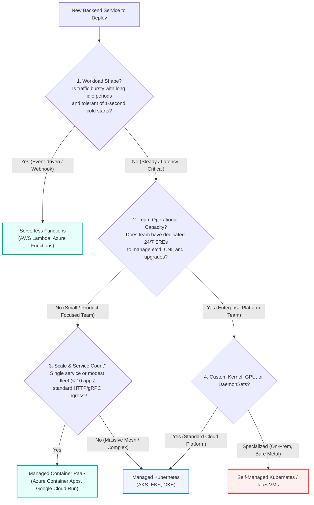
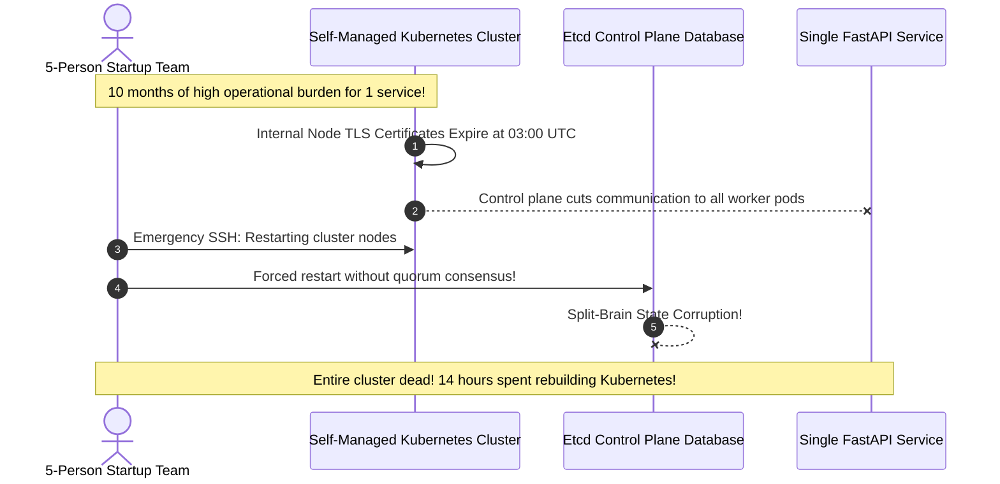

# Module 07: Choosing Your Deployment Target

> **Prerequisites:** [00-containerizing-a-backend-app](../00-containerizing-a-backend-app/README.md) through [06-health-checks-readiness-and-scaling-signals](../06-health-checks-readiness-and-scaling-signals/README.md).  
> **Estimated Reading Time:** 30 minutes  
> **Target Audience:** Engineering leads, systems architects, and backend engineers deciding on production hosting platforms and balancing operational overhead against system control.

> [!TIP]
> **Golden Rule of Deployment Targets:** Always default to the most managed platform that accommodates your workload's architectural constraints. Move left along the spectrum toward orchestrator control (Kubernetes/IaaS) only when forced by specific compliance, networking, or multi-service mesh requirements, because operational burden is an ongoing tax paid in team focus and reliability toil.

---

## Visual Mental Models & Architecture

### The Deployment Target Decision Framework

Selecting a hosting destination is an ordered evaluation of architectural constraints. By working top-down through workload characteristics, team capacity, and concurrency needs, you systematically identify the optimal operational tier.



---

## Systematic Taxonomic Reference Grids

### Deployment Target Comparison Matrix

| Evaluation Dimension | IaaS Virtual Machines (VM) | Self-Managed Kubernetes | Managed Kubernetes (AKS/EKS) | Managed Container PaaS (ACA / Cloud Run) | Serverless Functions (Lambda / Azure Functions) |
| :--- | :--- | :--- | :--- | :--- | :--- |
| **Operational Burden** | Extreme (OS patching, custom daemons) | **Maximum** (etcd, control plane, upgrades) | High (Workload manifests, node pools) | **Low** (Zero cluster maintenance) | **Minimal** (Pure code deployment) |
| **Cold Start Risk** | Zero (Always-on compute) | Zero (Always-on worker nodes) | Zero (Warm nodes maintain pods) | Low (< 2s if scaled to zero) | **High** (1s – 5s cold start on scale from 0) |
| **Scaling Model** | Slow VM autoscaling (3 – 8 mins) | Pod HPA (15 – 45s) | Pod HPA + Cluster Autoscaler | Fast HTTP scale-to-zero / KEDA | Instant per-event invocation |
| **Cost Profile** | Fixed hourly per provisioned VM | Fixed compute + cluster overhead | Worker node billing + control plane | Consumption-based (Scale to zero) | Pure pay-per-execution (Milliseconds) |
| **Recommended Workload** | Legacy OS dependencies, non-container apps | Air-gapped on-premise data centers | Multi-team fleets (>15 services), service meshes | **Standard Web APIs, Microservices, Background Workers** | Webhooks, async cron jobs, event glue |

### Decision Framework Evaluation Dimensions

| Framework Dimension | Primary Assessment Criteria | Indicator Favoring Managed PaaS | Indicator Favoring Orchestrator (K8s) |
| :--- | :--- | :--- | :--- |
| **1. Workload Shape** | Concurrency, I/O wait, latency SLA | Steady HTTP requests, sub-50ms p99 SLA | Mixed batch, streaming, and RPC services |
| **2. Team Capacity** | Dedicated SREs vs product engineers | < 10 engineers; zero dedicated platform engineers | Dedicated platform engineering team |
| **3. Service Count** | Architectural topology | 1 to 8 decoupled microservices | 15+ interdependent services sharing a VPC |
| **4. Control Needs** | Custom CNI, DaemonSets, eBPF | Standard ingress, TLS termination, HTTP routing | Custom networking plugins, service mesh (Istio) |
| **5. Cost Economics** | Baseline utilization vs traffic spikes | Intermittent traffic with overnight idle windows | Sustained, predictable 24/7 high-volume throughput |

---

## Production War Stories: Incident Post-Mortem

### SEV-1 Post-Mortem: The Premature Kubernetes Cluster Meltdown

#### Incident Overview
* **Severity:** SEV-1 (Catastrophic Total Platform Outage)
* **Detection Time:** Immediate (Cert-manager renewal expiry)
* **Resolution Time:** 14 hours 20 minutes (etcd consensus restore and manual node rebuilding)
* **Impact:** 100% of customer traffic dropped; startup unable to ship product features for 2 weeks.

#### What Happened
A five-person startup with a single FastAPI backend service and a PostgreSQL database decided to build their production infrastructure on **self-managed Kubernetes on raw AWS EC2 instances**. The team believed this would "ensure future scalability and prevent cloud vendor lock-in."

Ten months into production:
1. The engineering team spent approximately 25 hours per month troubleshooting Kubernetes CNI network routing, ingress controller configuration, and node volume mounts rather than developing application features.
2. At 03:00 on a Sunday, the internal control plane mutual-TLS certificates (configured with default 1-year expirations) expired.
3. Kubelets immediately refused communication with the Kubernetes API server.
4. An automated worker node replacement triggered by an AWS health check failed to join the cluster.
5. In an attempt to force node synchronization, an engineer manually restarted the etcd cluster nodes. Because of improper quorum configurations, etcd suffered a **split-brain consensus failure**, corrupting cluster state.
6. The single FastAPI service was inaccessible for over 14 hours while the team desperately attempted to recover etcd snapshots.



#### Root Cause Analysis
1. **Severe Control-vs-Burden Mismatch:** The startup paid the maximum operational tax of running an enterprise distributed orchestrator to host a single, stateless backend service.
2. **Résumé-Driven Architecture:** The architectural choice was driven by technology hype rather than workload constraints or organizational capacity.
3. **Missing Managed Abstractions:** A managed PaaS (such as Azure Container Apps or AWS App Runner) would have handled TLS termination, node management, rolling deploys, and scaling automatically with zero maintenance overhead.

#### The Fix & Architectural Hardening
1. **Complete Decommissioning of Kubernetes Cluster:** The team migrated the single FastAPI container image directly to a **Managed Container PaaS (Azure Container Apps / Cloud Run)**.
2. **Infrastructure Elimination:** Eliminated 300+ lines of complex Kubernetes YAML manifests, Helm charts, and custom Terraform cluster modules, replacing them with a single 30-line infrastructure template.
3. **Zero Maintenance Overhead:** Platform upgrades, certificate rotations, and ingress scaling became fully managed cloud responsibilities, returning 100% of engineering bandwidth to product development.

---

## Multi-Language Production Code Tabs

Because you designed your application to be a 12-factor container (Modules 00 and 01), the **exact same container image** runs across different deployment targets without code modifications. Below are production configurations targeting Managed PaaS and Managed Kubernetes.

=== "Go"
    ```yaml
    # Target 1: Azure Container Apps (Managed PaaS - Zero Cluster Maintenance)
    # deploy-aca.bicep
    resource containerApp 'Microsoft.App/containerApps@2024-03-01' = {
      name: 'go-backend-api'
      location: resourceGroup().location
      properties: {
        configuration: {
          ingress: {
            external: true
            targetPort: 8080
          }
        }
        template: {
          containers: [
            {
              name: 'server'
              image: 'ghcr.io/myorg/go-backend:git-7f8a1bc'
              resources: {
                cpu: json('0.5')
                memory: '1.0Gi'
              }
              env: [
                { name: 'APP_ENV', value: 'prod' }
                { name: 'DATABASE_URL', secretRef: 'db-conn' }
              ]
              probes: [
                {
                  type: 'Liveness'
                  httpGet: { path: '/livez', port: 8080 }
                  periodSeconds: 10
                }
                {
                  type: 'Readiness'
                  httpGet: { path: '/readyz', port: 8080 }
                  periodSeconds: 5
                }
              ]
            }
          ]
          scale: {
            minReplicas: 1
            maxReplicas: 10
            rules: [
              {
                name: 'http-scaling'
                http: { metadata: { concurrentRequests: '50' } }
              }
            ]
          }
        }
      }
    }
    ```

=== "Node.js/TypeScript"
    ```yaml
    # Target 2: Managed Kubernetes (AKS / EKS Deployment Manifest)
    # k8s-deployment.yaml
    apiVersion: apps/v1
    kind: Deployment
    metadata:
      name: node-backend-api
      labels:
        app: node-backend
    spec:
      replicas: 3
      strategy:
        type: RollingUpdate
        rollingUpdate:
          maxSurge: 1
          maxUnavailable: 0
      selector:
        matchLabels:
          app: node-backend
      template:
        metadata:
          labels:
            app: node-backend
        spec:
          securityContext:
            runAsNonRoot: true
            runAsUser: 1000
          containers:
            - name: api
              image: ghcr.io/myorg/node-backend:git-7f8a1bc
              ports:
                - containerPort: 3000
              resources:
                requests:
                  cpu: "250m"
                  memory: "512Mi"
                limits:
                  cpu: "1000m"
                  memory: "1Gi"
              livenessProbe:
                httpGet: { path: /livez, port: 3000 }
                periodSeconds: 10
              readinessProbe:
                httpGet: { path: /readyz, port: 3000 }
                periodSeconds: 5
    ```

=== "Python"
    ```yaml
    # Target 1: Azure Container Apps Bicep Manifest for Python / FastAPI
    resource pythonApp 'Microsoft.App/containerApps@2024-03-01' = {
      name: 'fastapi-service'
      location: resourceGroup().location
      properties: {
        configuration: {
          ingress: {
            external: true
            targetPort: 8000
          }
        }
        template: {
          containers: [
            {
              name: 'web'
              image: 'ghcr.io/myorg/fastapi-service:git-7f8a1bc'
              resources: {
                cpu: json('0.5')
                memory: '1.0Gi'
              }
              env: [
                { name: 'PYTHONUNBUFFERED', value: '1' }
                { name: 'APP_ENV', value: 'prod' }
              ]
              probes: [
                {
                  type: 'Liveness'
                  httpGet: { path: '/livez', port: 8000 }
                }
                {
                  type: 'Readiness'
                  httpGet: { path: '/readyz', port: 8000 }
                }
              ]
            }
          ]
          scale: {
            minReplicas: 2
            maxReplicas: 20
          }
        }
      }
    }
    ```

=== "C#"
    ```yaml
    # Target 2: Managed Kubernetes Deployment for ASP.NET Core
    apiVersion: apps/v1
    kind: Deployment
    metadata:
      name: dotnet-backend-api
    spec:
      replicas: 4
      strategy:
        type: RollingUpdate
        rollingUpdate:
          maxSurge: 25%
          maxUnavailable: 0
      selector:
        matchLabels:
          app: dotnet-backend
      template:
        metadata:
          labels:
            app: dotnet-backend
        spec:
          containers:
            - name: web
              image: ghcr.io/myorg/dotnet-backend:git-7f8a1bc
              ports:
                - containerPort: 8080
              livenessProbe:
                httpGet: { path: /livez, port: 8080 }
              readinessProbe:
                httpGet: { path: /readyz, port: 8080 }
    ```

---

## Practical Hands-On Verification CLI Workflows

### Evaluating and Deploying to Managed PaaS

To verify your service's portability without standing up a local Kubernetes cluster, deploy the container directly to a serverless container runtime:

```bash
# 1. Step 1: Verify the multi-stage image runs locally as non-root
docker run --rm -p 8080:8000 --env-file .env.prod myapp:git-7f8a1bc

# 2. Step 2: Validate health probe responses
curl -I http://localhost:8080/livez
curl -I http://localhost:8080/readyz

# 3. Step 3: Deploy to Azure Container Apps (Example PaaS CLI)
az containerapp create \
  --name my-backend-api \
  --resource-group rg-production \
  --image ghcr.io/myorg/myapp:git-7f8a1bc \
  --target-port 8000 \
  --ingress external \
  --min-replicas 1 \
  --max-replicas 5
```

**Expected Wire Output:**
```text
HTTP/1.1 200 OK
content-type: application/json
{"status":"alive"}

Container App created successfully!
FQDN: https://my-backend-api.ambitiousocean-1234.eastus.azurecontainerapps.io
```

---

## Operational Validation Checkpoints (Scenario Quizzes)

### Checkpoint 1: When Does Kubernetes Actually Earn Its Complexity?
<details>
<summary><strong>Scenario Assessment:</strong> A company operates 24 distinct microservices developed by 6 different cross-functional teams. They currently host them as separate individual PaaS web apps. Operations engineers complain of fragmented monitoring, high networking egress costs between services, and inconsistent deployment scripts. Does this workload justify migrating to Kubernetes (AKS/EKS)?</summary>

<strong>Answer:</strong>
**YES.** This is the exact architectural threshold where an orchestrator **earns its operational complexity**:
1. **Multi-Service Scale:** Managing 24 separate PaaS configurations leads to operational sprawl and fragmented security policies.
2. **Internal Service Mesh & Networking:** In Kubernetes, inter-service communication stays within a private virtual cluster network (`http://order-service.default.svc.cluster.local`) with mTLS (via Istio/Linkerd) and zero cloud egress bandwidth fees.
3. **Declarative Standardization:** A single GitOps repository (ArgoCD) can manage all 24 deployments, ingress rules, network policies, and autoscaling configurations uniformly.
4. **Organizational Capacity:** With 6 teams and dedicated operations engineers, the organization possesses the engineering bandwidth required to operate and maintain a managed cluster (AKS/EKS).
</details>

### Checkpoint 2: The Serverless Cold-Start Latency Trap
<details>
<summary><strong>Scenario Assessment:</strong> A fintech company migrates its synchronous core banking authorization API to AWS Lambda / Azure Functions. Customers complain that periodically, credit card authorization requests take 2,800ms to complete instead of the mandated 150ms SLA. What architectural phenomenon is occurring, and what is the proper target resolution?</summary>

<strong>Answer:</strong>
The authorization service is suffering from **Serverless Cold Starts**:
1. When a serverless function experiences a lull in traffic, the cloud platform terminates idle execution environments (scaling to zero).
2. When the next transaction arrives, the platform must provision a new microVM, download the runtime container, initialize language runtimes, establish TLS database connection pools, and run startup imports before executing the handler.
3. In Java, Python, or .NET backends, this cold-start penalty commonly takes 1.5 to 4 seconds.

**Resolution:**
Migrate the latency-critical synchronous authorization service to a **Container PaaS (Azure Container Apps / Cloud Run) or Kubernetes** configured with **`minReplicas: 2` (warm pool)**. By maintaining at least two running, pre-initialized container replicas 24/7, incoming requests are served immediately without cold-start initialization latency.
</details>

### Checkpoint 3: The Illusory Goal of Complete Cloud Portability
<details>
<summary><strong>Scenario Assessment:</strong> An engineering architect forbids the use of AWS SQS, Azure Key Vault, and Google Cloud BigQuery, mandating that the team self-host RabbitMQ, HashiCorp Vault, and open-source Cassandra inside raw EC2 instances so the application remains "100% cloud-agnostic." How do you evaluate this architectural philosophy?</summary>

<strong>Answer:</strong>
This represents the dangerous anti-pattern of **"The Portability Trap" (Premature De-coupling)**:
1. **The Fallacy of Free Portability:** In practice, companies migrate cloud providers once every 7 to 10 years, if ever. The architectural cost of never committing to managed cloud services drastically outstrips the hypothetical cost of migration.
2. **Massive Operational Overhead:** Self-hosting distributed datastores (Cassandra, Vault, RabbitMQ) requires dedicated teams to manage clustering, backups, disk expansion, failover, OS patching, and 24/7 on-call alerting.
3. **The Pragmatic 12-Factor Balance:**
   - Keep the **application container portable** by relying on standard protocols (HTTP, gRPC, SQL) and injecting connection strings via environment variables (Factor III & IV).
   - Freely adopt **managed cloud services** (managed databases, cloud secrets vaults, managed message queues) to eliminate operational toil.
   - If migration is ever required, only the infrastructure Terraform scripts and environment connection strings change, while your application code remains untouched.
</details>

---

## Cumulative Track Review

*Test your comprehensive mastery across Track 13 (Modules 00 through 07) before undertaking the Capstone Project.*

<details>
<summary><strong>1. Multi-Stage Docker Build Optimization:</strong> Why does a multi-stage Dockerfile copy virtual environments from a builder stage rather than installing dependencies directly in the runtime image?</summary>

Building packages frequently requires compilers (`gcc`, `make`), headers (`libpq-dev`), and package caches (`pip`). Leaving these in the runtime image bloats the container by 1+ GB, enlarges the security attack surface, and slows down cluster pull times during autoscaling. Multi-stage builds leave the build tools in the discarded builder stage, copying only the final compiled artifacts into a minimal, clean runtime image.
</details>

<details>
<summary><strong>2. The In-Flight Request Drain Protocol:</strong> Explain the exact POSIX signaling and readiness probe sequence when Kubernetes retires an old pod during a rolling update.</summary>

1. Kubernetes sends `SIGTERM` to the container process (PID 1).
2. The application's shutdown hook immediately flips `/readyz` to HTTP 503, signaling ingress controllers to remove the pod from routing tables.
3. The application sleeps for a brief pre-stop propagation window (e.g., 2 seconds).
4. The application drains in-flight HTTP requests, closes database connection pools, and terminates cleanly with exit code 0 before `terminationGracePeriodSeconds` expires.
</details>

<details>
<summary><strong>3. Zero-Downtime Database Migration Sequencing:</strong> Why must an additive database migration run BEFORE application code deploys, while a destructive migration must run AFTER?</summary>

- **Additive Migrations (Expand):** Adding a nullable column does not impact currently-running old replicas (they ignore it). Running it before code rollout ensures that when new replicas start, the column already exists.
- **Destructive Migrations (Contract):** Dropping a column while old replicas are still running causes immediate runtime SQL errors. Destructive migrations must wait until 100% of old replicas are retired.
</details>

<details>
<summary><strong>4. Decoupling Health Probes:</strong> Why must a database check NEVER be included in a Kubernetes liveness probe?</summary>

Liveness probe failures trigger an automatic container restart. If the database experiences a transient network hiccup, all pods fail liveness simultaneously. Kubernetes kills the entire fleet at once, creating a cascading restart storm and taking down the service. Database checks belong exclusively in **readiness probes** to route traffic around pods without restarting them.
</details>

---

## Summary & Further Study

- **Control vs Burden:** Balance platform autonomy against maintenance overhead; default to managed container platforms.
- **Portability Dividend:** A 12-factor container image runs on VMs, PaaS, or Kubernetes without code modifications.
- **Top-Down Evaluation:** Match workload shape, team capacity, and service count to your hosting destination.

### Further Reading
- [The Twelve-Factor App Methodology](https://12factor.net/)
- [Martin Fowler on Microservice Deployment Strategies](https://martinfowler.com/articles/microservices.html)
- [Azure Container Apps Architecture Guide](https://learn.microsoft.com/en-us/azure/container-apps/)
- [Kubernetes Architecture and Best Practices](https://kubernetes.io/docs/concepts/overview/)
