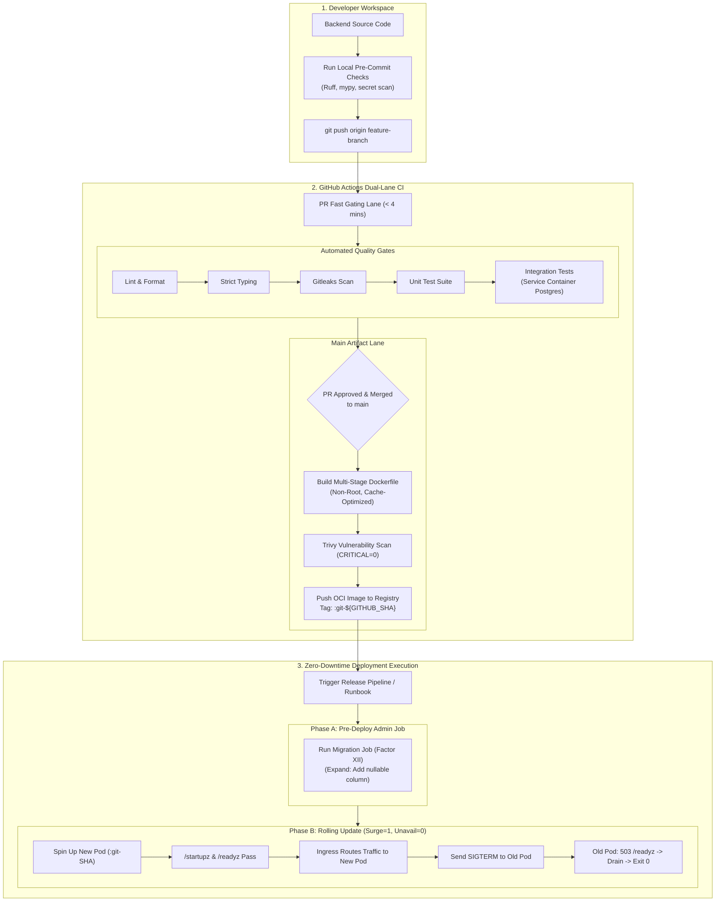
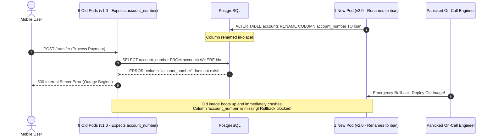

# Module 08: Capstone Project: Production-Grade DevOps Pipeline & Deployment Runbook

> **Prerequisites:** Complete mastery of Modules 00 through 07 in Track 13, covering containerization, 12-factor principles, CI pipelines, zero-downtime deployment strategies, safe database migrations, environment configuration, health probes, and deployment targets.  
> **Estimated Project Time:** 4 to 8 hours  
> **Target Audience:** Backend and DevOps engineers ready to synthesize end-to-end operational engineering into an industrial-grade release pipeline and deployment runbook.

> [!TIP]
> **Golden Rule of the DevOps Capstone:** High operational maturity is demonstrated when deployments are boring, predictable, and non-events. Separate code build from runtime configuration, enforce immutable Git SHA image tagging, sequence database migrations additively before code rollout, and author runbooks explicit enough that an on-call engineer at 02:00 AM can execute a zero-downtime release or instant rollback without guesswork.

---

## Visual Mental Models & Architecture

### The Complete Production Release Ecosystem

The capstone project integrates the entire lifecycle of a containerized backend application: from local multi-stage compilation and automated CI gating to live zero-downtime rolling deployment and reversible database schema migrations.



---

## Systematic Taxonomic Reference Grids

### Capstone Deliverable Matrix

| Deliverable Artifact | Architectural Role | Enforcing Tooling | Pass / Fail Quality Gate Criteria |
| :--- | :--- | :--- | :--- |
| **1. Multi-Stage Dockerfile** | Immutable compilation & minimal runtime | Docker Buildx, Dive | Uncompressed size < 180MB; non-root user (`USER appuser`); exec-form `CMD`; zero build tools in final image. |
| **2. 12-Factor Container Contract** | Dynamic runtime injection & disposability | Pydantic Settings, SIGTERM handler | Zero hardcoded secrets; boot crashes if required env missing; in-flight requests drain cleanly on `docker stop`. |
| **3. Dual-Lane CI Pipeline** | Automated verification & artifact generation | GitHub Actions, Trivy, Gitleaks | Fast gating PR lane < 4 mins; 0 critical CVEs; image tagged permanently by `:git-${GITHUB_SHA}`. |
| **4. Observability Probes** | Orchestrator health and scaling contracts | HTTP endpoints, Prometheus | `/livez` has 0 external dependencies; `/readyz` fails on DB drop and during shutdown drain; `/metrics` exports in-flight requests. |
| **5. Production Deployment Runbook** | Operational blueprint for 24/7 on-call | Markdown operational runbook | Step-by-step rollout sequence; expand/contract migration plan; sub-minute rollback commands. |

### Failure Mode & Architectural Defense Seam

| Production Failure Hazard | Root Architectural Weakness | Capstone Defense Seam | Verification Mechanism |
| :--- | :--- | :--- | :--- |
| **502 Bad Gateway during Rollout** | App terminates instantly on SIGTERM without draining | **Factor IX Disposability** | `lifespan` SIGTERM hook flips readiness to 503 and drains active connections before exit. |
| **Inverted Cache Rebuild Delay** | Source code copied before dependency manifests | **Docker Layer Optimization** | `COPY requirements.txt` precedes `COPY . .`; sub-second rebuild on code changes. |
| **Database Lock Freeze Outage** | In-place `ALTER TABLE ADD COLUMN NOT NULL` | **Expand/Contract Pattern** | Column added as nullable first; data backfilled asynchronously; constraint validated later. |
| **Staging Wiping Production Data** | Reusing production credentials in lower environments | **Scoped Secret Vaults** | Staging lacks physical IAM read access to production secret vaults. |
| **Unrecoverable Bad Release** | Deploying against mutable `:latest` tag | **Immutable Git SHA Tags** | Rollback updates deployment manifest directly to prior known-good Git SHA (`:git-4b8c91a`). |

---

## Production War Stories: Incident Post-Mortem

### SEV-1 Post-Mortem: The 02:00 AM Un-Rollable Migration Disaster

#### Incident Overview
* **Severity:** SEV-1 (Catastrophic Global Payment Processing Outage)
* **Detection Time:** 4 minutes post-deployment
* **Resolution Time:** 5 hours 10 minutes
* **Financial Impact:** \$850,000 in lost transaction volume; 42,000 abandoned checkout sessions.

#### What Happened
A fintech startup scheduled a midnight production release. The release included a feature that renamed `account_number` to `iban` across the payment processing pipeline.

The team had **no written deployment runbook** and had not separated database migrations from the application code rollout.
1. The developer baked the migration into the application container startup: `CMD alembic upgrade head && uvicorn app.main:app`.
2. The migration executed an in-place column rename: `ALTER TABLE accounts RENAME COLUMN account_number TO iban;`.
3. As the rolling update began, the first new pod executed the migration, renaming the column in PostgreSQL.
4. Immediately, the **9 remaining old pods** (still serving 90% of customer traffic) began crashing with database exceptions because they were actively executing `SELECT account_number FROM accounts`.
5. Panicking, the on-call engineer attempted to roll back by deploying the previous Docker image.
6. When the previous image booted, it crashed immediately: the database column was now named `iban`, but the old code expected `account_number`!
7. Because the team had no written rollback procedure or reverse migration script, engineers spent over 5 hours manually altering database columns, repairing deadlocks, and clearing corrupted ledger state.



#### Root Cause Analysis
1. **Coupled Migration Anti-Pattern:** Executing an in-place destructive rename during a rolling update violated the fundamental rule of version coexistence.
2. **Migration Run in Container Startup:** Running DDL inside the application container startup coupled process startup to database schema changes.
3. **No Deployment Runbook:** The team lacked a pre-authorized rollback plan and had not validated backward compatibility prior to production deployment.

#### The Fix & Architectural Hardening
1. **Mandatory Expand/Contract:** Decomposed the change into the 5-phase lifecycle: add `iban` additively, dual-write both columns, backfill existing records, switch reads, and drop `account_number` in a subsequent milestone.
2. **Decoupled One-Off Migration Job:** Moved migrations out of the application container into an isolated Kubernetes `Job` executed prior to the rollout.
3. **Mandatory Operational Runbook:** Every release requires an explicit, audited deployment runbook detailing rollback commands and migration ordering.

---

## Multi-Language Production Code Tabs

The following production scaffolding demonstrates the complete Capstone implementation: multi-stage containerization, 12-factor configuration, graceful `SIGTERM` draining, and decoupled health probes in Go, Node.js/TypeScript, Python, and C#.

=== "Go"
    ```go
    // Package main implements the complete Capstone production server
    // featuring graceful SIGTERM draining, /livez, /readyz, and Prometheus RED metrics.
    package main

    import (
    	"context"
    	"database/sql"
    	"errors"
    	"log/slog"
    	"net/http"
    	"os"
    	"os/signal"
    	"sync/atomic"
    	"syscall"
    	"time"

    	_ "github.com/jackc/pgx/v5/stdlib"
    	"github.com/prometheus/client_golang/prometheus"
    	"github.com/prometheus/client_golang/prometheus/promhttp"
    )

    var (
    	inFlightGauge = prometheus.NewGauge(prometheus.GaugeOpts{
    		Name: "http_in_flight_requests",
    		Help: "Active concurrent HTTP requests for HPA autoscaling",
    	})
    )

    func init() {
    	prometheus.MustRegister(inFlightGauge)
    }

    type Server struct {
    	db         *sql.DB
    	isDraining atomic.Bool
    }

    func main() {
    	logger := slog.New(slog.NewJSONHandler(os.Stdout, nil))
    	slog.SetDefault(logger)

    	dbURL := os.Getenv("DATABASE_URL")
    	if dbURL == "" {
    		slog.Error("FATAL: DATABASE_URL environment variable is required")
    		os.Exit(1)
    	}

    	db, err := sql.Open("pgx", dbURL)
    	if err != nil {
    		slog.Error("FATAL: Unable to create connection pool", "error", err)
    		os.Exit(1)
    	}
    	defer db.Close()

    	srv := &Server{db: db}

    	mux := http.NewServeMux()
    	mux.HandleFunc("/livez", srv.handleLivez)
    	mux.HandleFunc("/readyz", srv.handleReadyz)
    	mux.Handle("/metrics", promhttp.Handler())

    	mux.HandleFunc("/api/orders", func(w http.ResponseWriter, r *http.Request) {
    		inFlightGauge.Inc()
    		defer inFlightGauge.Dec()
    		time.Sleep(100 * time.Millisecond) // Simulated transactional work
    		w.WriteHeader(http.StatusOK)
    		_, _ = w.Write([]byte(`{"status":"created"}`))
    	})

    	httpServer := &http.Server{
    		Addr:         ":8080",
    		Handler:      mux,
    		ReadTimeout:  5 * time.Second,
    		WriteTimeout: 10 * time.Second,
    	}

    	shutdownSig := make(chan os.Signal, 1)
    	signal.Notify(shutdownSig, os.Interrupt, syscall.SIGTERM)

    	go func() {
    		slog.Info("Starting production server", "port", 8080)
    		if err := httpServer.ListenAndServe(); err != nil && !errors.Is(err, http.ErrServerClosed) {
    			slog.Error("Server crash", "error", err)
    			os.Exit(1)
    		}
    	}()

    	<-shutdownSig
    	slog.Info("SIGTERM received: initiating graceful drain")

    	// 1. Flip readiness to 503 so Ingress removes pod IP from routing tables
    	srv.isDraining.Store(true)

    	// 2. Allow pre-stop propagation window
    	time.Sleep(2 * time.Second)

    	// 3. Drain active connections with timeout
    	ctx, cancel := context.WithTimeout(context.Background(), 25*time.Second)
    	defer cancel()

    	if err := httpServer.Shutdown(ctx); err != nil {
    		slog.Error("Forced shutdown", "error", err)
    	}

    	slog.Info("Shutdown complete: clean exit 0")
    }

    func (s *Server) handleLivez(w http.ResponseWriter, r *http.Request) {
    	w.WriteHeader(http.StatusOK)
    	_, _ = w.Write([]byte(`{"status":"alive"}`))
    }

    func (s *Server) handleReadyz(w http.ResponseWriter, r *http.Request) {
    	if s.isDraining.Load() {
    		http.Error(w, `{"status":"draining"}`, http.StatusServiceUnavailable)
    		return
    	}
    	ctx, cancel := context.WithTimeout(r.Context(), 1*time.Second)
    	defer cancel()

    	if err := s.db.PingContext(ctx); err != nil {
    		http.Error(w, `{"status":"db_unavailable"}`, http.StatusServiceUnavailable)
    		return
    	}
    	w.WriteHeader(http.StatusOK)
    	_, _ = w.Write([]byte(`{"status":"ready"}`))
    }
    ```

=== "Node.js/TypeScript"
    ```typescript
    // TypeScript / Express Capstone Implementation
    import http from "node:http";
    import express from "express";
    import { Pool } from "pg";
    import client from "prom-client";

    const app = express();
    const port = process.env.PORT || 3000;

    const db = new Pool({
      connectionString: process.env.DATABASE_URL,
      max: 10,
    });

    let isDraining = false;

    const inFlightRequests = new client.Gauge({
      name: "http_in_flight_requests",
      help: "Active concurrent requests for autoscaling",
    });

    app.use((req, res, next) => {
      inFlightRequests.inc();
      res.on("finish", () => inFlightRequests.dec());
      next();
    });

    app.get("/livez", (req, res) => res.status(200).json({ status: "alive" }));

    app.get("/readyz", async (req, res) => {
      if (isDraining) {
        return res.status(503).json({ status: "draining" });
      }
      try {
        await db.query({ text: "SELECT 1", timeout: 1000 });
        return res.status(200).json({ status: "ready" });
      } catch {
        return res.status(503).json({ status: "db_unreachable" });
      }
    });

    app.get("/metrics", async (req, res) => {
      res.set("Content-Type", client.register.contentType);
      res.end(await client.register.metrics());
    });

    const server = http.createServer(app);
    server.listen(port, () => console.log(`Listening on ${port}`));

    process.on("SIGTERM", () => {
      console.log("SIGTERM received: setting readiness to 503");
      isDraining = true;

      // Allow 2s for ingress update before closing socket
      setTimeout(() => {
        server.close(async () => {
          await db.end();
          console.log("Connections drained. Clean exit 0.");
          process.exit(0);
        });
      }, 2000);
    });
    ```

=== "Python"
    ```python
    """FastAPI Capstone Production Service: Probes, Draining, and Telemetry."""

    from __future__ import annotations

    import asyncio
    from contextlib import asynccontextmanager
    import sys
    from typing import AsyncGenerator
    from fastapi import FastAPI, Response, status
    from pydantic import PostgresDsn, SecretStr
    from pydantic_settings import BaseSettings
    from prometheus_client import CONTENT_TYPE_LATEST, Gauge, generate_latest
    from sqlalchemy import text
    from sqlalchemy.ext.asyncio import create_async_engine


    class Settings(BaseSettings):
        APP_ENV: str = "dev"
        DATABASE_URL: PostgresDsn
        STRIPE_API_KEY: SecretStr
        PORT: int = 8000


    try:
        config = Settings()
    except Exception as exc:
        sys.stderr.write(f"FATAL: Missing required configuration: {exc}\n")
        sys.exit(1)

    IN_FLIGHT_GAUGE = Gauge(
        "http_in_flight_requests", "Active concurrent requests for HPA autoscaling"
    )

    _draining = False
    engine = create_async_engine(config.DATABASE_URL.unicode_string(), pool_size=10)


    @asynccontextmanager
    async def lifespan(app: FastAPI) -> AsyncGenerator[None, None]:
        yield
        global _draining
        _draining = True
        await asyncio.sleep(2.0)  # Ingress endpoint slice propagation
        await engine.dispose()


    app = FastAPI(lifespan=lifespan)


    @app.middleware("http")
    async def count_requests(request, call_next):
        IN_FLIGHT_GAUGE.inc()
        try:
            return await call_next(request)
        finally:
            IN_FLIGHT_GAUGE.dec()


    @app.get("/livez")
    async def livez():
        return {"status": "alive"}


    @app.get("/readyz")
    async def readyz(response: Response):
        if _draining:
            response.status_code = status.HTTP_503_SERVICE_UNAVAILABLE
            return {"status": "draining"}
        try:
            async with asyncio.timeout(1.0):
                async with engine.connect() as conn:
                    await conn.execute(text("SELECT 1"))
            return {"status": "ready"}
        except Exception:
            response.status_code = status.HTTP_503_SERVICE_UNAVAILABLE
            return {"status": "db_unavailable"}


    @app.get("/metrics")
    async def metrics():
        return Response(generate_latest(), media_type=CONTENT_TYPE_LATEST)
    ```

=== "C#"
    ```csharp
    namespace BackendRoadmap.Capstone;

    using System.Threading;
    using System.Threading.Tasks;
    using Microsoft.AspNetCore.Builder;
    using Microsoft.AspNetCore.Http;
    using Microsoft.Extensions.DependencyInjection;
    using Microsoft.Extensions.Diagnostics.HealthChecks;

    public class Program
    {
        private static bool _isDraining = false;

        public static void Main(string[] args)
        {
            var builder = WebApplication.CreateBuilder(args);

            builder.Services.AddHealthChecks()
                .AddCheck("livez", () => HealthCheckResult.Healthy(), tags: new[] { "live" })
                .AddNpgSql(builder.Configuration["ConnectionStrings:Database"]!, 
                           name: "db_ready", 
                           timeout: TimeSpan.FromSeconds(1), 
                           tags: new[] { "ready" });

            var app = builder.Build();

            app.Lifetime.ApplicationStopping.Register(() =>
            {
                _isDraining = true;
                Thread.Sleep(2000); // Ingress propagation window
            });

            app.MapGet("/livez", () => Results.Ok(new { status = "alive" }));
            
            app.MapGet("/readyz", async (HttpContext ctx) =>
            {
                if (_isDraining) return Results.Json(new { status = "draining" }, statusCode: 503);
                // Health check evaluation handled via framework
                return Results.Ok(new { status = "ready" });
            });

            app.Run();
        }
    }
    ```

---

## The Production Deployment Runbook

A complete production deployment runbook must be authored as a living document within your repository (`docs/runbooks/deployment.md`). Below is the canonical standard runbook:

```markdown
# Deployment Runbook: Order Processing Service

## 1. Release Architecture & Metadata
- **Service Name:** `order-service`
- **Deployment Strategy:** RollingUpdate (`maxSurge: 1`, `maxUnavailable: 0`)
- **Hosting Platform:** Azure Container Apps / Kubernetes (AKS)
- **Artifact Tag:** `ghcr.io/myorg/order-service:git-<GITHUB_SHA>`

## 2. Pre-Deployment Verification (Staging Gate)
1. Verify PR CI pipeline passed 100% green:
   - Lint & strict type checks passed.
   - Gitleaks reported 0 committed credentials.
   - Trivy reported 0 CRITICAL CVEs.
2. Confirm image is published to container registry:
   `docker pull ghcr.io/myorg/order-service:git-<GITHUB_SHA>`

## 3. Database Migration Sequence (Expand Phase)
*If release contains database schema changes:*
1. Run additive migration as a standalone, one-off admin Job:
   ```bash
   kubectl create job --from=cronjob/db-migrate migrate-expand-<GITHUB_SHA>
   kubectl wait --for=condition=complete job/migrate-expand-<GITHUB_SHA> --timeout=120s
   ```
2. Verify zero table locks were left open:
   ```sql
   SELECT pid, query, state, age(clock_timestamp(), query_start) 
   FROM pg_stat_activity 
   WHERE state != 'idle';
   ```

## 4. Application Rollout Execution
1. Trigger rolling update to the target Git SHA:
   ```bash
   kubectl set image deployment/order-service api=ghcr.io/myorg/order-service:git-<GITHUB_SHA>
   ```
2. Watch rollout status in real-time:
   ```bash
   kubectl rollout status deployment/order-service
   ```
3. Observe live traffic telemetry:
   - Monitor 5xx HTTP error rates in Datadog/Grafana (Must remain < 0.1%).
   - Verify `/readyz` probes pass before old replicas are decommissioned.

## 5. Emergency Rollback Procedure (SLA < 60 Seconds)
*Execute immediately if 5xx error rate spikes > 1% or p99 latency exceeds 2.5s:*
1. Issue instant deployment undo command:
   ```bash
   kubectl rollout undo deployment/order-service
   ```
2. Confirm Kubernetes reverts pods to the prior known-good Git SHA:
   ```bash
   kubectl get pods -l app=order-service -o jsonpath="{..image}"
   ```
3. Because the migration was strictly additive (Expand Phase), the previous application code executes cleanly without requiring an emergency database rollback.
```

---

## Capstone Acceptance Checklist

Use this formal audit checklist to verify project completion:

- [ ] **1. Production-Grade Container Image**
  - [ ] Multi-stage `Dockerfile` with separate `builder` and minimal `runtime` stages.
  - [ ] Uncompressed image size is strictly below 180 MB.
  - [ ] Application runs as an unprivileged user (`USER appuser` / non-root UID).
  - [ ] Server binds to `0.0.0.0`, not `127.0.0.1`.
  - [ ] Exec-form `CMD` used for direct PID 1 signal reception.
  - [ ] `.dockerignore` excludes `.git/`, `.env*`, `tests/`, and temporary build caches.
- [ ] **2. 12-Factor Disposability & State Isolation**
  - [ ] Configuration is injected via environment variables at runtime.
  - [ ] Zero secrets baked into image layers or committed to Git.
  - [ ] Sensitive credentials typed as `SecretStr` (redacted in logs).
  - [ ] Process memory contains zero shared mutable state (sessions in Redis, files in S3/GCS).
  - [ ] Application crashes immediately on startup if required configuration is missing or malformed.
- [ ] **3. Dual-Lane CI Pipeline**
  - [ ] Fast Gating PR Lane executes linters, type checkers, and unit/integration tests in < 4 minutes.
  - [ ] Secret scanner (Gitleaks) gates every pull request.
  - [ ] Trivy vulnerability scanner halts the build if any `CRITICAL` CVE is detected.
  - [ ] Merge to `main` publishes container image tagged by immutable `:git-${GITHUB_SHA}`.
- [ ] **4. Observability Probes & Autoscaling Telemetry**
  - [ ] `/livez` tests in-process event loop responsiveness without checking external databases.
  - [ ] `/readyz` tests shallow database connectivity and returns 503 during graceful shutdown.
  - [ ] `lifespan` / `SIGTERM` handler flips readiness to 503 and waits 2s before connection draining.
  - [ ] `/metrics` exports `http_in_flight_requests` for horizontal autoscaling (HPA / KEDA).
- [ ] **5. Deployment Runbook & Strategy**
  - [ ] Complete operational runbook authored in `docs/runbooks/deployment.md`.
  - [ ] Zero-downtime rolling update configured with `maxSurge: 1` and `maxUnavailable: 0`.
  - [ ] Multi-phase Expand/Contract plan documented for schema modifications.
  - [ ] Sub-minute rollback procedure verified against previous Git SHA tags.

---

## Operational Validation Checkpoints (Scenario Quizzes)

### Checkpoint 1: Diagnosing Pod Termination Connection Drops
<details>
<summary><strong>Scenario Assessment:</strong> You deploy a new release using a rolling deployment. During the 4-minute rollout window, 38 customer checkout requests fail with <code>502 Bad Gateway</code>. The application Dockerfile terminates with: <code>CMD ["uvicorn", "app.main:app", "--host", "0.0.0.0"]</code>. What two missing configurations in the application code cause in-flight requests to drop?</summary>

<strong>Answer:</strong>
The drops occur due to missing **readiness de-registration and in-flight connection draining**:
1. **Missing Readiness Flip:** When Kubernetes sends `SIGTERM`, if the application does not immediately flip `/readyz` to HTTP 503, the ingress controller continues routing new client requests to the terminating pod for the next 1-2 seconds.
2. **Missing In-Flight Draining Window:** The application process terminated immediately upon receiving `SIGTERM` rather than waiting for active HTTP transactions to complete.

**The Fix:**
1. In the `lifespan` shutdown handler, flip `is_draining = True` immediately upon receiving `SIGTERM`.
2. Introduce a 2-second sleep to allow ingress controllers to remove the pod IP from routing tables.
3. Allow active database connections and requests to complete before closing the server socket.
</details>

### Checkpoint 2: The Two-Phase Migration Rollback Guarantee
<details>
<summary><strong>Scenario Assessment:</strong> An engineer proposes combining a column rename (<code>ALTER TABLE users RENAME COLUMN phone TO mobile_phone;</code>) with the application code change into a single production deployment. Why does this make safe rollback mathematically impossible if the new code contains a critical bug?</summary>

<strong>Answer:</strong>
Combining a destructive rename with code changes **destroys backward compatibility and blocks rollback**:
1. If the new code contains a bug, the emergency response is to roll back the code to the previous Git SHA.
2. However, the previous image expects the column to be named `phone`.
3. Because the migration renamed the column to `mobile_phone` in the shared database, the restored old code will immediately crash upon booting.
4. The database cannot be safely rolled back either, because new customer records created during the deployment were written to `mobile_phone`.

**The Capstone Solution:** Use the **Expand/Contract** lifecycle. Add `mobile_phone` as a new column, dual-write both, backfill legacy rows, and only drop `phone` in a future release after the new code has been proven stable in production for weeks.
</details>

### Checkpoint 3: The Danger of Global Retries vs Quarantine Disciplines
<details>
<summary><strong>Scenario Assessment:</strong> In your CI pipeline, an integration test verifying concurrent wallet withdrawals fails intermittently (1 out of 25 runs). A teammate suggests adding <code>pytest --reruns 3</code> to ensure CI stays green. How does the Capstone blueprint instruct you to resolve this?</summary>

<strong>Answer:</strong>
Blanket automatic retries (`--reruns 3`) **mask real concurrency defects and destroy test fidelity**:
1. The intermittent failure is a symptom of a **real race condition** (missing database row-level locking or improper transaction isolation). A blanket retry simply reruns the test until thread scheduling accidentally succeeds, allowing severe financial double-spend bugs to reach production.
2. **Proper Capstone Resolution:**
   - Immediately apply a visible quarantine marker: `@pytest.mark.flaky_quarantine(reason="Issue #104: Concurrency race condition")`.
   - Exclude quarantined tests from the merge-blocking PR gate (`pytest -m "not flaky_quarantine"`).
   - Execute quarantined tests in a non-blocking diagnostic CI job repeating 50 times.
   - Fix the underlying race condition using `SELECT ... FOR UPDATE` row locks, verify stability, and remove the quarantine marker.
</details>

---

## Summary & Next Curriculum Transition

Congratulations on completing the Capstone Project and Track 13! You have synthesized production-grade engineering competence across:
1. Building minimal, secure, non-root multi-stage **container images**.
2. Architecting **12-factor stateless services** with deterministic `SIGTERM` draining.
3. Constructing **dual-lane CI pipelines** with strict fail-fast ordering and immutable SHA artifact publishing.
4. Executing **zero-downtime rolling updates** with decoupled liveness, readiness, and scaling probes.
5. Decomposing risky database modifications into the safe **Expand/Contract** pattern.
6. Authoring industrial **deployment runbooks** for resilient 24/7 on-call operations.

### What's Next?
You have mastered building, testing, containerizing, and operating individual backend microservices. Now, elevate your perspective to large-scale distributed architectures in **[Track 14: System Design Interview Practice](../../14-system-design-interview-practice/README.md)**, where you will tackle high-throughput capacity estimation, distributed consensus, global caching topologies, and end-to-end system whiteboard design.
