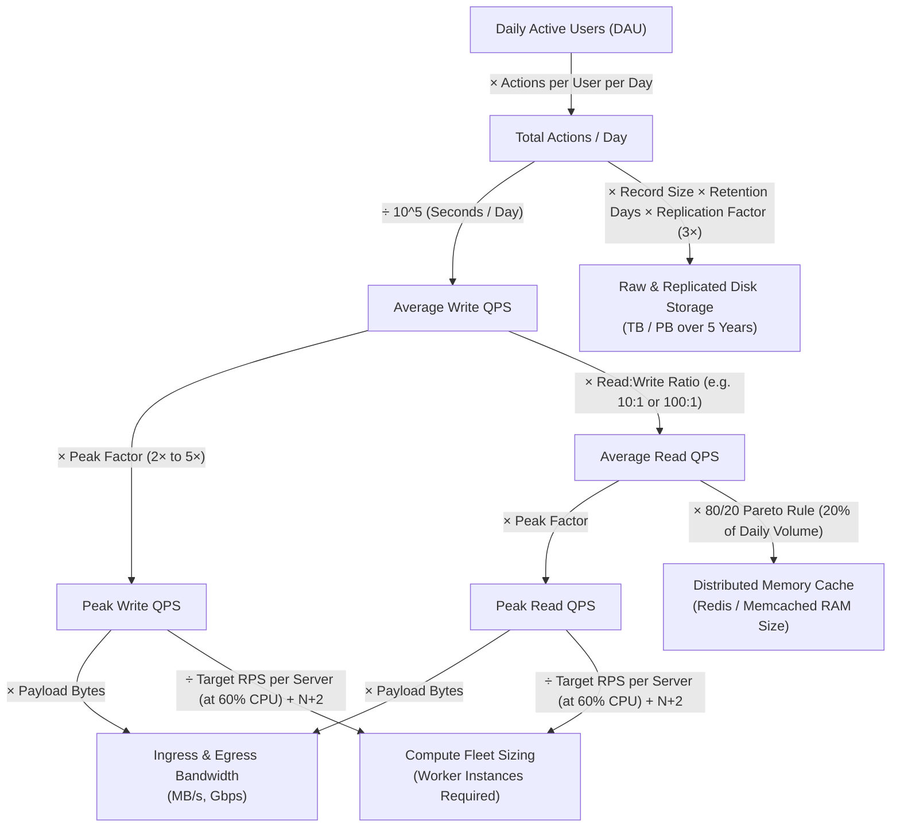
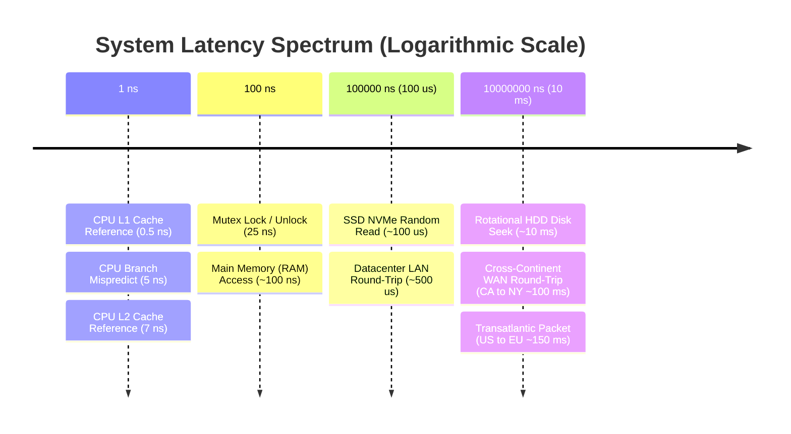
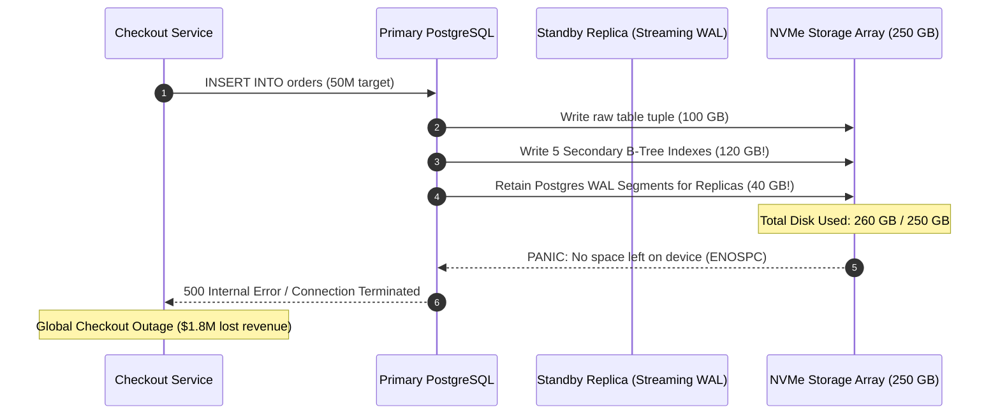

# Module 00: Capacity Estimation and Back-of-the-Envelope Math

> **Status:** Production Standard  
> **Difficulty:** Intermediate to Advanced  
> **Estimated Time:** 2–3 Hours  
> **Prerequisites:** Basic arithmetic, understanding of client-server architecture, latency concepts

---

> [!TIP]
> **The Golden Rule of Capacity Estimation**  
> Every architectural decision is secretly a sizing argument. Never begin drawing boxes or selecting databases in a system design interview until you have computed the orders of magnitude for peak QPS, network bandwidth, storage growth, and memory cache footprints. Anchor your math on three immutable constants: **$10^5$ seconds/day ($86,400\text{ s}$)**, **$2^{10} \approx 10^3$ (KB $\to$ MB $\to$ GB $\to$ TB $\to$ PB)**, and the **Latency Ladder (RAM $\sim 100\text{ ns}$, SSD $\sim 100\ \mu\text{s}$, Disk $\sim 10\text{ ms}$, Network WAN $\sim 100\text{ ms}$)**. Always size compute fleets for $N+2$ failure redundancy at a maximum $60\%$ target CPU utilization.

---

## 1. Visual Mental Models

### 1.1 The End-to-End Estimation Funnel

Capacity estimation is a deterministic funnel that translates a single business metric (Daily Active Users — DAU) into hardware infrastructure requirements:



### 1.2 The Latency Ladder Spectrum

Relative execution costs dictate whether a request path can hit disk, network, or must remain strictly in-memory:



---

## 2. Capacity Reference Matrix & System Constants

### 2.1 Universal Estimation Constants

| Constant | Exact Value | Interview Approximation | Application |
| :--- | :--- | :--- | :--- |
| **Seconds per Day** | $86,400\text{ s}$ | $10^5\text{ s}$ ($100,000\text{ s}$) | Convert Daily Volume $\to$ Average QPS ($\text{Daily Volume} / 10^5$) |
| **Seconds per Month** | $2,592,000\text{ s}$ | $2.5 \times 10^6\text{ s}$ | Convert Monthly Volume $\to$ QPS |
| **Kilobyte (KB)** | $1,024\text{ B} = 2^{10}\text{ B}$ | $10^3\text{ B}$ ($1,000\text{ B}$) | Text messages, metadata rows, small payloads |
| **Megabyte (MB)** | $1,048,576\text{ B} = 2^{20}\text{ B}$ | $10^6\text{ B}$ ($1,000,000\text{ B}$) | Photos, document files, audio clips |
| **Gigabyte (GB)** | $1,073,741,824\text{ B} = 2^{30}\text{ B}$ | $10^9\text{ B}$ ($1,000,000,000\text{ B}$) | Video files, memory node RAM capacity |
| **Terabyte (TB)** | $2^{40}\text{ B}$ | $10^{12}\text{ B}$ | Disk storage arrays, database shards |
| **Petabyte (PB)** | $2^{50}\text{ B}$ | $10^{15}\text{ B}$ | Multi-year warehouse storage, media lakes |

### 2.2 Throughput & Server Sizing Benchmark Rule-of-Thumb

| Component | Standard Safe Throughput per Node | Bottleneck Limit | Mitigation Strategy |
| :--- | :--- | :--- | :--- |
| **Stateless Web API (Go/Node/Java)** | $1,000 - 5,000\text{ RPS}$ per 4-vCPU node | CPU Context Switching, Connection Limits | Scale out horizontally behind L4/L7 Load Balancers |
| **Single Redis Node (In-Memory)** | $50,000 - 100,000\text{ QPS}$ | Single-thread event loop CPU saturation | Redis Cluster sharding, client-side caching |
| **PostgreSQL / MySQL (Relational)** | $1,000 - 4,000\text{ writes/sec}$ | Disk fsync, WAL I/O, B-Tree lock contention | Read replicas, horizontal sharding, connection poolers |
| **Cassandra / ScyllaDB (LSM Tree)** | $10,000 - 30,000\text{ writes/sec}$ per node | Sequential write to Memtable + CommitLog | Token range distribution, adding storage nodes |
| **Kafka Broker (Streaming Log)** | $100\text{ MB/s} - 200\text{ MB/s}$ Ingress | NIC bandwidth, Page Cache thrashing | Co-partitioning, batching (`linger.ms`), zero-copy send |

---

## 3. Production War Story: The 10× Black Friday Storage Outage

### The Incident
An international retail platform prepared for Black Friday by calculating database storage based on order payloads:
- Estimated 50 million orders created during peak week.
- Average raw JSON order payload: $2\text{ KB}$.
- Engineering calculation: $50\times 10^6 \times 2\text{ KB} = 100\text{ GB}$.
- Provisioned storage on primary database: $250\text{ GB}$ (assuming $2.5\times$ safety margin).

Within 6 hours of Black Friday launch, the primary database crashed with an unrecoverable `ENOSPC: No space left on device` error. Writes froze globally, causing cart checkout failure across the mobile app and website for 42 minutes.



### The Post-Mortem & Formula Correction
The post-mortem revealed three critical estimation mistakes:
1. **Secondary Index Overhead Ignored:** The table had 5 secondary indexes (`user_id`, `created_at`, `status`, `payment_ref`, `tracking_code`). B-Tree index pages consume between $100\%$ and $150\%$ of the raw table volume!
2. **Postgres WAL & Tombstones Omitted:** Write-Ahead Logs (WAL) retained for asynchronous streaming replication consumed an extra $40\text{ GB}$.
3. **The Multiplier Rule:** Production storage must ALWAYS account for:
$$\text{Total Storage} = (\text{Raw Data} \times 1.5_{\text{Index Overhead}} + \text{WAL Buffer}) \times \text{Replication Factor (3)} \times 1.4_{\text{Filesystem Headroom}}$$

---

## 4. Multi-Language Capacity Estimation Engine

Below is a complete, production-grade Capacity & Hardware Sizing Calculator implemented in Go, TypeScript, and Python. It calculates QPS, Bandwidth, Storage over 5 years (including indexes & replication), Cache RAM, and Server fleet sizing with $N+2$ redundancy.

````carousel
```python
# capacity_calculator.py
"""
Production Back-of-the-Envelope Capacity Estimator
Calculates QPS, Network Bandwidth, Multi-Year Storage, Cache, and Server Fleet Size.
"""

from dataclasses import dataclass
import math

SECONDS_PER_DAY = 100_000  # Engineering approximation for 86,400

@dataclass
class SystemParameters:
    dau: int                     # Daily Active Users
    actions_per_user_per_day: int
    read_write_ratio: float       # e.g., 10.0 means 10 reads per 1 write
    peak_multiplier: float        # e.g., 3.0
    payload_write_bytes: int     # Average write size in bytes
    payload_read_bytes: int      # Average read response size in bytes
    retention_years: int
    replication_factor: int       # Typically 3x
    index_overhead_ratio: float   # e.g., 1.4 (40% overhead for indexes)
    server_safe_rps: int          # Max throughput per server instance at 60% CPU

def compute_capacity(p: SystemParameters):
    # 1. QPS Calculations
    total_writes_day = p.dau * p.actions_per_user_per_day
    avg_write_qps = total_writes_day / SECONDS_PER_DAY
    peak_write_qps = avg_write_qps * p.peak_multiplier

    avg_read_qps = avg_write_qps * p.read_write_ratio
    peak_read_qps = avg_read_qps * p.peak_multiplier
    total_peak_qps = peak_write_qps + peak_read_qps

    # 2. Network Bandwidth
    ingress_bytes_sec = peak_write_qps * p.payload_write_bytes
    egress_bytes_sec = peak_read_qps * p.payload_read_bytes
    ingress_mbps = (ingress_bytes_sec * 8) / (1024 * 1024)
    egress_mbps = (egress_bytes_sec * 8) / (1024 * 1024)

    # 3. Storage Calculations (over retention window)
    daily_raw_storage = total_writes_day * p.payload_write_bytes
    yearly_raw_storage = daily_raw_storage * 365
    total_raw_storage = yearly_raw_storage * p.retention_years
    
    # Including secondary index overhead and 3x replica factor
    total_provisioned_storage = (
        total_raw_storage * p.index_overhead_ratio * p.replication_factor
    )

    # 4. Memory / Cache Sizing (80/20 Pareto Rule on daily reads)
    daily_read_volume = (avg_read_qps * SECONDS_PER_DAY) * p.payload_read_bytes
    cache_ram_bytes = daily_read_volume * 0.20  # Cache 20% hot data

    # 5. Compute Fleet Sizing (at 60% CPU target + N+2 redundancy)
    baseline_servers = math.ceil(total_peak_qps / p.server_safe_rps)
    n_plus_two_servers = baseline_servers + 2

    return {
        "Avg Write QPS": round(avg_write_qps),
        "Peak Write QPS": round(peak_write_qps),
        "Avg Read QPS": round(avg_read_qps),
        "Peak Read QPS": round(peak_read_qps),
        "Total Peak QPS": round(total_peak_qps),
        "Network Ingress (Mbps)": round(ingress_mbps, 2),
        "Network Egress (Mbps)": round(egress_mbps, 2),
        "Daily Raw Storage (GB)": round(daily_raw_storage / (10**9), 2),
        f"Storage {p.retention_years}Yr Provisioned (TB)": round(total_provisioned_storage / (10**12), 2),
        "Cache RAM Required (GB)": round(cache_ram_bytes / (10**9), 2),
        "Minimum Server Fleet (N+2)": n_plus_two_servers
    }

if __name__ == "__main__":
    # Example: Sizing Twitter / X scale post service
    params = SystemParameters(
        dau=200_000_000,
        actions_per_user_per_day=2,      # 2 tweets written/day
        read_write_ratio=100.0,          # 100 timeline reads per 1 tweet write
        peak_multiplier=3.0,
        payload_write_bytes=500,         # 500 bytes per tweet record
        payload_read_bytes=10_000,       # 10 KB per timeline page
        retention_years=5,
        replication_factor=3,
        index_overhead_ratio=1.4,
        server_safe_rps=2_000
    )
    results = compute_capacity(params)
    for k, v in results.items():
        print(f"{k:35}: {v}")
```
<!-- slide -->
```go
// capacity_calculator.go
package main

import (
	"fmt"
	"math"
)

const SecondsPerDay = 100000.0 // 10^5 approximation

type SystemParameters struct {
	DAU                  float64
	ActionsPerUserDay    float64
	ReadWriteRatio       float64
	PeakMultiplier       float64
	PayloadWriteBytes    float64
	PayloadReadBytes     float64
	RetentionYears       float64
	ReplicationFactor    float64
	IndexOverheadRatio   float64
	ServerSafeRPS        float64
}

type CapacityResult struct {
	AvgWriteQPS          int64
	PeakWriteQPS         int64
	AvgReadQPS           int64
	PeakReadQPS          int64
	TotalPeakQPS         int64
	IngressMbps          float64
	EgressMbps           float64
	DailyStorageGB       float64
	FiveYearStorageTB    float64
	CacheRAMGB           float64
	ServerFleetCount     int64
}

func ComputeCapacity(p SystemParameters) CapacityResult {
	totalWritesDay := p.DAU * p.ActionsPerUserDay
	avgWriteQPS := totalWritesDay / SecondsPerDay
	peakWriteQPS := avgWriteQPS * p.PeakMultiplier

	avgReadQPS := avgWriteQPS * p.ReadWriteRatio
	peakReadQPS := avgReadQPS * p.PeakMultiplier
	totalPeakQPS := peakWriteQPS + peakReadQPS

	ingressBytesSec := peakWriteQPS * p.PayloadWriteBytes
	egressBytesSec := peakReadQPS * p.PayloadReadBytes
	ingressMbps := (ingressBytesSec * 8) / (1024 * 1024)
	egressMbps := (egressBytesSec * 8) / (1024 * 1024)

	dailyRawStorage := totalWritesDay * p.PayloadWriteBytes
	totalProvisionedStorage := dailyRawStorage * 365 * p.RetentionYears * p.IndexOverheadRatio * p.ReplicationFactor

	dailyReadVolume := (avgReadQPS * SecondsPerDay) * p.PayloadReadBytes
	cacheRAM := dailyReadVolume * 0.20

	baseServers := math.Ceil(totalPeakQPS / p.ServerSafeRPS)

	return CapacityResult{
		AvgWriteQPS:       int64(avgWriteQPS),
		PeakWriteQPS:      int64(peakWriteQPS),
		AvgReadQPS:        int64(avgReadQPS),
		PeakReadQPS:       int64(peakReadQPS),
		TotalPeakQPS:      int64(totalPeakQPS),
		IngressMbps:       ingressMbps,
		EgressMbps:        egressMbps,
		DailyStorageGB:    dailyRawStorage / 1e9,
		FiveYearStorageTB: totalProvisionedStorage / 1e12,
		CacheRAMGB:        cacheRAM / 1e9,
		ServerFleetCount:  int64(baseServers) + 2,
	}
}

func main() {
	params := SystemParameters{
		DAU:                200000000,
		ActionsPerUserDay:  2,
		ReadWriteRatio:     100,
		PeakMultiplier:     3,
		PayloadWriteBytes:  500,
		PayloadReadBytes:   10000,
		RetentionYears:     5,
		ReplicationFactor:  3,
		IndexOverheadRatio: 1.4,
		ServerSafeRPS:      2000,
	}

	res := ComputeCapacity(params)
	fmt.Printf("Peak Write QPS      : %d\n", res.PeakWriteQPS)
	fmt.Printf("Peak Read QPS       : %d\n", res.PeakReadQPS)
	fmt.Printf("Egress Bandwidth    : %.2f Mbps (%.2f Gbps)\n", res.EgressMbps, res.EgressMbps/1000)
	fmt.Printf("5-Yr Storage (TB)   : %.2f TB\n", res.FiveYearStorageTB)
	fmt.Printf("Cache RAM (20%% hot) : %.2f GB\n", res.CacheRAMGB)
	fmt.Printf("Server Instances N+2: %d\n", res.ServerFleetCount)
}
```
<!-- slide -->
```typescript
// capacity_calculator.ts
interface SystemParameters {
  dau: number;
  actionsPerUserPerDay: number;
  readWriteRatio: number;
  peakMultiplier: number;
  payloadWriteBytes: number;
  payloadReadBytes: number;
  retentionYears: number;
  replicationFactor: number;
  indexOverheadRatio: number;
  serverSafeRPS: number;
}

export function computeCapacity(p: SystemParameters) {
  const SECONDS_PER_DAY = 100_000;

  const totalWritesDay = p.dau * p.actionsPerUserPerDay;
  const avgWriteQPS = totalWritesDay / SECONDS_PER_DAY;
  const peakWriteQPS = avgWriteQPS * p.peakMultiplier;

  const avgReadQPS = avgWriteQPS * p.readWriteRatio;
  const peakReadQPS = avgReadQPS * p.peakMultiplier;
  const totalPeakQPS = peakWriteQPS + peakReadQPS;

  const ingressMbps = (peakWriteQPS * p.payloadWriteBytes * 8) / (1024 * 1024);
  const egressMbps = (peakReadQPS * p.payloadReadBytes * 8) / (1024 * 1024);

  const dailyRawStorage = totalWritesDay * p.payloadWriteBytes;
  const totalProvisionedStorage =
    dailyRawStorage * 365 * p.retentionYears * p.indexOverheadRatio * p.replicationFactor;

  const dailyReadVolume = avgReadQPS * SECONDS_PER_DAY * p.payloadReadBytes;
  const cacheRAMBytes = dailyReadVolume * 0.2;

  const baseServers = Math.ceil(totalPeakQPS / p.serverSafeRPS);

  return {
    avgWriteQPS: Math.round(avgWriteQPS),
    peakWriteQPS: Math.round(peakWriteQPS),
    avgReadQPS: Math.round(avgReadQPS),
    peakReadQPS: Math.round(peakReadQPS),
    ingressMbps: Number(ingressMbps.toFixed(2)),
    egressGbps: Number((egressMbps / 1000).toFixed(2)),
    fiveYearStorageTB: Number((totalProvisionedStorage / 1e12).toFixed(2)),
    cacheRAMGB: Number((cacheRAMBytes / 1e9).toFixed(2)),
    minServersWithRedundancy: baseServers + 2,
  };
}

// Verification sample run
console.log(
  computeCapacity({
    dau: 200_000_000,
    actionsPerUserPerDay: 2,
    readWriteRatio: 100,
    peakMultiplier: 3,
    payloadWriteBytes: 500,
    payloadReadBytes: 10_000,
    retentionYears: 5,
    replicationFactor: 3,
    indexOverheadRatio: 1.4,
    serverSafeRPS: 2000,
  })
);
```
````

---

## 5. Practical Hands-On Verification CLI

Run arithmetic verification directly in PowerShell / terminal without a spreadsheet:

```powershell
# 1. Verification of Seconds per Day conversion
# Daily actions = 500 Million
$dailyActions = 500000000
$secondsDay = 100000
$avgQPS = $dailyActions / $secondsDay
Write-Host "Average QPS: $avgQPS" # Expected: 5000

# 2. Peak QPS at 3x burst multiplier
$peakQPS = $avgQPS * 3
Write-Host "Peak QPS: $peakQPS"   # Expected: 15000

# 3. Bandwidth calculation: 15,000 requests/sec * 2 KB payload
$payloadBytes = 2048
$bandwidthBytesSec = $peakQPS * $payloadBytes
$bandwidthMbps = ($bandwidthBytesSec * 8) / 1000000
Write-Host "Peak Bandwidth: $bandwidthMbps Mbps" # Expected: ~245.76 Mbps

# 4. Storage over 5 years (Replicated 3x with 1.4 index overhead)
$days = 365 * 5
$rawStorageBytes = $dailyActions * $payloadBytes * $days
$provisionedStorageTB = ($rawStorageBytes * 1.4 * 3) / 1e12
Write-Host "5-Year Replicated Storage: $([Math]::Round($provisionedStorageTB, 2)) TB"
```

---

## 6. Operational Validation Checkpoints

<details>
<summary><strong>Checkpoint 1: Why is rounding 86,400 to 100,000 acceptable (and preferred) in System Design Interviews?</strong></summary>

> **Root Cause Analysis:**  
> Back-of-the-envelope calculations are designed to establish **orders of magnitude** ($10^2$ vs $10^4$ vs $10^7$) to determine architecture (e.g. single instance vs sharded cluster).  
> 
> Dividing by $10^5$ instead of $86,400$ produces an answer within $\sim 15\%$ of actual average throughput. Real-world traffic fluctuations between peak hours and off-peak hours exceed $200\%-500\%$ (a $2\times$ to $5\times$ peak multiplier). A $15\%$ discrepancy in average throughput is completely dwarfed by the peak burst multiplier. Using $10^5$ allows mental arithmetic without losing conversational momentum on a whiteboard.
</details>

<details>
<summary><strong>Checkpoint 2: An interviewer says: "Our app has 10M DAU, and we want to cache all reads. Can we put the cache on one server?" How do you answer?</strong></summary>

> **Root Cause Analysis:**  
> Frame the answer using the funnel:
> 1. Clarify **actions per user** and **read-to-write ratio**. If each user performs 10 reads of $2\text{ KB}$ each: $10\text{M} \times 10 = 100\text{M reads/day} \implies 100\text{M} \times 2\text{ KB} = 200\text{ GB daily read volume}$.
> 2. Apply the **80/20 Pareto Principle**: $20\%$ of items generate $80\%$ of read traffic. Hot set size $= 200\text{ GB} \times 0.20 = 40\text{ GB}$.
> 3. Memory evaluation: $40\text{ GB}$ easily fits into a single high-memory Redis server (e.g., AWS `r6g.xlarge` with $32\text{ GB}$ or `r6g.2xlarge` with $64\text{ GB}$).
> 4. **Throughput check:** Average read $\text{QPS} = 100\text{M} / 10^5 = 1,000\text{ QPS}$; Peak ($3\times$) $= 3,000\text{ QPS}$. A single Redis instance easily sustains $50,000+\text{ QPS}$.  
> **Conclusion:** Yes, from both RAM and QPS perspectives, one primary instance with one replica for failover is sufficient.
</details>

<details>
<summary><strong>Checkpoint 3: What is the N+2 redundancy rule, and why does server fleet estimation target 60% CPU utilization rather than 90%?</strong></summary>

> **Root Cause Analysis:**  
> Systems operating at $>70\%$ utilization experience non-linear queuing latency explosion according to **Kingman's Formula**:
> $$W_q \approx \left(\frac{\rho}{1-\rho}\right) \cdot \left(\frac{C_a^2 + C_s^2}{2}\right) \cdot \frac{1}{\mu}$$
> As utilization $\rho \to 1.0$, waiting time $W_q \to \infty$. Sizing for $60\%$ utilization ensures that unexpected micro-bursts do not degrade p99 latencies.  
> 
> The **$N+2$ rule** ensures operational survival during maintenance and disaster:
> - $N$: The number of servers required to handle peak load at $60\%$ utilization.
> - $+1$: Redundancy for an unexpected node failure or network split.
> - $+2$: Redundancy allowing rolling zero-downtime OS/security deployments while maintaining fault tolerance.
</details>

---

## 7. Free PDF Notes & Printables

Download the notes for each video on this page as a printable PDF, with every diagram and interview questions: [SD-D-001: Back-of-the-Envelope Estimation](https://backendroadmap.com/notes/system-design/SD-D-001.pdf), [SD-D-003: How to Estimate RPS](https://backendroadmap.com/notes/system-design/SD-D-003.pdf), [SD-D-004: Peak vs Average Traffic](https://backendroadmap.com/notes/system-design/SD-D-004.pdf), [SD-D-005: Read/Write Ratio](https://backendroadmap.com/notes/system-design/SD-D-005.pdf), [SD-D-006: Storage Estimation](https://backendroadmap.com/notes/system-design/SD-D-006.pdf), [SD-D-007: Bandwidth Estimation](https://backendroadmap.com/notes/system-design/SD-D-007.pdf), [SD-D-008: Cache Sizing](https://backendroadmap.com/notes/system-design/SD-D-008.pdf), [SD-D-009: How Many Servers Do You Need? Capacity, 60% Target & N+2](https://backendroadmap.com/notes/system-design/SD-D-009.pdf), [SD-D-010: Growth Projections](https://backendroadmap.com/notes/system-design/SD-D-010.pdf), [SD-D-011: Back-of-the-Envelope Estimation](https://backendroadmap.com/notes/system-design/SD-D-011.pdf). Each section in one file: [Phase 2, Estimation (PDF)](https://backendroadmap.com/notes/system-design/Phase2_Estimation_Notes.pdf).

---

## 8. Curriculum Navigation

- [Back to System Design Track Overview](../README.md)
- [Proceed to Module 01: The System Design Interview Framework](../01-the-system-design-interview-framework/README.md)
