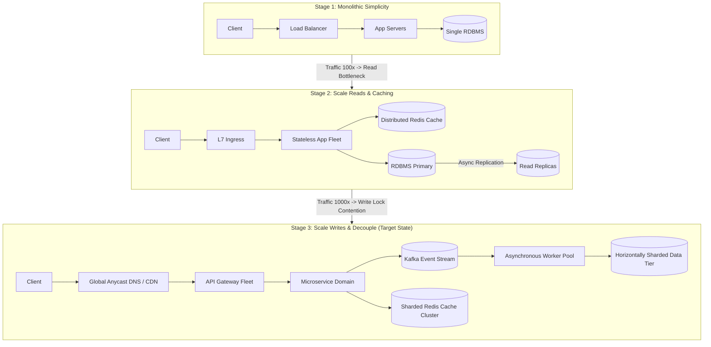
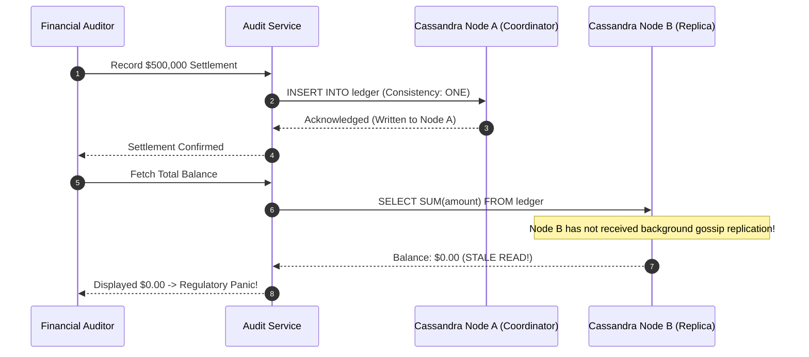

# Module 01: The System Design Interview Framework

> **Status:** Production Standard  
> **Difficulty:** Intermediate to Advanced  
> **Estimated Time:** 2–3 Hours  
> **Prerequisites:** Module 00 (Capacity Estimation and Back-of-the-Envelope Math), Distributed Systems Fundamentals

---

> [!TIP]
> **The Golden Rule of the System Design Interview**  
> A system design interview is not an academic knowledge quiz—it is an interactive simulation of technical leadership. Never write a single database name or draw an architectural box before establishing explicit boundaries. Drive the session collaboratively: **Scope & NFRs (5 min)** $\to$ **Capacity Math (5 min)** $\to$ **API & Data Model (5 min)** $\to$ **High-Level Design (10 min)** $\to$ **Deep-Dive on Critical Bottleneck (10 min)** $\to$ **Failure Modes & Tradeoffs (5 min)**. Anchor every design choice in the formula: *"We choose X over Y because requirement Z mandates high read throughput at the cost of eventual consistency."*

---

## 1. Visual Mental Models

### 1.1 The 45-Minute Interview Whiteboard Time Budget

Senior candidates control the clock and narrate the process explicitly to prevent running out of time before reaching technical depth:

```mermaid
gantt
    title 45-Minute System Design Interview Execution Plan
    dateFormat  m
    axisFormat %M min

    section Phase 1: Scoping
    1. Requirements & Scope Clarification (FR & NFR) :active, p1, 0, 5m
    2. Capacity & Back-of-Envelope Math               :p2, 5, 10m

    section Phase 2: Contracts
    3. Core API Signature Design                     :p3, 10, 15m
    4. Data Model & Storage Choice                   :p4, 15, 20m

    section Phase 3: Architecture
    5. High-Level Design (Happy Path End-to-End)     :crit, p5, 20, 30m

    section Phase 4: Seniority
    6. Deep-Dive on Complex Components               :p6, 30, 40m
    7. Failure Modes, SPoF & Bottleneck Tradeoffs    :p7, 40, 45m
```



### 1.2 Evolutionary Architectural Progression

Never draw the final complex distributed architecture on minute one. Build it incrementally to justify every added component with concrete numbers:



---

## 2. The 7-Step Whiteboard Rubric & Evaluation Grid

| Phase | Time | Candidate Primary Action | High Signal Behaviors (Pass) | Anti-Patterns (Fail) |
| :--- | :--- | :--- | :--- | :--- |
| **1. Requirements** | $0-5\text{ min}$ | Establish 2–4 Functional Requirements (FR), 3 Non-Functional Requirements (NFR), and Out-of-Scope limits. | Asks clarifying questions; bounds the problem domain; identifies latency & consistency requirements upfront. | Immediately assumes requirements; starts designing features without asking who the users are. |
| **2. Estimation** | $5-10\text{ min}$ | Compute QPS (Peak/Avg), Ingress/Egress Bandwidth, 5-Yr Storage, and RAM Cache size. | Uses $10^5\text{ s/day}$; calculates storage with replication and index overhead; deduces single node vs sharded cluster. | Skips calculations; calculates to 4 decimal places using a calculator; treats memory as infinite. |
| **3. API Design** | $10-15\text{ min}$ | Define clean REST / gRPC endpoint signatures including headers, request bodies, and error responses. | Includes idempotency keys; passes pagination tokens (`cursor`); specifies HTTP status codes. | Omits IDs; designs vague `POST /doEverything` endpoints without status codes or auth context. |
| **4. Data Model** | $15-20\text{ min}$ | Define schemas, primary keys, access patterns, and justify Relational vs NoSQL vs Search index. | Maps data access patterns to query models; chooses partition/shard keys deliberately to prevent hotspots. | Names a database solely because it is popular ("We will use Cassandra because it scales"). |
| **5. High-Level** | $20-30\text{ min}$ | Draw the complete end-to-end request flow (Client $\to$ DNS/CDN $\to$ LB $\to$ App $\to$ Cache $\to$ DB). | Explains request flow step-by-step; keeps compute stateless; isolates stateful storage. | Jumps straight to complex distributed consensus or streaming before drawing a basic working flow. |
| **6. Deep Dive** | $30-40\text{ min}$ | Drill deep into the 1–2 most challenging components (e.g., ID generation, fan-out, cache invalidation). | Articulates concrete distributed algorithms; addresses race conditions and edge cases. | Speaks in hand-wavy generalities; evades difficult concurrency questions. |
| **7. Bottlenecks** | $40-45\text{ min}$ | Identify Single Points of Failure (SPoF), network partitions, cascading failures, and graceful degradation. | Proactively identifies weaknesses in own design; explains circuit breakers, rate limits, and fallback paths. | Claims the system is "100% bug-free and cannot fail"; gets defensive when challenged. |

---

## 3. Production War Story: The Buzzword Trap

### The Incident
During a Staff Engineer architectural review at a financial technology company, an engineering team presented a design for an internal real-time audit ledger:
- **The Pitch:** *"We designed a hyper-scale event pipeline using Apache Kafka, Apache Flink for stream joins, and Apache Cassandra with a multi-region quorum for sub-millisecond writes."*
- **The Actual Requirements:** The company had 45 financial auditors. Total daily transactions averaged 12,000 writes/day ($0.12\text{ QPS}$), peaking at $15\text{ QPS}$ during month-end closes. Strong read-after-write consistency was legally required for tax compliance.
- **The Consequence:** During the initial rollout, Cassandra's eventual consistency delivered stale balances to auditors. Furthermore, operating a multi-region Cassandra cluster and Kafka cluster for $15\text{ QPS}$ cost $\$38,000/\text{month}$ in infrastructure overhead while suffering three cascading tombstone-compaction outages.



### The Post-Mortem & Rule
The system was dismantled and replaced with a single PostgreSQL instance with streaming replication and daily snapshots. Cost dropped from $\$38,000/\text{month}$ to $\$140/\text{month}$, latency dropped to $2\text{ ms}$, and data consistency was mathematically guaranteed by ACID relational constraints.

> **Interview Lesson:** Scalability without necessity is engineering negligence. Never bring distributed streaming or NoSQL to a problem that fits on a single relational database with read replicas.

---

## 4. Multi-Language Implementation: Contract & Domain Model Scaffolding

During Phase 3 (API Design) and Phase 4 (Data Model), writing clean, typed interfaces proves architectural clarity. Below is the multi-language contract scaffolding for a high-throughput, idempotent resource creation service (e.g., a URL Shortener or Order Engine).

````carousel
```typescript
// contracts/shortener.interface.ts
/**
 * Phase 3 & 4: Typed Contract & Entity Definitions
 */

// 1. Core API Request/Response Contracts
export interface CreateLinkRequest {
  destination_url: string;
  custom_alias?: string;
  expires_at_epoch_ms?: number;
}

export interface CreateLinkResponse {
  link_id: string;
  short_code: string;
  short_url: string;
  destination_url: string;
  created_at_epoch_ms: number;
  expires_at_epoch_ms: number | null;
}

export interface ResolveLinkResponse {
  destination_url: string;
  http_status: 301 | 302;
}

// 2. Storage Data Model (Database Entity)
export interface LinkEntity {
  // Primary Shard Key: short_code (enables deterministic point lookups)
  short_code: string;
  destination_url: string;
  user_id: string;
  created_at_epoch_ms: number;
  expires_at_epoch_ms: number | null;
  click_count: number;
  is_active: boolean;
}

// 3. API Handler Skeleton demonstrating Idempotency & Validation
export class LinkServiceContract {
  async createLink(
    idempotencyKey: string,
    req: CreateLinkRequest
  ): Promise<CreateLinkResponse> {
    // Validate URL syntax
    try {
      new URL(req.destination_url);
    } catch {
      throw new Error('INVALID_ARGUMENT: Malformed destination URL');
    }

    // In interview, demonstrate header-based idempotency handling
    return {
      link_id: 'link_98a7sd12',
      short_code: req.custom_alias || 'x8K3mQ',
      short_url: `https://sho.rt/${req.custom_alias || 'x8K3mQ'}`,
      destination_url: req.destination_url,
      created_at_epoch_ms: Date.now(),
      expires_at_epoch_ms: req.expires_at_epoch_ms || null,
    };
  }
}
```
<!-- slide -->
```go
// contracts/shortener.go
package contracts

import (
	"errors"
	"net/url"
	"time"
)

// 1. API Request & Response Contracts
type CreateLinkRequest struct {
	DestinationURL   string     `json:"destination_url"`
	CustomAlias      *string    `json:"custom_alias,omitempty"`
	ExpiresAtEpochMS *int64     `json:"expires_at_epoch_ms,omitempty"`
}

type CreateLinkResponse struct {
	LinkID           string `json:"link_id"`
	ShortCode        string `json:"short_code"`
	ShortURL         string `json:"short_url"`
	DestinationURL   string `json:"destination_url"`
	CreatedAtEpochMS int64  `json:"created_at_epoch_ms"`
}

// 2. Database Entity Model
// Shard Key: ShortCode ensures distributed lookup across database partitions
type LinkEntity struct {
	ShortCode        string `gorm:"primaryKey;size:10"`
	DestinationURL   string `gorm:"size:2048;not null"`
	UserID           string `gorm:"index;size:64"`
	CreatedAtEpochMS int64  `gorm:"autoCreateTime:milli"`
	ExpiresAtEpochMS *int64 `gorm:"index"`
	IsActive         bool   `gorm:"default:true"`
}

// 3. Service Contract Validation
func ValidateCreateLink(req CreateLinkRequest) error {
	if req.DestinationURL == "" {
		return errors.New("destination_url cannot be empty")
	}
	parsed, err := url.ParseRequestURI(req.DestinationURL)
	if err != nil || (parsed.Scheme != "http" && parsed.Scheme != "https") {
		return errors.New("destination_url must be a valid HTTP/HTTPS URL")
	}
	if req.CustomAlias != nil && len(*req.CustomAlias) > 32 {
		return errors.New("custom_alias exceeds 32 characters")
	}
	return nil
}
```
<!-- slide -->
```python
# contracts/shortener.py
from pydantic import BaseModel, HttpUrl, Field
from typing import Optional
from datetime import datetime
import time

# 1. API Schemas
class CreateLinkRequest(BaseModel):
    destination_url: HttpUrl
    custom_alias: Optional[str] = Field(None, max_length=32, regex="^[a-zA-Z0-9_-]+$")
    expires_at_epoch_ms: Optional[int] = None

class CreateLinkResponse(BaseModel):
    link_id: str
    short_code: str
    short_url: str
    destination_url: str
    created_at_epoch_ms: int

# 2. Storage Data Model
class LinkRecord:
    """
    Primary Key / Shard Key: short_code (Base62 encoded integer)
    """
    def __init__(
        self,
        short_code: str,
        destination_url: str,
        user_id: str,
        expires_at_epoch_ms: Optional[int] = None
    ):
        self.short_code = short_code
        self.destination_url = destination_url
        self.user_id = user_id
        self.created_at_epoch_ms = int(time.time() * 1000)
        self.expires_at_epoch_ms = expires_at_epoch_ms
        self.is_active = True

    def to_dict(self):
        return {
            "short_code": self.short_code,
            "destination_url": self.destination_url,
            "user_id": self.user_id,
            "created_at_epoch_ms": self.created_at_epoch_ms,
            "expires_at_epoch_ms": self.expires_at_epoch_ms,
            "is_active": self.is_active
        }
```
````

---

## 5. Practical Hands-On Verification CLI

During API design verification, test endpoint behavior and wire contracts using standard CLI commands:

```powershell
# 1. Test URL creation contract with an Idempotency-Key header
curl.exe -i -X POST http://localhost:8000/api/v1/links `
  -H "Content-Type: application/json" `
  -H "Idempotency-Key: 7b819f3a-9e12-4f6b-8d1e-5a7c2b3e8a10" `
  -d '{\"destination_url\": \"https://engineering.atspotify.com/2023/system-design\", \"custom_alias\": \"spotify-arch\"}'

# Expected Wire Output:
# HTTP/1.1 201 Created
# Content-Type: application/json
# Location: /api/v1/links/spotify-arch
#
# {
#   "link_id": "lnk_10924a8f",
#   "short_code": "spotify-arch",
#   "short_url": "https://sho.rt/spotify-arch",
#   "destination_url": "https://engineering.atspotify.com/2023/system-design",
#   "created_at_epoch_ms": 1715000000000
# }

# 2. Test redirect resolution contract (verifying 302 Temporary vs 301 Permanent Redirect)
curl.exe -i -X GET http://localhost:8000/spotify-arch

# Expected Wire Output:
# HTTP/1.1 302 Found
# Location: https://engineering.atspotify.com/2023/system-design
# Cache-Control: private, max-age=90
```

---

## 6. Operational Validation Checkpoints

<details>
<summary><strong>Checkpoint 1: Why should HTTP 302 (Temporary Redirect) be chosen over HTTP 301 (Permanent Redirect) in a URL Shortener?</strong></summary>

> **Root Cause Analysis:**  
> - **HTTP 301 (Moved Permanently):** The browser permanently caches the redirect mapping in local browser storage. Subsequent clicks bypass your servers entirely and navigate directly to the target URL.  
> - **Tradeoff:** While HTTP 301 reduces server load, you permanently lose the ability to track click analytics, geo-location, user-agent telemetry, and link expiration.  
> - **HTTP 302 (Found / Temporary Redirect):** The browser issues a GET request to your service on every click, allowing accurate real-time click counting, fraud detection, and dynamic destination changes at the expense of handling higher redirection QPS.
</details>

<details>
<summary><strong>Checkpoint 2: What is the single biggest failure mode of candidates during the 10-minute High-Level Design phase?</strong></summary>

> **Root Cause Analysis:**  
> The **"Premature Optimization Rabbit Hole"**.  
> Candidates often get bogged down in the intricacies of a single edge case (e.g., handling Raft distributed leader election or multi-region CDC replication) before establishing the basic end-to-end request path. If the interviewer does not see a client connect to a load balancer, route to an app server, check a cache, and query a database, the candidate receives a "No Hire" in *System Architecture Breadth*. Always sketch the high-level happy path end-to-end first, then ask: *"Which component would you like me to drill into deeper?"*
</details>

<details>
<summary><strong>Checkpoint 3: How should a candidate respond when an interviewer abruptly says: "What happens if this database goes down?"</strong></summary>

> **Root Cause Analysis:**  
> Frame the answer using the standard High-Availability (HA) triage sequence:
> 1. **Detection:** Health check probes (readiness/liveness) via Raft heartbeat loss or orchestrator timeout ($<3\text{ s}$).
> 2. **Automatic Failover:** Promote a hot synchronous standby replica to primary; update connection poolers (e.g., PgBouncer) or internal DNS records.
> 3. **Mitigate Write Degradation:** If primary failover takes $30\text{ seconds}$, degrade gracefully by buffering incoming write events in Kafka or an SQS queue, returning `202 Accepted` to clients.
> 4. **Mitigate Read Degradation:** Serve reads directly from the distributed Redis cache or read-replicas in eventual-consistency mode.
</details>

---

## 7. Free PDF Notes & Printables

Download these notes as a printable PDF, with every diagram and interview questions: [SD-D-012: Architecture Diagrams](https://backendroadmap.com/notes/system-design/SD-D-012.pdf). Each section in one file: [Phase 2, Estimation (PDF)](https://backendroadmap.com/notes/system-design/Phase2_Estimation_Notes.pdf).

---

## 8. Curriculum Navigation

- [← Back to Module 00: Capacity Estimation and Back-of-Envelope Math](../00-capacity-estimation-and-back-of-envelope-math/README.md)
- [Back to System Design Track Overview](../README.md)
- [Proceed to Module 02: Designing a URL Shortener](../02-designing-a-url-shortener/README.md)
