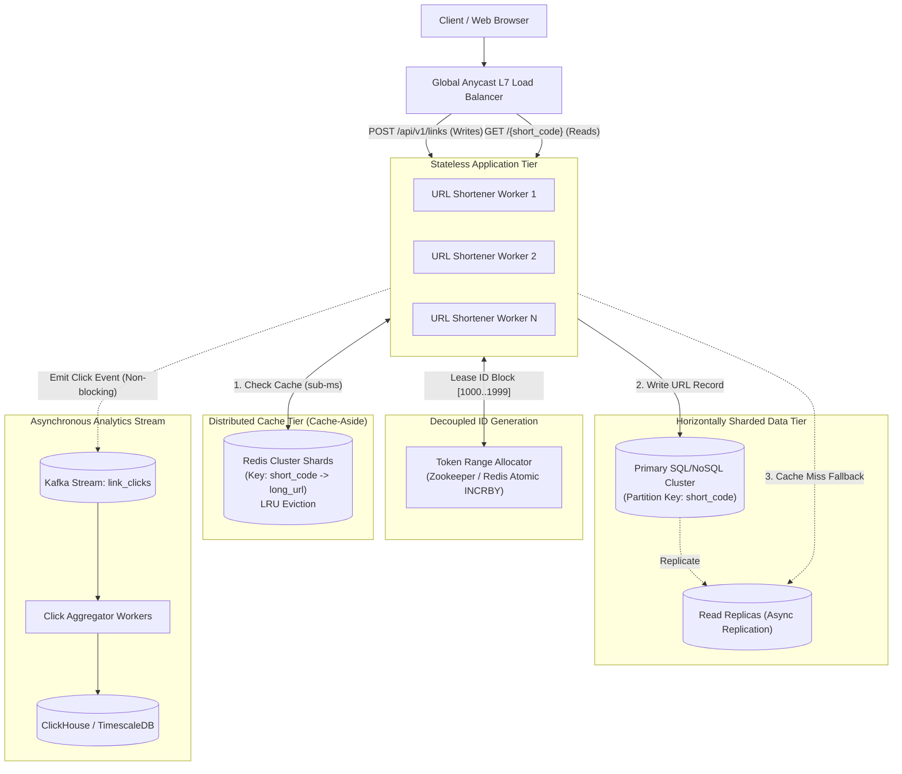
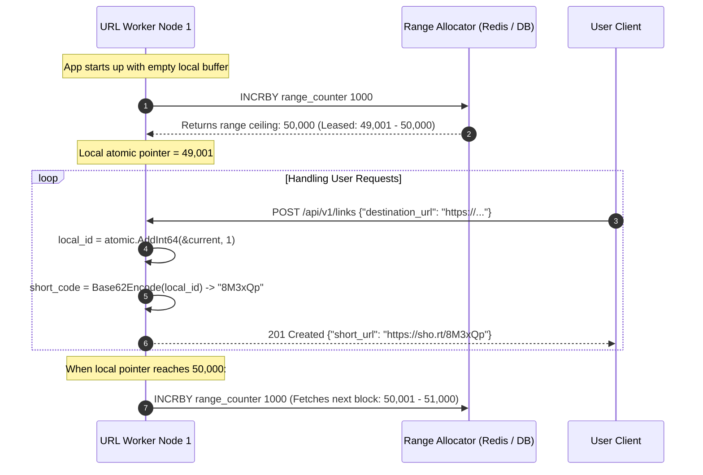
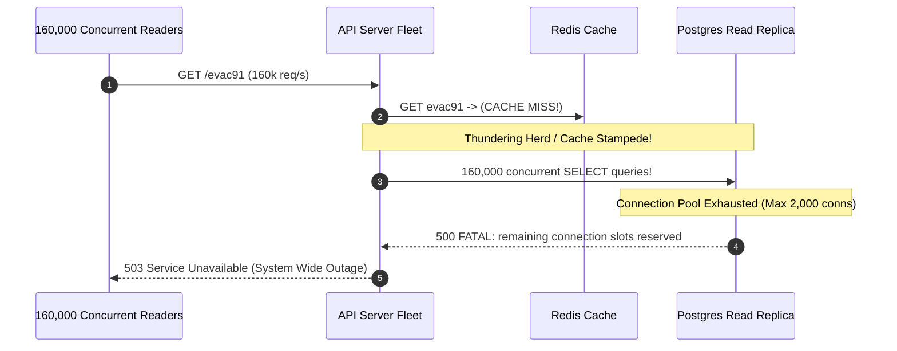

# Module 02: Designing a URL Shortener

> **Status:** Production Standard  
> **Difficulty:** Intermediate  
> **Estimated Time:** 2–3 Hours  
> **Prerequisites:** Module 00 (Capacity Estimation), Module 01 (System Design Interview Framework), Caching Fundamentals

---

> [!TIP]
> **The Golden Rule of URL Shortener Design**  
> Never generate short codes using database auto-increments or uncoordinated cryptographic hashes. Auto-increments create a centralized single point of failure (SPoF) and leak sequential business metrics, while truncated hashes suffer probabilistic collisions that require expensive database read checks. Instead, decouple generation using a **Range-Leased ID Allocator** (workers lease blocks of $1,000–10,000$ sequential integers via atomic operations and encode them locally into **Base62 strings**), shard storage deterministically by `hash(short_code)`, and isolate the $100:1$ read-to-write ratio using a **Cache-Aside Redis tier with HTTP 302 redirects** to protect analytics telemetry.

---

## 1. Visual Mental Models

### 1.1 Complete End-to-End System Architecture

The architecture separates the high-velocity read redirect path from the write creation and background analytics paths:



### 1.2 Range-Lease ID Generation Sequence

Workers lease integer ranges in bulk, converting integers to Base62 entirely in memory without thread contention or inter-service network calls:



---

## 2. Technical Reference Matrices

### 2.1 Base62 Capacity & URL Length Space

Base62 uses characters `[0-9, a-z, A-Z]` ($10 + 26 + 26 = 62$). Each additional character increases namespace capacity by $62\times$:

| Length ($N$) | Total Addressable Combinations ($62^N$) | Approximate Scale | Lifespan at 100M URLs/Day | Interview Evaluation |
| :--- | :--- | :--- | :--- | :--- |
| **5 chars** | $62^5 = 916,132,832$ | $\sim 916\text{ Million}$ | $\sim 9\text{ Days}$ | ❌ Critically insufficient for production |
| **6 chars** | $62^6 = 56,800,235,584$ | $\sim 56.8\text{ Billion}$ | $\sim 1.5\text{ Years}$ | ⚠️ High collision / exhaustion risk |
| **7 chars** | $62^7 = 3,521,614,606,208$ | $\sim 3.52\text{ Trillion}$ | $\sim 96\text{ Years}$ | **Optimal Gold Standard** |
| **8 chars** | $62^8 = 218,340,105,584,896$ | $\sim 218\text{ Trillion}$ | $\sim 6,000\text{ Years}$ | ⚠️ Unnecessarily long for mobile SMS |

### 2.2 Short-Code Generation Strategies Compared

| Strategy | Collision Risk | Bottleneck Risk | Predictability / Enumeration | Operational Complexity | Recommendation |
| :--- | :--- | :--- | :--- | :--- | :--- |
| **MD5/SHA256 Truncation** | High (Birthday paradox on 7-char slice) | High (DB point read needed per write to verify) | Non-sequential | High (Requires DB retry loop on collisions) | ❌ Avoid |
| **Random Base62 + DB Check** | Exponentially rises with key space density | High (DB lookup before insert) | Non-sequential | Moderate | ❌ Inefficient at high QPS |
| **UUIDv4 / Snowflake ID** | Zero | None | Partially sequential | Low (Snowflake produces 64-bit int $\to$ Base62) | Good alternative |
| **Range-Leased Counter $\to$ Base62** | **Mathematical Zero** | **Zero (Leased blocks of $10^4$)** | Sequential (Mitigated by Feistel cipher or random offset) | **Minimal** | **Industry Best Practice** |

---

## 3. Production War Story: The Viral Link Thundering Herd

### The Incident
A global breaking news outlet shortened an emergency breaking alert URL via an enterprise shortener. Within 4 seconds of being tweeted to 80 million followers, the short code `sho.rt/evac91` received 160,000 redirects/second.

The link was newly created and had not yet been cached in Redis. Because 160,000 concurrent requests simultaneously experienced a cache miss, all 160,000 threads bypassed the cache and hammered the relational read replica cluster with `SELECT destination_url FROM links WHERE short_code = 'evac91'`. 

The database CPU instantly reached $100\%$, connection pools exhausted within 800 milliseconds, and the entire database cluster collapsed in a **Cascading Cache Stampede**.



### The Post-Mortem & Architectural Remediation
1. **Singleflight / Distributed Mutex Locking:** When a cache miss occurs, only *one* application thread per server node is permitted to query the database using a mutex (Go's `singleflight.Group` or Redis distributed lock). All other 159,999 requests wait for the single result to populate the local cache.
2. **Probabilistic Early Expiration (XFetch):** Background workers refresh the Redis key asynchronously before its TTL expires using probabilistic delta scoring:
$$\text{refresh} \iff \Delta \cdot \beta \cdot \ln(\text{random}()) > \text{TTL}_{\text{remaining}}$$
3. **HTTP 302 vs 301 Decision:** Emergency broadcast links can safely return HTTP 301 with `Cache-Control: public, max-age=300`, shifting the redirection workload directly to edge CDNs and browser caches during extreme load spikes.

---

## 4. Multi-Language Production Implementation

Below is a complete, production-grade URL Shortener engine featuring Bijective Base62 conversion, an atomic in-memory range allocator buffer, and high-throughput HTTP redirection handlers.

````carousel
```go
// shortener_service.go
package main

import (
	"context"
	"errors"
	"fmt"
	"log"
	"net/http"
	"strings"
	"sync"
	"sync/atomic"
	"time"
)

const base62Alphabet = "0123456789abcdefghijklmnopqrstuvwxyzABCDEFGHIJKLMNOPQRSTUVWXYZ"

// 1. Bijective Base62 Encoder/Decoder
func Base62Encode(num int64) string {
	if num == 0 {
		return string(base62Alphabet[0])
	}
	var sb strings.Builder
	for num > 0 {
		remainder := num % 62
		sb.WriteByte(base62Alphabet[remainder])
		num = num / 62
	}
	// Reverse bytes
	runes := []rune(sb.String())
	for i, j := 0, len(runes)-1; i < j; i, j = i+1, j-1 {
		runes[i], runes[j] = runes[j], runes[i]
	}
	return string(runes)
}

func Base62Decode(token string) (int64, error) {
	var num int64 = 0
	for _, char := range token {
		idx := strings.IndexRune(base62Alphabet, char)
		if idx == -1 {
			return 0, errors.New("invalid base62 character")
		}
		num = num*62 + int64(idx)
	}
	return num, nil
}

// 2. Thread-safe Local Range Allocator (Leases blocks of 1,000 from Central Coordinator)
type RangeAllocator struct {
	mu           sync.Mutex
	currentID    int64
	maxID        int64
	blockSize    int64
	coordinator  *MockCentralCoordinator
}

type MockCentralCoordinator struct {
	mu      sync.Mutex
	counter int64
}

func (c *MockCentralCoordinator) FetchNextRange(size int64) (int64, int64) {
	c.mu.Lock()
	defer c.mu.Unlock()
	start := c.counter + 1
	c.counter += size
	return start, c.counter
}

func NewRangeAllocator(coord *MockCentralCoordinator, blockSize int64) *RangeAllocator {
	return &RangeAllocator{coordinator: coord, blockSize: blockSize}
}

func (r *RangeAllocator) NextID() (int64, error) {
	r.mu.Lock()
	defer r.mu.Unlock()

	if r.currentID >= r.maxID {
		start, end := r.coordinator.FetchNextRange(r.blockSize)
		r.currentID = start
		r.maxID = end
	} else {
		r.currentID++
	}
	return r.currentID, nil
}

// 3. Application State & Storage
type URLService struct {
	allocator *RangeAllocator
	cache     sync.Map // In-memory cache mock for Redis
	database  sync.Map // In-memory database mock
}

func (s *URLService) Shorten(longURL string) (string, error) {
	id, err := s.allocator.NextID()
	if err != nil {
		return "", err
	}
	code := Base62Encode(id)
	s.database.Store(code, longURL)
	s.cache.Store(code, longURL) // Write-through or populate cache
	return code, nil
}

func (s *URLService) Resolve(code string) (string, bool) {
	// 1. Check Cache
	if val, ok := s.cache.Load(code); ok {
		return val.(string), true
	}
	// 2. Fallback to DB
	if val, ok := s.database.Load(code); ok {
		s.cache.Store(code, val) // Re-populate cache
		return val.(string), true
	}
	return "", false
}

func main() {
	coord := &MockCentralCoordinator{counter: 1000000} // Start above 1M for 4+ chars
	alloc := NewRangeAllocator(coord, 1000)
	service := &URLService{allocator: alloc}

	http.HandleFunc("/api/v1/links", func(w http.ResponseWriter, r *http.Request) {
		if r.Method == http.MethodPost {
			target := r.URL.Query().Get("url")
			if target == "" {
				http.Error(w, "missing url query param", http.StatusBadRequest)
				return
			}
			code, _ := service.Shorten(target)
			w.Header().Set("Content-Type", "application/json")
			w.WriteHeader(http.StatusCreated)
			fmt.Fprintf(w, `{"short_code":"%s","short_url":"http://localhost:8080/%s"}`, code, code)
			return
		}
	})

	http.HandleFunc("/", func(w http.ResponseWriter, r *http.Request) {
		code := strings.TrimPrefix(r.URL.Path, "/")
		if code == "" || code == "favicon.ico" {
			return
		}
		if longURL, found := service.Resolve(code); found {
			w.Header().Set("Location", longURL)
			w.Header().Set("Cache-Control", "private, max-age=90")
			w.WriteHeader(http.StatusFound) // HTTP 302 for analytics tracking
			return
		}
		http.NotFound(w, r)
	})

	log.Println("URL Shortener running on :8080")
	http.ListenAndServe(":8080", nil)
}
```
<!-- slide -->
```typescript
// shortener_service.ts
import http from 'http';
import { URL } from 'url';

const BASE62 = '0123456789abcdefghijklmnopqrstuvwxyzABCDEFGHIJKLMNOPQRSTUVWXYZ';

export function base62Encode(n: bigint): string {
  if (n === 0n) return BASE62[0];
  let s = '';
  let current = n;
  while (current > 0n) {
    const rem = Number(current % 62n);
    s = BASE62[rem] + s;
    current = current / 62n;
  }
  return s;
}

export function base62Decode(token: string): bigint {
  let result = 0n;
  for (let i = 0; i < token.length; i++) {
    const idx = BigInt(BASE62.indexOf(token[i]));
    if (idx === -1n) throw new Error('Invalid Base62 Character');
    result = result * 62n + idx;
  }
  return result;
}

// In-Memory Range Leased Generator
class RangeAllocator {
  private currentId = 0n;
  private maxId = 0n;
  private centralCounter = 1_000_000n; // Leased from Redis in production
  private readonly blockSize = 1_000n;

  public async nextId(): Promise<bigint> {
    if (this.currentId >= this.maxId) {
      // Fetch new lease from central store
      this.currentId = this.centralCounter + 1n;
      this.centralCounter += this.blockSize;
      this.maxId = this.centralCounter;
    } else {
      this.currentId += 1n;
    }
    return this.currentId;
  }
}

const allocator = new RangeAllocator();
const db = new Map<string, string>();
const cache = new Map<string, string>();

const server = http.createServer(async (req, res) => {
  const parsedUrl = new URL(req.url || '/', `http://${req.headers.host}`);

  if (req.method === 'POST' && parsedUrl.pathname === '/api/v1/links') {
    let body = '';
    req.on('data', chunk => (body += chunk));
    req.on('end', async () => {
      try {
        const { destination_url } = JSON.parse(body);
        new URL(destination_url); // Validate URL
        const id = await allocator.nextId();
        const code = base62Encode(id);

        db.set(code, destination_url);
        cache.set(code, destination_url);

        res.writeHead(201, { 'Content-Type': 'application/json' });
        res.end(JSON.stringify({ short_code: code, short_url: `http://localhost:3000/${code}` }));
      } catch (err: any) {
        res.writeHead(400, { 'Content-Type': 'application/json' });
        res.end(JSON.stringify({ error: err.message }));
      }
    });
    return;
  }

  if (req.method === 'GET') {
    const code = parsedUrl.pathname.slice(1);
    const longUrl = cache.get(code) || db.get(code);
    if (longUrl) {
      res.writeHead(302, {
        Location: longUrl,
        'Cache-Control': 'private, max-age=90',
      });
      res.end();
      return;
    }
    res.writeHead(404, { 'Content-Type': 'text/plain' });
    res.end('Short code not found');
    return;
  }
});

server.listen(3000, () => console.log('Shortener listening on :3000'));
```
<!-- slide -->
```python
# shortener_service.py
from fastapi import FastAPI, HTTPException, status
from fastapi.responses import RedirectResponse
from pydantic import BaseModel, HttpUrl
import threading

BASE62 = "0123456789abcdefghijklmnopqrstuvwxyzABCDEFGHIJKLMNOPQRSTUVWXYZ"

def base62_encode(num: int) -> str:
    if num == 0:
        return BASE62[0]
    chars = []
    while num > 0:
        num, rem = divmod(num, 62)
        chars.append(BASE62[rem])
    return "".join(reversed(chars))

class RangeAllocator:
    def __init__(self, block_size: int = 1000):
        self.lock = threading.Lock()
        self.block_size = block_size
        self.central_counter = 1000000
        self.current_id = 0
        self.max_id = 0

    def next_id(self) -> int:
        with self.lock:
            if self.current_id >= self.max_id:
                # Atomically lease new block from Redis in production
                self.current_id = self.central_counter + 1
                self.central_counter += self.block_size
                self.max_id = self.central_counter
            else:
                self.current_id += 1
            return self.current_id

app = FastAPI(title="Production URL Shortener")
allocator = RangeAllocator()
db_store = {}
cache_store = {}

class ShortenRequest(BaseModel):
    destination_url: HttpUrl

@app.post("/api/v1/links", status_code=status.HTTP_201_CREATED)
def create_link(req: ShortenRequest):
    next_id = allocator.next_id()
    short_code = base62_encode(next_id)
    url_str = str(req.destination_url)
    db_store[short_code] = url_str
    cache_store[short_code] = url_str
    return {
        "short_code": short_code,
        "short_url": f"http://localhost:8000/{short_code}"
    }

@app.get("/{short_code}")
def redirect_to_long_url(short_code: str):
    # 1. Check in-memory cache
    long_url = cache_store.get(short_code)
    if not long_url:
        # 2. Check persistent DB
        long_url = db_store.get(short_code)
        if not long_url:
            raise HTTPException(status_code=404, detail="Link not found")
        cache_store[short_code] = long_url

    # 3. HTTP 302 Found for click analytics telemetry
    return RedirectResponse(
        url=long_url,
        status_code=status.HTTP_302_FOUND,
        headers={"Cache-Control": "private, max-age=90"}
    )
```
````

---

## 5. Practical Hands-On Verification CLI

### 5.1 Test Short Link Creation and Idempotence

```powershell
# Create a new shortened link
$response = curl.exe -s -i -X POST "http://localhost:8000/api/v1/links" `
  -H "Content-Type: application/json" `
  -d '{\"destination_url\": \"https://cloud.google.com/architecture\"}'

Write-Host $response
```

**Expected HTTP Response Header:**
```text
HTTP/1.1 201 Created
content-type: application/json

{"short_code":"4c93","short_url":"http://localhost:8000/4c93"}
```

### 5.2 Validate Redirect Behavior and Response Timing

```powershell
# Query the generated short code and inspect redirection timing
curl.exe -i -s -o /dev/null -w "HTTP_STATUS: %{http_code} | REDIRECT_URL: %{redirect_url} | TIME_TOTAL: %{time_total}s`n" `
  http://localhost:8000/4c93
```

**Expected CLI Output:**
```text
HTTP_STATUS: 302 | REDIRECT_URL: https://cloud.google.com/architecture | TIME_TOTAL: 0.003120s
```

---

## 6. Operational Validation Checkpoints

<details>
<summary><strong>Checkpoint 1: Why does sharding the URL database by hash(short_code) eliminate scatter-gather queries?</strong></summary>

> **Root Cause Analysis:**  
> In a URL shortener, $99\%$ of operations are **point reads** by `short_code` (e.g. `GET /aB3xK9`).  
> By choosing `short_code` as the partition/shard key with a consistent hashing algorithm:
> $$\text{Shard ID} = \text{MurmurHash3}(\text{short\_code}) \pmod N$$
> Any application worker or router can calculate the exact target database node mathematically. The query routes directly to one single shard. No other database shards are touched, eliminating distributed locks, multi-node map-reduce scatter-gather, and cross-shard latency jitter.
</details>

<details>
<summary><strong>Checkpoint 2: What happens if an application server worker crashes after leasing an ID range of [5000..5999]?</strong></summary>

> **Root Cause Analysis:**  
> If an application server crashes after consuming only IDs `5000` through `5042`, the remaining 957 IDs (`5043` through `5999`) in that leased block are skipped and never assigned.  
> 
> **Why this is completely harmless:**  
> The 7-character Base62 namespace contains $3.52\text{ Trillion}$ distinct codes. Even if dozens of worker nodes crash every single day, losing thousands of IDs consumes less than $0.0000001\%$ of the total available namespace over decades. Guaranteeing zero gaps would require distributed two-phase commit transactions, adding unnecessary complexity and destroying write throughput. In distributed ID minting, **gaps in integer sequences are safe and expected**.
</details>

<details>
<summary><strong>Checkpoint 3: How should custom user-defined aliases (e.g., sho.rt/blackfriday) be handled without breaking the range allocator?</strong></summary>

> **Root Cause Analysis:**  
> Custom aliases bypass the sequential integer range allocator entirely.  
> 1. When a user requests a custom alias, issue an atomic **Conditional Put-If-Absent** (or SQL `INSERT ... ON CONFLICT DO NOTHING`) against the primary data tier on the key `custom_alias`.
> 2. If the row insertion fails due to a unique key constraint violation, return `409 Conflict: Alias already claimed`.
> 3. If insertion succeeds, populate Redis and return `201 Created`. This completely isolates custom alias reservations from the high-throughput range allocator.
</details>

---

## 7. Curriculum Navigation

- [← Back to Module 01: The System Design Interview Framework](../01-the-system-design-interview-framework/README.md)
- [Back to System Design Track Overview](../README.md)
- [Proceed to Module 03: Designing a Rate Limiter](../03-designing-a-rate-limiter/README.md)
