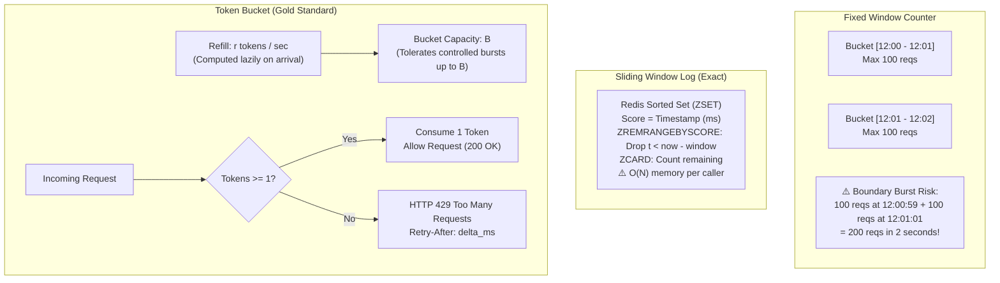
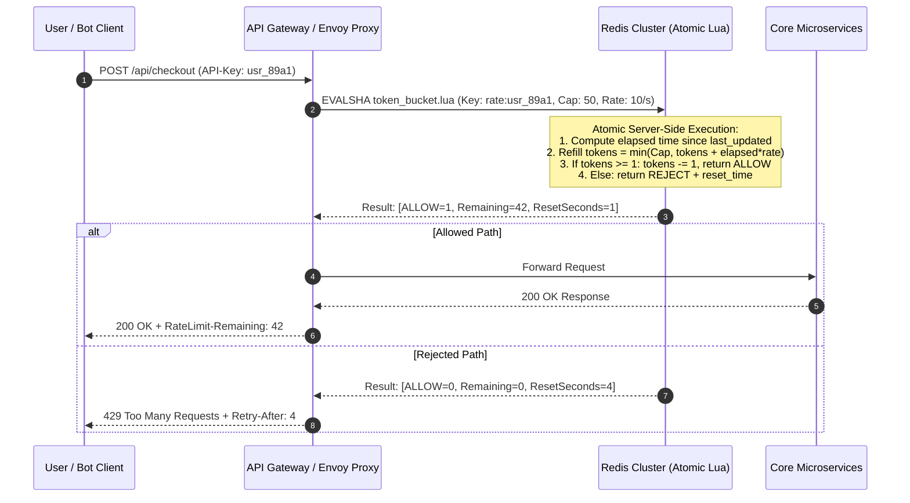
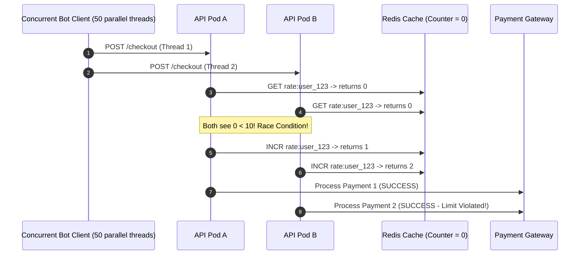

# Module 03: Designing a Rate Limiter

> **Status:** Production Standard  
> **Difficulty:** Intermediate to Advanced  
> **Estimated Time:** 2–3 Hours  
> **Prerequisites:** Module 00 (Capacity Estimation), Module 01 (System Design Interview Framework), Distributed Caching & Atomicity

---

> [!TIP]
> **The Golden Rule of Distributed Rate Limiting**  
> Rate limiting is an atomic invariant enforcement problem, not a simple counter update. Never implement rate limiting using separate client-side `GET` then `SET` operations, which introduce catastrophic read-modify-write race conditions under concurrent load. Every state transition—whether refilling a **Token Bucket** or trimming a **Sliding Window Log**—must execute as a single **Atomic Redis Lua Script (`EVALSHA`)** directly in the datastore engine. Always return standard IETF headers (`RateLimit-Limit`, `RateLimit-Remaining`, `RateLimit-Reset`, `Retry-After`) on HTTP 429 rejections, and explicitly configure whether your ingress fails **open** (protecting availability for public reads) or fails **closed** (protecting financial or authentication backends).

---

## 1. Visual Mental Models

### 1.1 Algorithm Mechanics Comparison

Choosing the wrong algorithm introduces boundary bursts or uncontrollable memory consumption:



### 1.2 Distributed Gateway Architecture & Atomic Lua Scripting

In a distributed multi-node fleet, state cannot live in application memory. The API Gateway delegates enforcement to a clustered Redis instance via atomic Lua execution:



---

## 2. Technical Reference Matrices

### 2.1 Rate Limiting Algorithm Tradeoff Grid

| Algorithm | Memory Overhead per Key | Burst Tolerance | Boundary Edge Accuracy | Computational Complexity | Best Use Case |
| :--- | :--- | :--- | :--- | :--- | :--- |
| **Fixed Window Counter** | Minimal ($8\text{ Bytes}$ counter) | None (Strict limit per calendar window) | Poor (Allows $2\times$ limit burst at boundary) | $O(1)$ | Simple coarse-grained daily quotas |
| **Sliding Window Log** | High ($8\text{–}16\text{ Bytes} \times \text{Requests}$) | Low (Strict continuous window) | $100\%$ Perfect | $O(\log N)$ insertions and trims | Low-volume, mission-critical audit endpoints |
| **Sliding Window Counter** | Very Low ($16\text{ Bytes}$: 2 integers) | Moderate (Smooths boundary transitions) | $\sim 99\%$ Accurate (Approximated) | $O(1)$ | Cloudflare/NGINX scale edge traffic filtering |
| **Token Bucket** | Minimal ($16\text{ Bytes}$: tokens + timestamp) | **High (Allows bursts up to bucket capacity $B$)** | High (Continuous long-term average $r$) | $O(1)$ (Lazy refill on request) | **Industry Standard for REST APIs (Stripe, GitHub, AWS)** |
| **Leaky Bucket (Traffic Shaper)** | Moderate ($O(\text{Queue Size})$) | None (Strictly constant outflow rate) | Perfect | $O(1)$ | Protecting write queues or downstream batch sinks |

### 2.2 Operational Failure Mode Matrix: Fail-Open vs Fail-Closed

When the rate limiting cache cluster fails (e.g., Redis network partition or OOM restart):

| Domain / Endpoint | Strategy | Rationale | Fallback Mitigation |
| :--- | :--- | :--- | :--- |
| **Public Content / Catalog Browsing** | **Fail-Open** | User experience is prioritized; transient over-requesting will not permanently corrupt core state. | Local in-memory emergency rate limiter per container instance. |
| **User Login & Password Reset** | **Fail-Closed** | Protects against credential-stuffing and brute-force password spraying attacks. | Return `503 Service Unavailable: Authentication security system offline`. |
| **Payment & Checkout Processing** | **Fail-Closed** | Prevents distributed double-spend attacks, card cracking, and downstream payment gateway exhaustion. | Circuit breaker opens; queue events in persistent transactional outbox. |
| **B2B Webhooks & Async Ingestion** | **Degrade & Buffer** | Asynchronous senders can tolerate backpressure without user-facing errors. | Return `429 Too Many Requests` with exponential `Retry-After: 30`. |

---

## 3. Production War Story: The Black Friday Concurrency Race

### The Incident
During a flash-sale event, an e-commerce platform configured a rate limiter to restrict users to 10 checkout attempts per minute:
- The rate limiter middleware executed two Redis commands:
  ```python
  # NAIVE NON-ATOMIC IMPLEMENTATION
  count = redis.get(user_id)
  if count and int(count) >= 10:
      return 429
  redis.incr(user_id)
  ```
- A bot operator executed a concurrent script utilizing 50 parallel HTTP/2 streams targeting a limited sneakers drop within the exact same 15-millisecond window across 5 stateless application pods.
- All 50 requests arrived simultaneously. When each pod issued `redis.get(user_id)`, the counter was at 0. All 50 pods evaluated `count < 10` as true, and all 50 executed `redis.incr(user_id)`.
- **The Result:** The bot bypassed the rate limit completely, claiming 50 checkout reservations in a single second. The card payment processor gateway was flooded with 2,500 simultaneous authorization charges, triggering rate limits from the bank and freezing checkout for legitimate customers for 18 minutes.



### The Post-Mortem & Fix
The multi-step `GET` $\to$ `IF` $\to$ `INCR` was replaced with a single atomic Redis Lua script. In Redis, Lua scripts run as a single atomic transaction on the single-threaded event loop. No other command or script can interleave between the check and the counter mutation.

---

## 4. Multi-Language Production Implementation: Atomic Token Bucket

Below is a complete, production-grade distributed Rate Limiter implemented in Go, TypeScript, and Python. It executes an atomic Lua script that lazily replenishes tokens based on elapsed wall-clock time and returns standard RFC rate-limiting headers.

````carousel
```python
# rate_limiter.py
"""
Production Distributed Rate Limiter with Atomic Redis Lua Token Bucket.
"""

import time
import redis
from typing import Tuple, Dict

# Lua Script: Atomic Token Bucket with Lazy Refill
# KEYS[1]: rate_limit key (e.g., rate:user_123)
# ARGV[1]: bucket capacity (max tokens)
# ARGV[2]: refill rate (tokens per second)
# ARGV[3]: current timestamp in epoch seconds (float)
# ARGV[4]: tokens requested (usually 1)
LUA_TOKEN_BUCKET = """
local key = KEYS[1]
local capacity = tonumber(ARGV[1])
local refill_rate = tonumber(ARGV[2])
local now = tonumber(ARGV[3])
local requested = tonumber(ARGV[4])

-- Retrieve current state [tokens, last_updated_epoch]
local data = redis.call('HMGET', key, 'tokens', 'last_updated')
local tokens = tonumber(data[1])
local last_updated = tonumber(data[2])

if tokens == nil then
    tokens = capacity
    last_updated = now
else
    -- Compute lazy refill based on elapsed wall-clock seconds
    local elapsed = math.max(0, now - last_updated)
    tokens = math.min(capacity, tokens + elapsed * refill_rate)
    last_updated = now
end

if tokens >= requested then
    tokens = tokens - requested
    redis.call('HMSET', key, 'tokens', tokens, 'last_updated', last_updated)
    -- Expire key when bucket would naturally refill to capacity + safety margin
    local ttl = math.ceil(capacity / refill_rate) * 2
    redis.call('EXPIRE', key, ttl)
    return {1, math.floor(tokens), 0} -- [allowed=1, remaining, retry_after=0]
else
    local missing = requested - tokens
    local retry_after = math.ceil(missing / refill_rate)
    redis.call('HMSET', key, 'tokens', tokens, 'last_updated', last_updated)
    return {0, math.floor(tokens), retry_after} -- [allowed=0, remaining, retry_after]
end
"""

class DistributedRateLimiter:
    def __init__(self, redis_client: redis.Redis):
        self.r = redis_client
        self.script_sha = self.r.script_load(LUA_TOKEN_BUCKET)

    def evaluate(
        self,
        identifier: str,
        capacity: int = 20,
        refill_rate: float = 5.0,
        fail_open: bool = True
    ) -> Tuple[bool, Dict[str, str]]:
        key = f"rate:{identifier}"
        now = time.time()
        try:
            allowed, remaining, retry_after = self.r.evalsha(
                self.script_sha, 1, key, capacity, refill_rate, now, 1
            )
            headers = {
                "RateLimit-Limit": str(capacity),
                "RateLimit-Remaining": str(remaining),
                "RateLimit-Reset": str(retry_after),
            }
            if not allowed:
                headers["Retry-After"] = str(retry_after)
            return bool(allowed), headers
        except (redis.ConnectionError, redis.TimeoutError) as ex:
            if fail_open:
                # Log error and permit request to safeguard availability
                return True, {"X-RateLimit-Fallback": "fail-open"}
            return False, {"Retry-After": "30", "X-RateLimit-Fallback": "fail-closed"}

if __name__ == "__main__":
    client = redis.Redis(host="localhost", port=6379, decode_responses=True)
    limiter = DistributedRateLimiter(client)
    
    user = "usr_super_bot_42"
    for i in range(25):
        allowed, hdrs = limiter.evaluate(user, capacity=10, refill_rate=2.0)
        status = "200 OK" if allowed else "429 TOO MANY REQUESTS"
        print(f"Request {i+1:2d} -> {status} | Rem: {hdrs.get('RateLimit-Remaining', '-'):>2} | Retry-After: {hdrs.get('Retry-After', '0')}")
        time.sleep(0.05)
```
<!-- slide -->
```go
// rate_limiter.go
package main

import (
	"context"
	"fmt"
	"log"
	"math"
	"net/http"
	"time"

	"github.com/redis/go-redis/v9"
)

const luaTokenBucket = `
local key = KEYS[1]
local capacity = tonumber(ARGV[1])
local refill_rate = tonumber(ARGV[2])
local now = tonumber(ARGV[3])
local requested = tonumber(ARGV[4])

local data = redis.call('HMGET', key, 'tokens', 'last_updated')
local tokens = tonumber(data[1])
local last_updated = tonumber(data[2])

if tokens == nil then
    tokens = capacity
    last_updated = now
else
    local elapsed = math.max(0, now - last_updated)
    tokens = math.min(capacity, tokens + elapsed * refill_rate)
    last_updated = now
end

if tokens >= requested then
    tokens = tokens - requested
    redis.call('HMSET', key, 'tokens', tokens, 'last_updated', last_updated)
    redis.call('EXPIRE', key, math.ceil(capacity / refill_rate) * 2)
    return {1, math.floor(tokens), 0}
else
    local missing = requested - tokens
    local retry_after = math.ceil(missing / refill_rate)
    redis.call('HMSET', key, 'tokens', tokens, 'last_updated', last_updated)
    return {0, math.floor(tokens), retry_after}
end
`

type RateLimiter struct {
	client    *redis.Client
	scriptSHA string
}

func NewRateLimiter(client *redis.Client) (*RateLimiter, error) {
	ctx := context.Background()
	sha, err := client.ScriptLoad(ctx, luaTokenBucket).Result()
	if err != nil {
		return nil, err
	}
	return &RateLimiter{client: client, scriptSHA: sha}, nil
}

func (rl *RateLimiter) Middleware(next http.Handler, capacity int, refillRate float64) http.Handler {
	return http.HandlerFunc(func(w http.ResponseWriter, r *http.Request) {
		ctx := r.Context()
		ip := r.RemoteAddr
		key := fmt.Sprintf("rate:%s", ip)
		now := float64(time.Now().UnixNano()) / 1e9

		res, err := rl.client.EvalSha(ctx, rl.scriptSHA, []string{key}, capacity, refillRate, now, 1).Result()
		if err != nil {
			// Fail-open strategy
			w.Header().Set("X-RateLimit-Fallback", "fail-open")
			next.ServeHTTP(w, r)
			return
		}

		vals := res.([]interface{})
		allowed := vals[0].(int64) == 1
		remaining := vals[1].(int64)
		retryAfter := vals[2].(int64)

		w.Header().Set("RateLimit-Limit", fmt.Sprintf("%d", capacity))
		w.Header().Set("RateLimit-Remaining", fmt.Sprintf("%d", remaining))

		if !allowed {
			w.Header().Set("Retry-After", fmt.Sprintf("%d", retryAfter))
			http.Error(w, "Too Many Requests", http.StatusTooManyRequests)
			return
		}

		next.ServeHTTP(w, r)
	})
}
```
<!-- slide -->
```typescript
// rate_limiter.ts
import { Request, Response, NextFunction } from 'express';
import Redis from 'ioredis';

const LUA_TOKEN_BUCKET = `
local key = KEYS[1]
local capacity = tonumber(ARGV[1])
local refill_rate = tonumber(ARGV[2])
local now = tonumber(ARGV[3])
local requested = tonumber(ARGV[4])

local data = redis.call('HMGET', key, 'tokens', 'last_updated')
local tokens = tonumber(data[1])
local last_updated = tonumber(data[2])

if tokens == nil then
    tokens = capacity
    last_updated = now
else
    local elapsed = math.max(0, now - last_updated)
    tokens = math.min(capacity, tokens + elapsed * refill_rate)
    last_updated = now
end

if tokens >= requested then
    tokens = tokens - requested
    redis.call('HMSET', key, 'tokens', tokens, 'last_updated', last_updated)
    redis.call('EXPIRE', key, math.ceil(capacity / refill_rate) * 2)
    return {1, math.floor(tokens), 0}
else
    local missing = requested - tokens
    local retry_after = math.ceil(missing / refill_rate)
    redis.call('HMSET', key, 'tokens', tokens, 'last_updated', last_updated)
    return {0, math.floor(tokens), retry_after}
end
`;

export class RateLimiterService {
  private redis: Redis;

  constructor(redisClient: Redis) {
    this.redis = redisClient;
    this.redis.defineCommand('evaluateTokenBucket', {
      numberOfKeys: 1,
      lua: LUA_TOKEN_BUCKET,
    });
  }

  public middleware(capacity = 30, refillRate = 10) {
    return async (req: Request, res: Response, next: NextFunction) => {
      const clientId = req.headers['x-api-key'] || req.ip || 'anonymous';
      const key = `rate:${clientId}`;
      const now = Date.now() / 1000;

      try {
        const [allowed, remaining, retryAfter] = (await (this.redis as any).evaluateTokenBucket(
          key,
          capacity,
          refillRate,
          now,
          1
        )) as [number, number, number];

        res.setHeader('RateLimit-Limit', capacity.toString());
        res.setHeader('RateLimit-Remaining', remaining.toString());

        if (allowed === 1) {
          return next();
        }

        res.setHeader('Retry-After', retryAfter.toString());
        return res.status(429).json({
          error: 'Too Many Requests',
          retry_after_seconds: retryAfter,
        });
      } catch (err) {
        // Fail-open policy for public read endpoints
        res.setHeader('X-RateLimit-Fallback', 'fail-open');
        return next();
      }
    };
  }
}
```
````

---

## 5. Practical Hands-On Verification CLI

### 5.1 Test Rate Limiting Ingress with Parallel curl Requests

Verify threshold tripping and observe HTTP 429 status code and `Retry-After` response headers:

```powershell
# Send 15 fast requests to a bucket with capacity=10
1..15 | ForEach-Object {
  curl.exe -s -i http://localhost:8080/api/checkout `
    -H "X-API-Key: test_client_beta" | Select-String -Pattern "HTTP/|RateLimit-|Retry-After"
}
```

**Expected Console Output:**
```text
HTTP/1.1 200 OK
RateLimit-Limit: 10
RateLimit-Remaining: 9
HTTP/1.1 200 OK
RateLimit-Limit: 10
RateLimit-Remaining: 8
...
HTTP/1.1 429 Too Many Requests
RateLimit-Limit: 10
RateLimit-Remaining: 0
Retry-After: 3
```

---

## 6. Operational Validation Checkpoints

<details>
<summary><strong>Checkpoint 1: Why does a Fixed Window Counter permit up to 2x the configured rate limit during boundary transitions?</strong></summary>

> **Root Cause Analysis:**  
> A Fixed Window Counter calculates usage within discrete calendar buckets (e.g., `12:00:00 - 12:01:00`).  
> If an attacker sends the maximum limit of 100 requests at `12:00:59`, the counter hits 100 and passes. At `12:01:00`, a brand-new window begins, resetting the counter to 0. The attacker immediately sends another 100 requests at `12:01:01`. Within a 2-second real-world window, the backend receives 200 requests, completely subverting the intended 100 requests/minute protection limit.
</details>

<details>
<summary><strong>Checkpoint 2: In a multi-region deployment (e.g. US-East, US-West, EU-Central), should rate limiting counters be synchronized globally?</strong></summary>

> **Root Cause Analysis:**  
> Synchronizing every atomic increment synchronously across regions via multi-datacenter consensus (e.g. Spanner or WAN Raft) adds $100\text{–}150\text{ ms}$ of network latency to **every single incoming request**, destroying API performance.  
> 
> **Production Solution:**  
> Partition the global limit across regions or use local synchronization:
> 1. **Local Quota Slicing:** If the global limit is 300 req/min, assign each of the 3 regions an independent local quota of 100 req/min.
> 2. **Asynchronous Batch Synchronization:** Edge nodes maintain local in-memory counters and asynchronously sync batch deltas to a central store every $1\text{–}5\text{ seconds}$ via background gossip. This trades slight, temporary over-allowance for sub-millisecond edge latency.
</details>

<details>
<summary><strong>Checkpoint 3: Why is Token Bucket preferred over Leaky Bucket for general REST APIs?</strong></summary>

> **Root Cause Analysis:**  
> - **Token Bucket:** Requests consume available tokens instantly. If a user loads a dashboard that makes 8 parallel API calls, the Token Bucket allows the burst immediately as long as tokens are available, resulting in sub-millisecond response times.  
> - **Leaky Bucket:** Regulates requests through a strict FIFO queue that releases requests at a rigid constant speed. Forcing user-interactive web requests into a queue adds noticeable queuing latency ($100\text{–}500\text{ ms}$ delays), degrading frontend UI responsiveness. Leaky bucket is ideal for asynchronous background jobs and outgoing webhook deliveries, but too restrictive for user-facing interactive APIs.
</details>

---

## 7. Free PDF Notes & Printables

Download these notes as a printable PDF, with every diagram and interview questions: [SD-C-013: Distributed Rate Limiting](https://backendroadmap.com/notes/system-design/SD-C-013.pdf). Each section in one file: [Phase 2, APIs (PDF)](https://backendroadmap.com/notes/system-design/Phase2_APIs_Notes.pdf).

---

## 8. Curriculum Navigation

- [← Back to Module 02: Designing a URL Shortener](../02-designing-a-url-shortener/README.md)
- [Back to System Design Track Overview](../README.md)
- [Proceed to Module 04: Designing a Distributed Cache & Key-Value Store](../04-designing-a-distributed-cache-and-key-value-store/README.md)
