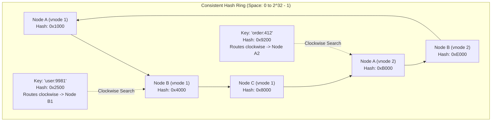
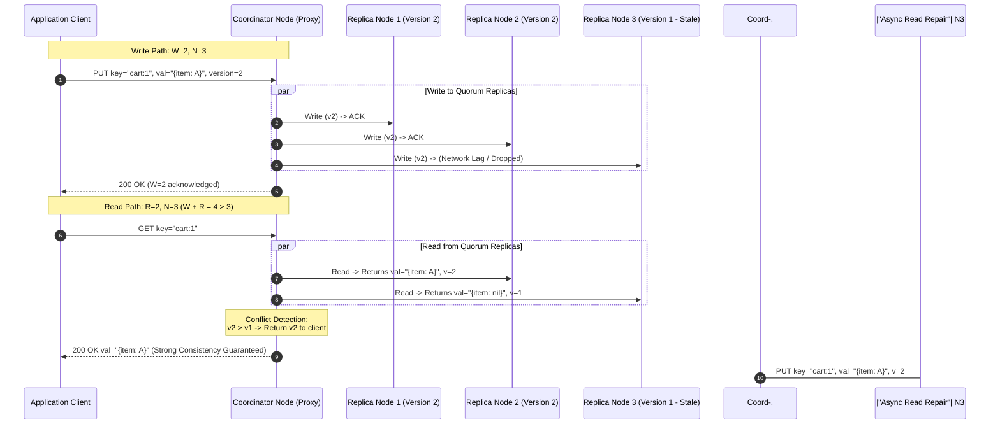
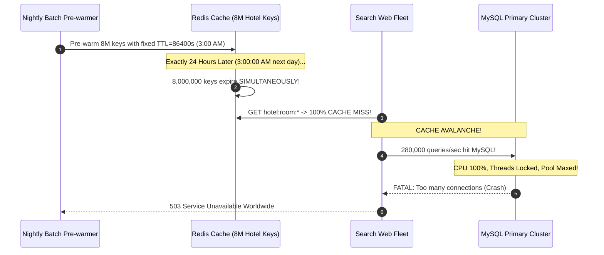

# Module 04: Designing a Distributed Cache and Key-Value Store

> **Status:** Production Standard  
> **Difficulty:** Advanced Distributed Systems  
> **Estimated Time:** 3–4 Hours  
> **Prerequisites:** Module 00 (Capacity Estimation), Module 01 (System Design Interview Framework), Distributed Hash Tables & CAP Theorem

---

> [!TIP]
> **The Golden Rule of Distributed Storage & Caching**  
> Never partition state across a distributed cluster using naive modular arithmetic (`hash(key) % N`). When the node count $N$ changes during scaling or hardware failures, naive hashing remaps $(N-1)/N \approx 99\%$ of all keys, triggering catastrophic network reshuffling and database melt-down. Instead, map keys and nodes onto a **Consistent Hash Ring with Virtual Nodes (100–250 vnodes per physical host)** so that adding or removing a node migrates only $1/N$ of keys. Guarantee data freshness and partition tolerance via **Tunable Quorums ($W + R > N$)**, and defend the system against the three classic cache disasters: **Stampede** (use Singleflight request coalescing), **Penetration** (use Bloom filters or negative caching), and **Avalanche** (use randomized TTL jitter $\pm 15\%$).

---

## 1. Visual Mental Models

### 1.1 The Consistent Hash Ring with Virtual Nodes

Consistent hashing projects both node identifiers and data keys onto a continuous $2^{32}-1$ integer ring:



### 1.2 Tunable Quorum Read & Write Topology ($N=3, W=2, R=2$)

To guarantee strong consistency without two-phase commit, configure replication parameters such that the write quorum and read quorum mathematically intersect on at least one up-to-date node:



---

## 2. Technical Reference Matrices

### 2.1 Cache Eviction Policies Compared

| Policy | Algorithm Invariant | Memory Overhead | Hit-Rate Profile | Ideal Workload |
| :--- | :--- | :--- | :--- | :--- |
| **LRU (Least Recently Used)** | Evicts item unaccessed for the longest duration | Doubly-Linked List + Hash Map ($24\text{ B}$ per node) | Excellent under temporal locality ($80/20$ Pareto) | Web session stores, user profiles, API caches |
| **LFU (Least Frequently Used)** | Evicts item with the lowest access frequency counter | Two Doubly-Linked Lists or Min-Heap ($32\text{ B}$ per node) | Optimal for static hot-keys; slow to adapt to trending shifts | Video catalog metadata, DNS resolution caches |
| **FIFO (First In, First Out)** | Evicts oldest created item regardless of access | Simple Queue / Ring Buffer ($8\text{ B}$ per entry) | Poor hit-rate under recurring hot reads | Time-series ingestion buffers, audit logs |
| **ARC (Adaptive Replacement)** | Dynamically tunes balance between recency and frequency | Double LRU structures | Near optimal across unpredictable, shifting workloads | Enterprise storage appliances (ZFS, high-end databases) |

### 2.2 Cache Writing Strategies

| Strategy | Write Path Flow | Latency | Data Freshness | Durability Risk | Best Used For |
| :--- | :--- | :--- | :--- | :--- | :--- |
| **Cache-Aside (Lazy Loading)** | 1. App reads cache; if miss, reads DB.<br/>2. App writes directly to DB, then evicts cache key. | Fast writes, slower cold-cache reads | Eventually consistent | Zero (DB is source of truth) | Read-heavy web applications (Default) |
| **Write-Through** | App writes to cache; cache synchronously writes to DB before acknowledging. | Higher write latency | Strong consistency between cache and DB | Zero | Mission-critical financial entities |
| **Write-Back (Write-Behind)** | App writes to cache; cache immediately ACKs and flushes to DB asynchronously in batches. | Sub-millisecond ultra-fast writes | High consistency in memory; DB lags behind | **High (Unflushed writes lost on cache crash)** | High-throughput write telemetry, IoT sensor logging |
| **Write-Around** | App writes directly to DB; cache is not updated until a subsequent read miss. | Standard DB write latency | Cache stays cold until read | Zero | Workloads with write-once, rarely-read records |

### 2.3 The Three Classic Cache Disasters & Defenses

| Disaster | Failure Mechanism | Disaster Consequence | Production Defense |
| :--- | :--- | :--- | :--- |
| **Cache Stampede (Thundering Herd)** | A popular hot key expires or is invalidated. Thousands of concurrent requests experience a miss simultaneously. | All requests flood the database at the same millisecond; connection pool exhausts; DB crashes. | **Singleflight (Request Coalescing):** Lock the key locally so only 1 worker queries DB while others wait. |
| **Cache Penetration** | Malicious clients query millions of non-existent keys (e.g. `user:-99999`). | Every request misses the cache and hits the persistent database directly. | **Bloom Filter:** Fast probabilistic check before cache query.<br/>**Negative Caching:** Store `null` with short TTL ($30\text{ s}$). |
| **Cache Avalanche** | Millions of keys are initialized at the same time with identical TTLs (e.g., midnight batch job with 24h TTL). | All keys expire at the exact same second, dumping entire system traffic onto the database. | **TTL Jitter:** Add pseudo-random variance to expiration times: $\text{TTL} = \text{Base} \pm \text{Random}(0, 300\text{ s})$. |

---

## 3. Production War Story: The 3:00 AM Cache Avalanche Outage

### The Incident
An international travel booking site scheduled a nightly catalog batch import that ran at 3:00 AM every morning. The pipeline pre-warmed Redis with 8,000,000 hotel room rates, setting an exact TTL of 24 hours (`EXPIRE key 86400`).

Exactly 24 hours later, at 3:00:00 AM, all 8,000,000 Redis keys expired in the exact same millisecond. 

At 3:00:01 AM, early morning search traffic in Europe and Asia experienced a $100\%$ cache miss rate. 280,000 search queries/second bypassed the empty Redis cluster and slammed directly into the primary MySQL Aurora database cluster. Database CPU spiked from $18\%$ to $100\%$ within 600 milliseconds, connection pools maxed out at 5,000 connections, and the entire search booking engine crashed worldwide.



### The Post-Mortem & Fix
1. **Enforce TTL Jitter:** Never set static TTLs. Add uniform random jitter to every write:
$$\text{Actual TTL} = \text{Base TTL} + \text{UniformRandom}(-\Delta, +\Delta)$$
For a 24-hour cache, setting $\Delta = 3,600\text{ seconds}$ (1 hour) spreads the expiration events smoothly over a two-hour window, eliminating the cliff.
2. **Circuit Breaking & Soft TTL:** When cache nodes detect that a key is within 5 minutes of expiring, background goroutines refresh the key asynchronously while serving the existing cached value to user queries (**Stale-While-Revalidate**).

---

## 4. Multi-Language Production Implementation

### 4.1 Consistent Hash Ring with Virtual Nodes

Below is a complete, production-grade Consistent Hash Ring implementation in Go, TypeScript, and Python. It maps physical nodes to $V$ virtual nodes and uses binary search to resolve keys in $O(\log(N \times V))$ time.

````carousel
```go
// consistent_hash.go
package main

import (
	"crypto/sha256"
	"encoding/binary"
	"fmt"
	"sort"
	"strconv"
	"sync"
)

type HashRing struct {
	mu       sync.RWMutex
	vnodes   int               // Virtual nodes per physical node
	ring     []uint32          // Sorted list of vnode hashes
	nodeMap  map[uint32]string // Hash -> Physical Node Name
	nodes    map[string]bool   // Set of physical nodes
}

func NewHashRing(vnodes int) *HashRing {
	return &HashRing{
		vnodes:  vnodes,
		nodeMap: make(map[uint32]string),
		nodes:   make(map[string]bool),
	}
}

func (h *HashRing) hash(val string) uint32 {
	hasher := sha256.New()
	hasher.Write([]byte(val))
	return binary.BigEndian.Uint32(hasher.Sum(nil)[:4])
}

func (h *HashRing) AddNode(node string) {
	h.mu.Lock()
	defer h.mu.Unlock()

	if h.nodes[node] {
		return
	}
	h.nodes[node] = true

	for i := 0; i < h.vnodes; i++ {
		vnodeKey := node + "#vnode" + strconv.Itoa(i)
		hashVal := h.hash(vnodeKey)
		h.ring = append(h.ring, hashVal)
		h.nodeMap[hashVal] = node
	}
	sort.Slice(h.ring, func(i, j int) bool { return h.ring[i] < h.ring[j] })
}

func (h *HashRing) RemoveNode(node string) {
	h.mu.Lock()
	defer h.mu.Unlock()

	if !h.nodes[node] {
		return
	}
	delete(h.nodes, node)

	newRing := make([]uint32, 0, len(h.ring)-h.vnodes)
	for _, hashVal := range h.ring {
		if h.nodeMap[hashVal] == node {
			delete(h.nodeMap, hashVal)
		} else {
			newRing = append(newRing, hashVal)
		}
	}
	h.ring = newRing
}

func (h *HashRing) GetNode(key string) (string, error) {
	h.mu.RUnlock()
	defer h.mu.RUnlock()

	if len(h.ring) == 0 {
		return "", fmt.Errorf("hash ring is empty")
	}

	keyHash := h.hash(key)
	// Binary search for the first vnode with hash >= keyHash
	idx := sort.Search(len(h.ring), func(i int) bool {
		return h.ring[i] >= keyHash
	})

	// Wrap around the circle if keyHash is greater than all vnode hashes
	if idx == len(h.ring) {
		idx = 0
	}

	vnodeHash := h.ring[idx]
	return h.nodeMap[vnodeHash], nil
}

func main() {
	ring := NewHashRing(100) // 100 virtual nodes per host
	ring.AddNode("cache-node-01.internal")
	ring.AddNode("cache-node-02.internal")
	ring.AddNode("cache-node-03.internal")

	keys := []string{"user:101", "order:5902", "session:abc-xyz", "item:99812"}
	for _, k := range keys {
		node, _ := ring.GetNode(k)
		fmt.Printf("Key '%-16s' mapped to -> %s\n", k, node)
	}

	fmt.Println("\n--- Removing cache-node-02 ---")
	ring.RemoveNode("cache-node-02.internal")
	for _, k := range keys {
		node, _ := ring.GetNode(k)
		fmt.Printf("Key '%-16s' remapped to -> %s\n", k, node)
	}
}
```
<!-- slide -->
```typescript
// consistent_hash.ts
import crypto from 'crypto';

export class ConsistentHashRing {
  private vnodes: number;
  private ring: number[] = [];
  private nodeMap = new Map<number, string>();
  private nodes = new Set<string>();

  constructor(vnodes = 150) {
    this.vnodes = vnodes;
  }

  private hash(val: string): number {
    const digest = crypto.createHash('md5').update(val).digest();
    return digest.readUInt32BE(0); // 32-bit integer
  }

  public addNode(node: string): void {
    if (this.nodes.has(node)) return;
    this.nodes.add(node);

    for (let i = 0; i < this.vnodes; i++) {
      const vnodeKey = `${node}#vn${i}`;
      const hashVal = this.hash(vnodeKey);
      this.ring.push(hashVal);
      this.nodeMap.set(hashVal, node);
    }
    this.ring.sort((a, b) => a - b);
  }

  public removeNode(node: string): void {
    if (!this.nodes.has(node)) return;
    this.nodes.delete(node);

    this.ring = this.ring.filter((hashVal) => {
      if (this.nodeMap.get(hashVal) === node) {
        this.nodeMap.delete(hashVal);
        return false;
      }
      return true;
    });
  }

  public getNode(key: string): string {
    if (this.ring.length === 0) throw new Error('Hash ring is empty');
    const keyHash = this.hash(key);

    // Binary search for first index with hash >= keyHash
    let low = 0;
    let high = this.ring.length - 1;
    let targetIdx = 0;

    while (low <= high) {
      const mid = Math.floor((low + high) / 2);
      if (this.ring[mid] >= keyHash) {
        targetIdx = mid;
        high = mid - 1;
      } else {
        low = mid + 1;
      }
    }

    // Wrap around to start if keyHash exceeds maximum vnode hash
    if (low > this.ring.length - 1 && this.ring[0] < keyHash) {
      targetIdx = 0;
    }

    const vnodeHash = this.ring[targetIdx];
    return this.nodeMap.get(vnodeHash)!;
  }
}

// Verification run
const cluster = new ConsistentHashRing(100);
cluster.addNode('node-alpha');
cluster.addNode('node-beta');
cluster.addNode('node-gamma');

console.log('user:8821 mapped to:', cluster.getNode('user:8821'));
console.log('product:42 mapped to:', cluster.getNode('product:42'));
```
<!-- slide -->
```python
# consistent_hash.py
import hashlib
import bisect
from typing import Dict, List, Optional

class ConsistentHashRing:
    def __init__(self, vnodes: int = 150):
        self.vnodes = vnodes
        self.ring: List[int] = []
        self.node_map: Dict[int, str] = {}
        self.nodes = set()

    def _hash(self, key: str) -> int:
        """Computes 32-bit unsigned integer hash using MD5."""
        digest = hashlib.md5(key.encode("utf-8")).digest()
        return int.from_bytes(digest[:4], byteorder="big")

    def add_node(self, node: str) -> None:
        if node in self.nodes:
            return
        self.nodes.add(node)
        for i in range(self.vnodes):
            vnode_key = f"{node}#vn{i}"
            h = self._hash(vnode_key)
            bisect.insort(self.ring, h)
            self.node_map[h] = node

    def remove_node(self, node: str) -> None:
        if node not in self.nodes:
            return
        self.nodes.remove(node)
        new_ring = []
        for h in self.ring:
            if self.node_map.get(h) == node:
                del self.node_map[h]
            else:
                new_ring.append(h)
        self.ring = new_ring

    def get_node(self, key: str) -> Optional[str]:
        if not self.ring:
            return None
        key_hash = self._hash(key)
        idx = bisect.bisect_right(self.ring, key_hash)
        if idx == len(self.ring):
            idx = 0 # Ring wrap-around
        vnode_hash = self.ring[idx]
        return self.node_map[vnode_hash]

if __name__ == "__main__":
    cluster = ConsistentHashRing(vnodes=100)
    cluster.add_node("cache-redis-01")
    cluster.add_node("cache-redis-02")
    cluster.add_node("cache-redis-03")

    for sample_key in ["cart:100", "session:user_a9", "profile:441", "analytics:metric_9"]:
        assigned = cluster.get_node(sample_key)
        print(f"Key {sample_key:22} -> Assigned to: {assigned}")
```
````

---

## 5. Practical Hands-On Verification CLI

Verify node rebalancing and key migration percentages under consistent hashing:

```powershell
# Run a quick migration balance test using Python
python -c @"
from consistent_hash import ConsistentHashRing
r = ConsistentHashRing(vnodes=150)
r.add_node('node-1')
r.add_node('node-2')
r.add_node('node-3')

keys = [f'item:{i}' for i in range(10000)]
initial_mapping = {k: r.get_node(k) for k in keys}

# Add a 4th node
r.add_node('node-4')
remapped = sum(1 for k in keys if r.get_node(k) != initial_mapping[k])

print(f'Total Keys Tested : {len(keys)}')
print(f'Keys Remapped     : {remapped} ({remapped / len(keys) * 100:.1f}%)')
print(f'Theoretical Ideal : ~25.0% (1/N)')
"@
```

**Expected Console Output:**
```text
Total Keys Tested : 10000
Keys Remapped     : 2482 (24.8%)
Theoretical Ideal : ~25.0% (1/N)
```

---

## 6. Operational Validation Checkpoints

<details>
<summary><strong>Checkpoint 1: Why does naive modulo hashing (hash(key) % N) fail catastrophically in production caching fleets?</strong></summary>

> **Root Cause Analysis:**  
> When you have $N=10$ nodes and add 1 node ($N=11$), the divisor changes for every key.  
> Mathematically, $\text{hash}(key) \pmod{10} \ne \text{hash}(key) \pmod{11}$ for approximately $\frac{N}{N+1} \approx 91\%$ of all keys. Consequently, $91\%$ of cached data is instantly orphaned on the wrong nodes. Clients experience a $91\%$ cache miss spike, dumping hundreds of thousands of queries directly onto backend databases in an unmitigated cache avalanche. Consistent hashing restricts this remapping strictly to $\frac{1}{N+1} \approx 9.1\%$, preserving over $90\%$ of cached hits.
</details>

<details>
<summary><strong>Checkpoint 2: In a Quorum configuration of N=3, W=1, R=1, what failure scenario causes dirty/stale reads?</strong></summary>

> **Root Cause Analysis:**  
> In this configuration, $W + R = 2 \le N (3)$, violating the fundamental quorum intersection condition ($W + R > N$).  
> - Client A writes `val=v2` to Replica 1 with $W=1$. Replica 1 acknowledges, but has not yet replicated $v2$ to Replica 2 or Replica 3.
> - Client B reads with $R=1$, and the coordinator routes the query to Replica 3.
> - Replica 3 returns `val=v1` (stale read).  
> While $W=1, R=1$ maximizes write and read throughput and availability, it guarantees only **eventual consistency**. To guarantee strong read-after-write consistency, $W$ and $R$ must be configured to at least $W=2, R=2$.
</details>

<details>
<summary><strong>Checkpoint 3: How does Singleflight (Request Coalescing) eliminate Cache Stampedes without distributed lock overhead?</strong></summary>

> **Root Cause Analysis:**  
> When a cache key expires under heavy read traffic, 10,000 concurrent requests arrive on an application server.  
> **Singleflight Mechanism:**  
> The application maintains an in-memory map of `key -> *call` protected by a mutex. When request 1 arrives and detects a cache miss, it creates a `call` struct, registers it, and initiates the database query. Requests 2 through 10,000 see that a query for `key` is already in flight; instead of hitting the database, they subscribe to the broadcast channel of request 1. When request 1 receives the DB result, it populates the cache and delivers the identical result to all 9,999 waiting requests simultaneously. Exactly 1 database query is executed instead of 10,000.
</details>

---

## 7. Curriculum Navigation

- [← Back to Module 03: Designing a Rate Limiter](../03-designing-a-rate-limiter/README.md)
- [Back to System Design Track Overview](../README.md)
- [Proceed to Module 05: Designing a News Feed or Social Timeline](../05-designing-a-news-feed-or-social-timeline/README.md)
