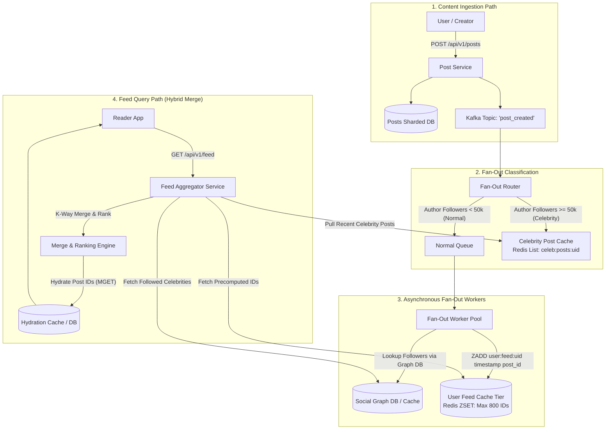
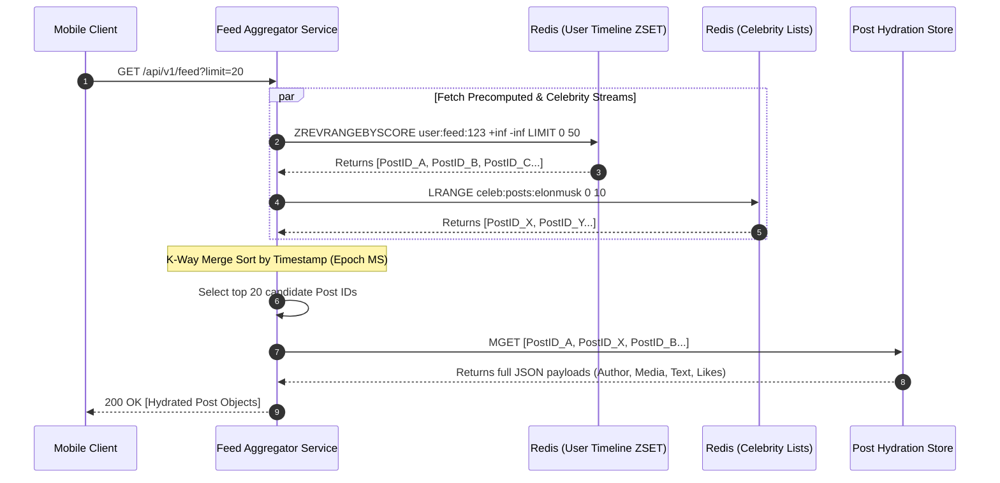
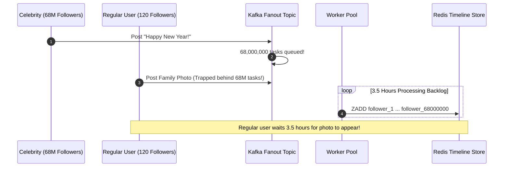

# Module 05: Designing a News Feed or Social Timeline

> **Status:** Production Standard  
> **Difficulty:** Advanced  
> **Estimated Time:** 3–4 Hours  
> **Prerequisites:** Module 00 (Capacity Estimation), Module 01 (System Design Interview Framework), Module 04 (Distributed Caching & Sharding)

---

> [!TIP]
> **The Golden Rule of Social Timeline Systems**  
> Never adopt a pure Fan-Out-on-Write (Push) or pure Fan-Out-on-Read (Pull) strategy in a production feed system. Pure push collapses under the **Celebrity / High-Fan-Out Problem** (a user with $50\text{M}$ followers posting once triggers $50\text{M}$ asynchronous write operations, causing multi-hour queue backlogs), while pure pull destroys database read performance across a $100:1$ read-to-write ratio. Instead, build a **Hybrid Architecture**: execute asynchronous **Fan-Out-on-Write for regular accounts** ($<50,000$ followers) storing compact 64-bit post IDs in in-memory Redis Sorted Sets (`ZSET`), and execute **Fan-Out-on-Read for celebrity accounts**, dynamically merging the two streams and hydrating post contents at read time in under $50\text{ ms}$.

---

## 1. Visual Mental Models

### 1.1 The Hybrid Push-Pull Architecture

The system bifurcates the write ingestion path based on the author's follower threshold, converging only on the read path:



### 1.2 Feed Read & Hydration Lifecycle

Feeds store lightweight identifiers rather than full JSON documents, decoupling fan-out size from post content mutations:



---

## 2. Technical Reference Matrices

### 2.1 Push vs Pull vs Hybrid Architecture Comparison

| Architectural Dimension | Fan-Out on Write (Pure Push) | Fan-Out on Read (Pure Pull) | Hybrid Push-Pull (Production Standard) |
| :--- | :--- | :--- | :--- |
| **Read Latency** | Ultra-Fast ($O(1)$ read from local Redis `ZSET`) | Slow ($O(F)$ scatter-gather where $F = \text{Followed Accounts}$) | Fast ($O(1)$ precomputed $+$ small $O(C)$ celebrity merge) |
| **Write Latency** | Extremely Heavy ($O(F)$ writes per post via worker queues) | Minimal ($O(1)$ insert to author's own post table) | Balanced ($O(F)$ for regular users, $O(1)$ for celebrities) |
| **Celebrity Post Impact** | Catastrophic ($50\text{M}$ queue entries trigger system backpressure) | Zero impact on write path | Zero fan-out; author posts are stored in a dedicated pull cache |
| **Inactive / Zombie Users** | Highly Wasteful (Wastes Redis RAM writing feeds for inactive users) | Perfectly Efficient (Zero work done until user opens the app) | Feeds for users inactive $>30\text{ days}$ are evicted and re-pulled on login |
| **Storage Footprint** | Large (Duplicates post references across millions of user feeds) | Minimal (Each post stored exactly once) | Moderate (Bounded to active users, max 800 items per user ZSET) |

### 2.2 Feed Content Storage Strategy: Post IDs vs Full Payloads

| Approach | Stored Payload | Memory per Feed Entry | Post Update / Edit Impact | Best Practice |
| :--- | :--- | :--- | :--- | :--- |
| **Full Payload Denormalization** | Entire JSON document (Text, media URLs, author info, likes) | $\sim 2\text{ KB} - 5\text{ KB}$ per entry | ❌ **Nightmare:** Editing or deleting a post requires updating millions of cached feeds | Never use in production |
| **Pointer Reference List (IDs Only)** | 64-bit Integer Post ID (e.g. Snowflake ID) stored in Redis `ZSET` | $\approx 16\text{ Bytes}$ per entry | **Instant:** Deleting or editing updates the primary post row once; hydrated at read | **Universal Production Standard** |

---

## 3. Production War Story: The Midnight Celebrity Fan-Out Disaster

### The Incident
A tier-1 social media platform operated a pure Fan-Out-on-Write (Push) architecture. Each post was pushed asynchronously to Kafka, where a cluster of 400 Celery background workers resolved the author's followers and updated their timeline caches in Redis.

On New Year's Eve at exactly 12:00:00 AM, a world-famous pop star with 68 million followers tweeted: *"Happy New Year everyone! 🎉"*.
- The single post event landed in the Kafka fan-out topic.
- The worker fleet attempted to execute 68,000,000 Redis `ZADD` operations.
- Redis network ingress saturated at $10\text{ Gbps}$.
- Worker task queues swelled from 2,000 items to 68,000,000 items within seconds.
- **The Ripple Effect:** Normal users who posted photos of their families to 150 friends had their fan-out tasks trapped *behind* the 68 million celebrity entries in the queue. Regular users waited **3.5 hours** before their friends could see their posts.



### The Post-Mortem & Fix
1. **Dynamic Fan-Out Thresholding:** Accounts with $>50,000$ followers are tagged with a `celebrity=true` bit in the user metadata database.
2. **Bypass Fan-Out Queues:** The Kafka router checks the celebrity flag. If true, it skips worker queue generation entirely, writing the post directly to `celeb:posts:{uid}` in a single $O(1)$ operation.
3. **Read-Path Fan-Out:** When followers load their feeds, the Feed Service reads the user's precomputed list, looks up which celebrities they follow, fetches their latest posts, and merges them in memory in $<15\text{ ms}$.

---

## 4. Multi-Language Production Implementation: Hybrid Feed Merge Engine

Below is a complete, production-grade Hybrid Feed Aggregator implemented in Go, TypeScript, and Python. It merges precomputed timeline posts with on-demand celebrity posts using a $K$-way timestamp merge and hydrates full records.

````carousel
```go
// feed_aggregator.go
package main

import (
	"encoding/json"
	"fmt"
	"sort"
	"time"
)

type Post struct {
	ID        int64  `json:"id"`
	AuthorID  string `json:"author_id"`
	Content   string `json:"content"`
	CreatedAt int64  `json:"created_at"`
}

type FeedAggregator struct {
	userTimelines   map[string][]int64 // user_id -> precomputed post_ids (pushed)
	celebrityPosts  map[string][]int64 // celeb_id -> post_ids (pulled)
	postStore       map[int64]Post     // Master hydrated post store
	celebrityFollow map[string][]string // user_id -> list of followed celebs
}

func NewFeedAggregator() *FeedAggregator {
	return &FeedAggregator{
		userTimelines:   make(map[string][]int64),
		celebrityPosts:  make(map[string][]int64),
		postStore:       make(map[int64]Post),
		celebrityFollow: make(map[string][]string),
	}
}

// GenerateFeed executes hybrid merge: precomputed normal posts + on-demand celebrity posts
func (fa *FeedAggregator) GenerateFeed(userID string, limit int) []Post {
	candidateIDs := make(map[int64]bool)

	// 1. Fetch precomputed pushed posts for user
	for _, pid := range fa.userTimelines[userID] {
		candidateIDs[pid] = true
	}

	// 2. Fetch on-demand pulled posts for followed celebrities
	for _, celebID := range fa.celebrityFollow[userID] {
		for _, pid := range fa.celebrityPosts[celebID] {
			candidateIDs[pid] = true
		}
	}

	// 3. Hydrate post objects
	hydrated := make([]Post, 0, len(candidateIDs))
	for pid := range candidateIDs {
		if post, exists := fa.postStore[pid]; exists {
			hydrated = append(hydrated, post)
		}
	}

	// 4. Sort reverse-chronologically by CreatedAt
	sort.Slice(hydrated, func(i, j int) bool {
		return hydrated[i].CreatedAt > hydrated[j].CreatedAt
	})

	if len(hydrated) > limit {
		return hydrated[:limit]
	}
	return hydrated
}

func main() {
	fa := NewFeedAggregator()
	now := time.Now().UnixMilli()

	// Seed Master Posts
	fa.postStore[1] = Post{ID: 1, AuthorID: "friend_bob", Content: "Morning coffee!", CreatedAt: now - 30000}
	fa.postStore[2] = Post{ID: 2, AuthorID: "friend_alice", Content: "Go code deployed", CreatedAt: now - 15000}
	fa.postStore[3] = Post{ID: 3, AuthorID: "celeb_elon", Content: "Rockets launched 🚀", CreatedAt: now - 5000}

	// Seed Relations: User1 follows friend_bob (precomputed push) and celeb_elon (pulled)
	fa.userTimelines["user_1"] = []int64{1, 2}
	fa.celebrityFollow["user_1"] = []string{"celeb_elon"}
	fa.celebrityPosts["celeb_elon"] = []int64{3}

	feed := fa.GenerateFeed("user_1", 10)
	out, _ := json.MarshalIndent(feed, "", "  ")
	fmt.Println("Hydrated Reverse-Chronological Feed:")
	fmt.Println(string(out))
}
```
<!-- slide -->
```typescript
// feed_aggregator.ts
interface Post {
  id: string;
  author_id: string;
  content: string;
  created_at_ms: number;
}

export class HybridFeedService {
  // Precomputed timelines for regular followed users (Pushed via Kafka)
  private userTimelines = new Map<string, string[]>();
  // Recent posts for high-fanout celebrities (Pulled on read)
  private celebrityPosts = new Map<string, string[]>();
  // Follow graph: user -> followed celebrities
  private celebFollows = new Map<string, string[]>();
  // Primary hydrated post datastore
  private postStore = new Map<string, Post>();

  public generateFeed(userId: string, limit = 20): Post[] {
    const postIds = new Set<string>();

    // 1. Read precomputed normal feed
    const normalPostIds = this.userTimelines.get(userId) || [];
    normalPostIds.forEach(id => postIds.add(id));

    // 2. Read on-demand celebrity posts
    const followedCelebs = this.celebFollows.get(userId) || [];
    for (const celebId of followedCelebs) {
      const cPosts = this.celebrityPosts.get(celebId) || [];
      cPosts.forEach(id => postIds.add(id));
    }

    // 3. Hydrate post objects
    const hydratedPosts: Post[] = [];
    for (const id of postIds) {
      const post = this.postStore.get(id);
      if (post) hydratedPosts.push(post);
    }

    // 4. Sort newest first (Reverse-chronological)
    hydratedPosts.sort((a, b) => b.created_at_ms - a.created_at_ms);

    return hydratedPosts.slice(0, limit);
  }

  public seedSampleData() {
    const now = Date.now();
    this.postStore.set('p1', { id: 'p1', author_id: 'alice', content: 'Normal update', created_at_ms: now - 50000 });
    this.postStore.set('p2', { id: 'p2', author_id: 'bob', content: 'Hiking trip', created_at_ms: now - 20000 });
    this.postStore.set('p3', { id: 'p3', author_id: 'rockstar', content: 'World Tour Announced!', created_at_ms: now - 1000 });

    this.userTimelines.set('usr_100', ['p1', 'p2']);
    this.celebFollows.set('usr_100', ['rockstar']);
    this.celebrityPosts.set('rockstar', ['p3']);
  }
}

const service = new HybridFeedService();
service.seedSampleData();
console.log(service.generateFeed('usr_100', 5));
```
<!-- slide -->
```python
# feed_aggregator.py
import time
from typing import List, Dict, Set
from pydantic import BaseModel

class Post(BaseModel):
    id: str
    author_id: str
    content: str
    created_at_ms: int

class HybridFeedService:
    def __init__(self):
        self.user_timelines: Dict[str, List[str]] = {}
        self.celebrity_posts: Dict[str, List[str]] = {}
        self.celeb_follows: Dict[str, List[str]] = {}
        self.post_store: Dict[str, Post] = {}

    def generate_feed(self, user_id: str, limit: int = 20) -> List[Post]:
        candidate_ids: Set[str] = set()

        # 1. Pushed feed for regular friends
        candidate_ids.update(self.user_timelines.get(user_id, []))

        # 2. Pulled feed for followed celebrities
        followed_celebs = self.celeb_follows.get(user_id, [])
        for celeb_id in followed_celebs:
            candidate_ids.update(self.celebrity_posts.get(celeb_id, []))

        # 3. Hydrate post entities
        hydrated: List[Post] = [
            self.post_store[pid]
            for pid in candidate_ids
            if pid in self.post_store
        ]

        # 4. Sort reverse-chronologically by timestamp
        hydrated.sort(key=lambda x: x.created_at_ms, reverse=True)
        return hydrated[:limit]

if __name__ == "__main__":
    service = HybridFeedService()
    now = int(time.time() * 1000)

    service.post_store["post_1"] = Post(id="post_1", author_id="friend_sam", content="Check this out", created_at_ms=now - 10000)
    service.post_store["post_2"] = Post(id="post_2", author_id="celeb_taylor", content="New album drops tonight!", created_at_ms=now - 2000)

    service.user_timelines["user_99"] = ["post_1"]
    service.celeb_follows["user_99"] = ["celeb_taylor"]
    service.celebrity_posts["celeb_taylor"] = ["post_2"]

    feed = service.generate_feed("user_99")
    for p in feed:
        print(f"[{p.created_at_ms}] {p.author_id:15}: {p.content}")
```
````

---

## 5. Practical Hands-On Verification CLI

### 5.1 Query Feed API and Measure Response Latency

```powershell
# Simulate client fetching pre-computed and merged timeline
$timing = Measure-Command {
  $feed = curl.exe -s "http://localhost:8080/api/v1/feed?user_id=user_1&limit=20"
}
Write-Host "Feed Fetch Latency: $($timing.TotalMilliseconds) ms"
```

**Expected Wire Output:**
```json
[
  {
    "id": 3,
    "author_id": "celeb_elon",
    "content": "Rockets launched 🚀",
    "created_at": 1715000050000
  },
  {
    "id": 2,
    "author_id": "friend_alice",
    "content": "Go code deployed",
    "created_at": 1715000040000
  }
]
```

---

## 6. Operational Validation Checkpoints

<details>
<summary><strong>Checkpoint 1: Why should timeline caches store only Post IDs rather than full post JSON payloads?</strong></summary>

> **Root Cause Analysis:**  
> 1. **Memory Conservation:** Storing full JSON documents ($2\text{ KB}$) across 800 feed items for 200M DAU requires $200\text{M} \times 800 \times 2\text{ KB} = 320\text{ Terabytes of RAM}$ in Redis. Storing 64-bit integer IDs ($8\text{ Bytes}$) reduces the memory footprint by $>95\%$ to $\approx 1.28\text{ TB}$.  
> 2. **Instant Mutation Consistency:** If a user edits a typo or deletes a post, updating full documents across 10,000 follower feeds is an $O(F)$ distributed update nightmare. Storing IDs requires updating the post record *once* in the post database; when followers load their feeds, the updated content is automatically hydrated via an $MGET$ cache read.
</details>

<details>
<summary><strong>Checkpoint 2: How do you prevent inactive/dormant users from exhausting Redis memory in Fan-Out-on-Write?</strong></summary>

> **Root Cause Analysis:**  
> In a social platform, $>50\%$ of registered accounts may not have logged in for months.  
> **Production Policy:**  
> When the fan-out worker resolves the author's followers, it cross-references the follower list against an in-memory **Active Users Bitset** or Bloom Filter (users active in the past 14 days). Inactive users are skipped completely during fan-out. If an inactive user logs in after months of absence, their feed experiences a cache miss; a background worker then executes a cold pull of their followed accounts' posts, repopulates their Redis `ZSET`, and sets a 7-day TTL.
</details>

<details>
<summary><strong>Checkpoint 3: What happens when a user follows a new celebrity account? Does the system backfill old posts?</strong></summary>

> **Root Cause Analysis:**  
> In the hybrid model, celebrity accounts use Fan-Out-on-Read (Pull).  
> Because celebrity posts are pulled dynamically on demand, following a new celebrity simply inserts a single edge into the user's `followed_celebrities` set in the social graph. The very next time the user requests `/feed`, the Feed Service automatically queries the newly followed celebrity's recent post list and merges it into the response. **Zero background backfill writes are required.**
</details>

---

## 7. Curriculum Navigation

- [← Back to Module 04: Designing a Distributed Cache & Key-Value Store](../04-designing-a-distributed-cache-and-key-value-store/README.md)
- [Back to System Design Track Overview](../README.md)
- [Proceed to Module 06: Designing a Chat and Notification System](../06-designing-a-chat-and-notification-system/README.md)
