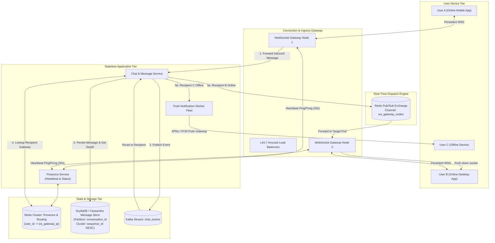
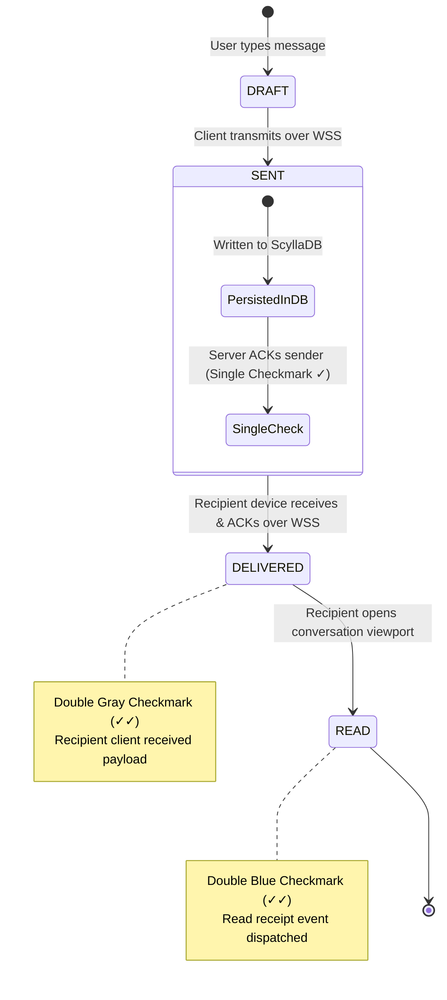
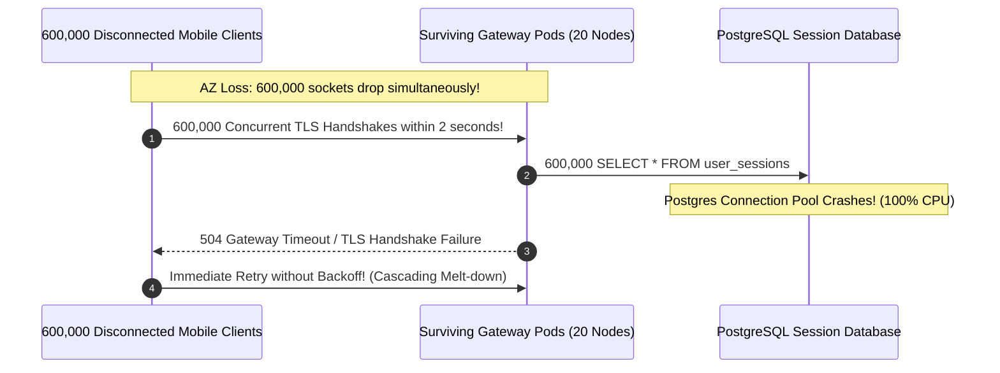

# Module 06: Designing a Chat and Notification System

> **Status:** Production Standard  
> **Difficulty:** Advanced Distributed Systems  
> **Estimated Time:** 3–4 Hours  
> **Prerequisites:** Module 00 (Capacity Estimation), Module 01 (Framework), Module 04 (Distributed Caching & Sharding), WebSockets & Real-Time Fundamentals

---

> [!TIP]
> **The Golden Rule of Real-Time Messaging Systems**  
> In real-time chat architectures, never couple message delivery directly to live socket connections without persistent storage. Always follow the **Persist-First Store-and-Forward Pattern**: synchronously persist the message to a horizontally partitioned wide-column store (e.g. ScyllaDB/Cassandra partitioned by `conversation_id`), assign a strictly monotonic per-conversation sequence ID, acknowledge receipt to the sender (`status: SENT`), and *only then* route the message through a distributed **Presence & Connection Registry (Redis Pub/Sub)**. If the recipient is disconnected, route asynchronously to third-party Mobile Push Gateways (APNs/FCM); upon reconnecting, the client catches up deterministically via incremental sequence sync: `SELECT * WHERE conversation_id = ? AND sequence_id > last_seen`.

---

## 1. Visual Mental Models

### 1.1 Complete End-to-End Chat & Notification Architecture

The architecture decouples stateful WebSocket connection servers from stateless business logic and persistent storage:



### 1.2 The Three-Phase Message Delivery State Machine

Messages traverse three distinct states, each acknowledged explicitly to power real-time receipts:



---

## 2. Technical Reference Matrices

### 2.1 Real-Time Transport Protocols Compared

| Protocol | Directionality | Connection Model | Overhead per Message | Client Battery & Mobile Suitability | Ideal Use Case |
| :--- | :--- | :--- | :--- | :--- | :--- |
| **HTTP Short Polling** | Unidirectional (Client $\to$ Server) | Ephemeral TCP/TLS per poll | High (Full HTTP header parsing $\sim 1\text{ KB}$) | Terrible (Wakes radio continuously; drains battery) | ❌ Avoid for chat systems |
| **HTTP Long Polling** | Pseudo-Bidirectional | Connection held open until data ready | High (Re-establishes connection on every message) | Moderate | Legacy fallback for restrictive corporate firewalls |
| **Server-Sent Events (SSE)** | Unidirectional (Server $\to$ Client) | Single persistent HTTP connection | Low (Minimal framing) | Good on web, limited mobile native support | One-way news feeds, stock tickers, LLM streaming |
| **WebSockets (RFC 6455)** | **Full Bidirectional** | **Single persistent TCP handshake** | **Ultra-Low ($2\text{–}10\text{ Bytes}$ framing header)** | **Excellent for continuous bidirectional streaming** | **Production Standard for 1:1 and Group Chat** |

### 2.2 Message Storage Schema Design (ScyllaDB / Cassandra CQL)

```sql
CREATE KEYSPACE chat_cluster WITH replication = {'class': 'NetworkTopologyStrategy', 'us-east': 3};

-- Partition Key: conversation_id (locates all messages for a chat on one storage node)
-- Clustering Key: sequence_id DESC (stores newest messages physically adjacent on disk)
CREATE TABLE chat_cluster.messages (
    conversation_id uuid,
    sequence_id bigint,
    message_id uuid,
    sender_id uuid,
    payload text,
    media_url text,
    created_at timestamp,
    delivery_status int, -- 1: Sent, 2: Delivered, 3: Read
    PRIMARY KEY ((conversation_id), sequence_id)
) WITH CLUSTERING ORDER BY (sequence_id DESC);
```

### 2.3 Notification Channel Priority Matrix

| Tier | Priority SLA | Channel Delivery | Retry & DLQ Behavior | Examples |
| :--- | :--- | :--- | :--- | :--- |
| **P0: Transactional / Security** | $<2\text{ seconds}$ | SMS (Twilio), Email (SendGrid), Push | Immediate retry ($3\times$), fallback to SMS if push fails | Two-factor authentication (2FA) OTP, Fraud alerts |
| **P1: Direct Social Interaction** | $<5\text{ seconds}$ | APNs (iOS), FCM (Android), WebSocket | Exponential backoff retry ($5\times$ over $5\text{ min}$) | Direct 1:1 chat message, @mentions in active thread |
| **P2: Marketing & Digest** | Best Effort ($<1\text{ hour}$) | Batch Email, In-App Notification Center | Non-blocking queue; rate-limited per user | Weekly newsletter, "Someone you might know joined" |

---

## 3. Production War Story: The 1.2 Million WebSocket Reconnection Storm

### The Incident
A premier enterprise communication platform operated 40 WebSocket gateway nodes in `us-east-1`, each maintaining 30,000 persistent user connections (1.2 million concurrent users).

During an AWS availability zone network degradation, AZ `us-east-1a` experienced a 30-second complete packet loss. 
- 20 gateway instances in that AZ were abruptly severed.
- 600,000 mobile and desktop apps simultaneously detected a socket disconnect.
- The client applications had a naive reconnection policy: `socket.onclose = () => connect()`.
- Within 1.5 seconds, all 600,000 clients hammered the remaining 20 gateway instances with TLS handshakes and initial HTTP authentication headers (`POST /v1/auth/session`).
- The TLS cryptographic termination CPU on the remaining nodes spiked to $100\%$, gateway health check probes timed out, Kubernetes declared the remaining pods unhealthy and restarted them, and the entire messaging infrastructure cascaded into a complete **Global Reconnection Storm**.



### The Post-Mortem & Fix
1. **Exponential Backoff with Full Jitter:** Client reconnection algorithms must enforce randomized exponential backoff:
$$T_{\text{sleep}} = \min(T_{\text{max}}, T_{\text{base}} \cdot 2^{\text{attempt}}) \times \text{Uniform}(0.5, 1.5)$$
2. **Session Resumption & Pre-Shared Auth Tickets:** Reconnecting clients bypass the relational authentication database entirely by passing an encrypted, self-contained **Session Ticket** verified in-memory by gateway nodes using asymmetric keys.
3. **Leaky Bucket Ingress Handshake Throttling:** Gateway reverse proxies (Envoy/NGINX) limit new TLS handshakes to a strict maximum rate (e.g. 5,000 handshakes/second per node), queuing excess reconnection requests smoothly.

---

## 4. Multi-Language Production Implementation: Real-Time Gateway & Router

Below is a complete, production-grade WebSocket Gateway and Message Router implemented in Go, TypeScript, and Python. It manages concurrent persistent WebSocket connections, tracks online status via Redis, and dispatches messages across cluster nodes via Redis Pub/Sub.

````carousel
```go
// chat_gateway.go
package main

import (
	"context"
	"encoding/json"
	"fmt"
	"log"
	"net/http"
	"os"
	"sync"
	"time"

	"github.com/gorilla/websocket"
	"github.com/redis/go-redis/v9"
)

var upgrader = websocket.Upgrader{
	CheckOrigin: func(r *http.Request) bool { return true },
}

type MessagePayload struct {
	ConversationID string `json:"conversation_id"`
	SenderID       string `json:"sender_id"`
	RecipientID    string `json:"recipient_id"`
	Content        string `json:"content"`
	Timestamp      int64  `json:"timestamp"`
}

type ClientConnection struct {
	UserID string
	Conn   *websocket.Conn
	mu     sync.Mutex
}

type GatewayServer struct {
	serverID    string
	rdb         *redis.Client
	connections sync.Map // map[string]*ClientConnection (userID -> conn)
}

func NewGatewayServer(serverID string, rdb *redis.Client) *GatewayServer {
	return &GatewayServer{
		serverID: serverID,
		rdb:      rdb,
	}
}

func (g *GatewayServer) HandleWebSocket(w http.ResponseWriter, r *http.Request) {
	userID := r.URL.Query().Get("user_id")
	if userID == "" {
		http.Error(w, "user_id required", http.StatusBadRequest)
		return
	}

	conn, err := upgrader.Upgrade(w, r, nil)
	if err != nil {
		log.Printf("Upgrade error: %v", err)
		return
	}

	client := &ClientConnection{UserID: userID, Conn: conn}
	g.connections.Store(userID, client)

	ctx := context.Background()
	// Register user presence: user_id -> server_id (TTL: 60s)
	g.rdb.Set(ctx, fmt.Sprintf("presence:%s", userID), g.serverID, 60*time.Second)

	log.Printf("User %s connected to Gateway %s", userID, g.serverID)

	defer func() {
		g.connections.Delete(userID)
		g.rdb.Del(ctx, fmt.Sprintf("presence:%s", userID))
		conn.Close()
		log.Printf("User %s disconnected", userID)
	}()

	for {
		_, rawMsg, err := conn.ReadMessage()
		if err != nil {
			break
		}

		var msg MessagePayload
		if err := json.Unmarshal(rawMsg, &msg); err != nil {
			continue
		}
		msg.Timestamp = time.Now().UnixMilli()

		// 1. Lookup recipient server
		recipientServer, err := g.rdb.Get(ctx, fmt.Sprintf("presence:%s", msg.RecipientID)).Result()
		if err == redis.Nil {
			log.Printf("Recipient %s is offline. Routing to Push Notification Worker...", msg.RecipientID)
			continue
		}

		// 2. Publish message to target server channel
		channel := fmt.Sprintf("gateway:channel:%s", recipientServer)
		outBytes, _ := json.Marshal(msg)
		g.rdb.Publish(ctx, channel, outBytes)
	}
}

// StartPubSubListener listens for messages routed to this specific gateway node
func (g *GatewayServer) StartPubSubListener(ctx context.Context) {
	channel := fmt.Sprintf("gateway:channel:%s", g.serverID)
	pubsub := g.rdb.Subscribe(ctx, channel)
	ch := pubsub.Channel()

	log.Printf("Listening for inter-gateway messages on %s...", channel)
	for raw := range ch {
		var msg MessagePayload
		json.Unmarshal([]byte(raw.Payload), &msg)

		if val, ok := g.connections.Load(msg.RecipientID); ok {
			client := val.(*ClientConnection)
			client.mu.Lock()
			client.Conn.WriteJSON(msg)
			client.mu.Unlock()
		}
	}
}

func main() {
	serverID := os.Getenv("SERVER_ID")
	if serverID == "" {
		serverID = "gateway-node-1"
	}

	rdb := redis.NewClient(&redis.Options{Addr: "localhost:6379"})
	gw := NewGatewayServer(serverID, rdb)

	ctx := context.Background()
	go gw.StartPubSubListener(ctx)

	http.HandleFunc("/ws", gw.HandleWebSocket)
	log.Printf("Chat Gateway running on :8080 (ID: %s)", serverID)
	http.ListenAndServe(":8080", nil)
}
```
<!-- slide -->
```typescript
// chat_gateway.ts
import { createServer } from 'http';
import { WebSocketServer, WebSocket } from 'ws';
import Redis from 'ioredis';
import { parse } from 'url';

const SERVER_ID = process.env.SERVER_ID || 'gateway-node-ts-1';
const redis = new Redis('localhost:6379');
const subRedis = new Redis('localhost:6379');

const server = createServer();
const wss = new WebSocketServer({ server });
const localSockets = new Map<string, WebSocket>();

interface ChatMessage {
  conversation_id: string;
  sender_id: string;
  recipient_id: string;
  content: string;
  timestamp: number;
}

wss.on('connection', async (ws: WebSocket, req) => {
  const { query } = parse(req.url || '', true);
  const userId = query.user_id as string;

  if (!userId) {
    ws.close(1008, 'user_id required');
    return;
  }

  localSockets.set(userId, ws);
  await redis.set(`presence:${userId}`, SERVER_ID, 'EX', 60);
  console.log(`[${SERVER_ID}] User ${userId} connected`);

  ws.on('message', async (data) => {
    try {
      const msg: ChatMessage = JSON.parse(data.toString());
      msg.timestamp = Date.now();

      // Check recipient presence
      const targetServer = await redis.get(`presence:${msg.recipient_id}`);
      if (!targetServer) {
        console.log(`User ${msg.recipient_id} offline. Triggering Mobile Push...`);
        return;
      }

      // Publish to recipient's assigned gateway pod
      await redis.publish(`gateway:channel:${targetServer}`, JSON.stringify(msg));
    } catch (err) {
      console.error('Invalid message format', err);
    }
  });

  ws.on('close', async () => {
    localSockets.delete(userId);
    await redis.del(`presence:${userId}`);
    console.log(`User ${userId} disconnected`);
  });
});

// Inter-Gateway PubSub Listener
subRedis.subscribe(`gateway:channel:${SERVER_ID}`);
subRedis.on('message', (_channel, payload) => {
  const msg: ChatMessage = JSON.parse(payload);
  const socket = localSockets.get(msg.recipient_id);
  if (socket && socket.readyState === WebSocket.OPEN) {
    socket.send(JSON.stringify(msg));
  }
});

server.listen(8081, () => {
  console.log(`TypeScript Chat Gateway active on port 8081 (ID: ${SERVER_ID})`);
});
```
<!-- slide -->
```python
# chat_gateway.py
import asyncio
import json
import os
from fastapi import FastAPI, WebSocket, WebSocketDisconnect
import redis.asyncio as aioredis

SERVER_ID = os.getenv("SERVER_ID", "gateway-python-1")
app = FastAPI()

rdb = aioredis.from_url("redis://localhost:6379", decode_responses=True)
sub_rdb = aioredis.from_url("redis://localhost:6379", decode_responses=True)
active_connections = {}

@app.on_event("startup")
async def start_pubsub_listener():
    asyncio.create_task(listen_for_cluster_messages())

async def listen_for_cluster_messages():
    pubsub = sub_rdb.pubsub()
    channel = f"gateway:channel:{SERVER_ID}"
    await pubsub.subscribe(channel)
    print(f"Subscribed to {channel}")
    async for message in pubsub.listen():
        if message["type"] == "message":
            data = json.loads(message["data"])
            recipient_id = data.get("recipient_id")
            if recipient_id in active_connections:
                ws = active_connections[recipient_id]
                await ws.send_text(json.dumps(data))

@app.websocket("/ws")
async def websocket_endpoint(websocket: WebSocket, user_id: str):
    await websocket.accept()
    active_connections[user_id] = websocket
    await rdb.set(f"presence:{user_id}", SERVER_ID, ex=60)
    print(f"User {user_id} registered on {SERVER_ID}")

    try:
        while True:
            text = await websocket.receive_text()
            msg = json.loads(text)
            recipient_id = msg.get("recipient_id")
            
            target_server = await rdb.get(f"presence:{recipient_id}")
            if not target_server:
                print(f"User {recipient_id} offline. Queuing Push Notification...")
                continue

            await rdb.publish(f"gateway:channel:{target_server}", json.dumps(msg))
    except WebSocketDisconnect:
        active_connections.pop(user_id, None)
        await rdb.delete(f"presence:{user_id}")
        print(f"User {user_id} disconnected")
```
````

---

## 5. Practical Hands-On Verification CLI

### 5.1 Establish WebSocket Session & Verify Inter-Node Dispatch

```powershell
# In Terminal 1: Connect as User B (Desktop)
# Using wscat or Python websockets
python -c @"
import asyncio, websockets, json
async def listen():
    async with websockets.connect('ws://localhost:8080/ws?user_id=user_b') as ws:
        print('User B connected. Waiting for messages...')
        while True:
            msg = await ws.recv()
            print(f'Received: {msg}')
asyncio.run(listen())
"@
```

```powershell
# In Terminal 2: Send message from User A
python -c @"
import asyncio, websockets, json
async def send():
    async with websockets.connect('ws://localhost:8080/ws?user_id=user_a') as ws:
        payload = {
            'conversation_id': 'conv_101',
            'sender_id': 'user_a',
            'recipient_id': 'user_b',
            'content': 'Hello from User A!'
        }
        await ws.send(json.dumps(payload))
        print('Message transmitted!')
asyncio.run(send())
"@
```

**Expected Terminal 1 Output:**
```text
User B connected. Waiting for messages...
Received: {"conversation_id":"conv_101","sender_id":"user_a","recipient_id":"user_b","content":"Hello from User A!","timestamp":1715000089100}
```

---

## 6. Operational Validation Checkpoints

<details>
<summary><strong>Checkpoint 1: Why should chat message history be partitioned by conversation_id rather than user_id?</strong></summary>

> **Root Cause Analysis:**  
> In chat applications, $>99\%$ of history reads are: *"Fetch the last 50 messages of this specific conversation."*  
> If messages were partitioned by `user_id`:
> - A 1:1 conversation between User A and User B would store A's messages on Shard 1 and B's messages on Shard 2.
> - Loading the chat view would require a distributed cross-shard scatter-gather query.
> - By partitioning by `(conversation_id)` with clustering key `(sequence_id DESC)`, all messages for that thread reside contiguously on the exact same storage node. Reading the latest 50 messages translates to an ultra-fast local sequential disk scan.
</details>

<details>
<summary><strong>Checkpoint 2: Why are global wall-clock timestamps (time.Now()) unreliable for message ordering in chat?</strong></summary>

> **Root Cause Analysis:**  
> Physical server clocks experience **Clock Drift** and NTP synchronization jumps (up to tens or hundreds of milliseconds).  
> If User A sends a message at Server 1 (clock skewed $-50\text{ ms}$) and User B replies at Server 2 (clock skewed $+50\text{ ms}$), physical timestamps can make the reply appear *before* the original question in the conversation viewport.  
> 
> **Production Fix:**  
> Use a per-conversation integer sequence counter or **Snowflake IDs** (41-bit timestamp + 10-bit machine ID + 12-bit per-millisecond sequence counter) with server-side tiebreaking, ensuring deterministic total order within the conversation.
</details>

<details>
<summary><strong>Checkpoint 3: How does a chat system handle message delivery to a large group channel with 100,000 members?</strong></summary>

> **Root Cause Analysis:**  
> Naive per-recipient fan-out would require 100,000 individual network writes for a single message.  
> **Hierarchical Gateway Fan-Out:**  
> 1. When a message is sent to `@large-channel`, the backend identifies which *gateway servers* hold at least one active channel member (typically 20–50 nodes across the cluster).
> 2. The backend publishes the message **once per gateway server** over Redis Pub/Sub or Kafka (`channel_id`).
> 3. Each gateway server receives the single message broadcast and writes it down the sockets of its locally connected members in memory. This collapses 100,000 cross-cluster network hops into 50, avoiding network switch saturation.
</details>

---

## 7. Curriculum Navigation

- [← Back to Module 05: Designing a News Feed or Social Timeline](../05-designing-a-news-feed-or-social-timeline/README.md)
- [Back to System Design Track Overview](../README.md)
- [Proceed to Module 07: Designing a Video Streaming or Search System](../07-designing-a-video-streaming-or-large-scale-search-system/README.md)
