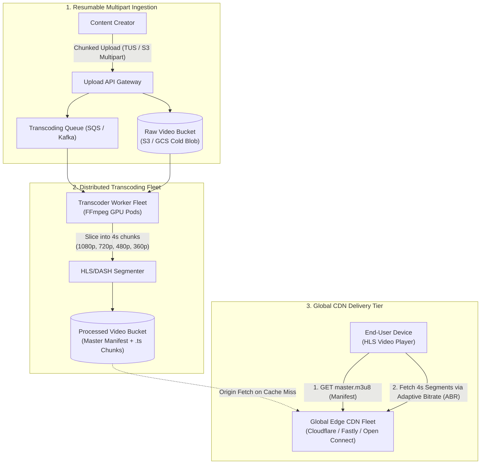
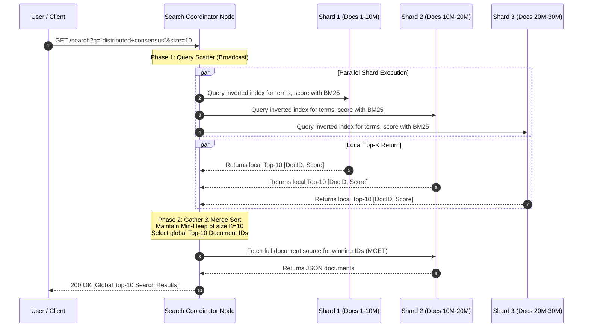
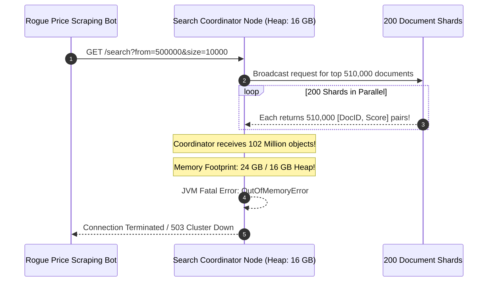

# Module 07: Designing a Video Streaming or Large-Scale Search System

> **Status:** Production Standard  
> **Difficulty:** Advanced Distributed Systems  
> **Estimated Time:** 3–4 Hours  
> **Prerequisites:** Module 00 (Capacity Estimation), Module 01 (System Design Interview Framework), Blob Storage & Inverted Index Fundamentals

---

> [!TIP]
> **The Golden Rule of Media Streaming & Distributed Search**  
> Never stream high-bandwidth binary payloads or execute full-text scans from monolithic database origins. For video architectures, decouple ingestion from playback via **Asynchronous Transcoding Pipelines** that slice video into $2\text{–}6\text{ second}$ chunks across multiple bitrates (HLS/DASH) and offload $>95\%$ of egress directly to **Tier-1 Edge CDNs**. For search architectures, decouple write ingestion from query evaluation using an **Inverted Index partitioned by Document ID**, executing searches via a **Two-Phase Scatter-Gather Coordinator** with local **BM25 scoring** and bounded Top-$K$ min-heap aggregation. Always defend deep pagination against memory exhaustion using cursor-based `search_after` rather than offset skipping.

---

## 1. Visual Mental Models

### 1.1 Video Streaming Pipeline: Ingestion to Edge CDN Playback

Video systems decouple heavy asynchronous encoding from high-bandwidth edge delivery:



### 1.2 Distributed Full-Text Search: Two-Phase Scatter-Gather

To search billions of documents in under $50\text{ ms}$, queries are broadcast across partitioned shards and merged centrally:



---

## 2. Technical Reference Matrices

### 2.1 Video Streaming Transport Protocols Compared

| Protocol | Transport | Latency | Segment Size | Adaptive Bitrate (ABR) Support | Ideal Application |
| :--- | :--- | :--- | :--- | :--- | :--- |
| **HLS (HTTP Live Streaming)** | Standard HTTP (TCP) | $2\text{–}6\text{ seconds}$ | $2\text{–}6\text{ seconds}$ | Native (Master `.m3u8` playlist) | **Universal VoD & Live Broadcast (iOS/Web/Android)** |
| **MPEG-DASH** | Standard HTTP (TCP) | $2\text{–}6\text{ seconds}$ | $2\text{–}6\text{ seconds}$ | Native (`.mpd` XML manifest) | International Open Standard (YouTube, Netflix) |
| **LL-HLS / Low-Latency DASH** | HTTP/2 or HTTP/3 | $1\text{–}2\text{ seconds}$ | Byte-Range Partial Segments | Native | Interactive sports streaming, live auctions |
| **WebRTC** | UDP (SRTP / SCTP) | $<500\text{ ms}$ | Continuous media frames | Dynamic codec bit-rate adjustment | Video conferencing (Zoom, Google Meet), Cloud Gaming |

### 2.2 Search Index Partitioning: Document vs Term Sharding

| Strategy | Sharding Mechanism | Query Execution Path | Re-indexing & Ingestion Overhead | Production Verdict |
| :--- | :--- | :--- | :--- | :--- |
| **Term Partitioning (Global Index)** | Shards own specific dictionary terms (e.g., Shard A owns `a-c`, Shard B owns `d-f`) | Query routes to few shards, but multi-term query requires inter-shard joins | Extremely high; inserting 1 document requires writes across multiple shards | ❌ Complex distributed transactions; rarely used |
| **Document Partitioning (Local Index)** | Shards own a subset of complete documents (`doc_id % N`); maintains local inverted index | **Scatter-Gather:** Broadcast query to all shards; merge local Top-$K$ | Minimal; document inserted atomically onto a single shard | **Universal Standard (Elasticsearch, Lucene, Solr)** |

---

## 3. Production War Story: The Deep Scatter-Gather Coordinator Collapse

### The Incident
An enterprise e-commerce search cluster indexed 200 million products across 200 Elasticsearch shards. 

A rogue price-scraping bot submitted automated requests attempting to harvest the entire product catalog via deep pagination:
```http
GET /search?q=*&size=10000&from=500000
```
- The Search Coordinator broadcast the request to all 200 shards.
- To fulfill `from=500000` with `size=10000`, each of the 200 individual shards had to:
  1. Retrieve its local top $510,000$ documents from the inverted index.
  2. Score and sort all $510,000$ candidate records in memory.
  3. Transmit all $510,000$ `[DocID, Score]` pairs across the network back to the single coordinator node.
- **The Consequence:** The coordinator received $200 \times 510,000 = 102,000,000$ records over the datacenter network. The JVM heap garbage collector froze for 45 seconds trying to build a 100-million-element priority queue, triggering an unrecoverable `OutOfMemoryError: Java heap space`. The coordinator pod crashed, and the scrape script triggered cascading failovers that took down the entire customer-facing search cluster for 38 minutes.



### The Post-Mortem & Fix
1. **Hard Upper Bound on Offset (`max_result_window`):** Enforce a strict maximum limit on `from + size` (e.g. 10,000). Any request exceeding 10,000 is rejected with `400 Bad Request`.
2. **Mandate Cursor-Based Pagination (`search_after`):** Deep pagination must pass the sorting tiebreaker value of the last visible document from the previous page:
   ```json
   {
     "search_after": [1715000000000, "prod_981a"],
     "size": 20
   }
   ```
   Each shard uses binary search to jump directly to the target score threshold in the postings list, evaluating only 20 records instead of 500,000. Coordinator memory usage drops by $99.99\%$.

---

## 4. Multi-Language Production Implementation: Inverted Index Engine

Below is a complete, production-grade Inverted Index search engine implemented in Go, TypeScript, and Python. It tokenizes text, builds an inverted index, computes term frequency-inverse document frequency (**BM25 scoring**), and returns Top-$K$ ranked documents.

````carousel
```go
// search_engine.go
package main

import (
	"fmt"
	"math"
	"sort"
	"strings"
	"unicode"
)

type Document struct {
	ID    int    `json:"id"`
	Title string `json:"title"`
	Body  string `json:"body"`
}

type SearchResult struct {
	DocID int
	Score float64
	Title string
}

type InvertedIndexEngine struct {
	docs        map[int]Document
	postings    map[string][]int   // term -> list of docIDs
	docLengths  map[int]int        // docID -> word count
	avgDocLen   float64
	k1          float64            // BM25 term frequency saturation (default 1.2)
	b           float64            // BM25 length normalization (default 0.75)
}

func NewInvertedIndexEngine() *InvertedIndexEngine {
	return &InvertedIndexEngine{
		docs:       make(map[int]Document),
		postings:   make(map[string][]int),
		docLengths: make(map[int]int),
		k1:         1.2,
		b:          0.75,
	}
}

func (idx *InvertedIndexEngine) tokenize(text string) []string {
	f := func(c rune) bool {
		return !unicode.IsLetter(c) && !unicode.IsNumber(c)
	}
	words := strings.FieldsFunc(strings.ToLower(text), f)
	return words
}

func (idx *InvertedIndexEngine) IndexDocument(doc Document) {
	idx.docs[doc.ID] = doc
	tokens := idx.tokenize(doc.Title + " " + doc.Body)
	idx.docLengths[doc.ID] = len(tokens)

	termFrequency := make(map[string]bool)
	for _, t := range tokens {
		if !termFrequency[t] {
			idx.postings[t] = append(idx.postings[t], doc.ID)
			termFrequency[t] = true
		}
	}

	// Update average document length
	totalWords := 0
	for _, l := range idx.docLengths {
		totalWords += l
	}
	idx.avgDocLen = float64(totalWords) / float64(len(idx.docs))
}

func (idx *InvertedIndexEngine) Search(query string, topK int) []SearchResult {
	queryTokens := idx.tokenize(query)
	scores := make(map[int]float64)
	totalDocs := float64(len(idx.docs))

	for _, token := range queryTokens {
		postingsList, exists := idx.postings[token]
		if !exists {
			continue
		}

		// Compute Inverse Document Frequency (IDF)
		df := float64(len(postingsList))
		idf := math.Log((totalDocs-df+0.5)/(df+0.5) + 1.0)

		for _, docID := range postingsList {
			docTokens := idx.tokenize(idx.docs[docID].Title + " " + idx.docs[docID].Body)
			tf := 0
			for _, dt := range docTokens {
				if dt == token {
					tf++
				}
			}

			// BM25 Scoring Formula
			docLen := float64(idx.docLengths[docID])
			numerator := float64(tf) * (idx.k1 + 1.0)
			denominator := float64(tf) + idx.k1*(1.0-idx.b+idx.b*(docLen/idx.avgDocLen))
			scores[docID] += idf * (numerator / denominator)
		}
	}

	results := make([]SearchResult, 0, len(scores))
	for docID, score := range scores {
		results = append(results, SearchResult{
			DocID: docID,
			Score: score,
			Title: idx.docs[docID].Title,
		})
	}

	// Sort descending by score
	sort.Slice(results, func(i, j int) bool {
		return results[i].Score > results[j].Score
	})

	if len(results) > topK {
		return results[:topK]
	}
	return results
}

func main() {
	engine := NewInvertedIndexEngine()

	engine.IndexDocument(Document{
		ID:    1,
		Title: "Distributed Systems Architecture",
		Body:  "Designing scalable distributed systems with consensus, replication, and sharding.",
	})
	engine.IndexDocument(Document{
		ID:    2,
		Title: "Video Streaming at Scale",
		Body:  "Adaptive bitrate streaming with HLS, master playlist manifests, and global CDN caching.",
	})
	engine.IndexDocument(Document{
		ID:    3,
		Title: "Search Engine Fundamentals",
		Body:  "Inverted indexes, postings lists, and BM25 relevance scoring algorithms.",
	})

	query := "distributed streaming"
	results := engine.Search(query, 5)

	fmt.Printf("Top Results for Query: '%s'\n", query)
	for i, res := range results {
		fmt.Printf("%d. [Doc %d] Score: %.4f | Title: %s\n", i+1, res.DocID, res.Score, res.Title)
	}
}
```
<!-- slide -->
```typescript
// search_engine.ts
interface Document {
  id: number;
  title: string;
  body: string;
}

interface SearchResult {
  docId: number;
  score: number;
  title: string;
}

export class SearchEngine {
  private docs = new Map<number, Document>();
  private postings = new Map<string, number[]>();
  private docLengths = new Map<number, number>();
  private avgDocLen = 0;
  private readonly k1 = 1.2;
  private readonly b = 0.75;

  private tokenize(text: string): string[] {
    return text.toLowerCase().match(/\b[a-z0-9]+\b/g) || [];
  }

  public indexDocument(doc: Document): void {
    this.docs.set(doc.id, doc);
    const tokens = this.tokenize(`${doc.title} ${doc.body}`);
    this.docLengths.set(doc.id, tokens.length);

    const uniqueTokens = new Set(tokens);
    for (const token of uniqueTokens) {
      if (!this.postings.has(token)) {
        this.postings.set(token, []);
      }
      this.postings.get(token)!.push(doc.id);
    }

    let totalWords = 0;
    this.docLengths.forEach((len) => (totalWords += len));
    this.avgDocLen = totalWords / this.docs.size;
  }

  public search(query: string, topK = 10): SearchResult[] {
    const queryTokens = this.tokenize(query);
    const scores = new Map<number, number>();
    const totalDocs = this.docs.size;

    for (const token of queryTokens) {
      const postingsList = this.postings.get(token);
      if (!postingsList) continue;

      const df = postingsList.length;
      const idf = Math.log((totalDocs - df + 0.5) / (df + 0.5) + 1.0);

      for (const docId of postingsList) {
        const doc = this.docs.get(docId)!;
        const docTokens = this.tokenize(`${doc.title} ${doc.body}`);
        const tf = docTokens.filter((t) => t === token).length;

        const docLen = this.docLengths.get(docId)!;
        const num = tf * (this.k1 + 1.0);
        const denom = tf + this.k1 * (1.0 - this.b + this.b * (docLen / this.avgDocLen));
        const bm25Score = idf * (num / denom);

        scores.set(docId, (scores.get(docId) || 0) + bm25Score);
      }
    }

    const results: SearchResult[] = [];
    scores.forEach((score, docId) => {
      results.push({ docId, score, title: this.docs.get(docId)!.title });
    });

    results.sort((a, b) => b.score - a.score);
    return results.slice(0, topK);
  }
}

const engine = new SearchEngine();
engine.indexDocument({ id: 1, title: 'Kafka Streaming', body: 'Kafka event streaming and outbox pattern' });
engine.indexDocument({ id: 2, title: 'Video HLS Transcoding', body: 'Adaptive bitrate chunked video delivery' });
console.log(engine.search('streaming video'));
```
<!-- slide -->
```python
# search_engine.py
import math
import re
from typing import List, Dict, Set

class SearchEngine:
    def __init__(self, k1: float = 1.2, b: float = 0.75):
        self.k1 = k1
        self.b = b
        self.docs: Dict[int, Dict[str, str]] = {}
        self.postings: Dict[str, List[int]] = {}
        self.doc_lengths: Dict[int, int] = {}
        self.avg_doc_len: float = 0.0

    def tokenize(self, text: str) -> List[str]:
        return re.findall(r"\b[a-z0-9]+\b", text.lower())

    def index_document(self, doc_id: int, title: str, body: str) -> None:
        self.docs[doc_id] = {"title": title, "body": body}
        tokens = self.tokenize(f"{title} {body}")
        self.doc_lengths[doc_id] = len(tokens)

        unique_tokens: Set[str] = set(tokens)
        for t in unique_tokens:
            self.postings.setdefault(t, []).append(doc_id)

        self.avg_doc_len = sum(self.doc_lengths.values()) / len(self.docs)

    def search(self, query: str, top_k: int = 5) -> List[Dict]:
        query_tokens = self.tokenize(query)
        scores: Dict[int, float] = {}
        total_docs = len(self.docs)

        for token in query_tokens:
            if token not in self.postings:
                continue

            postings_list = self.postings[token]
            df = len(postings_list)
            # Standard Lucene/BM25 IDF calculation
            idf = math.log((total_docs - df + 0.5) / (df + 0.5) + 1.0)

            for doc_id in postings_list:
                doc = self.docs[doc_id]
                doc_tokens = self.tokenize(f"{doc['title']} {doc['body']}")
                tf = doc_tokens.count(token)

                doc_len = self.doc_lengths[doc_id]
                numerator = tf * (self.k1 + 1.0)
                denominator = tf + self.k1 * (1.0 - self.b + self.b * (doc_len / self.avg_doc_len))
                bm25 = idf * (numerator / denominator)

                scores[doc_id] = scores.get(doc_id, 0.0) + bm25

        ranked = [
            {"doc_id": doc_id, "score": round(score, 4), "title": self.docs[doc_id]["title"]}
            for doc_id, score in scores.items()
        ]
        ranked.sort(key=lambda x: x["score"], reverse=True)
        return ranked[:top_k]

if __name__ == "__main__":
    engine = SearchEngine()
    engine.index_document(1, "Postgres Indexes", "B-Tree indexes speed up equality and range queries.")
    engine.index_document(2, "Elasticsearch Shards", "Inverted indexes allow fast full-text searching across shards.")
    engine.index_document(3, "Kafka Streaming", "Real-time streaming pipeline using Kafka partition logs.")

    results = engine.search("elasticsearch indexes")
    for r in results:
        print(f"Doc {r['doc_id']} (Score: {r['score']}): {r['title']}")
```
````

---

## 5. Practical Hands-On Verification CLI

### 5.1 Inspect HLS Adaptive Bitrate Manifest (`master.m3u8`)

Verify that the transcoding pipeline produces valid multi-bitrate streams:

```powershell
# Fetch HLS Master Playlist Manifest from edge CDN
curl.exe -s http://localhost:8000/videos/vid_981/master.m3u8
```

**Expected Manifest Structure:**
```text
#EXTM3U
#EXT-X-VERSION:3
#EXT-X-STREAM-INF:BANDWIDTH=5000000,RESOLUTION=1920x1080
1080p/index.m3u8
#EXT-X-STREAM-INF:BANDWIDTH=2500000,RESOLUTION=1280x720
720p/index.m3u8
#EXT-X-STREAM-INF:BANDWIDTH=800000,RESOLUTION=640x360
360p/index.m3u8
```

---

## 6. Operational Validation Checkpoints

<details>
<summary><strong>Checkpoint 1: Why does Adaptive Bitrate (ABR) slice videos into small 2s–6s chunks rather than serving one large mp4 file?</strong></summary>

> **Root Cause Analysis:**  
> 1. **Dynamic Network Adaptation:** Client cellular bandwidth fluctuates continuously (e.g. entering a tunnel). With 4-second chunks, the player downloads segment 1 at 1080p, senses a bandwidth drop, and seamlessly requests segment 2 at 480p without rebuffering.  
> 2. **Fast Startup Latency:** The client only needs to download the first 2-second chunk to begin playback immediately ($<500\text{ ms}$ startup).  
> 3. **CDN Cache Efficiency:** Segment files (`segment_001.ts`) are static, immutable binary blobs cached aggressively across edge CDN proxies with `max-age=31536000` (1 year).
</details>

<details>
<summary><strong>Checkpoint 2: Why do production search clusters partition by Document ID rather than by Dictionary Term?</strong></summary>

> **Root Cause Analysis:**  
> - **Term Partitioning:** Shards own terms (`a-f`, `g-m`). When a document is indexed, its terms must be split across 50 shards via distributed 2-Phase Commit (2PC) transactions, causing write locks and operational brittleness.  
> - **Document Partitioning:** Each shard is a self-contained search engine (Lucene index) that owns a subset of complete documents. Writing a document touches exactly **one shard** with zero network coordination. Although queries must be broadcast to all shards (Scatter-Gather), reads are trivially parallelizable across CPU cores, and shards can be added or removed independently.
</details>

<details>
<summary><strong>Checkpoint 3: How does cursor-based search_after prevent OutOfMemory errors in deep search pagination?</strong></summary>

> **Root Cause Analysis:**  
> Using traditional `from=100000&size=20`, each shard must find and rank $100,020$ records, serializing millions of results across the network to the coordinator.  
> With `search_after: [last_score, last_doc_id]`:
> Shards utilize their internal sorted DocValues or B-Tree indexes to seek directly to the offset matching `(score < last_score)`. Each shard computes and returns **only the exact 20 records immediately following the cursor**. Coordinator memory stays constant at $O(\text{Size} \times \text{Shards})$ rather than $O(\text{From} \times \text{Shards})$, eliminating coordinator heap spikes.
</details>

---

## 7. Curriculum Navigation

- [← Back to Module 06: Designing a Chat and Notification System](../06-designing-a-chat-and-notification-system/README.md)
- [Back to System Design Track Overview](../README.md)
- [Proceed to Module 08: Capstone Project — Distributed Sliding Window Rate Limiter](../08-capstone-project/README.md)
