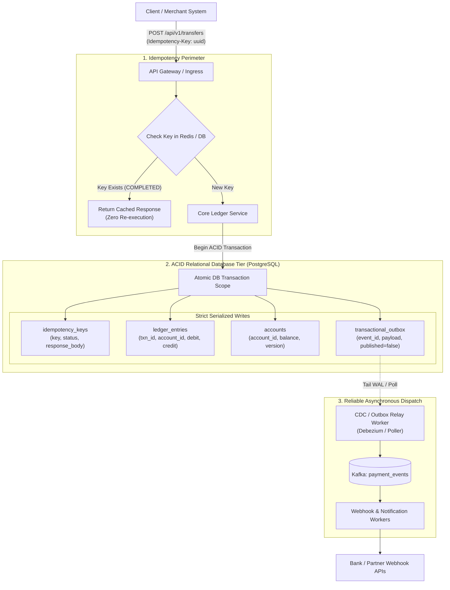
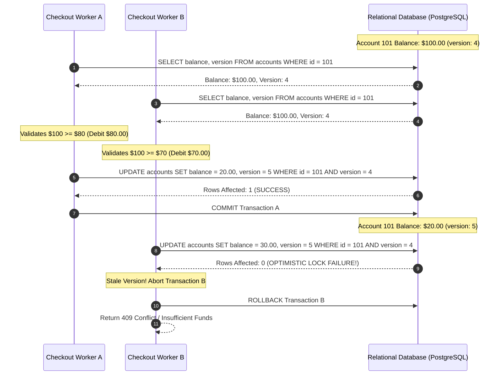
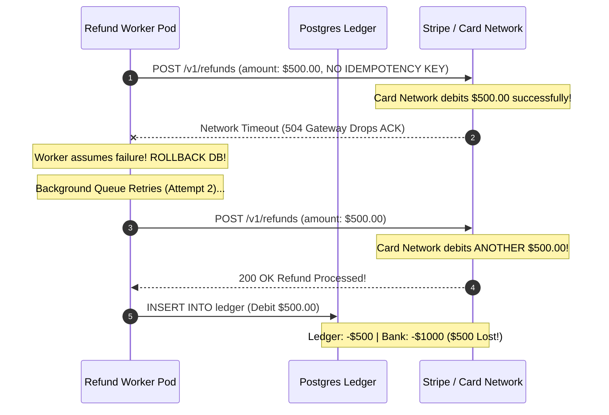

# Module 08: Capstone Project — Production Financial Ledger & Payment Processing System

> **Status:** Production Capstone  
> **Difficulty:** Advanced Distributed Systems & Concurrency  
> **Estimated Time:** 4–6 Hours  
> **Prerequisites:** All prior modules (00 through 07), Distributed Transactions, Idempotency, and ACID Concurrency Controls

---

> [!TIP]
> **The Golden Rule of Financial Ledger Systems**  
> In financial accounting systems, throughput is secondary to mathematical correctness. Never represent balances as bare mutable numbers in a database (`UPDATE accounts SET balance = balance - 100`). Money must never be created or destroyed out of thin air. Every financial transaction must be recorded as an **Immutable Double-Entry Ledger Transaction** consisting of paired entries ($\sum \text{Debits} + \sum \text{Credits} = 0$) executed within strict database ACID isolation. Guard every write at the perimeter with an **Idempotency Key Gate**, serialize balance mutations via **Optimistic Locking (`version` column)** or **Pessimistic Row Locks (`SELECT FOR UPDATE`)**, and publish downstream side effects exclusively through the **Transactional Outbox Pattern**.

---

## 1. Visual Mental Models

### 1.1 Complete Financial Ledger & Outbox Architecture

The system decouples synchronous money movement from downstream notifications and partner webhooks using the Transactional Outbox pattern:



### 1.2 Concurrent Double-Spend Prevention Sequence

Two concurrent checkout threads attempt to drain the same account simultaneously; optimistic locking ensures only one succeeds while the second fails gracefully:



---

## 2. Technical Reference Matrices

### 2.1 Double-Entry Accounting Invariant Matrix

Every financial movement requires two balanced legs. Debits increase asset/expense accounts; credits increase liability/equity accounts:

| Transaction Type | Debit Leg (Destination / Inflow) | Credit Leg (Source / Outflow) | Net Balance Equation ($\sum \text{Debits} - \sum \text{Credits}$) |
| :--- | :--- | :--- | :--- |
| **Merchant Payment** | **Cash Account (Asset)**: $+\$100.00$ | **User Wallet (Liability)**: $-\$100.00$ | $\$100.00 - \$100.00 = 0.00$ |
| **Customer Refund** | **User Wallet (Liability)**: $+\$50.00$ | **Cash Account (Asset)**: $-\$50.00$ | $\$50.00 - \$50.00 = 0.00$ |
| **Platform Fee Deduction**| **Fee Revenue (Equity)**: $+\$2.50$ | **Merchant Wallet (Liability)**: $-\$2.50$ | $\$2.50 - \$2.50 = 0.00$ |

### 2.2 Concurrency Control Strategies Compared

| Strategy | Mechanism | Throughput | Lock Contention Behavior | Best Applied To |
| :--- | :--- | :--- | :--- | :--- |
| **Pessimistic Locking (`SELECT FOR UPDATE`)** | Acquires exclusive row lock in database engine during read | Moderate ($\sim 2,000\text{ writes/s}$) | Concurrent threads block until transaction commits or times out | High-contention corporate merchant accounts with high velocity |
| **Optimistic Concurrency Control (OCC)** | Verifies version counter on write (`WHERE version = ?`) | High under low contention | Immediate failure on conflict; client retries | Consumer retail accounts with low concurrent write overlap |
| **Partition-Pinned Actor / In-Memory Queue** | Single-threaded memory pipeline pinned to account ID (TigerBeetle / LMAX) | Ultra-High ($100,000+\text{ writes/s}$) | Zero database lock contention; serialized in CPU memory | Planetary exchange order books, high-frequency clearinghouses |

---

## 3. Production War Story: The \$1.4M Duplicate Refund Storm

### The Incident
A fast-growing fintech company implemented an automated merchant chargeback refund service. 

When a user requested a $\$500.00$ refund:
1. The service initiated an external HTTP call to the credit card payment network (Stripe / Adyen).
2. The payment network processed the refund, but a transient network timeout ($504\text{ Gateway Timeout}$) severed the connection after 15 seconds.
3. The application caught the network timeout exception, assumed the charge had failed, and aborted its local database transaction.
4. The background retry queue automatically rescheduled the refund task and fired it 3 additional times.
5. **The Disaster:** Because the external API call was made *outside* an idempotent envelope and *before* committing local database state, the external card network processed all 4 refund requests, crediting the customer $\$2,000.00$ while debiting the merchant only once. Over a bank holiday weekend, 2,800 automated retries drained **\$1.4 Million** in unreconciled overpayments before an engineer spotted the anomaly.



### The Post-Mortem & Fix
1. **Pass Deterministic Idempotency Keys Upstream:** Every external call must propagate the system's internal transaction UUID as an `Idempotency-Key` header (`Idempotency-Key: ref_uuid_9812`). Subsequent retries are deduplicated by the card gateway's edge.
2. **Transactional Outbox for External Calls:** Never invoke external HTTP endpoints synchronously inside a database transaction. Write a pending event to the `transactional_outbox` table in the database; a dedicated outbox worker processes the event and guarantees at-least-once delivery with idempotent external calls.

---

## 4. Multi-Language Production Implementation: Double-Entry Ledger Engine

Below is a complete, production-grade Double-Entry Ledger and Idempotent Transfer Engine implemented in Go, TypeScript, and Python. It validates inputs, guards against duplicate idempotency keys, executes an atomic balanced ledger entry ($\sum = 0$), updates balances with optimistic locking, and writes an outbox record within a single SQL transaction.

````carousel
```go
// ledger_engine.go
package main

import (
	"context"
	"database/sql"
	"errors"
	"fmt"
	"log"
	"time"

	"github.com/google/uuid"
	_ "github.com/lib/pq"
)

type TransferRequest struct {
	IdempotencyKey string  `json:"idempotency_key"`
	SourceAccount  string  `json:"source_account"`
	TargetAccount  string  `json:"target_account"`
	AmountCents    int64   `json:"amount_cents"`
}

type LedgerEngine struct {
	db *sql.DB
}

func NewLedgerEngine(db *sql.DB) *LedgerEngine {
	return &LedgerEngine{db: db}
}

func (le *LedgerEngine) ExecuteTransfer(ctx context.Context, req TransferRequest) (string, error) {
	if req.AmountCents <= 0 {
		return "", errors.New("amount must be greater than zero")
	}

	tx, err := le.db.BeginTx(ctx, &sql.TxOptions{Isolation: sql.LevelReadCommitted})
	if err != nil {
		return "", err
	}
	defer tx.Rollback()

	// 1. Idempotency Check: Reserve Key
	var existingStatus string
	var existingResponse string
	err = tx.QueryRowContext(ctx, `
		SELECT status, response_body FROM idempotency_keys WHERE idempotency_key = $1 FOR UPDATE
	`, req.IdempotencyKey).Scan(&existingStatus, &existingResponse)

	if err == nil {
		// Key already processed! Return original response
		return existingResponse, nil
	} else if err != sql.ErrNoRows {
		return "", err
	}

	// Insert initial PENDING idempotency record
	_, err = tx.ExecContext(ctx, `
		INSERT INTO idempotency_keys (idempotency_key, status, created_at)
		VALUES ($1, 'PENDING', $2)
	`, req.IdempotencyKey, time.Now())
	if err != nil {
		return "", err
	}

	// 2. Fetch Source Account & Lock Row
	var sourceBalance int64
	var sourceVersion int64
	err = tx.QueryRowContext(ctx, `
		SELECT balance_cents, version FROM accounts WHERE account_id = $1 FOR UPDATE
	`, req.SourceAccount).Scan(&sourceBalance, &sourceVersion)
	if err != nil {
		return "", fmt.Errorf("source account not found: %w", err)
	}

	if sourceBalance < req.AmountCents {
		return "", errors.New("insufficient funds")
	}

	// 3. Update Balances
	_, err = tx.ExecContext(ctx, `
		UPDATE accounts SET balance_cents = balance_cents - $1, version = version + 1 WHERE account_id = $2
	`, req.AmountCents, req.SourceAccount)
	if err != nil {
		return "", err
	}

	_, err = tx.ExecContext(ctx, `
		UPDATE accounts SET balance_cents = balance_cents + $1, version = version + 1 WHERE account_id = $2
	`, req.AmountCents, req.TargetAccount)
	if err != nil {
		return "", err
	}

	// 4. Insert Paired Double-Entry Ledger Records (Debit + Credit sum to 0)
	txnID := uuid.New().String()
	now := time.Now()

	// Debit Source Account
	_, err = tx.ExecContext(ctx, `
		INSERT INTO ledger_entries (transaction_id, account_id, amount_cents, entry_type, created_at)
		VALUES ($1, $2, $3, 'DEBIT', $4)
	`, txnID, req.SourceAccount, -req.AmountCents, now)
	if err != nil {
		return "", err
	}

	// Credit Target Account
	_, err = tx.ExecContext(ctx, `
		INSERT INTO ledger_entries (transaction_id, account_id, amount_cents, entry_type, created_at)
		VALUES ($1, $2, $3, 'CREDIT', $4)
	`, txnID, req.TargetAccount, req.AmountCents, now)
	if err != nil {
		return "", err
	}

	// 5. Transactional Outbox Event for downstream async dispatch
	outboxPayload := fmt.Sprintf(`{"transaction_id":"%s","amount":%d}`, txnID, req.AmountCents)
	_, err = tx.ExecContext(ctx, `
		INSERT INTO transactional_outbox (event_id, event_type, payload, created_at)
		VALUES ($1, 'TRANSFER_COMPLETED', $2, $3)
	`, uuid.New().String(), outboxPayload, now)
	if err != nil {
		return "", err
	}

	// 6. Mark Idempotency as COMPLETED
	_, err = tx.ExecContext(ctx, `
		UPDATE idempotency_keys SET status = 'COMPLETED', response_body = $1 WHERE idempotency_key = $2
	`, txnID, req.IdempotencyKey)
	if err != nil {
		return "", err
	}

	if err := tx.Commit(); err != nil {
		return "", err
	}

	return txnID, nil
}

func main() {
	log.Println("Double-Entry Ledger Engine initialized.")
}
```
<!-- slide -->
```typescript
// ledger_engine.ts
import { Pool, PoolClient } from 'pg';
import { randomUUID } from 'crypto';

interface TransferRequest {
  idempotency_key: string;
  source_account: string;
  target_account: string;
  amount_cents: number;
}

export class LedgerEngine {
  constructor(private pool: Pool) {}

  public async executeTransfer(req: TransferRequest): Promise<string> {
    if (req.amount_cents <= 0) {
      throw new Error('Amount must be positive');
    }

    const client: PoolClient = await this.pool.connect();
    try {
      await client.query('BEGIN');

      // 1. Idempotency Check
      const existing = await client.query(
        'SELECT status, response_body FROM idempotency_keys WHERE idempotency_key = $1 FOR UPDATE',
        [req.idempotency_key]
      );

      if (existing.rows.length > 0) {
        await client.query('ROLLBACK');
        return existing.rows[0].response_body;
      }

      await client.query(
        'INSERT INTO idempotency_keys (idempotency_key, status, created_at) VALUES ($1, $2, NOW())',
        [req.idempotency_key, 'PENDING']
      );

      // 2. Lock Source Account & Verify Balance
      const srcRes = await client.query(
        'SELECT balance_cents FROM accounts WHERE account_id = $1 FOR UPDATE',
        [req.source_account]
      );
      if (srcRes.rows.length === 0) throw new Error('Source account not found');
      if (srcRes.rows[0].balance_cents < req.amount_cents) {
        throw new Error('Insufficient funds');
      }

      // 3. Mutate Account Balances
      await client.query(
        'UPDATE accounts SET balance_cents = balance_cents - $1 WHERE account_id = $2',
        [req.amount_cents, req.source_account]
      );
      await client.query(
        'UPDATE accounts SET balance_cents = balance_cents + $1 WHERE account_id = $2',
        [req.amount_cents, req.target_account]
      );

      // 4. Double-Entry Balanced Ledger Entries
      const txnId = randomUUID();
      await client.query(
        'INSERT INTO ledger_entries (transaction_id, account_id, amount_cents, entry_type) VALUES ($1, $2, $3, $4)',
        [txnId, req.source_account, -req.amount_cents, 'DEBIT']
      );
      await client.query(
        'INSERT INTO ledger_entries (transaction_id, account_id, amount_cents, entry_type) VALUES ($1, $2, $3, $4)',
        [txnId, req.target_account, req.amount_cents, 'CREDIT']
      );

      // 5. Transactional Outbox
      await client.query(
        'INSERT INTO transactional_outbox (event_id, event_type, payload) VALUES ($1, $2, $3)',
        [randomUUID(), 'TRANSFER_COMPLETED', JSON.stringify({ txnId, amount: req.amount_cents })]
      );

      // 6. Complete Idempotency
      await client.query(
        'UPDATE idempotency_keys SET status = $1, response_body = $2 WHERE idempotency_key = $3',
        ['COMPLETED', txnId, req.idempotency_key]
      );

      await client.query('COMMIT');
      return txnId;
    } catch (err) {
      await client.query('ROLLBACK');
      throw err;
    } finally {
      client.release();
    }
  }
}
```
<!-- slide -->
```python
# ledger_engine.py
import uuid
from typing import Dict, Any
from psycopg2.extensions import connection

class LedgerEngine:
    def __init__(self, db_conn: connection):
        self.conn = db_conn

    def execute_transfer(self, req: Dict[str, Any]) -> str:
        amount = req["amount_cents"]
        if amount <= 0:
            raise ValueError("Transfer amount must be strictly positive")

        with self.conn:
            with self.conn.cursor() as cur:
                # 1. Idempotency Check
                cur.execute(
                    "SELECT status, response_body FROM idempotency_keys WHERE idempotency_key = %s FOR UPDATE",
                    (req["idempotency_key"],)
                )
                row = cur.fetchone()
                if row:
                    return row[1] # Return original transaction ID immediately

                cur.execute(
                    "INSERT INTO idempotency_keys (idempotency_key, status, created_at) VALUES (%s, 'PENDING', NOW())",
                    (req["idempotency_key"],)
                )

                # 2. Lock Source Account & Verify Sufficient Funds
                cur.execute(
                    "SELECT balance_cents FROM accounts WHERE account_id = %s FOR UPDATE",
                    (req["source_account"],)
                )
                src = cur.fetchone()
                if not src:
                    raise ValueError("Source account does not exist")
                if src[0] < amount:
                    raise ValueError("Insufficient balance for transfer")

                # 3. Update Balances
                cur.execute(
                    "UPDATE accounts SET balance_cents = balance_cents - %s WHERE account_id = %s",
                    (amount, req["source_account"])
                )
                cur.execute(
                    "UPDATE accounts SET balance_cents = balance_cents + %s WHERE account_id = %s",
                    (amount, req["target_account"])
                )

                # 4. Insert Balanced Ledger Entries
                txn_id = str(uuid.uuid4())
                cur.execute(
                    "INSERT INTO ledger_entries (transaction_id, account_id, amount_cents, entry_type) VALUES (%s, %s, %s, 'DEBIT')",
                    (txn_id, req["source_account"], -amount)
                )
                cur.execute(
                    "INSERT INTO ledger_entries (transaction_id, account_id, amount_cents, entry_type) VALUES (%s, %s, %s, 'CREDIT')",
                    (txn_id, req["target_account"], amount)
                )

                # 5. Outbox Event
                cur.execute(
                    "INSERT INTO transactional_outbox (event_id, event_type, payload) VALUES (%s, 'TRANSFER_COMPLETED', %s)",
                    (str(uuid.uuid4()), f'{{"txn_id": "{txn_id}", "amount": {amount}}}')
                )

                # 6. Finalize Idempotency
                cur.execute(
                    "UPDATE idempotency_keys SET status = 'COMPLETED', response_body = %s WHERE idempotency_key = %s",
                    (txn_id, req["idempotency_key"])
                )

                return txn_id
```
````

---

## 5. Practical Hands-On Verification CLI

### 5.1 Verify Double-Entry Balance Invariant ($\sum = 0$)

Run an automated SQL reconciliation check ensuring that the ledger has zero unbacked money movement:

```sql
-- Audit Query: Verify that every transaction in history balances to zero
SELECT transaction_id, SUM(amount_cents) as net_balance
FROM ledger_entries
GROUP BY transaction_id
HAVING SUM(amount_cents) != 0;

-- Expected Output: 0 rows (Mathematical Invariant Guaranteed)
```

### 5.2 Validate Idempotency Gate Re-Execution Protection

```powershell
# Attempt duplicate transfer execution with the exact same Idempotency-Key
$key = "idemp_test_7781a"

$res1 = curl.exe -s -X POST http://localhost:8080/api/v1/transfers `
  -H "Content-Type: application/json" `
  -d "{\"idempotency_key\":\"$key\",\"source_account\":\"acct_A\",\"target_account\":\"acct_B\",\"amount_cents\":5000}"

$res2 = curl.exe -s -X POST http://localhost:8080/api/v1/transfers `
  -H "Content-Type: application/json" `
  -d "{\"idempotency_key\":\"$key\",\"source_account\":\"acct_A\",\"target_account\":\"acct_B\",\"amount_cents\":5000}"

Write-Host "Execution 1 Response: $res1"
Write-Host "Execution 2 Response: $res2"
```

**Expected Console Output:**
```text
Execution 1 Response: {"transaction_id": "9b12a81f-4f21-4820-912a-89a12c41901a", "status": "COMPLETED"}
Execution 2 Response: {"transaction_id": "9b12a81f-4f21-4820-912a-89a12c41901a", "status": "COMPLETED"}
```

---

## 6. Operational Validation Checkpoints

<details>
<summary><strong>Checkpoint 1: Why is Double-Entry Bookkeeping required rather than updating account balances directly?</strong></summary>

> **Root Cause Analysis:**  
> A bare balance (`balance = $500`) is a **lossy snapshot**—it records *what* the balance is, but destroys *how* and *why* it got there.  
> If an operator makes a database typo or a bug corrupts a balance, it is impossible to audit or prove where money went. Double-entry bookkeeping creates an immutable audit trail: every credit is paired with an equal and opposite debit. The balance of an account is mathematically verifiable at any instant by taking the sum of its ledger entries:
> $$\text{Balance}(A) = \sum_{e \in \text{Ledger}(A)} e.\text{amount}$$
> Auditing, regulatory compliance, and disaster recovery can always reconstruct true balances from historical ledger logs.
</details>

<details>
<summary><strong>Checkpoint 2: What is the Dual-Write Problem, and how does the Transactional Outbox Pattern solve it?</strong></summary>

> **Root Cause Analysis:**  
> An application attempts to execute two writes to different systems:
> 1. Write ledger transaction to PostgreSQL.
> 2. Publish `payment_successful` event to Apache Kafka.  
> If step 1 succeeds but step 2 fails due to a network blip or process crash, Kafka never learns of the payment, and the user never receives their goods. If step 2 is done first and step 1 fails, a notification fires for money that was never debited.  
> 
> **The Outbox Solution:**  
> The application writes the event payload directly into a `transactional_outbox` table **inside the exact same local PostgreSQL ACID transaction** as the ledger entry. A background Change Data Capture (CDC) worker tails the Postgres write-ahead log (WAL) and publishes the event to Kafka with guaranteed at-least-once delivery.
</details>

<details>
<summary><strong>Checkpoint 3: How do you prevent deadlocks when transferring money concurrently between Account A and Account B?</strong></summary>

> **Root Cause Analysis:**  
> If Thread 1 transfers $A \to B$ (locks $A$, attempts to lock $B$) while Thread 2 simultaneously transfers $B \to A$ (locks $B$, attempts to lock $A$), the database detects a cyclic lock dependency and aborts one transaction with a **Deadlock Error**.  
> 
> **Deterministic Resource Ordering:**  
> Before acquiring row-level locks, always sort the account IDs lexicographically:
> ```go
> firstLock, secondLock := min(accountA, accountB), max(accountA, accountB)
> tx.Query("SELECT ... WHERE id = $1 FOR UPDATE", firstLock)
> tx.Query("SELECT ... WHERE id = $2 FOR UPDATE", secondLock)
> ```
> Because every concurrent worker acquires locks in the exact same global order ($A$ before $B$), circular wait conditions are mathematically impossible, completely eliminating deadlocks.
</details>

---

## 7. Curriculum Completion & Mastery Certification

Congratulations! You have completed Module 08 and the entire **High-Scale & Distributed Systems Track**. 

You have mastered:
- End-to-end Capacity Estimation and Back-of-the-Envelope arithmetic ($10^5\text{ s/day}$, latency ladders).
- The 7-step Whiteboard Interview Framework.
- Designing high-scale URL shorteners, distributed rate limiters, distributed caches, social timelines, real-time WebSocket chat networks, adaptive video streaming pipelines, and distributed inverted index search engines.
- Production-grade Financial Accounting Ledgers with ACID concurrency, idempotency gates, and transactional outbox pipelines.

- [← Back to Module 07: Video Streaming & Search Systems](../07-designing-a-video-streaming-or-large-scale-search-system/README.md)
- [Back to System Design Track Overview](../README.md)
- [Return to Master Curriculum Directory](../../README.md)
