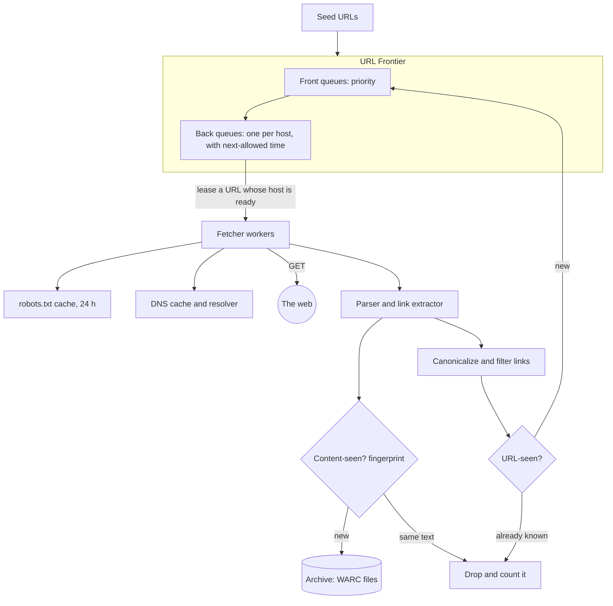
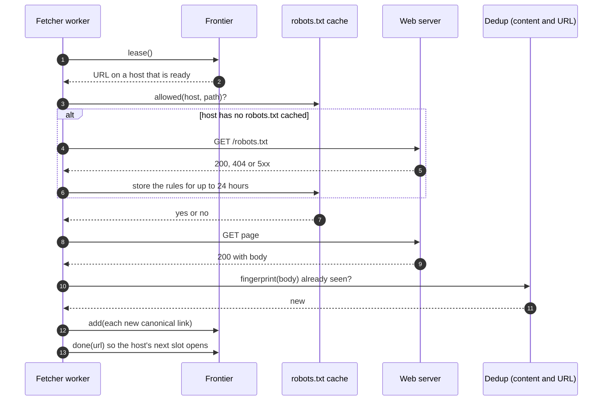

# Module 09: Designing a Web Crawler

> **Status:** Production Standard  
> **Difficulty:** Advanced  
> **Estimated Time:** 3–4 Hours  
> **Prerequisites:** Module 00 (Capacity Estimation), Module 01 (System Design Interview Framework), Module 04 (Distributed Cache and Key-Value Store), Module 07 (Large-Scale Search, for what a crawler feeds)

---

> [!TIP]
> **The Golden Rule of Web Crawlers**  
> A crawler is a **scheduler first and a downloader second**. Fetching one page is the easy part; the design is deciding *which URL to fetch next without hurting anyone and without repeating work*. Keep a **queue per host** so no site ever sees more than one request at a time, ask `robots.txt` before every fetch, and test each URL and each page's content against what you have already seen **before** it costs you a download. Everything else (priorities, sharding, recrawling) hangs off those three structures.

---

## 1. Requirements and Scope

An interviewer who says "design a web crawler" has left almost everything open. Spend the first five minutes closing it, and write the answers down.

| Question to ask | A reasonable answer for this module | What it changes in the design |
| :--- | :--- | :--- |
| What is the crawl for? | A search index and a text archive (like Common Crawl), not a site monitor | Breadth of coverage matters more than minute-level freshness |
| How many pages, how fast? | Billions of pages, a full pass in about two weeks | Decides the fetch rate, the number of machines and the size of the frontier |
| Which content? | HTML first; other types are skipped or stored untouched | Keeps the parser simple; images and video are a separate pipeline |
| Must it obey `robots.txt` and be polite? | Yes, always | Politeness becomes a hard requirement, not a tuning knob |
| How fresh must pages be? | Popular and fast-changing pages in days, the rest in weeks | A recrawl scheduler, not one pass |
| What happens to duplicates? | Do not store or follow them twice | URL-seen and content-seen tests |
| Single region or global? | One region to start; mention that a global crawl shards by host | Defers a geo-distribution discussion |

**Out of scope, said out loud:** rendering JavaScript, login-protected content, ranking the pages, and the index itself. Naming what you leave out is part of the answer.

**Non-functional requirements, in order of importance:** politeness (never overload a site), robustness (the web is full of broken and hostile pages), scalability (add machines to add speed), extensibility (a new content type should not mean a rewrite) and freshness.

---

## 2. Capacity Estimation, Anchored in Real Crawls

Do not invent a traffic number. Two published crawls give you the scale, and the arithmetic below is run in section 5, Workflow 3.

| Run | Pages | Time | Rate | Source |
| :--- | :--- | :--- | :--- | :--- |
| Mercator, one machine, May 1999 | 77.4 million requests | 8 days | 112 per second | Heydon and Najork, section 6.1 |
| Common Crawl, crawl CC-MAIN-2026-34 | 2.14 billion pages | 14 days (7–20 August 2026) | about 1,769 per second | Common Crawl announcement |

From the Common Crawl numbers you can derive everything else:

- **Average page:** 360 TiB of uncompressed content over 2.14 billion pages is about **181 KB per page**.
- **Bandwidth in:** 1,769 pages per second × 181 KB is about **327 MB/s, or 2.6 Gbit/s** of uncompressed content.
- **Hosts you need at once:** if a host may be asked for one page per second, you need at least **1,769 different hosts with a URL waiting at every moment** just to reach the rate. A crawl of a handful of big sites is slow *by design*; a fast crawl is a wide one.
- **Connections open:** by Little's law, rate × time per fetch. At 0.5 s per fetch that is about **885 connections open at once**; at 2 s it is 3,538.
- **Seen-set memory:** 10 billion URLs as 8-byte fingerprints is **75 GiB**. That fits in the RAM of one large machine, but not in an L2 cache, and not once you add the frontier, so it is sharded in practice.
- **Recrawl:** refreshing the same 2.14 billion pages every week instead of every fortnight needs **twice the rate**.

> [!NOTE]
> These are numbers for an archive-scale crawl. A search engine refreshing the important part of the web daily, or a crawler for one company's competitors' prices, sits at very different points. State your assumptions and show the formulas; the interviewer is scoring the method.

---

## 3. Interfaces and Data Model

A crawler has no public API; it has **internal contracts** between its parts. Say them as small interfaces.

```text
Frontier.add(url, priority)          # a new URL, already canonical and not seen before
Frontier.lease(worker_id) -> url     # the next URL whose host may be contacted now; the lease expires
Frontier.done(url, outcome)          # fetched, failed (retry later) or gone; releases the host's slot
RobotsCache.allowed(host, path) -> bool
Fetcher.get(url, if_none_match?) -> status, headers, body
Store.put(url, fetched_at, headers, body)       # append-only archive
```

A lease with a timeout, not a plain "pop", is what lets a worker die mid-fetch without losing the URL: when the lease expires the URL goes back to its host queue.

| Table or store | Key | What it holds | Why this shape |
| :--- | :--- | :--- | :--- |
| `url_state` | fingerprint of the canonical URL | state (new, leased, done, failed), `fail_count`, `last_fetch_at`, `next_fetch_at`, `etag`, `content_fp` | Fixed-size key; the whole table is the URL-seen set and the recrawl schedule |
| `host` | host name | `robots` body and `robots_fetched_at`, `next_allowed_at`, current gap, error counters | Politeness and robots are per host, so they live with the host |
| `content_fp` | fingerprint of the page text | the first URL that had it | The content-seen test |
| Archive (files) | crawl id, then file | the raw responses, appended in large files | Sequential writes; the format Common Crawl publishes is WARC |

Keep the **canonical form of a URL** as the identity: lower-case scheme and host, no default port, no fragment, an empty path written as `/`. Section 4 (the code) does exactly this, and a crawler that skips it fetches `HTTP://Example.com:80/a#top` and `http://example.com/a` as two pages.

---

## 4. High-Level Architecture





The loop never changes: **lease, check robots, fetch, deduplicate, extract, enqueue, release**. The sections below are the deep-dives an interviewer will pick from.

---

## 5. Deep Dives

### 5.1 The URL Frontier: Politeness and Priority in One Structure

A plain FIFO queue gives a breadth-first crawl, and it fails politeness at once: a page with 200 links to the same host puts 200 consecutive requests at that host. Two published designs fix it.

- **Mercator (1999):** the frontier is "a collection of distinct FIFO subqueues", with one subqueue per worker thread, and the subqueue for a URL is chosen by its canonical host name. Together these mean "at most one worker thread will download documents from a given web server." Most of the frontier lives on disk, with in-memory buffers that hold 600 URLs each.
- **The front/back design (Manning, Raghavan and Schütze):** *front queues* implement priority (a prioritizer gives each URL an integer, and higher-priority queues are chosen more often) and *back queues* implement politeness (each holds URLs from a single host, and a table maps hosts to back queues). A heap holds one entry per back queue: the earliest time that host may be contacted again. The book reports Mercator's designers recommending about three times as many back queues as threads.

The code in the next section is the back-queue half: one queue per host plus a `ready_at` time, and a `pop` that returns a URL from the host that has waited longest. The delay between two requests to one host is a **policy you choose**. Google's crawl-budget documentation describes the same idea as a crawl capacity limit (the time a server spends serving Googlebot), which goes up when a site responds quickly and down when "the site slows down" or returns 5xx errors or 429. Copy that behaviour: widen a host's gap on slow answers and errors, and narrow it slowly when it is healthy.

### 5.2 robots.txt: A Standard You Must Read Closely

`robots.txt` is specified in RFC 9309, and an interviewer will ask what you do when it is missing or broken.

| Situation | What RFC 9309 says |
| :--- | :--- |
| Cache it | Crawlers MAY cache it, but "SHOULD NOT use the cached version for more than 24 hours, unless the robots.txt file is unreachable" (section 2.4) |
| The fetch returns 4xx ("unavailable") | "The crawler MAY access any resources on the server" (section 2.3.1.3) |
| The fetch returns 5xx ("unreachable") | "The robots.txt file is undefined and the crawler MUST assume complete disallow" (section 2.3.1.4) |
| Redirects | SHOULD follow at least five consecutive redirects; more than five, MAY assume it is unavailable (section 2.3.1.2) |
| How much to parse | "The parsing limit MUST be at least 500 kibibytes" (section 2.5) |
| Allow against Disallow | "The most specific match found MUST be used", measured in octets; on a tie, "allow" SHOULD be used (section 2.2.2) |
| Crawl-delay | Not defined by the RFC; a crawler may read it as an extension (section 2.2.4) |

The asymmetry between 4xx and 5xx is the part to remember: a **missing** file (404) means "no rules", while a **server error** means "I do not know the rules, so assume the worst". A crawler that treats a 503 as "no rules" hammers a site that is already struggling. Workflow 1 runs Python's own parser against a throwaway server and shows that it is stricter than the RFC on 403.

### 5.3 Not Doing the Same Work Twice

Three different repeats exist, and each has its own test.

1. **The same URL written two ways.** Canonicalize first (section 3). Then the **URL-seen test** runs on every extracted link *before* it enters the frontier. Mercator notes the alternative of testing when a URL leaves the frontier, which "would result in a much larger frontier".
2. **The same page under different URLs.** `/item/1` and `/item/1?ref=home` are different URLs with one text. The **content-seen test** keeps a fingerprint of each page's text; if it is already known, the page is not stored again and its links are not followed. Mercator stored a 64-bit fingerprint per page. In its 8-day run, **8.5% of the successful responses were duplicates**.
3. **A page that is almost the same.** An exact fingerprint changes with one timestamp. Near-duplicate detection compares sets of word shingles instead; Olston and Najork's survey covers redundant pages and the traps below.

**How to store the URL-seen set.** Mercator kept a fixed-size checksum of each URL, mostly on disk, behind an in-memory cache of popular URLs. That cache (2^18 entries) had a **66.2% hit rate**, and with a table of recently added URLs the net hit rate was **75.7%**; each membership test averaged 0.16 seeks and 0.17 reads. It also merged a fingerprint of the host name into the high bits of the checksum so that URLs of one host sit near each other on disk. The Internet Archive's crawler used a **Bloom filter** instead: 10 hash functions and a separate 32 KB bit vector per site being crawled. A Bloom filter never forgets a URL (no false negatives) but sometimes claims to have seen one it has not: "each false positive will cause the URL not to be added to the frontier, and therefore the document will never be downloaded". Workflow 2 measures the rate and shows why the vector must be sized to the site.

$$p \approx \left(1 - e^{-kn/m}\right)^{k}$$

where m is the number of bits, n the number of URLs inserted and k the number of hash functions; the best k for a given m/n is about (m/n) · ln 2.

### 5.4 Spider Traps and Crawl Budget

A **spider trap** is a set of URLs that never ends: a calendar with a "next month" link forever, a session id in every URL, endless combinations of sort and filter parameters. Google's crawl-budget page names the same family: duplicate URLs, infinite scrolling and differently sorted versions of one page all waste crawling. Defences, cheapest first:

- Cap the **number of URLs per host** and the **depth** from the seed, and cap URL length.
- Strip known tracking and session parameters during canonicalization.
- Give each host a **budget** and spend it on the highest-priority URLs; a host that keeps producing new URLs with the same content (the content-seen rate says so) loses budget.
- Watch the **duplicate ratio per host** as a metric, so a trap shows up on a dashboard before it fills the disk.

### 5.5 DNS: The Hidden Bottleneck

Every new host needs a lookup before the first request. Mercator found that DNS "is a well-documented bottleneck", that the Java and Unix lookup functions were synchronized so only one uncached lookup could be outstanding, and that lookups took **87% of each thread's elapsed time**. A multi-threaded resolver that forwarded to a local name server cut that to **25%**. A modern crawler runs its own caching, asynchronous resolver and keeps the answer with the host record.

### 5.6 Freshness and Recrawling

One pass is not enough. Give each URL a `next_fetch_at`, and make the interval depend on how often the page has changed (shorten it after a change, lengthen it after a few unchanged fetches). Use **conditional requests** (`If-None-Match` with the stored `ETag`) so an unchanged page costs a small 304 answer instead of a full body. A sitemap can tell you which URLs a site considers important; a sitemap file holds at most 50,000 URLs and 50 MB uncompressed, so large sites list a sitemap index.

---

## 6. Scaling and Failure

- **Shard by host.** Hash the host name to a crawler node (consistent hashing, Module 04). Politeness stays local to one node because all of a host's queue is there. A link to another node's host is **forwarded in a batch** to its owner.
- **Add nodes, not tricks.** Throughput is limited by distinct ready hosts, so the way to go faster is more hosts at once, not a shorter gap.
- **Lease and retry.** A fetch that times out or errors goes back with an exponentially growing delay; after a number of failures the URL, or the host, is parked.
- **Checkpoint the frontier.** The frontier and seen-set are periodically written to disk so a restart resumes instead of starting from the seeds.
- **Be a good citizen.** Identify yourself in the `User-Agent` with a page that explains the crawler and how to contact you, honour `robots.txt`, and slow down on 429 and 5xx.
- **Metrics that matter:** pages per second, requests per host per second (the maximum must stay under your policy), robots-blocked ratio, error ratio by status, frontier size per priority, duplicate ratio and the age of the oldest ready URL.

---

## 7. Reference Matrices

### Frontier designs

| Design | Politeness | Priority | Cost |
| :--- | :--- | :--- | :--- |
| One global FIFO | None: one page can send hundreds of requests to a host in a row | None (breadth-first) | Trivial |
| Per-worker subqueue chosen by host (Mercator) | Strong: one thread per host | Weak: pluggable if you need it | Simple; a slow host idles its thread |
| Front queues for priority, back queues per host, heap on next time (IR book) | Strong, with a tunable gap per host | Strong: weighted choice among front queues | More moving parts; the standard answer in an interview |

### URL-seen set options

| Option | Memory | Wrong answers | Notes |
| :--- | :--- | :--- | :--- |
| Hash set of full URLs | Largest | None | Fine for millions, not billions |
| Fixed-size fingerprints, on disk with an in-memory cache (Mercator) | Bounded by the cache | None for 64-bit fingerprints in practice | Needs a sorted file and a merge; locality helps a lot |
| Bloom filter at 10 bits per URL | 244 KB per 200,000 URLs | About 0.8% of new URLs wrongly look seen, never the reverse | Cheap, but silent loss of pages; size it per host or per shard |

---

## 8. Real Evidence: What a Crawl Actually Looks Like

This module does not use an invented outage. The numbers below were measured by the crawler's authors, and each is quoted from its source.

| Mercator, May 1999 (one machine, 100 Mbit/s link) | Value |
| :--- | :--- |
| HTTP requests in the run | 77.4 million in 8 days (112 documents/s, 1,682 KB/s) |
| Requests that got no response at all | 1.8 million, 2.3% |
| Status 200 / 404 / 302 | 87.03% / 7.43% / 3.33% of the answers |
| Duplicates among the 200 responses | 8.5% |
| Where the CPU went | 37% JIT-compiled Java, 19% Java runtime, 44% Unix kernel |
| DNS before and after its own resolver | 87% of a thread's time down to 25% |
| URL-seen cache | 75.7% net hit rate |
| For comparison, in the same paper | Google's crawler: 26 million requests in 9 days (33.5 documents/s) |

Two lessons come straight from this table. **Most of the work is the network and the kernel**, not your parsing code. And **the web is untidy**: about one answer in eight is not a page, and nearly one successful page in twelve is a copy of another.

---

## 9. Multi-Language Implementation: A Polite Crawler on a Virtual Clock

The program below crawls a small made-up web (a table, so every run is identical) on a **virtual clock**. It does the parts that make a crawler a crawler: canonical URLs, `robots.txt` with the longest-match rule (including `*` and `$`), one queue per host with a politeness gap, a URL-seen set, a content-seen set, and a robots fetch that takes its own slot. It ends by running the same crawl with no delay, to show what politeness buys. The Python, TypeScript and Go versions print the same 31 lines.

````carousel
```python
"""A polite crawler on a tiny made-up web, run on a virtual clock: canonical URLs, robots.txt with the longest-match rule,
one queue per host, a URL-seen set and a content-seen set. The web is a table, so the run is the same every time."""
from collections import deque

GAP_MS = 1000  # the least time between two requests to one host: a policy of this crawler, not of any standard

# url -> (links found on the page, the page's text). A url that is not here answers 404.
WEB = {
    "http://news.example/robots.txt": ([], "User-agent: *\nDisallow: /private/\nAllow: /private/public.html\n"),
    "http://news.example/": (["/a", "/b", "/c", "/private/x", "/private/public.html", "http://shop.example/", "HTTP://NEWS.example:80/a#top"], "Front page"),
    "http://news.example/a": (["/b", "http://blog.example/"], "Story A"),
    "http://news.example/b": (["/c"], "Story B"),
    "http://news.example/c": (["/"], "Story C"),
    "http://news.example/private/x": ([], "Staff only"),
    "http://news.example/private/public.html": (["/a"], "Public notice"),
    "http://shop.example/": (["/item/1", "/item/1?ref=home", "/item/2"], "Shop"),
    "http://shop.example/item/1": ([], "Widget, 9 dollars"),
    "http://shop.example/item/1?ref=home": ([], "Widget, 9 dollars"),
    "http://shop.example/item/2": (["/item/3"], "Gadget, 12 dollars"),
    "http://blog.example/robots.txt": ([], "User-agent: googlebot\nDisallow: /\n\nUser-agent: *\nDisallow: /drafts\n"),
    "http://blog.example/": (["/post/1", "/drafts/x"], "Blog"),
    "http://blog.example/post/1": (["/"], "First post"),
    "http://blog.example/drafts/x": ([], "Unfinished"),
}


def canonicalize(url):
    """Lower-case scheme and host, drop the default port and the fragment, and give an empty path the path '/'."""
    scheme, rest = url.split("://", 1)
    scheme = scheme.lower()
    rest = rest.split("#", 1)[0]
    if "/" in rest:
        hostport, tail = rest.split("/", 1)
        path = "/" + tail
    else:
        hostport, path = rest, "/"
    host, _, port = hostport.partition(":")
    default = "80" if scheme == "http" else "443"
    shown = host.lower() if port in ("", default) else host.lower() + ":" + port
    return f"{scheme}://{shown}{path}"


def absolute(base, link):
    """A link on the page at `base`, as a full URL."""
    if "://" in link:
        return link
    scheme, rest = base.split("://", 1)
    return f"{scheme}://{rest.split('/', 1)[0]}{link}"


def host_of(url):
    return url.split("://", 1)[1].split("/", 1)[0]


def pattern_matches(pattern, path):
    """RFC 9309 patterns: a prefix, where * matches any run of characters and a final $ pins the end."""
    anchored = pattern.endswith("$")
    if anchored:
        pattern = pattern[:-1]
    parts = pattern.split("*")
    if not path.startswith(parts[0]):
        return False
    pos = len(parts[0])
    if len(parts) == 1:
        return path == parts[0] if anchored else True
    for part in parts[1:-1]:
        found = path.find(part, pos)
        if found < 0:
            return False
        pos = found + len(part)
    last = parts[-1]
    if anchored:
        return path.endswith(last) and len(path) - len(last) >= pos
    return path.find(last, pos) >= 0


def parse_robots(text, agent="*"):
    """The (allow, pattern) rules of the group for `agent`, or of the '*' group when there is none for it."""
    groups, current, in_rules = {}, [], False
    for raw in text.split("\n"):
        line = raw.split("#", 1)[0].strip()
        if ":" not in line:
            continue
        key, value = (s.strip() for s in line.split(":", 1))
        key = key.lower()
        if key == "user-agent":
            if in_rules:
                current, in_rules = [], False
            groups.setdefault(value.lower(), [])
            current.append(value.lower())
        elif key in ("allow", "disallow"):
            in_rules = True
            for name in current:
                groups[name].append((key == "allow", value))
    return groups.get(agent.lower(), groups.get("*", []))


def allowed(rules, path):
    """The most specific matching rule wins (most octets); on a tie, allow wins; no match means allowed."""
    best = None
    for allow, pattern in rules:
        if pattern == "" or not pattern_matches(pattern, path):
            continue
        key = (len(pattern.encode()), allow)
        if best is None or key > best:
            best = key
    return True if best is None else best[1]


def fingerprint(text):
    """32-bit FNV-1a of the text: a stand-in for the 64-bit Rabin fingerprints of Mercator."""
    h = 0x811C9DC5
    for byte in text.encode():
        h = ((h ^ byte) * 0x01000193) & 0xFFFFFFFF
    return h


class Frontier:
    """One FIFO queue per host, and the time each host may next be asked for something."""

    def __init__(self, gap_ms):
        self.gap_ms, self.queues, self.ready_at = gap_ms, {}, {}

    def push(self, url, front=False):
        queue = self.queues.setdefault(host_of(url), deque())
        queue.appendleft(url) if front else queue.append(url)

    def pop(self, now):
        ready = [h for h, q in self.queues.items() if q and self.ready_at.get(h, 0) <= now]
        if not ready:
            return None
        host = min(ready, key=lambda h: (self.ready_at.get(h, 0), h))
        self.ready_at[host] = now + self.gap_ms
        return self.queues[host].popleft()

    def next_time(self):
        times = [self.ready_at.get(h, 0) for h, q in self.queues.items() if q]
        return min(times) if times else None


def crawl(seeds, gap_ms, log=None):
    frontier, seen, robots, contents = Frontier(gap_ms), set(), {}, set()
    stats = dict(fetched=0, robots_fetches=0, blocked=0, repeats=0, duplicates=0, not_found=0)
    times = {}  # host -> start times of its requests
    now = 0

    def say(host, path, note):
        if log is not None:
            log.append(f"t={now:5d} {host}{path} {note}")

    for seed in seeds:
        url = canonicalize(seed)
        seen.add(url)
        frontier.push(url)
    while True:
        url = frontier.pop(now)
        if url is None:
            nxt = frontier.next_time()
            if nxt is None:
                break
            now = nxt
            continue
        host, path = host_of(url), "/" + url.split("://", 1)[1].split("/", 1)[1]
        if host not in robots:
            page = WEB.get(f"http://{host}/robots.txt")
            robots[host] = parse_robots(page[1]) if page else []
            stats["robots_fetches"] += 1
            times.setdefault(host, []).append(now)
            say(host, "/robots.txt", "200 robots.txt" if page else "404 no robots.txt, everything is allowed")
            frontier.push(url, front=True)  # the page itself waits for the next free slot of its host
            continue
        if not allowed(robots[host], path):
            stats["blocked"] += 1
            say(host, path, "skipped: robots.txt disallows it")
            frontier.ready_at[host] = now  # no request was made, so the host's slot is still free
            continue
        times.setdefault(host, []).append(now)
        page = WEB.get(url)
        if page is None:
            stats["not_found"] += 1
            say(host, path, "404")
            continue
        links, text = page
        stats["fetched"] += 1
        digest = fingerprint(text)
        if digest in contents:
            stats["duplicates"] += 1
            say(host, path, f"200 same text as a page already seen ({digest:08x}), links ignored")
            continue
        contents.add(digest)
        say(host, path, f"200 {len(links)} links")
        for link in links:
            target = canonicalize(absolute(url, link))
            if target in seen:
                stats["repeats"] += 1
            else:
                seen.add(target)
                frontier.push(target)
    busiest = 0
    for starts in times.values():
        for i, start in enumerate(starts):
            busiest = max(busiest, sum(1 for s in starts[i:] if s < start + 1000))
    return stats, now, busiest


if __name__ == "__main__":
    print("== canonical forms ==")
    for raw in ["HTTP://News.example:80/#top", "http://shop.example:8080/item/1?ref=home", "https://Blog.example:443"]:
        print(f"{raw} -> {canonicalize(raw)}")
    print("== robots.txt of news.example ==")
    rules = parse_robots(WEB["http://news.example/robots.txt"][1])
    for path in ["/", "/private/x", "/private/public.html", "/private/public.html5"]:
        print(f"{path} -> {'allowed' if allowed(rules, path) else 'disallowed'}")
    print("== polite crawl: one request per host per 1,000 ms ==")
    log = []
    polite, elapsed, burst = crawl(["http://News.example:80/#top"], GAP_MS, log)
    print("\n".join(log))
    print(f"pages fetched={polite['fetched']} robots.txt fetches={polite['robots_fetches']} blocked by robots={polite['blocked']} "
          f"404={polite['not_found']} same text={polite['duplicates']} links already seen={polite['repeats']}")
    print(f"finished at t={elapsed} ms, most requests to one host inside 1,000 ms: {burst}")
    rude, elapsed, burst = crawl(["http://News.example:80/#top"], 0)
    print(f"== the same crawl with no delay ==\nfinished at t={elapsed} ms, most requests to one host inside 1,000 ms: {burst}")
```

<!-- slide -->

```typescript
// A polite crawler on a tiny made-up web, run on a virtual clock: canonical URLs, robots.txt with the longest-match rule,
// one queue per host, a URL-seen set and a content-seen set. The web is a table, so the run is the same every time.

const GAP_MS = 1000; // the least time between two requests to one host: a policy of this crawler, not of any standard

type Page = { links: string[]; text: string };
type Rule = { allow: boolean; pattern: string };

// url -> the links found on the page and its text. A url that is not here answers 404.
const WEB: Record<string, Page> = {
  "http://news.example/robots.txt": { links: [], text: "User-agent: *\nDisallow: /private/\nAllow: /private/public.html\n" },
  "http://news.example/": { links: ["/a", "/b", "/c", "/private/x", "/private/public.html", "http://shop.example/", "HTTP://NEWS.example:80/a#top"], text: "Front page" },
  "http://news.example/a": { links: ["/b", "http://blog.example/"], text: "Story A" },
  "http://news.example/b": { links: ["/c"], text: "Story B" },
  "http://news.example/c": { links: ["/"], text: "Story C" },
  "http://news.example/private/x": { links: [], text: "Staff only" },
  "http://news.example/private/public.html": { links: ["/a"], text: "Public notice" },
  "http://shop.example/": { links: ["/item/1", "/item/1?ref=home", "/item/2"], text: "Shop" },
  "http://shop.example/item/1": { links: [], text: "Widget, 9 dollars" },
  "http://shop.example/item/1?ref=home": { links: [], text: "Widget, 9 dollars" },
  "http://shop.example/item/2": { links: ["/item/3"], text: "Gadget, 12 dollars" },
  "http://blog.example/robots.txt": { links: [], text: "User-agent: googlebot\nDisallow: /\n\nUser-agent: *\nDisallow: /drafts\n" },
  "http://blog.example/": { links: ["/post/1", "/drafts/x"], text: "Blog" },
  "http://blog.example/post/1": { links: ["/"], text: "First post" },
  "http://blog.example/drafts/x": { links: [], text: "Unfinished" },
};

function splitOnce(text: string, separator: string): [string, string] {
  const at = text.indexOf(separator);
  return at < 0 ? [text, ""] : [text.slice(0, at), text.slice(at + separator.length)];
}

/** Lower-case scheme and host, drop the default port and the fragment, and give an empty path the path '/'. */
function canonicalize(url: string): string {
  const [rawScheme, afterScheme] = splitOnce(url, "://");
  const scheme = rawScheme.toLowerCase();
  const rest = splitOnce(afterScheme, "#")[0];
  let hostport = rest;
  let path = "/";
  if (rest.includes("/")) {
    const [head, tail] = splitOnce(rest, "/");
    hostport = head;
    path = "/" + tail;
  }
  const [host, port] = splitOnce(hostport, ":");
  const standard = scheme === "http" ? "80" : "443";
  const shown = port === "" || port === standard ? host.toLowerCase() : host.toLowerCase() + ":" + port;
  return `${scheme}://${shown}${path}`;
}

/** A link on the page at `base`, as a full URL. */
function absolute(base: string, link: string): string {
  if (link.includes("://")) return link;
  const [scheme, rest] = splitOnce(base, "://");
  return `${scheme}://${splitOnce(rest, "/")[0]}${link}`;
}

function hostOf(url: string): string {
  return splitOnce(splitOnce(url, "://")[1], "/")[0];
}

/** RFC 9309 patterns: a prefix, where * matches any run of characters and a final $ pins the end. */
function patternMatches(rawPattern: string, path: string): boolean {
  const anchored = rawPattern.endsWith("$");
  const pattern = anchored ? rawPattern.slice(0, -1) : rawPattern;
  const parts = pattern.split("*");
  if (!path.startsWith(parts[0])) return false;
  let pos = parts[0].length;
  if (parts.length === 1) return anchored ? path === parts[0] : true;
  for (const part of parts.slice(1, -1)) {
    const found = path.indexOf(part, pos);
    if (found < 0) return false;
    pos = found + part.length;
  }
  const last = parts[parts.length - 1];
  if (anchored) return path.endsWith(last) && path.length - last.length >= pos;
  return path.indexOf(last, pos) >= 0;
}

/** The rules of the group for `agent`, or of the '*' group when there is none for it. */
function parseRobots(text: string, agent = "*"): Rule[] {
  const groups = new Map<string, Rule[]>();
  let current: string[] = [];
  let inRules = false;
  for (const raw of text.split("\n")) {
    const line = splitOnce(raw, "#")[0].trim();
    if (!line.includes(":")) continue;
    const [rawKey, rawValue] = splitOnce(line, ":");
    const key = rawKey.trim().toLowerCase();
    const value = rawValue.trim();
    if (key === "user-agent") {
      if (inRules) {
        current = [];
        inRules = false;
      }
      if (!groups.has(value.toLowerCase())) groups.set(value.toLowerCase(), []);
      current.push(value.toLowerCase());
    } else if (key === "allow" || key === "disallow") {
      inRules = true;
      for (const name of current) groups.get(name)!.push({ allow: key === "allow", pattern: value });
    }
  }
  return groups.get(agent.toLowerCase()) ?? groups.get("*") ?? [];
}

/** The most specific matching rule wins (most octets); on a tie, allow wins; no match means allowed. */
function allowed(rules: Rule[], path: string): boolean {
  let best: { size: number; allow: boolean } | null = null;
  for (const rule of rules) {
    if (rule.pattern === "" || !patternMatches(rule.pattern, path)) continue;
    const size = new TextEncoder().encode(rule.pattern).length;
    if (best === null || size > best.size || (size === best.size && rule.allow && !best.allow)) best = { size, allow: rule.allow };
  }
  return best === null ? true : best.allow;
}

/** 32-bit FNV-1a of the text: a stand-in for the 64-bit Rabin fingerprints of Mercator. */
function fingerprint(text: string): number {
  let h = 0x811c9dc5;
  for (const byte of new TextEncoder().encode(text)) h = Math.imul(h ^ byte, 0x01000193) >>> 0;
  return h;
}

/** One FIFO queue per host, and the time each host may next be asked for something. */
class Frontier {
  queues = new Map<string, string[]>();
  readyAt = new Map<string, number>();
  gapMs: number;

  constructor(gapMs: number) {
    this.gapMs = gapMs;
  }

  push(url: string, front = false): void {
    const host = hostOf(url);
    if (!this.queues.has(host)) this.queues.set(host, []);
    const queue = this.queues.get(host)!;
    if (front) queue.unshift(url);
    else queue.push(url);
  }

  pop(now: number): string | null {
    let chosen: string | null = null;
    for (const [host, queue] of this.queues) {
      const at = this.readyAt.get(host) ?? 0;
      if (queue.length === 0 || at > now) continue;
      if (chosen === null) chosen = host;
      else {
        const best = this.readyAt.get(chosen) ?? 0;
        if (at < best || (at === best && host < chosen)) chosen = host;
      }
    }
    if (chosen === null) return null;
    this.readyAt.set(chosen, now + this.gapMs);
    return this.queues.get(chosen)!.shift()!;
  }

  nextTime(): number | null {
    let next: number | null = null;
    for (const [host, queue] of this.queues) {
      if (queue.length === 0) continue;
      const at = this.readyAt.get(host) ?? 0;
      if (next === null || at < next) next = at;
    }
    return next;
  }
}

function crawl(seeds: string[], gapMs: number, log: string[] | null) {
  const frontier = new Frontier(gapMs);
  const seen = new Set<string>();
  const robots = new Map<string, Rule[]>();
  const contents = new Set<number>();
  const stats = { fetched: 0, robotsFetches: 0, blocked: 0, repeats: 0, duplicates: 0, notFound: 0 };
  const times = new Map<string, number[]>(); // host -> start times of its requests
  let now = 0;

  const say = (host: string, path: string, note: string) => {
    if (log !== null) log.push(`t=${String(now).padStart(5)} ${host}${path} ${note}`);
  };
  const started = (host: string) => {
    if (!times.has(host)) times.set(host, []);
    times.get(host)!.push(now);
  };

  for (const seed of seeds) {
    const url = canonicalize(seed);
    seen.add(url);
    frontier.push(url);
  }
  for (;;) {
    const url = frontier.pop(now);
    if (url === null) {
      const next = frontier.nextTime();
      if (next === null) break;
      now = next;
      continue;
    }
    const host = hostOf(url);
    const path = "/" + splitOnce(splitOnce(url, "://")[1], "/")[1];
    if (!robots.has(host)) {
      const page = WEB[`http://${host}/robots.txt`];
      robots.set(host, page ? parseRobots(page.text) : []);
      stats.robotsFetches += 1;
      started(host);
      say(host, "/robots.txt", page ? "200 robots.txt" : "404 no robots.txt, everything is allowed");
      frontier.push(url, true); // the page itself waits for the next free slot of its host
      continue;
    }
    if (!allowed(robots.get(host)!, path)) {
      stats.blocked += 1;
      say(host, path, "skipped: robots.txt disallows it");
      frontier.readyAt.set(host, now); // no request was made, so the host's slot is still free
      continue;
    }
    started(host);
    const page = WEB[url];
    if (page === undefined) {
      stats.notFound += 1;
      say(host, path, "404");
      continue;
    }
    stats.fetched += 1;
    const digest = fingerprint(page.text);
    if (contents.has(digest)) {
      stats.duplicates += 1;
      say(host, path, `200 same text as a page already seen (${digest.toString(16).padStart(8, "0")}), links ignored`);
      continue;
    }
    contents.add(digest);
    say(host, path, `200 ${page.links.length} links`);
    for (const link of page.links) {
      const target = canonicalize(absolute(url, link));
      if (seen.has(target)) stats.repeats += 1;
      else {
        seen.add(target);
        frontier.push(target);
      }
    }
  }
  let busiest = 0;
  for (const starts of times.values()) {
    starts.forEach((start, i) => {
      busiest = Math.max(busiest, starts.slice(i).filter((s) => s < start + 1000).length);
    });
  }
  return { stats, now, busiest };
}

console.log("== canonical forms ==");
for (const raw of ["HTTP://News.example:80/#top", "http://shop.example:8080/item/1?ref=home", "https://Blog.example:443"]) {
  console.log(`${raw} -> ${canonicalize(raw)}`);
}
console.log("== robots.txt of news.example ==");
const rules = parseRobots(WEB["http://news.example/robots.txt"].text);
for (const path of ["/", "/private/x", "/private/public.html", "/private/public.html5"]) {
  console.log(`${path} -> ${allowed(rules, path) ? "allowed" : "disallowed"}`);
}
console.log("== polite crawl: one request per host per 1,000 ms ==");
const log: string[] = [];
const polite = crawl(["http://News.example:80/#top"], GAP_MS, log);
console.log(log.join("\n"));
const s = polite.stats;
console.log(`pages fetched=${s.fetched} robots.txt fetches=${s.robotsFetches} blocked by robots=${s.blocked} 404=${s.notFound} same text=${s.duplicates} links already seen=${s.repeats}`);
console.log(`finished at t=${polite.now} ms, most requests to one host inside 1,000 ms: ${polite.busiest}`);
const rude = crawl(["http://News.example:80/#top"], 0, null);
console.log(`== the same crawl with no delay ==\nfinished at t=${rude.now} ms, most requests to one host inside 1,000 ms: ${rude.busiest}`);
```

<!-- slide -->

```go
// A polite crawler on a tiny made-up web, run on a virtual clock: canonical URLs, robots.txt with the longest-match rule,
// one queue per host, a URL-seen set and a content-seen set. The web is a table, so the run is the same every time.
package main

import (
	"fmt"
	"strings"
)

// gapMs is the least time between two requests to one host: a policy of this crawler, not of any standard.
const gapMs = 1000

type page struct {
	links []string
	text  string
}

type rule struct {
	allow   bool
	pattern string
}

// web maps a url to the links found on the page and its text. A url that is not here answers 404.
var web = map[string]page{
	"http://news.example/robots.txt":          {nil, "User-agent: *\nDisallow: /private/\nAllow: /private/public.html\n"},
	"http://news.example/":                    {[]string{"/a", "/b", "/c", "/private/x", "/private/public.html", "http://shop.example/", "HTTP://NEWS.example:80/a#top"}, "Front page"},
	"http://news.example/a":                   {[]string{"/b", "http://blog.example/"}, "Story A"},
	"http://news.example/b":                   {[]string{"/c"}, "Story B"},
	"http://news.example/c":                   {[]string{"/"}, "Story C"},
	"http://news.example/private/x":           {nil, "Staff only"},
	"http://news.example/private/public.html": {[]string{"/a"}, "Public notice"},
	"http://shop.example/":                    {[]string{"/item/1", "/item/1?ref=home", "/item/2"}, "Shop"},
	"http://shop.example/item/1":              {nil, "Widget, 9 dollars"},
	"http://shop.example/item/1?ref=home":     {nil, "Widget, 9 dollars"},
	"http://shop.example/item/2":              {[]string{"/item/3"}, "Gadget, 12 dollars"},
	"http://blog.example/robots.txt":          {nil, "User-agent: googlebot\nDisallow: /\n\nUser-agent: *\nDisallow: /drafts\n"},
	"http://blog.example/":                    {[]string{"/post/1", "/drafts/x"}, "Blog"},
	"http://blog.example/post/1":              {[]string{"/"}, "First post"},
	"http://blog.example/drafts/x":            {nil, "Unfinished"},
}

// canonicalize lower-cases the scheme and host, drops the default port and the fragment, and gives an empty path the path "/".
func canonicalize(url string) string {
	scheme, rest, _ := strings.Cut(url, "://")
	scheme = strings.ToLower(scheme)
	rest, _, _ = strings.Cut(rest, "#")
	hostport, path := rest, "/"
	if head, tail, ok := strings.Cut(rest, "/"); ok {
		hostport, path = head, "/"+tail
	}
	host, port, _ := strings.Cut(hostport, ":")
	standard := "443"
	if scheme == "http" {
		standard = "80"
	}
	shown := strings.ToLower(host)
	if port != "" && port != standard {
		shown += ":" + port
	}
	return scheme + "://" + shown + path
}

// absolute turns a link on the page at base into a full URL.
func absolute(base, link string) string {
	if strings.Contains(link, "://") {
		return link
	}
	scheme, rest, _ := strings.Cut(base, "://")
	host, _, _ := strings.Cut(rest, "/")
	return scheme + "://" + host + link
}

func hostOf(url string) string {
	_, rest, _ := strings.Cut(url, "://")
	host, _, _ := strings.Cut(rest, "/")
	return host
}

func pathOf(url string) string {
	_, rest, _ := strings.Cut(url, "://")
	_, tail, _ := strings.Cut(rest, "/")
	return "/" + tail
}

// patternMatches follows RFC 9309: a prefix, where * matches any run of characters and a final $ pins the end.
func patternMatches(pattern, path string) bool {
	anchored := strings.HasSuffix(pattern, "$")
	if anchored {
		pattern = pattern[:len(pattern)-1]
	}
	parts := strings.Split(pattern, "*")
	if !strings.HasPrefix(path, parts[0]) {
		return false
	}
	pos := len(parts[0])
	if len(parts) == 1 {
		if anchored {
			return path == parts[0]
		}
		return true
	}
	for _, part := range parts[1 : len(parts)-1] {
		found := strings.Index(path[pos:], part)
		if found < 0 {
			return false
		}
		pos += found + len(part)
	}
	last := parts[len(parts)-1]
	if anchored {
		return strings.HasSuffix(path, last) && len(path)-len(last) >= pos
	}
	return strings.Index(path[pos:], last) >= 0
}

// parseRobots returns the rules of the group for agent, or of the "*" group when there is none for it.
func parseRobots(text, agent string) []rule {
	groups := map[string][]rule{}
	var current []string
	inRules := false
	for _, raw := range strings.Split(text, "\n") {
		line, _, _ := strings.Cut(raw, "#")
		line = strings.TrimSpace(line)
		if !strings.Contains(line, ":") {
			continue
		}
		rawKey, rawValue, _ := strings.Cut(line, ":")
		key := strings.ToLower(strings.TrimSpace(rawKey))
		value := strings.TrimSpace(rawValue)
		switch key {
		case "user-agent":
			if inRules {
				current, inRules = nil, false
			}
			name := strings.ToLower(value)
			if _, ok := groups[name]; !ok {
				groups[name] = []rule{}
			}
			current = append(current, name)
		case "allow", "disallow":
			inRules = true
			for _, name := range current {
				groups[name] = append(groups[name], rule{key == "allow", value})
			}
		}
	}
	if found, ok := groups[strings.ToLower(agent)]; ok {
		return found
	}
	return groups["*"]
}

// allowed: the most specific matching rule wins (most octets); on a tie, allow wins; no match means allowed.
func allowed(rules []rule, path string) bool {
	found, bestSize, bestAllow := false, 0, false
	for _, r := range rules {
		if r.pattern == "" || !patternMatches(r.pattern, path) {
			continue
		}
		size := len(r.pattern)
		if !found || size > bestSize || (size == bestSize && r.allow && !bestAllow) {
			found, bestSize, bestAllow = true, size, r.allow
		}
	}
	return !found || bestAllow
}

// fingerprint is the 32-bit FNV-1a of the text: a stand-in for the 64-bit Rabin fingerprints of Mercator.
func fingerprint(text string) uint32 {
	h := uint32(0x811c9dc5)
	for i := 0; i < len(text); i++ {
		h = (h ^ uint32(text[i])) * 0x01000193
	}
	return h
}

// frontier keeps one FIFO queue per host, and the time each host may next be asked for something.
type frontier struct {
	gap     int
	queues  map[string][]string
	readyAt map[string]int
}

func newFrontier(gap int) *frontier {
	return &frontier{gap: gap, queues: map[string][]string{}, readyAt: map[string]int{}}
}

func (f *frontier) push(url string, front bool) {
	host := hostOf(url)
	if front {
		f.queues[host] = append([]string{url}, f.queues[host]...)
	} else {
		f.queues[host] = append(f.queues[host], url)
	}
}

func (f *frontier) pop(now int) (string, bool) {
	chosen := ""
	for host, queue := range f.queues {
		at := f.readyAt[host]
		if len(queue) == 0 || at > now {
			continue
		}
		if chosen == "" || at < f.readyAt[chosen] || (at == f.readyAt[chosen] && host < chosen) {
			chosen = host
		}
	}
	if chosen == "" {
		return "", false
	}
	f.readyAt[chosen] = now + f.gap
	url := f.queues[chosen][0]
	f.queues[chosen] = f.queues[chosen][1:]
	return url, true
}

func (f *frontier) nextTime() (int, bool) {
	next, any := 0, false
	for host, queue := range f.queues {
		if len(queue) == 0 {
			continue
		}
		if at := f.readyAt[host]; !any || at < next {
			next, any = at, true
		}
	}
	return next, any
}

type stats struct{ fetched, robotsFetches, blocked, repeats, duplicates, notFound int }

func crawl(seeds []string, gap int, log *[]string) (stats, int, int) {
	fr := newFrontier(gap)
	seen := map[string]bool{}
	robots := map[string][]rule{}
	contents := map[uint32]bool{}
	var st stats
	times := map[string][]int{} // host -> start times of its requests
	now := 0

	say := func(host, path, note string) {
		if log != nil {
			*log = append(*log, fmt.Sprintf("t=%5d %s%s %s", now, host, path, note))
		}
	}
	for _, seed := range seeds {
		url := canonicalize(seed)
		seen[url] = true
		fr.push(url, false)
	}
	for {
		url, ok := fr.pop(now)
		if !ok {
			next, any := fr.nextTime()
			if !any {
				break
			}
			now = next
			continue
		}
		host, path := hostOf(url), pathOf(url)
		if _, cached := robots[host]; !cached {
			p, found := web["http://"+host+"/robots.txt"]
			if found {
				robots[host] = parseRobots(p.text, "*")
			} else {
				robots[host] = nil
			}
			st.robotsFetches++
			times[host] = append(times[host], now)
			if found {
				say(host, "/robots.txt", "200 robots.txt")
			} else {
				say(host, "/robots.txt", "404 no robots.txt, everything is allowed")
			}
			fr.push(url, true) // the page itself waits for the next free slot of its host
			continue
		}
		if !allowed(robots[host], path) {
			st.blocked++
			say(host, path, "skipped: robots.txt disallows it")
			fr.readyAt[host] = now // no request was made, so the host's slot is still free
			continue
		}
		times[host] = append(times[host], now)
		p, found := web[url]
		if !found {
			st.notFound++
			say(host, path, "404")
			continue
		}
		st.fetched++
		digest := fingerprint(p.text)
		if contents[digest] {
			st.duplicates++
			say(host, path, fmt.Sprintf("200 same text as a page already seen (%08x), links ignored", digest))
			continue
		}
		contents[digest] = true
		say(host, path, fmt.Sprintf("200 %d links", len(p.links)))
		for _, link := range p.links {
			target := canonicalize(absolute(url, link))
			if seen[target] {
				st.repeats++
			} else {
				seen[target] = true
				fr.push(target, false)
			}
		}
	}
	busiest := 0
	for _, starts := range times {
		for i, start := range starts {
			count := 0
			for _, s := range starts[i:] {
				if s < start+1000 {
					count++
				}
			}
			if count > busiest {
				busiest = count
			}
		}
	}
	return st, now, busiest
}

func main() {
	fmt.Println("== canonical forms ==")
	for _, raw := range []string{"HTTP://News.example:80/#top", "http://shop.example:8080/item/1?ref=home", "https://Blog.example:443"} {
		fmt.Printf("%s -> %s\n", raw, canonicalize(raw))
	}
	fmt.Println("== robots.txt of news.example ==")
	rules := parseRobots(web["http://news.example/robots.txt"].text, "*")
	for _, path := range []string{"/", "/private/x", "/private/public.html", "/private/public.html5"} {
		verdict := "disallowed"
		if allowed(rules, path) {
			verdict = "allowed"
		}
		fmt.Printf("%s -> %s\n", path, verdict)
	}
	fmt.Println("== polite crawl: one request per host per 1,000 ms ==")
	var log []string
	polite, elapsed, burst := crawl([]string{"http://News.example:80/#top"}, gapMs, &log)
	fmt.Println(strings.Join(log, "\n"))
	fmt.Printf("pages fetched=%d robots.txt fetches=%d blocked by robots=%d 404=%d same text=%d links already seen=%d\n",
		polite.fetched, polite.robotsFetches, polite.blocked, polite.notFound, polite.duplicates, polite.repeats)
	fmt.Printf("finished at t=%d ms, most requests to one host inside 1,000 ms: %d\n", elapsed, burst)
	_, elapsed, burst = crawl([]string{"http://News.example:80/#top"}, 0, nil)
	fmt.Printf("== the same crawl with no delay ==\nfinished at t=%d ms, most requests to one host inside 1,000 ms: %d\n", elapsed, burst)
}
```
````

**Observed output (identical in Python 3.13.14, Node 24 and Go 1.22):**

```text
== canonical forms ==
HTTP://News.example:80/#top -> http://news.example/
http://shop.example:8080/item/1?ref=home -> http://shop.example:8080/item/1?ref=home
https://Blog.example:443 -> https://blog.example/
== robots.txt of news.example ==
/ -> allowed
/private/x -> disallowed
/private/public.html -> allowed
/private/public.html5 -> allowed
== polite crawl: one request per host per 1,000 ms ==
t=    0 news.example/robots.txt 200 robots.txt
t= 1000 news.example/ 200 7 links
t= 1000 shop.example/robots.txt 404 no robots.txt, everything is allowed
t= 2000 news.example/a 200 2 links
t= 2000 blog.example/robots.txt 200 robots.txt
t= 2000 shop.example/ 200 3 links
t= 3000 blog.example/ 200 2 links
t= 3000 news.example/b 200 1 links
t= 3000 shop.example/item/1 200 0 links
t= 4000 blog.example/post/1 200 1 links
t= 4000 news.example/c 200 1 links
t= 4000 shop.example/item/1?ref=home 200 same text as a page already seen (0720796f), links ignored
t= 5000 blog.example/drafts/x skipped: robots.txt disallows it
t= 5000 news.example/private/x skipped: robots.txt disallows it
t= 5000 news.example/private/public.html 200 1 links
t= 5000 shop.example/item/2 200 1 links
t= 6000 shop.example/item/3 404
pages fetched=11 robots.txt fetches=3 blocked by robots=2 404=1 same text=1 links already seen=6
finished at t=6000 ms, most requests to one host inside 1,000 ms: 1
== the same crawl with no delay ==
finished at t=0 ms, most requests to one host inside 1,000 ms: 6
```

Read it as a student of the design:

- **Canonical forms:** `HTTP://News.example:80/#top` and `https://Blog.example:443` lose their port, their fragment and their capitals; `:8080` is kept because it is not the default.
- **robots.txt:** `/private/public.html` is allowed although `/private/` is disallowed, because its rule is longer (more octets) and so more specific. `/private/public.html5` is allowed too: the allow rule is a prefix and matches it.
- **The crawl log:** the first request to every host is `/robots.txt`, and the page waits for the host's next free slot. Three hosts are being served at once, one request each per 1,000 ms, so all 15 requests have started by t=6000 ms; one request per second in a single line would need 14 seconds to start them. `shop.example` answers 404 for `robots.txt`, which means "everything is allowed", and `blog.example` has rules for the `googlebot` group but this crawler takes the `*` group and so may not enter `/drafts`.
- **Duplicates:** `item/1?ref=home` is a different URL with the same text, and it is caught by the content-seen test (the fingerprint `0720796f`); its links are ignored.
- **Politeness:** with a 1,000 ms gap the busiest host sees one request in any 1,000 ms window. With no delay the same crawl finishes at t=0 and the busiest host receives 6 requests at once, which is how a crawler gets blocked.

---

## 10. Practical Hands-On Verification Workflows (Python 3.13)

Each script is self-contained apart from Workflow 1, which imports the functions of the program above (save it as `crawler.py` first). The outputs are exactly what was printed on Python `3.13.14`.

### Workflow 1: What Does Python's Own robots.txt Reader Do on an Error?

A throwaway server on your own machine answers `/robots.txt` with a status of your choice, so nothing here touches a real site:

```python
"""What does Python's own robots.txt reader do when /robots.txt answers with an error, and what does RFC 9309 say it must do?
A throwaway server on this machine answers /robots.txt with the status asked for in the port's table."""
import threading
from http.server import BaseHTTPRequestHandler, HTTPServer
from urllib.robotparser import RobotFileParser

from crawler import allowed, parse_robots

BODY = b"User-agent: *\nDisallow: /private/\nAllow: /private/public.html\n"
STATUS = {"value": 200}


class Handler(BaseHTTPRequestHandler):
    def do_GET(self):
        self.send_response(STATUS["value"])
        self.send_header("Content-Length", str(len(BODY)) if STATUS["value"] == 200 else "0")
        self.end_headers()
        if STATUS["value"] == 200:
            self.wfile.write(BODY)

    def log_message(self, *args):
        pass


server = HTTPServer(("127.0.0.1", 0), Handler)
threading.Thread(target=server.serve_forever, daemon=True).start()
url = f"http://127.0.0.1:{server.server_port}/robots.txt"

# RFC 9309: 2.3.1.3 a 4xx answer means "unavailable": the crawler MAY access any resource. 2.3.1.4 a 5xx answer means "unreachable": complete disallow.
print(f"{'robots.txt answers':20} {'urllib: /private/x':20} {'urllib: /about':16} RFC 9309 says")
for status, rfc in [(200, "follow the file"), (404, "may crawl everything"), (403, "may crawl everything"), (500, "must not crawl anything"), (503, "must not crawl anything")]:
    STATUS["value"] = status
    parser = RobotFileParser(url)
    parser.read()
    private = "allowed" if parser.can_fetch("mybot", "/private/x") else "disallowed"
    about = "allowed" if parser.can_fetch("mybot", "/about") else "disallowed"
    print(f"{status:<20} {private:20} {about:16} {rfc}")
rules = parse_robots(BODY.decode())
print("file followed:", "/private/x", "allowed" if allowed(rules, "/private/x") else "disallowed", "|", "/about", "allowed" if allowed(rules, "/about") else "disallowed")
server.shutdown()
```

**Observed Output:**

```text
robots.txt answers   urllib: /private/x   urllib: /about   RFC 9309 says
200                  disallowed           allowed          follow the file
404                  allowed              allowed          may crawl everything
403                  disallowed           disallowed       may crawl everything
500                  disallowed           disallowed       must not crawl anything
503                  disallowed           disallowed       must not crawl anything
file followed: /private/x disallowed | /about allowed
```

Python's reader treats `403` as "disallow everything", where RFC 9309 says a 4xx answer means the crawler "MAY access any resources". That is a permitted, cautious choice and not a bug, but **read the library you depend on**: it decides what your crawler may do on a site that answers oddly. The reader also follows the file correctly (`/private/x` disallowed, `/about` allowed) when the answer is 200.

### Workflow 2: Size a Bloom Filter and Measure Its False Positives

```python
"""A Bloom filter as a URL-seen set: how big it must be, and what its false positives cost a crawler."""
import hashlib
import math


class Bloom:
    def __init__(self, bits, hashes):
        self.bits, self.hashes, self.array = bits, hashes, bytearray((bits + 7) // 8)

    def _positions(self, item):
        digest = hashlib.blake2b(item.encode(), digest_size=16).digest()
        a, b = int.from_bytes(digest[:8], "big"), int.from_bytes(digest[8:], "big") | 1
        return [(a + i * b) % self.bits for i in range(self.hashes)]  # double hashing: k positions from two hashes

    def add(self, item):
        for p in self._positions(item):
            self.array[p >> 3] |= 1 << (p & 7)

    def __contains__(self, item):
        return all(self.array[p >> 3] & (1 << (p & 7)) for p in self._positions(item))


def predicted(bits, hashes, n):
    """The textbook false-positive rate after n insertions: (1 - e^(-k n / m)) ^ k."""
    return (1 - math.exp(-hashes * n / bits)) ** hashes


N = 200_000
print(f"measured with n={N:,} URLs inserted and {N:,} URLs that were never inserted")
print(f"{'bits per URL':>12} {'hashes':>6} {'memory':>9} {'predicted':>10} {'measured':>10}")
for per_url in (6, 10, 14):
    hashes = max(1, round(per_url * math.log(2)))  # the k that minimises the rate for this m/n
    bloom = Bloom(per_url * N, hashes)
    for i in range(N):
        bloom.add(f"http://site{i % 5000}.example/page/{i}")
    wrong = sum(1 for i in range(N) if f"http://other{i % 5000}.example/new/{i}" in bloom)
    print(f"{per_url:>12} {hashes:>6} {per_url * N / 8 / 1024:>7.0f} KB {predicted(per_url * N, hashes, N):>10.4%} {wrong / N:>10.4%}")

print("\none 32 KB vector per site with 10 hash functions: the rate as a site grows")
bits = 32 * 1024 * 8
for n in (5_000, 10_000, 20_000, 50_000):
    print(f"{n:>7,} URLs on the site -> {predicted(bits, 10, n):.2e} of new URLs wrongly look already seen")

print("\nwhat a false positive costs: a page that is never fetched")
for n_links, rate in ((10_000_000_000, 0.01), (10_000_000_000, 0.001)):
    print(f"{n_links:,} new links at a rate of {rate:.1%}: {int(n_links * rate):,} pages silently skipped")
print(f"memory for 10 billion URLs at 10 bits each: {10_000_000_000 * 10 / 8 / 1024**3:.1f} GiB; as 8-byte fingerprints: {10_000_000_000 * 8 / 1024**3:.1f} GiB")
```

**Observed Output:**

```text
measured with n=200,000 URLs inserted and 200,000 URLs that were never inserted
bits per URL hashes    memory  predicted   measured
           6      4     146 KB    5.6057%    5.5665%
          10      7     244 KB    0.8194%    0.8260%
          14     10     342 KB    0.1201%    0.1165%

one 32 KB vector per site with 10 hash functions: the rate as a site grows
  5,000 URLs on the site -> 2.49e-08 of new URLs wrongly look already seen
 10,000 URLs on the site -> 1.03e-05 of new URLs wrongly look already seen
 20,000 URLs on the site -> 1.88e-03 of new URLs wrongly look already seen
 50,000 URLs on the site -> 2.00e-01 of new URLs wrongly look already seen

what a false positive costs: a page that is never fetched
10,000,000,000 new links at a rate of 1.0%: 100,000,000 pages silently skipped
10,000,000,000 new links at a rate of 0.1%: 10,000,000 pages silently skipped
memory for 10 billion URLs at 10 bits each: 11.6 GiB; as 8-byte fingerprints: 74.5 GiB
```

The measured rates (5.57%, 0.826%, 0.117%) match the formula within sampling noise. The second table is the trap: the 32 KB vector with 10 hash functions that suits a site of 10,000 URLs gives a false-positive rate of 1.03e-05, and the same vector on a site of 50,000 URLs wrongly marks **20%** of new URLs as seen. Each of those is a page that is never crawled and never reported.

### Workflow 3: Capacity From Two Real Crawls

```python
"""Capacity of a crawl, worked from two published runs: Mercator in May 1999 and Common Crawl in August 2026."""
TIB = 1024**4
DAY = 86_400

# Mercator, May 1999 (Heydon and Najork, section 6.1): 77.4 million HTTP requests in 8 days, 112 documents/s and 1,682 KB/s on one machine.
merc_requests, merc_days, merc_docs_s, merc_kb_s = 77_400_000, 8, 112, 1_682
print(f"Mercator: {merc_requests:,} requests in {merc_days} days = {merc_requests / (merc_days * DAY):.0f} per second, the paper's {merc_docs_s} documents/s; "
      f"{merc_kb_s / merc_docs_s:.1f} KB per document")

# Common Crawl, crawl CC-MAIN-2026-34: 2.14 billion pages, 360 TiB uncompressed, crawled between August 7th and August 20th.
pages, tib, days = 2_140_000_000, 360, 14
rate = pages / (days * DAY)
size = tib * TIB / pages
print(f"\nCommon Crawl: {pages:,} pages in {days} days")
print(f"  pages per second     {rate:,.0f}   ({rate / merc_docs_s:.0f} times Mercator's 1999 rate)")
print(f"  average page         {size / 1024:,.0f} KB uncompressed")
print(f"  bandwidth in         {rate * size / 1e6:,.0f} MB/s = {rate * size * 8 / 1e9:.1f} Gbit/s (uncompressed content; the wire carries less when pages are compressed)")

gap_s = 1.0
print(f"\npoliteness: at most one request per host every {gap_s:.0f} s")
print(f"  hosts with a URL waiting, at every moment, just to keep {rate:,.0f} pages/s going: at least {rate / (1 / gap_s):,.0f}")
for latency in (0.2, 0.5, 2.0):
    print(f"  Little's law: {rate:,.0f} pages/s x {latency} s per fetch = {rate * latency:,.0f} connections open at once")

fp_bytes = 8
print(f"\nfrontier and seen-set for 10 billion URLs: {10_000_000_000 * fp_bytes / 1024**3:.0f} GiB of {fp_bytes}-byte fingerprints; "
      f"at 2 TB of RAM per machine that is {10_000_000_000 * fp_bytes / (2 * 1024**4) * 100:.1f}% of one machine")
print(f"refreshing every page of a {pages:,}-page crawl once a week needs {pages / (7 * DAY):,.0f} pages/s, {pages / (7 * DAY) / rate:.1f} times a fortnightly crawl")
```

**Observed Output:**

```text
Mercator: 77,400,000 requests in 8 days = 112 per second, the paper's 112 documents/s; 15.0 KB per document

Common Crawl: 2,140,000,000 pages in 14 days
  pages per second     1,769   (16 times Mercator's 1999 rate)
  average page         181 KB uncompressed
  bandwidth in         327 MB/s = 2.6 Gbit/s (uncompressed content; the wire carries less when pages are compressed)

politeness: at most one request per host every 1 s
  hosts with a URL waiting, at every moment, just to keep 1,769 pages/s going: at least 1,769
  Little's law: 1,769 pages/s x 0.2 s per fetch = 354 connections open at once
  Little's law: 1,769 pages/s x 0.5 s per fetch = 885 connections open at once
  Little's law: 1,769 pages/s x 2.0 s per fetch = 3,538 connections open at once

frontier and seen-set for 10 billion URLs: 75 GiB of 8-byte fingerprints; at 2 TB of RAM per machine that is 3.6% of one machine
refreshing every page of a 2,140,000,000-page crawl once a week needs 3,538 pages/s, 2.0 times a fortnightly crawl
```

---

## 11. Hands-On Exercises and Independent Challenge

### Practical Exercises

1. **Say the numbers.** From the Common Crawl figures, work out the rate in pages per second, the average page size and the bandwidth, with your own arithmetic, before you read Workflow 3. Then redo it for a crawl of 200 million pages that must finish in 3 days.
2. **Politeness arithmetic.** A site has 40,000 pages. At a 1-second gap, how long does one crawler need for it? How long if the site asks for `Crawl-delay: 10`? What does that tell you about crawling a site with a million pages?
3. **Extend the program.** Add a `Retry-After`-style penalty: when a fetch answers 503, double that host's gap (up to 16 seconds) and halve it after five good answers. Add a 503 page to the made-up web and show the log.
4. **Break the Bloom filter.** Find the number of URLs at which a 32 KB, 10-hash vector passes a 1% false-positive rate. Use the formula, then check it with the script.

### Independent Challenge

You are asked to crawl a single large forum (about 30 million threads) in two weeks without being blocked. It uses `?sort=` and `?page=` parameters, session ids in URLs, and a `robots.txt` that returns 503 about once an hour. Design the frontier, the canonicalization rules, the robots handling and the per-host policy. Give the rate you would run at, and say what you would watch to know you were still welcome.

<details><summary>Architectural Discussion</summary>

**Rate.** 30 million pages in 14 days is about 25 pages per second for that one host. At a 1-second gap that is impossible; you need a gap of about 40 ms, which is far too aggressive for a forum. So the honest answer is to **negotiate or reduce scope**: crawl the threads that changed (use sitemaps and `lastmod`), or ask the operator for a dedicated rate. A realistic polite rate of one request per second finishes only about 1.2 million threads in 14 days.

**Canonicalization.** Drop session ids and tracking parameters, keep one order for `sort` and `page`, and prefer a canonical link the site declares. Treat `?sort=` variants as duplicates of the default listing.

**robots.txt.** A 503 means "assume complete disallow" for that moment; cache the last good copy and keep crawling from it only if the RFC's "unreachable" allowance applies, otherwise pause the host and retry with backoff. Do not treat the 503 as "no rules".

**Watch:** the error ratio and latency of the host (a rising latency is the site telling you to slow down), the 429 rate, and the duplicate ratio (a trap shows up here first).

</details>

---

## 12. Common Mistakes and Troubleshooting

- **One global queue.** It produces bursts of requests to one host. Always queue per host and keep a `ready_at` time.
- **Treating any non-200 `robots.txt` as "no rules".** A 5xx means disallow everything for now. A 404 is the only case that clearly means "no rules".
- **Skipping canonicalization.** Capitals in the host, a default port and a fragment each create a duplicate that costs a fetch and pollutes every count.
- **Testing URL-seen after the fetch.** The point is to avoid the download; test before the URL enters the frontier.
- **An unsized Bloom filter.** It works perfectly until the site outgrows it, and then it loses pages silently. Size it for the largest site, and monitor the fill ratio.
- **No limits per host.** One trap host with an endless calendar can fill a disk. Cap URLs, depth and URL length per host.
- **Following links on duplicate pages.** If the content is a copy, its links were already followed from the first copy.
- **Hiding who you are.** A crawler without an identifying `User-Agent` and a contact page is the first one a site blocks.

---

## 13. Operational Validation Checkpoints and Checkpoint Quiz

<details><summary><strong>Checkpoint 1: Your crawl is fast but half the hosts return 429. What do you change?</strong></summary>

Your effective rate to those hosts is above what they will accept. Widen the per-host gap and apply the change **per host**, doubling after each 429 and narrowing slowly while answers stay healthy, as Google's crawl-budget page describes (its limit goes down when "the site slows down" or answers with 5xx or 429). Do not just add workers: throughput is limited by the number of distinct ready hosts, and extra workers on the same hosts only deepen the problem.

</details>

<details><summary><strong>Checkpoint 2: The frontier is growing faster than you fetch, and most new URLs look alike. Why, and what do you do?</strong></summary>

You are probably inside a spider trap (calendar, session id, or sort and filter combinations). Check the duplicate ratio per host and the URLs per host; cap URLs and depth for that host, strip the offending parameter in canonicalization, and add a per-host budget so that a host that only yields copies stops consuming the crawl.

</details>

<details><summary><strong>Checkpoint 3: A node dies in the middle of a crawl. What is lost?</strong></summary>

Only the leases it held. Each leased URL's lease expires and the URL returns to its host queue, so nothing is dropped. If the frontier and seen-set are checkpointed to disk, the replacement node resumes from the last checkpoint; the worst case is some URLs fetched twice, which the content-seen test absorbs.

</details>

### Checkpoint Quiz

1. Why does a crawler keep one queue per host instead of one global FIFO, and what is the second table that goes with those queues?
2. What does RFC 9309 say a crawler must do when `robots.txt` returns 404, and when it returns 503?
3. A Bloom filter is used as the URL-seen set. What can it get wrong, in which direction, and what is the consequence for the crawl?
4. What is the difference between the URL-seen test and the content-seen test, and which one catches `/item/1` and `/item/1?ref=home`?
5. At 1,769 pages per second and a 1-second gap per host, what is the least number of hosts you need, and why does a crawl of a few huge sites run slowly?

<details><summary>Answers</summary>

1. Politeness: with one queue per host, no more than one request is outstanding to a site, which a single FIFO cannot guarantee when a page links to many pages of one host. The second structure is the **ready time per host** (the earliest moment it may be contacted again), usually a heap or a table beside the queues.
2. For 404 ("unavailable") the crawler MAY access any resource; for 503 ("unreachable") it MUST assume complete disallow.
3. It can say "seen" for a URL it has never seen (a false positive), never the other way round. Each false positive means a page is never added to the frontier, so it is never crawled and nothing reports it.
4. The URL-seen test compares canonical URLs and runs before a URL enters the frontier. The content-seen test compares fingerprints of the page text and runs after the fetch. The content-seen test catches the two item URLs, since their URLs differ but their text is the same.
5. At least 1,769 hosts with a URL ready at every moment (rate divided by one request per host per second). A crawl of a few large sites cannot reach that rate, because each host can only supply one page per gap.

</details>

---

## 14. Interview Practice

> [!interview]
> "Design a web crawler that fetches a billion pages a week." Walk me through the first ten minutes.

<details><summary>What a strong answer covers</summary>

- Scope first: purpose, freshness, content types, politeness and robots as hard requirements; JavaScript rendering and ranking out of scope.
- A number, with the formula: 1 billion per week is about 1,650 pages per second; with 0.5 s per fetch about 825 connections open; at least 1,650 hosts ready at any moment.
- The loop: frontier, robots cache, DNS, fetcher, parser, content-seen, URL-seen, archive.
- The frontier as the heart: per-host queues and next-allowed times, priority on top.
- Deduplication in two places, and how each is stored (fingerprints, Bloom filter with its false-positive cost).
- Traps and budgets, recrawl scheduling, sharding by host, and what happens when a node dies.

</details>

> [!interview]
> A site owner emails you: "your crawler took our server down". What do you check and change?

<details><summary>What a strong answer covers</summary>

- Look at requests per host per second from your logs; the maximum must be under the policy. Find whether a bug let two workers lease one host, or the gap was too small for that host.
- Check how you handled its `robots.txt` (a 5xx treated as "no rules" is a classic cause) and whether the user-agent and contact page were honest.
- Add adaptive slowing on latency, 5xx and 429, a per-host cap on concurrent connections, and an alert when any host's rate passes the limit.
- Reply to the owner, with what you changed.

</details>

---

## Further Reading and Sources

- [RFC 9309: Robots Exclusion Protocol](https://www.rfc-editor.org/rfc/rfc9309.html) — the standard for `robots.txt`: caching, 4xx and 5xx handling, the parse limit and the most-specific-match rule quoted above.
- [Heydon and Najork, "Mercator: A Scalable, Extensible Web Crawler" (World Wide Web 2, 1999)](https://dl.acm.org/doi/10.1023/A:1019213109274) — the per-host subqueue frontier, the URL-seen and content-seen tests, the DNS finding and the May 1999 run measured here.
- [Olston and Najork, "Web Crawling" (Foundations and Trends in Information Retrieval 4(3), 2010)](https://nowpublishers.com/article/Details/INR-017) — a survey of crawl scheduling, revisiting changing pages, redundant pages and crawler traps.
- [Manning, Raghavan and Schütze, "The URL frontier" (Introduction to Information Retrieval, chapter 20)](https://nlp.stanford.edu/IR-book/html/htmledition/the-url-frontier-1.html) — the front-queue and back-queue design with a heap of next-contact times.
- [Google Search Central: Managing crawl budget for large sites](https://developers.google.com/search/docs/crawling-indexing/large-site-managing-crawl-budget) — crawl capacity limit and crawl demand, slowing down on errors and 429, and duplicate URLs that waste crawling.
- [Common Crawl: August 2026 crawl archive now available](https://commoncrawl.org/blog/august-2026-crawl-archive-now-available) — the 2.14 billion pages, 360 TiB and crawl dates used in the capacity estimate.
- [Sitemaps protocol](https://www.sitemaps.org/protocol.html) — the 50,000-URL and 50 MB limits of a sitemap and a sitemap index.

## Next

- [← Back to Module 08: Capstone Project](../08-capstone-project/README.md)
- [Back to System Design Track Overview](../README.md)
- Continue to **[Module 10: Designing Typeahead and Autocomplete](../10-designing-typeahead-and-autocomplete/README.md)**, where the data structure is a trie and the budget is a few milliseconds.
