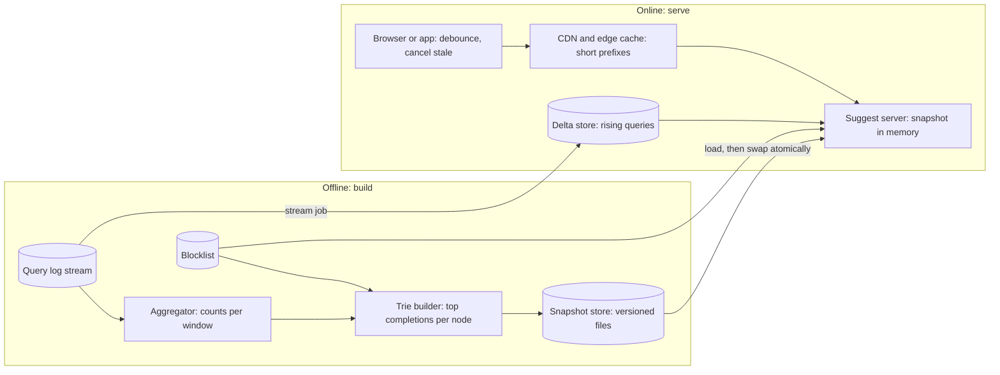
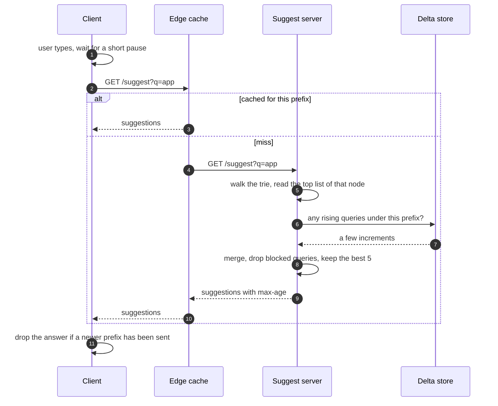

# Module 10: Designing Typeahead and Autocomplete

> **Status:** Production Standard  
> **Difficulty:** Advanced  
> **Estimated Time:** 3–4 Hours  
> **Prerequisites:** Module 00 (Capacity Estimation), Module 01 (System Design Interview Framework), Module 04 (Distributed Cache and Key-Value Store), Module 07 (Large-Scale Search)

---

> [!TIP]
> **The Golden Rule of Typeahead**  
> Typeahead is a **precomputation problem**. A suggestion must appear while the user is still typing, so a request may do almost nothing: walk one path in memory and copy a short list that was **computed beforehand**. Store the best few completions at **every node of a trie**, build them offline from the query logs, add a small stream of fresh increments for what is trending, filter a blocklist when you read, and cache the shortest prefixes, because they carry a large share of the traffic.

---

## 1. Requirements and Scope

| Question to ask | A reasonable answer for this module | What it changes in the design |
| :--- | :--- | :--- |
| What do we suggest? | Whole queries that people have searched, ranked by popularity | The data is a query log, not the documents |
| How many suggestions, and how fast? | The top 5, within a response that feels instant | Fixes the stored list size and the latency budget (section 2) |
| How fresh? | A new trend within minutes; the full ranking rebuilt hourly or daily | An offline build plus an online delta |
| Personal or the same for everyone? | The same for everyone, with language and region; personal history is an extension | Lets you cache by prefix at the edge |
| Typos? | Out of scope at first, then fuzzy matching as an extension | Exact prefix matching is a trie; fuzzy needs more |
| Anything we must never suggest? | Yes: a policy blocklist that takes effect in minutes | A filter at read time, and a stored list longer than the shown one |
| Which languages? | One at first; mention that tokenization and normalization differ by language | A `lang` parameter in the key |

**Non-functional requirements, in order of importance:** latency (suggestions must beat the next keystroke), availability (suggestions are optional, so degrade quietly), freshness, relevance and safety.

---

## 2. Capacity and the Latency Budget

The limit that matters is a human one. Jakob Nielsen's summary of Miller (1968) and Card et al. (1991) gives **0.1 second** as the limit for a system to feel as if it reacts instantaneously, 1 second for the flow of thought to stay uninterrupted and 10 seconds for keeping attention. A suggestion list is meant to feel instantaneous, so the whole path from keystroke to pixels has to fit in about 100 ms. That includes the network, which is not yours to speed up.

**Request volume** is set by the client, not the user's number of searches: if the box asks on every keystroke, a search of 10 characters is 10 requests. On the stand-in query log used in section 10, a request on every keystroke meant **10.76 requests per search**; waiting until the third character cut that to 8.78.

**Skew** decides what to cache: in the same log the **100 most requested prefixes answered 20.4% of all requests**, and 10,000 of them (2.6% of all prefixes) answered 61.0%. Short prefixes are asked by everyone, so a cache of them is small and hot.

**Memory** follows from the number of distinct queries and their length. A trie has at most one node per character of the distinct queries, and shared beginnings reduce that: the stand-in log of 77,036 distinct queries has 1,136,926 characters but needs only **379,732 nodes (33%)**. For a real log, **prune**: a query searched fewer than some threshold of times in the last weeks is never suggested, so it does not need a node.

Section 10 works the arithmetic for load and budget with every assumption labelled.

---

## 3. Interfaces and Data Model

```text
GET /suggest?q=app%20&lang=en&k=5
200 OK
Cache-Control: public, max-age=60
{ "q": "app ", "suggestions": [ { "text": "apple watch", "score": 95 }, ... ] }
```

The response depends only on the normalized prefix, the language and the region, so it can be cached by a CDN. Note that `q=app%20` keeps its **trailing space**: it means "the next word", and trimming it would show the same list as `app`.

| Store | Contents | Written by | Read by |
| :--- | :--- | :--- | :--- |
| Query log (a stream) | one event per search: query, time, language, region | the search service | the aggregator |
| `query_counts` | counts per query per time window | the aggregator (hourly, daily) | the builder |
| Snapshot files | a serialized trie (or sorted arrays) per language and shard, with a version | the builder | the suggest servers, which load it into memory |
| Delta store | recent increments for queries that are rising | a stream job | the suggest servers, at read time |
| Blocklist | queries and patterns that must never be shown | the policy team | the builder and the suggest servers |

Selected suggestions are logged too (what was shown, what was chosen, at which position), because the click-through rate is the metric that tells you whether the ranking is any good.

---

## 4. High-Level Architecture





---

## 5. Deep Dives

### 5.1 The Data Structure: A Trie With Precomputed Top Lists

A **trie** has one node per character, and the path from the root to a node spells a prefix. Finding the node for a prefix of `L` characters costs `L` steps, independent of the number of queries. The question is what to return from that node.

- **Compute at query time:** walk the whole subtree below the node and rank its queries. This is correct and slow for short prefixes, because the node for `a` has a large part of the log below it.
- **Precompute at every node (this module):** keep the best `KEEP` completions in each node. A lookup is `L` steps plus copying the list, and its cost does not depend on the size of the subtree at all. The price is memory (every node holds up to `KEEP` entries; the stand-in log has 379,732 nodes holding 628,626 completions) and a more careful update (section 5.3).

Production systems use more compact structures than one object per character: compressed (radix) tries and arrays, or the finite-state structures of search engines. Elasticsearch's completion suggester says it "uses data structures that enable fast lookups, but are costly to build and are stored in-memory", is "optimized for speed", and that the completion index is "entirely heap resident". Read that as the same design with the same trade: build cost and memory are paid so that a lookup is almost free.

### 5.2 Ranking

The simplest score is the count of searches. Real systems add:

- **Recency:** weight recent searches more, for example by an exponential decay `score = sum of count_i * 2^(-age_i / half_life)`, so a query that was big last year does not outrank one that is rising now.
- **Trending:** the rate of change, not the level, so a new event's query appears quickly.
- **Context:** Google's help page says that predictions reflect real searches and also take into account the query's language, location and trending interest, and for signed-in users past activity. A global, same-for-everyone list keeps the cache simple; adding the language and region to the cache key keeps it correct.

### 5.3 Freshness: A Snapshot and a Delta

Rebuilding the whole structure on every search is out of the question, and rebuilding it only once a day makes the list a day old. Do both:

1. **Offline snapshot** every hour or day: aggregate counts, build the trie with its top lists, publish a version, and let each server **load it and swap atomically**.
2. **Online delta:** a stream job counts the last few minutes and writes the queries that are rising; the server merges these few entries into the node's list at read time.

The program in section 9 shows the incremental part and its limit. `add` can put a query into every node's list on its path because **counts only grow**: a query that was pushed out of a list can only come back by growing past its neighbours, and then it is added. A query whose count *falls* (decay) or is removed cannot be handled that way, because the entry that should replace it is not known without looking below the node. So decay and deletions belong in the offline rebuild.

### 5.4 Safety: A Blocklist That Works in Minutes

Suggestions are a product decision as well as a data structure: a popular query can still be one you must not show. Google's help page says that automated systems try to block predictions that are violent, sexually explicit, hateful, disparaging or dangerous, and that enforcement teams remove those that violate its policies, together with closely related variations. Build for that:

- Apply the blocklist at **build time** *and* at **read time**. Read time is what makes a removal take effect in minutes, without waiting for the next build.
- Store a **longer list than you show** (`KEEP` 5, `SHOW` 3 in the program). If one of the shown entries is blocked, the next one fills the gap instead of leaving a short list.
- Treat related variants (spelling, spacing, case) by normalizing before the comparison.

### 5.5 Caching and the Client

- **Debounce** on the client: wait for a short pause or a minimum number of characters before asking. Waiting for the third character removes about a fifth of the keystroke traffic in the stand-in log; a pause-based rule removes more but depends on how fast people type, which you have to measure on your own users.
- **Cache by normalized prefix** at the browser and at the CDN, with a short `max-age` (about a minute) that trades freshness for hit rate. Short prefixes hit constantly; long ones rarely do.
- **Discard stale answers.** Responses can arrive out of order, so the client ignores an answer for a prefix that is no longer the one in the box (a sequence number, or cancelling the older request).

### 5.6 Sharding and Replication

The snapshot is **read-only between builds**, so the first move is **replication, not sharding**: put the whole snapshot on every suggest server and add servers for more throughput. Shard only when the snapshot no longer fits in the memory of one machine. Then split by prefix range or by a hash of the first two or three characters, route by prefix, and give hot shards (the common first letters) more replicas. Remember that uneven prefixes mean uneven shards.

### 5.7 Typos and Other Languages

An exact-prefix trie cannot suggest `appel` for `apple`. Fuzzy matching allows a few edits; Elasticsearch's completion suggester exposes this as a `fuzzy` option whose defaults include `fuzziness` of `AUTO`, `min_length` of 3 and `prefix_length` of 1. Fuzzy matching visits more candidates than an exact prefix does, so use it only where exact matching returns too little. Normalization (case, accents) must be the same at build time and at query time. In languages written without spaces, the unit of a word differs, so tokenization changes the design.

---

## 6. Scaling and Failure

- **Suggestions are optional.** If the service is slow, return nothing or the last cached list; never block the search box.
- **Keep the old snapshot** until the new one has loaded and passed a check (its size, a few known prefixes), then swap. A bad build must be rolled back by pointing at the previous version.
- **Metrics:** p50 and p99 latency, cache hit rate by prefix length, the share of requests that return nothing, click-through rate and the position of the chosen suggestion, the age of the snapshot, and how long a blocklist change takes to reach every server.
- **Abuse:** the log is user input. A coordinated campaign can push a query into the suggestions, so rate-limit and de-duplicate by user or session before counting, and keep the blocklist path fast.

---

## 7. Reference Matrices

### Data structure options

| Option | Lookup | Memory | Update | Use when |
| :--- | :--- | :--- | :--- | :--- |
| Trie, top-k list at every node | `L` steps plus a list copy | High: nodes times k | Cheap for increases; rebuild for decay | The standard interview answer; the list size is small |
| Trie, top-k computed by walking the subtree | Cost grows with the subtree: bad for short prefixes | Lowest | Trivial | Tiny data sets, or with a cache in front |
| Sorted array of queries, binary search for the prefix range | `log N` plus a scan of the range | Low | Rebuild | Read-only data; ranking needs a range-max structure |
| Search engine completion suggester (in memory) | Very fast | Heap resident | Reindex | You already run the search engine |

### Where each layer helps

| Layer | What it absorbs | Limit |
| :--- | :--- | :--- |
| Client debounce and minimum length | Keystrokes that nobody would see | Depends on typing speed |
| Browser cache | Repeats by the same user | Small |
| CDN and edge cache | Short, popular prefixes (100 prefixes: 20.4% of requests in the stand-in log) | A stale list for the `max-age` |
| Suggest server, in-memory snapshot | Everything else, at microseconds | Memory per replica |

---

## 8. Real Evidence: What Is Documented and What Was Measured

No invented outage here. Three documented statements shape the design, and the rest was measured on the data in section 10.

| Evidence | Source | What it means for the design |
| :--- | :--- | :--- |
| 0.1 s is the limit for "reacting instantaneously" | Nielsen Norman Group, after Miller (1968) and Card et al. (1991) | The 100 ms budget of section 2 |
| The completion suggester is in memory, costly to build and optimized for speed | Elasticsearch reference | Pay at build time, not at query time |
| Predictions reflect real searches, language, location, trends, and policy removals | Google Search help | Log-driven ranking with a safety layer |
| A trie lookup took about 2 microseconds, a scan of every query about 10 ms (roughly 5,000 times slower) | Workflow 1 below, on 77,036 queries | The structure is the whole difference |

---

## 9. Multi-Language Implementation: A Top-K Trie With Increments and a Blocklist

The program builds the trie from a 17-query log, answers prefixes as a user types them (including a trailing space and sloppy capitals), applies a blocklist at read time, adds a trending query incrementally, and then **checks every prefix of every query against a plain scan of the log**. The Python, TypeScript and Go versions print the same 21 lines.

````carousel
```python
"""Typeahead on a tiny query log: a trie that keeps the best few completions at every node, so a lookup walks one path and
copies a list. It also shows an increment (a trending query), a blocklist that is applied when reading, and a check of every
prefix against a plain scan of the log."""

KEEP = 5  # completions stored at each node: more than the 3 shown, so a blocked one can be skipped and still leave 3
SHOW = 3

LOG = [
    ("apple", 120), ("apple watch", 95), ("apple music", 80), ("app store", 70), ("appointment", 40),
    ("application form", 35), ("apply for visa", 30), ("apricot", 12), ("apple scam link", 100),
    ("banana bread", 60), ("banana", 55), ("band", 20), ("bandwidth test", 18),
    ("python", 150), ("python tutorial", 90), ("pytorch", 85), ("pyramid", 14),
]
BLOCKED = {"apple scam link"}


def normalize(text):
    """A query as it is stored: lower case, no spaces at either end, one space between words."""
    return " ".join(text.lower().split())


def normalize_prefix(text):
    """What the user has typed so far: the same, but a space at the end is kept, because it means 'the next word'."""
    cleaned = normalize(text)
    return cleaned + " " if cleaned and text.endswith(" ") else cleaned


class Node:
    def __init__(self):
        self.children = {}
        self.top = []  # up to KEEP pairs (count, query), best first


class Typeahead:
    def __init__(self):
        self.root, self.counts = Node(), {}

    def add(self, query, delta):
        """Add `delta` searches for `query`. Counts only grow here, so a query that fell out of a node's list cannot belong in it."""
        query = normalize(query)
        self.counts[query] = new = self.counts.get(query, 0) + delta
        node = self.root
        for depth in range(len(query) + 1):
            node.top = [entry for entry in node.top if entry[1] != query]
            node.top.append((new, query))
            node.top.sort(key=lambda entry: (-entry[0], entry[1]))
            del node.top[KEEP:]
            if depth < len(query):
                node = node.children.setdefault(query[depth], Node())

    def suggest(self, prefix, blocked=frozenset()):
        node = self.root
        for ch in normalize_prefix(prefix):
            node = node.children.get(ch)
            if node is None:
                return []
        return [(q, c) for c, q in node.top if q not in blocked][:SHOW]

    def scan(self, prefix, blocked=frozenset()):
        """The slow, obviously right answer: look at every query in the log."""
        prefix = normalize_prefix(prefix)
        hits = sorted(((-c, q) for q, c in self.counts.items() if q.startswith(prefix) and q not in blocked))
        return [(q, -c) for c, q in hits[:SHOW]]

    def stats(self):
        nodes = stored = 0
        stack = [self.root]
        while stack:
            node = stack.pop()
            nodes += 1
            stored += len(node.top)
            stack.extend(node.children.values())
        return nodes, stored


def show(label, rows):
    print(f"{label} -> " + (" | ".join(f"{q} ({c})" for q, c in rows) if rows else "(nothing)"))


if __name__ == "__main__":
    ta = Typeahead()
    for query, count in LOG:
        ta.add(query, count)
    nodes, stored = ta.stats()
    print(f"== build ==\n{len(LOG)} queries, {nodes} trie nodes, {stored} stored completions (at most {KEEP} per node)")

    print(f"== top {SHOW} while typing ==")
    for prefix in ["", "a", "app", "apple", "apple ", "apple w", "  APPLE  w", "ban", "py", "xyz"]:
        show(f"'{prefix}'", ta.suggest(prefix))

    print("== a blocklist is applied when reading ==")
    show("'apple' with nothing blocked", ta.suggest("apple"))
    show("'apple' with 'apple scam link' blocked", ta.suggest("apple", BLOCKED))

    print("== a query starts to trend: 'apple vision' +200 searches ==")
    ta.add("apple vision", 200)
    show("'app'", ta.suggest("app", BLOCKED))
    show("'apple v'", ta.suggest("apple v", BLOCKED))

    prefixes = {q[:i] for q in ta.counts for i in range(len(q) + 1)} | {"zzz"}
    agree = all(ta.suggest(p, BLOCKED) == ta.scan(p, BLOCKED) for p in prefixes)
    print(f"== check ==\nthe trie and a full scan of the log agree on all {len(prefixes)} prefixes: {agree}")
```

<!-- slide -->

```typescript
// Typeahead on a tiny query log: a trie that keeps the best few completions at every node, so a lookup walks one path and
// copies a list. It also shows an increment (a trending query), a blocklist that is applied when reading, and a check of every
// prefix against a plain scan of the log.

const KEEP = 5; // completions stored at each node: more than the 3 shown, so a blocked one can be skipped and still leave 3
const SHOW = 3;

type Entry = [number, string]; // [count, query]

const LOG: Entry[] = [
  [120, "apple"], [95, "apple watch"], [80, "apple music"], [70, "app store"], [40, "appointment"],
  [35, "application form"], [30, "apply for visa"], [12, "apricot"], [100, "apple scam link"],
  [60, "banana bread"], [55, "banana"], [20, "band"], [18, "bandwidth test"],
  [150, "python"], [90, "python tutorial"], [85, "pytorch"], [14, "pyramid"],
];
const BLOCKED = new Set(["apple scam link"]);

/** A query as it is stored: lower case, no spaces at either end, one space between words. */
function normalize(text: string): string {
  return text.toLowerCase().split(" ").filter((word) => word !== "").join(" ");
}

/** What the user has typed so far: the same, but a space at the end is kept, because it means 'the next word'. */
function normalizePrefix(text: string): string {
  const cleaned = normalize(text);
  return cleaned !== "" && text.endsWith(" ") ? cleaned + " " : cleaned;
}

class Node {
  children = new Map<string, Node>();
  top: Entry[] = []; // up to KEEP pairs, best first
}

class Typeahead {
  root = new Node();
  counts = new Map<string, number>();

  /** Add `delta` searches for `query`. Counts only grow here, so a query that fell out of a node's list cannot belong in it. */
  add(rawQuery: string, delta: number): void {
    const query = normalize(rawQuery);
    const count = (this.counts.get(query) ?? 0) + delta;
    this.counts.set(query, count);
    const letters = Array.from(query);
    let node = this.root;
    for (let depth = 0; depth <= letters.length; depth++) {
      node.top = node.top.filter((entry) => entry[1] !== query);
      node.top.push([count, query]);
      node.top.sort((a, b) => b[0] - a[0] || (a[1] < b[1] ? -1 : a[1] > b[1] ? 1 : 0));
      node.top.length = Math.min(node.top.length, KEEP);
      if (depth < letters.length) {
        if (!node.children.has(letters[depth])) node.children.set(letters[depth], new Node());
        node = node.children.get(letters[depth])!;
      }
    }
  }

  suggest(prefix: string, blocked: Set<string> = new Set()): Entry[] {
    let node: Node | undefined = this.root;
    for (const ch of normalizePrefix(prefix)) {
      node = node.children.get(ch);
      if (node === undefined) return [];
    }
    return node.top.filter((entry) => !blocked.has(entry[1])).slice(0, SHOW);
  }

  /** The slow, obviously right answer: look at every query in the log. */
  scan(rawPrefix: string, blocked: Set<string> = new Set()): Entry[] {
    const prefix = normalizePrefix(rawPrefix);
    const hits: Entry[] = [];
    for (const [query, count] of this.counts) if (query.startsWith(prefix) && !blocked.has(query)) hits.push([count, query]);
    hits.sort((a, b) => b[0] - a[0] || (a[1] < b[1] ? -1 : a[1] > b[1] ? 1 : 0));
    return hits.slice(0, SHOW);
  }

  stats(): [number, number] {
    let nodes = 0;
    let stored = 0;
    const stack = [this.root];
    while (stack.length > 0) {
      const node = stack.pop()!;
      nodes += 1;
      stored += node.top.length;
      stack.push(...node.children.values());
    }
    return [nodes, stored];
  }
}

function show(label: string, rows: Entry[]): void {
  console.log(`${label} -> ` + (rows.length > 0 ? rows.map(([count, query]) => `${query} (${count})`).join(" | ") : "(nothing)"));
}

const same = (a: Entry[], b: Entry[]) => a.length === b.length && a.every((entry, i) => entry[0] === b[i][0] && entry[1] === b[i][1]);

const ta = new Typeahead();
for (const [count, query] of LOG) ta.add(query, count);
const [nodes, stored] = ta.stats();
console.log(`== build ==\n${LOG.length} queries, ${nodes} trie nodes, ${stored} stored completions (at most ${KEEP} per node)`);

console.log(`== top ${SHOW} while typing ==`);
for (const prefix of ["", "a", "app", "apple", "apple ", "apple w", "  APPLE  w", "ban", "py", "xyz"]) show(`'${prefix}'`, ta.suggest(prefix));

console.log("== a blocklist is applied when reading ==");
show("'apple' with nothing blocked", ta.suggest("apple"));
show("'apple' with 'apple scam link' blocked", ta.suggest("apple", BLOCKED));

console.log("== a query starts to trend: 'apple vision' +200 searches ==");
ta.add("apple vision", 200);
show("'app'", ta.suggest("app", BLOCKED));
show("'apple v'", ta.suggest("apple v", BLOCKED));

const prefixes = new Set<string>(["zzz"]);
for (const query of ta.counts.keys()) for (let i = 0; i <= query.length; i++) prefixes.add(query.slice(0, i));
let agree = true;
for (const prefix of prefixes) if (!same(ta.suggest(prefix, BLOCKED), ta.scan(prefix, BLOCKED))) agree = false;
console.log(`== check ==\nthe trie and a full scan of the log agree on all ${prefixes.size} prefixes: ${agree ? "True" : "False"}`);
```

<!-- slide -->

```go
// Typeahead on a tiny query log: a trie that keeps the best few completions at every node, so a lookup walks one path and
// copies a list. It also shows an increment (a trending query), a blocklist that is applied when reading, and a check of every
// prefix against a plain scan of the log.
package main

import (
	"fmt"
	"sort"
	"strings"
)

const (
	keep = 5 // completions stored at each node: more than the 3 shown, so a blocked one can be skipped and still leave 3
	show = 3
)

type entry struct {
	count int
	query string
}

var logLines = []entry{
	{120, "apple"}, {95, "apple watch"}, {80, "apple music"}, {70, "app store"}, {40, "appointment"},
	{35, "application form"}, {30, "apply for visa"}, {12, "apricot"}, {100, "apple scam link"},
	{60, "banana bread"}, {55, "banana"}, {20, "band"}, {18, "bandwidth test"},
	{150, "python"}, {90, "python tutorial"}, {85, "pytorch"}, {14, "pyramid"},
}

var blocked = map[string]bool{"apple scam link": true}

// normalize is a query as it is stored: lower case, no spaces at either end, one space between words.
func normalize(text string) string {
	return strings.Join(strings.Fields(strings.ToLower(text)), " ")
}

// normalizePrefix is what the user has typed so far: the same, but a space at the end is kept, because it means "the next word".
func normalizePrefix(text string) string {
	cleaned := normalize(text)
	if cleaned != "" && strings.HasSuffix(text, " ") {
		return cleaned + " "
	}
	return cleaned
}

func better(a, b entry) bool {
	if a.count != b.count {
		return a.count > b.count
	}
	return a.query < b.query
}

type node struct {
	children map[byte]*node
	top      []entry // up to keep entries, best first
}

func newNode() *node { return &node{children: map[byte]*node{}} }

type typeahead struct {
	root   *node
	counts map[string]int
}

func newTypeahead() *typeahead { return &typeahead{root: newNode(), counts: map[string]int{}} }

// add records delta more searches for the query. Counts only grow here, so a query that fell out of a node's list cannot belong in it.
func (t *typeahead) add(raw string, delta int) {
	query := normalize(raw)
	t.counts[query] += delta
	count := t.counts[query]
	n := t.root
	for depth := 0; depth <= len(query); depth++ {
		kept := n.top[:0:0]
		for _, e := range n.top {
			if e.query != query {
				kept = append(kept, e)
			}
		}
		kept = append(kept, entry{count, query})
		sort.Slice(kept, func(i, j int) bool { return better(kept[i], kept[j]) })
		if len(kept) > keep {
			kept = kept[:keep]
		}
		n.top = kept
		if depth < len(query) {
			child, ok := n.children[query[depth]]
			if !ok {
				child = newNode()
				n.children[query[depth]] = child
			}
			n = child
		}
	}
}

func (t *typeahead) suggest(prefix string, skip map[string]bool) []entry {
	n := t.root
	typed := normalizePrefix(prefix)
	for i := 0; i < len(typed); i++ {
		next, ok := n.children[typed[i]]
		if !ok {
			return nil
		}
		n = next
	}
	var out []entry
	for _, e := range n.top {
		if !skip[e.query] && len(out) < show {
			out = append(out, e)
		}
	}
	return out
}

// scan is the slow, obviously right answer: look at every query in the log.
func (t *typeahead) scan(prefix string, skip map[string]bool) []entry {
	typed := normalizePrefix(prefix)
	var hits []entry
	for query, count := range t.counts {
		if strings.HasPrefix(query, typed) && !skip[query] {
			hits = append(hits, entry{count, query})
		}
	}
	sort.Slice(hits, func(i, j int) bool { return better(hits[i], hits[j]) })
	if len(hits) > show {
		hits = hits[:show]
	}
	return hits
}

func (t *typeahead) stats() (int, int) {
	nodes, stored := 0, 0
	stack := []*node{t.root}
	for len(stack) > 0 {
		n := stack[len(stack)-1]
		stack = stack[:len(stack)-1]
		nodes++
		stored += len(n.top)
		for _, child := range n.children {
			stack = append(stack, child)
		}
	}
	return nodes, stored
}

func display(label string, rows []entry) {
	if len(rows) == 0 {
		fmt.Printf("%s -> (nothing)\n", label)
		return
	}
	parts := make([]string, len(rows))
	for i, e := range rows {
		parts[i] = fmt.Sprintf("%s (%d)", e.query, e.count)
	}
	fmt.Printf("%s -> %s\n", label, strings.Join(parts, " | "))
}

func same(a, b []entry) bool {
	if len(a) != len(b) {
		return false
	}
	for i := range a {
		if a[i] != b[i] {
			return false
		}
	}
	return true
}

func main() {
	ta := newTypeahead()
	for _, e := range logLines {
		ta.add(e.query, e.count)
	}
	nodes, stored := ta.stats()
	fmt.Printf("== build ==\n%d queries, %d trie nodes, %d stored completions (at most %d per node)\n", len(logLines), nodes, stored, keep)

	fmt.Printf("== top %d while typing ==\n", show)
	for _, prefix := range []string{"", "a", "app", "apple", "apple ", "apple w", "  APPLE  w", "ban", "py", "xyz"} {
		display("'"+prefix+"'", ta.suggest(prefix, nil))
	}

	fmt.Println("== a blocklist is applied when reading ==")
	display("'apple' with nothing blocked", ta.suggest("apple", nil))
	display("'apple' with 'apple scam link' blocked", ta.suggest("apple", blocked))

	fmt.Println("== a query starts to trend: 'apple vision' +200 searches ==")
	ta.add("apple vision", 200)
	display("'app'", ta.suggest("app", blocked))
	display("'apple v'", ta.suggest("apple v", blocked))

	prefixes := map[string]bool{"zzz": true}
	for query := range ta.counts {
		for i := 0; i <= len(query); i++ {
			prefixes[query[:i]] = true
		}
	}
	agree := true
	for prefix := range prefixes {
		if !same(ta.suggest(prefix, blocked), ta.scan(prefix, blocked)) {
			agree = false
		}
	}
	verdict := "False"
	if agree {
		verdict = "True"
	}
	fmt.Printf("== check ==\nthe trie and a full scan of the log agree on all %d prefixes: %s\n", len(prefixes), verdict)
}
```
````

**Observed output (identical in Python 3.13.14, Node 24 and Go 1.22):**

```text
== build ==
17 queries, 114 trie nodes, 163 stored completions (at most 5 per node)
== top 3 while typing ==
'' -> python (150) | apple (120) | apple scam link (100)
'a' -> apple (120) | apple scam link (100) | apple watch (95)
'app' -> apple (120) | apple scam link (100) | apple watch (95)
'apple' -> apple (120) | apple scam link (100) | apple watch (95)
'apple ' -> apple scam link (100) | apple watch (95) | apple music (80)
'apple w' -> apple watch (95)
'  APPLE  w' -> apple watch (95)
'ban' -> banana bread (60) | banana (55) | band (20)
'py' -> python (150) | python tutorial (90) | pytorch (85)
'xyz' -> (nothing)
== a blocklist is applied when reading ==
'apple' with nothing blocked -> apple (120) | apple scam link (100) | apple watch (95)
'apple' with 'apple scam link' blocked -> apple (120) | apple watch (95) | apple music (80)
== a query starts to trend: 'apple vision' +200 searches ==
'app' -> apple vision (200) | apple (120) | apple watch (95)
'apple v' -> apple vision (200)
== check ==
the trie and a full scan of the log agree on all 121 prefixes: True
```

What to notice:

- **Each prefix answers from one node:** `'a'`, `'app'` and `'apple'` give the same top three because every query under them starts the same way; at `'apple '` (with the space) the list changes to the next-word completions.
- **Normalization:** `'  APPLE  w'` gives the same answer as `'apple w'`: the lookup never depends on how the user spaced or capitalized the text.
- **The blocklist works because the list is longer than what is shown:** with `apple scam link` blocked, `'apple'` still shows three entries (`apple`, `apple watch`, `apple music`), because the node stores five.
- **Trending:** after 200 searches of `apple vision`, it is first for `'app'` at once, because `add` inserted it into every node on its path.
- **Correctness:** all 121 prefixes (every prefix of every query, plus one that matches nothing) agree with the slow scan, which is the test to keep when you change the data structure.

---

## 10. Practical Hands-On Verification Workflows (Python 3.13)

Save the program above as `typeahead.py`; the workflows import it. They use a **real text corpus that ships with Python**: the language reference text in `pydoc_data.topics`. Its 1-, 2- and 3-word sequences, counted, stand in for a query log. Real query logs are more skewed and have a different vocabulary, so treat the shapes as meaningful and the exact shares as belonging to this corpus; measure your own log.

### Workflow 1: A Trie Against a Scan of Everything

```python
"""A trie with top-5 lists against a scan of the whole log, on a real text corpus: the Python language reference that ships with
Python (pydoc_data.topics). Its 1-, 2- and 3-word sequences, counted, stand in for a query log."""
import random
import re
import statistics
import time
from collections import Counter

import pydoc_data.topics as docs

from typeahead import Typeahead

text = " ".join(docs.topics[name] for name in sorted(docs.topics)).lower()
words = re.findall(r"[a-z]+", text)
counts = Counter()
for size in (1, 2, 3):
    counts.update(" ".join(words[i:i + size]) for i in range(len(words) - size + 1))
print(f"corpus: {len(docs.topics)} topics, {len(words):,} words, {len(counts):,} distinct 'queries' (1 to 3 words)")
print("most frequent:", ", ".join(f"{q!r} x{c}" for q, c in counts.most_common(4)))

start = time.perf_counter()
index = Typeahead()
for query, count in counts.items():
    index.add(query, count)
build_s = time.perf_counter() - start
nodes, stored = index.stats()
characters = sum(len(q) for q in counts)
print(f"\nbuild: {build_s:.1f} s for {len(counts):,} queries -> {nodes:,} trie nodes holding {stored:,} completions")
print(f"the queries have {characters:,} characters in all; sharing prefixes needs {nodes:,} nodes ({nodes / characters:.0%})")

random.seed(7)
queries = list(counts)
chosen = random.choices(queries, weights=[counts[q] for q in queries], k=3000)  # users search what is popular
typed = [q[: random.randint(1, len(q))] for q in chosen]  # and stop typing after some letters

timings = []
for prefix in typed:
    t0 = time.perf_counter_ns()
    index.suggest(prefix)
    timings.append((time.perf_counter_ns() - t0) / 1000)
timings.sort()
print(f"\ntrie lookup over {len(typed):,} typed prefixes: mean {statistics.mean(timings):.1f} us, p99 {timings[int(len(timings) * 0.99)]:.1f} us")

sample = typed[:60]
t0 = time.perf_counter()
answers = [index.scan(prefix) for prefix in sample]
scan_ms = (time.perf_counter() - t0) / len(sample) * 1000
print(f"scan of every query:  mean {scan_ms:.1f} ms per prefix over {len(sample)} prefixes ({scan_ms * 1000 / statistics.mean(timings):,.0f} times slower)")
print("the two agree on all", len(sample), "sampled prefixes:", all(index.suggest(p) == a for p, a in zip(sample, answers)))

print(f"\nfor the prefix {typed[0]!r}:", index.suggest(typed[0]))
print("for the prefix 'the ':", index.suggest("the "))
```

**Observed Output (timings vary by machine, ratios do not):**

```text
corpus: 80 topics, 72,718 words, 77,036 distinct 'queries' (1 to 3 words)
most frequent: 'the' x5102, 'a' x2119, 'is' x1993, 'of' x1559

build: 2.0 s for 77,036 queries -> 379,732 trie nodes holding 628,626 completions
the queries have 1,136,926 characters in all; sharing prefixes needs 379,732 nodes (33%)

trie lookup over 3,000 typed prefixes: mean 2.0 us, p99 5.6 us
scan of every query:  mean 10.0 ms per prefix over 60 prefixes (4,984 times slower)
the two agree on all 60 sampled prefixes: True

for the prefix 'po': [('point', 69), ('positional', 62), ('possible', 36)]
for the prefix 'the ': [('the same', 172), ('the class', 154), ('the function', 109)]
```

A lookup is microseconds because it follows about as many steps as the prefix has characters and copies at most five entries. The scan has to look at all 77,036 queries. The index also shares prefixes: 1.1 million characters of queries need 380 thousand nodes.

### Workflow 2: Where the Requests Go

```python
"""Where do the requests go? One request per keystroke is sent for every prefix of every search. With the counts of the same
stand-in query log as Workflow 1, the load on each prefix is exact: the number of searches of the queries that start with it."""
import re
from collections import Counter

import pydoc_data.topics as docs

text = " ".join(docs.topics[name] for name in sorted(docs.topics)).lower()
words = re.findall(r"[a-z]+", text)
counts = Counter()
for size in (1, 2, 3):
    counts.update(" ".join(words[i:i + size]) for i in range(len(words) - size + 1))

load = Counter()  # prefix -> requests it receives if every keystroke sends one
by_length = Counter()
searches = sum(counts.values())
for query, count in counts.items():
    for i in range(1, len(query) + 1):
        load[query[:i]] += count
        by_length[i] += count

total = sum(load.values())
print(f"{searches:,} searches, {len(load):,} distinct prefixes, {total:,} requests if every keystroke sends one")
print(f"requests per search with a request on every keystroke: {total / searches:.2f}")

print("\nshare of all requests by prefix length")
cumulative = 0
for length in range(1, 7):
    cumulative += by_length[length]
    print(f"  length {length}: {by_length[length] / total:6.1%} of requests   (lengths 1 to {length}: {cumulative / total:6.1%})")

print("\na cache that holds only the most requested prefixes")
ranked = sorted(load.values(), reverse=True)
for size in (100, 1_000, 10_000, 100_000):
    hits = sum(ranked[:size])
    print(f"  {size:>7,} prefixes ({size / len(load):5.1%} of all) answer {hits / total:6.1%} of requests")

print("\nrequests per search if the client waits for a minimum number of characters")
for minimum in (1, 2, 3, 4):
    sent = sum(count * max(0, len(query) - minimum + 1) for query, count in counts.items())
    print(f"  from character {minimum}: {sent / searches:5.2f} per search ({sent / total:5.1%} of the keystroke traffic)")
```

**Observed Output:**

```text
218,151 searches, 379,731 distinct prefixes, 2,346,374 requests if every keystroke sends one
requests per search with a request on every keystroke: 10.76

share of all requests by prefix length
  length 1:   9.3% of requests   (lengths 1 to 1:   9.3%)
  length 2:   9.1% of requests   (lengths 1 to 2:  18.4%)
  length 3:   8.6% of requests   (lengths 1 to 3:  27.0%)
  length 4:   8.0% of requests   (lengths 1 to 4:  35.1%)
  length 5:   7.6% of requests   (lengths 1 to 5:  42.6%)
  length 6:   7.2% of requests   (lengths 1 to 6:  49.8%)

a cache that holds only the most requested prefixes
      100 prefixes ( 0.0% of all) answer  20.4% of requests
    1,000 prefixes ( 0.3% of all) answer  40.1% of requests
   10,000 prefixes ( 2.6% of all) answer  61.0% of requests
  100,000 prefixes (26.3% of all) answer  83.0% of requests

requests per search if the client waits for a minimum number of characters
  from character 1: 10.76 per search (100.0% of the keystroke traffic)
  from character 2:  9.76 per search (90.7% of the keystroke traffic)
  from character 3:  8.78 per search (81.6% of the keystroke traffic)
  from character 4:  7.85 per search (73.0% of the keystroke traffic)
```

Every prefix of every search is a request when the client asks on every keystroke, so the load of a prefix is exactly the number of searches of the queries beneath it. A tiny set of prefixes carries a large share: **100 prefixes answer about a fifth of the requests and 10,000 answer 61%**. A minimum length trims about a tenth per character here (the queries are long), which is why debouncing by time matters more than a character count.

### Workflow 3: The Load and the Latency Budget

```python
"""The serving budget of a typeahead service. Numbers marked ASSUMED are choices to be replaced by your own measurements;
the others are measured in Workflows 1 and 2 on the stand-in query log."""
# ASSUMED product numbers
DAU = 10_000_000
SEARCHES_PER_USER = 5
PEAK_OVER_AVERAGE = 3.0
# Measured in Workflow 2
EVERY_KEYSTROKE, FROM_CHARACTER_3 = 10.76, 8.78
CACHE_HIT_TOP_10K = 0.610
# Measured in Workflow 1
LOOKUP_US = 2.0
# The limit for a response that feels instantaneous (Nielsen, after Miller 1968 and Card et al. 1991)
LIMIT_MS = 100

print("load, in requests per second")
print(f"{'client behaviour':32} {'per search':>10} {'average':>9} {'peak':>9} {'origin peak, 61% cached':>24}")
for name, per_search in [("a request on every keystroke", EVERY_KEYSTROKE), ("nothing before character 3", FROM_CHARACTER_3),
                         ("ASSUMED: debounce halves that", FROM_CHARACTER_3 / 2)]:
    average = DAU * SEARCHES_PER_USER * per_search / 86_400
    peak = average * PEAK_OVER_AVERAGE
    print(f"{name:32} {per_search:>10.2f} {average:>9,.0f} {peak:>9,.0f} {peak * (1 - CACHE_HIT_TOP_10K):>24,.0f}")

print(f"\nlatency budget: {LIMIT_MS} ms from keystroke to suggestions on screen")
print(f"{'ASSUMED network':28} {'round trip':>10} {'render':>7} {'left for the server':>20} {'lookup is':>10}")
for name, rtt in [("same city, wired", 20), ("4G phone", 70), ("far away, congested", 150)]:
    render = 10
    left = LIMIT_MS - rtt - render
    share = f"{LOOKUP_US / 1000 / left:.4%}" if left > 0 else "over budget"
    print(f"{name:28} {rtt:>7} ms {render:>4} ms {left:>17} ms {share:>10}")
```

**Observed Output:**

```text
load, in requests per second
client behaviour                 per search   average      peak  origin peak, 61% cached
a request on every keystroke          10.76     6,227    18,681                    7,285
nothing before character 3             8.78     5,081    15,243                    5,945
ASSUMED: debounce halves that          4.39     2,541     7,622                    2,972

latency budget: 100 ms from keystroke to suggestions on screen
ASSUMED network              round trip  render  left for the server  lookup is
same city, wired                  20 ms   10 ms                70 ms    0.0029%
4G phone                          70 ms   10 ms                20 ms    0.0100%
far away, congested              150 ms   10 ms               -60 ms over budget
```

The numbers marked ASSUMED are choices, not facts; the point is the shape. The lookup itself is a few thousandths of a percent of the budget, so the budget is spent on the network and the cache, not on the data structure. On a distant, congested network there is **nothing left** (a negative budget), which is the argument for edge caches and for answering short prefixes from a CDN near the user.

---

## 11. Hands-On Exercises and Independent Challenge

### Practical Exercises

1. **Walk it by hand.** For the 17-query log, write the stored top list of the node for `ap` and of the node for `apple `, then check them against the program. Which query is in the `ap` list but not in the `apple ` list, and why?
2. **Break the increment.** In the program, add a way to reduce a query's count. Find a case where the trie then disagrees with the scan, and explain why recomputing the node from its children fixes it.
3. **Two scores.** Change the ranking to `count_this_hour * 5 + count_older`, with made-up hourly counts for the 17 queries. Which prefixes change their answer?
4. **Budget it.** Re-run Workflow 3 with 50 million daily users and a client that waits for a pause. State your assumption for requests per search and what it does to the origin load.

### Independent Challenge

Design suggestions for a shop with 20 million products. Requirements: the same suggestions must also show category names ("apple in Phones"), a seller can boost their own items for a fee, typos like `iphon` must work, and a product that just went viral must appear within ten minutes. Give the data structure, the build and update path, how a boost is kept from distorting the ranking, and how you would test relevance.

<details><summary>Architectural Discussion</summary>

**Structure.** Two kinds of entries in one trie keyed by normalized text: queries (from the log) and catalogue terms (titles, brands, categories), each with a type so a "category" row can be shown as `apple in Phones`. Rank by a blend of query popularity and catalogue signals (stock, sales), not by text alone.

**Updates.** The nightly build produces the snapshot. A stream job over the last ten minutes of searches and orders writes the rising entries to the delta store, which the server merges at read time; this is what lets a viral product appear within ten minutes.

**Boosts.** Cap a boost to a bounded multiplier and require a minimum organic score, so a paid item cannot jump to the top of a prefix it has no relation to; log boosted impressions separately so click-through is not inflated.

**Typos.** Add a fuzzy path with a small edit distance and a minimum prefix length (the Elasticsearch defaults of fuzziness `AUTO`, `prefix_length` 1 and `min_length` 3 are a sensible starting point), and run it only when the exact lookup returns too little.

**Testing.** Replay a recorded set of real typed prefixes against each build and compare the top results with the previous build; alert on a large change. Track click-through and the position of the chosen suggestion online.

</details>

---

## 12. Common Mistakes and Troubleshooting

- **Computing the top k at query time from the subtree.** The prefix `a` is the common one and the most expensive one. Precompute.
- **Trimming the space.** `"apple "` is a different request from `"apple"`. Keep the trailing space and normalize everything else.
- **Storing only as many as you show.** A blocklist then leaves holes. Store more than `SHOW`.
- **Updating counts downward in place.** The incremental path in the program is only valid for increases; do decay and deletion in the rebuild.
- **Filtering the blocklist only at build time.** A removal then waits for the next build. Filter at read time too.
- **Personal suggestions in a shared cache.** If the answer depends on the user, it cannot be cached by prefix alone; keep the personal part separate and small.
- **Ignoring out-of-order responses.** The user sees the list for `app` after typing `apple`. Number the requests or cancel the old one.
- **No pruning.** Every query ever typed, once, takes nodes and is never suggested. Drop the long tail below a count threshold.

---

## 13. Operational Validation Checkpoints and Checkpoint Quiz

<details><summary><strong>Checkpoint 1: Latency is fine in the data centre but users on phones complain. Where do you look?</strong></summary>

The server does microseconds of work, so the time is in the network and the client. Measure the round trip from phones, serve short prefixes from an edge cache, lengthen `max-age` for them, reduce request count with debouncing, and make the client discard stale answers so a slow response does not replace a newer one.

</details>

<details><summary><strong>Checkpoint 2: A harmful suggestion is reported at noon. How fast can you remove it?</strong></summary>

At read time, within minutes: add it to the blocklist that the servers consult on every request, and purge the cached copies of the affected prefixes at the edge. The next snapshot build also applies the blocklist, so the removal lasts. Because each node stores more entries than are shown, the list does not shrink.

</details>

<details><summary><strong>Checkpoint 3: A new query is trending but does not appear until tomorrow. Why?</strong></summary>

It only exists in the next snapshot. Add the online delta: a stream job counts recent searches and the server merges the rising entries into the node's list at read time, and the increment path shown in the program puts them in at once.

</details>

### Checkpoint Quiz

1. Why does storing the top k at every node of a trie make a lookup independent of the size of the log?
2. What is the cost of that choice, and which kind of update does it make hard?
3. Why should a stored list be longer than the shown list?
4. In the stand-in log, what fraction of requests did the 100 most requested prefixes answer, and what does it imply for caching?
5. Why is the trailing space part of the request?

<details><summary>Answers</summary>

1. The lookup walks one path (one step per character of the prefix) to a node and copies a list that was computed in advance, so no part of the subtree below the node is visited.
2. Memory: each node holds up to k entries, so storage is nodes times k. It makes **decreases and removals** hard to apply in place, because the entry that should replace a removed one is not known without looking below the node; those are done in the offline rebuild.
3. Because entries may be removed at read time (blocklist) and the user must still see the full number of suggestions.
4. About 20.4% (100 prefixes), 40.1% for 1,000 and 61.0% for 10,000. A small cache of the shortest, most popular prefixes absorbs a large share of the load.
5. A trailing space means the user finished a word and wants the next one; trimming it would return the same list as the shorter prefix.

</details>

---

## 14. Interview Practice

> [!interview]
> "Design search-as-you-type suggestions for a site with 100 million daily users." Walk me through your answer.

<details><summary>What a strong answer covers</summary>

- Scope: whole queries ranked by popularity, top 5, instant, same for everyone with language and region, a blocklist.
- The 100 ms budget, where it is spent (network, not lookup), and the request volume per search with the client's debounce rule.
- The trie with the top list at each node, why that makes lookups independent of the log size, and what it costs.
- The pipeline: log, aggregation, builder, versioned snapshot, atomic swap, plus an online delta for trends.
- Caching by prefix at the edge with a short max-age; replication before sharding; how sharding by prefix would work.
- Safety (blocklist at build and read time), failure (suggestions optional), and metrics (click-through, empty rate, freshness).

</details>

> [!interview]
> Your suggestions show a query that you must remove right now, and a new viral query is missing. Explain both fixes.

<details><summary>What a strong answer covers</summary>

- Removal: a read-time blocklist and an edge purge, then the next build applies it too; the stored list is longer than the shown list so it stays full.
- Missing trend: the online delta merged at read time, fed by a stream job over the last minutes; the increment path works because counts only grow.
- Why the offline rebuild still matters: decay, deletions and re-ranking cannot be done by increments alone.

</details>

---

## Further Reading and Sources

- [Elasticsearch reference: Search suggesters, the completion suggester](https://www.elastic.co/docs/reference/elasticsearch/rest-apis/search-suggesters) — in-memory, costly to build, optimized for speed, heap resident; `skip_duplicates`, `fuzzy` and `size` options quoted above.
- [Google Search Help: How Google Autocomplete predictions work](https://support.google.com/websearch/answer/7368877) — predictions reflect real searches, language, location and trends; the policies behind removals.
- [Nielsen Norman Group: Response Times, The 3 Important Limits](https://www.nngroup.com/articles/response-times-3-important-limits/) — the 0.1 s, 1 s and 10 s limits and their origin in Miller (1968) and Card et al. (1991).

## Next

- [← Back to Module 09: Designing a Web Crawler](../09-designing-a-web-crawler/README.md)
- [Back to System Design Track Overview](../README.md)
- Continue to **[Module 11: Designing a Leaderboard](../11-designing-a-leaderboard/README.md)**, where the data structure is a sorted set and the hard question is the rank of one player among millions.
