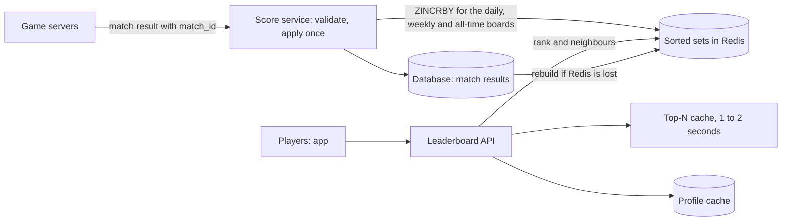
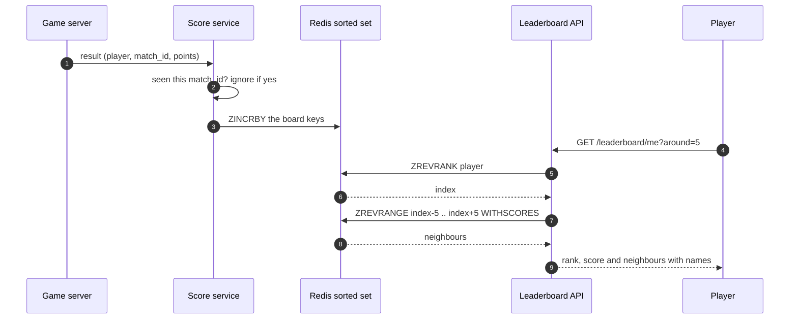

# Module 11: Designing a Leaderboard

> **Status:** Production Standard  
> **Difficulty:** Advanced  
> **Estimated Time:** 3–4 Hours  
> **Prerequisites:** Module 00 (Capacity Estimation), Module 01 (System Design Interview Framework), Module 04 (Distributed Cache and Key-Value Store), Module 05 (News Feed, for read-heavy fan-out)

---

> [!TIP]
> **The Golden Rule of Leaderboards**  
> A leaderboard is an **order-statistic problem**: you need the top N, the **rank of one player**, and the entries around that player, all while scores keep changing. Keep the players in a structure that is **always sorted and can count** (a skip list, which is what a Redis sorted set uses), so a rank is a lookup and not a scan. Decide how **ties** are broken before you write code. And when one machine is not enough, remember that only the top of the board needs exact positions; below it, an estimate is usually what a player wants.

---

## 1. Requirements and Scope

| Question to ask | A reasonable answer for this module | What it changes in the design |
| :--- | :--- | :--- |
| Which boards? | Global, friends, and time windows (daily, weekly, season) | One ordered set per board and window |
| What does a player ask for? | The top N, their own rank, and the players just above and below them | Rank and range queries, not only "top N" |
| How many players, how many updates? | Tens of millions of players, each finishing a few matches a day | Sets the memory and the write rate (section 2) |
| How fresh must a rank be? | A few seconds | Lets the top N be cached briefly |
| How are ties broken? | The player who reached the score first ranks higher | A tie-break rule that survives the storage format |
| Who decides a score? | The server, from verified match results | Cheating is handled by never trusting the client |
| Is a score ever corrected? | Yes: a cheater is removed, a match is voided | Removal and decrease must work |
| Must it survive a crash? | The scores must; the ordered index can be rebuilt | The database is the truth; the sorted set is derived |

**Out of scope, said out loud:** matchmaking, the game itself, payments for rewards, and rendering.

---

## 2. Capacity Estimation

**Memory** comes first, and it is measured, not guessed: a real Redis sorted set (Workflow 2) used **106, 96 and 94 bytes per player** at 10 thousand, 100 thousand and 1 million players, with player names 14 characters long. At 94 bytes, **100 million players need about 9 GiB** for one board. Daily, weekly and all-time boards each hold their own copy of the players who played in the window, so the total is a few times that for active players and much less for the all-time tail.

**Writes** are small. 10 million daily players finishing 5 matches each is 50 million score updates a day, about 580 per second on average; at a peak of three times the average, about 1,700 per second. Each update touches the daily, weekly and all-time sets, so about three times as many sorted-set operations. Measure this on your own hardware, but it is not a number that forces sharding by itself.

**Reads** are the heavy side: every player who opens the board asks for the top N and for their own rank. The top N is the same for everyone, so cache it for a second or two and serve it from the cache. The player's own rank cannot be cached across players, and it is the operation that must be cheap.

**Why the structure matters:** the rank of a player in a relational table is `1 + COUNT(*) WHERE score > mine`. On an indexed table of 1 million players, that took 3,065 microseconds in Workflow 3, ten times the time at 100 thousand players. At 100 million players, if it kept growing in proportion, it would be about 300 milliseconds for one player's rank. A sorted set answers the same question in a time that did not grow across the same 100-fold range.

---

## 3. Interfaces and Data Model

```text
POST /scores           { "player": "p42", "match_id": "m-9f3", "points": 30 }     # server to server
GET  /leaderboard      ?window=weekly&limit=10
GET  /leaderboard/me   ?window=weekly&around=5      # my rank, score, and 5 players above and below
```

`match_id` makes the update **idempotent**: a retried or replayed event must not add its points twice (the same idempotency idea as in the distributed-systems track). The score service records the `match_id` and applies each one once.

| Store | Key and value | Notes |
| :--- | :--- | :--- |
| Database (source of truth) | one row per match result: `match_id`, player, points, time | Never loses a result; the sorted sets can be rebuilt from it |
| Sorted set per board and window | `lb:weekly:2026-W47` : member `player id`, score `points` | Derived and fast; the window id is in the key name |
| Profile cache | `player id` to name and avatar | Joined at read time; do not put names in the sorted set |
| Top-N cache | the rendered top 100 of a board, a second or two old | Absorbs the many readers who ask for the same list |

**Windows are key names.** A weekly board for week 47 is a different key from week 48, so a new week starts empty with no mass delete, an old key can be given an expiry, and the final top N is copied to the database before the key is dropped.

---

## 4. High-Level Architecture





---

## 5. Deep Dives

### 5.1 Why a Query on a Table Is Not Enough

The top N is easy for a database: an index on the score returns the first ten entries in an almost constant time (the `top 10` column of Workflow 3 stays at about 5 microseconds from 10 thousand to a million rows). The rank is the problem. An ordinary index does not know *how many entries are before this one*, so `COUNT(*) WHERE score > mine` walks the entries and gets slower in proportion to the table (28, 252 and 3,065 microseconds for 10 thousand, 100 thousand and a million rows). A structure that **stores counts as well as order**, called an order-statistic structure, answers a rank in logarithmic time. A skip list with counts on its links is one.

### 5.2 The Redis Sorted Set

Redis's documentation describes it directly: a sorted set is "a collection of unique strings (members) ordered by an associated score", "implemented via a dual-ported data structure containing both a skip list and a hash table, so every time we add an element Redis performs an O(log(N)) operation". The hash table answers "what is this player's score", and the skip list keeps the order. The commands a leaderboard uses, with the complexities from Redis's own command pages:

| Need | Command | Cost |
| :--- | :--- | :--- |
| Add points | `ZINCRBY board 30 player` (or `ZADD`) | O(log N) |
| Rank of one player, best first, counting from 0 | `ZREVRANK board player` | O(log N) |
| Top 10 with scores | `ZREVRANGE board 0 9 WITHSCORES` | O(log N + M), M the entries returned |
| Neighbours of a player | `ZREVRANK`, then `ZREVRANGE board (rank-5) (rank+5)` | O(log N + M) |
| Remove a cheater | `ZREM board player` | O(log N) for each member removed |

Measured on a real server (Redis 7.4.12 in Docker, called from Python on the same machine, section 10), one command took about **0.4 to 0.5 ms for 10 thousand, 100 thousand and 1 million players alike**. Most of that is very likely the round trip, which does not depend on the number of players; the point is that the structure's cost stays far below it.

The skip list itself is William Pugh's 1990 invention: a linked list with extra, randomly chosen "express" pointers that skip over runs of entries, giving expected logarithmic search, insertion and deletion without the rebalancing code that balanced trees need.

### 5.3 Ties: Decide, Then Make the Storage Obey

Many players have the same score, so **the order among equals is a product decision**. Two different questions hide in it.

- **Which rank do equal players show?** The *ordinal* rank gives each player their own position (1, 2, 3, 4); the *competition* rank gives equals the same rank (1, 2, 2, 4). The program in section 9 prints both: `bob` and `dev` have 95 points and the ordinal ranks 2 and 3, but both are competition rank 2.
- **Who is listed first among equals?** In Redis, "if B and A have exactly the same score, then A > B if the A string is lexicographically greater than the B string". Best-first listing reverses that, so **`dev` comes before `bob`** (Workflow 1 shows this on a real server). If you want "the player who reached the score first ranks higher", put that into the score.

A **composite score** does that: `points * 2^21 + (2^21 - 1 - seconds since the season began)`. At equal points, the earlier player has the larger composite. Workflow 1 shows it working, and also where it stops: a Redis score is a floating-point number, so whole numbers are exact only up to 2^53. With 2^40 points and a 21-bit time field, the composite needs 61 bits, and two players who reached the score 100 seconds apart got **the same stored score**, so the order fell back to the names. Budget the bits: for example 30 bits of points (up to about a billion) and 23 bits of seconds (about 97 days) fit in 53 exactly.

### 5.4 Around Me, Friends and Windows

- **Around me:** read the player's index with `ZREVRANK`, then a range around it. Both are logarithmic, and the second returns only what you show.
- **Friends only:** a player has a few hundred friends, so fetch their scores in one pipelined call and sort those rows in the application. A global structure is not needed for a small set.
- **Daily, weekly, all-time:** one sorted set per window, all updated by the same score event (three `ZINCRBY` in one pipeline). A new window is a new key.
- **A rolling "last 7 days":** this is not a fixed key. Keep one set per day and combine them on demand for the few players who ask, or accept a fixed weekly window.

### 5.5 Scaling Past One Node

1. **Replicate for reads.** The top N and the neighbours are reads; replicas and a one- or two-second cache absorb them.
2. **Shard by player hash.** Each shard holds a slice of the players. The top N is the merge of each shard's top N; the rank of a player is **the sum, over all shards, of the number of players with a higher score** (a `ZCOUNT` per shard), so every rank costs one call per shard.
3. **Shard by score range.** Each shard holds a band of scores. The top N comes from the top shard, and a rank is the number of players in higher bands plus the rank inside the band. It needs the band counts, and scores move between bands, but a rank costs one shard call plus a count.
4. **Estimate below the top.** Keep a histogram of how many players are in each score bucket. A player's rank is then the players in higher buckets plus a guess inside their own; the program in section 9 does this with buckets 50 wide for 1,000 players and was off by 2, 4, 9 and 4 positions at ranks 10, 100, 500 and 897. Show exact ranks for the top few thousand and "top 12%" below.

### 5.6 Consistency and Durability

The sorted set is an **index**. The truth is the stream of verified match results, so:

- Apply each result **once** (the `match_id`), and keep the results in the database.
- Redis persistence (snapshots, an append-only log) and failover can lose the last moments of writes. Treat that as a gap to **replay** from the database, not as lost scores.
- A rebuild job must exist and be tested: read the results, recompute each player's score, and fill a new key, then switch the name. This is also how a voided match or a removed cheater is corrected.

### 5.7 Cheating and Abuse

Scores come from the **server**, computed from a match the server watched; a client that posts its own score can post anything. Rate-limit updates per player, flag scores that jump past what a match can give, and make removal fast: `ZREM` the player from every window, record the reason, and let the ranks close up, as the program shows when `alice` is removed and `carol` becomes rank 1.

---

## 6. Scaling and Failure

- **A hot key.** Every reader hits the same board. The top-N cache and replicas turn millions of reads into a few requests to the primary.
- **A rebuild in progress.** Serve the old key until the new one is complete, then switch; never serve a half-built board.
- **Metrics:** update latency, rank-lookup latency, cache hit rate for the top N, the lag between a match result and its appearance on the board, the size of each key, and the number of removals.
- **Failure:** if Redis is down, show the cached top N and say the player's own rank is unavailable, rather than an error page.

---

## 7. Reference Matrices

### Ways to compute a rank

| Approach | Rank of one player | Top N | Update | Memory | Good for |
| :--- | :--- | :--- | :--- | :--- | :--- |
| Relational table with an index on the score | Linear in the number of players: 3,065 us at a million rows | Fast | Fast | Disk | Tens of thousands of players, or a rank shown rarely |
| Sorted array in the application | Logarithmic search, linear insert | Fast | Linear shift | Smallest | Small boards, and the program in section 9 |
| Redis sorted set (skip list and hash) | Logarithmic | Logarithmic plus M | Logarithmic | About 94 to 106 bytes per player | The standard answer up to hundreds of millions of players on one board |
| Sharded sorted sets | One call per shard (by hash) or one call plus counts (by band) | Merge of shard tops | Logarithmic | Split over nodes | When one node's memory or write rate is not enough |
| Bucket histogram | Estimate, with an error of at most a bucket's population | Needs the top separately | Constant | Tiny | Ranks far below the top, and percentiles |

### Tie rules

| Rule | How to get it | Catch |
| :--- | :--- | :--- |
| Equal scores ordered by name | The Redis default (reversed in best-first listings) | Arbitrary for the players |
| First to reach the score wins | A composite score with a time field | The bits must fit in 53 (Workflow 1) |
| Shared rank for equals | Competition rank: 1 plus the number with a higher score | Positions skip (1, 2, 2, 4) |

---

## 8. Real Evidence: What Is Documented and What Was Measured

No invented outage. Documentation and measurements carry this module.

| Evidence | Source | Meaning |
| :--- | :--- | :--- |
| A sorted set is a skip list and a hash table; adding is O(log N) | Redis documentation, sorted sets | The rank and update costs of section 5.2 |
| Equal scores are ordered lexicographically; leaderboards are a named use case | Redis documentation, sorted sets | The tie behaviour and the use case |
| `ZREVRANK` is O(log N) and 0-based | Redis command reference | Add 1 to display a rank |
| 94 to 106 bytes per player; 0.4 to 0.5 ms per command across a 100-fold range | Workflow 2, Redis 7.4.12 | Capacity and cost at scale |
| SQLite rank query: 28, 252, 3,065 us for 10 thousand, 100 thousand and 1 million rows | Workflow 3 | Why the rank needs an order-statistic structure |
| A composite score loses its tie-break above 2^53 | Workflow 1 | The 53-bit budget |

---

## 9. Multi-Language Implementation: An Ordered Board With Two Kinds of Rank and a Histogram Estimate

The program keeps players in an ordered list, so a rank is a position found by binary search and "around me" is a slice. It prints ordinal and competition ranks, applies a score change and a removal, and then builds **1,000 players** from a fixed pseudo-random sequence (a small linear congruential generator, so all three languages get the same scores) and compares the exact competition rank with the estimate from a 50-wide score histogram. The Python, TypeScript and Go versions print the same 17 lines.

````carousel
```python
"""A leaderboard kept in order, so that a rank is a position and the neighbours of a player are the entries next to it. Ties are ordered by
name, and a rank can be ordinal (every position is different) or a competition rank (equal scores share one). A histogram of score
buckets gives a rank estimate that needs no ordered structure at all."""
from bisect import bisect_left, insort


class Leaderboard:
    def __init__(self, width):
        self.order = []  # (-score, name): the best first, equal scores by name
        self.scores = {}
        self.width, self.buckets = width, {}

    def _bucket(self, score):
        return score // self.width

    def set_score(self, name, score):
        self.remove(name)
        insort(self.order, (-score, name))
        self.scores[name] = score
        bucket = self._bucket(score)
        self.buckets[bucket] = self.buckets.get(bucket, 0) + 1

    def add_points(self, name, delta):
        self.set_score(name, self.scores.get(name, 0) + delta)

    def remove(self, name):
        if name in self.scores:
            score = self.scores.pop(name)
            del self.order[bisect_left(self.order, (-score, name))]
            self.buckets[self._bucket(score)] -= 1

    def rank(self, name):
        """Ordinal rank: the position in the list, counting from 1."""
        return bisect_left(self.order, (-self.scores[name], name)) + 1

    def competition_rank(self, name):
        """1 plus the number of players with a higher score: equal scores share a rank."""
        return bisect_left(self.order, (-self.scores[name], "")) + 1

    def top(self, count):
        return [(i + 1, name, -neg) for i, (neg, name) in enumerate(self.order[:count])]

    def around(self, name, spread):
        position = self.rank(name) - 1
        first = max(0, position - spread)
        return [(i + 1, n, -neg) for i, (neg, n) in enumerate(self.order[first:position + spread + 1], start=first)]

    def estimated_rank(self, score):
        """A competition rank worked out from bucket counts alone: the buckets above, and half of the player's own bucket."""
        mine = self._bucket(score)
        above = sum(count for bucket, count in self.buckets.items() if bucket > mine)
        return 1 + above + self.buckets.get(mine, 0) // 2


def line(rows):
    return " | ".join(f"{r} {n} {s}" for r, n, s in rows)


if __name__ == "__main__":
    board = Leaderboard(50)
    for name, score in [("alice", 120), ("bob", 95), ("dev", 95), ("carol", 80), ("erin", 70), ("fay", 70), ("gus", 70), ("hana", 40)]:
        board.set_score(name, score)
    print("== a small board ==")
    print("top 5:", line(board.top(5)))
    for name in ["bob", "dev", "gus"]:
        print(f"{name}: ordinal rank {board.rank(name)}, competition rank {board.competition_rank(name)}")
    print("around fay (2 above, 2 below):", line(board.around("fay", 2)))
    print("== a score changes ==")
    board.add_points("carol", 50)
    print("carol +50 ->", line(board.top(3)))
    print("== a player is removed ==")
    board.remove("alice")
    print("alice removed ->", line(board.top(3)), "| carol is now rank", board.rank("carol"))

    print("== 1000 players, scores from a fixed pseudo-random sequence, buckets 50 wide ==")
    big, state = Leaderboard(50), 12345
    for i in range(1, 1001):
        state = (state * 1664525 + 1013904223) % 4294967296
        first = state >> 16
        state = (state * 1664525 + 1013904223) % 4294967296
        big.set_score(f"p{i:04d}", (first % 1000) * ((state >> 16) % 1000) // 1000)
    print(f"{'player':>7} {'score':>6} {'exact rank':>11} {'estimated':>10} {'error':>6}")
    for position in [1, 10, 100, 500, 900]:
        _, name, score = big.top(position)[-1]
        exact, estimate = big.competition_rank(name), big.estimated_rank(score)
        print(f"{name:>7} {score:>6} {exact:>11} {estimate:>10} {estimate - exact:>6}")
```

<!-- slide -->

```typescript
// A leaderboard kept in order, so that a rank is a position and the neighbours of a player are the entries next to it. Ties are ordered by
// name, and a rank can be ordinal (every position is different) or a competition rank (equal scores share one). A histogram of score
// buckets gives a rank estimate that needs no ordered structure at all.

type Key = [number, string]; // [-score, name]: the best first, equal scores by name
type Row = [number, string, number]; // [rank, name, score]

const compare = (a: Key, b: Key): number => a[0] - b[0] || (a[1] < b[1] ? -1 : a[1] > b[1] ? 1 : 0);

class Leaderboard {
  order: Key[] = [];
  scores = new Map<string, number>();
  buckets = new Map<number, number>();
  width: number;

  constructor(width: number) {
    this.width = width;
  }

  private bucketOf(score: number): number {
    return Math.floor(score / this.width);
  }

  /** The first index whose key is not before `key`. */
  private firstAtLeast(key: Key): number {
    let low = 0;
    let high = this.order.length;
    while (low < high) {
      const middle = (low + high) >> 1;
      if (compare(this.order[middle], key) < 0) low = middle + 1;
      else high = middle;
    }
    return low;
  }

  setScore(name: string, score: number): void {
    this.remove(name);
    const key: Key = [-score, name];
    this.order.splice(this.firstAtLeast(key), 0, key);
    this.scores.set(name, score);
    const bucket = this.bucketOf(score);
    this.buckets.set(bucket, (this.buckets.get(bucket) ?? 0) + 1);
  }

  addPoints(name: string, delta: number): void {
    this.setScore(name, (this.scores.get(name) ?? 0) + delta);
  }

  remove(name: string): void {
    const score = this.scores.get(name);
    if (score === undefined) return;
    this.scores.delete(name);
    this.order.splice(this.firstAtLeast([-score, name]), 1);
    const bucket = this.bucketOf(score);
    this.buckets.set(bucket, this.buckets.get(bucket)! - 1);
  }

  /** Ordinal rank: the position in the list, counting from 1. */
  rank(name: string): number {
    return this.firstAtLeast([-this.scores.get(name)!, name]) + 1;
  }

  /** 1 plus the number of players with a higher score: equal scores share a rank. */
  competitionRank(name: string): number {
    return this.firstAtLeast([-this.scores.get(name)!, ""]) + 1;
  }

  top(count: number): Row[] {
    return this.order.slice(0, count).map(([negative, name], i) => [i + 1, name, -negative] as Row);
  }

  around(name: string, spread: number): Row[] {
    const position = this.rank(name) - 1;
    const first = Math.max(0, position - spread);
    return this.order.slice(first, position + spread + 1).map(([negative, n], i) => [first + i + 1, n, -negative] as Row);
  }

  /** A competition rank worked out from bucket counts alone: the buckets above, and half of the player's own bucket. */
  estimatedRank(score: number): number {
    const mine = this.bucketOf(score);
    let above = 0;
    for (const [bucket, count] of this.buckets) if (bucket > mine) above += count;
    return 1 + above + Math.floor((this.buckets.get(mine) ?? 0) / 2);
  }
}

const line = (rows: Row[]): string => rows.map(([rank, name, score]) => `${rank} ${name} ${score}`).join(" | ");

const board = new Leaderboard(50);
for (const [name, score] of [["alice", 120], ["bob", 95], ["dev", 95], ["carol", 80], ["erin", 70], ["fay", 70], ["gus", 70], ["hana", 40]] as [string, number][]) {
  board.setScore(name, score);
}
console.log("== a small board ==");
console.log("top 5:", line(board.top(5)));
for (const name of ["bob", "dev", "gus"]) console.log(`${name}: ordinal rank ${board.rank(name)}, competition rank ${board.competitionRank(name)}`);
console.log("around fay (2 above, 2 below):", line(board.around("fay", 2)));
console.log("== a score changes ==");
board.addPoints("carol", 50);
console.log("carol +50 ->", line(board.top(3)));
console.log("== a player is removed ==");
board.remove("alice");
console.log("alice removed ->", line(board.top(3)), "| carol is now rank", board.rank("carol"));

console.log("== 1000 players, scores from a fixed pseudo-random sequence, buckets 50 wide ==");
const big = new Leaderboard(50);
let state = 12345;
const next = () => {
  state = (Math.imul(state, 1664525) + 1013904223) >>> 0;
  return state >>> 16;
};
for (let i = 1; i <= 1000; i++) {
  const first = next();
  const second = next();
  big.setScore("p" + String(i).padStart(4, "0"), Math.floor(((first % 1000) * (second % 1000)) / 1000));
}
console.log(`${"player".padStart(7)} ${"score".padStart(6)} ${"exact rank".padStart(11)} ${"estimated".padStart(10)} ${"error".padStart(6)}`);
for (const position of [1, 10, 100, 500, 900]) {
  const [, name, score] = big.top(position)[position - 1];
  const exact = big.competitionRank(name);
  const estimate = big.estimatedRank(score);
  console.log(`${name.padStart(7)} ${String(score).padStart(6)} ${String(exact).padStart(11)} ${String(estimate).padStart(10)} ${String(estimate - exact).padStart(6)}`);
}
```

<!-- slide -->

```go
// A leaderboard kept in order, so that a rank is a position and the neighbours of a player are the entries next to it. Ties are ordered by
// name, and a rank can be ordinal (every position is different) or a competition rank (equal scores share one). A histogram of score
// buckets gives a rank estimate that needs no ordered structure at all.
package main

import (
	"fmt"
	"sort"
	"strings"
)

type key struct {
	score int
	name  string
}

// before orders the best score first, and equal scores by name.
func before(a, b key) bool {
	if a.score != b.score {
		return a.score > b.score
	}
	return a.name < b.name
}

type row struct {
	rank  int
	name  string
	score int
}

type leaderboard struct {
	order   []key
	scores  map[string]int
	buckets map[int]int
	width   int
}

func newLeaderboard(width int) *leaderboard {
	return &leaderboard{scores: map[string]int{}, buckets: map[int]int{}, width: width}
}

// firstAtLeast is the first index whose key is not before k.
func (l *leaderboard) firstAtLeast(k key) int {
	return sort.Search(len(l.order), func(i int) bool { return !before(l.order[i], k) })
}

func (l *leaderboard) setScore(name string, score int) {
	l.remove(name)
	k := key{score, name}
	at := l.firstAtLeast(k)
	l.order = append(l.order, key{})
	copy(l.order[at+1:], l.order[at:])
	l.order[at] = k
	l.scores[name] = score
	l.buckets[score/l.width]++
}

func (l *leaderboard) addPoints(name string, delta int) { l.setScore(name, l.scores[name]+delta) }

func (l *leaderboard) remove(name string) {
	score, ok := l.scores[name]
	if !ok {
		return
	}
	delete(l.scores, name)
	at := l.firstAtLeast(key{score, name})
	l.order = append(l.order[:at], l.order[at+1:]...)
	l.buckets[score/l.width]--
}

// rank is the ordinal rank: the position in the list, counting from 1.
func (l *leaderboard) rank(name string) int { return l.firstAtLeast(key{l.scores[name], name}) + 1 }

// competitionRank is 1 plus the number of players with a higher score: equal scores share a rank.
func (l *leaderboard) competitionRank(name string) int {
	return l.firstAtLeast(key{l.scores[name], ""}) + 1
}

func (l *leaderboard) rows(from, to int) []row {
	if to > len(l.order) {
		to = len(l.order)
	}
	out := make([]row, 0, to-from)
	for i := from; i < to; i++ {
		out = append(out, row{i + 1, l.order[i].name, l.order[i].score})
	}
	return out
}

func (l *leaderboard) top(count int) []row { return l.rows(0, count) }

func (l *leaderboard) around(name string, spread int) []row {
	position := l.rank(name) - 1
	first := position - spread
	if first < 0 {
		first = 0
	}
	return l.rows(first, position+spread+1)
}

// estimatedRank is a competition rank worked out from bucket counts alone: the buckets above, and half of the player's own bucket.
func (l *leaderboard) estimatedRank(score int) int {
	mine, above := score/l.width, 0
	for bucket, count := range l.buckets {
		if bucket > mine {
			above += count
		}
	}
	return 1 + above + l.buckets[mine]/2
}

func line(rows []row) string {
	parts := make([]string, len(rows))
	for i, r := range rows {
		parts[i] = fmt.Sprintf("%d %s %d", r.rank, r.name, r.score)
	}
	return strings.Join(parts, " | ")
}

func main() {
	board := newLeaderboard(50)
	for _, p := range []struct {
		name  string
		score int
	}{{"alice", 120}, {"bob", 95}, {"dev", 95}, {"carol", 80}, {"erin", 70}, {"fay", 70}, {"gus", 70}, {"hana", 40}} {
		board.setScore(p.name, p.score)
	}
	fmt.Println("== a small board ==")
	fmt.Println("top 5:", line(board.top(5)))
	for _, name := range []string{"bob", "dev", "gus"} {
		fmt.Printf("%s: ordinal rank %d, competition rank %d\n", name, board.rank(name), board.competitionRank(name))
	}
	fmt.Println("around fay (2 above, 2 below):", line(board.around("fay", 2)))
	fmt.Println("== a score changes ==")
	board.addPoints("carol", 50)
	fmt.Println("carol +50 ->", line(board.top(3)))
	fmt.Println("== a player is removed ==")
	board.remove("alice")
	fmt.Println("alice removed ->", line(board.top(3)), "| carol is now rank", board.rank("carol"))

	fmt.Println("== 1000 players, scores from a fixed pseudo-random sequence, buckets 50 wide ==")
	big := newLeaderboard(50)
	state := uint32(12345)
	next := func() int {
		state = state*1664525 + 1013904223
		return int(state >> 16)
	}
	for i := 1; i <= 1000; i++ {
		first := next()
		second := next()
		big.setScore(fmt.Sprintf("p%04d", i), (first%1000)*(second%1000)/1000)
	}
	fmt.Printf("%7s %6s %11s %10s %6s\n", "player", "score", "exact rank", "estimated", "error")
	for _, position := range []int{1, 10, 100, 500, 900} {
		r := big.top(position)[position-1]
		exact, estimate := big.competitionRank(r.name), big.estimatedRank(r.score)
		fmt.Printf("%7s %6d %11d %10d %6d\n", r.name, r.score, exact, estimate, estimate-exact)
	}
}
```
````

**Observed output (identical in Python 3.13.14, Node 24 and Go 1.22):**

```text
== a small board ==
top 5: 1 alice 120 | 2 bob 95 | 3 dev 95 | 4 carol 80 | 5 erin 70
bob: ordinal rank 2, competition rank 2
dev: ordinal rank 3, competition rank 2
gus: ordinal rank 7, competition rank 5
around fay (2 above, 2 below): 4 carol 80 | 5 erin 70 | 6 fay 70 | 7 gus 70 | 8 hana 40
== a score changes ==
carol +50 -> 1 carol 130 | 2 alice 120 | 3 bob 95
== a player is removed ==
alice removed -> 1 carol 130 | 2 bob 95 | 3 dev 95 | carol is now rank 1
== 1000 players, scores from a fixed pseudo-random sequence, buckets 50 wide ==
 player  score  exact rank  estimated  error
  p0497    954           1          1      0
  p0962    878          10         12      2
  p0073    572         100         96     -4
  p0367    181         500        509      9
  p0544     19         897        893     -4
```

What to notice:

- **Two ranks:** `gus` has 70 points like `erin` and `fay`, so his ordinal rank is 7 and his competition rank is 5.
- **Around me:** `fay` and the two entries on each side come from one slice, positions 4 to 8.
- **A correction:** after `alice` is removed, `carol` (130) is rank 1 and every position below moves up with no other change.
- **The estimate:** it is within a few positions of the exact rank (errors 0, 2, -4, 9 and -4), from nothing but 20 bucket counts, which is why an estimate is enough below the top of a very large board.
- **The cost of this exact structure:** inserting into a sorted array moves entries, which is fine here and not at 100 million. A skip list or a balanced tree gives the same operations in logarithmic time, and that is what the sorted set of the next section is.

---

## 10. Practical Hands-On Verification Workflows (Python 3.13 and Redis 7.4)

Workflows 1 and 2 use a real Redis. Start a throwaway one (it keeps nothing and is removed when stopped), install the client in a virtual environment, and stop the container at the end:

```bash
docker run -d --rm --name lb-redis -p 6391:6379 redis:7-alpine
pip install redis
# ... run the workflows ...
docker rm -f lb-redis
```

### Workflow 1: Ties, Neighbours and the Limits of a Tie-Breaking Score

```python
"""A real Redis sorted set: how it orders ties, how to find a player's neighbours, and where a tie-breaking score stops working.
Needs a Redis on port 6391 and the redis client (pip install redis)."""
import redis

r = redis.Redis(host="127.0.0.1", port=6391, decode_responses=True)
r.flushall()
print("redis", r.info("server")["redis_version"])

r.zadd("board", {"alice": 120, "bob": 95, "dev": 95, "carol": 80, "erin": 70, "fay": 70, "gus": 70, "hana": 40})
print("\nZREVRANGE board 0 -1 WITHSCORES")
for place, (name, score) in enumerate(r.zrevrange("board", 0, -1, withscores=True), start=0):
    print(f"  index {place}: {name:6} {score:g}   ZREVRANK = {r.zrevrank('board', name)}")
print("equal scores are ordered by name, and the highest score first reverses that order: dev comes before bob, gus before fay before erin")

print("\nthe neighbours of fay: ZREVRANK, then ZREVRANGE from rank-2 to rank+2")
rank = r.zrevrank("board", "fay")
print(f"  fay is at index {rank}:", r.zrevrange("board", max(0, rank - 2), rank + 2, withscores=True))

print("\nZINCRBY carol 50, then who is on top?")
r.zincrby("board", 50, "carol")
print(" ", r.zrevrange("board", 0, 2, withscores=True))

print("\nbreaking ties by who got there first: score = points * 2^21 + (2^21 - 1 - seconds since the season began)")
SHIFT = 1 << 21


def composite(points, seconds):
    return points * SHIFT + (SHIFT - 1 - seconds)


r.delete("race")
r.zadd("race", {"zed": composite(1_000_000, 200), "amy": composite(1_000_000, 100), "bo": composite(1_000_000, 100) - 1})
print("  1,000,000 points reached at t=200 (zed), t=100 (amy), t=100 and a later tick (bo):", r.zrevrange("race", 0, -1))
print("  the earlier one ranks higher, whatever the names")

print("\nbut a score is a floating point number: above 2^53 whole numbers stop being exact")
big = 1 << 40
a, b = composite(big, 100), composite(big, 200)
r.delete("race")
r.zadd("race", {"amy": a, "zed": b})
print(f"  points = 2^40: the two composites differ by {a - b} in Python integers")
print("  Redis stores:", r.zscore("race", "amy") == r.zscore("race", "zed") and "the same score for both" or "different scores")
print("  so the order is again decided by name:", r.zrevrange("race", 0, -1), "(zed first although amy got there first)")
print("  2^53 + 1 as a double:", int(float((1 << 53) + 1)), "= 2^53:", int(float((1 << 53) + 1)) == 1 << 53)
```

**Observed Output:**

```text
redis 7.4.12

ZREVRANGE board 0 -1 WITHSCORES
  index 0: alice  120   ZREVRANK = 0
  index 1: dev    95   ZREVRANK = 1
  index 2: bob    95   ZREVRANK = 2
  index 3: carol  80   ZREVRANK = 3
  index 4: gus    70   ZREVRANK = 4
  index 5: fay    70   ZREVRANK = 5
  index 6: erin   70   ZREVRANK = 6
  index 7: hana   40   ZREVRANK = 7
equal scores are ordered by name, and the highest score first reverses that order: dev comes before bob, gus before fay before erin

the neighbours of fay: ZREVRANK, then ZREVRANGE from rank-2 to rank+2
  fay is at index 5: [('carol', 80.0), ('gus', 70.0), ('fay', 70.0), ('erin', 70.0), ('hana', 40.0)]

ZINCRBY carol 50, then who is on top?
  [('carol', 130.0), ('alice', 120.0), ('dev', 95.0)]

breaking ties by who got there first: score = points * 2^21 + (2^21 - 1 - seconds since the season began)
  1,000,000 points reached at t=200 (zed), t=100 (amy), t=100 and a later tick (bo): ['amy', 'bo', 'zed']
  the earlier one ranks higher, whatever the names

but a score is a floating point number: above 2^53 whole numbers stop being exact
  points = 2^40: the two composites differ by 100 in Python integers
  Redis stores: the same score for both
  so the order is again decided by name: ['zed', 'amy'] (zed first although amy got there first)
  2^53 + 1 as a double: 9007199254740992 = 2^53: True
```

Two things to keep from this. Equal scores come back **in reverse name order** when you list best-first, so the tie rule is not "alphabetical" in the way a table query would make it. And a composite score is only as precise as a double: when the composite needed 61 bits, Redis stored one score for both players.

### Workflow 2: Memory and Latency From 10 Thousand to a Million Players

```python
"""A real Redis sorted set at 10 thousand, 100 thousand and 1 million players: memory per player and the time of each operation, measured from
a Python client on the same machine. Needs a Redis on port 6391 and the redis client (pip install redis)."""
import random
import statistics
import time

import redis

r = redis.Redis(host="127.0.0.1", port=6391)
rng = random.Random(42)


def timed(call, count=2000):
    samples = []
    for _ in range(count):
        t0 = time.perf_counter_ns()
        call()
        samples.append((time.perf_counter_ns() - t0) / 1000)
    samples.sort()
    return statistics.mean(samples), samples[int(len(samples) * 0.99)]


print(f"{'players':>10} {'memory/player':>14} | {'ZINCRBY':>14} {'ZREVRANK':>14} {'top 10':>14} {'around me':>14}   (mean / p99, microseconds)")
for size in (10_000, 100_000, 1_000_000):
    r.flushall()
    base = r.info("memory")["used_memory"]
    for start in range(0, size, 10_000):
        pipe = r.pipeline(transaction=False)
        for i in range(start, min(size, start + 10_000)):
            pipe.zadd("board", {f"player:{i:07d}": rng.randint(0, 1_000_000)})
        pipe.execute()
    per_player = (r.info("memory")["used_memory"] - base) / size
    assert r.zcard("board") == size

    def pick():
        return f"player:{rng.randrange(size):07d}"

    def around():
        rank = r.zrevrank("board", pick())
        r.zrevrange("board", max(0, rank - 5), rank + 5, withscores=True)

    results = [
        timed(lambda: r.zincrby("board", 10, pick())),
        timed(lambda: r.zrevrank("board", pick())),
        timed(lambda: r.zrevrange("board", 0, 9, withscores=True)),
        timed(around, 1000),
    ]
    cells = " ".join(f"{mean:>6.0f} /{p99:>6.0f}" for mean, p99 in results)
    print(f"{size:>10,} {per_player:>11.0f} B | {cells}")

print(f"\nat that size per player, 100 million players would need about {per_player * 100_000_000 / 1024**3:.0f} GiB")
```

**Observed Output (timings vary by machine; this is from Docker Desktop on Windows, through its port mapping):**

```text
   players  memory/player |        ZINCRBY       ZREVRANK         top 10      around me   (mean / p99, microseconds)
    10,000         106 B |    423 /   923    397 /   919    422 /   907   1103 /  2239
   100,000          96 B |    413 /   929    450 /  1149    499 /  1238   1030 /  2317
 1,000,000          94 B |    412 /   968    453 /   937    463 /  1063    849 /  1683

at that size per player, 100 million players would need about 9 GiB
```

Memory per player fell slightly as the set grew (106, 96, 94 bytes) and each command stayed at roughly 0.4 to 0.5 ms for a 100-fold range of sizes; "around me" is two commands, so about twice that. The p99 is about twice the mean, which is what to watch in production, not the mean.

### Workflow 3: The Same Questions on an Indexed Table

```python
"""The same questions asked of a relational table with an index on the score (SQLite, in memory, from the standard library):
the top ten, and the rank of one player, which is 1 plus the number of players with a higher score."""
import random
import sqlite3
import statistics
import time

rng = random.Random(42)


def timed(call, count):
    samples = []
    for _ in range(count):
        t0 = time.perf_counter_ns()
        call()
        samples.append((time.perf_counter_ns() - t0) / 1000)
    return statistics.mean(samples)


print(f"{'players':>10} {'top 10':>10} {'rank of one player':>20} {'update one score':>18}   (mean microseconds)")
for size in (10_000, 100_000, 1_000_000):
    db = sqlite3.connect(":memory:")
    db.execute("CREATE TABLE scores (name TEXT PRIMARY KEY, score INTEGER NOT NULL)")
    db.executemany("INSERT INTO scores VALUES (?, ?)", ((f"player:{i:07d}", rng.randint(0, 1_000_000)) for i in range(size)))
    db.execute("CREATE INDEX scores_by_score ON scores (score)")

    def name():
        return f"player:{rng.randrange(size):07d}"

    top = timed(lambda: db.execute("SELECT name, score FROM scores ORDER BY score DESC LIMIT 10").fetchall(), 500)
    rank = timed(lambda: db.execute("SELECT 1 + COUNT(*) FROM scores WHERE score > (SELECT score FROM scores WHERE name = ?)", (name(),)).fetchone(), 100)
    update = timed(lambda: db.execute("UPDATE scores SET score = score + 10 WHERE name = ?", (name(),)), 500)
    print(f"{size:>10,} {top:>10.0f} {rank:>20,.0f} {update:>18.0f}")
    db.close()
```

**Observed Output:**

```text
   players     top 10   rank of one player   update one score   (mean microseconds)
    10,000          5                   28                  2
   100,000          5                  252                  4
 1,000,000          5                3,065                  5
```

This runs inside the process with no network, so compare the **growth** and not the absolute numbers with Workflow 2. The top ten and an update stay flat; the rank of one player grows tenfold for every tenfold in players, because the count has to walk the entries with a higher score.

---

## 11. Hands-On Exercises and Independent Challenge

### Practical Exercises

1. **Two ranks by hand.** For the 8-player board in the program, write each player's ordinal and competition rank, and then the same after `carol` gains 50 points.
2. **Spend the bits.** Design a composite score for "highest points first, earliest wins" with points up to 1,000,000,000 and a 90-day season measured in seconds. How many bits does each field need, and does it fit in 53?
3. **Shard it.** You have 4 shards by player hash. Write the steps for the top 10 and for the rank of one player, and say how many calls each takes.
4. **Tune the estimate.** In the program, change the bucket width and find the width at which the estimated rank of the player at exact rank 500 is within 1% (5 positions). What does that cost in memory?

### Independent Challenge

A mobile game has 50 million players. It needs a global board that updates live, a friends board, a daily and a weekly board, and a season of 90 days. Cheaters must be removed within an hour and a voided match must be corrected. A "Top 100" screen is opened constantly. Design it, and state the numbers you assume.

<details><summary>Architectural Discussion</summary>

**Boards.** One sorted set per window, named by window id (`lb:daily:2026-11-17`, `lb:weekly:2026-W47`, `lb:season:12`, plus all-time), all updated from the same event by one pipelined call. Friends: fetch the friend scores in one call and sort in the application.

**Numbers.** At about 94 bytes per player, 50 million players are about 4.4 GiB for one full board. The daily and weekly sets are smaller (only active players), so one primary with replicas holds all of it comfortably; shard by score band or by player hash only if the measured write rate or memory says so.

**Top 100.** Cache it for a second or two and serve it from the cache; a recomputation every second is a single `ZREVRANGE`, no matter how many players are watching.

**Ties.** Pick a rule (for example first to reach the score) and budget the bits: 30 bits of points and 23 bits of seconds fit exactly in 53.

**Truth and repair.** Match results are in the database with a unique `match_id`. A cheater is removed with `ZREM` from every window, and a voided match is corrected by recomputing that player's scores from the database. A nightly job rebuilds a board into a new key and compares it with the live one, which also tests the recovery path.

**Season rollover.** A new key; copy the final top N to the database; keep the old key briefly for the results screen.

</details>

---

## 12. Common Mistakes and Troubleshooting

- **Computing a rank with `COUNT(*)` on a big table.** It is linear and slows with every player. Use an order-statistic structure.
- **Leaving ties to chance.** The default order among equals is by name. Decide the rule, test it, and make sure the storage format can hold it.
- **Overflowing a floating-point score.** A composite above 2^53 quietly loses the low bits. Count the bits.
- **Trusting the client's score.** Compute it on the server from a verified match.
- **Not making updates idempotent.** A retry adds points twice. Apply each `match_id` once.
- **Treating Redis as the only copy.** It is an index. Keep the results in the database and test the rebuild.
- **Putting profile data in the sorted set.** Names and avatars change; keep them in a separate cache and join at read time.
- **Reading the top N from the primary for every viewer.** Cache it for a second or two.
- **Exact ranks for everyone.** A player at rank 8,412,903 does not need that exact number; "top 17%" is cheaper and just as useful.

---

## 13. Operational Validation Checkpoints and Checkpoint Quiz

<details><summary><strong>Checkpoint 1: The rank page got slow as the game grew. Which query is it, and how do you fix it?</strong></summary>

It is almost certainly `COUNT(*) WHERE score > mine` on a relational table, which grows in proportion to the players (Workflow 3). Move the board to an order-statistic structure (a Redis sorted set), keep the database as the record of results, and verify the change by checking that the rank time no longer grows with the number of players.

</details>

<details><summary><strong>Checkpoint 2: Two players tied on score complain that the later one ranks above the earlier one. Why?</strong></summary>

The storage orders equal scores by name, not by time. Either add a time component to the score (a composite, within 53 bits) or keep a separate tie-break and merge. Test it with the largest points value you expect, because a composite that exceeds 53 bits collapses back into ties.

</details>

<details><summary><strong>Checkpoint 3: Redis restarted and the last few minutes of scores are missing. What now?</strong></summary>

Replay the match results of that period from the database, applying each `match_id` once. The sorted set is derived data; the database is the truth. Then add the rebuild to your runbook and test it regularly.

</details>

### Checkpoint Quiz

1. Why is the rank of a player hard for a relational table and easy for a sorted set?
2. What is the difference between an ordinal rank and a competition rank, for three players on 70 points?
3. How does Redis order players with the same score, and what does best-first listing do to that order?
4. A composite score is `points * 2^21 + (2^21 - 1 - seconds)`. When does it stop working, and why?
5. With the leaderboard sharded by player hash, how is a player's rank computed?

<details><summary>Answers</summary>

1. A table index knows the order but not *how many entries come before* an entry, so a rank is a count over the higher scores and grows with the table (28, 252 and 3,065 microseconds in Workflow 3). A sorted set is a skip list that keeps order and counts, so a rank is found in logarithmic time.
2. With ordinal ranks they are, for example, 5, 6 and 7 (every position is different); with a competition rank all three share the same rank, 5, and the next player is rank 8.
3. Lexicographically by member name, with the higher name ranking higher among equal scores. Listing best-first (`ZREVRANGE`, `ZREVRANK`) therefore puts the alphabetically later name first.
4. It stops when the composite no longer fits in 53 bits, because Redis stores a floating-point score: above 2^53 whole numbers are not all exact, so scores that differ in the time field collapse to the same value and the name decides again. Workflow 1 shows it at 2^40 points.
5. The sum, over all shards, of the number of players with a higher score (a `ZCOUNT` per shard), plus one. The top N is the merge of the top N of every shard.

</details>

---

## 14. Interview Practice

> [!interview]
> "Design a leaderboard for a game with 50 million players." Walk me through your answer.

<details><summary>What a strong answer covers</summary>

- Requirements: global, friends and windows; top N, own rank, neighbours; freshness of a few seconds; ties; server-authoritative scores.
- The estimation: memory per player (state a measured or sourced figure), update rate, and that reads dominate.
- Why a table is wrong for ranks (the count is linear) and what an order-statistic structure gives.
- The sorted set, its commands and costs, windows as key names, the top-N cache.
- Ties and ranks: ordinal against competition, and the composite score with its bit budget.
- Truth, idempotency, repair and cheating; scaling with replicas first and then sharding by hash or by band, and estimated ranks below the top.

</details>

> [!interview]
> A player says their rank dropped by 40 places overnight although they did nothing. What could cause it, and how would you investigate?

<details><summary>What a strong answer covers</summary>

- Others improved or a window rolled over (a new weekly key starts empty); check the window id on the request.
- A cheater or a voided match was removed or corrected, closing the ranks; check the audit log of removals.
- A tie rule changed or a composite score overflowed; check the tie-break and the score range.
- A rebuild from the database that applied events differently from the live path; compare the two.
- Show how you would reproduce it: the player's score and rank at two times from the database events.

</details>

---

## Further Reading and Sources

- [Redis documentation: Sorted sets](https://redis.io/docs/latest/develop/data-types/sorted-sets/) — the skip list and hash table implementation, O(log N) updates, ordering of equal scores and the leaderboard use case quoted above.
- [Redis command reference: ZREVRANK](https://redis.io/docs/latest/commands/zrevrank/) — a 0-based rank from the highest score, in O(log N), with the optional score.
- [Pugh, "Skip Lists: A Probabilistic Alternative to Balanced Trees" (Communications of the ACM 33(6), 1990)](https://dl.acm.org/doi/10.1145/78973.78977) — the data structure behind the sorted set and why it needs no rebalancing.

## Next

- [← Back to Module 10: Designing Typeahead and Autocomplete](../10-designing-typeahead-and-autocomplete/README.md)
- [Back to System Design Track Overview](../README.md)
- This is the last of the further problems. Return to the **[Capstone project](../08-capstone-project/README.md)** and run its payments design cold, now that you have seen a crawler, a suggestion service and a ranked board built from the same seven steps.
