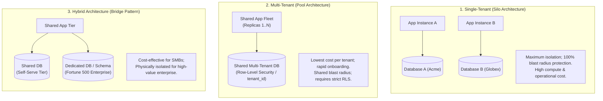
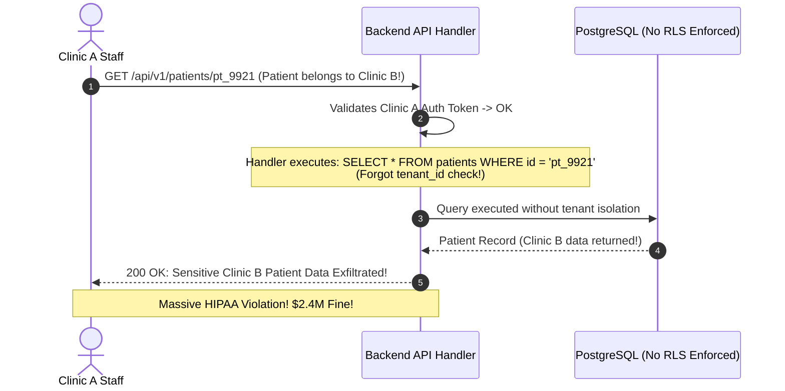

# Module 00: Tenancy Models and the Decision Framework

> **Prerequisites:** [Databases and Data Layer](../../04-databases-and-data-layer/00-relational-vs-non-relational/README.md), [Multi-Tenancy Patterns](../../04-databases-and-data-layer/10-multi-tenancy-patterns/README.md), and [Authentication and Authorization](../../03-authentication-and-authorization/README.md).  
> **Estimated Reading Time:** 28 minutes  
> **Target Audience:** Backend engineers, software architects, and engineering leaders designing scalable, secure multi-tenant B2B SaaS platforms.

> [!TIP]
> **Golden Rule of Multi-Tenancy Architecture:** A tenant is an isolated boundary for data, identity, configuration, and compute—not simply a `tenant_id` column in a database. Choose your tenancy model based on regulatory constraints, customer valuation, and blast radius rather than convenience, and enforce isolation across every tier of the stack (routing, auth, caching, and storage).

---

## Visual Mental Models & Architecture

### The Tenancy Spectrum: Silo vs Pool vs Hybrid

When building software as a service (SaaS), your infrastructure architecture dictates cost efficiency, security boundaries, and operational complexity.



---

## Systematic Taxonomic Reference Grids

### Tenancy Model Architectural Comparison

| Dimension | Single-Tenant (Silo) | Multi-Tenant: Shared Schema (Pool) | Multi-Tenant: Schema-Per-Tenant | Hybrid Model |
| :--- | :--- | :--- | :--- | :--- |
| **Data Isolation Mechanism** | Physical infrastructure separation | Logical via PostgreSQL Row-Level Security (RLS) | PostgreSQL Schemas (`tenant_a`, `tenant_b`) | Shared Pool for SMBs; Silo for Enterprise |
| **Compute Cost per Tenant** | Very High (Dedicated pods & databases) | **Lowest** (Maximum packing density) | Low-Medium (Shared DB server) | Optimized (Low baseline, premium tier) |
| **Onboarding Velocity** | Slow (Minutes/Hours: Provision infra) | **Instant** (< 500ms: Insert row into `tenants`) | Medium (Seconds: `CREATE SCHEMA`) | Instant for SMB; Automated Job for Enterprise |
| **Regulatory / HIPAA Compliance** | **Trivial** (Physical boundary guarantees) | Complex (Requires audited RLS & encryption) | Moderate | High (Satisfies enterprise audit clauses) |
| **Operational Overhead** | **Extreme** (N pipelines, N migrations) | Low (Single migration updates all tenants) | High (Migration scripts run across N schemas) | Moderate |
| **Blast Radius of Bug** | Single Tenant | **All Tenants** (Entire platform affected) | Partial (Shared database engine) | Segmented |

### The Five-Question Tenancy Decision Framework

```text
1. Organizational Boundary?    Is the product used by collaborative teams/companies?
                               No  -> Consumer app (Single user identity).
                               Yes -> Multi-tenancy required (Model tenant_id from day one).

2. Customer Volume & ARPU?     Thousands of SMBs ($10-100/mo) -> Multi-Tenant Pool (Shared Schema).
                               Dozens of Enterprise accounts ($100k+/yr) -> Hybrid or Silo.

3. Contractual & Regulatory?   Does customer contract demand dedicated physical isolation?
                               Yes -> Enterprise Silo (Dedicated DB / Container).
                               No  -> Logical RLS in Pool.

4. Cost of a Cross-Tenant Leak? Catastrophic (HIPAA, Financial Ledger, Defense) -> Strong isolation (Silo/Schema).
                               Manageable (Project management, collaboration) -> Shared Schema + RLS.

5. Customization Depth?        Do customers require custom DB fields, bespoke workflows?
                               Yes -> Schema-per-tenant or JSONB custom schema engines.
                               No  -> Shared standard schema.
```

---

## Production War Stories: Incident Post-Mortem

### SEV-1 Post-Mortem: The Cross-Tenant IDOR Leak

#### Incident Overview
* **Severity:** SEV-1 (Catastrophic Data Breach & Compliance Violation)
* **Detection Time:** 3 days post-deployment
* **Resolution Time:** 4 hours 30 minutes
* **Financial Impact:** \$2,400,000 regulatory settlement; mandatory third-party security audits.

#### What Happened
A healthcare B2B SaaS platform allowed clinics to manage electronic patient medical records. The platform used a multi-tenant shared-schema database. When querying patient records, handlers were supposed to filter by `tenant_id`.

A newly deployed report export handler queried the database:
```python
# Vulnerable Endpoint Handler
@app.get("/api/v1/patients/{patient_id}")
async def get_patient(patient_id: str, current_user=Depends(get_current_user)):
    # BUG: Forgot to verify that patient.tenant_id == current_user.tenant_id!
    patient = await db.fetch_one(
        "SELECT * FROM patients WHERE id = :id", {"id": patient_id}
    )
    return patient
```

A medical staff member at **Clinic A** received a malformed email link with a patient ID belonging to **Clinic B**. Upon clicking the link, Clinic A was presented with the full psychiatric evaluation and medical history of Clinic B's patient.

Because the system lacked database-enforced Row-Level Security (RLS) and relied solely on developers remembering to add `WHERE tenant_id = ...` in every query, an Insecure Direct Object Reference (IDOR) flaw exposed patient records across 14 competing healthcare networks.



#### Root Cause Analysis
1. **Isolation Enforced by Developer Discipline:** Tenant isolation was implemented via ad-hoc SQL `WHERE` clauses rather than defense-in-depth architectural primitives.
2. **Missing Database Row-Level Security (RLS):** The database engine was not configured with RLS policies, meaning any query omitting `tenant_id` returned data across all tenants.
3. **Missing Tenant Context in Request Token:** The authorization token did not cryptographically bind the user's permissions to the resolved tenant domain.

#### The Fix & Architectural Hardening
1. **Mandatory PostgreSQL RLS:** Enabled Row-Level Security across 100% of tenant tables (`ALTER TABLE patients ENABLE ROW LEVEL SECURITY;`).
2. **Context-Driven Session Variables:** Configured database connection pool middleware to set `SET LOCAL app.current_tenant = :tenant_id;` on every transaction.
3. **Automated Static Analysis Gate:** Integrated CI rules that automatically reject pull requests where raw SQL queries touch multi-tenant tables without explicit tenant context.

---

## Multi-Language Production Code Tabs

The following production code examples show how to structure multi-tenant data entities, tenant scopes, and global query filters in Go, Node.js/TypeScript, Python, and C#.

=== "Go"
    ```go
    // Package tenancy implements multi-tenant models and PostgreSQL RLS session injection.
    package tenancy

    import (
    	"context"
    	"database/sql"
    	"errors"
    	"fmt"
    	"time"
    )

    type Tenant struct {
    	ID        string    `json:"id"`
    	Name      string    `json:"name"`
    	Slug      string    `json:"slug"`
    	PlanTier  string    `json:"plan_tier"` // "starter", "pro", "enterprise"
    	Status    string    `json:"status"`    // "active", "suspended"
    	CreatedAt time.Time `json:"created_at"`
    }

    type User struct {
    	ID           string `json:"id"`
    	TenantID     string `json:"tenant_id"` // Scoped foreign key
    	Email        string `json:"email"`
    	PasswordHash string `json:"-"`
    	Role         string `json:"role"` // "admin", "member"
    }

    // SetTenantContext sets the PostgreSQL session variable for Row-Level Security (RLS).
    func SetTenantContext(ctx context.Context, tx *sql.Tx, tenantID string) error {
    	if tenantID == "" {
    		return errors.New("cannot set empty tenant context")
    	}
    	// Parameterized query prevents SQL injection in session setting
    	_, err := tx.ExecContext(ctx, "SELECT set_config('app.current_tenant', $1, true);", tenantID)
    	if err != nil {
    		return fmt.Errorf("failed to set RLS tenant context: %w", err)
    	}
    	return nil
    }
    ```

=== "Node.js/TypeScript"
    ```typescript
    // Prisma / TypeScript Multi-Tenant Schema Definition & Tenant Scoping
    import { PrismaClient } from "@prisma/client";

    export interface TenantContext {
      tenantId: string;
      userId: string;
      role: "admin" | "member";
    }

    /**
     * Factory that returns a tenant-scoped Prisma client extension.
     * Automatically injects tenantId into all find, create, and update queries.
     */
    export function createTenantClient(prisma: PrismaClient, tenantId: string) {
      return prisma.$extends({
        query: {
          $allModels: {
            async findMany({ args, query }) {
              args.where = { ...args.where, tenantId };
              return query(args);
            },
            async findFirst({ args, query }) {
              args.where = { ...args.where, tenantId };
              return query(args);
            },
            async create({ args, query }) {
              args.data = { ...args.data, tenantId };
              return query(args);
            },
          },
        },
      });
    }
    ```

=== "Python"
    ```python
    """SQLAlchemy 2.0 Multi-Tenant Models & PostgreSQL RLS Enforcement."""

    from __future__ import annotations

    import uuid
    from sqlalchemy import ForeignKey, String, UniqueConstraint, text
    from sqlalchemy.dialects.postgresql import UUID
    from sqlalchemy.ext.asyncio import AsyncSession
    from sqlalchemy.orm import DeclarativeBase, Mapped, mapped_column, relationship


    class Base(DeclarativeBase):
        pass


    class Tenant(Base):
        __tablename__ = "tenants"

        id: Mapped[uuid.UUID] = mapped_column(
            UUID(as_uuid=True), primary_key=True, default=uuid.uuid4
        )
        name: Mapped[str] = mapped_column(String(128), nullable=False)
        slug: Mapped[str] = mapped_column(String(64), unique=True, nullable=False)
        status: Mapped[str] = mapped_column(
            String(32), default="active"
        )  # active, suspended


    class User(Base):
        __tablename__ = "users"

        id: Mapped[uuid.UUID] = mapped_column(
            UUID(as_uuid=True), primary_key=True, default=uuid.uuid4
        )
        tenant_id: Mapped[uuid.UUID] = mapped_column(
            ForeignKey("tenants.id", ondelete="CASCADE"), nullable=False
        )
        email: Mapped[str] = mapped_column(String(255), nullable=False)
        password_hash: Mapped[str] = mapped_column(String(255), nullable=False)
        role: Mapped[str] = mapped_column(String(32), default="member")

        # CRITICAL: Email is unique WITHIN a tenant, NOT globally!
        __table_args__ = (
            UniqueConstraint("tenant_id", "email", name="uq_tenant_email"),
        )


    async def set_rls_tenant_context(
        session: AsyncSession, tenant_id: uuid.UUID
    ) -> None:
        """Inject tenant ID into PostgreSQL transaction context for RLS policies."""
        await session.execute(
            text("SELECT set_config('app.current_tenant', :t_id, true)"),
            {"t_id": str(tenant_id)},
        )
    ```

=== "C#"
    ```csharp
    namespace BackendRoadmap.Tenancy;

    using System;
    using Microsoft.EntityFrameworkCore;

    public class Tenant
    {
        public Guid Id { get; set; } = Guid.NewGuid();
        public string Name { get; set; } = string.Empty;
        public string Slug { get; set; } = string.Empty;
        public string Status { get; set; } = "active";
    }

    public class User
    {
        public Guid Id { get; set; } = Guid.NewGuid();
        public Guid TenantId { get; set; }
        public string Email { get; set; } = string.Empty;
        public string Role { get; set; } = "member";
    }

    public class TenantDbContext : DbContext
    {
        private readonly Guid _currentTenantId;

        public TenantDbContext(DbContextOptions<TenantDbContext> options, Guid currentTenantId)
            : base(options)
        {
            _currentTenantId = currentTenantId;
        }

        public DbSet<Tenant> Tenants => Set<Tenant>();
        public DbSet<User> Users => Set<User>();

        protected override void OnModelCreating(ModelBuilder modelBuilder)
        {
            base.OnModelCreating(modelBuilder);

            // Scoped uniqueness constraint
            modelBuilder.Entity<User>()
                .HasIndex(u => new { u.TenantId, u.Email })
                .IsUnique();

            // EF Core Global Query Filter: Automatically filters all queries by current tenant
            modelBuilder.Entity<User>()
                .HasQueryFilter(u => u.TenantId == _currentTenantId);
        }
    }
    ```

---

## Practical Hands-On Verification CLI Workflows

### 1. Verifying Database Row-Level Security (PostgreSQL)

Execute the following SQL commands to verify that PostgreSQL RLS mathematically forbids cross-tenant access even if an application query omits `WHERE tenant_id = ...`:

```sql
-- 1. Create table with tenant scope
CREATE TABLE projects (
    id UUID PRIMARY KEY DEFAULT gen_random_uuid(),
    tenant_id UUID NOT NULL,
    title TEXT NOT NULL
);

-- 2. Enable Row-Level Security
ALTER TABLE projects ENABLE ROW LEVEL SECURITY;

-- 3. Define RLS isolation policy
CREATE POLICY tenant_isolation_policy ON projects
    FOR ALL
    USING (tenant_id = NULLIF(current_setting('app.current_tenant', true), '')::uuid);

-- 4. Insert records for Tenant A and Tenant B
INSERT INTO projects (tenant_id, title) VALUES 
('11111111-1111-1111-1111-111111111111', 'Acme Secret Project'),
('22222222-2222-2222-2222-222222222222', 'Globex Roadmap');

-- 5. Test Query as Tenant A
SET LOCAL app.current_tenant = '11111111-1111-1111-1111-111111111111';
SELECT title FROM projects;
-- Expected output: 'Acme Secret Project' (1 row)

-- 6. Test Query without setting tenant (Fail Closed)
SET LOCAL app.current_tenant = '';
SELECT title FROM projects;
-- Expected output: 0 rows returned (Safe fail-closed)
```

---

## Operational Validation Checkpoints (Scenario Quizzes)

### Checkpoint 1: The Global Unique Email Constraint Trap
<details>
<summary><strong>Scenario Assessment:</strong> A multi-tenant SaaS application is designed with <code>CREATE TABLE users (id UUID PRIMARY KEY, email TEXT UNIQUE, tenant_id UUID REFERENCES tenants(id));</code>. A prominent marketing consultant attempts to sign up for Tenant B using their corporate email. The signup fails with an unhandled 500 error. What architectural mistake was made, and how is it corrected?</summary>

<strong>Answer:</strong>
The database schema defined a **global unique constraint on `email`** (`email TEXT UNIQUE`) rather than a **tenant-scoped composite unique constraint**:
1. In modern B2B SaaS, contractors, accountants, external consultants, and board members frequently belong to multiple independent client organizations that use the same SaaS product.
2. Under a global unique email constraint, an email address can only exist under a single tenant. Once `consultant@agency.com` joins Tenant A, any attempt to register them under Tenant B triggers a database unique constraint violation (`23505 duplicate key value violates unique constraint`).

**The Fix:**
Replace the global unique constraint with a composite unique index:
```sql
ALTER TABLE users DROP CONSTRAINT users_email_key;
ALTER TABLE users ADD CONSTRAINT uq_users_tenant_email UNIQUE (tenant_id, email);
```
Now, `consultant@agency.com` can exist independently in Tenant A and Tenant B, with completely separate permissions, roles, and lifecycles.
</details>

### Checkpoint 2: Evaluating the "Schema-Per-Tenant" Scalability Wall
<details>
<summary><strong>Scenario Assessment:</strong> A startup selects the "Schema-per-Tenant" model (each tenant gets their own PostgreSQL schema within a shared database). At 50 tenants, performance is excellent. At 4,000 tenants, database memory spikes, connection pool initialization takes minutes, and Alembic migrations fail with timeouts. Why did this architecture hit a wall?</summary>

<strong>Answer:</strong>
The "Schema-per-Tenant" architecture encounters severe **PostgreSQL catalog and resource exhaustion at scale**:
1. **Catalog Bloat:** Every table, index, sequence, and constraint in PostgreSQL is tracked in internal system catalogs (`pg_class`, `pg_attribute`). If a service has 40 tables and 4,000 schemas, PostgreSQL must track $40 \times 4000 = 160,000$ individual table relations.
2. **Buffer Cache Starvation:** PostgreSQL's relation cache (`relcache`) and memory buffers cannot hold metadata for 160,000 tables simultaneously, causing severe query latency and CPU thrashing on catalog lookups.
3. **Migration Nightmare:** Applying a single database migration requires running DDL 4,000 times in sequence (`ALTER TABLE tenant_1.orders... ALTER TABLE tenant_4000.orders...`), turning a 2-second migration into a 45-minute outage-prone job.

**Recommendation:** For high-tenant counts (>500 tenants), migrate to **Shared Schema with Row-Level Security (RLS)**.
</details>

### Checkpoint 3: Defending Boundaries Beyond the Database Tier
<details>
<summary><strong>Scenario Assessment:</strong> A team implements 100% PostgreSQL Row-Level Security across all tables. However, a security audit reveals that Tenant A was able to read Tenant B's invoices. List three non-database architectural seams where tenant boundaries commonly leak.</summary>

<strong>Answer:</strong>
A tenant boundary is a full-stack constraint. RLS protects only relational queries; leaks commonly occur in:
1. **Object / File Storage (S3 / GCS):** Storing invoice PDFs in a shared bucket using predictable numeric keys (`s3://invoices/invoice_1042.pdf`) without tenant prefixes (`s3://invoices/{tenant_id}/invoice_1042.pdf`) allows users to access other tenants' documents directly via URL manipulation.
2. **Distributed Cache (Redis):** Caching user profiles or authorization tokens using flat keys (`SET user:1042 "..."`) instead of tenant-prefixed keys (`SET tenant:{tenant_id}:user:1042 "..."`) results in cache collisions and cross-tenant data leaks.
3. **Background Job Queues (Celery / RabbitMQ / SQS):** Enqueuing background tasks with only an entity ID (`process_order(order_id=552)`) without passing and verifying the `tenant_id` context causes background worker threads to execute operations without tenant isolation.
</details>

---

## Summary & Further Study

- **Holistic Boundary:** Tenancy spans routing, authentication, caching, file storage, and background processing.
- **Decision Discipline:** Default to Shared Schema + RLS for high-volume self-serve tiers; carve out Enterprise accounts to Silos only when contractually required.
- **Database Hardening:** Always enforce PostgreSQL RLS and use composite `UNIQUE(tenant_id, email)` constraints.

### Further Reading
- [AWS SaaS Factory: SaaS Tenant Isolation Strategies](https://docs.aws.amazon.com/wellarchitected/latest/saas-lens/tenant-isolation.html)
- [PostgreSQL Documentation: Row-Level Security (RLS) Policies](https://www.postgresql.org/docs/current/ddl-rowsecurity.html)
- [Microsoft Azure Architecture: Multi-tenant SaaS on Azure](https://learn.microsoft.com/en-us/azure/architecture/guide/multitenant/overview)
