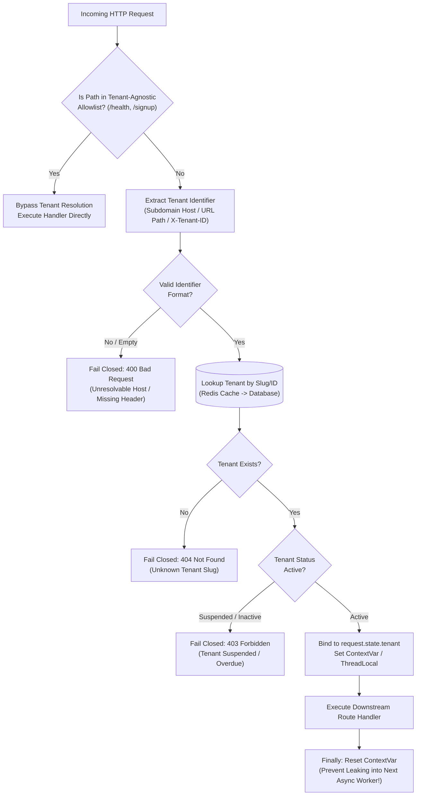
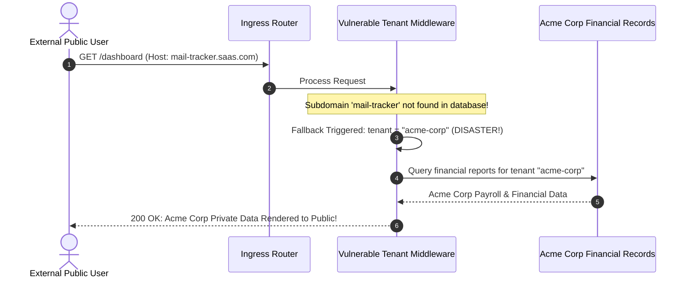

# Module 01: Tenant Identification and Request Routing

> **Prerequisites:** [00-tenancy-models-and-decision-framework](../00-tenancy-models-and-decision-framework/README.md), [Middleware Fundamentals](../../02-api-layer-and-request-handling/03-middleware-fundamentals/README.md), and [Authentication and Authorization](../../03-authentication-and-authorization/README.md).  
> **Estimated Reading Time:** 28 minutes  
> **Target Audience:** Backend engineers and API architects implementing front-door multi-tenant request resolution and context propagation pipelines.

> [!TIP]
> **Golden Rule of Tenant Resolution:** Resolve the tenant once, at the front door, in a single mandatory middleware pipeline before any route handler executes. Always fail closed—an unresolvable, unrecognized, or suspended tenant must be rejected immediately (HTTP 400/404/403) and must never, under any circumstances, fall back to a default tenant.

---

## Visual Mental Models & Architecture

### The Front-Door Tenant Resolution Pipeline

Every incoming request must be identified, authenticated, and verified against an active tenant before touching downstream business logic or database layers.



---

## Systematic Taxonomic Reference Grids

### Tenant Identification Strategies Matrix

| Identification Mechanism | Example Request Wire Format | User Experience & Branding | Infrastructure & DNS Requirement | Recommended Production Fit |
| :--- | :--- | :--- | :--- | :--- |
| **Subdomain-Based** | `Host: acme.saasplatform.com` | High (Professional, custom company domain branding) | Requires Wildcard DNS (`*.saasplatform.com`) & Wildcard TLS | **Default choice for B2B Web SaaS applications.** |
| **Path-Based** | `GET /api/v1/acme/projects` | Medium (Obvious tenant in URL; less branded) | Zero infrastructure setup; works identically on `localhost` | Internal management tools, rapid prototyping. |
| **Header-Based** | `X-Tenant-ID: 1111-2222-3333` | Low (Hidden from human browser view) | Zero infrastructure setup; requires explicit client SDK support | **Pure B2B APIs, mobile app backends, microservices.** |
| **Custom Vanity Domain** | `Host: app.acmewidgets.com` | Premium (White-labeled enterprise branding) | Complex (CNAME verification, dynamic TLS cert issuance) | Enterprise tier add-on. |

### HTTP Status Code Taxonomy for Tenant Failures

| Scenario | HTTP Code | Error Response Message | Operational & Security Rationale |
| :--- | :--- | :--- | :--- |
| **Unparseable Host Header** | `400 Bad Request` | `{"detail": "Unresolvable tenant from host"}` | The client communicated via an unsupported host or malformed URL. |
| **Unknown / Non-Existent Slug** | `404 Not Found` | `{"detail": "Unknown tenant"}` | The tenant slug does not exist in system records (e.g. `nosuchcompany.saas.com`). |
| **Suspended / Paused Account** | `403 Forbidden` | `{"detail": "Tenant account suspended"}` | The tenant exists but is locked due to non-payment or administrative hold. |
| **Tenant Context Omitted** | `500 Server Error` | `{"detail": "Tenant resolution did not run"}` | Defense-in-depth safety catch: handler was reached without middleware execution. |

---

## Production War Stories: Incident Post-Mortem

### SEV-1 Post-Mortem: The "Helpful" Default Fallback Tenant Disaster

#### Incident Overview
* **Severity:** SEV-1 (Catastrophic Enterprise Privacy Violation & Account Takeover)
* **Detection Time:** 8 hours post-deployment
* **Resolution Time:** 1 hour 15 minutes
* **Impact:** 3,200 external public visitors exposed to the private financial reports of the company's largest flagship customer.

#### What Happened
During early development, a SaaS engineering team added a "convenience fallback" to their tenant resolution middleware so developers didn't have to configure mock subdomains on `localhost`:
```python
# The Catastrophic "Helpful" Fallback Anti-Pattern
slug = extract_subdomain(request.headers.get("host"))
tenant = await tenant_repo.find_by_slug(slug)
if tenant is None:
    # "Fallback to our demo/flagship account for convenience"
    tenant = await tenant_repo.find_by_slug("acme-corp")
request.state.tenant = tenant
```

This code survived code review and shipped directly to production.

Two weeks later, a marketing team sent an email newsletter containing a broken tracking link: `https://mail-click-tracker.saasplatform.com/dashboard`.
1. When 3,200 recipients clicked the link, their browsers sent `Host: mail-click-tracker.saasplatform.com`.
2. The regex failed to match any known tenant slug (`mail-click-tracker` was not a tenant).
3. Instead of failing closed with a `404 Not Found`, the middleware executed the fallback: it assigned the request to **`acme-corp`** (the platform's largest enterprise customer).
4. Thousands of unauthenticated external users landed on Acme Corp's private financial dashboard, viewing internal enterprise payroll reports and confidential customer lists.



#### Root Cause Analysis
1. **Violation of the Fail-Closed Security Invariant:** The middleware failed open by substituting a default tenant when identification failed, rather than throwing an immediate HTTP exception.
2. **Missing Production Hardening:** Development shortcuts were not gated by environment checks (`if config.APP_ENV == "dev"`).
3. **Absence of Negative Security Integration Tests:** The test suite had zero tests verifying that an unrecognized subdomain returns `404 Not Found`.

#### The Fix & Architectural Hardening
1. **Strict Fail-Closed Enforcement:** Removed all fallback logic permanently. Any unrecognized slug raises `HTTPException(status_code=404, detail="Unknown tenant")`.
2. **Automated Negative Test Gates:** Added automated integration tests that fire requests with invalid, empty, and spoofed `Host` headers, asserting HTTP 400 and 404 responses.

---

## Multi-Language Production Code Tabs

The following production code examples demonstrate fail-closed tenant resolution middleware with allowlist filtering and asynchronous context binding in Go, Node.js/TypeScript, Python, and C#.

=== "Go"
    ```go
    // Package middleware implements fail-closed subdomain tenant resolution in Go.
    package middleware

    import (
    	"context"
    	"net/http"
    	"regexp"
    	"strings"
    )

    type tenantContextKey struct{}

    type Tenant struct {
    	ID     string
    	Slug   string
    	Status string // "active", "suspended"
    }

    type TenantFinder func(ctx context.Context, slug string) (*Tenant, error)

    var subdomainRegex = regexp.MustCompile(`^([a-z0-9-]+)\.saasplatform\.com$`)

    func TenantResolution(lookup TenantFinder, allowlist map[string]bool) func(http.Handler) http.Handler {
    	return func(next http.Handler) http.Handler {
    		return http.HandlerFunc(func(w http.ResponseWriter, r *http.Request) {
    			// 1. Bypass tenant resolution for allowlisted paths
    			if allowlist[r.URL.Path] {
    				next.ServeHTTP(w, r)
    				return
    			}

    			// 2. Extract subdomain from Host header
    			host := strings.Split(r.Host, ":")[0] // Strip port if present
    			matches := subdomainRegex.FindStringSubmatch(host)
    			if len(matches) < 2 {
    				http.Error(w, `{"error":"Unresolvable tenant from host"}`, http.StatusBadRequest)
    				return
    			}

    			slug := matches[1]

    			// 3. Resolve tenant (Fail Closed)
    			tenant, err := lookup(r.Context(), slug)
    			if err != nil || tenant == nil {
    				http.Error(w, `{"error":"Unknown tenant"}`, http.StatusNotFound)
    				return
    			}

    			// 4. Verify account status
    			if tenant.Status != "active" {
    				http.Error(w, `{"error":"Tenant account suspended"}`, http.StatusForbidden)
    				return
    			}

    			// 5. Bind tenant to request context
    			ctx := context.WithValue(r.Context(), tenantContextKey{}, tenant)
    			next.ServeHTTP(w, r.WithContext(ctx))
    		})
    	}
    }
    ```

=== "Node.js/TypeScript"
    ```typescript
    // TypeScript / Express Tenant Resolution with AsyncLocalStorage Context
    import { Request, Response, NextFunction } from "express";
    import { AsyncLocalStorage } from "node:async_hooks";

    export interface Tenant {
      id: string;
      slug: string;
      status: "active" | "suspended";
    }

    export const tenantStorage = new AsyncLocalStorage<Tenant>();

    const SUBDOMAIN_REGEX = /^([a-z0-9-]+)\.saasplatform\.com$/i;
    const ALLOWLISTED_PATHS = new Set(["/health", "/signup", "/api/v1/auth/login"]);

    export function createTenantMiddleware(
      findTenant: (slug: string) => Promise<Tenant | null>
    ) {
      return async (req: Request, res: Response, next: NextFunction) => {
        // 1. Allowlist bypass
        if (ALLOWLISTED_PATHS.has(req.path)) {
          return next();
        }

        // 2. Extract subdomain from Host header
        const host = req.hostname;
        const match = host.match(SUBDOMAIN_REGEX);
        if (!match) {
          return res.status(400).json({ error: "Unresolvable tenant from host" });
        }

        const slug = match[1].toLowerCase();

        // 3. Lookup tenant
        const tenant = await findTenant(slug);
        if (!tenant) {
          return res.status(404).json({ error: "Unknown tenant" });
        }

        // 4. Status verification
        if (tenant.status !== "active") {
          return res.status(403).json({ error: "Tenant account suspended" });
        }

        // 5. Execute downstream within AsyncLocalStorage context
        tenantStorage.run(tenant, () => {
          (req as any).tenant = tenant;
          next();
        });
      };
    }
    ```

=== "Python"
    ```python
    """FastAPI / Starlette Middleware for Subdomain Tenant Resolution."""

    from __future__ import annotations

    from contextvars import ContextVar
    import re
    from typing import Callable
    from fastapi import FastAPI, HTTPException, Request, Response
    from starlette.middleware.base import BaseHTTPMiddleware

    # Asynchronous context variable for background tasks
    current_tenant_ctx: ContextVar[str | None] = ContextVar(
        "current_tenant_ctx", default=None
    )

    SUBDOMAIN_PATTERN = re.compile(r"^([a-z0-9-]+)\.saasplatform\.com$")
    TENANT_AGNOSTIC_PATHS = {"/health", "/signup", "/login"}


    class TenantResolutionMiddleware(BaseHTTPMiddleware):

        def __init__(self, app: FastAPI, tenant_lookup: Callable):
            super().__init__(app)
            self.tenant_lookup = tenant_lookup

        async def dispatch(self, request: Request, call_next) -> Response:
            # 1. Bypass tenant resolution for tenant-agnostic paths
            if request.url.path in TENANT_AGNOSTIC_PATHS:
                return await call_next(request)

            # 2. Extract host header
            host = request.headers.get("host", "").split(":")[0]
            match = SUBDOMAIN_PATTERN.match(host)
            if not match:
                raise HTTPException(
                    status_code=400, detail="Unresolvable tenant from host"
                )

            slug = match.group(1).lower()

            # 3. Lookup tenant record (Fail Closed: 404 on missing)
            tenant = await self.tenant_lookup(slug)
            if tenant is None:
                raise HTTPException(status_code=404, detail="Unknown tenant")

            # 4. Enforce account status
            if tenant.status != "active":
                raise HTTPException(
                    status_code=403, detail="Tenant account suspended"
                )

            # 5. Bind context with guaranteed teardown reset
            request.state.tenant = tenant
            token = current_tenant_ctx.set(tenant.id)
            try:
                response = await call_next(request)
                return response
            finally:
                current_tenant_ctx.reset(token)  # CRITICAL: Prevent async task leaks!
    ```

=== "C#"
    ```csharp
    namespace BackendRoadmap.Tenancy;

    using System.Text.RegularExpressions;
    using System.Threading.Tasks;
    using Microsoft.AspNetCore.Http;

    public class TenantResolutionMiddleware
    {
        private readonly RequestDelegate _next;
        private static readonly Regex SubdomainRegex = new(@"^([a-z0-9-]+)\.saasplatform\.com$", RegexOptions.Compiled | RegexOptions.IgnoreCase);
        private static readonly HashSet<string> Allowlist = new() { "/health", "/signup", "/login" };

        public TenantResolutionMiddleware(RequestDelegate next)
        {
            _next = next;
        }

        public async Task InvokeAsync(HttpContext context, ITenantRepository repo, TenantContext currentContext)
        {
            // 1. Allowlist check
            if (Allowlist.Contains(context.Request.Path.Value?.ToLowerInvariant() ?? ""))
            {
                await _next(context);
                return;
            }

            // 2. Extract host
            string host = context.Request.Host.Host;
            var match = SubdomainRegex.Match(host);
            if (!match.Success)
            {
                context.Response.StatusCode = StatusCodes.Status400BadRequest;
                await context.Response.WriteAsJsonAsync(new { error = "Unresolvable tenant from host" });
                return;
            }

            string slug = match.Groups[1].Value.ToLowerInvariant();

            // 3. Lookup Tenant
            var tenant = await repo.FindBySlugAsync(slug);
            if (tenant == null)
            {
                context.Response.StatusCode = StatusCodes.Status404NotFound;
                await context.Response.WriteAsJsonAsync(new { error = "Unknown tenant" });
                return;
            }

            if (tenant.Status != "active")
            {
                context.Response.StatusCode = StatusCodes.Status403Forbidden;
                await context.Response.WriteAsJsonAsync(new { error = "Tenant account suspended" });
                return;
            }

            // 4. Bind to Scoped Context Service
            currentContext.CurrentTenant = tenant;
            await _next(context);
        }
    }
    ```

---

## Practical Hands-On Verification CLI Workflows

### Testing Fail-Closed Tenant Resolution via `curl`

Verify that tenant resolution strictly enforces isolation boundaries without DNS configuration by overriding the `Host` header:

```bash
# 1. Valid active tenant request (Expect 200 OK)
curl -i -H "Host: acme.saasplatform.com" http://localhost:8000/api/whoami

# 2. Valid second tenant request (Expect 200 OK with distinct tenant slug)
curl -i -H "Host: globex.saasplatform.com" http://localhost:8000/api/whoami

# 3. Non-existent tenant slug (Expect 404 Not Found)
curl -i -H "Host: nonexistent.saasplatform.com" http://localhost:8000/api/whoami

# 4. Suspended tenant slug (Expect 403 Forbidden)
curl -i -H "Host: suspended-corp.saasplatform.com" http://localhost:8000/api/whoami

# 5. Malformed Host header omitting subdomain (Expect 400 Bad Request)
curl -i -H "Host: saasplatform.com" http://localhost:8000/api/whoami

# 6. Tenant-Agnostic health check without tenant host (Expect 200 OK)
curl -i -H "Host: localhost" http://localhost:8000/health
```

**Expected Wire Output (Testing Fail-Closed Invariants):**
```text
HTTP/1.1 200 OK
{"tenant_slug":"acme","tenant_id":"t1"}

HTTP/1.1 404 Not Found
{"detail":"Unknown tenant"}

HTTP/1.1 403 Forbidden
{"detail":"Tenant account suspended"}

HTTP/1.1 400 Bad Request
{"detail":"Unresolvable tenant from host"}
```

---

## Operational Validation Checkpoints (Scenario Quizzes)

### Checkpoint 1: Why ContextVar Must Be Reset in a Finally Block
<details>
<summary><strong>Scenario Assessment:</strong> In an async Python backend (FastAPI/Tornado), an engineer binds tenant context via <code>current_tenant_ctx.set(tenant.id)</code> inside middleware, but omits the <code>finally: current_tenant_ctx.reset(token)</code> cleanup block. Under high concurrency, Tenant B occasionally sees Tenant A's cached background jobs. How did this context leak occur?</summary>

<strong>Answer:</strong>
In modern asynchronous event loops, **coroutines are scheduled cooperatively across a fixed pool of OS worker threads**:
1. When a request completes, the underlying worker thread or task context is not destroyed; it is recycled to handle subsequent incoming requests.
2. If `current_tenant_ctx.set()` is executed without a matching `.reset(token)`, the context variable retains Tenant A's ID on that thread.
3. If the next request to land on that worker thread hits a tenant-agnostic path (like `/health`) or an unauthenticated background task that does not explicitly overwrite `current_tenant_ctx`, it inherits Tenant A's active tenant context.
4. Any background queries spawned from that context will execute with Tenant A's permissions.

**The Fix:** Always wrap request execution in a `try...finally` block to ensure the context variable token is reset to its original state:
```python
token = current_tenant_ctx.set(tenant.id)
try:
    return await call_next(request)
finally:
    current_tenant_ctx.reset(token)
```
</details>

### Checkpoint 2: Conflicting Tenant Signals (Subdomain vs Header)
<details>
<summary><strong>Scenario Assessment:</strong> A public API service supports both subdomain routing (<code>acme.api.com</code>) and custom headers (<code>X-Tenant-ID: globex</code>). An incoming HTTP request arrives with <code>Host: acme.api.com</code> but sets <code>X-Tenant-ID: globex</code>. How must the middleware resolve this discrepancy?</summary>

<strong>Answer:</strong>
The middleware must **FAIL CLOSED immediately with HTTP 400 Bad Request**:
1. **Never Arbitrarily Pick One:** Silently picking the header over the subdomain (or vice versa) creates a critical ambiguity vulnerability. The client may believe it is operating on Globex data while the security proxy authenticated Acme.
2. **Security Probe or Misconfigured Client:** A request with conflicting tenant signals indicates either a severe bug in the API client integration or an intentional spoofing attempt by an attacker testing access boundaries.
3. **Fail-Closed Resolution:**
   ```python
   if header_tenant and subdomain_tenant and header_tenant != subdomain_tenant:
       raise HTTPException(
           status_code=400,
           detail="Conflicting tenant identification signals in request",
       )
```
</details>

### Checkpoint 3: Subdomain vs Path Routing in Mobile & Desktop Apps
<details>
<summary><strong>Scenario Assessment:</strong> An engineering team is designing a B2B SaaS platform that will serve both a React browser web application and native iOS/Android mobile apps. Why does using path-based routing (<code>/api/v1/{tenant_slug}/...</code>) or header-based routing (<code>X-Tenant-ID</code>) provide superior operational reliability for mobile apps compared to dynamic subdomains?</summary>

<strong>Answer:</strong>
Dynamic subdomains (`acme.saas.com`) introduce **severe operational friction in mobile and native client development**:
1. **Dynamic Network Base URLs:** Mobile app networking stacks (e.g. Retrofit, Alamofire) expect a static, pinned API base URL (`https://api.saasplatform.com`). Dynamically reconstructing base URLs per tenant requires complex app-level cache routing.
2. **Wildcard TLS & Certificate Pinning:** Mobile enterprise apps frequently use TLS Certificate Pinning for security. Managing certificate pinning against dynamic wildcard subdomains across different CDN providers is notoriously error-prone.
3. **Cookie and Storage Partitioning:** Native webviews isolate storage per domain. Using path-based or header-based routing allows mobile clients to target a single, unified API origin (`api.saasplatform.com`) while passing the tenant token cleanly via HTTP headers.
</details>

---

## Summary & Further Study

- **Front-Door Isolation:** Resolve tenant context once in middleware; never delegate resolution to individual endpoint handlers.
- **Fail Closed:** Unknown, unresolvable, or suspended tenants must be rejected with 400, 404, or 403; never fall through to default accounts.
- **Context Hygiene:** Always clear asynchronous context variables in a `finally` block to prevent state leakage across concurrent worker threads.

### Further Reading
- [AWS SaaS Architecture: Tenant Routing Patterns](https://docs.aws.amazon.com/wellarchitected/latest/saas-lens/tenant-routing.html)
- [Python Standard Library: contextvars Module](https://docs.python.org/3/library/contextvars.html)
- [OWASP Security Guide: Multi-Tenant Architecture Verification](https://owasp.org/www-project-web-security-testing-guide/latest/4-Web_Application_Security_Testing/05-Authorization_Testing/02-Testing_for_Bypassing_Authorization_Schema)
