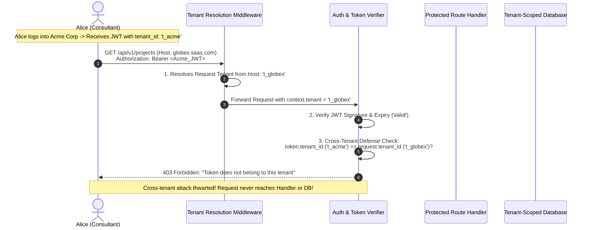
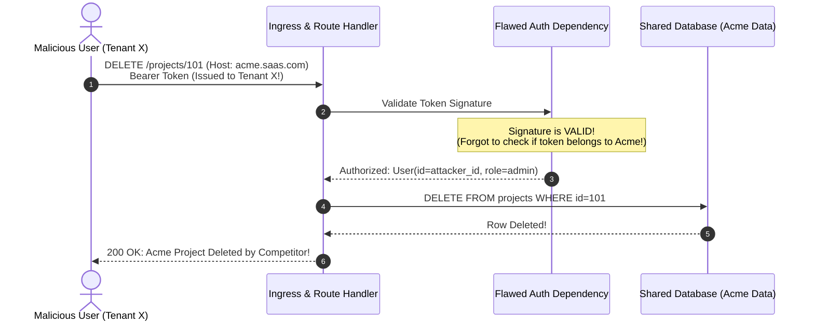

# Module 02: Auth and Authorization Across Tenants

> **Prerequisites:** [00-tenancy-models-and-decision-framework](../00-tenancy-models-and-decision-framework/README.md), [01-tenant-identification-and-request-routing](../01-tenant-identification-and-request-routing/README.md), and [Authentication and Authorization](../../03-authentication-and-authorization/README.md).  
> **Estimated Reading Time:** 28 minutes  
> **Target Audience:** Backend engineers and security architects implementing multi-tenant identity, tenant-scoped JWT claims, and cross-tenant access control policies.

> [!TIP]
> **Golden Rule of Multi-Tenant Authorization:** Cryptographic signature validity alone is not authorization. A user identity is strictly scoped to a tenant boundary: always bind `tenant_id` inside the signed token payload, and verify that the token's `tenant_id` claim matches the request's independently resolved tenant context before evaluating roles or executing business logic.

---

## Visual Mental Models & Architecture

### The Multi-Tenant Token Verification & Cross-Tenant Defense Flow

In a multi-tenant system, authentication must verify both **who the user is** and **which tenant domain they are permitted to act within**.



---

## Systematic Taxonomic Reference Grids

### Multi-Tenant JWT Claim Taxonomy

| JWT Claim | Standard / Custom | Encoded Data Type | Security Purpose | Verification Rule |
| :--- | :--- | :--- | :--- | :--- |
| **`sub`** | Standard RFC 7519 | UUID / String | Unique User Identifier | Bound to user record within the specific tenant. |
| **`tenant_id`** | Custom Claim | UUID / String | **Tenant Boundary Anchor** | **Mandatory Match:** Must equal request's resolved tenant ID. |
| **`role`** | Custom Claim | String (`admin`, `member`) | In-Tenant RBAC Authorization | Evaluated only *after* tenant match is confirmed. |
| **`org_slug`** | Custom Claim | String (`acme`) | Client-side routing convenience | Informational; do not use as primary database key. |
| **`exp`** | Standard RFC 7519 | Unix Timestamp | Token Expiration | Enforce short lifetimes (15 – 60 minutes). |

### Cross-Tenant Access Attack Matrix

| Attack Vector | Vulnerability Mechanism | Expected HTTP Response | Architectural Defense |
| :--- | :--- | :--- | :--- |
| **Cross-Tenant Token Replay** | Replaying Tenant A's valid token against Tenant B's subdomain | `403 Forbidden` | Compare `token.tenant_id == request.state.tenant.id`. |
| **Global Email Hijacking** | Forcing global unique email constraint, locking user out | `400 Bad Request` | Enforce `UNIQUE(tenant_id, email)` composite keys. |
| **Unsigned Tenant Hint Spoofing** | Sending `X-Tenant-ID` header alongside generic JWT | `400 / 403` | Never trust client headers over signed JWT claims. |
| **Role Escalation Across Tenants** | Using Tenant A Admin token to modify Tenant B settings | `403 Forbidden` | Layered dependency: resolve tenant $\rightarrow$ match tenant $\rightarrow$ check role. |
| **Password Reset Token Replay** | Replaying reset token across tenants sharing an email | `403 Forbidden` | Cryptographically bind `tenant_id` inside password reset tokens. |

---

## Production War Stories: Incident Post-Mortem

### SEV-1 Post-Mortem: The Valid Signature Cross-Tenant Takeover

#### Incident Overview
* **Severity:** SEV-1 (Critical Authorization Bypass & Enterprise Data Corruption)
* **Detection Time:** 2 days post-deployment
* **Resolution Time:** 3 hours 15 minutes
* **Impact:** 64 enterprise accounts compromised; project tasks deleted across competitor accounts.

#### What Happened
A project management SaaS company implemented JWT authentication. To speed up request processing, their authentication dependency checked signature validity and extracted the `sub` (user ID) without validating the tenant:
```python
# The Flawed Auth Dependency
async def get_current_user(token: str = Depends(oauth2_scheme)):
    payload = jwt.decode(token, SECRET_KEY, algorithms=["HS256"])
    # VULNERABILITY: Checked signature, but never verified tenant_id!
    return User(id=payload["sub"], role=payload["role"])
```

An engineer at a competitor organization discovered that:
1. They could register a legitimate free account under **Tenant Attacker** (`attacker.saasplatform.com`) and receive a cryptographically valid JWT signed by the platform's private key.
2. The user opened Postman and executed `DELETE https://acme.saasplatform.com/api/projects/proj_101`, passing their Attacker JWT in the `Authorization: Bearer` header.
3. The routing middleware resolved `acme` as the host tenant.
4. However, `get_current_user` verified the JWT signature (which was valid, because it was signed by the server's key). The handler assumed the user was authorized and deleted Acme's projects.
5. The attacker iterated through 64 known corporate subdomains, modifying and deleting production records across competing enterprises.



#### Root Cause Analysis
1. **Conflating Authentication with Tenant Authorization:** The platform assumed that any valid JWT signed by the server had universal authorization across all subdomains.
2. **Missing Token-to-Request Validation Seam:** The system lacked a cross-tenant guard comparing the token's internal `tenant_id` against the request's resolved host tenant.
3. **Missing RLS Safety Net:** Handlers executed queries directly without database Row-Level Security session contexts.

#### The Fix & Architectural Hardening
1. **Mandatory Tenant Claim Matching:** Added the strict equality guard to the authentication dependency:
   ```python
   if payload.get("tenant_id") != request.state.tenant.id:
       raise HTTPException(
           status_code=403, detail="Token does not belong to this tenant"
       )
```
2. **Layered Authorization Enforcement:** Enforced a strict three-tier dependency chain: `get_current_tenant` $\rightarrow$ `get_current_user` $\rightarrow$ `require_role`.

---

## Multi-Language Production Code Tabs

The following production code examples demonstrate tenant-scoped JWT issuance, strict token-to-request validation, and layered role authorization in Go, Node.js/TypeScript, Python, and C#.

=== "Go"
    ```go
    // Package auth implements tenant-aware JWT issuance and validation.
    package auth

    import (
    	"errors"
    	"fmt"
    	"net/http"
    	"time"

    	"github.com/golang-jwt/jwt/v5"
    )

    var (
    	ErrInvalidToken     = errors.New("invalid or expired token")
    	ErrCrossTenantAccess = errors.New("token does not belong to this tenant")
    )

    type TenantClaims struct {
    	UserID   string `json:"sub"`
    	TenantID string `json:"tenant_id"`
    	Role     string `json:"role"`
    	jwt.RegisteredClaims
    }

    // IssueToken encodes tenant_id directly into the signed cryptographic payload.
    func IssueToken(userID, tenantID, role, secretKey string) (string, error) {
    	claims := TenantClaims{
    		UserID:   userID,
    		TenantID: tenantID,
    		Role:     role,
    		RegisteredClaims: jwt.RegisteredClaims{
    			ExpiresAt: jwt.NewNumericDate(time.Now().Add(8 * time.Hour)),
    			IssuedAt:  jwt.NewNumericDate(time.Now()),
    		},
    	}
    	token := jwt.NewWithClaims(jwt.SigningMethodHS256, claims)
    	return token.SignedString([]byte(secretKey))
    }

    // AuthorizeTenant validates token signature and enforces tenant match.
    func AuthorizeTenant(tokenStr, expectedTenantID, secretKey string) (*TenantClaims, error) {
    	token, err := jwt.ParseWithClaims(tokenStr, &TenantClaims{}, func(t *jwt.Token) (interface{}, error) {
    		if _, ok := t.Method.(*jwt.SigningMethodHMAC); !ok {
    			return nil, fmt.Errorf("unexpected signing method: %v", t.Header["alg"])
    		}
    		return []byte(secretKey), nil
    	})

    	if err != nil || !token.Valid {
    		return nil, ErrInvalidToken
    	}

    	claims, ok := token.Claims.(*TenantClaims)
    	if !ok {
    		return nil, ErrInvalidToken
    	}

    	// CRITICAL SECURITY GUARD: Reject cross-tenant token replay
    	if claims.TenantID != expectedTenantID {
    		return nil, ErrCrossTenantAccess
    	}

    	return claims, nil
    }
    ```

=== "Node.js/TypeScript"
    ```typescript
    // TypeScript Tenant-Aware JWT Verification & RBAC Middleware
    import { Request, Response, NextFunction } from "express";
    import jwt from "jsonwebtoken";

    export interface TenantJWTPayload {
      sub: string;
      tenant_id: string;
      role: "admin" | "member";
    }

    const JWT_SECRET = process.env.JWT_SECRET || "dev-secret-key";

    export function requireTenantAuth(req: Request, res: Response, next: NextFunction) {
      const authHeader = req.headers.authorization;
      if (!authHeader?.startsWith("Bearer ")) {
        return res.status(401).json({ error: "Missing authorization token" });
      }

      const token = authHeader.split(" ")[1];

      try {
        const payload = jwt.verify(token, JWT_SECRET) as TenantJWTPayload;
        const resolvedTenant = (req as any).tenant;

        if (!resolvedTenant) {
          return res.status(500).json({ error: "Tenant resolution did not run" });
        }

        // CRITICAL CROSS-TENANT CHECK:
        if (payload.tenant_id !== resolvedTenant.id) {
          return res.status(403).json({ error: "Token does not belong to this tenant" });
        }

        (req as any).user = payload;
        next();
      } catch (err) {
        return res.status(401).json({ error: "Invalid or expired token" });
      }
    }

    export function requireRole(...allowedRoles: string[]) {
      return (req: Request, res: Response, next: NextFunction) => {
        const user = (req as any).user as TenantJWTPayload;
        if (!user || !allowedRoles.includes(user.role)) {
          return res.status(403).json({ error: "Insufficient permissions within tenant" });
        }
        next();
      };
    }
    ```

=== "Python"
    ```python
    """FastAPI Layered Multi-Tenant Authentication & RBAC Dependencies."""

    from __future__ import annotations

    from datetime import datetime, timedelta, timezone
    from fastapi import Depends, HTTPException, Request, status
    import jwt
    from pydantic import BaseModel

    SECRET_KEY = "production-crypto-secret-key"
    ALGORITHM = "HS256"


    class AuthenticatedUser(BaseModel):
        user_id: str
        tenant_id: str
        role: str


    def issue_tenant_jwt(
        user_id: str, tenant_id: str, role: str, expiry_hours: int = 8
    ) -> str:
        """Issue a signed JWT embedding the tenant boundary."""
        payload = {
            "sub": user_id,
            "tenant_id": tenant_id,
            "role": role,
            "exp": datetime.now(timezone.utc) + timedelta(hours=expiry_hours),
        }
        return jwt.encode(payload, SECRET_KEY, algorithm=ALGORITHM)


    def get_current_user(request: Request) -> AuthenticatedUser:
        """Verify token signature AND validate token tenant matches resolved request tenant."""
        tenant = getattr(request.state, "tenant", None)
        if tenant is None:
            raise HTTPException(
                status_code=status.HTTP_500_INTERNAL_SERVER_ERROR,
                detail="Tenant middleware did not run",
            )

        auth_header = request.headers.get("authorization", "")
        if not auth_header.startswith("Bearer "):
            raise HTTPException(
                status_code=status.HTTP_401_UNAUTHORIZED,
                detail="Missing or malformed Authorization header",
            )

        token = auth_header.removeprefix("Bearer ").strip()
        try:
            payload = jwt.decode(token, SECRET_KEY, algorithms=[ALGORITHM])
        except jwt.PyJWTError:
            raise HTTPException(
                status_code=status.HTTP_401_UNAUTHORIZED,
                detail="Invalid or expired token",
            )

        # THE CRITICAL TENANT ISOLATION GUARD:
        if payload.get("tenant_id") != tenant.id:
            raise HTTPException(
                status_code=status.HTTP_403_FORBIDDEN,
                detail="Token does not belong to this tenant",
            )

        return AuthenticatedUser(
            user_id=payload["sub"],
            tenant_id=payload["tenant_id"],
            role=payload["role"],
        )


    def require_role(*allowed_roles: str):
        """RBAC Dependency: Layered strictly after tenant verification."""

        def dependency(
            user: AuthenticatedUser = Depends(get_current_user),
        ) -> AuthenticatedUser:
            if user.role not in allowed_roles:
                raise HTTPException(
                    status_code=status.HTTP_403_FORBIDDEN,
                    detail="Insufficient role permissions for this operation",
                )
            return user

        return dependency
    ```

=== "C#"
    ```csharp
    namespace BackendRoadmap.Tenancy.Auth;

    using System.Security.Claims;
    using System.Threading.Tasks;
    using Microsoft.AspNetCore.Http;

    public class TenantAuthorizationMiddleware
    {
        private readonly RequestDelegate _next;

        public TenantAuthorizationMiddleware(RequestDelegate next) => _next = next;

        public async Task InvokeAsync(HttpContext context, TenantContext tenantContext)
        {
            var user = context.User;

            if (user.Identity?.IsAuthenticated == true)
            {
                var tokenTenantId = user.FindFirst("tenant_id")?.Value;
                var resolvedTenantId = tenantContext.CurrentTenant?.Id.ToString();

                // CRITICAL CROSS-TENANT CHECK
                if (string.IsNullOrEmpty(tokenTenantId) || tokenTenantId != resolvedTenantId)
                {
                    context.Response.StatusCode = StatusCodes.Status403Forbidden;
                    await context.Response.WriteAsJsonAsync(new { error = "Token does not belong to this tenant" });
                    return;
                }
            }

            await _next(context);
        }
    }
    ```

---

## Practical Hands-On Verification CLI Workflows

### Testing Cross-Tenant Token Replay Defenses

Verify that valid tokens cannot be used against competitor tenants:

```bash
# 1. Step 1: Login to Acme Corp and acquire token
ACME_TOKEN=$(curl -s -X POST http://localhost:8000/api/login \
  -H "Host: acme.saasplatform.com" \
  -H "Content-Type: application/json" \
  -d '{"email":"alice@acme.com","password":"password123"}' | jq -r .token)

# 2. Step 2: Access Acme Corp protected route (Expect 200 OK)
curl -i -H "Host: acme.saasplatform.com" \
  -H "Authorization: Bearer $ACME_TOKEN" \
  http://localhost:8000/api/projects

# 3. Step 3: Replay Acme's valid token against Globex Corp (Expect 403 Forbidden)
curl -i -H "Host: globex.saasplatform.com" \
  -H "Authorization: Bearer $ACME_TOKEN" \
  http://localhost:8000/api/projects
```

**Expected Wire Output (Cross-Tenant Replay Blocked):**
```text
HTTP/1.1 200 OK
Content-Type: application/json
[{"id":"proj_1","name":"Acme Q4 Roadmap"}]

HTTP/1.1 403 Forbidden
Content-Type: application/json
{"detail":"Token does not belong to this tenant"}
```

---

## Operational Validation Checkpoints (Scenario Quizzes)

### Checkpoint 1: Why Signature Validity Does Not Equal Authorization
<details>
<summary><strong>Scenario Assessment:</strong> A security auditor reports that user Bob from Tenant A was able to access confidential payroll reports on Tenant B's API endpoint. The engineering team responds: "Our JWT library verifies the HMAC SHA-256 signature and expiration timestamp on every request, so unauthenticated requests are impossible." Why is the engineering team's response flawed?</summary>

<strong>Answer:</strong>
The team is conflating **Cryptographic Authentication (Signature Integrity)** with **Multi-Tenant Authorization (Domain Scoping)**:
1. When Bob logs into Tenant A, the authentication server issues a JWT signed with the server's private secret key. The signature is 100% cryptographically valid.
2. If the API handler verifies *only* the signature and expiry, Bob's token will pass validation on **any endpoint across the entire platform**, including Tenant B's domain.
3. The server proved *who* Bob is (authentication), but failed to check *where* Bob is permitted to act (authorization).
4. Signature verification guarantees that the client did not tamper with the token's payload. It does **not** check whether the token's origin tenant matches the destination tenant of the HTTP request.
</details>

### Checkpoint 2: The Multi-Tenant Consultant Identity Model
<details>
<summary><strong>Scenario Assessment:</strong> An external accounting consultant, <code>carol@auditing.com</code>, provides financial auditing services to both Acme Corp (Tenant 1) and Globex Corp (Tenant 2). When Carol logs into Acme, she has the <code>auditor</code> role. In Globex, she is a full <code>admin</code>. How must the database and JWT tokens model Carol's identity to prevent permission bleeding?</summary>

<strong>Answer:</strong>
Carol must be modeled as **two completely distinct user records in the database, bound to their respective tenants**:
1. **Database Schema:**
   - Record 1: `{ id: "u_1", tenant_id: "t_acme", email: "carol@auditing.com", role: "auditor" }`
   - Record 2: `{ id: "u_2", tenant_id: "t_globex", email: "carol@auditing.com", role: "admin" }`
2. **Session / JWT Isolation:**
   - When logging in at `acme.saas.com`, Carol receives Token 1: `{ sub: "u_1", tenant_id: "t_acme", role: "auditor" }`.
   - When logging in at `globex.saas.com`, Carol receives Token 2: `{ sub: "u_2", tenant_id: "t_globex", role: "admin" }`.
3. **Zero Permission Bleeding:**
   - If Token 1 is sent to Globex, it is instantly rejected with `403 Forbidden` (`t_acme != t_globex`).
   - Carol cannot accidentally exercise her Globex `admin` privileges while operating on Acme's data.
</details>

### Checkpoint 3: Scoping Password Reset and Invite Flows
<details>
<summary><strong>Scenario Assessment:</strong> A user clicks "Forgot Password" on <code>acme.saasplatform.com</code>, entering <code>dan@example.com</code>. Dan also has an account under <code>globex.saasplatform.com</code>. What two security invariants must the password reset token enforce?</summary>

<strong>Answer:</strong>
1. **Tenant-Scoped Reset Token:**
   - The password reset token must cryptographically encode both the `user_id` and the `tenant_id` (or store a `tenant_id` foreign key in the `password_resets` table).
   - When Dan clicks the email link (`https://acme.saasplatform.com/reset-password?token=...`), the reset handler must verify that the token's embedded `tenant_id` matches Acme's resolved tenant context.
   - This prevents Dan from replaying Acme's password reset token against Globex to reset his Globex password.
2. **Zero Account Enumeration across Tenants:**
   - The response to the "Forgot Password" submission must return a generic message: `"If an account exists under this organization, a reset link has been dispatched."`
   - The API must never disclose whether `dan@example.com` exists under Acme, Globex, or both, preventing external threat actors from enumerating corporate employee rosters across competitor subdomains.
</details>

---

## Summary & Further Study

- **Token Binding:** Always embed `tenant_id` in the signed JWT payload.
- **Strict Equality Guard:** Reject requests with HTTP 403 if `token.tenant_id != request.tenant_id`.
- **Composite Uniqueness:** Use `UNIQUE(tenant_id, email)` to support multi-tenant user affiliations.
- **Layered Authorization:** Sequence checks as: Resolve Tenant $\rightarrow$ Match Tenant $\rightarrow$ Authorize Role.

### Further Reading
- [Auth0 Architecture: Multi-Tenant Authorization Best Practices](https://auth0.com/docs/get-started/architecture-scenarios/multi-tenant)
- [OWASP API Security Top 10: Broken Object Level Authorization (BOLA)](https://owasp.org/API-Security/editions/2023/en/0xa1-broken-object-level-authorization/)
- [RFC 7519: JSON Web Token (JWT) Specification](https://datatracker.ietf.org/doc/html/rfc7519)
