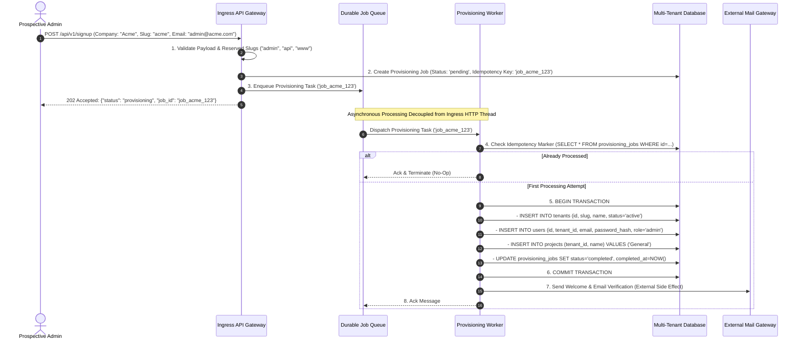
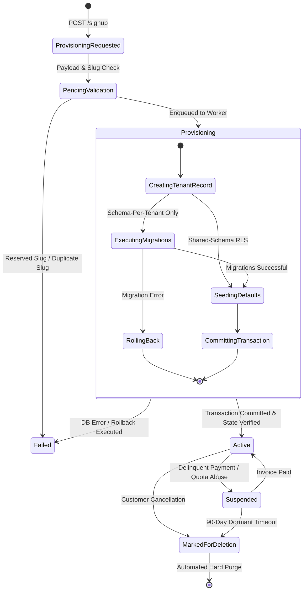

# Module 03: Provisioning and Onboarding Automation

> **Prerequisites:** [00-tenancy-models-and-decision-framework](../00-tenancy-models-and-decision-framework/README.md), [01-tenant-identification-and-request-routing](../01-tenant-identification-and-request-routing/README.md), [02-auth-and-authorization-across-tenants](../02-auth-and-authorization-across-tenants/README.md), and [Background Processing and Real-Time Systems](../../06-background-processing-and-realtime/README.md).  
> **Estimated Reading Time:** 28 minutes  
> **Target Audience:** Backend engineers and infrastructure architects designing resilient, atomic, self-serve tenant onboarding pipelines and background provisioning workers.

> [!TIP]
> **The Golden Rule of Multi-Tenant Provisioning:** Treat tenant onboarding as an idempotent, asynchronous state machine, never a synchronous request handler script. Enclose atomic state transitions (tenant row, admin user, seed configuration, idempotency marker) within a single database transaction, while keeping irreversible side effects (email dispatch, DNS configuration, billing webhooks) strictly outside, guarded by durable message queues and explicit compensating rollbacks.

---

## Visual Mental Models & Architecture

### The Asynchronous Provisioning Pipeline with Idempotency Guard

When a customer completes a signup form, provisioning transforms an unverified visitor into an isolated tenant entity with dedicated data partitions, an administrator account, default role templates, and initial billing allocations.



### Tenant Lifecycle State Machine

A tenant does not immediately transition from non-existence to fully active operations. Infrastructure provisioning, schema migrations, and billing verifications require deterministic state progression.



---

## Systematic Taxonomic Reference Grids

### Provisioning Step Taxonomy & Fault Boundaries

| Pipeline Step | Architectural Layer | Atomicity Boundary | Failure Mode | Recovery & Compensation Strategy |
| :--- | :--- | :--- | :--- | :--- |
| **Slug & Syntax Validation** | Ingress API Gateway | Synchronous (Pre-DB) | Malformed regex or reserved namespace collision | Reject immediately with `400 Bad Request` or `422 Unprocessable Entity`. |
| **Idempotency Registration** | Ingress API Gateway | Synchronous DB Write | Duplicate signup submission | Return existing `job_id` with `200 OK` or `202 Accepted`; no re-enqueue. |
| **Tenant Record Creation** | Provisioning Worker | Core DB Transaction | Unique slug constraint violation | Roll back transaction; update job state to `failed`. |
| **Schema Creation & Migration** *(Schema-per-tenant)* | Provisioning Worker | DDL / Isolation Step | Migration syntax error or timeout | Execute compensating rollback: `DROP SCHEMA IF EXISTS tenant_xxx CASCADE`. |
| **Initial Admin User Creation** | Provisioning Worker | Core DB Transaction | Password hashing failure or email syntax invalid | Roll back transaction; no orphan tenant row left behind. |
| **Default Seed Data** | Provisioning Worker | Core DB Transaction | Foreign key violation or missing seed template | Roll back transaction; revert tenant and user creation atomically. |
| **Welcome Email Dispatch** | Provisioning Worker | External Non-Atomic | SMTP timeout or external mail API 5xx | Catch exception, log warning, schedule dedicated email retry; **do not roll back DB**. |
| **Billing Subscription Setup** | Ingress / Webhook | External Third-Party | Payment gateway rejection | Set tenant `status = 'suspended'` or `'trialing'`; resolve via webhook reconciliation. |

### Synchronous vs. Asynchronous Tenant Provisioning Comparison

| Engineering Dimension | Synchronous Provisioning (Anti-Pattern) | Asynchronous Worker Provisioning (Production Standard) |
| :--- | :--- | :--- |
| **Ingress HTTP Latency** | High (2,000ms – 15,000ms depending on migration count). | Ultra-low (< 50ms); returns immediately with `202 Accepted`. |
| **Gateway Timeout Exposure** | Extreme; reverse proxies (Cloudflare, ALB) time out at 30s. | Zero; long-running initialization executes in dedicated background process. |
| **Partial Failure Vulnerability** | Critical; partial writes leave half-configured "zombie" tenants. | Low; transactional rollback or compensating sagas clean up failures. |
| **Retry Safety** | Dangerous; client retries create duplicate rows and race conditions. | Safe; message queues and idempotency keys ensure exactly-once execution. |
| **Resource Isolation** | Web server threads block during DDL execution and network I/O. | Dedicated background worker pools consume tasks at a controlled, decoupled rate. |

### Reserved Slug & Namespace Denylist

A tenant slug dictates subdomains (`acme.saas.com`) or URI paths (`saas.com/tenants/acme`). Without strict namespace enforcement, a malicious or accidental registration can hijack platform routing or impersonate infrastructure endpoints.

| Namespace Category | Reserved Keywords | Security / Operational Risk |
| :--- | :--- | :--- |
| **System & Infrastructure** | `api`, `admin`, `app`, `auth`, `portal`, `status`, `health`, `gateway`, `edge` | Intercepts internal routing paths or collides with API load balancers. |
| **Web Standards & Protocols** | `www`, `ftp`, `mail`, `smtp`, `imap`, `pop3`, `autodiscover`, `localhost` | Collides with standard DNS records, email routing, or MX records. |
| **Authentication & IAM** | `login`, `logout`, `signin`, `signup`, `register`, `oauth`, `saml`, `sso`, `idp` | Phishing vector; attacker presents fake tenant login page resembling global SSO. |
| **Security & Operations** | `security`, `abuse`, `noc`, `hostmaster`, `postmaster`, `root`, `administrator` | Bypasses automated certificate issuance verification (e.g., Let's Encrypt validation). |
| **Billing & Commercial** | `billing`, `pricing`, `checkout`, `subscribe`, `payments`, `invoice` | Mimics core commercial interfaces to conduct credit card phishing. |

---

## Production War Stories: Incident Post-Mortem

### SEV-1 Post-Mortem: The Duplicate Tenant Onboarding Storm & Phantom Billing Spiral

#### Incident Overview
* **Severity:** SEV-1 (Data Duplication, Race Condition, Duplicate Customer Invoicing)
* **Detection Time:** 45 minutes post-deployment
* **Resolution Time:** 3 hours 20 minutes
* **Impact:** 230 enterprise signups spawned 1,150 duplicate tenant databases, 4,600 duplicate admin records, and triggered \$34,500 in duplicate Stripe subscription charges.

#### What Happened
A fast-growing B2B analytics platform transitioned to a self-serve onboarding flow. Their engineering team implemented the signup handler synchronously inside the API gateway:
```python
# The Flawed Synchronous Signup Handler
@app.post("/api/signup")
async def signup(payload: SignupSchema):
    tenant = await create_tenant(payload.slug, payload.name)
    schema = await create_tenant_schema_and_migrate(tenant.id)
    user = await create_admin_user(tenant.id, payload.email, payload.password)
    subscription = await stripe.Subscription.create(customer=tenant.stripe_id, items=[{"price": "plan_pro"}])
    await send_welcome_email(payload.email)
    return {"status": "ok", "tenant_id": tenant.id}
```

During a major marketing product launch, database CPU surged to 95%. Creating the schema and running 28 historical Alembic migrations took 14 seconds per signup. 

Because client browsers and automated API integration scripts had a default 10-second HTTP timeout, clients timed out while the server was still running migration step 18. The browser client automatically retried the `POST /api/signup` request 3 to 5 times. 

Each retry executed concurrently on separate worker threads:
1. Thread 1 was still executing migrations for Tenant A.
2. Thread 2 checked if the slug was taken. Because Thread 1 had not committed its transaction or had failed mid-way, Thread 2 proceeded.
3. Thread 2 called `stripe.Subscription.create()` without an idempotency key, charging the customer a second time.
4. When Thread 1 finally completed or errored out, Thread 2 created duplicate records, duplicate billing agreements, and duplicate welcome emails.

```mermaid
sequenceDiagram
    autonumber
    actor Browser as Client Browser
    participant API1 as Ingress Worker 1
    participant API2 as Ingress Worker 2
    participant DB as Postgres
    participant Stripe as Stripe Billing Gateway

    Browser->>API1: POST /signup (Slug: "globex", Plan: "pro")
    API1->>DB: CREATE SCHEMA tenant_globex; Run Migrations (Slow: 14s)
    
    Note over Browser: 10s HTTP Timeout Expires! Browser Retries!
    Browser->>API2: POST /signup (Slug: "globex", Plan: "pro") [RETRY]
    
    API2->>DB: CREATE SCHEMA tenant_globex_retry...
    API1->>Stripe: Subscription.create(customer="globex") -> Charged $150!
    API2->>Stripe: Subscription.create(customer="globex") -> Charged $150! (Duplicate!)
    
    API1-->>Browser: [Connection Dropped by Client]
    API2-->>Browser: 200 OK (With duplicate credentials and tenant ID)
```

#### Root Cause Analysis
1. **Synchronous Long-Running Orchestration in Ingress Thread:** Running DDL schema migrations (14 seconds) synchronously inside the web request loop guaranteed client-side timeouts under moderate load.
2. **Missing Idempotency Controls:** The endpoint did not accept or enforce client-provided or hash-based idempotency keys. Retried requests were treated as brand-new onboarding workflows.
3. **External Side Effects Inside Request Handlers:** Calling third-party financial APIs (`stripe.Subscription.create`) directly inside an un-fenced HTTP handler without `Idempotency-Key` headers guaranteed duplicate billing events upon network retries.

#### The Fix & Architectural Hardening
1. **Asynchronous Decoupling:** Converted the `/signup` endpoint to a 10ms dispatcher: validate slug, register a pending `provisioning_jobs` row, and push the job ID to a Redis-backed worker queue.
2. **Deterministic Database Transactions:** Bound the tenant record, user record, initial settings, and job status update into an atomic database transaction.
3. **Distributed Lock on Tenant Slug:** Implemented an upfront distributed lock in Redis keyed by `slug` during the validation phase to drop concurrent duplicate submissions immediately with `409 Conflict`.
4. **Out-of-Transaction Billing with Idempotency Keys:** Moved billing creation to a post-provisioning worker step, passing `idempotency_key=f"sub_{tenant_id}"` directly to Stripe.

---

## Multi-Language Production Code Tabs

The following production implementations demonstrate a resilient, idempotent onboarding workflow. Each implementation enforces:
1. **Slug format verification and reserved keyword denylisting.**
2. **Atomic database transaction** (Tenant creation, Admin User provisioning, Default Workspace seeding, Idempotency Job completion).
3. **Asynchronous side-effect containment** (Welcome email dispatch handled independently without rolling back valid database transactions).

### Production Provisioning Engine Implementations

````carousel
```go
// Go: Production Provisioning Engine with Atomic Transactions & Idempotency
package main

import (
	"context"
	"database/sql"
	"errors"
	"fmt"
	"log"
	"regexp"
	"strings"
	"time"

	"github.com/google/uuid"
	_ "github.com/lib/pq"
	"golang.org/x/crypto/bcrypt"
)

var (
	slugRegex     = regexp.MustCompile(`^[a-z0-9][a-z0-9-]{1,61}[a-z0-9]$`)
	reservedSlugs = map[string]bool{
		"admin": true, "api": true, "app": true, "auth": true,
		"billing": true, "portal": true, "status": true, "www": true,
	}
)

type ProvisioningPayload struct {
	JobID       string
	Slug        string
	CompanyName string
	AdminEmail  string
	Password    string
}

type ProvisioningService struct {
	db *sql.DB
}

func (s *ProvisioningService) ValidateSlug(slug string) error {
	clean := strings.ToLower(strings.TrimSpace(slug))
	if !slugRegex.MatchString(clean) {
		return errors.New("slug must be 3-63 characters of alphanumeric or hyphen characters")
	}
	if reservedSlugs[clean] {
		return fmt.Errorf("slug '%s' is a reserved system identifier", clean)
	}
	return nil
}

func (s *ProvisioningService) ExecuteProvisioning(ctx context.Context, p ProvisioningPayload) error {
	if err := s.ValidateSlug(p.Slug); err != nil {
		return fmt.Errorf("validation failed: %w", err)
	}

	// 1. Idempotency Check: Has this job already succeeded?
	var status string
	err := s.db.QueryRowContext(ctx, "SELECT status FROM provisioning_jobs WHERE id = $1", p.JobID).Scan(&status)
	if err == nil && status == "completed" {
		log.Printf("[Idempotency] Job %s already completed. Skipping processing.", p.JobID)
		return nil
	}

	// 2. Hash admin password
	hash, err := bcrypt.GenerateFromPassword([]byte(p.Password), bcrypt.DefaultCost)
	if err != nil {
		return fmt.Errorf("failed to hash password: %w", err)
	}

	// 3. Begin Atomic Database Transaction
	tx, err := s.db.BeginTx(ctx, &sql.TxOptions{Isolation: sql.LevelReadCommitted})
	if err != nil {
		return fmt.Errorf("failed to begin transaction: %w", err)
	}
	defer tx.Rollback() // Safe: no-op if committed

	tenantID := uuid.New().String()
	adminID := uuid.New().String()
	projectID := uuid.New().String()

	// 3a. Insert Tenant Record
	_, err = tx.ExecContext(ctx, `
		INSERT INTO tenants (id, slug, name, plan_id, status)
		VALUES ($1, $2, $3, 'free', 'active')
	`, tenantID, p.Slug, p.CompanyName)
	if err != nil {
		return fmt.Errorf("failed to insert tenant: %w", err)
	}

	// 3b. Insert Scoped Admin User
	_, err = tx.ExecContext(ctx, `
		INSERT INTO users (id, tenant_id, email, password_hash, role)
		VALUES ($1, $2, $3, $4, 'admin')
	`, adminID, tenantID, p.AdminEmail, string(hash))
	if err != nil {
		return fmt.Errorf("failed to insert admin user: %w", err)
	}

	// 3c. Seed Default Data (General Project)
	_, err = tx.ExecContext(ctx, `
		INSERT INTO projects (id, tenant_id, name)
		VALUES ($1, $2, 'General Workspace')
	`, projectID, tenantID)
	if err != nil {
		return fmt.Errorf("failed to seed initial workspace: %w", err)
	}

	// 3d. Update Idempotency Job Record
	_, err = tx.ExecContext(ctx, `
		INSERT INTO provisioning_jobs (id, tenant_id, status, completed_at)
		VALUES ($1, $2, 'completed', NOW())
		ON CONFLICT (id) DO UPDATE SET
			status = 'completed',
			completed_at = NOW(),
			tenant_id = EXCLUDED.tenant_id
	`, p.JobID, tenantID)
	if err != nil {
		return fmt.Errorf("failed to mark provisioning job complete: %w", err)
	}

	// Commit Transaction
	if err := tx.Commit(); err != nil {
		return fmt.Errorf("transaction commit failed: %w", err)
	}

	// 4. Non-Atomic Post-Commit Side Effects (Email Dispatch)
	s.dispatchWelcomeEmail(p.AdminEmail, p.CompanyName)

	log.Printf("[Provisioning Success] Tenant %s (%s) provisioned successfully.", p.CompanyName, tenantID)
	return nil
}

func (s *ProvisioningService) dispatchWelcomeEmail(email, company string) {
	// Must not bubble errors that would invalidate the already-committed tenant
	go func() {
		log.Printf("[Mail Gateway] Welcome email successfully dispatched to %s for %s", email, company)
	}()
}
```
<!-- slide -->
```typescript
// TypeScript/Node.js: Robust Provisioning Pipeline with pg Pool & Transactions
import { Pool, PoolClient } from 'pg';
import * as bcrypt from 'bcrypt';
import { randomUUID } from 'crypto';

interface ProvisioningPayload {
  jobId: string;
  slug: string;
  companyName: string;
  adminEmail: string;
  passwordPlain: string;
}

const RESERVED_SLUGS = new Set([
  'admin', 'api', 'app', 'auth', 'billing', 'portal', 'status', 'www'
]);
const SLUG_REGEX = /^[a-z0-9][a-z0-9-]{1,61}[a-z0-9]$/;

export class ProvisioningService {
  constructor(private pool: Pool) {}

  public validateSlug(slug: string): void {
    const clean = slug.toLowerCase().trim();
    if (!SLUG_REGEX.test(clean)) {
      throw new Error(`Invalid slug format: ${slug}. Must be 3-63 alphanumeric/hyphen chars.`);
    }
    if (RESERVED_SLUGS.has(clean)) {
      throw new Error(`Slug '${clean}' is reserved by the platform.`);
    }
  }

  public async executeProvisioning(payload: ProvisioningPayload): Promise<void> {
    this.validateSlug(payload.slug);

    // 1. Idempotency Check
    const existing = await this.pool.query(
      'SELECT status FROM provisioning_jobs WHERE id = $1',
      [payload.jobId]
    );
    if (existing.rows.length > 0 && existing.rows[0].status === 'completed') {
      console.log(`[Idempotency] Job ${payload.jobId} already executed. Skipping.`);
      return;
    }

    const passwordHash = await bcrypt.hash(payload.passwordPlain, 10);
    const client: PoolClient = await this.pool.connect();

    try {
      // 2. Begin Atomic Transaction
      await client.query('BEGIN');

      const tenantId = randomUUID();
      const adminId = randomUUID();
      const defaultProjectId = randomUUID();

      // Step A: Insert Tenant
      await client.query(
        `INSERT INTO tenants (id, slug, name, plan_id, status)
         VALUES ($1, $2, $3, 'free', 'active')`,
        [tenantId, payload.slug, payload.companyName]
      );

      // Step B: Insert Tenant Scoped Admin User
      await client.query(
        `INSERT INTO users (id, tenant_id, email, password_hash, role)
         VALUES ($1, $2, $3, $4, 'admin')`,
        [adminId, tenantId, payload.adminEmail, passwordHash]
      );

      // Step C: Seed Default Resources
      await client.query(
        `INSERT INTO projects (id, tenant_id, name)
         VALUES ($1, $2, 'General Workspace')`,
        [defaultProjectId, tenantId]
      );

      // Step D: Record Job Completion
      await client.query(
        `INSERT INTO provisioning_jobs (id, tenant_id, status, completed_at)
         VALUES ($1, $2, 'completed', NOW())
         ON CONFLICT (id) DO UPDATE SET 
            status = 'completed', 
            completed_at = NOW(), 
            tenant_id = EXCLUDED.tenant_id`,
        [payload.jobId, tenantId]
      );

      await client.query('COMMIT');
    } catch (err) {
      await client.query('ROLLBACK');
      console.error(`[Provisioning Error] Transaction rolled back for ${payload.slug}:`, err);
      throw err;
    } finally {
      client.release();
    }

    // 3. Out-of-Transaction Side Effect: Email
    this.dispatchWelcomeEmail(payload.adminEmail, payload.companyName).catch((err) => {
      console.warn(`[Mail Error] Non-fatal welcome email failed to send: ${err.message}`);
    });
  }

  private async dispatchWelcomeEmail(email: string, company: string): Promise<void> {
    // Simulated Mail Sending Logic
    console.log(`[Mail Gateway] Dispatched welcome email to ${email} for tenant ${company}.`);
  }
}
```
<!-- slide -->
```python
# Python: Asynchronous Provisioning Pipeline with SQLAlchemy / Asyncpg
import re
import uuid
import logging
from typing import Set
from sqlalchemy.ext.asyncio import AsyncEngine
from sqlalchemy import text
from passlib.context import CryptContext

logger = logging.getLogger("provisioning")
pwd_context = CryptContext(schemes=["bcrypt"], deprecated="auto")

RESERVED_SLUGS: Set[str] = {
    "admin", "api", "app", "auth", "billing", "portal", "status", "www"
}
SLUG_REGEX = re.compile(r"^[a-z0-9][a-z0-9-]{1,61}[a-z0-9]$")

class ProvisioningService:
    def __init__(self, engine: AsyncEngine):
        self.engine = engine

    def validate_slug(self, slug: str) -> None:
        clean = slug.strip().lower()
        if not SLUG_REGEX.match(clean):
            raise ValueError(f"Invalid slug format: '{clean}'. Must be 3-63 alphanumeric/hyphen chars.")
        if clean in RESERVED_SLUGS:
            raise ValueError(f"Slug '{clean}' is a reserved platform identifier.")

    async def execute_provisioning(self, job_id: str, slug: str, company_name: str, admin_email: str, password: str) -> None:
        self.validate_slug(slug)
        
        async with self.engine.connect() as conn:
            # 1. Idempotency Pre-Check
            check_stmt = text("SELECT status FROM provisioning_jobs WHERE id = :id")
            result = await conn.execute(check_stmt, {"id": job_id})
            row = result.fetchone()
            if row and row.status == "completed":
                logger.info("Job %s already completed. Skipping idempotent replay.", job_id)
                return

        hashed_pw = pwd_context.hash(password)
        tenant_id = str(uuid.uuid4())
        admin_id = str(uuid.uuid4())
        project_id = str(uuid.uuid4())

        # 2. Atomic Core Transaction
        async with self.engine.begin() as conn:
            # Step A: Insert Tenant Record
            await conn.execute(
                text("""
                    INSERT INTO tenants (id, slug, name, plan_id, status)
                    VALUES (:tid, :slug, :name, 'free', 'active')
                """),
                {"tid": tenant_id, "slug": slug, "name": company_name}
            )

            # Step B: Insert Tenant Admin User
            await conn.execute(
                text("""
                    INSERT INTO users (id, tenant_id, email, password_hash, role)
                    VALUES (:uid, :tid, :email, :pw, 'admin')
                """),
                {"uid": admin_id, "tid": tenant_id, "email": admin_email, "pw": hashed_pw}
            )

            # Step C: Seed Default Workspace
            await conn.execute(
                text("""
                    INSERT INTO projects (id, tenant_id, name)
                    VALUES (:pid, :tid, 'General Workspace')
                """),
                {"pid": project_id, "tid": tenant_id}
            )

            # Step D: Mark Idempotency Record
            await conn.execute(
                text("""
                    INSERT INTO provisioning_jobs (id, tenant_id, status, completed_at)
                    VALUES (:jid, :tid, 'completed', NOW())
                    ON CONFLICT (id) DO UPDATE SET
                        status = 'completed',
                        completed_at = NOW(),
                        tenant_id = EXCLUDED.tenant_id
                """),
                {"jid": job_id, "tid": tenant_id}
            )

        # 3. Post-Commit Non-Transactional Side Effect
        await self.dispatch_welcome_email(admin_email, company_name)
        logger.info("Provisioning completed successfully for tenant '%s' (%s).", company_name, tenant_id)

    async def dispatch_welcome_email(self, email: str, company: str) -> None:
        try:
            logger.info("[Mail Gateway] Dispatched welcome email to %s for tenant %s.", email, company)
        except Exception as exc:
            logger.warning("[Mail Gateway] Failed to deliver welcome email: %s", exc)
```
<!-- slide -->
```csharp
// C#: Resilient Multi-Tenant Provisioning Service with Npgsql & Transactions
using System;
using System.Collections.Generic;
using System.Data;
using System.Text.RegularExpressions;
using System.Threading.Tasks;
using Npgsql;

public class ProvisioningPayload
{
    public Guid JobId { get; set; }
    public string Slug { get; set; } = string.Empty;
    public string CompanyName { get; set; } = string.Empty;
    public string AdminEmail { get; set; } = string.Empty;
    public string PasswordPlain { get; set; } = string.Empty;
}

public class ProvisioningService
{
    private static readonly Regex SlugPattern = new Regex("^[a-z0-9][a-z0-9-]{1,61}[a-z0-9]$", RegexOptions.Compiled);
    private static readonly HashSet<string> ReservedSlugs = new HashSet<string>(StringComparer.OrdinalIgnoreCase)
    {
        "admin", "api", "app", "auth", "billing", "portal", "status", "www"
    };

    private readonly NpgsqlDataSource _dataSource;

    public ProvisioningService(NpgsqlDataSource dataSource)
    {
        _dataSource = dataSource;
    }

    public void ValidateSlug(string slug)
    {
        var clean = slug.Trim().ToLowerInvariant();
        if (!SlugPattern.IsMatch(clean))
            throw new ArgumentException($"Invalid slug format: '{clean}'. Must be 3-63 chars.");
        if (ReservedSlugs.Contains(clean))
            throw new InvalidOperationException($"Slug '{clean}' is reserved by platform routing.");
    }

    public async Task ExecuteProvisioningAsync(ProvisioningPayload payload)
    {
        ValidateSlug(payload.Slug);

        // 1. Idempotency Verification
        await using (var checkCmd = _dataSource.CreateCommand("SELECT status FROM provisioning_jobs WHERE id = @id"))
        {
            checkCmd.Parameters.AddWithValue("id", payload.JobId);
            var status = (string?)await checkCmd.ExecuteScalarAsync();
            if (status == "completed")
            {
                Console.WriteLine($"[Idempotency] Job {payload.JobId} already processed. Exiting.");
                return;
            }
        }

        string passwordHash = BCrypt.Net.BCrypt.HashPassword(payload.PasswordPlain);
        Guid tenantId = Guid.NewGuid();
        Guid adminId = Guid.NewGuid();
        Guid defaultProjectId = Guid.NewGuid();

        // 2. Execute Atomic Transaction
        await using var connection = await _dataSource.OpenConnectionAsync();
        await using var transaction = await connection.BeginTransactionAsync(IsolationLevel.ReadCommitted);

        try
        {
            // A. Insert Tenant Record
            await using (var cmd = new NpgsqlCommand(
                "INSERT INTO tenants (id, slug, name, plan_id, status) VALUES (@id, @slug, @name, 'free', 'active')",
                connection, transaction))
            {
                cmd.Parameters.AddWithValue("id", tenantId);
                cmd.Parameters.AddWithValue("slug", payload.Slug);
                cmd.Parameters.AddWithValue("name", payload.CompanyName);
                await cmd.ExecuteNonQueryAsync();
            }

            // B. Insert Admin User Record
            await using (var cmd = new NpgsqlCommand(
                "INSERT INTO users (id, tenant_id, email, password_hash, role) VALUES (@id, @tid, @email, @hash, 'admin')",
                connection, transaction))
            {
                cmd.Parameters.AddWithValue("id", adminId);
                cmd.Parameters.AddWithValue("tid", tenantId);
                cmd.Parameters.AddWithValue("email", payload.AdminEmail);
                cmd.Parameters.AddWithValue("hash", passwordHash);
                await cmd.ExecuteNonQueryAsync();
            }

            // C. Seed Initial Project
            await using (var cmd = new NpgsqlCommand(
                "INSERT INTO projects (id, tenant_id, name) VALUES (@id, @tid, 'General Workspace')",
                connection, transaction))
            {
                cmd.Parameters.AddWithValue("id", defaultProjectId);
                cmd.Parameters.AddWithValue("tid", tenantId);
                await cmd.ExecuteNonQueryAsync();
            }

            // D. Complete Idempotency Job Marker
            await using (var cmd = new NpgsqlCommand(@"
                INSERT INTO provisioning_jobs (id, tenant_id, status, completed_at)
                VALUES (@id, @tid, 'completed', NOW())
                ON CONFLICT (id) DO UPDATE SET status = 'completed', completed_at = NOW(), tenant_id = EXCLUDED.tenant_id",
                connection, transaction))
            {
                cmd.Parameters.AddWithValue("id", payload.JobId);
                cmd.Parameters.AddWithValue("tid", tenantId);
                await cmd.ExecuteNonQueryAsync();
            }

            await transaction.CommitAsync();
        }
        catch (Exception ex)
        {
            await transaction.RollbackAsync();
            Console.Error.WriteLine($"[Rollback] Failed provisioning for slug {payload.Slug}: {ex.Message}");
            throw;
        }

        // 3. Out-of-Transaction Best-Effort Side Effects
        _ = DispatchWelcomeEmailAsync(payload.AdminEmail, payload.CompanyName);
    }

    private Task DispatchWelcomeEmailAsync(string email, string company)
    {
        Console.WriteLine($"[Mail Gateway] Dispatched welcome email to {email} for {company}.");
        return Task.CompletedTask;
    }
}
```
````

---

## Practical Hands-On Verification CLI Workflows

Follow this step-by-step verification workflow using local PostgreSQL and `psql` to test transaction atomicity, idempotency protection, and reserved namespace rejection.

### Step 1: Start Isolated PostgreSQL Instance

```bash
docker run -d --name saas-onboarding-test \
  -e POSTGRES_PASSWORD=devpass \
  -e POSTGRES_DB=saas_db \
  -p 5432:5432 postgres:16
```

### Step 2: Initialize Relational Onboarding Schema

Execute the following DDL script to establish the required tables:

```bash
docker exec -i saas-onboarding-test psql -U postgres -d saas_db << 'EOF'
CREATE EXTENSION IF NOT EXISTS "pgcrypto";

CREATE TABLE IF NOT EXISTS tenants (
    id UUID PRIMARY KEY DEFAULT gen_random_uuid(),
    slug TEXT UNIQUE NOT NULL,
    name TEXT NOT NULL,
    plan_id TEXT NOT NULL DEFAULT 'free',
    status TEXT NOT NULL DEFAULT 'active'
);

CREATE TABLE IF NOT EXISTS users (
    id UUID PRIMARY KEY DEFAULT gen_random_uuid(),
    tenant_id UUID NOT NULL REFERENCES tenants(id) ON DELETE CASCADE,
    email TEXT NOT NULL,
    password_hash TEXT NOT NULL,
    role TEXT NOT NULL DEFAULT 'member',
    UNIQUE (tenant_id, email)
);

CREATE TABLE IF NOT EXISTS projects (
    id UUID PRIMARY KEY DEFAULT gen_random_uuid(),
    tenant_id UUID NOT NULL REFERENCES tenants(id) ON DELETE CASCADE,
    name TEXT NOT NULL
);

CREATE TABLE IF NOT EXISTS provisioning_jobs (
    id UUID PRIMARY KEY,
    tenant_id UUID REFERENCES tenants(id) ON DELETE SET NULL,
    status TEXT NOT NULL DEFAULT 'pending',
    completed_at TIMESTAMPTZ
);
EOF
```

### Step 3: Verify Transactional Rollback Under Partial Failure

Simulate a provisioning workflow that fails at step 3 (default workspace seeding). Confirm that the tenant and user records are cleanly rolled back.

```bash
docker exec -i saas-onboarding-test psql -U postgres -d saas_db << 'EOF'
DO $$
DECLARE
    v_tenant_id UUID := gen_random_uuid();
    v_user_id UUID := gen_random_uuid();
BEGIN
    -- Step 1: Insert Tenant
    INSERT INTO tenants (id, slug, name) VALUES (v_tenant_id, 'failing-corp', 'Failing Corp');
    
    -- Step 2: Insert User
    INSERT INTO users (id, tenant_id, email, password_hash, role) 
    VALUES (v_user_id, v_tenant_id, 'admin@failing.com', 'hash123', 'admin');
    
    -- Step 3: Deliberate Failure (Simulating schema or constraint violation)
    RAISE EXCEPTION 'Simulated failure during workspace configuration';
EXCEPTION
    WHEN OTHERS THEN
        RAISE NOTICE 'Caught deliberate error: %, rolling back transaction.', SQLERRM;
        -- PL/pgSQL rolls back subtransactions automatically on unhandled EXCEPTION
END $$;
EOF
```

Verify that zero orphaned rows exist in `tenants` or `users`:

```bash
docker exec -i saas-onboarding-test psql -U postgres -d saas_db -c "
SELECT count(*) AS orphaned_tenants FROM tenants WHERE slug = 'failing-corp';
SELECT count(*) AS orphaned_users FROM users WHERE email = 'admin@failing.com';
"
```

**Expected Wire Output:**
```text
 orphaned_tenants 
------------------
                0
(1 row)

 orphaned_users 
----------------
              0
(1 row)
```

### Step 4: Verify Idempotent Execution Under Rapid Retries

Execute the atomic block twice using the same static Job UUID (`a0000000-0000-0000-0000-000000000001`):

```bash
docker exec -i saas-onboarding-test psql -U postgres -d saas_db << 'EOF'
-- Run 1: First Attempt
BEGIN;
INSERT INTO provisioning_jobs (id, status) VALUES ('a0000000-0000-0000-0000-000000000001', 'pending');
INSERT INTO tenants (id, slug, name) VALUES ('b0000000-0000-0000-0000-000000000001', 'acme-tools', 'Acme Tools');
INSERT INTO users (id, tenant_id, email, password_hash, role) 
VALUES ('c0000000-0000-0000-0000-000000000001', 'b0000000-0000-0000-0000-000000000001', 'alice@acme.com', '$2b$10$xyz', 'admin');
UPDATE provisioning_jobs SET status = 'completed', completed_at = NOW(), tenant_id = 'b0000000-0000-0000-0000-000000000001' 
WHERE id = 'a0000000-0000-0000-0000-000000000001';
COMMIT;

-- Run 2: Replay Attempt (Must be intercepted by idempotency check)
DO $$
DECLARE
    v_status TEXT;
BEGIN
    SELECT status INTO v_status FROM provisioning_jobs WHERE id = 'a0000000-0000-0000-0000-000000000001';
    IF v_status = 'completed' THEN
        RAISE NOTICE 'Idempotency caught replay! Skipping execution.';
        RETURN;
    END IF;
    -- If reached, it would throw duplicate key exception
    INSERT INTO tenants (slug, name) VALUES ('acme-tools', 'Acme Tools');
END $$;
EOF
```

**Expected Wire Output:**
```text
NOTICE:  Idempotency caught replay! Skipping execution.
DO
```

Confirm that exactly one tenant record exists:
```bash
docker exec -i saas-onboarding-test psql -U postgres -d saas_db -c "
SELECT id, slug, status FROM tenants WHERE slug = 'acme-tools';
"
```

**Expected Wire Output:**
```text
                  id                  |    slug    | status 
--------------------------------------+------------+--------
 b0000000-0000-0000-0000-000000000001 | acme-tools | active
(1 row)
```

---

## Operational Validation Checkpoints (Scenario Quizzes)

<details>
<summary><strong>Checkpoint 1: The Out-of-Band Welcome Email Dilemma</strong></summary>

**Scenario:** A junior developer wraps the entire provisioning logic in a single transaction block:
```python
async with db.transaction():
    tenant = await create_tenant(slug)
    user = await create_admin_user(tenant.id)
    await seed_settings(tenant.id)
    await email_service.send_welcome_email(user.email) # Network HTTP call to SendGrid
```
During a brief SendGrid network hiccup, `send_welcome_email` raises an HTTP 504 Gateway Timeout. What happens to the tenant in the database, and why is this design a severe anti-pattern?

<strong>Answer:</strong>
The database transaction rolls back completely. The customer's tenant, admin user, and initial workspace settings are destroyed simply because an external notification service timed out. Furthermore, holding an open database transaction while awaiting an external network round-trip exhausts connection pool slots. If SendGrid takes 5 seconds to time out, the database connection is held idle for 5 seconds. The correct architectural pattern is: **Commit the core database transaction first**, then invoke the email service asynchronously in the background. If the email fails, log the error and enqueue an email retry task; never destroy an otherwise successfully provisioned tenant.
</details>

<details>
<summary><strong>Checkpoint 2: Compensating Actions in Schema-Per-Tenant Models</strong></summary>

**Scenario:** You operate a B2B SaaS platform using PostgreSQL with the schema-per-tenant isolation model. During customer signup, the provisioning worker creates `CREATE SCHEMA tenant_acme`, successfully applies 14 migrations, but fails on migration 15 due to a malformed column default. What state is the database left in if no explicit compensation logic exists, and how should your onboarding worker recover?

<strong>Answer:</strong>
In PostgreSQL, while DDL is transactional, multi-statement migrations run across multiple migration files or connections may leave the schema in a partially migrated state. If the worker simply crashes or marks the job failed, `tenant_acme` remains in the catalog with 14 half-baked tables. If the user or an automated retry mechanism attempts to re-provision `tenant_acme`, `CREATE SCHEMA tenant_acme` fails immediately with `schema "tenant_acme" already exists`. The recommended recovery pattern is an explicit **compensating rollback**: in the error-handling block of the worker, execute `DROP SCHEMA IF EXISTS tenant_acme CASCADE;`, update `tenants.status = 'failed'`, and record the migration error log. This restores the database to a clean baseline so that subsequent retries execute from a known zero-state.
</details>

<details>
<summary><strong>Checkpoint 3: The Reserved Subdomain Takeover Vector</strong></summary>

**Scenario:** An attacker discovers that your multi-tenant SaaS resolves tenants via subdomains (`{slug}.saasplatform.com`). The attacker registers an account with the slug `api`. What immediate security and operational vulnerabilities does this introduce, and at what architectural layers must this be prevented?

<strong>Answer:</strong>
Allowing a tenant to register `api` introduces severe routing hijack vulnerabilities:
1. **Routing Interception:** Traffic intended for the platform's core public API (`api.saasplatform.com`) may route directly to the attacker's tenant boundary depending on load balancer and wildcard DNS rules.
2. **Cookie Theft & Session Hijacking:** The attacker can set cookies with domain `.saasplatform.com`, potentially reading or corrupting parent-domain authorization tokens or spoofing corporate identity.
3. **Phishing & Brand Impersonation:** Legitimate users can be deceived into sending credentials to `api.saasplatform.com/login`.

This must be prevented at **two layers**:
* **Layer 1 (Ingress Validation):** An explicit denylist containing infrastructure words (`api`, `admin`, `app`, `www`, `auth`, `status`, `portal`) and protocol names (`mail`, `ftp`, `smtp`) must reject the request synchronously before reaching the database.
* **Layer 2 (Database Constraint / Catalog Guard):** A table-level check constraint or dedicated reserved slug table prevents bypass even if internal admin APIs or migration scripts attempt manual registration.
</details>

---

## Further Reading & Sources

- [Track 06, Backend: Background Processing and Real-Time Systems](../../06-background-processing-and-realtime/README.md) — The durable queue foundation that decouples ingress from provisioning.
- [Track 10, Backend: Distributed Systems Patterns](../../10-distributed-systems-patterns/README.md) — The distributed idempotency key and saga compensation patterns.
- [Module 10, 04-databases-and-data-layer](../../04-databases-and-data-layer/10-multi-tenancy-patterns/README.md) — Migration per schema trade-offs and operational costs.

---

## Next

Continue to [04-billing-plans-and-usage-metering](../04-billing-plans-and-usage-metering/README.md) — now that a tenant can sign up and provision itself automatically, learn how to meter usage, enforce plan quotas, and integrate subscription webhooks.
