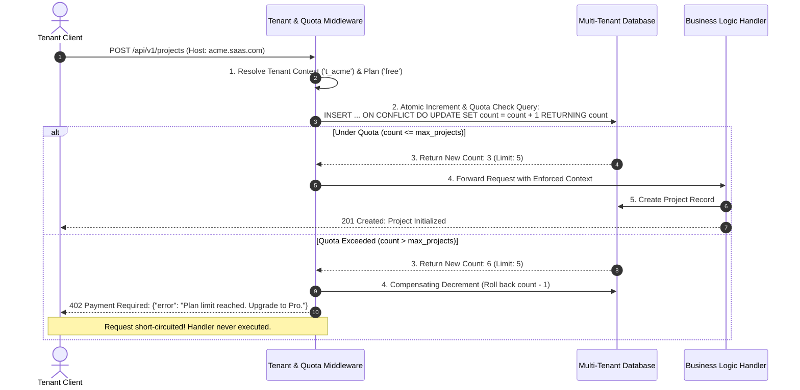
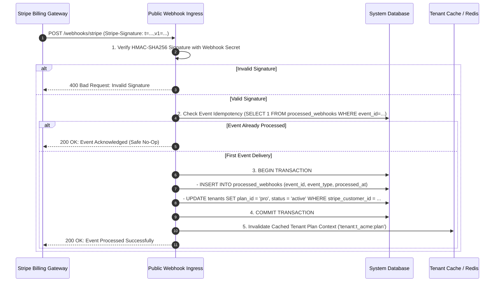
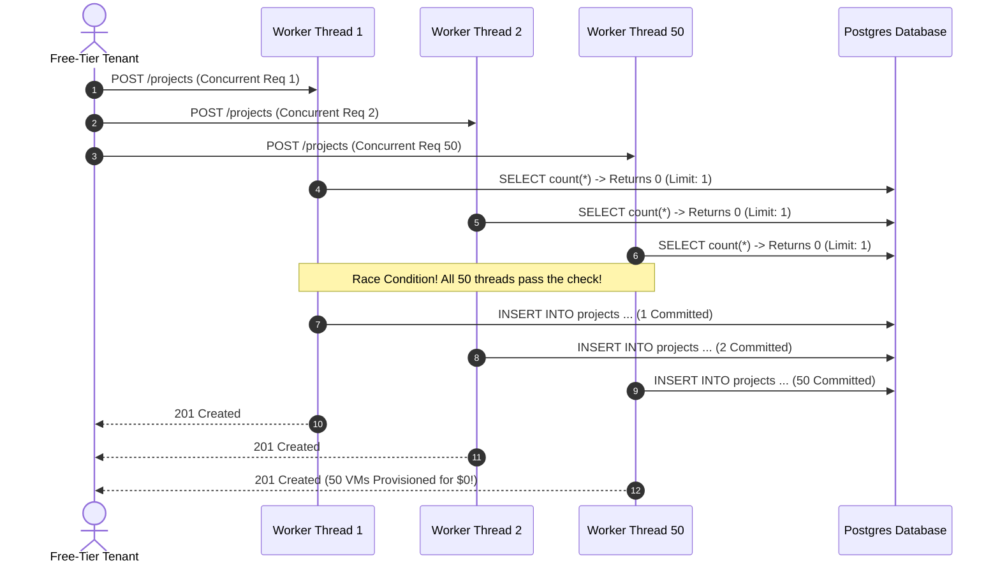

# Module 04: Billing, Plans, and Usage Metering

> **Prerequisites:** [00-tenancy-models-and-decision-framework](../00-tenancy-models-and-decision-framework/README.md), [01-tenant-identification-and-request-routing](../01-tenant-identification-and-request-routing/README.md), [02-auth-and-authorization-across-tenants](../02-auth-and-authorization-across-tenants/README.md), and [03-provisioning-and-onboarding-automation](../03-provisioning-and-onboarding-automation/README.md).  
> **Estimated Reading Time:** 30 minutes  
> **Target Audience:** Backend engineers and systems architects designing usage-based billing models, atomic quota enforcement engines, and resilient payment webhook reconcilers.

> [!TIP]
> **The Golden Rule of Multi-Tenant Billing:** Model plans, entitlements, and quotas as immutable database configuration, never hardcoded application logic. Enforce resource limits atomically at the database or distributed cache layer using single-statement compare-and-increment operations, and treat the external billing gateway (e.g., Stripe) as an asynchronous system of record synchronized via idempotent, signature-verified webhooks.

---

## Visual Mental Models & Architecture

### Atomic Quota Metering & Request Flow

In a multi-tenant platform, high-concurrency requests competing for limited plan allocations must be validated atomically. A naive read-then-write approach (`SELECT count; if count < max: UPDATE`) creates a classic race window allowing tenants to exceed tier entitlements.



### Resilient Billing Webhook Synchronization Architecture

Your billing provider (such as Stripe) processes recurring renewals, upgrades, cancellations, and payment failures asynchronously. Your application must process incoming webhook events idempotently without trusting unverified payloads.



---

## Systematic Taxonomic Reference Grids

### Entitlement & Quota Classification Taxonomy

| Quota Category | Measurement Unit | Enforcement Mechanism | Failure Response Code | Typical Business Domain Examples |
| :--- | :--- | :--- | :--- | :--- |
| **Hard Allocation Quota** | Absolute Entity Count | Atomic DB check inside transaction | `402 Payment Required` | Maximum projects, maximum active users/seats, active workspaces. |
| **Metered Consumption Quota** | Aggregated Volume per Billing Period | Atomic counter (Redis or Postgres `ON CONFLICT`) | `402 Payment Required` | Monthly API calls, total AI tokens consumed, SMS messages sent. |
| **Transient Rate Limit** | Requests per second / minute | In-memory token bucket / sliding log (Redis) | `429 Too Many Requests` | Burst traffic protection, endpoint hammering defense. |
| **Storage & Bandwidth Quota** | Bytes consumed (Gigabytes) | Asynchronous reconciliation / soft warning | `402 Payment Required` | Cloud storage disk space, video streaming egress bandwidth. |
| **Feature Entitlement Flag** | Boolean capability | In-memory plan check / JWT claim | `403 Forbidden` | SSO/SAML login, audit logging, custom domain support. |

### HTTP Rejection Status Code Matrix: 402 vs 403 vs 429

Frontend applications and API clients must receive distinct, actionable signals when an operation cannot be completed.

| HTTP Code | Semantic Meaning | Why Triggered in Multi-Tenant Context | Client Recovery Action |
| :--- | :--- | :--- | :--- |
| **`402 Payment Required`** | Commercial quota or plan entitlement reached | Tenant has exceeded free tier projects or monthly API allowance | Present upgrade modal or direct user to billing checkout portal. |
| **`403 Forbidden`** | Authorization / Permission violation | User has insufficient role (e.g., `member` attempting admin operation) or feature not available on plan | Inform user they lack permissions; contacting tenant admin required. |
| **`429 Too Many Requests`** | Velocity / Rate limit threshold exceeded | Tenant or user is bursting requests faster than the per-second token bucket | Back off exponentially; retry after duration indicated in `Retry-After`. |

### Billing Gateway Webhook Event Matrix

| Webhook Event Name | Source Trigger | Application Action | Tenant State Transition |
| :--- | :--- | :--- | :--- |
| `customer.subscription.created` | Customer completes checkout session | Store `stripe_subscription_id`, assign paid `plan_id` | `pending_payment` $\rightarrow$ `active` |
| `customer.subscription.updated` | Customer upgrades or downgrades plan tier | Update `plan_id`, update entitlement limits in cache | `active` (Tier upgraded or downgraded) |
| `invoice.payment_failed` | Recurring monthly charge declined | Increment failed attempt counter, trigger warning banner | `active` $\rightarrow$ `past_due` |
| `customer.subscription.deleted` | Subscription canceled or churned past grace period | Downgrade to `free` plan or suspend tenant access | `past_due` $\rightarrow$ `suspended` / `free` |

---

## Production War Stories: Incident Post-Mortem

### SEV-1 Post-Mortem: The Concurrency Race Over-Allocation and Out-of-Sync Plan Webhook Drop

#### Incident Overview
* **Severity:** SEV-1 (Systemic Revenue Loss & Infrastructure Over-Provisioning)
* **Detection Time:** 14 days post-billing-refactor
* **Resolution Time:** 4 hours 45 minutes
* **Impact:** 410 free-tier accounts provisioned over 1,800 enterprise compute clusters without paying, costing the platform \$128,000 in unrecoverable cloud compute costs.

#### What Happened
A cloud IDE and developer tooling SaaS offered 1 free project per account, charging \$49/month for additional projects. Their project creation handler checked plan limits before inserting the new project row:

```python
# The Flawed Read-Then-Write Quota Check
@app.post("/projects")
async def create_project(payload: ProjectCreate, tenant = Depends(get_tenant)):
    # STEP 1: Read current project count
    current_count = await db.fetch_val(
        "SELECT count(*) FROM projects WHERE tenant_id = :tid", 
        {"tid": tenant.id}
    )
    plan = await get_plan(tenant.plan_id) # Free tier max_projects = 1
    
    # STEP 2: Non-atomic verification
    if current_count >= plan.max_projects:
        raise HTTPException(status_code=402, detail="Project limit reached")
    
    # STEP 3: Create project and provision underlying cloud resources
    project = await db.execute(
        "INSERT INTO projects (tenant_id, name) VALUES (:tid, :name) RETURNING id",
        {"tid": tenant.id, "name": payload.name}
    )
    await provision_cloud_vm(project.id)
    return project
```

A user wrote a bash script using `curl` that dispatched 50 simultaneous `POST /projects` requests within a 10-millisecond window. Because all 50 requests executed Step 1 concurrently before any request reached Step 3, all 50 threads read `current_count = 0`. 

All 50 threads passed the check, and the database committed 50 project records, spinning up 50 expensive cloud virtual machines for a single free-tier account. The script was shared on developer forums, resulting in hundreds of users automating the bypass.

Compounding the disaster, when paying users downgraded their subscriptions on Stripe, the application's webhook listener suffered unhandled JSON parsing errors on specific payload updates. Because the webhook endpoint returned `500 Internal Server Error`, Stripe retried for 72 hours and then stopped delivering events, leaving hundreds of churned accounts on perpetual Enterprise access.



#### Root Cause Analysis
1. **Time-of-Check to Time-of-Use (TOCTOU) Race Condition:** The quota validation and project creation were decoupled into separate, non-isolated database interactions without row locking or transactional serialization.
2. **Missing Database Integrity Constraints:** The database schema did not enforce quota limits via conditional triggers or atomic counter increment tables.
3. **Fragile Webhook Ingress Architecture:** The webhook endpoint lacked signature verification, durable logging, and idempotency tracking tables, causing event drops upon transient schema parsing bugs.

#### The Fix & Architectural Hardening
1. **Atomic Usage Counters with Postgres Upsert:** Implemented a dedicated `usage_counters` table incremented via `INSERT ... ON CONFLICT (...) DO UPDATE SET count = usage_counters.count + 1 RETURNING count`. If the returned value exceeds the plan limit, a compensating rollback decrements the counter and immediately returns `402 Payment Required`.
2. **Postgres Partial Unique Indices & Triggers:** Added database-level trigger checks for hard entity limits.
3. **Idempotent Webhook Processing Engine:** Built a resilient webhook ingress with strict HMAC-SHA256 signature checking, storing raw event payloads in an immutable `processed_webhooks` audit log before triggering asynchronous event workers.

---

## Multi-Language Production Code Tabs

The following production implementations demonstrate:
1. **Concurrency-safe atomic quota incrementing using PostgreSQL upserts.**
2. **Quota enforcement middleware returning `402 Payment Required`.**
3. **Cryptographically verified, idempotent webhook ingestion for billing providers.**

### Production Billing & Quota Engines

````carousel
```go
// Go: Concurrency-Safe Quota Metering & Stripe Webhook Ingestion
package main

import (
	"crypto/hmac"
	"crypto/sha256"
	"database/sql"
	"encoding/hex"
	"encoding/json"
	"errors"
	"fmt"
	"net/http"
	"strconv"
	"strings"
	"time"

	"github.com/google/uuid"
	_ "github.com/lib/pq"
)

type QuotaService struct {
	db *sql.DB
}

// CheckAndIncrement atomically records consumption and evaluates quota
func (s *QuotaService) CheckAndIncrement(tenantID, metric string, limit int) (bool, int, error) {
	periodStart := time.Now().UTC().Format("2006-01-01") // Monthly boundary

	query := `
		INSERT INTO usage_counters (tenant_id, metric, period_start, count)
		VALUES ($1, $2, $3, 1)
		ON CONFLICT (tenant_id, metric, period_start)
		DO UPDATE SET count = usage_counters.count + 1
		RETURNING count;
	`

	var currentCount int
	err := s.db.QueryRow(query, tenantID, metric, periodStart).Scan(&currentCount)
	if err != nil {
		return false, 0, fmt.Errorf("failed to increment usage: %w", err)
	}

	if limit > 0 && currentCount > limit {
		// Quota exceeded: atomically roll back the increment
		decrementQuery := `
			UPDATE usage_counters
			SET count = count - 1
			WHERE tenant_id = $1 AND metric = $2 AND period_start = $3;
		`
		_, _ = s.db.Exec(decrementQuery, tenantID, metric, periodStart)
		return false, currentCount - 1, nil
	}

	return true, currentCount, nil
}

// VerifyStripeSignature checks HMAC-SHA256 signature from Stripe
func VerifyStripeSignature(payload []byte, sigHeader, secret string) bool {
	var timestamp string
	var signatures []string

	pairs := strings.Split(sigHeader, ",")
	for _, pair := range pairs {
		parts := strings.SplitN(pair, "=", 2)
		if len(parts) != 2 {
			continue
		}
		if parts[0] == "t" {
			timestamp = parts[1]
		} else if parts[0] == "v1" {
			signatures = append(signatures, parts[1])
		}
	}

	if timestamp == "" || len(signatures) == 0 {
		return false
	}

	// Signed payload is timestamp.payload
	signedPayload := fmt.Sprintf("%s.%s", timestamp, string(payload))
	mac := hmac.New(sha256.New, []byte(secret))
	mac.Write([]byte(signedPayload))
	expectedSig := hex.EncodeToString(mac.Sum(nil))

	for _, sig := range signatures {
		if hmac.Equal([]byte(sig), []byte(expectedSig)) {
			return true
		}
	}
	return false
}

// HandleBillingWebhook processes incoming Stripe events idempotently
func (s *QuotaService) HandleBillingWebhook(w http.ResponseWriter, r *http.Request, webhookSecret string) {
	sig := r.Header.Get("Stripe-Signature")
	var payload []byte
	_, _ = r.Body.Read(payload)

	if !VerifyStripeSignature(payload, sig, webhookSecret) {
		http.Error(w, "Invalid signature", http.StatusBadRequest)
		return
	}

	var event struct {
		ID   string `json:"id"`
		Type string `json:"type"`
		Data struct {
			Object struct {
				CustomerID string `json:"customer"`
				Plan       struct {
					ID string `json:"id"`
				} `json:"plan"`
			} `json:"object"`
		} `json:"data"`
	}
	if err := json.Unmarshal(payload, &event); err != nil {
		http.Error(w, "Invalid JSON payload", http.StatusBadRequest)
		return
	}

	// Idempotency: Insert into processed_webhooks
	tx, err := s.db.Begin()
	if err != nil {
		http.Error(w, "Database error", http.StatusInternalServerError)
		return
	}
	defer tx.Rollback()

	var exists bool
	_ = tx.QueryRow("SELECT true FROM processed_webhooks WHERE event_id = $1", event.ID).Scan(&exists)
	if exists {
		w.WriteHeader(http.StatusOK)
		w.Write([]byte(`{"status": "already_processed"}`))
		return
	}

	_, err = tx.Exec("INSERT INTO processed_webhooks (event_id, event_type, processed_at) VALUES ($1, $2, NOW())", event.ID, event.Type)
	if err != nil {
		http.Error(w, "Failed to register webhook event", http.StatusInternalServerError)
		return
	}

	// Update tenant plan
	if event.Type == "customer.subscription.updated" {
		_, err = tx.Exec("UPDATE tenants SET plan_id = $1 WHERE stripe_customer_id = $2", event.Data.Object.Plan.ID, event.Data.Object.CustomerID)
		if err != nil {
			http.Error(w, "Failed to update tenant plan", http.StatusInternalServerError)
			return
		}
	}

	if err := tx.Commit(); err != nil {
		http.Error(w, "Commit failed", http.StatusInternalServerError)
		return
	}

	w.WriteHeader(http.StatusOK)
	w.Write([]byte(`{"status": "success"}`))
}
```
<!-- slide -->
```typescript
// TypeScript/Node.js: Atomic Quota Guard & Stripe Webhook Ingress
import { Pool } from 'pg';
import * as crypto from 'crypto';
import { Request, Response, NextFunction } from 'express';

export class BillingService {
  constructor(private pool: Pool) {}

  /**
   * Atomically increments metric consumption and evaluates against plan threshold
   */
  public async checkAndIncrement(
    tenantId: string,
    metric: string,
    maxLimit: number | null
  ): Promise<{ allowed: boolean; currentCount: number }> {
    const periodStart = new Date().toISOString().slice(0, 7) + '-01'; // 'YYYY-MM-01'

    const client = await this.pool.connect();
    try {
      const upsertSql = `
        INSERT INTO usage_counters (tenant_id, metric, period_start, count)
        VALUES ($1, $2, $3, 1)
        ON CONFLICT (tenant_id, metric, period_start)
        DO UPDATE SET count = usage_counters.count + 1
        RETURNING count;
      `;
      const res = await client.query(upsertSql, [tenantId, metric, periodStart]);
      const currentCount = parseInt(res.rows[0].count, 10);

      if (maxLimit !== null && currentCount > maxLimit) {
        // Compensate by decrementing back
        await client.query(
          `UPDATE usage_counters SET count = count - 1 
           WHERE tenant_id = $1 AND metric = $2 AND period_start = $3`,
          [tenantId, metric, periodStart]
        );
        return { allowed: false, currentCount: currentCount - 1 };
      }

      return { allowed: true, currentCount };
    } finally {
      client.release();
    }
  }

  /**
   * Express Middleware to enforce quota limits
   */
  public createQuotaGuard(metric: string) {
    return async (req: Request, res: Response, next: NextFunction) => {
      const tenant = (req as any).tenant;
      if (!tenant) {
        return res.status(500).json({ error: 'Tenant context missing' });
      }

      // Fetch plan limit
      const planRes = await this.pool.query(
        `SELECT max_${metric} AS limit FROM plans WHERE id = $1`,
        [tenant.plan_id]
      );
      const limit = planRes.rows[0]?.limit ?? null;

      const { allowed, currentCount } = await this.checkAndIncrement(tenant.id, metric, limit);
      if (!allowed) {
        return res.status(402).json({
          error: 'Quota Exceeded',
          message: `Tenant has reached the limit of ${limit} for ${metric}. Please upgrade.`,
          currentCount,
          limit
        });
      }

      next();
    };
  }

  /**
   * Idempotent Stripe Webhook Ingestion
   */
  public async handleStripeWebhook(req: Request, res: Response, webhookSecret: string): Promise<void> {
    const signature = req.headers['stripe-signature'] as string;
    const rawBody = (req as any).rawBody || JSON.stringify(req.body);

    if (!this.verifyStripeSignature(rawBody, signature, webhookSecret)) {
      res.status(400).send('Invalid signature');
      return;
    }

    const event = req.body;
    const client = await this.pool.connect();
    try {
      await client.query('BEGIN');

      // Idempotency check
      const check = await client.query(
        'SELECT 1 FROM processed_webhooks WHERE event_id = $1',
        [event.id]
      );
      if (check.rows.length > 0) {
        await client.query('ROLLBACK');
        res.status(200).json({ status: 'already_processed' });
        return;
      }

      await client.query(
        'INSERT INTO processed_webhooks (event_id, event_type, processed_at) VALUES ($1, $2, NOW())',
        [event.id, event.type]
      );

      if (event.type === 'customer.subscription.updated') {
        const sub = event.data.object;
        await client.query(
          'UPDATE tenants SET plan_id = $1 WHERE stripe_customer_id = $2',
          [sub.plan.id, sub.customer]
        );
      }

      await client.query('COMMIT');
      res.status(200).json({ received: true });
    } catch (err) {
      await client.query('ROLLBACK');
      res.status(500).json({ error: 'Failed to process webhook' });
    } finally {
      client.release();
    }
  }

  private verifyStripeSignature(payload: string, header: string, secret: string): boolean {
    if (!header) return false;
    const parts = header.split(',');
    const timestamp = parts.find(p => p.startsWith('t='))?.split('=')[1];
    const signature = parts.find(p => p.startsWith('v1='))?.split('=')[1];

    if (!timestamp || !signature) return false;
    const expected = crypto
      .createHmac('sha256', secret)
      .update(`${timestamp}.${payload}`)
      .digest('hex');

    return crypto.timingSafeEqual(Buffer.from(signature), Buffer.from(expected));
  }
}
```
<!-- slide -->
```python
# Python: Atomic Postgres Upsert Quota Engine & FastAPI Dependency
from datetime import date
import hmac
import hashlib
from fastapi import FastAPI, Depends, HTTPException, Request, Header
from sqlalchemy.ext.asyncio import AsyncEngine
from sqlalchemy import text

class BillingQuotaManager:
    def __init__(self, engine: AsyncEngine):
        self.engine = engine

    async def check_and_increment(self, tenant_id: str, metric: str, limit: int | None) -> tuple[bool, int]:
        period_start = date.today().replace(day=1)
        
        async with self.engine.begin() as conn:
            # Atomic Postgres UPSERT with single-statement RETURNING
            upsert_query = text("""
                INSERT INTO usage_counters (tenant_id, metric, period_start, count)
                VALUES (:tid, :metric, :period, 1)
                ON CONFLICT (tenant_id, metric, period_start)
                DO UPDATE SET count = usage_counters.count + 1
                RETURNING count;
            """)
            result = await conn.execute(upsert_query, {
                "tid": tenant_id, "metric": metric, "period": period_start
            })
            new_count = result.scalar_one()

            # Quota threshold evaluation
            if limit is not None and new_count > limit:
                # Compensating decrement rollback
                await conn.execute(text("""
                    UPDATE usage_counters
                    SET count = count - 1
                    WHERE tenant_id = :tid AND metric = :metric AND period_start = :period
                """), {"tid": tenant_id, "metric": metric, "period": period_start})
                return False, new_count - 1

            return True, new_count

    def require_quota(self, metric: str):
        """FastAPI Dependency for mid-request quota enforcement"""
        async def dependency(request: Request):
            tenant = getattr(request.state, "tenant", None)
            if not tenant:
                raise HTTPException(status_code=500, detail="Missing tenant context")

            # Resolve plan limits
            async with self.engine.connect() as conn:
                res = await conn.execute(
                    text(f"SELECT max_{metric} FROM plans WHERE id = :pid"),
                    {"pid": tenant.plan_id}
                )
                limit = res.scalar_one_or_none()

            allowed, count = await self.check_and_increment(tenant.id, metric, limit)
            if not allowed:
                raise HTTPException(
                    status_code=402,
                    detail={
                        "error": "Quota Exceeded",
                        "metric": metric,
                        "limit": limit,
                        "current_usage": count,
                        "upgrade_url": f"https://billing.saas.com/upgrade?tenant={tenant.slug}"
                    }
                )
            return count
        return dependency

    async def process_stripe_webhook(self, raw_body: bytes, stripe_signature: str, secret: str) -> dict:
        # Cryptographic Signature Verification
        parts = dict(x.split("=", 1) for x in stripe_signature.split(",") if "=" in x)
        timestamp = parts.get("t")
        expected_sig = parts.get("v1")
        if not timestamp or not expected_sig:
            raise ValueError("Malformed Stripe-Signature header")

        computed_sig = hmac.new(
            secret.encode("utf-8"),
            f"{timestamp}.".encode("utf-8") + raw_body,
            hashlib.sha256
        ).hexdigest()

        if not hmac.compare_digest(computed_sig, expected_sig):
            raise ValueError("Invalid webhook signature")

        import json
        event = json.loads(raw_body.decode("utf-8"))
        event_id = event["id"]

        # Transactional Idempotency Gate
        async with self.engine.begin() as conn:
            check = await conn.execute(
                text("SELECT 1 FROM processed_webhooks WHERE event_id = :id"),
                {"id": event_id}
            )
            if check.scalar_one_or_none():
                return {"status": "already_processed"}

            await conn.execute(
                text("INSERT INTO processed_webhooks (event_id, event_type, processed_at) VALUES (:id, :t, NOW())"),
                {"id": event_id, "t": event["type"]}
            )

            if event["type"] == "customer.subscription.updated":
                sub = event["data"]["object"]
                await conn.execute(
                    text("UPDATE tenants SET plan_id = :plan WHERE stripe_customer_id = :cust"),
                    {"plan": sub["plan"]["id"], "cust": sub["customer"]}
                )

        return {"status": "success"}
```
<!-- slide -->
```csharp
// C#: Concurrency-Safe Quota Engine & Webhook Verification
using System;
using System.Security.Cryptography;
using System.Text;
using System.Text.Json;
using System.Threading.Tasks;
using Npgsql;

public class QuotaService
{
    private readonly NpgsqlDataSource _dataSource;

    public QuotaService(NpgsqlDataSource dataSource)
    {
        _dataSource = dataSource;
    }

    public async Task<(bool Allowed, long CurrentCount)> CheckAndIncrementAsync(
        Guid tenantId, string metric, int? maxLimit)
    {
        var periodStart = new DateTime(DateTime.UtcNow.Year, DateTime.UtcNow.Month, 1);

        await using var conn = await _dataSource.OpenConnectionAsync();
        await using var tx = await conn.BeginTransactionAsync();

        try
        {
            const string upsertSql = @"
                INSERT INTO usage_counters (tenant_id, metric, period_start, count)
                VALUES (@tid, @metric, @period, 1)
                ON CONFLICT (tenant_id, metric, period_start)
                DO UPDATE SET count = usage_counters.count + 1
                RETURNING count;";

            await using var cmd = new NpgsqlCommand(upsertSql, conn, tx);
            cmd.Parameters.AddWithValue("tid", tenantId);
            cmd.Parameters.AddWithValue("metric", metric);
            cmd.Parameters.AddWithValue("period", periodStart);

            var count = (long)(await cmd.ExecuteScalarAsync())!;

            if (maxLimit.HasValue && count > maxLimit.Value)
            {
                // Compensating decrement
                const string decSql = @"
                    UPDATE usage_counters
                    SET count = count - 1
                    WHERE tenant_id = @tid AND metric = @metric AND period_start = @period;";
                await using var decCmd = new NpgsqlCommand(decSql, conn, tx);
                decCmd.Parameters.AddWithValue("tid", tenantId);
                decCmd.Parameters.AddWithValue("metric", metric);
                decCmd.Parameters.AddWithValue("period", periodStart);
                await decCmd.ExecuteNonQueryAsync();

                await tx.CommitAsync();
                return (false, count - 1);
            }

            await tx.CommitAsync();
            return (true, count);
        }
        catch
        {
            await tx.RollbackAsync();
            throw;
        }
    }

    public static bool VerifyStripeSignature(string payload, string sigHeader, string secret)
    {
        string? timestamp = null;
        string? signature = null;

        foreach (var item in sigHeader.Split(','))
        {
            var parts = item.Split('=', 2);
            if (parts.Length != 2) continue;
            if (parts[0].Trim() == "t") timestamp = parts[1].Trim();
            if (parts[0].Trim() == "v1") signature = parts[1].Trim();
        }

        if (timestamp == null || signature == null) return false;

        using var hmac = new HMACSHA256(Encoding.UTF8.GetBytes(secret));
        var hash = hmac.ComputeHash(Encoding.UTF8.GetBytes($"{timestamp}.{payload}"));
        var computedSig = Convert.ToHexString(hash).ToLowerInvariant();

        return CryptographicOperations.FixedTimeEquals(
            Encoding.UTF8.GetBytes(signature),
            Encoding.UTF8.GetBytes(computedSig)
        );
    }
}
```
````

---

## Practical Hands-On Verification CLI Workflows

Follow this hands-on workflow to test concurrency-safe counter increments, simulate quota enforcement triggering `402 Payment Required`, and verify webhook idempotency.

### Step 1: Initialize Database Tables and Plan Seed Data

```bash
docker exec -i saas-onboarding-test psql -U postgres -d saas_db << 'EOF'
CREATE TABLE IF NOT EXISTS plans (
    id TEXT PRIMARY KEY,
    name TEXT NOT NULL,
    max_projects INT, -- NULL = Unlimited
    max_api_calls_per_month INT
);

INSERT INTO plans (id, name, max_projects, max_api_calls_per_month) VALUES
    ('free', 'Free Starter', 2, 100),
    ('pro', 'Professional', 50, 50000)
ON CONFLICT (id) DO NOTHING;

CREATE TABLE IF NOT EXISTS usage_counters (
    tenant_id UUID NOT NULL REFERENCES tenants(id) ON DELETE CASCADE,
    metric TEXT NOT NULL,
    period_start DATE NOT NULL,
    count BIGINT NOT NULL DEFAULT 0,
    PRIMARY KEY (tenant_id, metric, period_start)
);

CREATE TABLE IF NOT EXISTS processed_webhooks (
    event_id TEXT PRIMARY KEY,
    event_type TEXT NOT NULL,
    processed_at TIMESTAMPTZ NOT NULL
);
EOF
```

### Step 2: Seed a Free-Tier Test Tenant

```bash
docker exec -i saas-onboarding-test psql -U postgres -d saas_db << 'EOF'
INSERT INTO tenants (id, slug, name, plan_id, status)
VALUES ('e0000000-0000-0000-0000-000000000001', 'acme-labs', 'Acme Labs', 'free', 'active')
ON CONFLICT (id) DO UPDATE SET plan_id = 'free';
EOF
```

### Step 3: Verify Single-Statement Atomic Increment & Quota Threshold

Execute two legitimate increments and one over-quota increment to observe counter behavior:

```bash
docker exec -i saas-onboarding-test psql -U postgres -d saas_db << 'EOF'
-- Attempt 1: Increment project creation count
INSERT INTO usage_counters (tenant_id, metric, period_start, count)
VALUES ('e0000000-0000-0000-0000-000000000001', 'projects', '2026-11-01', 1)
ON CONFLICT (tenant_id, metric, period_start)
DO UPDATE SET count = usage_counters.count + 1
RETURNING count;

-- Attempt 2: Increment project creation count
INSERT INTO usage_counters (tenant_id, metric, period_start, count)
VALUES ('e0000000-0000-0000-0000-000000000001', 'projects', '2026-11-01', 1)
ON CONFLICT (tenant_id, metric, period_start)
DO UPDATE SET count = usage_counters.count + 1
RETURNING count;
EOF
```

**Expected Wire Output:**
```text
 count 
-------
     1
(1 row)

 count 
-------
     2
(1 row)
```

Now, simulate the 3rd attempt breaching the Free tier quota limit (`max_projects = 2`):

```bash
docker exec -i saas-onboarding-test psql -U postgres -d saas_db << 'EOF'
DO $$
DECLARE
    v_count INT;
    v_limit INT := 2; -- Free tier limit
BEGIN
    INSERT INTO usage_counters (tenant_id, metric, period_start, count)
    VALUES ('e0000000-0000-0000-0000-000000000001', 'projects', '2026-11-01', 1)
    ON CONFLICT (tenant_id, metric, period_start)
    DO UPDATE SET count = usage_counters.count + 1
    RETURNING count INTO v_count;

    IF v_count > v_limit THEN
        -- Rollback decrement
        UPDATE usage_counters SET count = count - 1 
        WHERE tenant_id = 'e0000000-0000-0000-0000-000000000001' AND metric = 'projects' AND period_start = '2026-11-01';
        RAISE EXCEPTION 'HTTP 402: Quota exceeded for plan free (limit: %, requested count: %)', v_limit, v_count;
    END IF;
END $$;
EOF
```

**Expected Wire Output:**
```text
ERROR:  HTTP 402: Quota exceeded for plan free (limit: 2, requested count: 3)
CONTEXT:  PL/pgSQL function inline_code_block line 15 at RAISE
```

Verify that the counter was preserved at 2:
```bash
docker exec -i saas-onboarding-test psql -U postgres -d saas_db -c "
SELECT metric, period_start, count FROM usage_counters WHERE tenant_id = 'e0000000-0000-0000-0000-000000000001';
"
```

**Expected Wire Output:**
```text
  metric  | period_start | count 
----------+--------------+-------
 projects | 2026-11-01   |     2
(1 row)
```

### Step 4: Verify Idempotent Webhook Processing

Simulate an incoming Stripe `customer.subscription.updated` event upgrading `acme-labs` to `pro`:

```bash
docker exec -i saas-onboarding-test psql -U postgres -d saas_db << 'EOF'
-- Run Webhook Ingestion for Event evt_test_101
INSERT INTO processed_webhooks (event_id, event_type, processed_at)
VALUES ('evt_test_101', 'customer.subscription.updated', NOW());

UPDATE tenants SET plan_id = 'pro' WHERE id = 'e0000000-0000-0000-0000-000000000001';
EOF
```

Verify that replaying the identical webhook event is safely caught:
```bash
docker exec -i saas-onboarding-test psql -U postgres -d saas_db << 'EOF'
DO $$
BEGIN
    IF EXISTS (SELECT 1 FROM processed_webhooks WHERE event_id = 'evt_test_101') THEN
        RAISE NOTICE 'Idempotency gate: Webhook event evt_test_101 already processed. Skipping update.';
        RETURN;
    END IF;
    -- Would execute updates if not caught
END $$;
EOF
```

**Expected Wire Output:**
```text
NOTICE:  Idempotency gate: Webhook event evt_test_101 already processed. Skipping update.
DO
```

---

## Operational Validation Checkpoints (Scenario Quizzes)

<details>
<summary><strong>Checkpoint 1: The SELECT-Then-UPDATE Quota Race Window</strong></summary>

**Scenario:** An engineering team implements quota checking in application code:
```python
current_count = await db.fetch_val("SELECT count FROM usage WHERE tenant_id = :tid", {"tid": tenant_id})
if current_count >= limit:
    raise QuotaExceededException()
await db.execute("UPDATE usage SET count = count + 1 WHERE tenant_id = :tid", {"tid": tenant_id})
```
Under what operational traffic condition will this code fail to enforce the limit, and what specific SQL construction guarantees correctness without setting pessimistic table locks?

<strong>Answer:</strong>
This code is vulnerable to a Time-of-Check to Time-of-Use (TOCTOU) race condition whenever a tenant dispatches multiple concurrent requests. If a tenant on a plan with a limit of 10 currently has 9 used units and sends 10 concurrent requests simultaneously, all 10 threads can execute the `SELECT` statement before any thread executes the `UPDATE`. All 10 threads see `current_count = 9 < 10` and proceed to increment, resulting in a final count of 19 (a 90% quota overrun). The correct design uses PostgreSQL's atomic single-statement upsert:
```sql
INSERT INTO usage_counters (tenant_id, metric, period_start, count)
VALUES (:tid, :metric, :period, 1)
ON CONFLICT (tenant_id, metric, period_start)
DO UPDATE SET count = usage_counters.count + 1
RETURNING count;
```
Because PostgreSQL executes row-level upserts with an internal exclusive write lock on the target index tuple, all concurrent updates are serialized atomically at the storage engine level.
</details>

<details>
<summary><strong>Checkpoint 2: The Direct UI Plan Assignment Anti-Pattern</strong></summary>

**Scenario:** A SaaS frontend allows administrators to click "Upgrade to Enterprise". Upon receiving the request, the backend immediately executes `UPDATE tenants SET plan_id = 'enterprise' WHERE id = :tid;` and redirects the user to Stripe Checkout to enter payment details. Why is this a severe architectural flaw, and how does webhook-driven reconciliation resolve it?

<strong>Answer:</strong>
Allowing the application to update `plan_id` before receiving confirmed settlement from the payment gateway decouples entitlement from payment state:
1. **Unpaid Entitlement Exploitation:** If the user closes the browser at the Stripe Checkout screen, submits a stolen card that is rejected, or triggers 3D-Secure failure, the application has already granted Enterprise capabilities.
2. **State Drift:** If payment fails on subscription renewal 30 days later, the application has no mechanism to downgrade the tenant unless it listens to gateway events.

The billing gateway (Stripe) must remain the authoritative system of record for commercial subscriptions. The application must only transition `plan_id` upon receiving and cryptographically verifying an authoritative webhook event (`checkout.session.completed` or `customer.subscription.updated`).
</details>

<details>
<summary><strong>Checkpoint 3: Soft vs. Hard Quota Architecture for Storage</strong></summary>

**Scenario:** You are architecting a SaaS platform that charges for two resources: Active Team Members (seats) and Object Storage (gigabytes of uploaded media). Why is it acceptable—and often necessary—to enforce team seats with a hard atomic database lock, while storage consumption is typically enforced via soft reconciliation?

<strong>Answer:</strong>
The difference stems from transaction boundaries and observability:
* **Active Seats (Hard Quota):** Inviting a user is a discrete, low-frequency metadata operation. Checking `SELECT count(*) FROM users WHERE tenant_id = :tid` inside the user invitation transaction is fast (< 2ms), predictable, and zero-byte overhead. Breaches are unacceptable because seats directly determine authorization and licensing.
* **Storage Consumption (Soft Quota):** A user uploading a 2 GB file via chunked multipart upload transmits data over minutes. The exact post-compression storage size may not be known upfront. Enforcing atomic database locks on every chunked HTTP upload would create massive database lock contention across storage nodes. Instead, systems perform a fast pre-flight authorization check, ingest the file, calculate usage asynchronously via storage bucket metrics or background event streams, and apply soft enforcement (e.g., warning banners or disabling future uploads if over quota) rather than violently dropping an in-flight 2 GB transfer mid-stream.
</details>

---

## Free PDF notes

Download these notes as a printable PDF, with every diagram and interview questions: [SD-C-014: Throttling vs Rate Limiting vs Quotas](https://backendroadmap.com/notes/system-design/SD-C-014.pdf). Each section in one file: [Phase 2, APIs (PDF)](https://backendroadmap.com/notes/system-design/Phase2_APIs_Notes.pdf).

---

## Further Reading & Sources

- [Stripe Documentation: Usage-Based Billing Patterns](https://stripe.com/docs/billing/subscriptions/usage-based) — Metered billing and aggregation models.
- [Stripe Documentation: Webhook Signatures](https://stripe.com/docs/webhooks) — Cryptographic verification and replay prevention.
- [Track 05, Backend: Caching and Performance](../../05-caching-and-performance/README.md) — Concurrency control and race condition mitigations.

---

## Next

Continue to [05-scaling-and-noisy-neighbor-at-the-app-layer](../05-scaling-and-noisy-neighbor-at-the-app-layer/README.md) — now that usage is measured per tenant, learn how to prevent a single noisy tenant's traffic from degrading API availability and worker capacity for everyone else.
