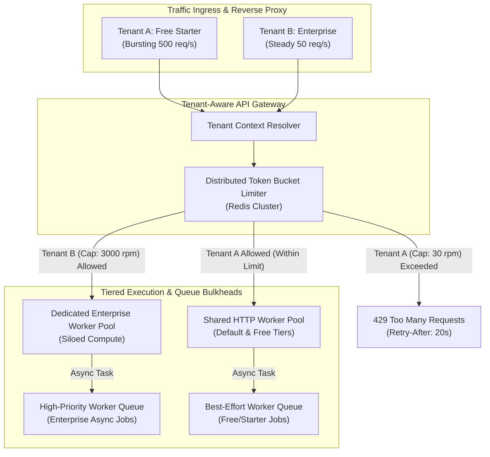
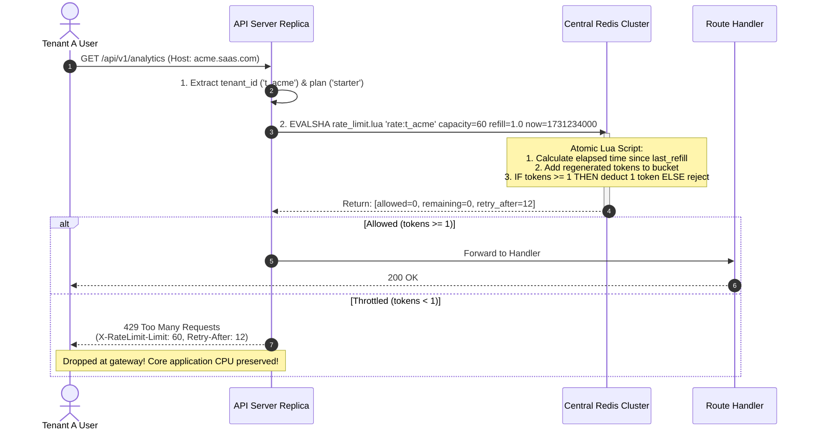
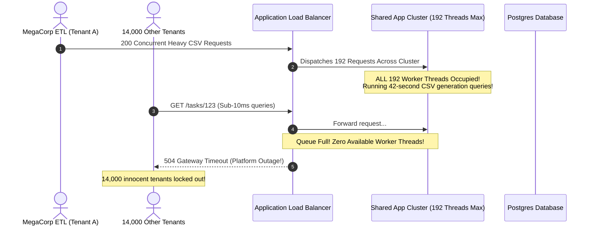

# Module 05: Scaling and the Noisy-Neighbor Problem at the App Layer

> **Prerequisites:** [00-tenancy-models-and-decision-framework](../00-tenancy-models-and-decision-framework/README.md), [01-tenant-identification-and-request-routing](../01-tenant-identification-and-request-routing/README.md), [02-auth-and-authorization-across-tenants](../02-auth-and-authorization-across-tenants/README.md), [04-billing-plans-and-usage-metering](../04-billing-plans-and-usage-metering/README.md), and [Track 05: Caching and Performance](../../05-caching-and-performance/README.md).  
> **Estimated Reading Time:** 28 minutes  
> **Target Audience:** Senior backend engineers and platform architects designing multi-tenant resource governors, distributed rate limiters, tiered worker pools, and feature gating engines.

> [!TIP]
> **The Golden Rule of Application-Layer Tenant Isolation:** Never limit traffic solely by client IP or individual user ID. Multi-tenant capacity must be governed at the **tenant boundary**: enforce distributed rate limiting keyed by `tenant_id` scaled by plan tier, isolate expensive asynchronous workloads into partitioned worker queues, and implement circuit breakers to shed pathological tenant traffic before it exhausts shared application thread pools.

---

## Visual Mental Models & Architecture

### The Multi-Tenant Application Layer Governor Architecture

When multiple organizations share common API ingress nodes and background worker clusters, an unthrottled burst or pathological query pattern from one organization can consume all available socket connections, CPU threads, and memory allocations.



### Distributed Per-Tenant Token Bucket State Flow

Using in-process memory for rate limiting leads to dramatic leakage in horizontally scaled architectures. A distributed Redis-backed sliding token bucket maintains strict tenant quotas across any number of application replicas.



---

## Systematic Taxonomic Reference Grids

### Noisy-Neighbor Failure Modes at the Application Layer

| Failure Mode | Failure Mechanism | Root Cause | Architectural Defense |
| :--- | :--- | :--- | :--- |
| **HTTP Thread Pool Starvation** | Tenant runs 100 concurrent slow CSV exports; exhausts WSGI/worker threads | Unbounded concurrency per tenant on shared API servers | Per-tenant concurrent request caps (`MaxConcurrentRequests = 10`) and async job offloading. |
| **Worker Queue Starvation** | Free tenant enqueues 50,000 webhook jobs; enterprise tasks delayed 4 hours | Single global FIFO background queue | Fair-share queuing or per-tier queue partitioning (VIP vs Standard). |
| **Memory / OOM Cascades** | Large tenant queries 1,000,000 rows into application heap memory | Missing streaming or pagination guards on endpoints | Strict cursor pagination (`limit <= 100`) and per-tenant memory quotas. |
| **Connection Pool Exhaustion** | Pathological queries hold open database connections indefinitely | Missing tenant-level connection limits or `statement_timeout` | Proxy pooling (PgBouncer) with aggressive per-tenant statement timeouts (e.g., 5s). |
| **Feature Consumption Abuse** | Lower-tier tenant invokes computationally expensive feature in tight loop | Feature enabled globally without plan gating | Plan-based feature flags (`require_feature("bulk_export")`) returning `402`. |

### Systematic Comparison of Multi-Tenant Throttling Algorithms

| Algorithm | Redis Memory Footprint | Concurrency Safety | Burst Handling Capability | Best Suited Multi-Tenant Use Case |
| :--- | :--- | :--- | :--- | :--- |
| **Token Bucket** | Minimal (2 keys: `tokens`, `last_updated`) | High (Single atomic Lua script) | Excellent; permits bursts up to capacity, refills smoothly | **Default standard** for general API rate limiting by plan tier. |
| **Leaky Bucket** | Minimal (1 FIFO queue or counter) | High | Zero burst; enforces perfectly smooth, constant egress rate | Data streaming ingestion, outbound third-party webhook dispatchers. |
| **Sliding Window Log** | High (1 sorted set per tenant containing timestamps) | High | Absolute precision; eliminates edge-of-window doubling | High-value security endpoints (e.g., password reset, 2FA validation). |
| **Sliding Window Counter** | Low (Hash counters for current & previous windows) | High | Smooth approximation (< 0.05% error) | High-throughput distributed API gateways (e.g., Kong, Envoy). |

### Infrastructure Isolation Tiers Comparison

| Isolation Tier | Deployment Model | Cost per Tenant | Blast Radius Containment | Target Tenant Archetype |
| :--- | :--- | :--- | :--- | :--- |
| **Shared Pool (Pooled)** | All tenants share API pods, workers, and queues | Lowest (\$0.01 – \$0.10 / mo) | Low; software rate limiting is the sole barrier | Free, Starter, Self-serve Pro tiers. |
| **Tiered Partitioning** | Dedicated worker queues and app pods per plan tier | Moderate (\$10 – \$50 / mo) | High; Free tier storms cannot impact Enterprise pods | High-volume Pro and Mid-Market tiers. |
| **Dedicated Silo** | Dedicated Kubernetes pods and isolated database | High (\$200 – \$2,000+ / mo) | Total (100% hardware & process isolation) | Enterprise, HIPAA/SOC2 compliant accounts. |

---

## Production War Stories: Incident Post-Mortem

### SEV-1 Post-Mortem: The Enterprise CSV Export Thread Starvation & Black Hole Outage

#### Incident Overview
* **Severity:** SEV-1 (Total Multi-Tenant Platform Outage)
* **Detection Time:** 6 minutes post-incident onset
* **Resolution Time:** 2 hours 10 minutes
* **Impact:** 14,000 business accounts worldwide suffered complete HTTP 504 timeouts for 130 minutes.

#### What Happened
A multi-tenant project management SaaS operated 24 containerized application instances behind an AWS Application Load Balancer. Each container ran a Python Gunicorn server configured with 4 worker processes and 2 threads per worker (a maximum platform capacity of $24 \times 8 = 192$ concurrent execution threads).

An automated ETL script operated by a legitimate Enterprise tenant launched a cron job at 02:00 UTC. The script initiated 200 parallel HTTP requests to:
```http
GET /api/v1/projects/export?format=csv
Host: megacorp.saasplatform.com
```

This endpoint:
1. Ran an unindexed multi-table JOIN query spanning 500,000 task records.
2. Formatted the resulting rows into CSV strings in application memory.
3. Held open the active HTTP thread for approximately 42 seconds per request.

Within 4 seconds of the cron job firing, all 192 application worker threads across all 24 nodes were occupied servicing MegaCorp's 200 export requests.

When users from other organizations (Acme, Globex, Initech) attempted simple, sub-10ms requests (e.g., `GET /api/v1/tasks/123`), their requests queued at the load balancer socket backlog. Because no application threads were available to accept connections, the load balancer returned `HTTP 504 Gateway Timeout` to all 14,000 tenants globally.



#### Root Cause Analysis
1. **Unbounded Per-Tenant Concurrency:** The platform had no limit on how many concurrent execution slots a single tenant could consume. A single tenant occupied 100% of global thread capacity.
2. **Synchronous Heavy Export Execution:** A 42-second bulk export was executed directly inside synchronous HTTP request-response worker threads instead of being offloaded to an asynchronous background worker pool.
3. **Missing Circuit Breaker & Bulkheads:** There was no tenant-level concurrency bulkhead or execution timeout to shed heavy workloads during thread exhaustion.

#### The Fix & Architectural Hardening
1. **Offloaded Heavy Workloads to Asynchronous Queues:** Re-architected `/export` to return `202 Accepted` immediately with a `job_id`, delegating the CSV generation to background Celery workers.
2. **Per-Tenant Concurrency Bulkhead:** Implemented a Redis semaphore limiting each tenant to a maximum of 5 concurrent in-flight requests on heavy endpoints.
3. **Tiered Worker Queues:** Created dedicated Celery queues for Enterprise vs. Free tier exports to guarantee enterprise operations never block basic operations.
4. **Feature Gating by Plan:** Placed bulk export behind `require_feature("bulk_export")`, rejecting unauthorized lower-tier attempts with `402 Payment Required`.

---

## Multi-Language Production Code Tabs

The following implementations demonstrate:
1. **Distributed per-tenant token bucket rate limiting using Redis and atomic Lua scripting.**
2. **Plan-aware dynamic rate limit configuration (Free vs. Pro vs. Enterprise).**
3. **Plan-based feature gating middleware returning `402 Payment Required`.**

### Production Rate Limiting & Governor Engines

````carousel
```go
// Go: Distributed Per-Tenant Redis Token Bucket & Feature Gate
package main

import (
	"context"
	"fmt"
	"net/http"
	"strconv"
	"time"

	"github.com/go-redis/redis/v8"
)

// Atomic Token Bucket Lua Script
const tokenBucketLua = `
local key = KEYS[1]
local capacity = tonumber(ARGV[1])
local refill_rate = tonumber(ARGV[2])
local cost = tonumber(ARGV[3])
local now = tonumber(ARGV[4])

local data = redis.call("HMGET", key, "tokens", "last_updated")
local tokens = tonumber(data[1])
local last_updated = tonumber(data[2])

if tokens == nil then
    tokens = capacity
    last_updated = now
else
    local elapsed = math.max(0, now - last_updated)
    tokens = math.min(capacity, tokens + elapsed * refill_rate)
    last_updated = now
end

if tokens >= cost then
    tokens = tokens - cost
    redis.call("HMSET", key, "tokens", tokens, "last_updated", last_updated)
    redis.call("EXPIRE", key, math.ceil(capacity / refill_rate) * 2)
    return {1, math.floor(tokens), 0}
else
    local retry_after = math.ceil((cost - tokens) / refill_rate)
    return {0, math.floor(tokens), retry_after}
end
`

type GovernorService struct {
	rdb         *redis.Client
	scriptSHA   string
	planLimits  map[string]int // plan_id -> requests per minute
	featureGate map[string][]string
}

func NewGovernorService(rdb *redis.Client) (*GovernorService, error) {
	ctx := context.Background()
	sha, err := rdb.ScriptLoad(ctx, tokenBucketLua).Result()
	if err != nil {
		return nil, fmt.Errorf("failed to load rate limit lua: %w", err)
	}

	return &GovernorService{
		rdb:       rdb,
		scriptSHA: sha,
		planLimits: map[string]int{
			"free":       30,   // 30 requests / minute
			"pro":        300,  // 300 requests / minute
			"enterprise": 3000, // 3000 requests / minute
		},
		featureGate: map[string][]string{
			"bulk_export": {"pro", "enterprise"},
			"audit_logs":  {"enterprise"},
		},
	}, nil
}

func (g *GovernorService) RateLimitMiddleware(next http.Handler) http.Handler {
	return http.HandlerFunc(func(w http.ResponseWriter, r *http.Request) {
		tenantID := r.Header.Get("X-Tenant-ID")
		planID := r.Header.Get("X-Tenant-Plan")
		if tenantID == "" || planID == "" {
			http.Error(w, "Missing tenant headers", http.StatusBadRequest)
			return
		}

		limitRPM, ok := g.planLimits[planID]
		if !ok {
			limitRPM = 30
		}

		capacity := float64(limitRPM)
		refillRate := capacity / 60.0 // tokens per second
		now := float64(time.Now().Unix())

		key := fmt.Sprintf("ratelimit:%s", tenantID)
		res, err := g.rdb.EvalSha(r.Context(), g.scriptSHA, []string{key}, capacity, refillRate, 1, now).Result()
		if err != nil {
			http.Error(w, "Rate limiter error", http.StatusInternalServerError)
			return
		}

		vals := res.([]interface{})
		allowed := vals[0].(int64) == 1
		remaining := vals[1].(int64)
		retryAfter := vals[2].(int64)

		w.Header().Set("X-RateLimit-Limit", strconv.Itoa(limitRPM))
		w.Header().Set("X-RateLimit-Remaining", strconv.FormatInt(remaining, 10))

		if !allowed {
			w.Header().Set("Retry-After", strconv.FormatInt(retryAfter, 10))
			http.Error(w, "Rate limit exceeded. Slow down.", http.StatusTooManyRequests)
			return
		}

		next.ServeHTTP(w, r)
	})
}

func (g *GovernorService) RequireFeature(featureName string, next http.HandlerFunc) http.HandlerFunc {
	return func(w http.ResponseWriter, r *http.Request) {
		planID := r.Header.Get("X-Tenant-Plan")
		allowedPlans := g.featureGate[featureName]

		hasAccess := false
		for _, p := range allowedPlans {
			if p == planID {
				hasAccess = true
				break
			}
		}

		if !hasAccess {
			w.WriteHeader(http.StatusPaymentRequired)
			w.Write([]byte(fmt.Sprintf(`{"error": "Feature '%s' requires plan upgrade"}`, featureName)))
			return
		}

		next(w, r)
	}
}
```
<!-- slide -->
```typescript
// TypeScript/Node.js: Distributed Redis Token Bucket & Express Guard
import { Request, Response, NextFunction } from 'express';
import Redis from 'ioredis';

const TOKEN_BUCKET_LUA = `
local key = KEYS[1]
local capacity = tonumber(ARGV[1])
local refill_rate = tonumber(ARGV[2])
local cost = tonumber(ARGV[3])
local now = tonumber(ARGV[4])

local data = redis.call("HMGET", key, "tokens", "last_updated")
local tokens = tonumber(data[1])
local last_updated = tonumber(data[2])

if tokens == nil then
    tokens = capacity
    last_updated = now
else
    local elapsed = math.max(0, now - last_updated)
    tokens = math.min(capacity, tokens + elapsed * refill_rate)
    last_updated = now
end

if tokens >= cost then
    tokens = tokens - cost
    redis.call("HMSET", key, "tokens", tokens, "last_updated", last_updated)
    redis.call("EXPIRE", key, math.ceil(capacity / refill_rate) * 2)
    return {1, math.floor(tokens), 0}
else
    local retry_after = math.ceil((cost - tokens) / refill_rate)
    return {0, math.floor(tokens), retry_after}
end
`;

export class TenantGovernor {
  private scriptSha: string = '';
  private planRpmLimits: Record<string, number> = {
    free: 30,
    pro: 300,
    enterprise: 3000,
  };
  private featureGates: Record<string, string[]> = {
    bulk_export: ['pro', 'enterprise'],
    audit_logs: ['enterprise'],
  };

  constructor(private redis: Redis) {
    this.initLua();
  }

  private async initLua() {
    this.scriptSha = await this.redis.script('LOAD', TOKEN_BUCKET_LUA) as string;
  }

  public rateLimitMiddleware() {
    return async (req: Request, res: Response, next: NextFunction) => {
      const tenant = (req as any).tenant;
      if (!tenant) {
        return res.status(500).json({ error: 'Tenant context missing' });
      }

      const limitRpm = this.planRpmLimits[tenant.plan_id] || 30;
      const capacity = limitRpm;
      const refillRate = capacity / 60.0;
      const now = Math.floor(Date.now() / 1000);

      const redisKey = `ratelimit:${tenant.id}`;
      const result = await this.redis.evalsha(
        this.scriptSha,
        1,
        redisKey,
        capacity.toString(),
        refillRate.toString(),
        '1',
        now.toString()
      ) as [number, number, number];

      const [allowed, remaining, retryAfter] = result;
      res.setHeader('X-RateLimit-Limit', limitRpm.toString());
      res.setHeader('X-RateLimit-Remaining', remaining.toString());

      if (allowed !== 1) {
        res.setHeader('Retry-After', retryAfter.toString());
        return res.status(429).json({
          error: 'Too Many Requests',
          message: `Tenant rate limit exceeded. Retry after ${retryAfter} seconds.`,
        });
      }

      next();
    };
  }

  public requireFeature(feature: string) {
    return (req: Request, res: Response, next: NextFunction) => {
      const tenant = (req as any).tenant;
      const eligiblePlans = this.featureGates[feature] || [];

      if (!tenant || !eligiblePlans.includes(tenant.plan_id)) {
        return res.status(402).json({
          error: 'Payment Required',
          message: `Feature '${feature}' is restricted to higher tier plans. Upgrade required.`,
        });
      }
      next();
    };
  }
}
```
<!-- slide -->
```python
# Python: Redis Token Bucket & Plan Feature Guard with FastAPI
import time
from typing import Set, Dict
import redis.asyncio as aioredis
from fastapi import Request, HTTPException, Depends

TOKEN_BUCKET_LUA = """
local key = KEYS[1]
local capacity = tonumber(ARGV[1])
local refill_rate = tonumber(ARGV[2])
local cost = tonumber(ARGV[3])
local now = tonumber(ARGV[4])

local data = redis.call("HMGET", key, "tokens", "last_updated")
local tokens = tonumber(data[1])
local last_updated = tonumber(data[2])

if tokens == nil then
    tokens = capacity
    last_updated = now
else
    local elapsed = math.max(0, now - last_updated)
    tokens = math.min(capacity, tokens + elapsed * refill_rate)
    last_updated = now
end

if tokens >= cost then
    tokens = tokens - cost
    redis.call("HMSET", key, "tokens", tokens, "last_updated", last_updated)
    redis.call("EXPIRE", key, math.ceil(capacity / refill_rate) * 2)
    return {1, math.floor(tokens), 0}
else
    local retry_after = math.ceil((cost - tokens) / refill_rate)
    return {0, math.floor(tokens), retry_after}
end
"""

class TenantGovernor:
    def __init__(self, redis_client: aioredis.Redis):
        self.redis = redis_client
        self.script_sha = None
        self.plan_rpm: Dict[str, int] = {
            "free": 30,
            "pro": 300,
            "enterprise": 3000
        }
        self.feature_gates: Dict[str, Set[str]] = {
            "bulk_export": {"pro", "enterprise"},
            "custom_domain": {"enterprise"}
        }

    async def initialize(self):
        self.script_sha = await self.redis.script_load(TOKEN_BUCKET_LUA)

    async def enforce_rate_limit(self, request: Request):
        tenant = getattr(request.state, "tenant", None)
        if not tenant:
            raise HTTPException(status_code=500, detail="Missing tenant context")

        limit_rpm = self.plan_rpm.get(tenant.plan_id, 30)
        capacity = float(limit_rpm)
        refill_rate = capacity / 60.0
        now = time.time()

        key = f"ratelimit:{tenant.id}"
        allowed, remaining, retry_after = await self.redis.evalsha(
            self.script_sha, 1, key, capacity, refill_rate, 1, int(now)
        )

        request.state.rate_limit_remaining = remaining
        if allowed != 1:
            raise HTTPException(
                status_code=429,
                detail="Rate limit exceeded",
                headers={
                    "Retry-After": str(retry_after),
                    "X-RateLimit-Limit": str(limit_rpm),
                    "X-RateLimit-Remaining": str(remaining),
                }
            )

    def require_feature(self, feature_name: str):
        async def dependency(request: Request):
            tenant = getattr(request.state, "tenant", None)
            if not tenant:
                raise HTTPException(status_code=500, detail="Missing tenant context")

            allowed_plans = self.feature_gates.get(feature_name, set())
            if tenant.plan_id not in allowed_plans:
                raise HTTPException(
                    status_code=402,
                    detail={
                        "error": "Payment Required",
                        "message": f"Feature '{feature_name}' requires plan upgrade.",
                        "allowed_plans": list(allowed_plans)
                    }
                )
        return dependency
```
<!-- slide -->
```csharp
// C#: High-Performance Distributed Rate Limiter with StackExchange.Redis
using System;
using System.Collections.Generic;
using System.Threading.Tasks;
using Microsoft.AspNetCore.Http;
using StackExchange.Redis;

public class TenantGovernor
{
    private const string TokenBucketLua = @"
        local key = KEYS[1]
        local capacity = tonumber(ARGV[1])
        local refill_rate = tonumber(ARGV[2])
        local cost = tonumber(ARGV[3])
        local now = tonumber(ARGV[4])

        local data = redis.call('HMGET', key, 'tokens', 'last_updated')
        local tokens = tonumber(data[1])
        local last_updated = tonumber(data[2])

        if tokens == nil then
            tokens = capacity
            last_updated = now
        else
            local elapsed = math.max(0, now - last_updated)
            tokens = math.min(capacity, tokens + elapsed * refill_rate)
            last_updated = now
        end

        if tokens >= cost then
            tokens = tokens - cost
            redis.call('HMSET', key, 'tokens', tokens, 'last_updated', last_updated)
            redis.call('EXPIRE', key, math.ceil(capacity / refill_rate) * 2)
            return {1, math.floor(tokens), 0}
        else
            local retry_after = math.ceil((cost - tokens) / refill_rate)
            return {0, math.floor(tokens), retry_after}
        end";

    private readonly IConnectionMultiplexer _redis;
    private readonly LuaScript _preparedScript;
    private readonly Dictionary<string, int> _planRpmLimits = new()
    {
        { "free", 30 },
        { "pro", 300 },
        { "enterprise", 3000 }
    };

    public TenantGovernor(IConnectionMultiplexer redis)
    {
        _redis = redis;
        _preparedScript = LuaScript.Prepare(TokenBucketLua);
    }

    public async Task<bool> CheckRateLimitAsync(HttpContext context, string tenantId, string planId)
    {
        int limitRpm = _planRpmLimits.GetValueOrDefault(planId, 30);
        double capacity = limitRpm;
        double refillRate = capacity / 60.0;
        long now = DateTimeOffset.UtcNow.ToUnixTimeSeconds();

        var db = _redis.GetDatabase();
        var key = (RedisKey)$"ratelimit:{tenantId}";

        var result = (RedisResult[]?)await db.ScriptEvaluateAsync(
            _preparedScript,
            new { key = key, capacity = capacity, refill_rate = refillRate, cost = 1, now = now }
        );

        if (result == null || result.Length < 3) return false;

        bool allowed = (int)result[0] == 1;
        long remaining = (long)result[1];
        long retryAfter = (long)result[2];

        context.Response.Headers["X-RateLimit-Limit"] = limitRpm.ToString();
        context.Response.Headers["X-RateLimit-Remaining"] = remaining.ToString();

        if (!allowed)
        {
            context.Response.Headers["Retry-After"] = retryAfter.ToString();
            context.Response.StatusCode = StatusCodes.Status429TooManyRequests;
            await context.Response.WriteAsync("Rate limit exceeded.");
            return false;
        }

        return true;
    }
}
```
````

---

## Practical Hands-On Verification CLI Workflows

Follow this hands-on workflow to start a local Redis container, evaluate token bucket consumption under burst traffic, and observe deterministic HTTP 429 throttling.

### Step 1: Start Redis Container for Distributed Governor State

```bash
docker run -d --name saas-governor-redis -p 6379:6379 redis:7-alpine
```

### Step 2: Load and Execute Token Bucket Lua Script via Redis CLI

Execute the token bucket script directly to simulate rapid burst requests from Tenant A (`t_acme`, Free Tier: capacity = 3 tokens, refill rate = 0.5 tokens/sec):

```bash
# Request 1: Should be allowed (Remaining: 2)
docker exec -i saas-governor-redis redis-cli EVAL "
local key = KEYS[1]
local capacity = tonumber(ARGV[1])
local refill_rate = tonumber(ARGV[2])
local cost = tonumber(ARGV[3])
local now = tonumber(ARGV[4])

local data = redis.call('HMGET', key, 'tokens', 'last_updated')
local tokens = tonumber(data[1])
local last_updated = tonumber(data[2])

if tokens == nil then
    tokens = capacity
    last_updated = now
else
    local elapsed = math.max(0, now - last_updated)
    tokens = math.min(capacity, tokens + elapsed * refill_rate)
    last_updated = now
end

if tokens >= cost then
    tokens = tokens - cost
    redis.call('HMSET', key, 'tokens', tokens, 'last_updated', last_updated)
    redis.call('EXPIRE', key, 60)
    return {1, math.floor(tokens), 0}
else
    local retry_after = math.ceil((cost - tokens) / refill_rate)
    return {0, math.floor(tokens), retry_after}
end
" 1 "ratelimit:t_acme" 3 0.5 1 1000
```

**Expected Wire Output (Request 1):**
```text
1) (integer) 1   # Allowed = true
2) (integer) 2   # Remaining tokens = 2
3) (integer) 0   # Retry-After = 0
```

Execute Requests 2 and 3 in the same second:
```bash
# Request 2 (Remaining: 1)
docker exec -i saas-governor-redis redis-cli EVAL "$(cat << 'EOF'
local key = KEYS[1]; local capacity = tonumber(ARGV[1]); local refill_rate = tonumber(ARGV[2]); local cost = tonumber(ARGV[3]); local now = tonumber(ARGV[4]); local data = redis.call('HMGET', key, 'tokens', 'last_updated'); local tokens = tonumber(data[1]); local last_updated = tonumber(data[2]); if tokens == nil then tokens = capacity; last_updated = now; else local elapsed = math.max(0, now - last_updated); tokens = math.min(capacity, tokens + elapsed * refill_rate); last_updated = now; end; if tokens >= cost then tokens = tokens - cost; redis.call('HMSET', key, 'tokens', tokens, 'last_updated', last_updated); redis.call('EXPIRE', key, 60); return {1, math.floor(tokens), 0}; else local retry_after = math.ceil((cost - tokens) / refill_rate); return {0, math.floor(tokens), retry_after}; end
EOF
)" 1 "ratelimit:t_acme" 3 0.5 1 1000

# Request 3 (Remaining: 0)
docker exec -i saas-governor-redis redis-cli EVAL "$(cat << 'EOF'
local key = KEYS[1]; local capacity = tonumber(ARGV[1]); local refill_rate = tonumber(ARGV[2]); local cost = tonumber(ARGV[3]); local now = tonumber(ARGV[4]); local data = redis.call('HMGET', key, 'tokens', 'last_updated'); local tokens = tonumber(data[1]); local last_updated = tonumber(data[2]); if tokens == nil then tokens = capacity; last_updated = now; else local elapsed = math.max(0, now - last_updated); tokens = math.min(capacity, tokens + elapsed * refill_rate); last_updated = now; end; if tokens >= cost then tokens = tokens - cost; redis.call('HMSET', key, 'tokens', tokens, 'last_updated', last_updated); redis.call('EXPIRE', key, 60); return {1, math.floor(tokens), 0}; else local retry_after = math.ceil((cost - tokens) / refill_rate); return {0, math.floor(tokens), retry_after}; end
EOF
)" 1 "ratelimit:t_acme" 3 0.5 1 1000
```

Now execute **Request 4** within the same second:
```bash
docker exec -i saas-governor-redis redis-cli EVAL "$(cat << 'EOF'
local key = KEYS[1]; local capacity = tonumber(ARGV[1]); local refill_rate = tonumber(ARGV[2]); local cost = tonumber(ARGV[3]); local now = tonumber(ARGV[4]); local data = redis.call('HMGET', key, 'tokens', 'last_updated'); local tokens = tonumber(data[1]); local last_updated = tonumber(data[2]); if tokens == nil then tokens = capacity; last_updated = now; else local elapsed = math.max(0, now - last_updated); tokens = math.min(capacity, tokens + elapsed * refill_rate); last_updated = now; end; if tokens >= cost then tokens = tokens - cost; redis.call('HMSET', key, 'tokens', tokens, 'last_updated', last_updated); redis.call('EXPIRE', key, 60); return {1, math.floor(tokens), 0}; else local retry_after = math.ceil((cost - tokens) / refill_rate); return {0, math.floor(tokens), retry_after}; end
EOF
)" 1 "ratelimit:t_acme" 3 0.5 1 1000
```

**Expected Wire Output (Throttled!):**
```text
1) (integer) 0   # Allowed = false (Throttled!)
2) (integer) 0   # Remaining tokens = 0
3) (integer) 2   # Retry-After = 2 seconds
```

### Step 3: Verify Tenant Boundary Isolation

Immediately execute the identical script for a different tenant (`ratelimit:t_globex`):
```bash
docker exec -i saas-governor-redis redis-cli EVAL "$(cat << 'EOF'
local key = KEYS[1]; local capacity = tonumber(ARGV[1]); local refill_rate = tonumber(ARGV[2]); local cost = tonumber(ARGV[3]); local now = tonumber(ARGV[4]); local data = redis.call('HMGET', key, 'tokens', 'last_updated'); local tokens = tonumber(data[1]); local last_updated = tonumber(data[2]); if tokens == nil then tokens = capacity; last_updated = now; else local elapsed = math.max(0, now - last_updated); tokens = math.min(capacity, tokens + elapsed * refill_rate); last_updated = now; end; if tokens >= cost then tokens = tokens - cost; redis.call('HMSET', key, 'tokens', tokens, 'last_updated', last_updated); redis.call('EXPIRE', key, 60); return {1, math.floor(tokens), 0}; else local retry_after = math.ceil((cost - tokens) / refill_rate); return {0, math.floor(tokens), retry_after}; end
EOF
)" 1 "ratelimit:t_globex" 3 0.5 1 1000
```

**Expected Wire Output:**
```text
1) (integer) 1   # Allowed = true (Globex is completely unaffected by Acme's burst!)
2) (integer) 2   # Remaining tokens = 2
3) (integer) 0
```

---

## Operational Validation Checkpoints (Scenario Quizzes)

<details>
<summary><strong>Checkpoint 1: The Multi-Instance Rate Limiter Leak</strong></summary>

**Scenario:** A company configures an in-memory rate limiter using a Python dictionary inside their FastAPI application:
```python
tenant_buckets = defaultdict(lambda: TokenBucket(capacity=10))
```
The application is deployed to an AWS ECS cluster running 8 auto-scaled container instances behind a round-robin load balancer. If an automated script belonging to Tenant A transmits 80 requests in a 1-second burst, why do all 80 requests succeed instead of being capped at 10?

<strong>Answer:</strong>
Because the token bucket state is stored in the local volatile memory heap of each individual Python process. The 8 container instances share zero state. When the round-robin load balancer distributes the 80 requests across the 8 containers, each container receives approximately 10 requests. Each container evaluates its own isolated local `TokenBucket` for Tenant A, observes that only 10 requests have arrived, and approves them all. Consequently, the tenant achieves an effective burst capacity of $\text{Capacity} \times \text{Instances} = 10 \times 8 = 80$ requests. To enforce a true tenant-level ceiling across a scaled cluster, the rate limiter state must reside in a centralized, shared distributed store (such as Redis) evaluated via atomic Lua scripts.
</details>

<details>
<summary><strong>Checkpoint 2: The Per-User vs. Per-Tenant Throttling Paradox</strong></summary>

**Scenario:** An engineering team implements rate limiting strictly at the user level: `Limit = 60 requests/minute per user`. An Enterprise customer with 500 active employees begins reporting that their employees frequently receive `429 Too Many Requests` during normal morning work, while a competing Free-tier tenant with 2 users experiences zero throttling even when running data-scraping scripts. What is the architectural flaw in this design?

<strong>Answer:</strong>
Rate limiting strictly by `user_id` ignores organizational topology and commercial entitlements:
1. **Per-User Limits Do Not Scale with Seat Count:** A 500-seat organization running collaborative workflows naturally generates high aggregate request volume across shared data assets. If internal batch tools or integrations run under a single service account or user session, that user is throttled at 60 rpm—a rate appropriate for a free consumer, not an enterprise organization paying for massive capacity.
2. **Missing Aggregate Boundary:** Conversely, 2 users in a free account each staying just below 60 rpm generate 120 rpm, while a single enterprise user hitting 61 rpm is blocked.
The correct multi-tenant design enforces **hierarchical rate limiting**: a primary bucket keyed by `tenant_id` where capacity is determined by the purchased plan tier (e.g., Free = 60 rpm, Enterprise = 10,000 rpm), supplemented by a secondary, generous per-user safety ceiling to prevent an individual compromised user from exhausting the organization's entire shared quota.
</details>

<details>
<summary><strong>Checkpoint 3: The Legitimate Noisy Neighbor on Shared Compute</strong></summary>

**Scenario:** An Enterprise customer runs a nightly database reconciliation query at 01:00 UTC. The customer is well within their purchased rate limit (50 req/sec out of 500 allowed) and well within their monthly API quota. However, because the reconciliation query does a full table scan, CPU on the shared PostgreSQL cluster surges to 100%, causing HTTP response times for 300 smaller tenants sharing the database to increase from 20ms to 8,000ms. Why will rate limiting and billing quotas fail to solve this problem, and what architectural pattern is required?

<strong>Answer:</strong>
Rate limiting and quotas fail here because the customer is **not violating any volume thresholds**. They are generating low request velocity within their paid contractual limits. The problem is an architectural mismatch in **workload resource intensity**:
1. **Why Rate Limiting Fails:** Lowering their rate limit would throttle legitimate business operations they are contractually entitled to run.
2. **Required Architectural Mitigation (Tiered Infrastructure & Read Replicas):**
   * **Database Layer:** Route all analytical/reconciliation queries away from the primary transactional database to a dedicated, asynchronously replicated Read Replica.
   * **Compute Layer (Dedicated Silo):** Migrate the Enterprise customer to a dedicated application worker pool or dedicated database partition (schema-per-tenant or database-per-tenant, as explored in Module 00).
   * **Execution Timeouts:** Enforce an aggressive `statement_timeout = 2s` on the shared transactional pool; require long-running batch jobs to run through isolated background workers with separate connection pools.
</details>

---

## Further Reading & Sources

- [Track 09, Backend: Security Deep Dive](../../09-security-deep-dive/README.md) — Rate limiting fundamentals and security defenses.
- [Track 05, Backend: Caching and Performance](../../05-caching-and-performance/README.md) — Redis distributed lock patterns and high-performance caching.
- [AWS Well-Architected Framework: SaaS Tenant Isolation](https://docs.aws.amazon.com/wellarchitected/latest/saas-lens/tenant-isolation.html) — Tiered and siloed infrastructure patterns.

---

## Next

Continue to [06-capstone-build-a-small-saas](../06-capstone-build-a-small-saas/README.md) — wire together every mechanism from modules 00 through 05 (isolation models, routing, auth, provisioning, billing, and scaling governors) into a production-grade multi-tenant B2B SaaS application.
