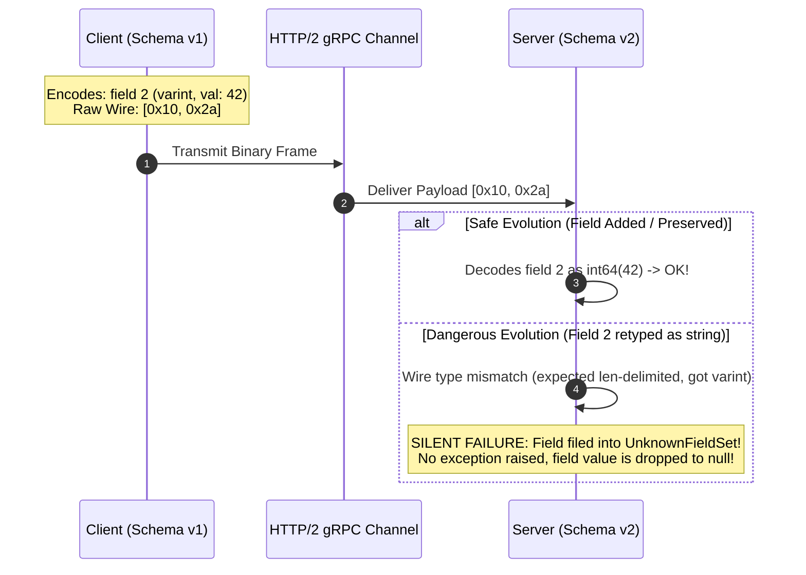
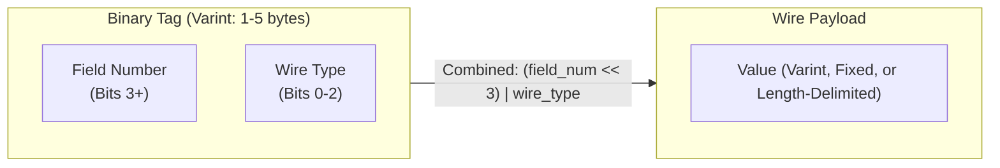
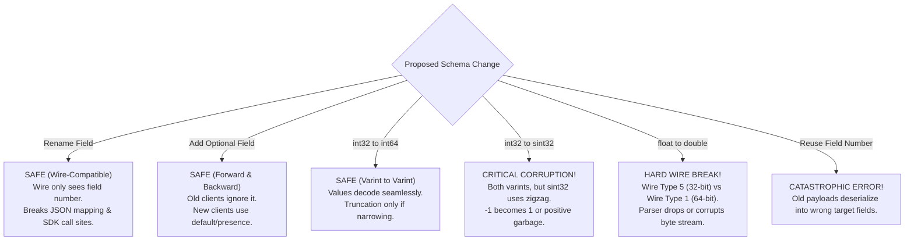
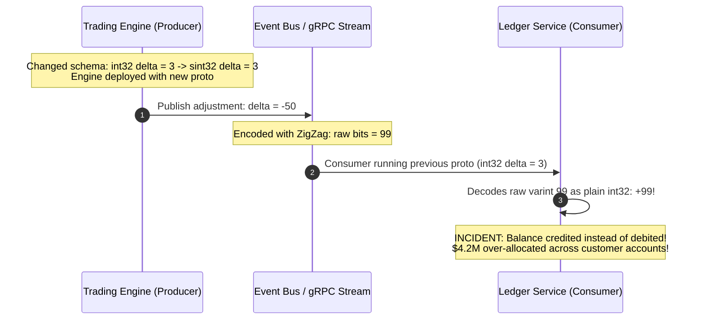

# Module 00: Protobuf Schema Design and Evolution

> [!TIP]
> **The Golden Rule of Protocol Buffers:**
> The wire format transmits field numbers and wire types—never field names. Renaming a field is wire-compatible, but reusing or altering a field number is a catastrophic silent data corruption bug. Always reserve deleted field numbers and names, enforce explicit presence with `optional`, and version your packages (`v1`, `v2`) to prevent runtime disasters.



---

## 1. Protobuf Wire Anatomy: Bits on the Wire

In JSON or XML, keys are transmitted as ASCII strings (`{"quantity": 42}`). In Protocol Buffers, field names exist purely for human ergonomics in code; the serialization engine packs data into tight binary tuples of **Tag** and **Value**.



### The Tag Bitmask Formula

$$\text{Tag} = (\text{Field Number} \ll 3) \mid \text{Wire Type}$$

Because the wire type occupies exactly the lowest 3 bits ($2^3 = 8$ possible wire types):
- Field numbers **1 through 15** encode their tag into a single byte ($15 \ll 3 = 120 < 128$).
- Field numbers **16 through 2047** require two bytes for the tag.
- **Production Rule**: Reserve field numbers 1–15 for your hottest, highest-frequency fields.

### Wire Type Taxonomy

| Wire Type ID | Name | Format / Size | Corresponding Protobuf Types |
| :--- | :--- | :--- | :--- |
| `0` | **Varint** | Variable-length (1–10 bytes) | `int32`, `int64`, `uint32`, `uint64`, `bool`, `enum`, `sint32`, `sint64` |
| `1` | **64-bit** | Fixed 8 bytes | `fixed64`, `sfixed64`, `double` |
| `2` | **Length-delimited** | Varint length prefix + raw bytes | `string`, `bytes`, embedded sub-messages, packed repeated |
| `5` | **32-bit** | Fixed 4 bytes | `fixed32`, `sfixed32`, `float` |

---

## 2. Schema Evolution Compatibility Matrix



### Safe vs. Dangerous Modification Guide

| Modification | Wire Compatibility | Client Impact | Correct Procedure |
| :--- | :--- | :--- | :--- |
| **Rename field** (`name` $\to$ `full_name`) | **Compatible** | Breaks compile-time SDK references; breaks protobuf-JSON | Safe on wire. Coordinate code changes across repos. |
| **Delete field** | **Compatible** | Old decoders store it in unknown fields | **Mandatory**: Add `reserved <num>; reserved "<name>";` |
| **Change `int32` $\to$ `int64`** | **Compatible** | Both wire type 0 | Seamless; old clients safely truncate if value exceeds 32 bits. |
| **Change `int32` $\to$ `sint32`** | **Incompatible** | Both wire type 0, but encoding differs (Zigzag) | Never mutate in-place. Create a new field number. |
| **Change `float` $\to$ `double`** | **Incompatible** | Wire type 5 (4 bytes) $\to$ Wire type 1 (8 bytes) | Dual-write new field `double price_exact = 12;`. |
| **Wrap field in `optional`** | **Compatible** | Adds explicit presence bitmask | Safe retrofit for proto3 partial update APIs. |
| **Add enum member** | **Compatible** | Open enum in proto3 preserves unrecognized int | Add new value $\ge 1$. Handled by server `default` case. |

---

## 3. Production War Story: The Pricing Engine Zigzag Calamity



### Incident Post-Mortem

- **Root Cause**: An engineer noticed `int32` wastes up to 10 bytes on the wire for negative numbers (due to two's complement sign extension). They updated `int32 delta = 3;` to `sint32 delta = 3;` directly in the shared `.proto` repository without incrementing the field number.
- **The Failure Mode**: Both types share wire type `0` (varint). The protobuf parser did not throw an error; instead, it applied standard varint decoding to zigzag-encoded bits. A price correction of `-50` was interpreted as `+99`.
- **The Remediation**:
  1. Reverted the schema change immediately.
  2. Adopted **Buf CI Linters** (`buf breaking --against '.git#branch=main'`) in GitHub Actions to automatically block PRs that alter types on active field numbers.
  3. Added the strict rule: "If the encoding changes, deprecate and reserve the field number and assign a brand new field number."

---

## 4. Multi-Language Implementation: Field Presence & `FieldMask` Updates

When performing partial updates (`PATCH /users/123`), implicit presence makes it impossible to distinguish between an unsupplied field and a field deliberately set to its default (`0` or `""`).

Below, we demonstrate:
1. `optional` field explicit presence checks (`HasField`).
2. Google AIP-standard `FieldMask` partial updates.

````carousel
```go
// user_service.go (Go Implementation)
package main

import (
	"context"
	"errors"
	"fmt"
	"strings"

	pb "github.com/backendroadmap/gen/shop/v1"
	"google.golang.org/protobuf/types/known/fieldmaskpb"
)

type UserServer struct {
	pb.UnimplementedUserServiceServer
	db map[string]*pb.User
}

func (s *UserServer) UpdateUser(ctx context.Context, req *pb.UpdateUserRequest) (*pb.User, error) {
	if req.User == nil {
		return nil, errors.New("user payload is required")
	}

	user, exists := s.db[req.User.Id]
	if !exists {
		return nil, fmt.Errorf("user %s not found", req.User.Id)
	}

	// 1. Explicit Field Presence check using optional fields
	if req.User.Bio != nil {
		// bio was explicitly set (even if set to empty string "")
		user.Bio = req.User.Bio
	}

	// 2. Standard Google AIP-161 FieldMask evaluation
	if req.UpdateMask != nil && len(req.UpdateMask.Paths) > 0 {
		for _, path := range req.UpdateMask.Paths {
			switch strings.ToLower(path) {
			case "email":
				user.Email = req.User.Email
			case "display_name":
				user.DisplayName = req.User.DisplayName
			case "bio":
				user.Bio = req.User.Bio
			default:
				return nil, fmt.Errorf("unsupported update_mask path: %s", path)
			}
		}
	}

	return user, nil
}
```
<!-- slide -->
```typescript
// userService.ts (Node.js / TypeScript Implementation)
import { UserServiceServer, UpdateUserRequest, User } from './gen/shop/v1/user_pb';
import { sendUnaryData, ServerUnaryCall, status } from '@grpc/grpc-js';

const userDatabase = new Map<string, User>();

export class UserServiceImpl implements UserServiceServer {
  [name: string]: any;

  updateUser(call: ServerUnaryCall<UpdateUserRequest, User>, callback: sendUnaryData<User>): void {
    const req = call.request;
    const incomingUser = req.getUser();
    const updateMask = req.getUpdateMask();

    if (!incomingUser) {
      return callback({ code: status.INVALID_ARGUMENT, message: 'User payload missing' }, null);
    }

    const userId = incomingUser.getId();
    const existing = userDatabase.get(userId);
    if (!existing) {
      return callback({ code: status.NOT_FOUND, message: `User ${userId} not found` }, null);
    }

    // 1. Explicit Presence Evaluation with hasBio()
    if (incomingUser.hasBio()) {
      existing.setBio(incomingUser.getBio()); // Distinguishes "" from undefined
    }

    // 2. FieldMask Dynamic Path Handling
    if (updateMask && updateMask.getPathsList().length > 0) {
      const paths = updateMask.getPathsList();
      for (const path of paths) {
        if (path === 'email') {
          existing.setEmail(incomingUser.getEmail());
        } else if (path === 'displayName') {
          existing.setDisplayName(incomingUser.getDisplayName());
        }
      }
    }

    userDatabase.set(userId, existing);
    callback(null, existing);
  }
}
```
<!-- slide -->
```python
# user_service.py (Python Implementation)
from gen.shop.v1 import user_pb2, user_pb2_grpc
import grpc

class UserServiceServicer(user_pb2_grpc.UserServiceServicer):
    def __init__(self):
        self.db: dict[str, user_pb2.User] = {}

    def UpdateUser(self, request: user_pb2.UpdateUserRequest, context):
        if not request.HasField("user"):
            context.abort(grpc.StatusCode.INVALID_ARGUMENT, "Missing user message")

        user_id = request.user.id
        if user_id not in self.db:
            context.abort(grpc.StatusCode.NOT_FOUND, f"User {user_id} not found")

        current_user = self.db[user_id]

        # 1. Field presence validation with HasField()
        if request.user.HasField("bio"):
            # Bio was explicitly provided, even if empty string ""
            current_user.bio = request.user.bio

        # 2. FieldMask processing (AIP-161 standard)
        if request.HasField("update_mask"):
            for path in request.update_mask.paths:
                if path == "email":
                    current_user.email = request.user.email
                elif path == "display_name":
                    current_user.display_name = request.user.display_name
                elif path == "bio":
                    current_user.bio = request.user.bio
                else:
                    context.abort(grpc.StatusCode.INVALID_ARGUMENT, f"Invalid mask path: {path}")

        return current_user
```
````

---

## 5. Practical Hands-On Verification CLI

### Step 1: Inspect Raw Binary Wire Frames with `protoc --decode_raw`

Demonstrate that names do not exist on the wire by inspecting raw payload bytes:

```bash
# Create a test payload containing field 1 ("USR-101") and field 2 (42)
python -c '
from gen.shop.v1 import user_pb2
msg = user_pb2.User(id="USR-101", age=42)
with open("payload.bin", "wb") as f:
    f.write(msg.SerializeToString())
'

# Inspect the binary without schema definition
protoc --decode_raw < payload.bin
```

```text
1: "USR-101"
2: 42
```

### Step 2: Test Field Mask RPC via `grpcurl`

Call the running service over gRPC, passing a JSON `update_mask`:

```bash
grpcurl -plaintext \
  -d '{
    "user": {
      "id": "USR-101",
      "displayName": "Ada Lovelace",
      "bio": ""
    },
    "updateMask": {
      "paths": ["displayName", "bio"]
    }
  }' \
  localhost:50051 \
  shop.v1.UserService/UpdateUser
```

```json
{
  "id": "USR-101",
  "email": "ada@example.com",
  "displayName": "Ada Lovelace",
  "bio": ""
}
```

### Step 3: Run CI Breaking Change Detection with `buf`

Install Buf CLI and verify that your branch is strictly backward-compatible:

```bash
# Initialize buf configuration
buf config init

# Check against git main branch for breaking changes
buf breaking --against ".git#branch=main"
```

Expected output if an engineer illegally modified a field number or wire type:

```text
proto/shop/v1/user.proto:14:3:Field "2" on message "User" changed type from "int32" to "sint32".
proto/shop/v1/user.proto:19:1:Previously present field "5" with name "legacy_token" on message "User" was deleted without being reserved.
```

---

## 6. Operational Validation Checkpoints

<details>
<summary><strong>Checkpoint 1: Why does changing a field from `float` to `double` silently corrupt neighboring fields on the wire?</strong></summary>

**Root Cause:**
`float` is encoded as Wire Type 5 (fixed 32-bit: 4 bytes). `double` is encoded as Wire Type 1 (fixed 64-bit: 8 bytes). When an older client sends a `float`, it places 4 bytes on the wire. When a newer server compiled with `double` reads field 1, it unconditionally consumes 8 bytes from the buffer. It ingests the 4 bytes of the float *plus* the next 4 bytes belonging to the subsequent tag and value. This causes catastrophic cascading parsing errors across all remaining fields.
</details>

<details>
<summary><strong>Checkpoint 2: Why must both the field number AND field name be reserved when deleting a field?</strong></summary>

**Dual Defense:**
1. Reserving the **number** (`reserved 4;`) prevents a future developer from reusing the number, which would cause older clients still sending legacy payloads to deserialize their data into the new, unrelated field.
2. Reserving the **name** (`reserved "tax_code";`) protects JSON mappings, text format dumps, and dynamic reflection proxies. In protobuf-JSON mappings, fields are matched by camelCase/snake_case string names. If a new field reuses the old name with a different type, JSON clients will crash with unmarshaling errors.
</details>

<details>
<summary><strong>Checkpoint 3: Why should enum definitions always reserve value 0 for `_UNSPECIFIED`?</strong></summary>

**Semantic Safety:**
In proto3, scalar fields have implicit presence by default and decode to `0` when absent on the wire. If value `0` represents a valid state (e.g., `ORDER_STATUS_PENDING`), an application cannot determine whether the sender explicitly asserted that the order is pending or simply neglected to set the field. Reserving `0` as `ORDER_STATUS_UNSPECIFIED` guarantees that an uninitialized enum is immediately identifiable.
</details>
