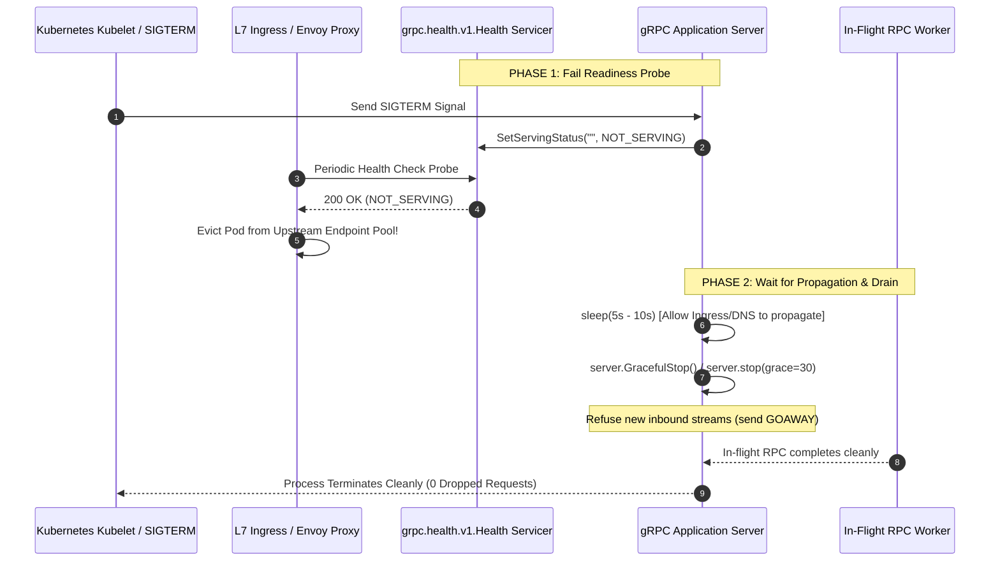
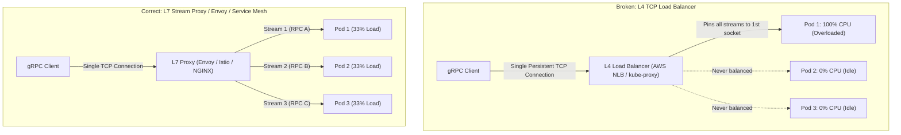
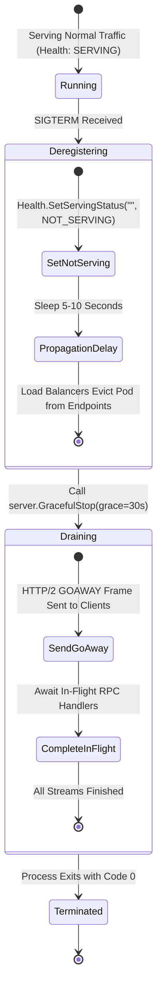
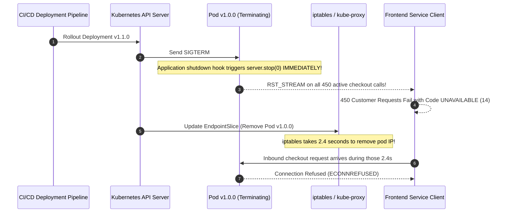

# Module 02: Production Serving — Health, Load Balancing and Keepalive

> **The Golden Rule of Production gRPC Serving**
> gRPC multiplexes all RPCs over long-lived HTTP/2 TCP connections. L4 load balancers make routing decisions per-connection, resulting in 100% of traffic pinning to a single backend replica while other pods idle. To serve gRPC reliably in production, you must enforce L7 per-stream load balancing (or client-side DNS round-robin across headless services), implement the standard `grpc.health.v1.Health` protocol, and execute phased graceful shutdowns that allow load balancers to deregister the pod before closing sockets.



---

## 1. The gRPC Load Balancing Problem: L4 vs. L7

Because HTTP/1.1 creates and recycles many short-lived TCP connections, traditional Layer 4 (TCP) load balancers (AWS NLB, Azure Load Balancer, Kubernetes `kube-proxy`) evenly distribute requests across backend pods. 

In gRPC, a client establishes **one single TCP connection** and multiplexes thousands of concurrent RPCs as HTTP/2 binary streams over that single connection. An L4 balancer makes a routing decision only once during the initial TCP handshake—binding that client permanently to one backend.



### Load Balancing Architecture Comparison

| Architecture | Mechanism | Pros | Cons / Gotchas |
| :--- | :--- | :--- | :--- |
| **L7 Proxy (Envoy / Istio)** | Proxy speaks HTTP/2, parses frames, balances per-stream | Zero client code changes; supports circuit breaking & canary routing | Adds an extra network hop (~0.5ms latency) and proxy infrastructure overhead |
| **Client-Side Round Robin** | Client resolves all backend pod IPs via DNS and balances streams itself | Direct pod-to-pod communication; zero proxy hop latency | Requires **Headless Service** (`clusterIP: None`); puts routing logic into client binaries |
| **`MAX_CONNECTION_AGE`** | Server forces clients to reconnect periodically by sending `GOAWAY` | Works with L4 balancers with zero client changes | Mitigation, not a true fix; causes periodic TCP/TLS reconnection bursts |

---

## 2. Phased Graceful Shutdown Timeline

A common mistake in containerized gRPC environments is calling `server.stop(0)` or immediately killing the container upon receiving `SIGTERM`. This severs active streams, causing clients to experience bursts of `UNAVAILABLE` errors during rolling deployments.



### Essential Channel Tuning Flags

| Flag Name | Default | Recommended Value | Architectural Impact |
| :--- | :--- | :--- | :--- |
| `grpc.keepalive_time_ms` | `7200000` (2h) | `30000` (30s) | Emits HTTP/2 PING frames to prevent silent connection drop by NAT/firewalls |
| `grpc.keepalive_timeout_ms` | `20000` (20s) | `10000` (10s) | Time allowed for peer to acknowledge PING frame before declaring socket dead |
| `grpc.http2.min_ping_interval_without_data_ms` | `300000` (5m) | `10000` (10s) | **Server setting**: Minimum interval between pings to prevent `ENHANCE_YOUR_CALM` disconnects |
| `grpc.max_connection_age_ms` | $\infty$ | `300000` (5m) | Periodically issues `GOAWAY` to force L4 balancers to re-place connections |
| `grpc.max_receive_message_length` | `4194304` (4MB) | `16777216` (16MB) | Enforced independently on client and server; prevents `RESOURCE_EXHAUSTED` |

---

## 3. Production War Story: The Deploy-Time 502 Spike



### Incident Post-Mortem

- **Root Cause**: The gRPC server executed an immediate shutdown (`server.stop(0)`) upon receiving `SIGTERM`. Kubernetes removes terminating pod IPs from iptables/EndpointSlices asynchronously, which typically takes 2–5 seconds. For several seconds, kube-proxy continued routing incoming RPCs to a socket that was already closed. Simultaneously, in-flight checkout RPCs were violently killed.
- **Remediation**:
  1. Updated the shutdown hook: upon `SIGTERM`, set the gRPC health status to `NOT_SERVING` and enforce a mandatory 5-second `time.Sleep()` before calling `GracefulStop()`.
  2. Defined native Kubernetes `readinessProbe` targeting gRPC health port 50051 with `periodSeconds: 2`.
  3. Deploys achieved zero-downtime with zero dropped streams across 15,000 active checkout connections.

---

## 4. Multi-Language Implementation: Production Server & Client

Below is the complete implementation of:
1. `grpc.health.v1.Health` servicer integration.
2. Graceful shutdown handler with pre-drain sleep.
3. Server reflection.
4. Client-side round-robin load balancing configuration over DNS.

````carousel
```go
// production_server.go (Go Implementation)
package main

import (
	"context"
	"fmt"
	"net"
	"os"
	"os/signal"
	"syscall"
	"time"

	pb "github.com/backendroadmap/gen/shop/v1"
	"google.golang.org/grpc"
	"google.golang.org/grpc/health"
	healthpb "google.golang.org/grpc/health/grpc_health_v1"
	"google.golang.org/grpc/keepalive"
	"google.golang.org/grpc/reflection"
)

type OrderServer struct {
	pb.UnimplementedOrderServiceServer
}

func (s *OrderServer) GetOrder(ctx context.Context, req *pb.GetOrderRequest) (*pb.Order, error) {
	return &pb.Order{Id: req.Id, Quantity: 10}, nil
}

func main() {
	lis, err := net.Listen("tcp", ":50051")
	if err != nil {
		panic(err)
	}

	// Server Keepalive & Connection Age Policies
	serverOpts := []grpc.ServerOption{
		grpc.KeepaliveParams(keepalive.ServerParameters{
			MaxConnectionAge:      5 * time.Minute, // Forces periodic L4 rebalancing
			MaxConnectionAgeGrace: 30 * time.Second,
			Time:                  30 * time.Second, // Ping idle clients
			Timeout:               10 * time.Second,
		}),
		grpc.KeepaliveEnforcementPolicy(keepalive.EnforcementPolicy{
			MinTime:             10 * time.Second, // Allow clients to ping every 10s
			PermitWithoutStream: true,
		}),
		grpc.MaxRecvMsgSize(16 * 1024 * 1024), // 16MB ceiling
	}

	s := grpc.NewServer(serverOpts...)
	pb.RegisterOrderServiceServer(s, &OrderServer{})

	// 1. Register Health Server
	healthSvc := health.NewServer()
	healthpb.RegisterHealthServer(s, healthSvc)
	healthSvc.SetServingStatus("", healthpb.HealthCheckResponse_SERVING)
	healthSvc.SetServingStatus("shop.v1.OrderService", healthpb.HealthCheckResponse_SERVING)

	// 2. Enable Server Reflection for grpcurl
	reflection.Register(s)

	// 3. Phased Graceful Shutdown Goroutine
	sigChan := make(chan os.Signal, 1)
	signal.Notify(sigChan, syscall.SIGINT, syscall.SIGTERM)

	go func() {
		<-sigChan
		fmt.Println("[SHUTDOWN] SIGTERM received. Initiating phased graceful drain...")

		// Step A: Mark health as NOT_SERVING so LB removes pod from pool
		healthSvc.SetServingStatus("", healthpb.HealthCheckResponse_NOT_SERVING)
		healthSvc.SetServingStatus("shop.v1.OrderService", healthpb.HealthCheckResponse_NOT_SERVING)

		// Step B: Sleep 5s to allow LB and Kubernetes iptables to propagate removal
		time.Sleep(5 * time.Second)

		// Step C: Stop accepting new streams and drain in-flight calls
		stopped := make(chan struct{})
		go func() {
			s.GracefulStop()
			close(stopped)
		}()

		select {
		case <-stopped:
			fmt.Println("[SHUTDOWN] All active RPCs drained successfully.")
		case <-time.After(30 * time.Second):
			fmt.Println("[SHUTDOWN] Drain timeout exceeded. Forcing hard stop.")
			s.Stop()
		}
	}()

	fmt.Println("Production gRPC Server listening on :50051")
	s.Serve(lis)
}
```
<!-- slide -->
```typescript
// productionServer.ts (Node.js / TypeScript Implementation)
import * as grpc from '@grpc/grpc-js';
import { HealthImplementation } from 'grpc-health-check';

const statusMap: { [key: string]: string } = {
  '': 'SERVING',
  'shop.v1.OrderService': 'SERVING',
};

const healthImpl = new HealthImplementation(statusMap);

const server = new grpc.Server({
  'grpc.keepalive_time_ms': 30000,
  'grpc.keepalive_timeout_ms': 10000,
  'grpc.http2.min_ping_interval_without_data_ms': 10000,
  'grpc.max_connection_age_ms': 300000,
  'grpc.max_receive_message_length': 16 * 1024 * 1024,
});

healthImpl.addToServer(server);

server.bindAsync('0.0.0.0:50051', grpc.ServerCredentials.createInsecure(), (err, port) => {
  if (err) throw err;
  console.log(`Production gRPC server listening on port ${port}`);
  server.start();
});

// Phased Graceful Shutdown Handling
const shutdown = () => {
  console.log('SIGTERM received: Starting phased graceful shutdown...');

  // 1. Mark NOT_SERVING to evict from Load Balancer
  healthImpl.setStatus('', 'NOT_SERVING');

  // 2. Propagation delay: wait 5s for endpoints to update
  setTimeout(() => {
    console.log('Draining active in-flight calls...');
    server.tryShutdown((err) => {
      if (err) {
        console.error('Graceful shutdown failed, forcing exit:', err);
        server.forceShutdown();
      }
      process.exit(0);
    });
  }, 5000);
};

process.on('SIGTERM', shutdown);
process.on('SIGINT', shutdown);
```
<!-- slide -->
```python
# production_server.py (Python Implementation)
from concurrent import futures
import time
import signal
import sys
import grpc
from grpc_health.v1 import health, health_pb2, health_pb2_grpc
from grpc_reflection.v1alpha import reflection
from gen.shop.v1 import order_pb2, order_pb2_grpc

class OrderService(order_pb2_grpc.OrderServiceServicer):
    def GetOrder(self, request, context):
        return order_pb2.Order(id=request.id, quantity=10)

def serve():
    options = [
        ("grpc.keepalive_time_ms", 30000),
        ("grpc.keepalive_timeout_ms", 10000),
        ("grpc.http2.min_ping_interval_without_data_ms", 10000),
        ("grpc.http2.max_ping_strikes", 0),
        ("grpc.max_connection_age_ms", 300000),
        ("grpc.max_receive_message_length", 16 * 1024 * 1024),
    ]

    server = grpc.server(futures.ThreadPoolExecutor(max_workers=32), options=options)
    order_pb2_grpc.add_OrderServiceServicer_to_server(OrderService(), server)

    # 1. Add Health Servicer
    health_servicer = health.HealthServicer()
    health_pb2_grpc.add_HealthServicer_to_server(health_servicer, server)
    health_servicer.set("", health_pb2.HealthCheckResponse.SERVING)

    # 2. Add Reflection
    SERVICE_NAMES = (
        order_pb2.DESCRIPTOR.services_by_name["OrderService"].full_name,
        health_pb2.DESCRIPTOR.services_by_name["Health"].full_name,
        reflection.SERVICE_NAME,
    )
    reflection.enable_server_reflection(SERVICE_NAMES, server)

    server.add_insecure_port("[::]:50051")
    server.start()
    print("Serving production gRPC on [::]:50051")

    # 3. Phased Graceful Shutdown Handler
    def graceful_shutdown(signum, frame):
        print("\n[SHUTDOWN] SIGTERM received. Setting health status to NOT_SERVING...")
        health_servicer.set("", health_pb2.HealthCheckResponse.NOT_SERVING)
        
        # Wait 5 seconds for Kubernetes Endpoints and proxies to update
        time.sleep(5)
        
        print("[SHUTDOWN] Draining active RPCs with 30s grace window...")
        server.stop(grace=30).wait()
        print("[SHUTDOWN] Process terminated cleanly.")
        sys.exit(0)

    signal.signal(signal.SIGTERM, graceful_shutdown)
    signal.signal(signal.SIGINT, graceful_shutdown)
    server.wait_for_termination()

if __name__ == "__main__":
    serve()
```
````

---

## 5. Practical Hands-On Verification CLI

### Step 1: Probe Health Endpoints via `grpcurl`

Inspect overall cluster and per-service health readiness:

```bash
# Query default service health
grpcurl -plaintext localhost:50051 grpc.health.v1.Health/Check
```

```json
{
  "status": "SERVING"
}
```

```bash
# Query specific service health
grpcurl -plaintext -d '{"service": "shop.v1.OrderService"}' \
  localhost:50051 grpc.health.v1.Health/Check
```

```json
{
  "status": "SERVING"
}
```

### Step 2: Discover API Endpoints with Server Reflection

Query the server schema dynamically without requiring local `.proto` files:

```bash
grpcurl -plaintext localhost:50051 list
```

```text
grpc.health.v1.Health
grpc.reflection.v1alpha.ServerReflection
shop.v1.OrderService
```

Describe a specific RPC definition:

```bash
grpcurl -plaintext localhost:50051 describe shop.v1.OrderService.GetOrder
```

```text
rpc GetOrder ( .shop.v1.GetOrderRequest ) returns ( .shop.v1.Order );
```

### Step 3: Configure Client-Side Round-Robin Balancing

To achieve client-side stream balancing without a proxy, point your client at a headless Kubernetes service with explicit `round_robin` service config:

```python
# Client-side stream balancing
channel = grpc.insecure_channel(
    "dns:///orders-headless.default.svc.cluster.local:50051",
    options=[(
        "grpc.service_config",
        '{"loadBalancingConfig": [{"round_robin": {}}]}'
    )]
)
```

---

## 6. Operational Validation Checkpoints

<details>
<summary><strong>Checkpoint 1: Why does a standard Kubernetes ClusterIP Service fail to load balance gRPC client requests?</strong></summary>

**DNS & Connection Mechanics:**
A standard Kubernetes `ClusterIP` resolves to a single virtual IP address. When a gRPC client connects, it establishes one long-lived TCP connection to that virtual IP. `kube-proxy` selects one backend pod during the initial TCP handshake, and all subsequent multiplexed HTTP/2 streams flow to that exact same pod. To achieve client-side balancing, you must configure a **Headless Service** (`spec.clusterIP: None`), enabling DNS A-record lookups to return the individual IP addresses of every active pod in the replica set.
</details>

<details>
<summary><strong>Checkpoint 2: What is the root cause of an `ENHANCE_YOUR_CALM` disconnect error?</strong></summary>

**Keepalive Policy Mismatch:**
HTTP/2 servers protect themselves from Denial of Service (DoS) attacks caused by ping flooding. If a client sends keepalive PING frames more frequently than the server's `grpc.http2.min_ping_interval_without_data_ms` (which defaults to 5 minutes in standard gRPC implementations), the server increments a strike counter. When strikes exceed `max_ping_strikes` (default 2), the server unilaterally transmits a `GOAWAY` frame with error code `ENHANCE_YOUR_CALM` and severs the TCP socket.
</details>

<details>
<summary><strong>Checkpoint 3: Why is a 5-second sleep necessary between setting `NOT_SERVING` and calling `server.GracefulStop()`?</strong></summary>

**Asynchronous Network Propagation Delay:**
In Kubernetes and cloud environments, health check polling runs periodically (e.g., every 2–10 seconds), and iptables/EndpointSlice propagation to ingress controllers or Envoy sidecars takes several hundred milliseconds to a few seconds. If a server stops immediately, incoming traffic already in-flight through the network fabric will reach closed ports, generating `ECONNREFUSED` or 502 Bad Gateway errors. The sleep window ensures that upstream proxies stop routing new traffic to the pod *before* the pod stops listening.
</details>
