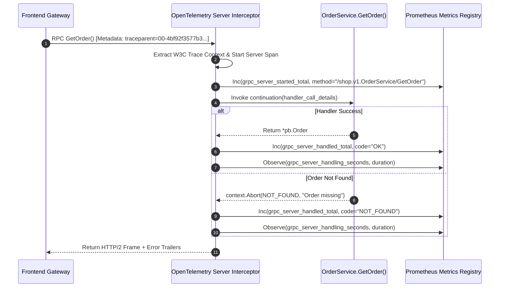
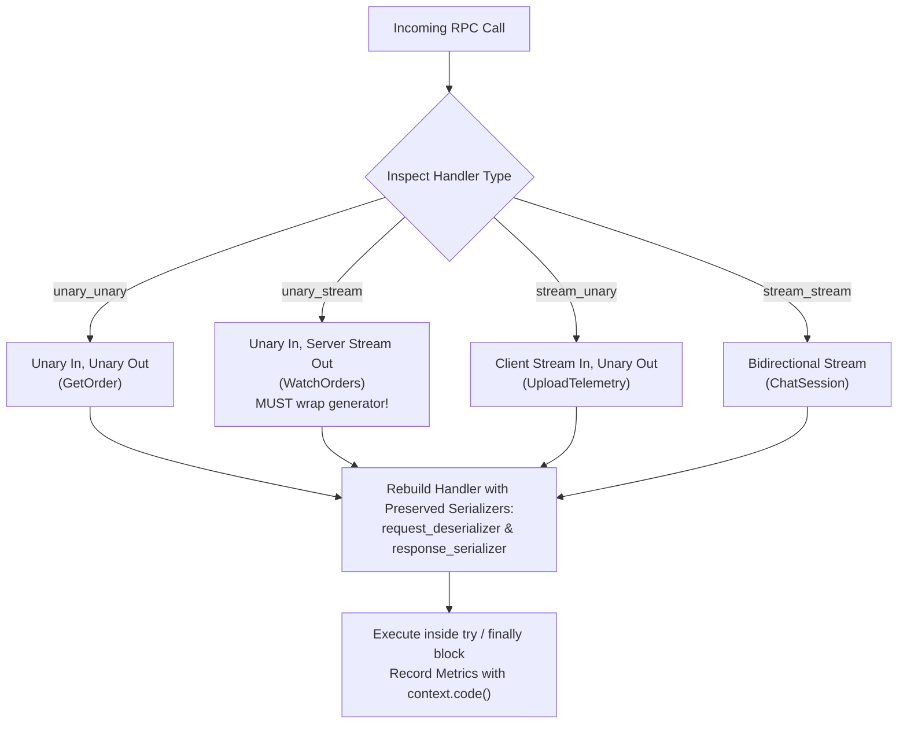
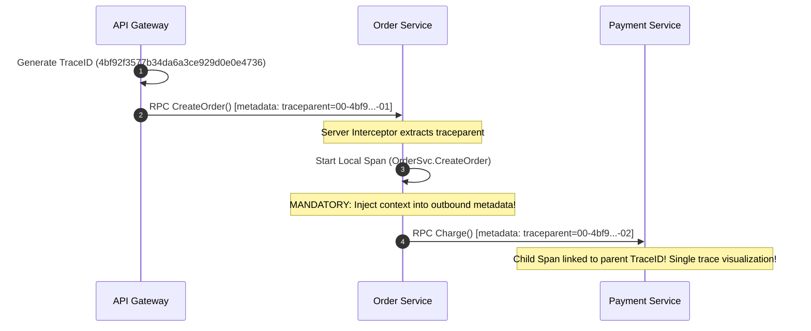
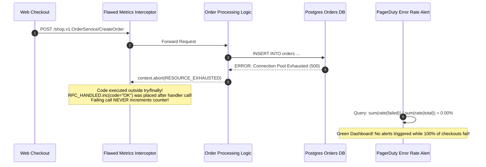

# Module 03: Observability and Testing

> **The Golden Rule of gRPC Observability & Testing**
> Because gRPC lacks URL paths, `handler_call_details.method` is your primary grouping key for logs, metrics, and traces. Never test gRPC by calling servicer classes directly with mocked contexts—always execute tests against a real in-process gRPC server bound to ephemeral port `localhost:0`. Always wrap streaming handlers by consuming the generator in a `finally` block, and record status codes dynamically to prevent silent dashboard blind spots.



---

## 1. Interceptor Architecture: The Four RPC Modalities

In REST, every request is a single request/response cycle. In gRPC, a call can take four distinct forms. A naive interceptor that only wraps `unary_unary` will **silently fail to record metrics, logs, or traces for all streaming RPCs**.



### The Standard Golden Four Prometheus Metrics

| Metric Identifier | Metric Type | Label Dimensions | Semantic Intent |
| :--- | :--- | :--- | :--- |
| `grpc_server_started_total` | Counter | `method` | Total number of RPC streams initiated |
| `grpc_server_handled_total` | Counter | `method`, `code` | Total RPCs finalized, partitioned by canonical gRPC status code |
| `grpc_server_handling_seconds` | Histogram | `method` | RPC execution duration from invocation to trailer emission |
| `grpc_server_msg_sent_total` | Counter | `method` | Total discrete protobuf messages yielded across streaming responses |

> [!CAUTION]
> **Cardinality Explosion Trap**: Never attach high-cardinality values such as `order_id`, `user_id`, or `ip_address` as Prometheus metric labels. Label exclusively by `method` and `code`. Unbounded metric labels will overwhelm Prometheus memory, causing scrape timeouts and monitoring blackouts.

---

## 2. Distributed Context Propagation (W3C Trace Context)

gRPC metadata is the native carrier for distributed tracing context. If a service receives an incoming RPC and dispatches a downstream call without forwarding the incoming metadata, the distributed trace graph is severed.



---

## 3. Production War Story: The False-Green Dashboard Disaster



### Incident Post-Mortem

- **Root Cause**: The engineering team wrote a custom metrics interceptor where `RPC_HANDLED.labels(method=method, code="OK").inc()` was executed after the handler returned. When the database pool failed, `context.abort()` raised an exception internally, bypassing the metric increment entirely.
- **The Failure Mode**: The error-rate Prometheus calculation evaluated a numerator of zero. The dashboard reported a 100% success rate during a total checkout blackout lasting 45 minutes.
- **Remediation**:
  1. Refactored the interceptor to place all metrics recording inside a mandatory `finally` block.
  2. Dynamically extracted `context.code()` (or mapped unhandled exceptions to `codes.Unknown`), ensuring failures are always explicitly incremented with their actual error enum.

---

## 4. Multi-Language Implementation: Observability Interceptor & Ephemeral Test Suite

Below is the complete implementation demonstrating:
1. Production metric and tracing interceptor handling unary and streaming RPCs.
2. In-process test harness using ephemeral port `localhost:0`.
3. Strict assertions verifying canonical gRPC status codes and error details.

````carousel
```go
// server_test.go (Go Implementation)
package main

import (
	"context"
	"net"
	"testing"
	"time"

	pb "github.com/backendroadmap/gen/shop/v1"
	"github.com/stretchr/testify/assert"
	"google.golang.org/grpc"
	"google.golang.org/grpc/codes"
	"google.golang.org/grpc/credentials/insecure"
	"google.golang.org/grpc/status"
)

type MockOrderServer struct {
	pb.UnimplementedOrderServiceServer
}

func (s *MockOrderServer) GetOrder(ctx context.Context, req *pb.GetOrderRequest) (*pb.Order, error) {
	if req.Id == "missing-id" {
		return nil, status.Errorf(codes.NotFound, "order %s not found", req.Id)
	}
	return &pb.Order{Id: req.Id, Quantity: 5}, nil
}

// In-process test harness using dynamic OS port assignment
func startTestServer(t *testing.T) (*grpc.ClientConn, func()) {
	lis, err := net.Listen("tcp", "localhost:0") // 0 = OS picks free port
	assert.NoError(t, err)

	server := grpc.NewServer()
	pb.RegisterOrderServiceServer(server, &MockOrderServer{})

	go func() {
		_ = server.Serve(lis)
	}()

	conn, err := grpc.Dial(lis.Addr().String(), grpc.WithTransportCredentials(insecure.NewCredentials()))
	assert.NoError(t, err)

	cleanup := func() {
		conn.Close()
		server.GracefulStop()
		lis.Close()
	}

	return conn, cleanup
}

func TestGetOrder_ContractValidation(t *testing.T) {
	conn, cleanup := startTestServer(t)
	defer cleanup()

	client := pb.NewOrderServiceClient(conn)

	// Test Case 1: Happy Path
	resp, err := client.GetOrder(context.Background(), &pb.GetOrderRequest{Id: "ORD-99"})
	assert.NoError(t, err)
	assert.Equal(t, "ORD-99", resp.Id)
	assert.Equal(t, int32(5), resp.Quantity)

	// Test Case 2: Strict Status Code Contract on Failure
	_, err = client.GetOrder(context.Background(), &pb.GetOrderRequest{Id: "missing-id"})
	assert.Error(t, err)
	st, ok := status.FromError(err)
	assert.True(t, ok)
	assert.Equal(t, codes.NotFound, st.Code())
	assert.Contains(t, st.Message(), "order missing-id not found")
}
```
<!-- slide -->
```typescript
// server.test.ts (Node.js / TypeScript Implementation)
import * as grpc from '@grpc/grpc-js';
import { OrderServiceClient } from './gen/shop/v1/order_grpc_pb';
import { GetOrderRequest, Order } from './gen/shop/v1/order_pb';

describe('gRPC OrderService In-Process Integration Tests', () => {
  let server: grpc.Server;
  let client: OrderServiceClient;
  let boundPort: number;

  beforeAll((done) => {
    server = new grpc.Server();
    server.addService(
      {
        getOrder: (call: any, callback: any) => {
          if (call.request.getId() === 'missing-id') {
            return callback({
              code: grpc.status.NOT_FOUND,
              details: 'Order not found',
            });
          }
          const order = new Order();
          order.setId(call.request.getId());
          order.setQuantity(5);
          callback(null, order);
        },
      },
      {}
    );

    // Ephemeral port binding (port 0)
    server.bindAsync('localhost:0', grpc.ServerCredentials.createInsecure(), (err, port) => {
      if (err) return done(err);
      boundPort = port;
      server.start();
      client = new OrderServiceClient(`localhost:${boundPort}`, grpc.credentials.createInsecure());
      done();
    });
  });

  afterAll((done) => {
    client.close();
    server.tryShutdown(done);
  });

  test('Validates Happy Path Contract', (done) => {
    const req = new GetOrderRequest();
    req.setId('ORD-101');
    client.getOrder(req, (err, resp) => {
      expect(err).toBeNull();
      expect(resp?.getId()).toBe('ORD-101');
      expect(resp?.getQuantity()).toBe(5);
      done();
    });
  });

  test('Asserts Canonical NOT_FOUND Status Code Contract', (done) => {
    const req = new GetOrderRequest();
    req.setId('missing-id');
    client.getOrder(req, (err, resp) => {
      expect(err).not.toBeNull();
      expect(err?.code).toBe(grpc.status.NOT_FOUND);
      expect(err?.details).toContain('Order not found');
      done();
    });
  });
});
```
<!-- slide -->
```python
# test_order_service.py (Python Implementation)
from concurrent import futures
import pytest
import grpc
from gen.shop.v1 import order_pb2, order_pb2_grpc

class MockOrderServicer(order_pb2_grpc.OrderServiceServicer):
    def GetOrder(self, request, context):
        if request.id == "missing-id":
            context.abort(grpc.StatusCode.NOT_FOUND, f"Order {request.id} not found")
        return order_pb2.Order(id=request.id, quantity=5)

@pytest.fixture(scope="module")
def grpc_channel():
    # 1. Ephemeral Port localhost:0 prevents port collisions in parallel CI
    server = grpc.server(futures.ThreadPoolExecutor(max_workers=4))
    order_pb2_grpc.add_OrderServiceServicer_to_server(MockOrderServicer(), server)
    port = server.add_insecure_port("localhost:0")
    server.start()

    with grpc.insecure_channel(f"localhost:{port}") as channel:
        yield channel

    server.stop(grace=None)

def test_get_order_happy_path(grpc_channel):
    stub = order_pb2_grpc.OrderServiceStub(grpc_channel)
    resp = stub.GetOrder(order_pb2.GetOrderRequest(id="ORD-101"))
    assert resp.id == "ORD-101"
    assert resp.quantity == 5

def test_get_order_not_found_contract(grpc_channel):
    stub = order_pb2_grpc.OrderServiceStub(grpc_channel)
    with pytest.raises(grpc.RpcError) as exc_info:
        stub.GetOrder(order_pb2.GetOrderRequest(id="missing-id"))
    
    # Assert canonical contract details
    assert exc_info.value.code() == grpc.StatusCode.NOT_FOUND
    assert "Order missing-id not found" in exc_info.value.details()

def test_get_order_deadline_exceeded(grpc_channel):
    stub = order_pb2_grpc.OrderServiceStub(grpc_channel)
    with pytest.raises(grpc.RpcError) as exc_info:
        # Pass impossibly short timeout
        stub.GetOrder(order_pb2.GetOrderRequest(id="ORD-101"), timeout=0.000001)
    assert exc_info.value.code() == grpc.StatusCode.DEADLINE_EXCEEDED
```
````

---

## 5. Practical Hands-On Verification CLI

### Step 1: Scrape gRPC Prometheus Metrics Endpoint

Validate that `code` status labels differentiate successful calls from failures:

```bash
curl.exe -s http://localhost:9090/metrics | Select-String "grpc_server_handled_total"
```

```text
grpc_server_handled_total{code="OK",method="/shop.v1.OrderService/GetOrder"} 1420
grpc_server_handled_total{code="NOT_FOUND",method="/shop.v1.OrderService/GetOrder"} 38
grpc_server_handled_total{code="DEADLINE_EXCEEDED",method="/shop.v1.OrderService/GetOrder"} 4
```

### Step 2: Calculate Production Error Rate with PromQL

```promql
sum(rate(grpc_server_handled_total{code!="OK"}[5m]))
  /
sum(rate(grpc_server_handled_total[5m]))
```

### Step 3: Run Parallel Integration Tests via pytest-xdist

Verify that using ephemeral `localhost:0` ports enables frictionless parallel CI execution:

```bash
pytest -n 4 tests/test_order_service.py
```

```text
[gw0] PASSED tests/test_order_service.py::test_get_order_happy_path 
[gw1] PASSED tests/test_order_service.py::test_get_order_not_found_contract 
[gw2] PASSED tests/test_order_service.py::test_get_order_deadline_exceeded 
=== 3 passed in 0.42s ===
```

---

## 6. Operational Validation Checkpoints

<details>
<summary><strong>Checkpoint 1: Why does timing a server-streaming gRPC handler without consuming its generator yield an incorrect 0ms latency?</strong></summary>

**Execution Mechanics:**
In Python and other generator-based gRPC implementations, executing a streaming handler returns an un-evaluated generator object immediately. If an interceptor measures time from before invoking the handler to when the generator object is returned, it measures only generator initialization latency (~0.1ms). The actual execution, database queries, and network serialization take place as client code iterates over the stream. The interceptor must wrap the generator in an iterator and record the completion timestamp inside its `finally` block.
</details>

<details>
<summary><strong>Checkpoint 2: Why does omitting `request_deserializer` and `response_serializer` break rebuilt interceptor handlers?</strong></summary>

**gRPC Marshalling Pipeline:**
When rebuilding an RPC handler in an interceptor (e.g., calling `grpc.unary_unary_rpc_method_handler`), gRPC requires the protobuf marshaller functions. If these serializer references are omitted, gRPC treats incoming payloads as raw bytes rather than deserializing them into strongly-typed protobuf messages. Handlers receive byte strings instead of generated message objects, causing immediate attribute errors.
</details>

<details>
<summary><strong>Checkpoint 3: Why should unit tests never test gRPC servicers by invoking `servicer.MyMethod(req, mock_context)` directly?</strong></summary>

**Testing Fidelity Blindspot:**
Directly calling class methods bypasses the entire gRPC protocol engine: protobuf serialization/deserialization, interceptor chains, deadline enforcement, HTTP/2 framing, metadata propagation, and status code trailer mapping. Bugs in field tags, auth interceptors, or deadline handling will go completely undetected. Tests must dial an actual in-process gRPC socket using `localhost:0`.
</details>
