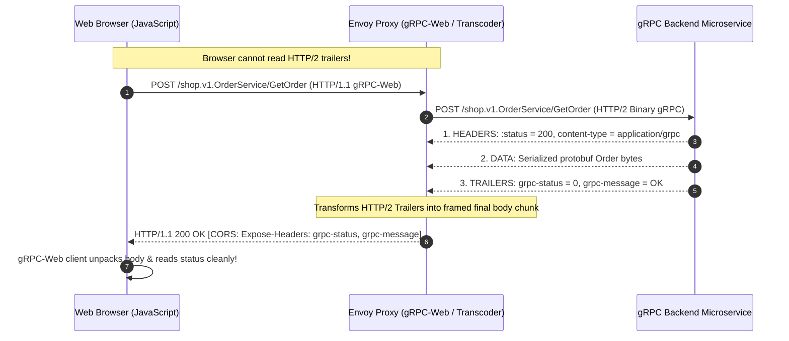
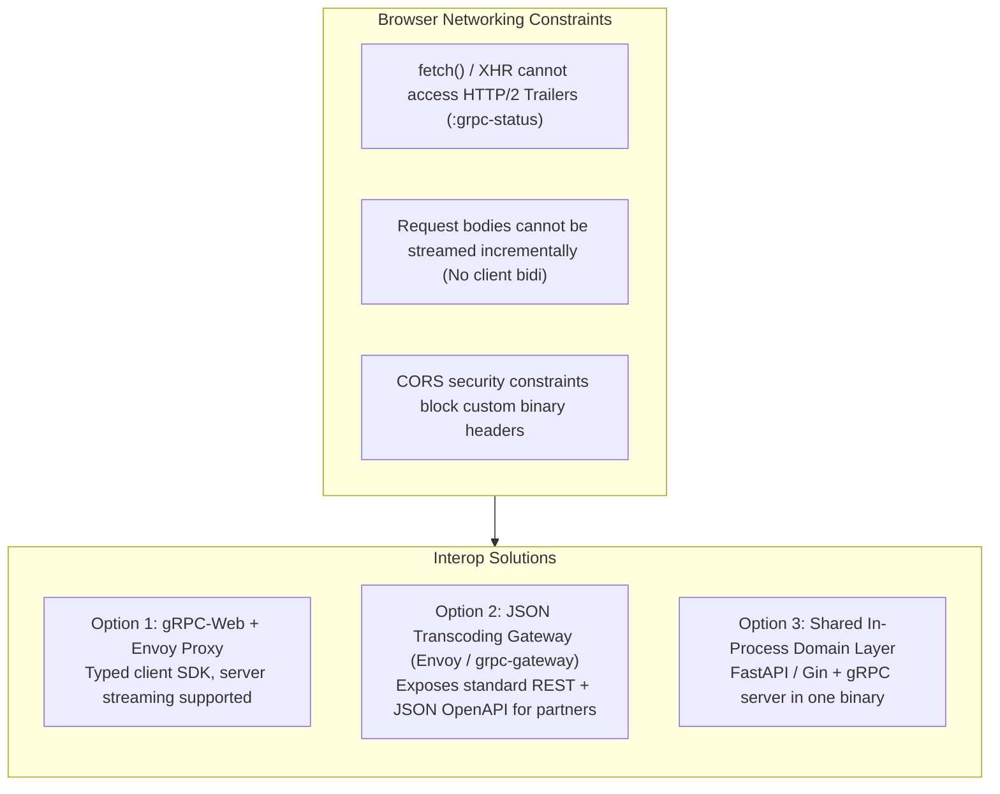
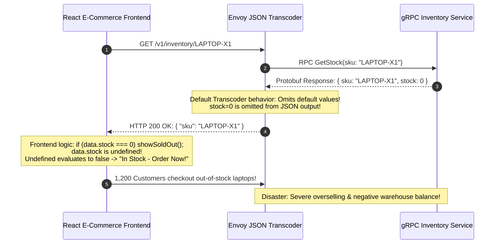

# Module 04: gRPC-Web, Gateways and Interop

> [!TIP]
> **The Golden Rule of gRPC Web & Interoperability:**
> Web browsers cannot communicate via native gRPC because browser networking APIs (`fetch`, `XHR`) cannot read HTTP/2 trailer frames or write request bodies incrementally. To expose gRPC to the web, you must either bridge through a gRPC-Web proxy (which encodes trailers into a framed chunk in the response body) or transcode to REST via `google.api.http` annotations. When transcoding to JSON, always enable `always_print_primitive_fields: true` to prevent proto3 default zero-values from vanishing from client JSON payloads.



---

## 1. Browser Limitations & gRPC Gateway Architectures

Web browsers are structurally incapable of acting as direct native gRPC clients:



### Architectural Tradeoff Matrix

| Architecture Pattern | Client Paradigm | Streaming Capabilities | Infrastructure Footprint | Recommended Use Case |
| :--- | :--- | :--- | :--- | :--- |
| **gRPC-Web** | Generated TypeScript/JS stubs (`.grpc.web.ts`) | **Server streaming only** (Client & Bidi impossible) | Requires Envoy or Traefik proxy | Internal frontend applications requiring strict compile-time types |
| **JSON Transcoder (Envoy)** | Plain REST / JSON (`fetch('/v1/orders/1')`) | None / Server-Sent Events (SSE) | Envoy with `descriptor.pb` set | Public developer APIs, third-party webhook receivers |
| **In-Process Dual Serving** | REST client + gRPC stubs | Unary on REST; full streaming on gRPC | Zero extra proxies | Small microservices; monolithic migrations to gRPC |

---

## 2. Protobuf to JSON Canonical Mapping Rules

When transcoding protobuf to JSON via Envoy or `grpc-gateway`, the protobuf specification enforces strict mapping rules:

| Protobuf Type | Canonical JSON Wire Representation | Reason for Divergence |
| :--- | :--- | :--- |
| `snake_case_name` | `lowerCamelCaseName` | JavaScript idiom compliance (both casing accepted on ingress) |
| `int64`, `uint64`, `sint64` | **`"string"`** (e.g., `"9007199254740993"`) | **JavaScript IEEE-754 Safe**: Numbers $> 2^{53} - 1$ suffer silent bit-loss |
| `bytes` | Base64-encoded string | Binary safety in ASCII JSON |
| `google.protobuf.Timestamp` | RFC 3339 string (`"2026-08-15T12:00:00Z"`) | Uniform human-readable date exchange |
| `google.protobuf.Duration` | String with suffix (`"3.5s"`, `"0.2s"`) | Self-documenting time spans |
| **Zero-value scalars** (`0`, `""`, `false`) | **OMITTED by default** (`{}`) | Proto3 implicit presence (use `always_print_primitive_fields`) |

---

## 3. Production War Story: The Zero-Inventory Outage



### Incident Post-Mortem

- **Root Cause**: The gRPC service returned an integer field `stock = 0`. Because proto3 scalars have implicit presence, the default Envoy JSON transcoder omitted the field entirely from the response body (`{ "sku": "LAPTOP-X1" }`).
- **The Failure Mode**: The frontend TypeScript code checked `response.stock === 0`. Because the key was missing, `response.stock` was `undefined`, bypassing the sold-out guard and allowing customers to purchase thousands of non-existent units.
- **The Remediation**:
  1. Configured Envoy's `grpc_json_transcoder` filter with `print_options.always_print_primitive_fields: true`.
  2. Updated frontend defensive coding to nullish coalesce: `const stock = response.stock ?? 0;`.
  3. Retrofitted the `.proto` schema to declare `optional int32 stock = 2;` for explicit presence.

---

## 4. Multi-Language Implementation: Dual-Serving & Transcoding Configuration

### Google API HTTP Annotations (`order.proto`)

```proto
syntax = "proto3";
package shop.v1;

import "google/api/annotations.proto";

message GetOrderRequest {
  string id = 1;
}

message Order {
  string id = 1;
  int32 quantity = 2;
  int64 total_cents = 3;
}

service OrderService {
  rpc GetOrder(GetOrderRequest) returns (Order) {
    option (google.api.http) = {
      get: "/v1/orders/{id}"
    };
  }
}
```

````carousel
```go
// dual_server.go (Go Implementation: Shared Business Layer)
package main

import (
	"context"
	"fmt"
	"net"
	"net/http"

	pb "github.com/backendroadmap/gen/shop/v1"
	"github.com/gin-gonic/gin"
	"google.golang.org/grpc"
	"google.golang.org/grpc/codes"
	"google.golang.org/grpc/status"
)

// 1. Shared Business Logic Domain: Zero Transport Code
type OrderDomainService struct{}

func (d *OrderDomainService) FetchOrder(id string) (*pb.Order, error) {
	if id == "not-found" {
		return nil, fmt.Errorf("order %s does not exist", id)
	}
	return &pb.Order{Id: id, Quantity: 2, TotalCents: 9007199254740993}, nil
}

// 2. gRPC Transport Servicer
type gRPCServer struct {
	pb.UnimplementedOrderServiceServer
	domain *OrderDomainService
}

func (s *gRPCServer) GetOrder(ctx context.Context, req *pb.GetOrderRequest) (*pb.Order, error) {
	order, err := s.domain.FetchOrder(req.Id)
	if err != nil {
		return nil, status.Error(codes.NotFound, err.Error())
	}
	return order, nil
}

// 3. REST Transport Controller (Gin HTTP/1.1)
func setupREST(domain *OrderDomainService) *gin.Engine {
	r := gin.Default()
	r.GET("/v1/orders/:id", func(c *gin.Context) {
		id := c.Param("id")
		order, err := domain.FetchOrder(id)
		if err != nil {
			c.JSON(http.StatusNotFound, gin.H{"error": err.Error()})
			return
		}
		// Notice TotalCents is sent as string to avoid JavaScript IEEE-754 precision loss
		c.JSON(http.StatusOK, gin.H{
			"id":         order.Id,
			"quantity":   order.Quantity,
			"totalCents": fmt.Sprintf("%d", order.TotalCents),
		})
	})
	return r
}

func main() {
	domain := &OrderDomainService{}

	// Start gRPC on :50051
	go func() {
		lis, _ := net.Listen("tcp", ":50051")
		s := grpc.NewServer()
		pb.RegisterOrderServiceServer(s, &gRPCServer{domain: domain})
		s.Serve(lis)
	}()

	// Start REST on :8080
	r := setupREST(domain)
	r.Run(":8080")
}
```
<!-- slide -->
```typescript
// dualServer.ts (Node.js / TypeScript: Dual Serving Architecture)
import express, { Request, Response } from 'express';
import * as grpc from '@grpc/grpc-js';

// 1. Common Domain Logic Layer
class OrderDomain {
  getOrder(id: string) {
    if (id === 'not-found') return null;
    return {
      id,
      quantity: 2,
      totalCents: '9007199254740993', // Preserved as string
    };
  }
}

const domain = new OrderDomain();

// 2. REST HTTP Server
const app = express();
app.get('/v1/orders/:id', (req: Request, res: Response) => {
  const order = domain.getOrder(req.params.id);
  if (!order) {
    return res.status(404).json({ error: 'Order not found' });
  }
  res.json(order);
});
app.listen(8080, () => console.log('REST gateway listening on :8080'));

// 3. gRPC Server
const server = new grpc.Server();
server.addService(
  {
    getOrder: (call: any, callback: any) => {
      const order = domain.getOrder(call.request.id);
      if (!order) {
        return callback({ code: grpc.status.NOT_FOUND, details: 'Order not found' });
      }
      callback(null, order);
    },
  },
  {}
);
server.bindAsync('0.0.0.0:50051', grpc.ServerCredentials.createInsecure(), () => {
  server.start();
  console.log('gRPC microservice listening on :50051');
});
```
<!-- slide -->
```python
# dual_server.py (Python Implementation: FastAPI + gRPC Servicer)
from concurrent import futures
import uvicorn
from fastapi import FastAPI, HTTPException
import grpc
from gen.shop.v1 import order_pb2, order_pb2_grpc

# 1. Pure Shared Domain Service
class OrderDomain:
    @staticmethod
    def get_order(order_id: str):
        if order_id == "not-found":
            return None
        return {
            "id": order_id,
            "quantity": 2,
            "total_cents": 9007199254740993
        }

# 2. gRPC Servicer
class OrderServicer(order_pb2_grpc.OrderServiceServicer):
    def GetOrder(self, request, context):
        data = OrderDomain.get_order(request.id)
        if not data:
            context.abort(grpc.StatusCode.NOT_FOUND, f"Order {request.id} not found")
        return order_pb2.Order(
            id=data["id"],
            quantity=data["quantity"],
            total_cents=data["total_cents"]
        )

# 3. REST FastAPI Application
app = FastAPI()

@app.get("/v1/orders/{order_id}")
def get_order_rest(order_id: str):
    data = OrderDomain.get_order(order_id)
    if not data:
        raise HTTPException(status_code=404, detail="Order not found")
    return {
        "id": data["id"],
        "quantity": data["quantity"],
        "totalCents": str(data["total_cents"]) # JSON string format
    }

def start_grpc():
    server = grpc.server(futures.ThreadPoolExecutor(max_workers=10))
    order_pb2_grpc.add_OrderServiceServicer_to_server(OrderServicer(), server)
    server.add_insecure_port("[::]:50051")
    server.start()
    return server
```
````

---

## 5. Practical Hands-On Verification CLI

### Step 1: Compile Protobuf Descriptor Set for Envoy Transcoding

```bash
python -m grpc_tools.protoc \
  -I proto \
  -I third_party \
  --descriptor_set_out=descriptor.pb \
  --include_imports \
  proto/shop/v1/order.proto
```

### Step 2: Configure Envoy Proxy (`envoy.yaml`) with CORS & gRPC-Web

```yaml
static_resources:
  listeners:
  - name: ingress_listener
    address:
      socket_address: { address: 0.0.0.0, port_value: 8080 }
    filter_chains:
    - filters:
      - name: envoy.filters.network.http_connection_manager
        typed_config:
          "@type": type.googleapis.com/envoy.extensions.filters.network.http_connection_manager.v3.HttpConnectionManager
          stat_prefix: grpc_web_ingress
          route_config:
            name: local_route
            virtual_hosts:
            - name: local_service
              domains: ["*"]
              routes:
              - match: { prefix: "/" }
                route: { cluster: grpc_service, timeout: 5s }
              cors:
                allow_origin_string_match: [{ prefix: "*" }]
                allow_methods: "GET, PUT, POST, OPTIONS"
                allow_headers: "content-type,x-grpc-web,grpc-timeout,authorization"
                expose_headers: "grpc-status,grpc-message"
          http_filters:
          - name: envoy.filters.http.grpc_web
          - name: envoy.filters.http.cors
          - name: envoy.filters.http.grpc_json_transcoder
            typed_config:
              "@type": type.googleapis.com/envoy.extensions.filters.http.grpc_json_transcoder.v3.GrpcJsonTranscoder
              proto_descriptor: "/etc/envoy/descriptor.pb"
              services: ["shop.v1.OrderService"]
              print_options:
                always_print_primitive_fields: true
          - name: envoy.filters.http.router
  clusters:
  - name: grpc_service
    type: LOGICAL_DNS
    dns_lookup_family: V4_ONLY
    lb_policy: ROUND_ROBIN
    http2_protocol_options: {}
    load_assignment:
      cluster_name: grpc_service
      endpoints:
      - lb_endpoints:
        - endpoint:
            address:
              socket_address: { address: 127.0.0.1, port_value: 50051 }
```

### Step 3: Verify Transcoded REST Ingress via `curl.exe`

```bash
curl.exe -i http://localhost:8080/v1/orders/ORD-99
```

```http
HTTP/1.1 200 OK
Content-Type: application/json
Access-Control-Allow-Origin: *

{
  "id": "ORD-99",
  "quantity": 2,
  "totalCents": "9007199254740993"
}
```

Verify status code mapping for non-existent entities (maps `NOT_FOUND` to 404):

```bash
curl.exe -i http://localhost:8080/v1/orders/not-found
```

```http
HTTP/1.1 404 Not Found
Content-Type: application/json

{
  "code": 5,
  "message": "Order not-found not found"
}
```

---

## 6. Operational Validation Checkpoints

<details>
<summary><strong>Checkpoint 1: Why does omitting `expose_headers: "grpc-status,grpc-message"` cause gRPC-Web calls in browsers to fail silently?</strong></summary>

**Browser CORS Sandbox Constraints:**
In browser cross-origin requests, JavaScript can only read basic CORS-safelisted response headers unless custom headers are explicitly allowed via `Access-Control-Expose-Headers`. gRPC-Web delivers RPC success/failure statuses inside the `grpc-status` and `grpc-message` headers (or final chunk). If Envoy does not expose these headers, the browser's security sandbox strips them from the response, causing the client SDK to fail with an unhelpful `Status: UNKNOWN (Failed to fetch)`.
</details>

<details>
<summary><strong>Checkpoint 2: Why are 64-bit integers (`int64`, `uint64`) represented as JSON strings instead of numeric literals?</strong></summary>

**Floating Point Precision Loss:**
The JSON specification defines numbers as double-precision floating-point numbers (IEEE-754). JavaScript engines can only represent integers up to `Number.MAX_SAFE_INTEGER` ($2^{53} - 1 = 9,007,199,254,740,991$). Any integer above this threshold transmitted as a numeric literal undergoes silent rounding and bit corruption. Protobuf serializers protect data integrity by serializing all 64-bit integers as strings.
</details>

<details>
<summary><strong>Checkpoint 3: Why can gRPC-Web support Server-Streaming but NOT Client-Streaming or Bidirectional Streaming?</strong></summary>

**Transport Framing Limitations:**
Browser networking APIs (`fetch()` and `XMLHttpRequest`) allow reading chunked HTTP response streams progressively via `ReadableStream`. However, browsers do not permit a client to incrementally append chunks to an open HTTP request body while reading responses. Once the request payload is dispatched, the request stream is closed. Consequently, client streaming and full bidirectional streaming are impossible over gRPC-Web.
</details>
