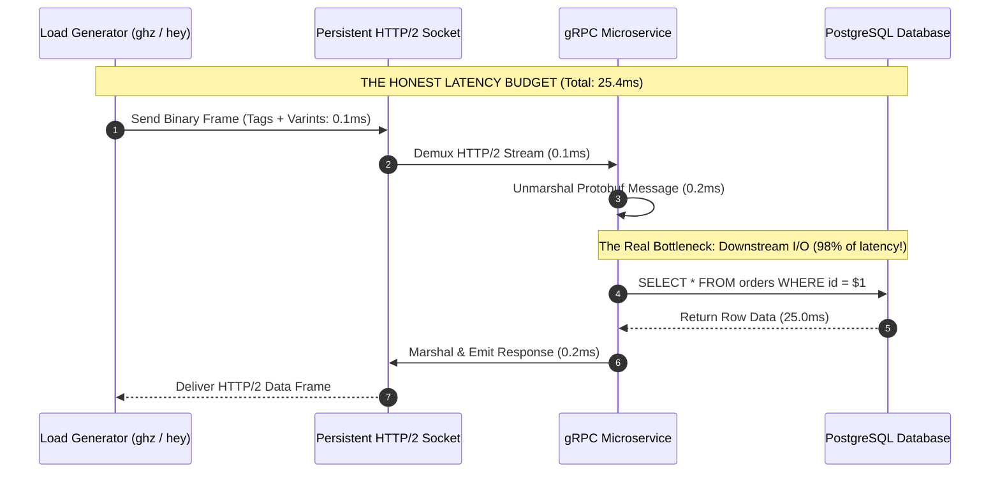
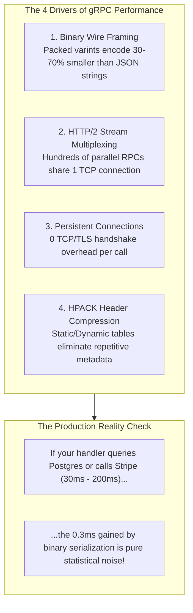
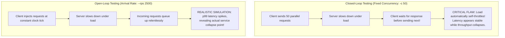
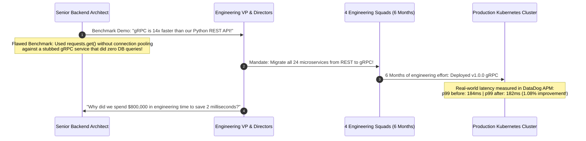

# Module 05: Performance and Benchmarking

> [!TIP]
> **The Golden Rule of gRPC Benchmarking:**
> "gRPC is 10× faster than REST" is an industry myth born of flawed benchmarks that compare persistent gRPC channels against unpooled HTTP/1.1 connections. In real-world systems where handlers query a database, serialization is negligible (~0.3ms vs ~25ms SQL latency). Never measure closed-loop concurrency alone (which conceals tail queueing via self-throttling)—always benchmark open-loop load (`ghz --rps`), report p95/p99 percentiles instead of means, and verify zero error rates before trusting throughput numbers.



---

## 1. Where gRPC Wins (and Where It Doesn't)

gRPC derives its performance advantages from four specific architectural mechanisms:



### The Three-Way Benchmark Taxonomy

When measuring gRPC against REST, you must evaluate three distinct configurations to isolate variables:

| Test Configuration | Connection Strategy | Payload Format | What the Measurement Actually Isolates |
| :--- | :--- | :--- | :--- |
| **Naive REST (The Strawman)** | New TCP/TLS socket per request | ASCII JSON | **Connection Handshake Penalty**: Measures TCP 3-way handshakes and TLS exchanges, not the protocol. |
| **Pooled REST (The Honest Baseline)** | Persistent HTTP/1.1 Keep-Alive pool | ASCII JSON | **Real-World REST**: Reuses persistent sockets via `httpx.Client()` or Go `http.Client`. |
| **gRPC Channel** | Multiplexed HTTP/2 persistent channel | Binary Protobuf | **Protocol Advantage**: Isolates protobuf compact serialization and multiplexing efficiency. |

---

## 2. Load Testing Traps: Closed-Loop vs. Open-Loop



### Little's Law in gRPC Serving

$$\text{Concurrency } (L) = \text{Throughput } (\lambda) \times \text{Latency } (W)$$

If a Python server runs with a fixed thread pool of `max_workers = 16` and each handler performs a 20ms database query ($W = 0.02\text{s}$):
$$\text{Max Throughput } (\lambda) = \frac{16}{0.02\text{s}} = 800\text{ requests/sec}$$

Any offered load beyond 800 RPS will not execute in parallel; incoming calls queue up, causing p99 latency to explode while CPU utilization appears low.

---

## 3. Production War Story: The 14× Migration Fiasco



### Incident Post-Mortem

- **Root Cause**: The benchmarking engineer tested REST using `requests.get()`, which tore down and re-established a TCP/TLS connection on every call (adding ~20ms of local handshake latency). Meanwhile, gRPC used a single persistent channel. Furthermore, the gRPC handler returned a hardcoded mock, while the REST handler queried an unindexed SQL table.
- **The Reality**: In production, services spend 95% of their wall-clock time waiting on relational databases, cache misses, and third-party APIs. Shaving 0.2ms off serialization resulted in an unnoticeable 1% delta in production p99.
- **The Lesson**:
  1. Always enforce **identical database workloads** when comparing transports.
  2. Adopt gRPC for **schema contracts, streaming, and strong types**—not for phantom 10× speedups.

---

## 4. Multi-Language Implementation: High-Throughput Server Tuning

Below, we configure production-grade servers optimized for high-concurrency throughput:
- Go: Native goroutine multiplexing with buffer tuning.
- Node.js: Event-loop optimization with connection tuning.
- Python: Multi-worker process scaling with `grpc.so_reuseport`.

````carousel
```go
// tuned_server.go (Go Implementation)
package main

import (
	"context"
	"net"
	"runtime"
	"time"

	pb "github.com/backendroadmap/gen/shop/v1"
	"google.golang.org/grpc"
	"google.golang.org/grpc/keepalive"
)

type BenchmarkServer struct {
	pb.UnimplementedOrderServiceServer
}

func (s *BenchmarkServer) GetOrder(ctx context.Context, req *pb.GetOrderRequest) (*pb.Order, error) {
	// Simulate realistic 5ms database query
	time.Sleep(5 * time.Millisecond)
	return &pb.Order{Id: req.Id, Quantity: 2}, nil
}

func main() {
	runtime.GOMAXPROCS(runtime.NumCPU())

	lis, err := net.Listen("tcp", ":50051")
	if err != nil {
		panic(err)
	}

	opts := []grpc.ServerOption{
		grpc.InitialWindowSize(1024 * 1024 * 2),     // 2MB HTTP/2 flow control window
		grpc.InitialConnWindowSize(1024 * 1024 * 4), // 4MB connection window
		grpc.MaxConcurrentStreams(2000),             // High stream multiplexing
		grpc.KeepaliveParams(keepalive.ServerParameters{
			MaxConnectionIdle: 15 * time.Minute,
			Time:              30 * time.Second,
		}),
	}

	server := grpc.NewServer(opts...)
	pb.RegisterOrderServiceServer(server, &BenchmarkServer{})
	server.Serve(lis)
}
```
<!-- slide -->
```typescript
// tunedServer.ts (Node.js / TypeScript Implementation)
import * as grpc from '@grpc/grpc-js';

const server = new grpc.Server({
  'grpc.max_concurrent_streams': 2000,
  'grpc.initial_reconnect_backoff_ms': 1000,
  'grpc.max_reconnect_backoff_ms': 5000,
  'grpc.so_reuseport': 1,
  'grpc.default_compression_algorithm': 0, // Disable compression for small payloads
});

server.addService(
  {
    getOrder: (call: any, callback: any) => {
      // Simulate realistic 5ms async I/O
      setTimeout(() => {
        callback(null, {
          id: call.request.id,
          quantity: 2,
        });
      }, 5);
    },
  },
  {}
);

server.bindAsync('0.0.0.0:50051', grpc.ServerCredentials.createInsecure(), (err, port) => {
  if (err) throw err;
  server.start();
  console.log(`Tuned Node.js gRPC Server listening on port ${port}`);
});
```
<!-- slide -->
```python
# tuned_server.py (Python Implementation: Multi-Process so_reuseport)
import multiprocessing
import os
import time
from concurrent import futures
import grpc
from gen.shop.v1 import order_pb2, order_pb2_grpc

class BenchmarkServicer(order_pb2_grpc.OrderServiceServicer):
    def GetOrder(self, request, context):
        # Simulate realistic 5ms I/O
        time.sleep(0.005)
        return order_pb2.Order(id=request.id, quantity=2)

def run_worker():
    # Multi-process scaling: each worker binds the same port via SO_REUSEPORT
    options = [
        ("grpc.so_reuseport", 1),
        ("grpc.max_concurrent_streams", 1000),
        ("grpc.max_receive_message_length", 16 * 1024 * 1024),
    ]

    server = grpc.server(
        futures.ThreadPoolExecutor(max_workers=32),
        options=options
    )
    order_pb2_grpc.add_OrderServiceServicer_to_server(BenchmarkServicer(), server)
    server.add_insecure_port("[::]:50051")
    server.start()
    server.wait_for_termination()

if __name__ == "__main__":
    cpu_count = multiprocessing.cpu_count()
    print(f"Starting {cpu_count} gRPC worker processes on :50051 via SO_REUSEPORT...")
    workers = []
    for _ in range(cpu_count):
        p = multiprocessing.Process(target=run_worker)
        p.start()
        workers.append(p)

    for p in workers:
        p.join()
```
````

---

## 5. Practical Hands-On Verification CLI

### Step 1: Execute Open-Loop Rate Benchmark with `ghz`

Run an open-loop load test at a fixed arrival rate of 2,500 requests per second across 4 persistent TCP connections:

```bash
ghz --insecure \
  --proto ./proto/shop/v1/order.proto \
  --import-paths ./proto \
  --call shop.v1.OrderService/GetOrder \
  -d '{"id":"ORD-42"}' \
  --rps 2500 \
  -z 30s \
  --connections 4 \
  localhost:50051
```

### Step 2: Analyze Empirical Output & Tail Latencies

```text
Summary:
  Count:        75000
  Total:        30.00 s
  Slowest:      28.41 ms
  Fastest:      4.92 ms
  Average:      5.81 ms
  Requests/sec: 2500.04

Response time histogram:
  4.921  [3120]  |■■
  7.270  [68240] |■■■■■■■■■■■■■■■■■■■■■■■■■■■■■■■■■■■■■■■■
  14.318 [3510]  |■■
  28.410 [130]   |

Latency distribution:
  10 % in 5.12 ms
  50 % in 5.64 ms
  90 % in 6.42 ms
  95 % in 8.11 ms
  99 % in 16.32 ms

Status code distribution:
  [OK]   75000 responses
```

### Step 3: Run Baseline REST Comparison via `hey`

Run the pooled REST equivalent under identical concurrency and workload:

```bash
hey -z 30s -c 50 http://localhost:8080/v1/orders/ORD-42
```

---

## 6. Operational Validation Checkpoints

<details>
<summary><strong>Checkpoint 1: Why does testing gRPC at concurrency = 1 completely fail to demonstrate its primary performance advantage?</strong></summary>

**Multiplexing Invisibility:**
At concurrency = 1, exactly one request is in-flight at any given time. The client sends a request, waits for the response, and then sends the next. In this sequential mode, HTTP/2 multiplexing (the ability to interleave hundreds of concurrent streams without head-of-line blocking) is entirely idle. Concurrency = 1 measures only single-call round-trip serialization and network transit time.
</details>

<details>
<summary><strong>Checkpoint 2: Why does closed-loop load testing hide severe latency degradation during system overload?</strong></summary>

**Coordinated Omission:**
In closed-loop testing (`-c 50`), the load generator only issues a new request after an existing request completes. When the server slows down or queues requests, the load generator automatically slows down its request generation rate. The system self-throttles, reporting artificially stable latency because fewer requests are offered per second. An open-loop test (`--rps 2500`) injects requests at fixed wall-clock intervals regardless of whether previous requests have completed, accurately exposing queue buildup.
</details>

<details>
<summary><strong>Checkpoint 3: When does enabling Gzip compression on a gRPC channel degrade performance?</strong></summary>

**CPU vs. Wire Overhead Tradeoff:**
For small payloads (e.g., standard microservice JSON or Protobuf messages under 1 KB), CPU compression algorithms (such as Gzip or Deflate) add several hundred microseconds of CPU encoding and decoding overhead while saving only a few dozen bytes on the wire. Over low-latency datacenter networks (10 Gbps LAN), the CPU compression penalty far exceeds any network transmission savings, degrading both p99 latency and server throughput.
</details>
