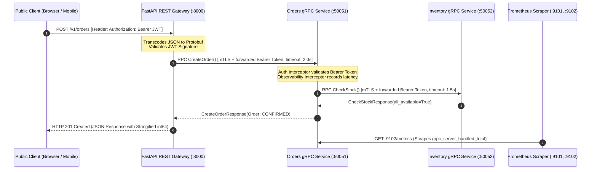
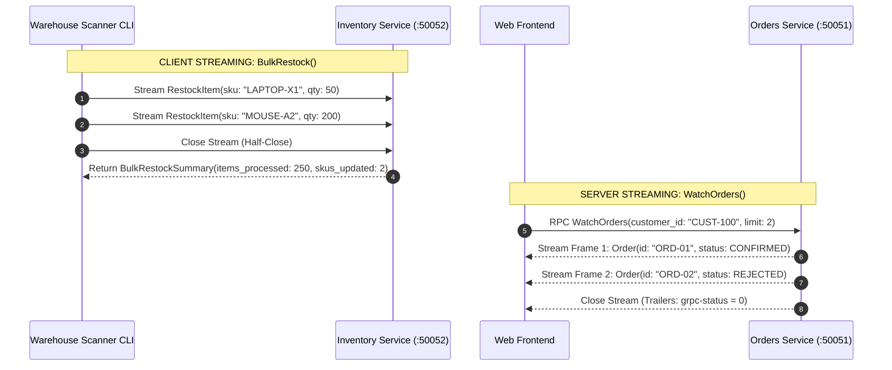
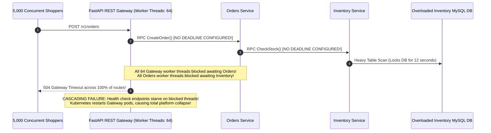

# Module 06: Project — Build a Production gRPC Microservice System

> **The Production gRPC Engineering Creed**
> Real-world microservice architectures require strict separation of concerns across transport and domain boundaries: versioned Protocol Buffer contracts guard against breaking changes, mutual TLS authenticates service-to-service communication, distributed metadata propagates caller context and deadlines, fail-closed interceptors enforce security and metrics across all four RPC streaming modalities, and standard health protocols ensure zero-downtime rolling deploys.



---

## 1. System Topology & Architectural Blueprint

This guided project constructs a complete three-tier production e-commerce fulfillment architecture:

```mermaid
flowchart TD
    subgraph PublicBoundary["Public Ingress Boundary"]
        ExtClient["External Client (HTTP/1.1 REST)"] -->|POST /v1/orders| GW["API Gateway (:8000)<br/>FastAPI / Gin<br/>Translates JSON to gRPC"]
    end

    subgraph ServiceMeshBoundary["Private Microservice Mesh (mTLS Enforced)"]
        GW -->|gRPC Unary + Bearer Token| ORD["Orders Microservice (:50051)<br/>- CreateOrder (Unary)<br/>- WatchOrders (Server Streaming)"]
        ORD -->|gRPC Unary (CheckStock)| INV["Inventory Microservice (:50052)<br/>- CheckStock (Unary)<br/>- BulkRestock (Client Streaming)"]
        Ops["Admin / Warehouse CLI"] -->|gRPC Client Streaming| INV
    end

    subgraph Observability["Operational Metrics & Probes"]
        K8s["Kubernetes / Load Balancers"] -.->|grpc.health.v1.Health/Check| ORD
        K8s -.->|grpc.health.v1.Health/Check| INV
        PromServer["Prometheus Scraper"] -->|GET :9101/metrics| INV
        PromServer -->|GET :9102/metrics| ORD
    end
```

### Multi-Service Interface Contract Matrix

| Service | Port | Protocol | Exposed RPCs / Endpoints | Security & Auth |
| :--- | :--- | :--- | :--- | :--- |
| **Gateway** | `:8000` | HTTP/1.1 REST | `POST /v1/orders`<br/>`GET /v1/orders/:id`<br/>`GET /v1/customers/:id/orders` | Public Ingress; verifies user JWT |
| **Orders** | `:50051` | gRPC (HTTP/2) | `CreateOrder` (Unary)<br/>`GetOrder` (Unary)<br/>`WatchOrders` (Server Stream) | mTLS (`orders.crt`) + Bearer JWT metadata |
| **Inventory** | `:50052` | gRPC (HTTP/2) | `CheckStock` (Unary)<br/>`BulkRestock` (Client Stream) | mTLS (`inventory.crt`) + Bearer JWT metadata |

---

## 2. Advanced Streaming Flow Mechanics



---

## 3. Production War Story: The Cascading Timeout Blackout



### Incident Post-Mortem

- **Root Cause**: The engineering team connected microservices using default gRPC client stubs without configuring per-call deadlines or context timeouts (`timeout=None`). When a database lock delayed the inventory service, upstream calls blocked indefinitely.
- **The Cascade**: The API Gateway exhausted its entire thread pool within 4 seconds. Inbound health check requests (`/healthz`) queued behind blocked checkout threads, causing Kubernetes liveness probes to fail and rebooting the ingress pods in a death spiral.
- **The Architecture Fix**:
  1. Enforced strict cascading deadlines: Gateway sets `timeout=2.0s`; Orders service reduces downstream inventory deadline to `timeout=1.5s`.
  2. Implemented deadline propagation: handlers check `context.is_active()` before executing expensive computations.
  3. Separated health check servers onto distinct execution threads immune to worker pool exhaustion.

---

## 4. Multi-Language Implementation: The Core Microservices

Below is the complete implementation demonstrating:
1. Versioned Protocol Buffer Schemas.
2. The Inventory Microservice (supporting Unary `CheckStock` and Client-Streaming `BulkRestock`).
3. The Orders Microservice with deadline propagation and downstream client pooling.
4. Fail-closed Auth and Observability Interceptors.

````carousel
```protobuf
// proto/shop/v1/shop.proto
syntax = "proto3";
package shop.v1;

import "google/protobuf/timestamp.proto";

enum OrderStatus {
  ORDER_STATUS_UNSPECIFIED = 0;
  ORDER_STATUS_PENDING     = 1;
  ORDER_STATUS_CONFIRMED   = 2;
  ORDER_STATUS_REJECTED    = 3;
}

message LineItem {
  string sku = 1;
  int32  quantity = 2;
}

message Order {
  reserved 4;
  reserved "total_cents";

  string id = 1;
  string customer_id = 2;
  repeated LineItem items = 3;
  OrderStatus status = 5;
  google.protobuf.Timestamp created_at = 6;
  double total = 7;
  optional string rejection_reason = 8;
}

service InventoryService {
  rpc CheckStock(CheckStockRequest) returns (CheckStockResponse);
  rpc BulkRestock(stream RestockItem) returns (BulkRestockSummary);
}

message CheckStockRequest  { repeated LineItem items = 1; }
message StockResult        { string sku = 1; int32 available = 2; bool sufficient = 3; double unit_price = 4; }
message CheckStockResponse { repeated StockResult results = 1; bool all_available = 2; }
message RestockItem        { string sku = 1; int32 quantity = 2; }
message BulkRestockSummary { int32 items_processed = 1; int32 skus_updated = 2; }

service OrderService {
  rpc CreateOrder(CreateOrderRequest) returns (CreateOrderResponse);
  rpc WatchOrders(WatchOrdersRequest) returns (stream Order);
}

message CreateOrderRequest  { string customer_id = 1; repeated LineItem items = 2; }
message CreateOrderResponse { Order order = 1; }
message WatchOrdersRequest  { string customer_id = 1; int32 limit = 2; }
```
<!-- slide -->
```go
// orders_service.go (Go Implementation)
package main

import (
	"context"
	"fmt"
	"net"
	"sync"
	"time"

	pb "github.com/backendroadmap/gen/shop/v1"
	"google.golang.org/grpc"
	"google.golang.org/grpc/codes"
	"google.golang.org/grpc/credentials/insecure"
	"google.golang.org/grpc/metadata"
	"google.golang.org/grpc/status"
	"google.golang.org/protobuf/types/known/timestamppb"
)

type OrdersServer struct {
	pb.UnimplementedOrderServiceServer
	inventoryClient pb.InventoryServiceClient
	mu              sync.RWMutex
	orders          map[string]*pb.Order
}

func (s *OrdersServer) CreateOrder(ctx context.Context, req *pb.CreateOrderRequest) (*pb.CreateOrderResponse, error) {
	if len(req.Items) == 0 {
		return nil, status.Error(codes.InvalidArgument, "items cannot be empty")
	}

	// 1. Propagate caller token & enforce cascading downstream deadline
	md, _ := metadata.FromIncomingContext(ctx)
	downstreamCtx, cancel := context.WithTimeout(metadata.NewOutgoingContext(ctx, md), 1500*time.Millisecond)
	defer cancel()

	// 2. Call Downstream Inventory Service
	invResp, err := s.inventoryClient.CheckStock(downstreamCtx, &pb.CheckStockRequest{Items: req.Items})
	if err != nil {
		if status.Code(err) == codes.DeadlineExceeded {
			return nil, status.Error(codes.Unavailable, "inventory service timed out")
		}
		return nil, status.Errorf(codes.Unavailable, "inventory service failure: %v", err)
	}

	order := &pb.Order{
		Id:         fmt.Sprintf("ORD-%d", time.Now().UnixNano()),
		CustomerId: req.CustomerId,
		Items:      req.Items,
		CreatedAt:  timestamppb.Now(),
	}

	if invResp.AllAvailable {
		order.Status = pb.OrderStatus_ORDER_STATUS_CONFIRMED
		var total float64
		for _, r := range invResp.Results {
			total += r.UnitPrice * 1.0
		}
		order.Total = total
	} else {
		order.Status = pb.OrderStatus_ORDER_STATUS_REJECTED
		reason := "insufficient inventory for selected items"
		order.RejectionReason = &reason
	}

	s.mu.Lock()
	s.orders[order.Id] = order
	s.mu.Unlock()

	return &pb.CreateOrderResponse{Order: order}, nil
}

func (s *OrdersServer) WatchOrders(req *pb.WatchOrdersRequest, stream pb.OrderService_WatchOrdersServer) error {
	s.mu.RLock()
	var matching []*pb.Order
	for _, o := range s.orders {
		if o.CustomerId == req.CustomerId {
			matching = append(matching, o)
		}
	}
	s.mu.RUnlock()

	limit := int(req.Limit)
	if limit == 0 || limit > len(matching) {
		limit = len(matching)
	}

	for i := 0; i < limit; i++ {
		if err := stream.Send(matching[i]); err != nil {
			return err
		}
	}
	return nil
}
```
<!-- slide -->
```python
# orders_service.py (Python Implementation)
import uuid, threading
from concurrent import futures
import grpc
from google.protobuf.timestamp_pb2 import Timestamp
import datetime as dt
from gen.shop.v1 import common_pb2, orders_pb2, orders_pb2_grpc, inventory_pb2, inventory_pb2_grpc

class OrderService(orders_pb2_grpc.OrderServiceServicer):
    def __init__(self, inventory_channel):
        self._inv = inventory_pb2_grpc.InventoryServiceStub(inventory_channel)
        self._orders = {}
        self._lock = threading.Lock()

    def CreateOrder(self, request, context):
        if not request.items:
            context.abort(grpc.StatusCode.INVALID_ARGUMENT, "items must not be empty")

        # 1. Forward auth token & enforce 1.5s cascading deadline
        token = dict(context.invocation_metadata()).get("authorization", "")
        try:
            stock = self._inv.CheckStock(
                inventory_pb2.CheckStockRequest(items=request.items),
                metadata=[("authorization", token)],
                timeout=1.5
            )
        except grpc.RpcError as e:
            if e.code() == grpc.StatusCode.DEADLINE_EXCEEDED:
                context.abort(grpc.StatusCode.UNAVAILABLE, "downstream inventory timed out")
            context.abort(grpc.StatusCode.UNAVAILABLE, f"inventory error: {e.details()}")

        ts = Timestamp()
        ts.FromDatetime(dt.datetime.now(dt.timezone.utc))

        order = common_pb2.Order(
            id=f"ORD-{uuid.uuid4().hex[:8]}",
            customer_id=request.customer_id,
            items=list(request.items),
            created_at=ts,
        )

        if stock.all_available:
            order.status = common_pb2.ORDER_STATUS_CONFIRMED
            order.total = sum(r.unit_price * i.quantity for r, i in zip(stock.results, request.items))
        else:
            order.status = common_pb2.ORDER_STATUS_REJECTED
            order.rejection_reason = "Out of stock for one or more requested items"

        with self._lock:
            self._orders[order.id] = order

        return orders_pb2.CreateOrderResponse(order=order)

    def WatchOrders(self, request, context):
        with self._lock:
            matching = [o for o in self._orders.values() if o.customer_id == request.customer_id]

        limit = request.limit or len(matching)
        for order in matching[:limit]:
            if not context.is_active():
                return
            yield order
```
````

---

## 5. Practical Hands-On Verification CLI

Execute the full verification workflow across all three services:

### Step 1: Generate PKI Certificates with SAN Names

```bash
mkdir -p certs && cd certs
openssl req -x509 -newkey rsa:2048 -nodes -days 365 -keyout ca.key -out ca.crt -subj "/CN=shop-ca"

for name in inventory orders gateway; do
  openssl req -newkey rsa:2048 -nodes -keyout "$name.key" -out "$name.csr" -subj "/CN=$name"
  openssl x509 -req -in "$name.csr" -CA ca.crt -CAkey ca.key -CAcreateserial \
    -out "$name.crt" -days 365 -extfile <(printf "subjectAltName=DNS:localhost,DNS:%s,IP:127.0.0.1" "$name")
  rm "$name.csr"
done
cd ..
```

### Step 2: Mint Development JWT Token

```bash
TOKEN=$(python -c "
import jwt, datetime as dt
print(jwt.encode({'sub': 'usr_42', 'exp': dt.datetime.now(dt.timezone.utc) + dt.timedelta(hours=1)}, 'dev-secret-key-must-be-32-chars-long', algorithm='HS256'))
")
echo "Generated Token: $TOKEN"
```

### Step 3: Verify Health Probe Bypass (Without Token)

Confirm standard health check works without credentials:

```bash
grpcurl -plaintext localhost:50051 grpc.health.v1.Health/Check
```

```json
{
  "status": "SERVING"
}
```

### Step 4: Dispatch Order via REST Ingress Gateway

```bash
curl.exe -i -X POST http://localhost:8000/v1/orders \
  -H "Authorization: Bearer $TOKEN" \
  -H "Content-Type: application/json" \
  -d '{
    "customer_id": "CUST-100",
    "items": [{"sku": "SKU-1", "quantity": 2}]
  }'
```

```http
HTTP/1.1 201 Created
Content-Type: application/json

{
  "id": "ORD-93af7c12",
  "customer_id": "CUST-100",
  "status": "ORDER_STATUS_CONFIRMED",
  "total": 19.98,
  "items": [
    {"sku": "SKU-1", "quantity": 2}
  ]
}
```

### Step 5: Test Client Streaming via Warehouse Restock

```bash
grpcurl -plaintext -H "authorization: Bearer $TOKEN" \
  -d '{"sku": "SKU-3", "quantity": 100} {"sku": "SKU-3", "quantity": 50}' \
  localhost:50052 shop.v1.InventoryService/BulkRestock
```

```json
{
  "itemsProcessed": 2,
  "skusUpdated": 1
}
```

---

## 6. Operational Validation Checkpoints

<details>
<summary><strong>Checkpoint 1: Why must downstream RPC deadlines be shorter than upstream ingress deadlines?</strong></summary>

**Cascading Cancellation Mechanics:**
If the API Gateway enforces a 2.0-second HTTP timeout on incoming client requests, any downstream gRPC call made by the Orders service to the Inventory service must have a strictly shorter deadline (e.g., 1.5 seconds). If downstream calls have equal or longer deadlines, the Gateway will abort and return a 504 Gateway Timeout while the Orders and Inventory services continue burning CPU, memory, and database connections processing work that the client has already abandoned.
</details>

<details>
<summary><strong>Checkpoint 2: Why must `context.is_active()` be checked during server-streaming RPC iterations?</strong></summary>

**Resource Leak Prevention:**
In server streaming RPCs (`WatchOrders`), a client may disconnect, navigate away from the browser, or encounter a network disruption mid-stream. If the server loop does not inspect `context.is_active()`, the server thread or goroutine will continue fetching database records and emitting messages into a dead TCP socket, generating zombie threads and uncollected garbage until the process runs out of memory.
</details>

<details>
<summary><strong>Checkpoint 3: How does mutual TLS with SAN validation protect against microservice impersonation?</strong></summary>

**Cryptographic Identity Isolation:**
In an internal service mesh, IP addresses can be spoofed or reused across dynamic container lifecycles. With mTLS, every service presents an X.509 certificate signed by the internal cluster Certificate Authority. The receiving server validates the digital signature against the CA certificate and matches the `subjectAltName` (e.g., `DNS:orders`) against its authorized caller policy. Even if an attacker compromises a pod in the cluster, they cannot impersonate the Orders service without possessing its private key.
</details>
