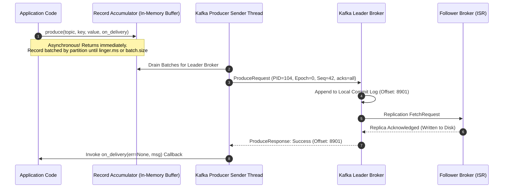
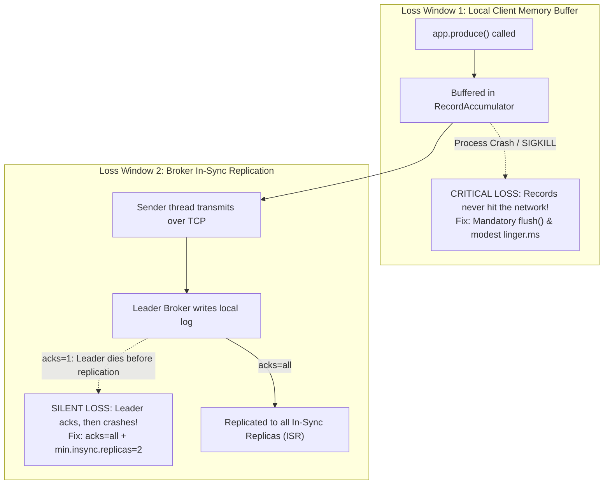
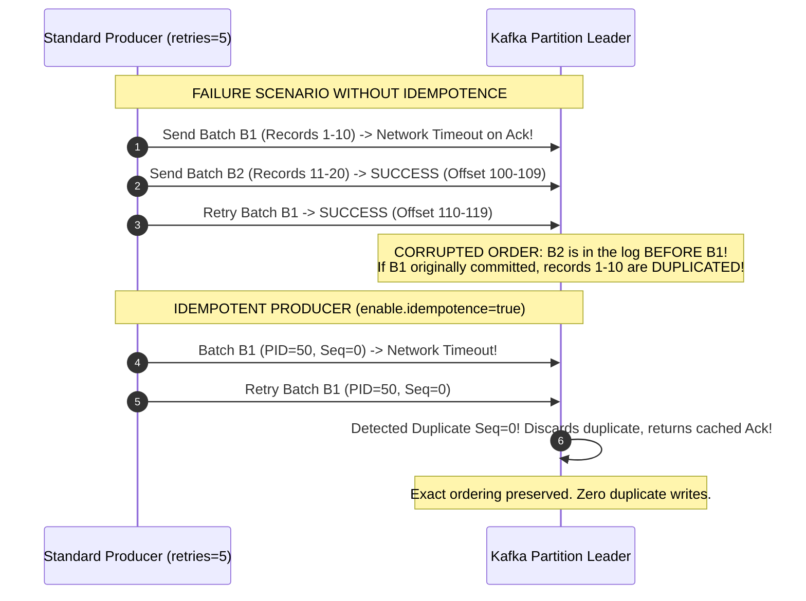
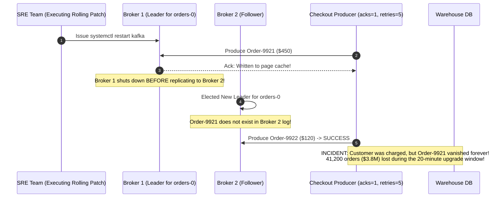

# Module 00: Producer Internals — Acks, Idempotence and Partitioning

> **The Golden Rule of Kafka Producer Durability**
> `produce()` does not mean "sent"—it buffers in memory asynchronously. Without an explicit `flush()` on shutdown, buffered messages vanish. Durability is a three-way contract: `acks=all` on the producer, `min.insync.replicas=2`, and `replication.factor=3` on the topic. Always set `enable.idempotence=true` to guarantee exactly-once per-partition delivery and strict ordering without throttling in-flight requests.



---

## 1. The Write Path: Where Messages Disappear

A default Kafka producer configuration will lose data during ordinary rolling broker upgrades. There are two distinct loss windows:



### The Durability Triad

Durability in Apache Kafka is defined by the interaction of three configuration settings. Misconfiguring any single one degrades the guarantee:

$$\text{Durability Guarantee} = \left( \text{Producer } \texttt{acks=all} \right) \;\wedge\; \left( \text{Topic } \texttt{min.insync.replicas=2} \right) \;\wedge\; \left( \text{Topic } \texttt{replication.factor=3} \right)$$

| Dimension | `acks=0` | `acks=1` (Default) | `acks=all` (`-1`) | `acks=all` + `min.insync.replicas=2` |
| :--- | :--- | :--- | :--- | :--- |
| **Leader Waits For** | Nothing (Fire & Forget) | Leader disk/buffer write | All active ISR members | At least 2 active ISR members |
| **Durability Level** | Extremely Low | Medium (Loses data on leader crash) | High (Degrades if ISR shrinks to 1) | **Strict High Durability** |
| **Failure Response** | None | Silent message loss | Silent loss if ISR = 1 | `NOT_ENOUGH_REPLICAS` error |
| **Throughput** | Maximum | High | Modest | Optimal with batching |

---

## 2. Idempotence & Ordering: Overcoming the In-Flight Dilemma

Without idempotence, retrying failed requests causes message duplication and partition reordering.



### The Idempotent Producer Contract

Enabling `enable.idempotence = true` assigns each producer a unique 64-bit **Producer ID (PID)** and tracks monotonic sequence numbers per topic-partition:
- Implicitly enforces `acks = all`.
- Implicitly enforces `retries = 2147483647` ($\text{INT\_MAX}$).
- Permitted `max.in.flight.requests.per.connection <= 5` while maintaining strict FIFO order.

---

## 3. Production War Story: The Black Friday Rolling Upgrade Disaster



### Incident Post-Mortem

- **Root Cause**: The producers used `acks=1` with `min.insync.replicas=1`. When Broker 1 (the partition leader) acknowledged incoming messages, it had not yet replicated them to Broker 2. When the DevOps team gracefully rebooted Broker 1 for an OS kernel upgrade, Broker 2 became leader, truncating all unreplicated log records.
- **Why No Alerts Fired**: Because the producer used `acks=1`, all 41,200 writes were marked as "successful." Delivery callbacks received `err = None`.
- **The Remediation**:
  1. Updated all producers to enforce `enable.idempotence = true` and `acks = all`.
  2. Set cluster-wide topic defaults: `replication.factor = 3` and `min.insync.replicas = 2`.
  3. Verified that if fewer than 2 replicas exist, producers receive `NOT_ENOUGH_REPLICAS` and retry into a local dead-letter queue.

---

## 4. Multi-Language Implementation: Production-Grade Producers

Below is the complete implementation of a production-grade, idempotent producer with:
1. `acks=all` and `enable.idempotence=true`.
2. Asynchronous delivery callbacks with error logging.
3. Batching optimization (`linger.ms=15`, `compression.type=lz4`).
4. Phased graceful shutdown calling `flush()`.

````carousel
```go
// producer.go (Go Implementation)
package main

import (
	"context"
	"fmt"
	"log"
	"os"
	"os/signal"
	"syscall"
	"time"

	"github.com/confluentinc/confluent-kafka-go/v2/kafka"
)

type ProductionKafkaProducer struct {
	producer *kafka.Producer
}

func NewProductionProducer(bootstrapServers string) (*ProductionKafkaProducer, error) {
	config := &kafka.ConfigMap{
		"bootstrap.servers":                     bootstrapServers,
		// 1. Correctness & Durability
		"enable.idempotence":                    true, // Enforces acks=all & max.in.flight<=5
		"acks":                                  "all",
		"retries":                               1000000,
		"max.in.flight.requests.per.connection": 5,
		// 2. High-Throughput Batching
		"linger.ms":                             15,
		"batch.size":                            65536, // 64 KB
		"compression.type":                      "lz4",
		// 3. Timeouts & Reliability
		"delivery.timeout.ms":                   120000, // 2 minutes max
		"request.timeout.ms":                    30000,
	}

	p, err := kafka.NewProducer(config)
	if err != nil {
		return nil, fmt.Errorf("failed to create producer: %w", err)
	}

	// Background Delivery Report Handler
	go func() {
		for e := range p.Events() {
			switch ev := e.(type) {
			case *kafka.Message:
				if ev.TopicPartition.Error != nil {
					log.Printf("[ERROR] Delivery failed for key %s: %v\n", string(ev.Key), ev.TopicPartition.Error)
				} else {
					log.Printf("[SUCCESS] Message key=%s delivered to %s[%d]@offset %d\n",
						string(ev.Key), *ev.TopicPartition.Topic, ev.TopicPartition.Partition, ev.TopicPartition.Offset)
				}
			}
		}
	}()

	return &ProductionKafkaProducer{producer: p}, nil
}

func (p *ProductionKafkaProducer) Produce(topic, key, value string) error {
	return p.producer.Produce(&kafka.Message{
		TopicPartition: kafka.TopicPartition{Topic: &topic, Partition: kafka.PartitionAny},
		Key:            []byte(key),
		Value:          []byte(value),
	}, nil)
}

func (p *ProductionKafkaProducer) Close() {
	// Mandatory: Flush all remaining queued buffers before exit
	log.Println("Flushing remaining Kafka buffers...")
	unflushed := p.producer.Flush(15000)
	if unflushed > 0 {
		log.Printf("[WARN] %d messages remained un-flushed upon shutdown!\n", unflushed)
	}
	p.producer.Close()
}
```
<!-- slide -->
```typescript
// producer.ts (Node.js / TypeScript: KafkaJS)
import { Kafka, Partitioners, Producer, RecordMetadata } from 'kafkajs';

export class ProductionProducer {
  private kafka: Kafka;
  private producer: Producer;

  constructor(brokers: string[]) {
    this.kafka = new Kafka({
      clientId: 'shop-checkout-service',
      brokers,
    });

    this.producer = this.kafka.producer({
      // Enforce Java-compatible murmur2 hash partitioner
      createPartitioner: Partitioners.DefaultPartitioner,
      idempotent: true, // Enables idempotent delivery per partition
      maxInFlightRequests: 5,
    });
  }

  async connect(): Promise<void> {
    await this.producer.connect();
    console.log('Kafka Idempotent Producer connected');
  }

  async sendOrderEvent(topic: string, orderId: string, payload: object): Promise<RecordMetadata[]> {
    return await this.producer.send({
      topic,
      acks: -1, // acks=all
      timeout: 30000,
      messages: [
        {
          key: orderId, // Keys guarantee per-order FIFO sequence
          value: JSON.stringify(payload),
          timestamp: Date.now().toString(),
        },
      ],
    });
  }

  async disconnect(): Promise<void> {
    console.log('Disconnecting producer and draining buffers...');
    await this.producer.disconnect();
  }
}
```
<!-- slide -->
```python
# producer.py (Python Implementation: confluent-kafka)
import logging
from confluent_kafka import Producer

log = logging.getLogger("kafka_producer")

class ProductionKafkaProducer:
    def __init__(self, bootstrap_servers: str):
        config = {
            "bootstrap.servers": bootstrap_servers,
            # 1. Correctness & Idempotence
            "enable.idempotence": True,      # Forces acks=all, retries=INT_MAX, max.in.flight<=5
            "max.in.flight.requests.per.connection": 5,
            # 2. Batching & Throughput
            "linger.ms": 15,
            "batch.size": 65536,            # 64 KB
            "compression.type": "lz4",
            # 3. Delivery bounds
            "delivery.timeout.ms": 120000,  # 2 minute global delivery timeout
            "request.timeout.ms": 30000,
        }
        self.producer = Producer(config)

    def _delivery_callback(self, err, msg):
        if err is not None:
            log.error("Message delivery failed: %s (key=%s)", err, msg.key())
        else:
            log.debug("Message delivered to %s [%d] at offset %d",
                      msg.topic(), msg.partition(), msg.offset())

    def produce(self, topic: str, key: str, value: str):
        # Asynchronous local enqueue
        self.producer.produce(
            topic=topic,
            key=key.encode("utf-8"),
            value=value.encode("utf-8"),
            on_delivery=self._delivery_callback
        )
        # Serve delivery callbacks from previous batches
        self.producer.poll(0)

    def close(self):
        # Mandatory: block until every buffered record is acked or failed
        log.info("Flushing buffered Kafka records before exit...")
        remaining = self.producer.flush(timeout=15.0)
        if remaining > 0:
            log.warning("%d records were not flushed and may be lost!", remaining)
```
````

---

## 5. Practical Hands-On Verification CLI

### Step 1: Start Local KRaft-Mode Kafka Cluster

```bash
docker run -d --name kafka-node -p 9092:9092 \
  -e KAFKA_NODE_ID=1 \
  -e KAFKA_PROCESS_ROLES=broker,controller \
  -e KAFKA_LISTENERS=PLAINTEXT://:9092,CONTROLLER://:9093 \
  -e KAFKA_ADVERTISED_LISTENERS=PLAINTEXT://localhost:9092 \
  -e KAFKA_CONTROLLER_LISTENER_NAMES=CONTROLLER \
  -e KAFKA_LISTENER_SECURITY_PROTOCOL_MAP=CONTROLLER:PLAINTEXT,PLAINTEXT:PLAINTEXT \
  -e KAFKA_CONTROLLER_QUORUM_VOTERS=1@localhost:9093 \
  -e KAFKA_OFFSETS_TOPIC_REPLICATION_FACTOR=1 \
  -e KAFKA_TRANSACTION_STATE_LOG_REPLICATION_FACTOR=1 \
  -e KAFKA_TRANSACTION_STATE_LOG_MIN_ISR=1 \
  apache/kafka:3.9.0
```

### Step 2: Create a Partitioned Topic with Replication Bounds

```bash
docker exec -it kafka-node /opt/kafka/bin/kafka-topics.sh \
  --create --topic orders.v1 \
  --partitions 3 \
  --replication-factor 1 \
  --config min.insync.replicas=1 \
  --bootstrap-server localhost:9092
```

```text
Created topic orders.v1.
```

### Step 3: Produce Keyed Events and Inspect Partition Placement

Produce messages with keys `order-101`, `order-102`, and `order-103`:

```bash
python -c "
from confluent_kafka import Producer
p = Producer({'bootstrap.servers': 'localhost:9092', 'enable.idempotence': True})
for order_id in ['order-101', 'order-102', 'order-103', 'order-101']:
    p.produce('orders.v1', key=order_id.encode(), value=b'event_payload')
p.flush()
"
```

Read from the console consumer with key and partition headers printed:

```bash
docker exec -it kafka-node /opt/kafka/bin/kafka-console-consumer.sh \
  --bootstrap-server localhost:9092 \
  --topic orders.v1 \
  --from-beginning \
  --property print.key=true \
  --property print.partition=true \
  --property print.offset=true \
  --timeout-ms 5000
```

```text
Partition:1	Offset:0	order-101	event_payload
Partition:1	Offset:1	order-101	event_payload
Partition:2	Offset:0	order-102	event_payload
Partition:0	Offset:0	order-103	event_payload
```

> **Notice**: Both `order-101` events landed in **Partition 1** in strict offset sequence (`Offset:0`, then `Offset:1`).

---

## 6. Operational Validation Checkpoints

<details>
<summary><strong>Checkpoint 1: Why does adding partitions to an existing keyed topic break application ordering guarantees?</strong></summary>

**Partition Hashing Formula:**
Default Kafka producers assign partitions using a hash modulus: $\text{partition} = \text{hash}(\text{key}) \pmod N$, where $N$ is the number of partitions. If $N$ increases from 3 to 6, a key that previously hashed to partition 1 may now map to partition 4. New events for that key will be written to partition 4, while historical unconsumed events remain in partition 1. Consumers processing partitions independently will process new events out of order relative to historical events.
</details>

<details>
<summary><strong>Checkpoint 2: Why is `acks=all` insufficient without setting `min.insync.replicas=2`?</strong></summary>

**The Shrinking ISR Trap:**
`acks=all` instructs the leader to wait until all members of the *current In-Sync Replica (ISR)* set have written the record. However, if two followers in a 3-replica cluster experience network partitions or restart, Kafka shrinks the ISR set to just the leader. Under this condition, `acks=all` requires confirmation from only the leader itself, silently degrading to `acks=1`. Configuring `min.insync.replicas=2` forces the leader to reject writes with `NOT_ENOUGH_REPLICAS` if the ISR drops below 2.
</details>

<details>
<summary><strong>Checkpoint 3: What is the operational distinction between `retries` and `delivery.timeout.ms`?</strong></summary>

**Timeout vs Attempt Budgeting:**
The `retries` parameter configures the maximum count of retry attempts (often set to $\infty$). However, an unacknowledged message can linger indefinitely if attempts are paced by exponential backoff. The `delivery.timeout.ms` parameter sets an absolute wall-clock ceiling on the total lifespan of a record—spanning local queuing in the `RecordAccumulator`, network transmission, and all subsequent retry attempts. If a record is not successfully acknowledged within this timeout, the delivery callback immediately fires with a timeout error.
</details>
