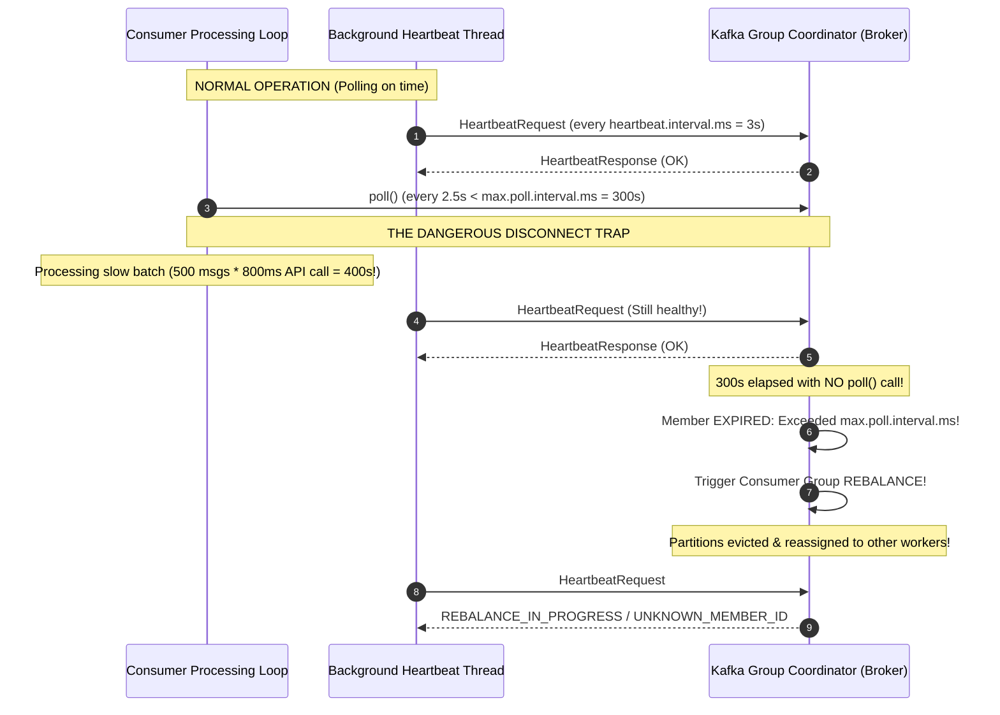
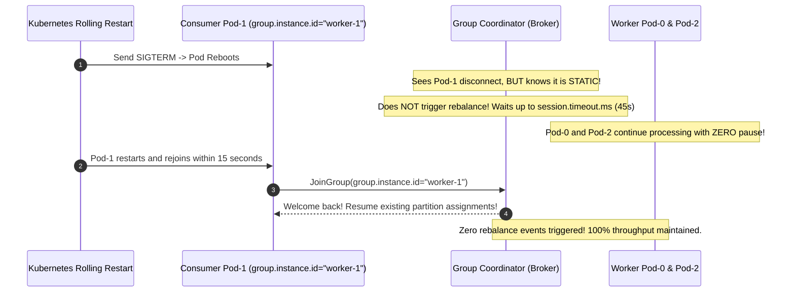
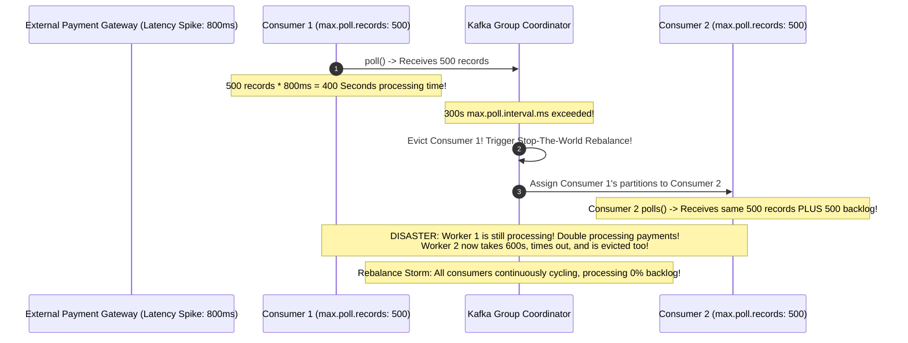

# Module 01: Consumer Groups and Rebalancing in Depth

> **The Golden Rule of Kafka Consumer Groups**
> Heartbeats are transmitted by a background thread and only prove the process is alive; they will NOT prevent eviction if your main processing thread blocks. To prevent catastrophic rebalance storms, satisfy the golden inequality: $\text{max.poll.records} \times \text{per-record processing time} < \text{max.poll.interval.ms}$. Always configure `cooperative-sticky` assignment to eliminate stop-the-world pauses, and use `group.instance.id` to survive rolling container deploys with zero rebalances.



---

## 1. Rebalance Mechanics: Eager vs. Cooperative-Sticky

Under the legacy **Eager** assignment protocol (e.g., `RangeAssignor`), whenever a consumer joins, leaves, or times out, every single member of the group must drop all its assigned partitions before the group coordinator can reassign them. This causes complete processing freezes across the entire consumer cluster.

In contrast, the modern **Cooperative-Sticky** protocol (`KIP-429`) only revokes partitions that must physically migrate to new owners.

```mermaid
flowchart TD
    subgraph EagerProtocol["Legacy Eager Protocol (Stop-The-World)"]
        E1["Consumer 3 Joins Group"] --> E2["ALL Consumers immediately REVOKE all partitions"]
        E2 --> E3["Total Cluster Stall: 0 messages processed"]
        E3 --> E4["Leader computes new layout"]
        E4 --> E5["Consumers re-assigned partitions (Dead time: 5-30s)"]
    end

    subgraph CooperativeProtocol["Modern Cooperative-Sticky (KIP-429)"]
        C1["Consumer 3 Joins Group"] --> C2["Consumers retain non-moving partitions"]
        C2 --> C3["Only migrating partitions revoked"]
        C3 --> C4["Unchanged partitions CONTINUE PROCESSING throughout!"]
        C4 --> C5["Minimal blip (Sub-second migration)"]
    end
```



### The Consumer Timeout Interplay Grid

| Setting | Default | Purpose / Mechanism | What Happens When Exceeded | Recommended Production Tuning |
| :--- | :--- | :--- | :--- | :--- |
| `session.timeout.ms` | `45000` (45s) | Heartbeat threshold for declaring dead container/node | Group marks member dead $\to$ triggers rebalance | `45000` (Leave default) |
| `heartbeat.interval.ms` | `3000` (3s) | Cadence of background heartbeat thread | Must be $\le \frac{1}{3} \times \text{session.timeout.ms}$ | `3000` (Leave default) |
| `max.poll.interval.ms` | `300000` (5m) | Maximum wall-clock time allowed between successive `poll()` calls | Member ejected from group $\to$ rebalance storm | Keep at `300000`; tune batch size down |
| `max.poll.records` | `500` | Maximum records returned in a single `poll()` invocation | Governs total execution time per batch | **Tune DOWN**: Set to `20` - `50` for heavy I/O |

---

## 2. Static Membership: Zero-Rebalance Rolling Deploys

In Kubernetes rolling deployments, restarting pods with dynamic IDs causes two global rebalances per pod (one when the container stops, and one when the new pod starts). 

Using **Static Membership** (`KIP-345`) via `group.instance.id` binds the consumer identity to the container ordinal (e.g., `StatefulSet` pod index).



---

## 3. Production War Story: The Payment Gateway Rebalance Storm



### Incident Post-Mortem

- **Root Cause**: The consumer was configured with default `max.poll.records = 500` and `max.poll.interval.ms = 300000` (5 minutes). When an external payment gateway suffered a latency degradation from 50ms to 800ms per transaction, processing a single batch took $500 \times 0.8\text{s} = 400\text{ seconds}$.
- **The Cascade**:
  1. Consumer 1 exceeded `max.poll.interval.ms`, was ejected, and its partitions were reassigned to Consumer 2.
  2. Consumer 1 had not committed its offsets, so Consumer 2 began reprocessing the identical 500 payment records—causing duplicate credit card charges!
  3. Consumer 2 was also overwhelmed by the bloated backlog, timed out, and was ejected. The entire fleet collapsed into an infinite rebalance storm.
- **The Remediation**:
  1. Reduced `max.poll.records` from 500 down to **25**, ensuring even under degraded 1-second latency, a batch finishes in $25\text{s} \ll 300\text{s}$.
  2. Switched assignment strategy to `cooperative-sticky`.
  3. Bound offset commits to synchronous execution inside `on_revoke` rebalance listeners.

---

## 4. Multi-Language Implementation: Production-Grade Consumer

Below is the complete implementation of a production consumer demonstrating:
1. `partition.assignment.strategy = cooperative-sticky`.
2. Static membership (`group.instance.id`).
3. Defensive batch sizing (`max.poll.records = 25`).
4. Rebalance listener with synchronous offset commit in `on_revoke`.

````carousel
```go
// consumer.go (Go Implementation)
package main

import (
	"context"
	"fmt"
	"log"
	"os"
	"os/signal"
	"syscall"
	"time"

	"github.com/confluentinc/confluent-kafka-go/v2/kafka"
)

type ProductionConsumer struct {
	consumer *kafka.Consumer
}

func NewProductionConsumer(brokers, groupID, instanceID string) (*ProductionConsumer, error) {
	config := &kafka.ConfigMap{
		"bootstrap.servers":               brokers,
		"group.id":                        groupID,
		"group.instance.id":               instanceID, // Static membership
		"partition.assignment.strategy":   "cooperative-sticky",
		"auto.offset.reset":               "earliest",
		"enable.auto.commit":              false, // Manual offset commits
		"max.poll.interval.ms":            300000,
		"session.timeout.ms":              45000,
		"heartbeat.interval.ms":           3000,
	}

	c, err := kafka.NewConsumer(config)
	if err != nil {
		return nil, fmt.Errorf("failed to create consumer: %w", err)
	}

	return &ProductionConsumer{consumer: c}, nil
}

func (pc *ProductionConsumer) Run(ctx context.Context, topic string) {
	err := pc.consumer.SubscribeTopics([]string{topic}, func(c *kafka.Consumer, ev kafka.Event) error {
		switch e := ev.(type) {
		case kafka.AssignedPartitions:
			log.Printf("[REBALANCE] Partitions ASSIGNED: %v\n", e.Partitions)
			return c.IncrementalAssign(e.Partitions)
		case kafka.RevokedPartitions:
			log.Printf("[REBALANCE] Partitions REVOKED: %v. Committing offsets before release...\n", e.Partitions)
			// Last chance: Synchronous commit before losing partition ownership
			_, err := c.Commit()
			if err != nil {
				log.Printf("[WARN] Commit on revoke failed: %v\n", err)
			}
			return c.IncrementalUnassign(e.Partitions)
		}
		return nil
	})
	if err != nil {
		log.Fatalf("Subscription failed: %v", err)
	}

	for {
		select {
		case <-ctx.Done():
			log.Println("Context cancelled, closing consumer...")
			pc.consumer.Close()
			return
		default:
			ev := pc.consumer.Poll(100)
			if ev == nil {
				continue
			}

			switch m := ev.(type) {
			case *kafka.Message:
				// Process message
				log.Printf("Consumed record key=%s value=%s on %s[%d]@%d\n",
					string(m.Key), string(m.Value), *m.TopicPartition.Topic, m.TopicPartition.Partition, m.TopicPartition.Offset)

				// Commit offset after successful processing
				_, err := pc.consumer.CommitMessage(m)
				if err != nil {
					log.Printf("Failed to commit offset: %v\n", err)
				}
			case kafka.Error:
				log.Printf("[ERROR] Consumer error: %v\n", m)
			}
		}
	}
}
```
<!-- slide -->
```typescript
// consumer.ts (Node.js / TypeScript: KafkaJS)
import { Kafka } from 'kafkajs';

export async function runProductionConsumer(podOrdinal: string) {
  const kafka = new Kafka({
    clientId: `orders-worker-${podOrdinal}`,
    brokers: ['localhost:9092'],
  });

  const consumer = kafka.consumer({
    groupId: 'orders-fulfillment-group',
    sessionTimeout: 45000,
    heartbeatInterval: 3000,
    maxWaitTimeInMs: 100,
    maxBytesPerPartition: 65536,
  });

  await consumer.connect();
  await consumer.subscribe({ topic: 'orders.v1', fromBeginning: true });

  console.log(`Consumer worker-${podOrdinal} listening for events...`);

  await consumer.run({
    autoCommit: false,
    partitionsConsumedConcurrently: 1,
    eachBatchAutoResolve: false,
    eachBatch: async ({ batch, resolveOffset, heartbeat, commitOffsetsIfNecessary }) => {
      for (const message of batch.messages) {
        // Business logic execution
        console.log(`Processing message offset: ${message.offset} key: ${message.key?.toString()}`);

        // Maintain liveness by heartbeating during long batch loops
        await heartbeat();

        resolveOffset(message.offset);
        await commitOffsetsIfNecessary();
      }
    },
  });
}
```
<!-- slide -->
```python
# consumer.py (Python Implementation: confluent-kafka)
import logging
from confluent_kafka import Consumer, KafkaError

log = logging.getLogger("kafka_consumer")

class ProductionConsumer:
    def __init__(self, bootstrap_servers: str, group_id: str, instance_id: str):
        config = {
            "bootstrap.servers": bootstrap_servers,
            "group.id": group_id,
            "group.instance.id": instance_id, # Static membership
            "partition.assignment.strategy": "cooperative-sticky",
            "auto.offset.reset": "earliest",
            "enable.auto.commit": False,      # Manual commit control
            "max.poll.interval.ms": 300000,   # 5 minutes
            "session.timeout.ms": 45000,
            "heartbeat.interval.ms": 3000,
        }
        self.consumer = Consumer(config)

    def _on_assign(self, consumer, partitions):
        log.info("[REBALANCE] Assigned partitions: %s", [p.partition for p in partitions])
        consumer.incremental_assign(partitions)

    def _on_revoke(self, consumer, partitions):
        log.info("[REBALANCE] Revoking partitions: %s. Committing offsets...", [p.partition for p in partitions])
        try:
            # Synchronous commit: must finish before partition is given away
            consumer.commit(asynchronous=False)
        except Exception as e:
            log.warning("Commit on revoke failed: %s", e)
        consumer.incremental_unassign(partitions)

    def run(self, topic: str):
        self.consumer.subscribe([topic], on_assign=self._on_assign, on_revoke=self._on_revoke)
        try:
            while True:
                msg = self.consumer.poll(timeout=1.0)
                if msg is None:
                    continue
                if msg.error():
                    if msg.error().code() == KafkaError._PARTITION_EOF:
                        continue
                    log.error("Consumer error: %s", msg.error())
                    continue

                # Process business record
                log.info("Processing record: key=%s value=%s on partition %d",
                         msg.key(), msg.value(), msg.partition())

                # Commit offset manually after processing succeeds
                self.consumer.commit(message=msg, asynchronous=False)
        finally:
            log.info("Closing consumer...")
            self.consumer.close()
```
````

---

## 5. Practical Hands-On Verification CLI

### Step 1: Inspect Active Consumer Groups and Member Allocations

Query active groups in your cluster:

```bash
docker exec -it kafka-node /opt/kafka/bin/kafka-consumer-groups.sh \
  --bootstrap-server localhost:9092 \
  --list
```

```text
orders-fulfillment-group
payments-audit-group
```

### Step 2: Inspect Consumer Lag per Partition

```bash
docker exec -it kafka-node /opt/kafka/bin/kafka-consumer-groups.sh \
  --bootstrap-server localhost:9092 \
  --describe \
  --group orders-fulfillment-group
```

```text
GROUP                    TOPIC     PARTITION  CURRENT-OFFSET  LOG-END-OFFSET  LAG             CONSUMER-ID     HOST            CLIENT-ID
orders-fulfillment-group orders.v1 0          1402            1402            0               worker-0_01     /172.17.0.1     orders-worker-0
orders-fulfillment-group orders.v1 1          2890            2894            4               worker-1_02     /172.17.0.1     orders-worker-1
orders-fulfillment-group orders.v1 2          1901            1901            0               worker-2_03     /172.17.0.1     orders-worker-2
```

> **Metric Alert**: Partition 1 has a **LAG of 4 messages**. If this lag grows monotonically over time, `max.poll.records` or downstream database capacity must be optimized.

### Step 3: Inspect Detailed Static Group Membership

```bash
docker exec -it kafka-node /opt/kafka/bin/kafka-consumer-groups.sh \
  --bootstrap-server localhost:9092 \
  --describe \
  --group orders-fulfillment-group \
  --members --verbose
```

```text
GROUP                    MEMBER-ID                        GROUP-INSTANCE-ID  CLIENT-ID        HOST          ASSIGNMENT
orders-fulfillment-group worker-0_9a8f                    worker-0           orders-worker-0  /127.0.0.1    orders.v1(0)
orders-fulfillment-group worker-1_4b12                    worker-1           orders-worker-1  /127.0.0.1    orders.v1(1)
orders-fulfillment-group worker-2_7c33                    worker-2           orders-worker-2  /127.0.0.1    orders.v1(2)
```

---

## 6. Operational Validation Checkpoints

<details>
<summary><strong>Checkpoint 1: Why does scaling a consumer group from 6 instances to 12 instances against a 6-partition topic provide zero throughput increase?</strong></summary>

**Partition Exclusivity Axiom:**
In Apache Kafka, a topic partition can be consumed by at most **one member** of a given consumer group at any given time. If a topic has 6 partitions and the group has 12 members, 6 consumers will be assigned exactly 1 partition each, while the remaining 6 consumers will receive an empty partition assignment and sit completely idle. These idle members consume connection overhead and slow down rebalance negotiations while providing 0% increase in message consumption rate.
</details>

<details>
<summary><strong>Checkpoint 2: Why must offset commits be executed synchronously inside the `on_revoke` rebalance callback?</strong></summary>

**Partition Revocation Window:**
The `on_revoke` callback is invoked immediately before the group coordinator revokes a partition from the consumer. It represents the final moment where the consumer still legitimately owns the partition. If offsets are not committed synchronously (`asynchronous=False`) during `on_revoke`, the new consumer assigned to that partition will read from the previous committed offset, reprocessing all messages handled by the previous consumer since the last timer-based auto-commit.
</details>

<details>
<summary><strong>Checkpoint 3: What is the operational trade-off of enabling Static Membership via `group.instance.id`?</strong></summary>

**Failure Detection Latency:**
Static membership prevents rebalances during rolling deployments as long as a restarting container rejoins within `session.timeout.ms` (e.g., 45 seconds). However, if a static consumer node suffers a catastrophic unrecoverable hardware failure, the group coordinator will not trigger a rebalance until the entire `session.timeout.ms` window elapses. The partitions assigned to that dead node remain completely frozen for 45 seconds before being redistributed to surviving workers.
</details>
