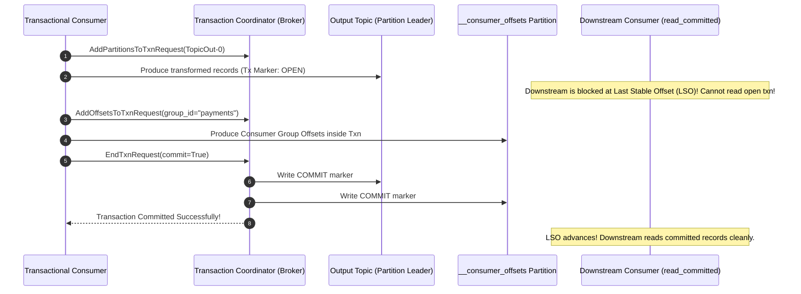
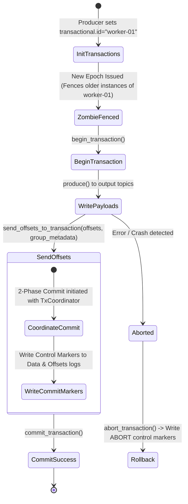
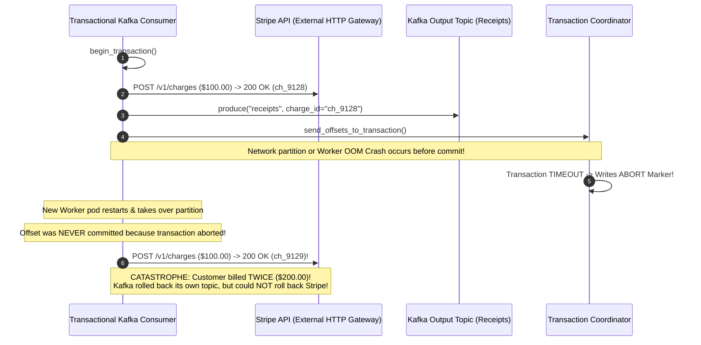

# Module 02: Delivery Semantics and Exactly-Once

> [!TIP]
> **The Golden Rule of Kafka Delivery Semantics:**
> Kafka transactions guarantee Exactly-Once Semantics (EOS) strictly within the Kafka-to-Kafka boundary (consume $\to$ transform $\to$ produce $\to$ commit offset). They do NOT roll back external database writes, credit card charges, or third-party webhooks. For external side effects, the correct production architecture is at-least-once delivery paired with an idempotent consumer backed by a unique database constraint (`ON CONFLICT DO NOTHING`). Always set `isolation.level = read_committed` on downstream consumers to prevent reading uncommitted or aborted batches.



---

## 1. The Three Delivery Semantics

In distributed stream processing, the delivery semantic is determined entirely by the sequence in which processing and offset commits occur:

```mermaid
flowchart TD
    subgraph AtMostOnce["At-Most-Once (Commit BEFORE Process)"]
        A1["poll() returns message"] --> A2["commitSync()"]
        A2 --> A3["processMessage()"]
        A3 -. Crash mid-processing .-> A4["CRITICAL LOSS: Offset already moved forward!<br/>Message is lost forever."]
    end

    subgraph AtLeastOnce["At-Least-Once (Commit AFTER Process)"]
        B1["poll() returns message"] --> B2["processMessage()"]
        B2 --> B3["commitSync()"]
        B2 -. Crash mid-processing .-> B4["DUPLICATE RISK: Next worker re-reads message.<br/>Requires idempotent handler!"]
    end

    subgraph ExactlyOnce["Exactly-Once Semantics (Transactional EOS)"]
        C1["begin_transaction()"] --> C2["produce(output_topic)"]
        C2 --> C3["send_offsets_to_transaction()"]
        C3 --> C4["commit_transaction()"]
        C4 --> C5["ATOMIC: Offsets and outputs commit together!"]
    end
```



### Delivery Guarantee Taxonomy

| Semantic | Offset Commit Timing | Failure Dynamic | Production Suitability |
| :--- | :--- | :--- | :--- |
| **At-Most-Once** | Offset committed *before* handler completes | Message dropped permanently on worker crash | Real-time sensor telemetry, ephemeral metrics |
| **At-Least-Once** | Offset committed *after* handler completes | Message re-delivered on worker crash | **Default Standard for 95% of microservices** (with deduplication table) |
| **Kafka EOS (Transactions)** | Offset and output written under atomic 2PC | Aborted on failure; no duplicates inside Kafka | Stream-to-stream pipelines (Kafka Streams, Flink) |
| **Auto-Commit** (`enable.auto.commit=true`) | Timer-based (every 5s) during `poll()` | Unpredictable (at-least-once or at-most-once depending on load timing) | Loss-tolerant background cache warming |

---

## 2. The Mechanics of Kafka Transactions: Consume-Transform-Produce

Kafka transactions allow a consumer to read from Topic A, produce to Topic B, and commit its consumer offset to `__consumer_offsets` in a single atomic transaction.



### Core Transactional Requirements

1. **`transactional.id`**: Must be a stable, persistent string per worker instance (e.g., `orders-stream-worker-1`). When an instance reboots, Kafka issues a new transactional epoch and **fences** any orphaned zombie processes holding the previous ID.
2. **`send_offsets_to_transaction`**: Without this explicit method, the output messages commit atomically, but consumer offsets commit independently—degrading the system back to at-least-once.
3. **`isolation.level = read_committed`**: Downstream consumers must opt into `read_committed`. By default (`read_uncommitted`), consumers will read uncommitted or aborted messages.

---

## 3. Production War Story: The Stripe Double-Charge Illusion



### Incident Post-Mortem

- **Root Cause**: The engineering team believed enabling Kafka transactions provided end-to-end "exactly-once" processing for their payment pipeline. Inside the transaction block, they invoked external payment gateway API calls (`charge_card()`).
- **The Blindspot**: Kafka transactions operate exclusively over Kafka commit logs. When a network hiccup aborted the Kafka transaction, the $100 credit card charge had already succeeded in Stripe. Because the consumer offset rolled back, the restarting consumer reprocessed the event, charging the customer a second time.
- **The Architectural Fix**:
  1. Recognized that external side effects cannot participate in a Kafka 2-phase commit.
  2. Switched from Kafka transactions to **at-least-once delivery paired with an Idempotency Deduplication Table** in PostgreSQL:
     `INSERT INTO processed_events (event_id, charge_id) VALUES ($1, $2) ON CONFLICT (event_id) DO NOTHING;`
  3. Passed the event's immutable UUID as the `Idempotency-Key` header directly to Stripe.

---

## 4. Multi-Language Implementation: Production Atomic Stream Processor

Below is the complete implementation of:
1. Transactional Producer & Consumer loop (`consume -> transform -> produce -> send_offsets_to_transaction`).
2. Downstream consumer with `isolation.level = read_committed`.
3. Idempotent consumer with relational database de-duplication table.

````carousel
```go
// transactional_stream.go (Go Implementation)
package main

import (
	"context"
	"fmt"
	"log"
	"time"

	"github.com/confluentinc/confluent-kafka-go/v2/kafka"
)

func RunTransactionalPipeline(brokers, groupID, txnID string) {
	// 1. Transactional Producer Configuration
	p, err := kafka.NewProducer(&kafka.ConfigMap{
		"bootstrap.servers":  brokers,
		"transactional.id":   txnID, // Mandatory stable ID per worker
		"enable.idempotence": true,
	})
	if err != nil {
		log.Fatalf("Producer error: %v", err)
	}
	defer p.Close()

	// 2. Initialize Transactions (Fences older instances with same txnID)
	ctx := context.Background()
	if err := p.InitTransactions(ctx); err != nil {
		log.Fatalf("InitTransactions failed: %v", err)
	}

	// 3. Consumer with read_committed isolation
	c, err := kafka.NewConsumer(&kafka.ConfigMap{
		"bootstrap.servers":  brokers,
		"group.id":           groupID,
		"enable.auto.commit": false, // Transactions manage offsets!
		"auto.offset.reset":  "earliest",
		"isolation.level":    "read_committed",
	})
	if err != nil {
		log.Fatalf("Consumer error: %v", err)
	}
	defer c.Close()

	c.SubscribeTopics([]string{"orders.raw"}, nil)

	for {
		msg, err := c.ReadMessage(1000 * time.Millisecond)
		if err != nil {
			continue
		}

		// Begin Atomic Transaction
		if err := p.BeginTransaction(); err != nil {
			log.Printf("BeginTransaction error: %v", err)
			continue
		}

		// Transform and produce to output topic
		outTopic := "orders.processed"
		transformedPayload := []byte(fmt.Sprintf(`{"status":"VALIDATED","raw":%s}`, string(msg.Value)))
		err = p.Produce(&kafka.Message{
			TopicPartition: kafka.TopicPartition{Topic: &outTopic, Partition: kafka.PartitionAny},
			Key:            msg.Key,
			Value:          transformedPayload,
		}, nil)

		if err != nil {
			p.AbortTransaction(ctx)
			continue
		}

		// Atomic Offset Commit: Attach consumer position to the producer transaction
		metadata, _ := c.GetConsumerGroupMetadata()
		nextOffset := kafka.TopicPartition{
			Topic:     msg.TopicPartition.Topic,
			Partition: msg.TopicPartition.Partition,
			Offset:    msg.TopicPartition.Offset + 1, // Offset + 1 rule!
		}

		err = p.SendOffsetsToTransaction(ctx, []kafka.TopicPartition{nextOffset}, metadata)
		if err != nil {
			p.AbortTransaction(ctx)
			continue
		}

		// Commit Output and Offsets atomically
		if err := p.CommitTransaction(ctx); err != nil {
			log.Printf("Commit failed: %v", err)
			p.AbortTransaction(ctx)
		}
	}
}
```
<!-- slide -->
```typescript
// idempotentConsumer.ts (Node.js / TypeScript: At-Least-Once with DB Dedupe)
import { Kafka } from 'kafkajs';
import { Pool } from 'pg';

export class IdempotentPaymentConsumer {
  private kafka: Kafka;
  private db: Pool;

  constructor(brokers: string[], dbPool: Pool) {
    this.kafka = new Kafka({ clientId: 'payments-worker', brokers });
    this.db = dbPool;
  }

  async start() {
    const consumer = this.kafka.consumer({
      groupId: 'payments-processing-group',
      enableAutoCommit: false, // Manual commits
    });

    await consumer.connect();
    await consumer.subscribe({ topic: 'orders.checkout', fromBeginning: true });

    await consumer.run({
      autoCommit: false,
      eachMessage: async ({ topic, partition, message }) => {
        const eventId = message.key?.toString();
        if (!eventId) return;

        const payload = JSON.parse(message.value?.toString() || '{}');
        const client = await this.db.connect();

        try {
          await client.query('BEGIN');

          // Idempotency Gate: UNIQUE constraint on event_id
          const dedupeResult = await client.query(
            `INSERT INTO processed_events (event_id, processed_at) 
             VALUES ($1, NOW()) 
             ON CONFLICT (event_id) DO NOTHING 
             RETURNING event_id`,
            [eventId]
          );

          if ((dedupeResult.rowCount ?? 0) > 0) {
            // First time seeing event: Execute business side effect
            await client.query(
              'UPDATE accounts SET balance = balance - $1 WHERE account_id = $2',
              [payload.amount, payload.accountId]
            );
          } else {
            console.log(`[DEDUPE] Event ${eventId} was already processed. Skipping duplicate execution.`);
          }

          await client.query('COMMIT');

          // Commit Kafka offset only after DB transaction is committed
          await consumer.commitOffsets([
            { topic, partition, offset: (BigInt(message.offset) + BigInt(1)).toString() },
          ]);
        } catch (err) {
          await client.query('ROLLBACK');
          throw err; // Trigger Kafka retry
        } finally {
          client.release();
        }
      },
    });
  }
}
```
<!-- slide -->
```python
# transactional_processor.py (Python Implementation: confluent-kafka)
import logging
from confluent_kafka import Producer, Consumer, TopicPartition, KafkaError

log = logging.getLogger("transactional_pipeline")

def run_pipeline(bootstrap_servers: str, txn_id: str):
    # 1. Transactional Producer Setup
    producer = Producer({
        "bootstrap.servers": bootstrap_servers,
        "transactional.id": txn_id,      # Stable instance identity
        "enable.idempotence": True,
    })
    producer.init_transactions()

    # 2. Consumer Setup with read_committed
    consumer = Consumer({
        "bootstrap.servers": bootstrap_servers,
        "group.id": "analytics-processor",
        "enable.auto.commit": False,     # Transaction manages offsets
        "auto.offset.reset": "earliest",
        "isolation.level": "read_committed",
    })
    consumer.subscribe(["events.raw"])

    try:
        while True:
            msgs = consumer.consume(num_messages=50, timeout=1.0)
            if not msgs:
                continue

            producer.begin_transaction()
            try:
                for msg in msgs:
                    if msg.error():
                        continue
                    # Produce transformed record
                    producer.produce(
                        topic="events.enriched",
                        key=msg.key(),
                        value=b'{"enriched": true, "data": ' + msg.value() + b'}'
                    )

                # Send consumer offsets to the transaction
                positions = [
                    TopicPartition(m.topic(), m.partition(), m.offset() + 1)
                    for m in msgs
                ]
                producer.send_offsets_to_transaction(
                    positions,
                    consumer.consumer_group_metadata()
                )

                # Commit offsets and messages atomically
                producer.commit_transaction()
            except Exception as e:
                log.error("Transaction failed: %s. Aborting...", e)
                producer.abort_transaction()
    finally:
        consumer.close()
```
````

---

## 5. Practical Hands-On Verification CLI

### Step 1: Create Input and Output Topics

```bash
docker exec -it kafka-node /opt/kafka/bin/kafka-topics.sh \
  --create --topic tx-in --partitions 2 --bootstrap-server localhost:9092

docker exec -it kafka-node /opt/kafka/bin/kafka-topics.sh \
  --create --topic tx-out --partitions 2 --bootstrap-server localhost:9092
```

### Step 2: Simulate Aborted Transaction vs. Committed Transaction

Execute a python script that writes two batches: Batch 1 is **ABORTED**, Batch 2 is **COMMITTED**:

```python
from confluent_kafka import Producer
p = Producer({"bootstrap.servers": "localhost:9092", "transactional.id": "tx-tester", "enable.idempotence": True})
p.init_transactions()

# 1. Aborted Transaction
p.begin_transaction()
p.produce("tx-out", key=b"ord-01", value=b"ABORTED_SECRET_DATA")
p.abort_transaction()

# 2. Committed Transaction
p.begin_transaction()
p.produce("tx-out", key=b"ord-02", value=b"COMMITTED_CONFIRMED_DATA")
p.commit_transaction()
```

### Step 3: Verify Downstream Isolation via `read_committed`

Run consumer with `isolation.level=read_committed`:

```bash
docker exec -it kafka-node /opt/kafka/bin/kafka-console-consumer.sh \
  --bootstrap-server localhost:9092 \
  --topic tx-out \
  --from-beginning \
  --isolation-level read_committed \
  --timeout-ms 5000
```

```text
COMMITTED_CONFIRMED_DATA
```

> **Verification Success**: The aborted record `ABORTED_SECRET_DATA` was completely hidden from the consumer!

Now query with `isolation-level read_uncommitted` to see the aborted record:

```bash
docker exec -it kafka-node /opt/kafka/bin/kafka-console-consumer.sh \
  --bootstrap-server localhost:9092 \
  --topic tx-out \
  --from-beginning \
  --isolation-level read_uncommitted \
  --timeout-ms 5000
```

```text
ABORTED_SECRET_DATA
COMMITTED_CONFIRMED_DATA
```

---

## 6. Operational Validation Checkpoints

<details>
<summary><strong>Checkpoint 1: Why does committing `msg.offset()` instead of `msg.offset() + 1` cause duplicate reprocessing on consumer restarts?</strong></summary>

**Committed Offset Semantics:**
In Apache Kafka, a committed offset designates the **next logical message offset** that the consumer wishes to read. If a consumer processes message at offset 42 and commits offset 42, upon reboot the consumer requests partition data starting at offset 42. It re-reads and reprocesses message 42 a second time. The consumer must commit `offset + 1` (offset 43) to confirm that message 42 was completed.
</details>

<details>
<summary><strong>Checkpoint 2: Why do Kafka transactions fail to provide exactly-once guarantees for outbound REST API or database calls?</strong></summary>

**Two-Phase Commit Boundary Isolation:**
Kafka transactions use a two-phase commit protocol managed by the Kafka Transaction Coordinator. It can coordinate commits across topic partitions and the `__consumer_offsets` internal log. External systems (such as a Stripe API, an email service, or an external PostgreSQL database) do not participate in Kafka's 2PC transaction protocol. If the external API call succeeds and the Kafka transaction subsequently aborts or times out, the external side effect cannot be undone by Kafka.
</details>

<details>
<summary><strong>Checkpoint 3: What is "Zombie Fencing" in transactional Kafka producers?</strong></summary>

**Epoch Increment & Monotonic Fencing:**
When a worker process experiences a long GC pause or network partition, the cluster may assume it is dead and launch a replacement instance with the same `transactional.id`. When the replacement calls `init_transactions()`, the Transaction Coordinator increments the transactional epoch for that ID. When the paused zombie instance wakes up and attempts to call `commit_transaction()`, the coordinator rejects the request with a fatal `ProducerFencedException`, preventing the zombie from corrupting partition logs.
</details>
