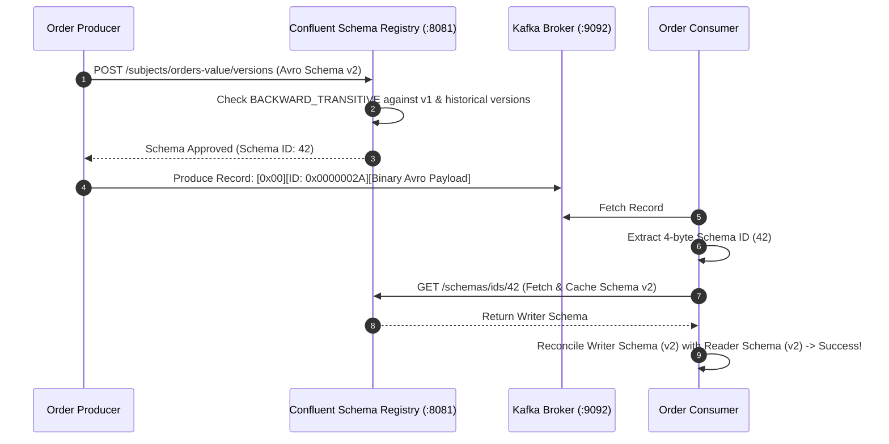
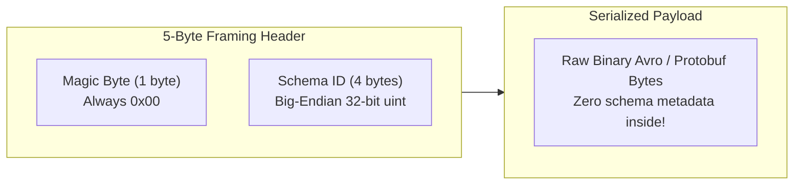
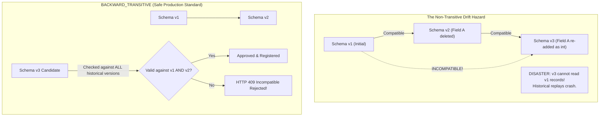
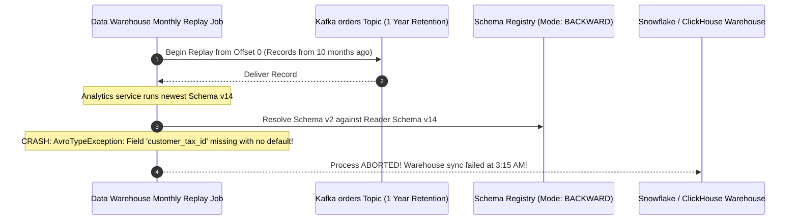

# Module 03: Schemas and Evolution with Schema Registry

> **The Golden Rule of Event Schema Evolution**
> Retained Kafka log records are immutable. A schema change must remain backward-compatible with every record version ever written that still resides within retention. Always configure `BACKWARD_TRANSITIVE` compatibility to prevent incremental drift across versions, enforce defaults on all newly added fields, and deploy consumers *before* producers. When multiple event types share a single topic to preserve ordering, use `TopicRecordNameStrategy`.



---

## 1. Confluent Wire Framing & Schema Resolution

Plain JSON payloads force consumers to perform unsafe runtime type guessing. Confluent Schema Registry standardizes binary payloads by prepending a 5-byte framing header to Avro or Protobuf bytes:



### The Schema Resolution Engine

When a consumer reads a message:
1. It extracts the 4-byte **Schema ID** from the framing header.
2. It fetches the **Writer's Schema** from its local LRU cache (or requests it from Schema Registry via HTTP once).
3. The Avro deserializer merges the **Writer's Schema** (how bytes were packed) with the consumer's local **Reader's Schema** (what fields code expects).
4. Any field present in the reader schema but absent in the writer schema is populated using the field's declared **`default`** value.

---

## 2. Compatibility Modes & The Drift Hazard



### Compatibility Mode Matrix & Deployment Sequencing

| Compatibility Mode | What Can New Schema Read? | Safe Field Changes | Mandatory Deployment Order |
| :--- | :--- | :--- | :--- |
| **`BACKWARD`** | Records written with *previous* schema | Add optional field (with default), delete field | **1. Deploy Consumers $\to$ 2. Deploy Producers** |
| **`BACKWARD_TRANSITIVE`** | Records written with *any* historical schema | Add optional field (with default), delete field | **1. Deploy Consumers $\to$ 2. Deploy Producers** |
| **`FORWARD`** | *Previous* schema can read new records | Add new field, delete optional field | **1. Deploy Producers $\to$ 2. Deploy Consumers** |
| **`FORWARD_TRANSITIVE`** | *Any* historical schema can read new records | Add new field, delete optional field | **1. Deploy Producers $\to$ 2. Deploy Consumers** |
| **`FULL_TRANSITIVE`** | Bidirectional compatibility across all versions | Add or delete optional fields **with defaults** | Flexible (Either order) |

---

## 3. Production War Story: The Historical Replay Crash



### Incident Post-Mortem

- **Root Cause**: The engineering team maintained default `BACKWARD` compatibility (non-transitive). In Schema v5, a field was removed. In Schema v11, an engineer re-introduced that field as a non-nullable integer without a default. Because `BACKWARD` only compares v11 against v10, the Schema Registry permitted the registration.
- **The Failure Mode**: Day-to-day streaming consumers were unaffected because live producers were emitting v11 and live consumers were running v11. However, when the analytics team replayed historical records written under Schema v2, the Avro parser failed with a fatal deserialization error because historical bytes lacked the required field.
- **The Remediation**:
  1. Updated the global cluster setting to **`BACKWARD_TRANSITIVE`**:
     `curl -X PUT -d '{"compatibility":"BACKWARD_TRANSITIVE"}' http://localhost:8081/config/orders-value`
  2. Integrated Schema Registry compatibility checks directly into the GitHub Actions CI pipeline, failing pull requests that violate historical schema resolution.

---

## 4. Multi-Language Implementation: Schema Registry SerDes

Below is the complete implementation of:
1. Canonical Avro Schema with default values and aliases.
2. Producer utilizing `AvroSerializer` with Schema Registry caching.
3. Consumer utilizing `AvroDeserializer` with explicit reader schema reconciliation.

````carousel
```json
// schemas/order_placed.avsc (Canonical Avro Schema)
{
  "type": "record",
  "name": "OrderPlaced",
  "namespace": "shop.events.v1",
  "doc": "Order placement domain event",
  "fields": [
    { "name": "order_id", "type": "string" },
    { "name": "customer_id", "type": "string" },
    { "name": "total", "type": "double", "aliases": ["total_amount"] },
    { "name": "currency", "type": "string", "default": "USD" },
    { 
      "name": "coupon_code", 
      "type": ["null", "string"], 
      "default": null,
      "doc": "Optional coupon; null must be first in union for default validity" 
    }
  ]
}
```
<!-- slide -->
```go
// avro_producer.go (Go Implementation)
package main

import (
	"fmt"
	"log"
	"os"

	"github.com/confluentinc/confluent-kafka-go/v2/kafka"
	"github.com/confluentinc/confluent-kafka-go/v2/schemaregistry"
	"github.com/confluentinc/confluent-kafka-go/v2/schemaregistry/serde"
	"github.com/confluentinc/confluent-kafka-go/v2/schemaregistry/serde/avro"
)

type OrderPlaced struct {
	OrderID    string   `avro:"order_id"`
	CustomerID string   `avro:"customer_id"`
	Total      float64  `avro:"total"`
	Currency   string   `avro:"currency"`
	CouponCode *string  `avro:"coupon_code"`
}

func main() {
	// 1. Schema Registry Client Setup
	srClient, err := schemaregistry.NewClient(schemaregistry.NewConfig("http://localhost:8081"))
	if err != nil {
		log.Fatalf("Failed to create SR client: %v", err)
	}

	// 2. Avro Serializer Initialization
	schemaBytes, _ := os.ReadFile("schemas/order_placed.avsc")
	serializer, err := avro.NewGenericSerializer(srClient, serde.ValueSerde, avro.NewSerializerConfig())
	if err != nil {
		log.Fatalf("Serializer error: %v", err)
	}

	p, _ := kafka.NewProducer(&kafka.ConfigMap{"bootstrap.servers": "localhost:9092"})
	defer p.Close()

	topic := "orders.v1"
	coupon := "SUMMER20"
	order := OrderPlaced{
		OrderID:    "ORD-8812",
		CustomerID: "CUST-99",
		Total:      99.50,
		Currency:   "USD",
		CouponCode: &coupon,
	}

	// Serializes payload with 5-byte framing header (Magic Byte + Schema ID)
	payload, err := serializer.Serialize(topic, &order)
	if err != nil {
		log.Fatalf("Serialization failed: %v", err)
	}

	p.Produce(&kafka.Message{
		TopicPartition: kafka.TopicPartition{Topic: &topic, Partition: kafka.PartitionAny},
		Key:            []byte(order.OrderID),
		Value:          payload,
	}, nil)

	p.Flush(5000)
	fmt.Println("Avro message published with registered Schema ID")
}
```
<!-- slide -->
```typescript
// avroProducer.ts (Node.js / TypeScript: @kafkajs/confluent-schema-registry)
import { SchemaRegistry, SchemaType } from '@kafkajs/confluent-schema-registry';
import { Kafka } from 'kafkajs';
import * as fs from 'fs';

const registry = new SchemaRegistry({ host: 'http://localhost:8081' });
const kafka = new Kafka({ brokers: ['localhost:9092'] });
const producer = kafka.producer();

async function run() {
  await producer.connect();
  const schemaString = fs.readFileSync('schemas/order_placed.avsc', 'utf-8');

  // Register schema under TopicNameStrategy: <topic>-value
  const { id } = await registry.register(
    { type: SchemaType.AVRO, schema: schemaString },
    { subject: 'orders.v1-value' }
  );

  const order = {
    order_id: 'ORD-1002',
    customer_id: 'CUST-42',
    total: 149.99,
    currency: 'USD',
    coupon_code: null,
  };

  // Encodes magic byte + 4-byte Schema ID + Avro binary
  const encodedValue = await registry.encode(id, order);

  await producer.send({
    topic: 'orders.v1',
    messages: [{ key: order.order_id, value: encodedValue }],
  });

  console.log(`Produced Avro message with Schema ID: ${id}`);
  await producer.disconnect();
}
run();
```
<!-- slide -->
```python
# avro_consumer.py (Python Implementation: confluent-kafka)
from confluent_kafka import Consumer
from confluent_kafka.schema_registry import SchemaRegistryClient
from confluent_kafka.schema_registry.avro import AvroDeserializer
from confluent_kafka.serialization import SerializationContext, MessageField

def run_consumer():
    sr_client = SchemaRegistryClient({"url": "http://localhost:8081"})
    
    with open("schemas/order_placed.avsc", "r") as f:
        reader_schema_str = f.read()

    # Deserializer reconciles embedded Writer Schema ID with local Reader Schema
    deserializer = AvroDeserializer(
        schema_registry_client=sr_client,
        schema_str=reader_schema_str
    )

    consumer = Consumer({
        "bootstrap.servers": "localhost:9092",
        "group.id": "order-analytics-group",
        "auto.offset.reset": "earliest",
        "enable.auto.commit": True,
    })
    consumer.subscribe(["orders.v1"])

    print("Listening for Avro messages on orders.v1...")
    try:
        while True:
            msg = consumer.poll(1.0)
            if msg is None or msg.error():
                continue

            # Automatically strips 5-byte header, resolves schema, and decodes object
            order = deserializer(msg.value(), SerializationContext(msg.topic(), MessageField.VALUE))
            print(f"Decoded Order: ID={order['order_id']} Total={order['total']} Currency={order['currency']}")
    finally:
        consumer.close()
```
````

---

## 5. Practical Hands-On Verification CLI

### Step 1: Query Schema Registry for Active Subjects

```bash
curl.exe -s http://localhost:8081/subjects
```

```json
[
  "orders.v1-value",
  "inventory.v1-value"
]
```

### Step 2: Enforce `BACKWARD_TRANSITIVE` via REST API

Set the subject compatibility level to prevent historical drift:

```bash
curl.exe -X PUT -H "Content-Type: application/vnd.schemaregistry.v1+json" \
  --data '{"compatibility":"BACKWARD_TRANSITIVE"}' \
  http://localhost:8081/config/orders.v1-value
```

```json
{
  "compatibility": "BACKWARD_TRANSITIVE"
}
```

### Step 3: Test Schema Compatibility in CI (Pre-Commit Gate)

Simulate a CI pipeline check testing if a proposed schema modification is compatible:

```bash
curl.exe -X POST -H "Content-Type: application/vnd.schemaregistry.v1+json" \
  --data '{"schema": "{\"type\":\"record\",\"name\":\"OrderPlaced\",\"namespace\":\"shop.events.v1\",\"fields\":[{\"name\":\"order_id\",\"type\":\"string\"},{\"name\":\"new_required_field\",\"type\":\"string\"}]}"}' \
  http://localhost:8081/compatibility/subjects/orders.v1-value/versions/latest
```

```json
{
  "is_compatible": false
}
```

> **Build Alert**: The schema check returned `is_compatible: false` because `new_required_field` was added without a default value! CI pipeline fails and aborts deployment.

---

## 6. Operational Validation Checkpoints

<details>
<summary><strong>Checkpoint 1: Why must union types declare `["null", "string"]` rather than `["string", "null"]` when specifying `"default": null` in Avro?</strong></summary>

**Avro Specification Union Rule:**
Per the Apache Avro specification, default values for union types must always match the **first type declared in the union list**. If a field specifies `"type": ["string", "null"]` and `"default": null`, the Avro schema validator rejects the schema because the default value `null` does not match the first union entry (`string`). To define an optional nullable field, `null` must be placed first: `"type": ["null", "string"]`.
</details>

<details>
<summary><strong>Checkpoint 2: Why should topics carrying multiple event types configure `TopicRecordNameStrategy`?</strong></summary>

**Namespace Decoupling:**
By default, Schema Registry uses `TopicNameStrategy`, binding all messages in a topic to a single subject named `<topic>-value`. If an application publishes both `OrderPlaced` and `OrderCancelled` to the same topic to preserve ordering across a customer key, the second schema registration will fail compatibility checks against the first. Configuring `TopicRecordNameStrategy` namespaces schemas as `<topic>-<record_name>`, allowing multiple distinct schemas to evolve independently within a single topic.
</details>

<details>
<summary><strong>Checkpoint 3: Why is deleting an older schema version from the Schema Registry extremely dangerous in production?</strong></summary>

**Historical Payload Invalidation:**
Historical messages stored in Kafka topics do not contain the schema body; they contain only the 4-byte numeric Schema ID. When a consumer reads older messages during an index backfill or data warehouse replay, it requests the historical schema by that ID. If an operator deletes the schema version from the registry, the Schema Registry returns an HTTP 404, causing all consumer pods to crash with deserialization errors across historical segments.
</details>
