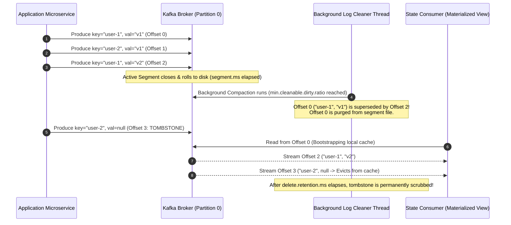
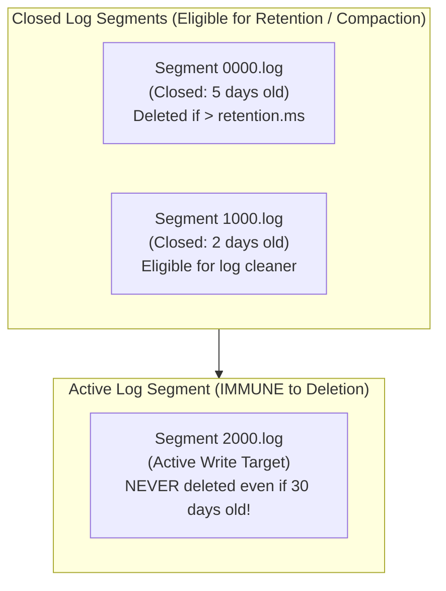
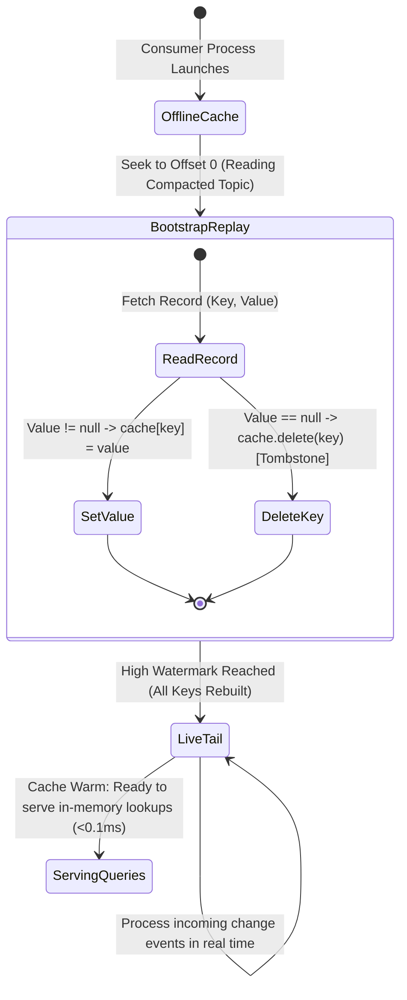
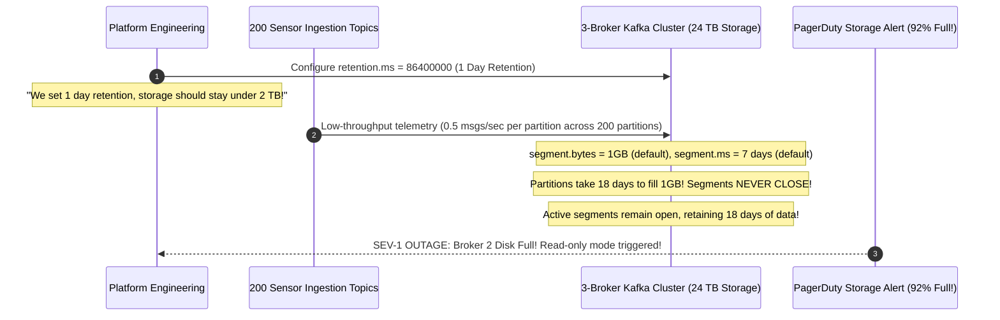

# Module 04: Retention, Compaction and Topics as State

> [!TIP]
> **The Golden Rule of Kafka Retention & Compaction:**
> Kafka retention and compaction policies are enforced exclusively on *closed* segments—the active segment currently being written to is never deleted or compacted regardless of `retention.ms`. To avoid runaway disk bloat on low-throughput partitions, always configure `segment.ms` alongside `retention.ms`. When using compacted topics as state, producing a record with a `null` value is a tombstone that permanently deletes the key after `delete.retention.ms`.



---

## 1. Segment Anatomy & Retention Mechanics

In Apache Kafka, a partition is not a single giant file; it is an ordered collection of discrete **Segment** files (`.log` and `.index` pairs).



### The Active Segment Retention Trap

A common operational crisis occurs when an operator sets `retention.ms = 86400000` (24 hours), yet notices disk usage continuing to grow for weeks. 
- **The Cause**: Segments only become eligible for deletion once they are **closed**.
- If a low-throughput partition takes 14 days to accumulate `segment.bytes` (default 1 GB) and `segment.ms` is left at default (7 days), the active segment remains open for an entire week, preserving old records far past the nominal 24-hour limit.

### Retention & Compaction Parameter Grid

| Configuration Flag | Scope | Default Value | Architectural Impact |
| :--- | :--- | :--- | :--- |
| `cleanup.policy` | Topic | `delete` | `delete`: Purges closed segments by time/size.<br/>`compact`: Retains latest value per key indefinitely. |
| `retention.ms` | Topic | `604800000` (7 days) | Milliseconds after which a closed segment can be purged. (`-1` = infinite) |
| `retention.bytes` | Topic | `-1` (Unlimited) | Maximum bytes retained **per partition** (Total disk budget = $N_{\text{partitions}} \times \text{retention.bytes}$). |
| `segment.ms` | Topic | `604800000` (7 days) | Maximum time before the active segment is forcibly rolled into a closed segment. |
| `min.cleanable.dirty.ratio` | Topic | `0.5` (50%) | Ratio of superseded records required to trigger background log compaction. |
| `delete.retention.ms` | Topic | `86400000` (24h) | Time a deletion tombstone (`value = null`) survives in compacted logs before removal. |

---

## 2. Compacted Topics as State: In-Memory Materialized Views

By setting `cleanup.policy = compact`, a topic transforms from a transient event log into a durable, replayable key-value store.



### Architectural Guarantees & Constraints

1. **Deterministic Rebuildability**: Any service instance can rebuild its entire state store by replaying the compacted topic from offset 0 without accessing a relational database.
2. **Offset Gaps are Normal**: Compaction purges obsolete records without shifting subsequent offsets. Offsets `[0, 1, 5, 12]` are standard; consumers simply advance forward.
3. **No Secondary Indexes**: Compacted topics only index by the record's primary partition key. Multi-attribute queries require maintaining custom indexing in memory.

---

## 3. Production War Story: The 18-Terabyte Silent Disk Exhaustion



### Incident Post-Mortem

- **Root Cause**: The engineering team created 200 topics with 1-day retention (`retention.ms = 86400000`), expecting disk space to stabilize. However, individual partitions had low ingestion rates. Because `segment.ms` was left at default (7 days) and `segment.bytes` was 1 GB, the active segments stayed open for over two weeks.
- **The Cascade**: Because active segments cannot be purged by Kafka's retention daemon, the cluster accumulated 18 TB of data instead of the budgeted 2 TB, abruptly crashing the brokers when disks reached 100% capacity.
- **The Remediation**:
  1. Updated cluster configuration to roll segments promptly:
     `kafka-configs.sh --alter --entity-type topics --entity-name <topic> --add-config segment.ms=3600000` (1 hour).
  2. Configured `retention.bytes` per partition to enforce a hard physical storage limit regardless of time.

---

## 4. Multi-Language Implementation: In-Memory Materialized View

Below is the complete implementation of a consumer that initializes an in-memory key-value state store from a compacted topic, processes tombstones, and tails live updates:

````carousel
```go
// materialized_cache.go (Go Implementation)
package main

import (
	"context"
	"fmt"
	"log"
	"sync"
	"time"

	"github.com/confluentinc/confluent-kafka-go/v2/kafka"
)

type MaterializedView struct {
	mu    sync.RWMutex
	state map[string]string
	ready bool
}

func NewMaterializedView() *MaterializedView {
	return &MaterializedView{
		state: make(map[string]string),
	}
}

func (mv *MaterializedView) Start(ctx context.Context, brokers, topic string) {
	c, err := kafka.NewConsumer(&kafka.ConfigMap{
		"bootstrap.servers":  brokers,
		"group.id":           fmt.Sprintf("materialized-view-%d", time.Now().UnixNano()),
		"auto.offset.reset":  "earliest", // Read all historical keys from offset 0
		"enable.auto.commit": false,
	})
	if err != nil {
		log.Fatalf("Consumer error: %v", err)
	}
	defer c.Close()

	c.SubscribeTopics([]string{topic}, nil)
	log.Printf("Bootstrapping state store from compacted topic %s...\n", topic)

	for {
		select {
		case <-ctx.Done():
			return
		default:
			ev := c.Poll(100)
			if ev == nil {
				continue
			}

			switch m := ev.(type) {
			case *kafka.Message:
				key := string(m.Key)
				mv.mu.Lock()
				if m.Value == nil {
					// Tombstone detected: Evict key permanently
					delete(mv.state, key)
					log.Printf("[TOMBSTONE] Evicted key: %s\n", key)
				} else {
					mv.state[key] = string(m.Value)
				}
				mv.mu.Unlock()
			case kafka.Error:
				log.Printf("Consumer error: %v\n", m)
			}
		}
	}
}

func (mv *MaterializedView) Get(key string) (string, bool) {
	mv.mu.RLock()
	defer mv.mu.RUnlock()
	val, ok := mv.state[key]
	return val, ok
}
```
<!-- slide -->
```typescript
// materializedCache.ts (Node.js / TypeScript: KafkaJS)
import { Kafka } from 'kafkajs';

export class MaterializedStateView {
  private state = new Map<string, string>();
  private kafka: Kafka;

  constructor(brokers: string[]) {
    this.kafka = new Kafka({ clientId: 'cache-builder', brokers });
  }

  async bootstrap(topic: string) {
    const consumer = this.kafka.consumer({
      // Ephemeral group ID ensures fresh read from offset 0
      groupId: `state-cache-${Date.now()}`,
    });

    await consumer.connect();
    await consumer.subscribe({ topic, fromBeginning: true });

    console.log(`Bootstrapping materialized cache from ${topic}...`);

    await consumer.run({
      autoCommit: false,
      eachMessage: async ({ message }) => {
        const key = message.key?.toString();
        if (!key) return;

        if (message.value === null) {
          // Tombstone: delete key from local state
          this.state.delete(key);
          console.log(`[TOMBSTONE] Removed key: ${key}`);
        } else {
          this.state.set(key, message.value.toString());
        }
      },
    });
  }

  get(key: string): string | undefined {
    return this.state.get(key);
  }
}
```
<!-- slide -->
```python
# materialized_cache.py (Python Implementation: confluent-kafka)
import logging
import threading
from confluent_kafka import Consumer, KafkaError

log = logging.getLogger("materialized_cache")

class MaterializedCache:
    def __init__(self, bootstrap_servers: str, topic: str):
        self.topic = topic
        self._state = {}
        self._lock = threading.RWMutex if hasattr(threading, "RWMutex") else threading.Lock()
        
        self.consumer = Consumer({
            "bootstrap.servers": bootstrap_servers,
            "group.id": f"cache-view-{id(self)}",
            "auto.offset.reset": "earliest", # Replay from beginning
            "enable.auto.commit": False,
        })

    def run(self):
        self.consumer.subscribe([self.topic])
        log.info("Starting materialized view bootstrap on %s...", self.topic)
        try:
            while True:
                msg = self.consumer.poll(1.0)
                if msg is None:
                    continue
                if msg.error():
                    continue

                key = msg.key().decode("utf-8") if msg.key() else None
                if not key:
                    continue

                with self._lock:
                    if msg.value() is None:
                        # Tombstone: delete key
                        self._state.pop(key, None)
                        log.debug("[TOMBSTONE] Key %s purged from cache", key)
                    else:
                        self._state[key] = msg.value().decode("utf-8")
        finally:
            self.consumer.close()

    def get(self, key: str) -> str | None:
        with self._lock:
            return self._state.get(key)
```
````

---

## 5. Practical Hands-On Verification CLI

### Step 1: Create a Compacted Topic with Small Segments

```bash
docker exec -it kafka-node /opt/kafka/bin/kafka-topics.sh \
  --create --topic user-profiles \
  --partitions 1 \
  --replication-factor 1 \
  --config cleanup.policy=compact \
  --config segment.ms=5000 \
  --config min.cleanable.dirty.ratio=0.01 \
  --config delete.retention.ms=10000 \
  --bootstrap-server localhost:9092
```

```text
Created topic user-profiles.
```

### Step 2: Produce Multiple Key Updates & a Tombstone

```python
from confluent_kafka import Producer
p = Producer({'bootstrap.servers': 'localhost:9092'})

# Produce updates for user-1 and user-2
p.produce('user-profiles', key=b'user-1', value=b'{"tier": "silver"}')
p.produce('user-profiles', key=b'user-2', value=b'{"tier": "bronze"}')
p.produce('user-profiles', key=b'user-1', value=b'{"tier": "gold"}') # Supersedes silver

# Produce Tombstone for user-2 (value=None)
p.produce('user-profiles', key=b'user-2', value=None)
p.flush()
```

### Step 3: Inspect Low-Level Segment Records with `kafka-dump-log.sh`

Inspect the underlying binary segment log files inside the broker container:

```bash
docker exec -it kafka-node /opt/kafka/bin/kafka-dump-log.sh \
  --files /tmp/kraft-broker-logs/user-profiles-0/00000000000000000000.log \
  --print-data-log
```

```text
Dumping /tmp/kraft-broker-logs/user-profiles-0/00000000000000000000.log
Starting offset: 0
baseOffset: 0 lastOffset: 0 count: 1 payloadSize: 18 key: user-1 payload: {"tier": "silver"}
baseOffset: 1 lastOffset: 1 count: 1 payloadSize: 18 key: user-2 payload: {"tier": "bronze"}
baseOffset: 2 lastOffset: 2 count: 1 payloadSize: 16 key: user-1 payload: {"tier": "gold"}
baseOffset: 3 lastOffset: 3 count: 1 payloadSize: 0  key: user-2 payload: null
```

> **Notice**: After background compaction runs, Offset 0 and Offset 1 will be purged, leaving only Offset 2 (`{"tier": "gold"}`) and the tombstone at Offset 3.

---

## 6. Operational Validation Checkpoints

<details>
<summary><strong>Checkpoint 1: Why does producing `value = ""` (empty string) behave completely differently from `value = None` on a compacted topic?</strong></summary>

**Tombstone vs Empty Payload:**
In Apache Kafka, a **tombstone** is defined strictly as a record with a non-null key and a **null payload** (`value = None`, size = -1). When the log cleaner encounters a null payload, it marks the key for permanent deletion. An empty string (`value = ""`, size = 0) is a valid, non-null payload. The log cleaner treats it as a legitimate value update, permanently retaining the key mapped to an empty string.
</details>

<details>
<summary><strong>Checkpoint 2: Why must `delete.retention.ms` be configured to exceed the maximum expected downtime of any consumer?</strong></summary>

**The Tombstone Vanishing Race:**
When a key is deleted via a tombstone, the tombstone record remains in the log for `delete.retention.ms` (default 24 hours) before being permanently purged by the log cleaner. If a consumer service experiences an outage lasting 36 hours, it will boot up after the tombstone has already been discarded. The consumer will replay historical segments, discover the pre-tombstone value, and restore the deleted key into its local state—causing permanent phantom record resurrection.
</details>

<details>
<summary><strong>Checkpoint 3: Why should business events (e.g., `OrderPlaced`) NEVER be stored on a compacted topic?</strong></summary>

**Destruction of Historical Auditability:**
Compaction retains only the latest record for a given key, discarding superseded records. If business events like `OrderPlaced`, `PaymentAuthorized`, and `OrderRefunded` share the partition key `order_id` on a compacted topic, the log cleaner will delete the `OrderPlaced` and `PaymentAuthorized` events as soon as `OrderRefunded` is written. Downstream audit pipelines, tax accounting, and event-sourced state machines lose their entire historical event trail. Business events must always use `cleanup.policy = delete`.
</details>
