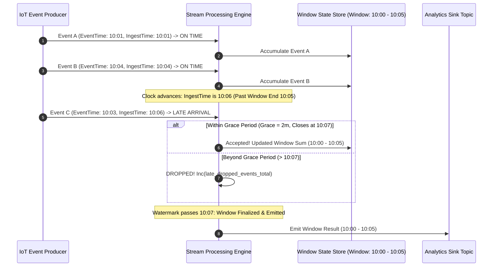
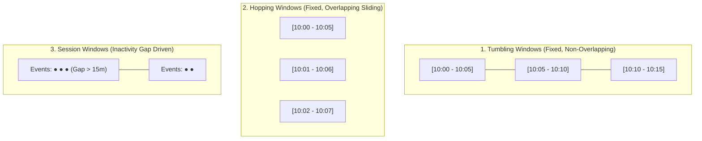
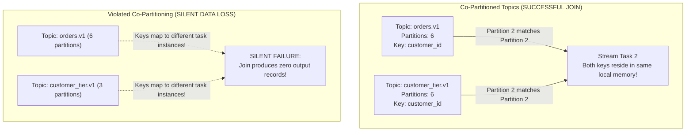
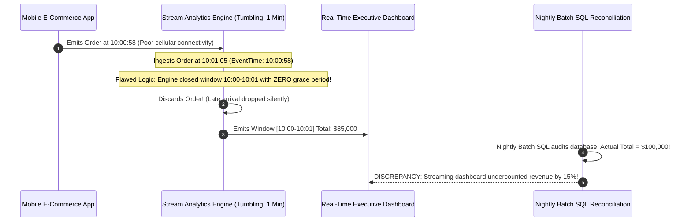

# Module 05: Stream Processing — Windows, Joins and State

> **The Golden Rule of Stream Processing**
> Aggregations and windowed joins must always be evaluated in **Event Time** (the business timestamp carried in the message payload)—never in processing time. Processing time breaks replayability: re-running yesterday's stream against today's system clock will produce conflicting calculations. Always configure an explicit grace period to accommodate out-of-order late arrivals, track watermarks as the minimum across assigned partitions, and emit a dedicated metric for late-dropped records.



---

## 1. The Stream-Table Duality

In event streaming, streams and tables represent two distinct perspectives on the same underlying data:

```mermaid
flowchart LR
    subgraph StreamView["The Stream (Changelog of Facts)"]
        direction TB
        S1["Offset 0: user-42 login (10:01)"]
        S2["Offset 1: user-42 update_cart (10:03)"]
        S3["Offset 2: user-42 logout (10:08)"]
        SNote["Append-only log of occurrences<br/>Represented by cleanup.policy=delete"]
    end

    subgraph TableView["The Table (Current State View)"]
        direction TB
        T1["Key: user-42 -> Status: LOGGED_OUT"]
        TNote["Materialized current state per key<br/>Represented by cleanup.policy=compact"]
    end

    StreamView -->|Aggregate / Fold by Key| TableView
    TableView -->|Emit Change Data Capture (CDC)| StreamView
```

### Window Typology Matrix

Stream engines group unbounded event streams into bounded segments using four fundamental windowing strategies:



| Windowing Model | Boundaries | Overlap? | Primary Production Use Case |
| :--- | :--- | :--- | :--- |
| **Tumbling** | Fixed duration (e.g., 5 min) | **No** | Periodic metrics: "Total revenue per minute" |
| **Hopping** | Fixed duration, advance interval (e.g., 5m window, advance 1m) | **Yes** | Moving averages: "5-minute rolling error rate" |
| **Session** | Dynamic, expands while events arrive within `inactivity_gap` | **No** | User web journeys, IoT asset connectivity sessions |
| **Sliding** | Continuous relative to event timestamps ($\pm \Delta t$) | **Yes** | Join correlations: "Match click to ad impression within 30s" |

---

## 2. Stream Joins & Co-Partitioning Axiom



### Stream Join Taxonomy

| Join Type | Left Stream | Right Stream | Requirement | Window Required? |
| :--- | :--- | :--- | :--- | :--- |
| **Stream-Stream** | Unbounded stream | Unbounded stream | Co-partitioned | **Mandatory** (Unbounded streams cannot buffer infinitely) |
| **Stream-Table** | Unbounded stream | Compacted table | Co-partitioned | No (Looks up current table state) |
| **Table-Table** | Compacted table | Compacted table | Co-partitioned | No (Materialized view join) |

---

## 3. Production War Story: The 15% Revenue Undercount Outage



### Incident Post-Mortem

- **Root Cause**: The streaming team computed 1-minute tumbling windows on event timestamps. However, they configured `grace_period_ms = 0` and emitted windows the instant an event from minute $T+1$ appeared. Mobile transactions delayed by mobile cellular networks arrived a few seconds late and were discarded silently.
- **The Failure Mode**: Real-time sales dashboards underreported revenue by 15% every hour. Because the engine lacked a `late_dropped_events_total` metric, the engineering team spent three weeks suspecting broker packet loss.
- **The Remediation**:
  1. Measured the actual empirical lateness distribution ($\text{processing\_time} - \text{event\_time}$) and established that 99.8% of late records arrive within 45 seconds.
  2. Set `grace_period = 60s` on all window operators.
  3. Emitted a Prometheus metric `late_dropped_records_total` with alerting enabled.

---

## 4. Multi-Language Implementation: Production Event-Time Windowing

Below is the complete implementation of an event-time tumbling window processor with:
1. Event-time extraction from record payloads.
2. Low-watermark tracking across partition streams.
3. Grace-period buffer holding late arrivals.
4. Metric counter logging dropped records.

````carousel
```go
// tumbling_window.go (Go Implementation)
package main

import (
	"context"
	"encoding/json"
	"fmt"
	"log"
	"sync"
	"time"
)

type ClickEvent struct {
	UserID      string `json:"user_id"`
	TimestampMS int64  `json:"timestamp_ms"` // Event time
}

type WindowKey struct {
	StartMS int64
	UserID  string
}

type EventTimeWindowAggregator struct {
	windowSizeMS int64
	graceMS      int64
	watermarkMS  int64
	mu           sync.Mutex
	windows      map[WindowKey]int
	lateDropped  int64
}

func NewWindowAggregator(windowSize, grace time.Duration) *EventTimeWindowAggregator {
	return &EventTimeWindowAggregator{
		windowSizeMS: windowSize.Milliseconds(),
		graceMS:      grace.Milliseconds(),
		windows:      make(map[WindowKey]int),
	}
}

func (a *EventTimeWindowAggregator) Ingest(event ClickEvent) {
	a.mu.Lock()
	defer a.mu.Unlock()

	// 1. Advance Watermark (Monotonic highest seen event time)
	if event.TimestampMS > a.watermarkMS {
		a.watermarkMS = event.TimestampMS
	}

	// 2. Compute Window Start
	windowStart := (event.TimestampMS / a.windowSizeMS) * a.windowSizeMS
	windowEnd := windowStart + a.windowSizeMS

	// 3. Grace Period Check: Has the watermark advanced past windowEnd + grace?
	if a.watermarkMS > windowEnd+a.graceMS {
		a.lateDropped++
		log.Printf("[LATE DROPPED] Record eventTime=%d beyond grace windowEnd=%d\n", event.TimestampMS, windowEnd)
		return
	}

	key := WindowKey{StartMS: windowStart, UserID: event.UserID}
	a.windows[key]++
}

func (a *EventTimeWindowAggregator) EmitFinalizedWindows() map[WindowKey]int {
	a.mu.Lock()
	defer a.mu.Unlock()

	finalized := make(map[WindowKey]int)
	for wk, count := range a.windows {
		windowEnd := wk.StartMS + a.windowSizeMS
		if a.watermarkMS > windowEnd+a.graceMS {
			finalized[wk] = count
			delete(a.windows, wk)
		}
	}
	return finalized
}
```
<!-- slide -->
```typescript
// tumblingWindow.ts (Node.js / TypeScript Implementation)
export interface OrderEvent {
  orderId: string;
  userId: string;
  amount: number;
  eventTimeMs: number;
}

export class EventTimeTumblingWindow {
  private windowSizeMs: number;
  private gracePeriodMs: number;
  private currentWatermarkMs: number = 0;
  private state = new Map<string, number>(); // "windowStart:userId" -> total
  public lateDroppedCount: number = 0;

  constructor(windowSizeMs: number, gracePeriodMs: number) {
    this.windowSizeMs = windowSizeMs;
    this.gracePeriodMs = gracePeriodMs;
  }

  process(event: OrderEvent): void {
    // 1. Advance monotonic watermark
    if (event.eventTimeMs > this.currentWatermarkMs) {
      this.currentWatermarkMs = event.eventTimeMs;
    }

    const windowStart = Math.floor(event.eventTimeMs / this.windowSizeMs) * this.windowSizeMs;
    const windowEnd = windowStart + this.windowSizeMs;

    // 2. Reject events that arrive after the grace period has expired
    if (this.currentWatermarkMs > windowEnd + this.gracePeriodMs) {
      this.lateDroppedCount++;
      console.warn(`[LATE DROP] Order ${event.orderId} arrived too late for window ${windowStart}`);
      return;
    }

    const key = `${windowStart}:${event.userId}`;
    const currentTotal = this.state.get(key) || 0;
    this.state.set(key, currentTotal + event.amount);
  }

  emitExpiredWindows(): Array<{ windowStart: number; userId: string; total: number }> {
    const expired: Array<{ windowStart: number; userId: string; total: number }> = [];

    for (const [key, total] of this.state.entries()) {
      const [startStr, userId] = key.split(':');
      const windowStart = parseInt(startStr, 10);
      const windowEnd = windowStart + this.windowSizeMs;

      if (this.currentWatermarkMs > windowEnd + this.gracePeriodMs) {
        expired.push({ windowStart, userId, total });
        this.state.delete(key);
      }
    }
    return expired;
  }
}
```
<!-- slide -->
```python
# tumbling_window.py (Python Implementation)
import logging
from collections import defaultdict

log = logging.getLogger("stream_processor")

class EventTimeTumblingWindow:
    def __init__(self, window_size_ms: int, grace_ms: int):
        self.window_size_ms = window_size_ms
        self.grace_ms = grace_ms
        self.watermark_ms = 0
        self.windows = defaultdict(lambda: defaultdict(int)) # window_start -> key -> count
        self.late_dropped_total = 0

    def process(self, event: dict):
        event_time = event["timestamp_ms"]
        key = event["key"]

        # 1. Advance watermark
        if event_time > self.watermark_ms:
            self.watermark_ms = event_time

        # 2. Compute window boundary
        window_start = (event_time // self.window_size_ms) * self.window_size_ms
        window_end = window_start + self.window_size_ms

        # 3. Grace period check
        if self.watermark_ms > window_end + self.grace_ms:
            self.late_dropped_total += 1
            log.warning("Dropped late record: key=%s event_time=%d (watermark=%d)",
                        key, event_time, self.watermark_ms)
            return

        self.windows[window_start][key] += 1

    def emit_finalized(self) -> list[tuple[int, dict]]:
        finalized = []
        for ws in sorted(list(self.windows.keys())):
            window_end = ws + self.window_size_ms
            # When the watermark passes window_end + grace, the window is permanently sealed
            if self.watermark_ms > window_end + self.grace_ms:
                finalized.append((ws, dict(self.windows.pop(ws))))
        return finalized
```
````

---

## 5. Practical Hands-On Verification CLI

### Step 1: Create Co-Partitioned Stream and Table Topics

Ensure both topics have an **identical partition count (3)** to satisfy the co-partitioning axiom:

```bash
docker exec -it kafka-node /opt/kafka/bin/kafka-topics.sh \
  --create --topic orders.stream --partitions 3 --bootstrap-server localhost:9092

docker exec -it kafka-node /opt/kafka/bin/kafka-topics.sh \
  --create --topic customer.tier --partitions 3 \
  --config cleanup.policy=compact \
  --bootstrap-server localhost:9092
```

### Step 2: Verify Co-Partitioning Alignment

Inspect partition counts across both topics to prevent silent join dropouts:

```bash
docker exec -it kafka-node /opt/kafka/bin/kafka-topics.sh \
  --describe --topic "orders.stream|customer.tier" \
  --bootstrap-server localhost:9092
```

```text
Topic: orders.stream	TopicId: 1a9f...	PartitionCount: 3	ReplicationFactor: 1
Topic: customer.tier	TopicId: 8b2c...	PartitionCount: 3	ReplicationFactor: 1
```

### Step 3: Simulate Late-Arriving Event Stream

Produce events with deliberately staggered timestamps and assert that the grace period accepts out-of-order events while dropping items past the grace boundary:

```python
from tumbling_window import EventTimeTumblingWindow

# 60s Window, 10s Grace
agg = EventTimeTumblingWindow(window_size_ms=60000, grace_ms=10000)

# Event 1: On time at 10:00:10
agg.process({"key": "u1", "timestamp_ms": 600010})

# Event 2: Advanced watermark to 10:01:05 (Past window end 10:01:00)
agg.process({"key": "u1", "timestamp_ms": 600065})

# Event 3: Late arrival for previous window at 10:00:55 (Watermark = 10:01:05 <= 10:01:10) -> ACCEPTED
agg.process({"key": "u1", "timestamp_ms": 600055})

# Event 4: Big jump advances watermark to 10:05:00
agg.process({"key": "u2", "timestamp_ms": 600300})

# Event 5: Severely late record at 10:00:40 -> DROPPED (Watermark is now 10:05:00)
agg.process({"key": "u1", "timestamp_ms": 600040})

print("Late dropped count:", agg.late_dropped_total) # Output: 1
```

---

## 6. Operational Validation Checkpoints

<details>
<summary><strong>Checkpoint 1: Why does a stream-table join silently fail to match records if the two topics have different partition counts?</strong></summary>

**Co-Partitioning Failure Mechanics:**
Kafka consumer instances in a stream processing cluster consume corresponding partition numbers across topics (e.g., Worker 1 consumes partition 1 of `orders.stream` and partition 1 of `customer.tier`). Partition assignment uses the hash modulus: $\text{partition} = \text{hash}(\text{key}) \pmod N$. If `orders.stream` has 6 partitions and `customer.tier` has 3 partitions, key `user-100` might hash to partition 4 on `orders.stream` and partition 1 on `customer.tier`. Worker 1 processes partition 1, while Worker 4 processes partition 4. The order and the customer profile never meet in the same worker's memory, causing the join to produce null.
</details>

<details>
<summary><strong>Checkpoint 2: Why must the stream watermark be tracked as the MINIMUM event time across assigned partitions?</strong></summary>

**Partition Skew & Premature Window Closure:**
If a consumer processes three partitions ($P_0, P_1, P_2$) and advances the global watermark based on the *maximum* event time seen across all records, a burst of high-timestamp traffic on $P_0$ will immediately drag the watermark forward. This causes the engine to seal active windows prematurely. When normal, non-late records subsequently arrive on $P_1$ and $P_2$, they will fall behind the artificially inflated watermark and be discarded as late data. Tracking the *minimum* event time across all active partition streams ensures no partition is left behind.
</details>

<details>
<summary><strong>Checkpoint 3: Why are Stream-Table joins fundamentally non-deterministic when historical streams are replayed?</strong></summary>

**Temporal State Mutation:**
In a stream-table join, incoming stream events are enriched against the *current* state of the table at the instant the record is processed. If a customer was in tier "BRONZE" when an order was placed in January, but upgraded to "GOLD" in July, replaying the January order stream in August will look up the customer's current August table record and enrich the order with "GOLD". To achieve reproducible historical replays, applications must implement versioned temporal tables or snapshot joins.
</details>
