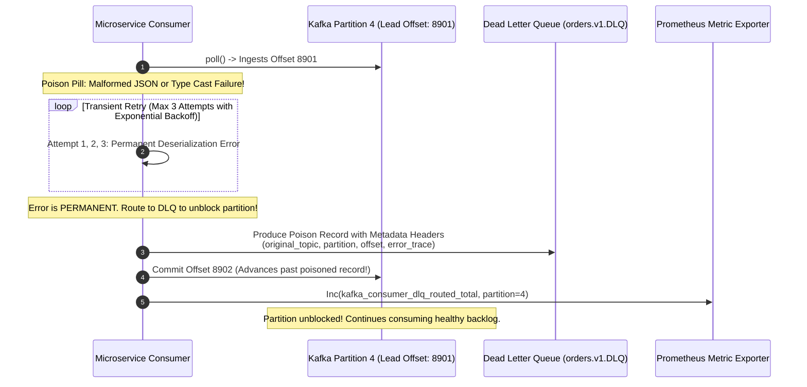
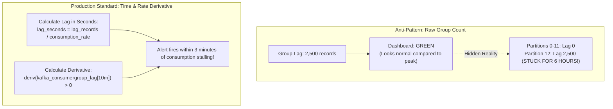
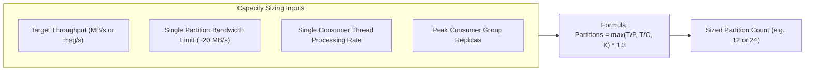
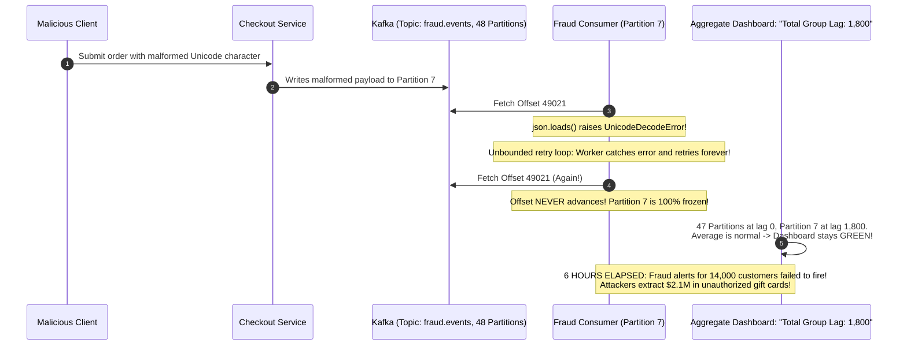

# Module 06: Operating Kafka — Lag, Sizing and Reliability

> [!TIP]
> **The Golden Rule of Kafka Production Operations:**
> Never monitor consumer lag as an aggregate group record count—a single poisoned partition will freeze while 49 healthy partitions mask the failure. Always evaluate lag **per-partition converted to time** ($\text{lag\_seconds} = \text{lag\_records} / \text{processing\_rate}$) and alert on its derivative ($\text{deriv}(\text{lag}) > 0$). To prevent infinite partition blockades, classify transient vs. permanent errors and route unparseable poison pills to a Dead-Letter Queue (DLQ) with rich diagnostic headers.



---

## 1. Lag Measurement: Records vs. Time Derivative

Monitoring consumer lag purely by raw message count is one of the most widespread operational anti-patterns:
- A lag of **10,000 records** on a high-throughput stream processing 20,000 req/sec represents **0.5 seconds** of lag (Healthy).
- A lag of **500 records** on a downstream payment batch consumer processing 2 req/sec represents **4.1 minutes** of lag (Severe Degradation).



### Kafka Metric Taxonomy & Alerting Thresholds

| Metric Name | Source | Alert Condition | Operational Severity | Root Cause / Meaning |
| :--- | :--- | :--- | :--- | :--- |
| `UnderReplicatedPartitions` | Broker | `> 0` for 5m | **P1 (Page)** | One or more broker replicas fell out of ISR. Durability degraded. |
| `OfflinePartitionsCount` | Broker | `> 0` | **P0 (Critical)** | Partition has no leader. Reads and writes fail immediately. |
| `ActiveControllerCount` | Broker | `!= 1` | **P0 (Critical)** | Split-brain ($>1$) or dead cluster controller ($0$). |
| `kafka_consumer_lag_seconds` | Consumer | `> 300s` (5m) | **P2 (Ticket/Slack)** | Consumer falling unacceptably far behind real time. |
| `deriv(kafka_consumergroup_lag[10m])` | Consumer | `> 0` sustained | **P1 (Page)** | Ingestion rate exceeds consumption rate; lag will grow infinitely. |
| `kafka_consumer_dlq_routed_total` | Consumer | `rate() > 0` | **P2 (Ticket)** | Malformed poison pill or bug encountered and parked in DLQ. |

---

## 2. Partition Sizing: The Once-and-For-All Decision

As established in Module 00, adding partitions to an existing keyed topic changes the hash modulus, breaking per-key FIFO ordering. Therefore, partition counts must be sized accurately up front.



### The Tradeoffs of Over-Partitioning

While under-partitioning creates a hard bottleneck on concurrency, extreme over-partitioning carries substantial hidden costs:
- **Broker Memory & Open File Handles**: Each partition maps to at least 2 file handles (`.log` and `.index`) per segment on disk.
- **Failover / Leader Election Latency**: When a broker restarts, it must elect leaders for all its hosted partitions. Recovering 8,000 partitions takes 20$\times$ longer than recovering 400 partitions.
- **End-to-End Latency**: Client memory is partitioned across accumulators; more partitions require larger memory pools to maintain batching efficiency.

---

## 3. Production War Story: The Six-Hour Poison Pill Blackout



### Incident Post-Mortem

- **Root Cause**: A single malformed Unicode transaction landed on Partition 7. The consumer code wrapped the processing loop in a naive `except Exception:` block that slept and retried the exact same message indefinitely without incrementing offsets.
- **Why It Took 6 Hours to Detect**: The on-call SRE dashboard monitored `sum(kafka_consumergroup_lag)` across the group. Because the other 47 partitions were processing normally with near-zero lag, the aggregate number stayed around 1,800 records.
- **The Remediation**:
  1. Updated the consumer to categorize errors: transient database timeouts retry up to 3 times; permanent schema/JSON decode errors route immediately to a **Dead Letter Queue (`fraud.events.DLQ`)**.
  2. Injected diagnostic headers into the DLQ message (`original_partition`, `original_offset`, `error_traceback`).
  3. Replaced aggregate group lag alerts with **`max by (partition) (kafka_consumergroup_lag)`**.

---

## 4. Multi-Language Implementation: Production DLQ Consumer

Below is the complete implementation of a production-grade consumer featuring:
1. Error classification (Transient vs. Permanent).
2. Exponential backoff for transient database network glitches.
3. Dead Letter Queue routing with diagnostic metadata headers for permanent failures.
4. Offset commitment after safe DLQ offloading.

````carousel
```go
// dlq_consumer.go (Go Implementation)
package main

import (
	"context"
	"errors"
	"fmt"
	"log"
	"time"

	"github.com/confluentinc/confluent-kafka-go/v2/kafka"
)

var ErrPermanent = errors.New("permanent unrecoverable data error")
var ErrTransient = errors.New("transient network error")

type ResilientConsumer struct {
	consumer *kafka.Consumer
	producer *kafka.Producer
	dlqTopic string
}

func (rc *ResilientConsumer) HandleMessage(msg *kafka.Message) {
	const maxRetries = 3
	var err error

	for attempt := 1; attempt <= maxRetries; attempt++ {
		err = rc.processBusinessLogic(msg.Value)
		if err == nil {
			// Success: Commit offset
			rc.consumer.CommitMessage(msg)
			return
		}

		if errors.Is(err, ErrPermanent) {
			log.Printf("[PERMANENT ERROR] Bypassing retries for offset %d: %v\n", msg.TopicPartition.Offset, err)
			break
		}

		// Exponential Backoff for transient failures
		time.Sleep(time.Duration(1<<attempt) * 100 * time.Millisecond)
	}

	// Route to Dead Letter Queue (DLQ)
	rc.routeToDLQ(msg, err)
	// Commit offset to prevent blocking partition
	rc.consumer.CommitMessage(msg)
}

func (rc *ResilientConsumer) routeToDLQ(origMsg *kafka.Message, reason error) {
	headers := []kafka.Header{
		{Key: "original_topic", Value: []byte(*origMsg.TopicPartition.Topic)},
		{Key: "original_partition", Value: []byte(fmt.Sprintf("%d", origMsg.TopicPartition.Partition))},
		{Key: "original_offset", Value: []byte(fmt.Sprintf("%d", origMsg.TopicPartition.Offset))},
		{Key: "error_reason", Value: []byte(reason.Error())},
		{Key: "failed_at", Value: []byte(time.Now().UTC().Format(time.RFC3339))},
	}

	rc.producer.Produce(&kafka.Message{
		TopicPartition: kafka.TopicPartition{Topic: &rc.dlqTopic, Partition: kafka.PartitionAny},
		Key:            origMsg.Key,
		Value:          origMsg.Value,
		Headers:        headers,
	}, nil)
	rc.producer.Flush(1000)
	log.Printf("[DLQ] Message key=%s successfully routed to %s\n", string(origMsg.Key), rc.dlqTopic)
}

func (rc *ResilientConsumer) processBusinessLogic(payload []byte) error {
	if string(payload) == "POISON_PILL" {
		return ErrPermanent
	}
	return nil
}
```
<!-- slide -->
```typescript
// dlqConsumer.ts (Node.js / TypeScript: KafkaJS)
import { Kafka, Consumer, Producer } from 'kafkajs';

export class ResilientDLQConsumer {
  private kafka: Kafka;
  private consumer: Consumer;
  private producer: Producer;
  private dlqTopic: string;

  constructor(brokers: string[], dlqTopic: string) {
    this.kafka = new Kafka({ clientId: 'resilient-worker', brokers });
    this.consumer = this.kafka.consumer({ groupId: 'orders-dlq-group' });
    this.producer = this.kafka.producer();
    this.dlqTopic = dlqTopic;
  }

  async run(topic: string) {
    await this.consumer.connect();
    await this.producer.connect();
    await this.consumer.subscribe({ topic, fromBeginning: true });

    await this.consumer.run({
      autoCommit: false,
      eachMessage: async ({ topic, partition, message }) => {
        try {
          this.executeBusinessLogic(message.value?.toString());
        } catch (err: any) {
          console.error(`Failed processing offset ${message.offset}. Routing to DLQ:`, err.message);

          // Produce to Dead-Letter Queue with Diagnostic Headers
          await this.producer.send({
            topic: this.dlqTopic,
            messages: [
              {
                key: message.key,
                value: message.value,
                headers: {
                  original_topic: topic,
                  original_partition: partition.toString(),
                  original_offset: message.offset,
                  error_message: err.message,
                  failed_at: new Date().toISOString(),
                },
              },
            ],
          });
        }

        // Commit offset to unblock the partition
        await this.consumer.commitOffsets([
          { topic, partition, offset: (BigInt(message.offset) + BigInt(1)).toString() },
        ]);
      },
    });
  }

  private executeBusinessLogic(payload?: string) {
    if (!payload || payload.includes('POISON_PILL')) {
      throw new Error('ERR_MALFORMED_JSON: Poison pill detected');
    }
  }
}
```
<!-- slide -->
```python
# dlq_consumer.py (Python Implementation: confluent-kafka)
import logging
import traceback
from datetime import datetime, timezone
from confluent_kafka import Consumer, Producer

log = logging.getLogger("dlq_consumer")

class PermanentError(Exception): pass
class TransientError(Exception): pass

class ResilientDLQConsumer:
    def __init__(self, bootstrap_servers: str, group_id: str, dlq_topic: str):
        self.dlq_topic = dlq_topic
        self.consumer = Consumer({
            "bootstrap.servers": bootstrap_servers,
            "group.id": group_id,
            "enable.auto.commit": False,
            "auto.offset.reset": "earliest",
        })
        self.producer = Producer({"bootstrap.servers": bootstrap_servers})

    def route_to_dlq(self, msg, error_str: str):
        headers = [
            ("original_topic", msg.topic().encode("utf-8")),
            ("original_partition", str(msg.partition()).encode("utf-8")),
            ("original_offset", str(msg.offset()).encode("utf-8")),
            ("error", error_str[:500].encode("utf-8")),
            ("failed_at", datetime.now(timezone.utc).isoformat().encode("utf-8")),
        ]
        self.producer.produce(
            topic=self.dlq_topic,
            key=msg.key(),
            value=msg.value(),
            headers=headers
        )
        self.producer.flush()
        log.warning("[DLQ] Parked poisoned message key=%s offset=%d into %s",
                    msg.key(), msg.offset(), self.dlq_topic)

    def process(self, payload: bytes):
        if payload == b"POISON_PILL":
            raise PermanentError("Malformed JSON payload cannot be parsed")

    def run(self, topic: str):
        self.consumer.subscribe([topic])
        try:
            while True:
                msg = self.consumer.poll(1.0)
                if msg is None or msg.error():
                    continue

                try:
                    self.process(msg.value())
                except PermanentError as e:
                    self.route_to_dlq(msg, str(e))
                except Exception as e:
                    self.route_to_dlq(msg, traceback.format_exc())

                # Always commit offset to allow partition to advance
                self.consumer.commit(message=msg, asynchronous=False)
        finally:
            self.consumer.close()
```
````

---

## 5. Practical Hands-On Verification CLI

### Step 1: Create Main Topic and Dedicated DLQ Topic

```bash
docker exec -it kafka-node /opt/kafka/bin/kafka-topics.sh \
  --create --topic orders.inbound --partitions 3 --bootstrap-server localhost:9092

docker exec -it kafka-node /opt/kafka/bin/kafka-topics.sh \
  --create --topic orders.DLQ --partitions 3 --bootstrap-server localhost:9092
```

### Step 2: Simulate Poison Pill Injection

Produce 2 valid records, 1 poison pill, and 2 subsequent valid records:

```python
from confluent_kafka import Producer
p = Producer({'bootstrap.servers': 'localhost:9092'})

p.produce('orders.inbound', key=b'ord-1', value=b'VALID_ORDER_1')
p.produce('orders.inbound', key=b'ord-2', value=b'VALID_ORDER_2')
p.produce('orders.inbound', key=b'ord-3', value=b'POISON_PILL')
p.produce('orders.inbound', key=b'ord-4', value=b'VALID_ORDER_4')
p.produce('orders.inbound', key=b'ord-5', value=b'VALID_ORDER_5')
p.flush()
```

### Step 3: Run Consumer and Inspect Dead Letter Queue Contents

Run the consumer script. Then inspect the `orders.DLQ` topic with headers printed:

```bash
docker exec -it kafka-node /opt/kafka/bin/kafka-console-consumer.sh \
  --bootstrap-server localhost:9092 \
  --topic orders.DLQ \
  --from-beginning \
  --property print.headers=true \
  --property print.key=true \
  --timeout-ms 5000
```

```text
original_topic:orders.inbound,original_partition:0,original_offset:2,error:Malformed JSON payload cannot be parsed,failed_at:2026-11-09T18:30:00Z	ord-3	POISON_PILL
```

> **Notice**: The poisoned message `ord-3` was isolated into the DLQ with full diagnostic lineage, and the main consumer proceeded to successfully process `ord-4` and `ord-5`.

---

## 6. Operational Validation Checkpoints

<details>
<summary><strong>Checkpoint 1: Why does alerting on group-summed lag (`sum(kafka_consumergroup_lag)`) fail during partial consumer failures?</strong></summary>

**Aggregate Dilution Masking:**
When a consumer group processes a 32-partition topic, healthy partitions continuously ingest and commit messages, maintaining low lag. If a poison pill or crash freezes partition 4, its lag will grow by a few hundred messages per minute. In an aggregate sum where 31 healthy partitions fluctuate by thousands of messages, a linear rise of 500 records on partition 4 is completely invisible. Alerting must evaluate the maximum across individual partitions: `max by (consumergroup, topic, partition) (kafka_consumergroup_lag)`.
</details>

<details>
<summary><strong>Checkpoint 2: What is the risk of enabling `unclean.leader.election.enable = true`?</strong></summary>

**Silent Irreversible Data Loss:**
If all brokers currently in the In-Sync Replica (ISR) set fail or become unreachable, setting `unclean.leader.election.enable = true` allows Kafka to elect an out-of-sync replica (a broker that was lagging behind) as the new partition leader. Any committed messages that were written to the former leader but never replicated to this lagging broker are permanently truncated from the log. Downstream consumers will observe silent message drops.
</details>

<details>
<summary><strong>Checkpoint 3: What trade-off is accepted when routing a poison pill to a DLQ instead of stopping the partition?</strong></summary>

**Out-of-Order Message Processing:**
When a poisoned record for `account_id = "A-1"` is routed to a DLQ and the consumer advances its offset, the consumer proceeds to process subsequent messages for `account_id = "A-1"`. If message 1 was `DebitAccount` and message 2 was `CloseAccount`, skipping message 1 and processing message 2 violates per-key business sequentiality. Systems requiring strict per-key invariants must pause partition consumption and page an operator rather than automatically routing to a DLQ.
</details>
