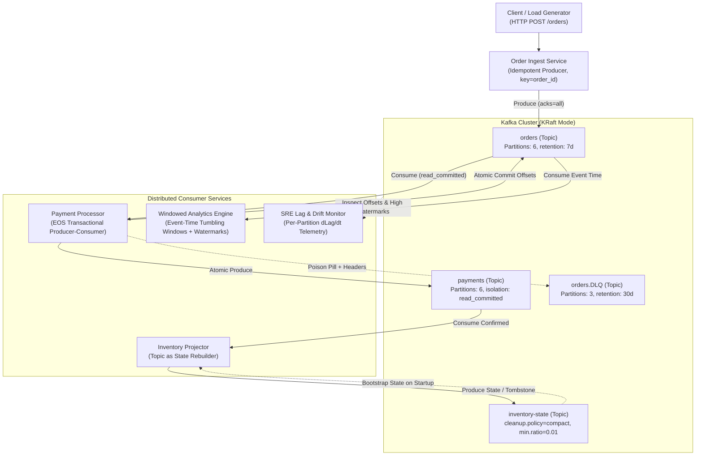
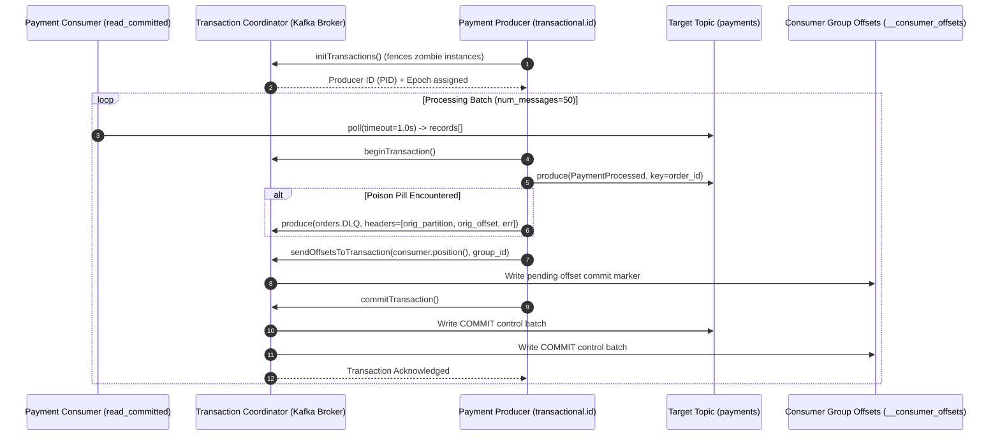
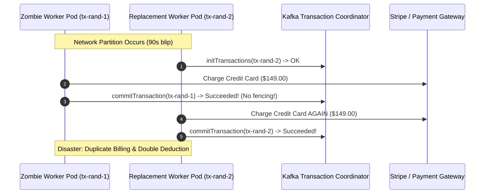

# Module 07: Capstone Project — Production Event-Driven Order Processing System

> **Status:** Production Capstone  
> **Difficulty:** Advanced Distributed Systems  
> **Estimated Time:** 8–12 Hours  
> **Prerequisites:** Modules 00 through 06 (Producer Internals, Consumer Groups, EOS Transactions, Schema Evolution, Log Compaction, Windowed Streaming, SRE Lag Operations)

---

> [!TIP]
> **The Golden Rule of Event-Driven Systems**  
> In event-driven distributed architectures, decoupling is an illusion unless transport, processing semantics, and failure domains are explicitly bounded. Never rely on incidental network reliability or default client parameters: every business event must carry deterministic idempotency keys, produce within explicit transactions or outbox patterns, isolate state mutations into compacted logs, route poison pills into header-annotated Dead Letter Queues (DLQ) without stalling partition progress, and measure queue health via consumer lag rate of change ($d\text{Lag}/dt$) rather than static message counts.

---

## 1. System Topology & Architecture

The system coordinates four autonomous services around Apache Kafka, demonstrating the integration of all previous module concepts:



### 1.1 Transactional Coordination Lifecycle (Module 02)

The core transaction encapsulates reading from `orders`, computing payment eligibility, emitting to `payments`, and committing consumer offsets atomically:



---

## 2. Topic Topology & Architectural Reference Matrix

| Topic Name | Partitions | Replication | Cleanup Policy | Compaction / Retention Specs | Partition Key | Architectural Purpose |
| :--- | :--- | :--- | :--- | :--- | :--- | :--- |
| `orders` | 6 | 1 (Dev) / 3 (Prod) | `delete` | `retention.ms=604800000` (7 days) | `order_id` (UUIDv4) | Primary business intake log; preserves temporal ordering per order entity. |
| `payments` | 6 | 1 (Dev) / 3 (Prod) | `delete` | `retention.ms=604800000` (7 days) | `order_id` (Co-partitioned) | Transactional result log; enables deterministic join with `orders` via matching partition count. |
| `inventory-state` | 6 | 1 (Dev) / 3 (Prod) | `compact` | `segment.ms=10000`, `min.cleanable.dirty.ratio=0.01` | `sku` | In-memory distributed table state log; compacts historical updates; supports tombstones (`value=null`). |
| `orders.DLQ` | 3 | 1 (Dev) / 3 (Prod) | `delete` | `retention.ms=2592000000` (30 days) | `order_id` or original key | Quarantines malformed/unparseable messages with diagnostic wire headers without head-of-line blocking. |

---

## 3. Production War Story: The Ghost Offset Incident & Zombie Worker Failover

### The Incident
During a flash-sale event on an e-commerce platform processing 45,000 orders/minute, a network partition isolated worker `payment-processor-pod-2` from the Kubernetes API server for 90 seconds. Kubernetes presumed the pod dead and scheduled a replacement pod (`payment-processor-pod-2-new`).

When the network blip healed, both pods were active simultaneously. The old pod continued reading from partition 3 and producing payment confirmations to the payment gateway. Because neither pod used a deterministic `transactional.id` (they generated random UUIDs like `tx-uuid-8f921`), Kafka allowed both pods to produce concurrently. The result was 1,420 customers receiving duplicate credit card charges within 3 minutes before circuit breakers engaged.



### The Root Cause & Remediation
1. **Dynamic Transaction IDs:** Generating random transaction IDs disabled Kafka's native zombie fencing mechanism. 
2. **The Fix:** Assign deterministic, partition-pinned transaction IDs (`payment-processor-${INSTANCE_ID}`) combined with static consumer group membership (`group.instance.id`). When `payment-processor-2` initializes, Kafka's Transaction Coordinator bumps the producer epoch; any subsequent produce or commit attempt by the zombie worker is immediately rejected with `ProducerFencedException`, aborting its local transaction and killing the zombie process before duplicate external calls occur.

---

## 4. Multi-Language Implementation

### 4.1 Ingest Service: HTTP API with Idempotent Producer

This service exposes `POST /orders`, generates an internal UUID, and guarantees zero loss and strict ordering by producing with `enable.idempotence=true` and `key=order_id`.

````carousel
```go
// services/ingest.go
package main

import (
	"encoding/json"
	"fmt"
	"log"
	"net/http"
	"os"
	"os/signal"
	"sync/atomic"
	"syscall"
	"time"

	"github.com/confluentinc/confluent-kafka-go/v2/kafka"
	"github.com/google/uuid"
)

type OrderRequest struct {
	CustomerID string  `json:"customer_id"`
	SKU        string  `json:"sku"`
	Quantity   int     `json:"quantity"`
	UnitPrice  float64 `json:"unit_price"`
}

type OrderPlaced struct {
	OrderID     string  `json:"order_id"`
	CustomerID  string  `json:"customer_id"`
	SKU         string  `json:"sku"`
	Quantity    int     `json:"quantity"`
	UnitPrice   float64 `json:"unit_price"`
	TimestampMS int64   `json:"timestamp_ms"`
	EventID     string  `json:"event_id"`
}

var (
	deliveredCount uint64
	failedCount    uint64
)

func main() {
	bootstrap := os.Getenv("KAFKA_BOOTSTRAP")
	if bootstrap == "" {
		bootstrap = "localhost:9092"
	}

	p, err := kafka.NewProducer(&kafka.ConfigMap{
		"bootstrap.servers":                     bootstrap,
		"enable.idempotence":                    true,
		"acks":                                  "all",
		"linger.ms":                             10,
		"batch.size":                            65536,
		"compression.type":                      "lz4",
		"delivery.timeout.ms":                   120000,
		"max.in.flight.requests.per.connection": 5,
	})
	if err != nil {
		log.Fatalf("Failed to create producer: %s", err)
	}

	// Delivery report event loop
	go func() {
		for e := range p.Events() {
			switch ev := e.(type) {
			case *kafka.Message:
				if ev.TopicPartition.Error != nil {
					atomic.AddUint64(&failedCount, 1)
					log.Printf("DELIVERY FAILED key=%s err=%v", string(ev.Key), ev.TopicPartition.Error)
				} else {
					atomic.AddUint64(&deliveredCount, 1)
				}
			}
		}
	}()

	http.HandleFunc("/orders", func(w http.ResponseWriter, r *http.Request) {
		if r.Method != http.MethodPost {
			http.Error(w, "Method not allowed", http.StatusMethodNotAllowed)
			return
		}
		var req OrderRequest
		if err := json.NewDecoder(r.Body).Decode(&req); err != nil {
			http.Error(w, err.Error(), http.StatusBadRequest)
			return
		}

		event := OrderPlaced{
			OrderID:     fmt.Sprintf("ORD-%s", uuid.New().String()[:8]),
			CustomerID:  req.CustomerID,
			SKU:         req.SKU,
			Quantity:    req.Quantity,
			UnitPrice:   req.UnitPrice,
			TimestampMS: time.Now().UnixMilli(),
			EventID:     uuid.New().String(),
		}
		val, _ := json.Marshal(event)
		topic := "orders"

		err := p.Produce(&kafka.Message{
			TopicPartition: kafka.TopicPartition{Topic: &topic, Partition: kafka.PartitionAny},
			Key:            []byte(event.OrderID),
			Value:          val,
		}, nil)

		if err != nil {
			http.Error(w, "Producer queue full", http.StatusServiceUnavailable)
			return
		}

		w.Header().Set("Content-Type", "application/json")
		w.WriteHeader(http.StatusAccepted)
		json.NewEncoder(w).Encode(map[string]string{"order_id": event.OrderID, "status": "accepted"})
	})

	http.HandleFunc("/stats", func(w http.ResponseWriter, r *http.Request) {
		w.Header().Set("Content-Type", "application/json")
		json.NewEncoder(w).Encode(map[string]interface{}{
			"delivered": atomic.LoadUint64(&deliveredCount),
			"failed":    atomic.LoadUint64(&failedCount),
			"in_queue":  p.Len(),
		})
	})

	srv := &http.Server{Addr: ":8000"}
	go srv.ListenAndServe()
	log.Println("Order Ingest API listening on :8000")

	sigterm := make(chan os.Signal, 1)
	signal.Notify(sigterm, syscall.SIGINT, syscall.SIGTERM)
	<-sigterm

	log.Println("Shutting down: flushing pending messages...")
	p.Flush(30000)
	p.Close()
	srv.Close()
}
```
<!-- slide -->
```typescript
// services/ingest.ts
import express, { Request, Response } from 'express';
import { Kafka, Partitioners } from 'kafkajs';
import { randomUUID } from 'crypto';

const app = express();
app.use(express.json());

const kafka = new Kafka({
  clientId: 'order-ingest-service',
  brokers: [(process.env.KAFKA_BOOTSTRAP || 'localhost:9092')],
});

const producer = kafka.producer({
  createPartitioner: Partitioners.DefaultPartitioner,
  idempotent: true,
  maxInFlightRequests: 5,
});

let delivered = 0;
let failed = 0;

interface OrderRequest {
  customer_id: string;
  sku: string;
  quantity: number;
  unit_price: number;
}

app.post('/orders', async (req: Request<{}, {}, OrderRequest>, res: Response) => {
  const { customer_id, sku, quantity, unit_price } = req.body;
  if (!customer_id || !sku || quantity <= 0 || unit_price <= 0) {
    return res.status(400).json({ error: 'Invalid order payload' });
  }

  const order_id = `ORD-${randomUUID().substring(0, 8)}`;
  const payload = {
    order_id,
    customer_id,
    sku,
    quantity,
    unit_price,
    timestamp_ms: Date.now(),
    event_id: randomUUID(),
  };

  try {
    await producer.send({
      topic: 'orders',
      messages: [{
        key: order_id,
        value: JSON.stringify(payload),
      }],
      acks: -1, // acks=all
    });
    delivered++;
    return res.status(202).json({ order_id, status: 'accepted' });
  } catch (err: any) {
    failed++;
    console.error('Delivery failure:', err);
    return res.status(503).json({ error: 'Kafka ingestion unavailable' });
  }
});

app.get('/stats', (_req: Request, res: Response) => {
  res.json({ delivered, failed });
});

async function bootstrap() {
  await producer.connect();
  const server = app.listen(8000, () => {
    console.log('Order Ingest service running on port 8000');
  });

  const shutdown = async () => {
    console.log('Flushing producer buffers and disconnecting...');
    server.close();
    await producer.disconnect();
    process.exit(0);
  };

  process.on('SIGTERM', shutdown);
  process.on('SIGINT', shutdown);
}

bootstrap().catch(console.error);
```
<!-- slide -->
```python
# services/ingest.py
import logging, uuid, os
from fastapi import FastAPI, HTTPException
from pydantic import BaseModel, Field
from confluent_kafka import Producer
from shared.config import PRODUCER_BASE
from shared.events import OrderPlaced

logging.basicConfig(level=logging.INFO)
log = logging.getLogger("ingest")

app = FastAPI(title="Order Ingest Service")
producer = Producer(PRODUCER_BASE)

delivered, failed = 0, 0

def on_delivery(err, msg):
    global delivered, failed
    if err is not None:
        failed += 1
        log.error("DELIVERY FAILED key=%s err=%s", msg.key(), err)
    else:
        delivered += 1

class OrderRequest(BaseModel):
    customer_id: str
    sku: str
    quantity: int = Field(gt=0)
    unit_price: float = Field(gt=0)

@app.post("/orders", status_code=202)
def place_order(req: OrderRequest):
    event = OrderPlaced(
        order_id=f"ORD-{uuid.uuid4().hex[:8]}",
        customer_id=req.customer_id,
        sku=req.sku,
        quantity=req.quantity,
        unit_price=req.unit_price,
    )
    try:
        producer.produce(
            "orders",
            key=event.order_id.encode(),
            value=event.to_bytes(),
            on_delivery=on_delivery,
        )
    except BufferError:
        raise HTTPException(503, "Producer queue full")
    
    producer.poll(0) # trigger background callback deliveries
    return {"order_id": event.order_id, "status": "accepted"}

@app.get("/stats")
def stats():
    return {"delivered": delivered, "failed": failed, "in_queue": len(producer)}

@app.on_event("shutdown")
def shutdown():
    log.info("Flushing %d buffered records before exit...", len(producer))
    producer.flush(30)
```
````

---

### 4.2 Payment Processor: Exactly-Once Processing with DLQ Quarantining

This service atomically processes order batches, routes malformed records to `orders.DLQ` with diagnostic headers, produces payment records, and commits consumer group offsets within a single Kafka transaction.

````carousel
```python
# services/payment_processor.py
import logging, os, sys, json, signal
from confluent_kafka import Consumer, Producer, KafkaException
from shared.config import BOOTSTRAP, CONSUMER_BASE
from shared.events import OrderPlaced, PaymentProcessed

logging.basicConfig(level=logging.INFO, format="%(asctime)s [payment] %(message)s")
log = logging.getLogger()

INSTANCE = os.getenv("INSTANCE_ID", "1")

# Transactional producer with stable transactional.id for zombie fencing
producer = Producer({
    "bootstrap.servers": BOOTSTRAP,
    "transactional.id": f"payment-processor-{INSTANCE}",
    "enable.idempotence": True,
})
producer.init_transactions()

# Consumer with static membership to prevent costly rebalances during rolling restarts
consumer = Consumer({
    **CONSUMER_BASE,
    "group.id": "payment-processor",
    "group.instance.id": f"payment-worker-{INSTANCE}",
    "isolation.level": "read_committed",
})
consumer.subscribe(["orders"])

running = True
signal.signal(signal.SIGTERM, lambda *_: globals().__setitem__("running", False))
signal.signal(signal.SIGINT, lambda *_: globals().__setitem__("running", False))

DECLINE_THRESHOLD = float(os.getenv("DECLINE_OVER", "1000"))

def route_to_dlq(msg, error_str: str):
    """Parks unparseable poison pills with diagnostic wire headers without stalling the partition."""
    producer.produce(
        "orders.DLQ",
        key=msg.key(),
        value=msg.value(),
        headers=[
            ("original_topic", msg.topic().encode()),
            ("original_partition", str(msg.partition()).encode()),
            ("original_offset", str(msg.offset()).encode()),
            ("error_message", error_str[:900].encode()),
        ],
    )

processed_count = 0
try:
    while running:
        msgs = consumer.consume(num_messages=50, timeout=1.0)
        if not msgs:
            continue

        producer.begin_transaction()
        try:
            for msg in msgs:
                if msg.error():
                    raise KafkaException(msg.error())

                try:
                    order = OrderPlaced.from_bytes(msg.value())
                except Exception as ex:
                    log.warning("Poison pill detected at %s[%d]@%d: %s",
                                msg.topic(), msg.partition(), msg.offset(), ex)
                    route_to_dlq(msg, str(ex))
                    continue

                amount = order.quantity * order.unit_price
                status = "DECLINED" if amount > DECLINE_THRESHOLD else "CONFIRMED"
                
                payment = PaymentProcessed(
                    order_id=order.order_id,
                    customer_id=order.customer_id,
                    amount=amount,
                    status=status,
                )
                producer.produce(
                    "payments",
                    key=order.order_id.encode(),
                    value=payment.to_bytes()
                )
                processed_count += 1

            # Atomic transaction boundary: produce offsets directly to transaction
            producer.send_offsets_to_transaction(
                consumer.position(consumer.assignment()),
                consumer.consumer_group_metadata(),
            )
            producer.commit_transaction()
            log.info("Committed transactional batch of %d records (total: %d)", len(msgs), processed_count)
        except Exception:
            log.exception("Encountered transaction processing error; aborting transaction")
            producer.abort_transaction()
            raise
finally:
    log.info("Shutting down payment processor; total processed=%d", processed_count)
    consumer.close()
```
<!-- slide -->
```go
// services/payment_processor.go
package main

import (
	"context"
	"encoding/json"
	"fmt"
	"log"
	"os"
	"os/signal"
	"syscall"
	"time"

	"github.com/confluentinc/confluent-kafka-go/v2/kafka"
)

type OrderPlaced struct {
	OrderID    string  `json:"order_id"`
	CustomerID string  `json:"customer_id"`
	SKU        string  `json:"sku"`
	Quantity   int     `json:"quantity"`
	UnitPrice  float64 `json:"unit_price"`
}

type PaymentProcessed struct {
	OrderID    string  `json:"order_id"`
	CustomerID string  `json:"customer_id"`
	Amount     float64 `json:"amount"`
	Status     string  `json:"status"`
}

func main() {
	instance := os.Getenv("INSTANCE_ID")
	if instance == "" {
		instance = "1"
	}
	bootstrap := "localhost:9092"

	// 1. Transactional Producer
	p, err := kafka.NewProducer(&kafka.ConfigMap{
		"bootstrap.servers":  bootstrap,
		"transactional.id":   fmt.Sprintf("payment-processor-%s", instance),
		"enable.idempotence": true,
	})
	if err != nil {
		log.Fatal(err)
	}

	ctx := context.Background()
	if err := p.InitTransactions(ctx); err != nil {
		log.Fatalf("InitTransactions failed: %v", err)
	}

	// 2. Read Committed Consumer
	c, err := kafka.NewConsumer(&kafka.ConfigMap{
		"bootstrap.servers":               bootstrap,
		"group.id":                        "payment-processor",
		"group.instance.id":               fmt.Sprintf("payment-worker-%s", instance),
		"auto.offset.reset":               "earliest",
		"enable.auto.commit":              false,
		"isolation.level":                 "read_committed",
		"partition.assignment.strategy":   "cooperative-sticky",
	})
	if err != nil {
		log.Fatal(err)
	}

	c.SubscribeTopics([]string{"orders"}, nil)
	run := true
	sig := make(chan os.Signal, 1)
	signal.Notify(sig, syscall.SIGINT, syscall.SIGTERM)

	go func() {
		<-sig
		run = false
	}()

	for run {
		msg, err := c.ReadMessage(1000 * time.Millisecond)
		if err != nil {
			continue
		}

		if err := p.BeginTransaction(); err != nil {
			log.Fatalf("BeginTransaction error: %v", err)
		}

		var order OrderPlaced
		if err := json.Unmarshal(msg.Value, &order); err != nil {
			// Poison pill: route to DLQ with headers
			dlqTopic := "orders.DLQ"
			p.Produce(&kafka.Message{
				TopicPartition: kafka.TopicPartition{Topic: &dlqTopic, Partition: kafka.PartitionAny},
				Key:            msg.Key,
				Value:          msg.Value,
				Headers: []kafka.Header{
					{Key: "error", Value: []byte(err.Error())},
					{Key: "orig_offset", Value: []byte(fmt.Sprintf("%d", msg.TopicPartition.Offset))},
				},
			}, nil)
		} else {
			amount := float64(order.Quantity) * order.UnitPrice
			status := "CONFIRMED"
			if amount > 1000.0 {
				status = "DECLINED"
			}
			payment := PaymentProcessed{
				OrderID:    order.OrderID,
				CustomerID: order.CustomerID,
				Amount:     amount,
				Status:     status,
			}
			payVal, _ := json.Marshal(payment)
			payTopic := "payments"
			p.Produce(&kafka.Message{
				TopicPartition: kafka.TopicPartition{Topic: &payTopic, Partition: kafka.PartitionAny},
				Key:            []byte(order.OrderID),
				Value:          payVal,
			}, nil)
		}

		// Send consumer offset to transaction
		meta, _ := c.GetConsumerGroupMetadata()
		nextOffset := kafka.TopicPartition{
			Topic:     msg.TopicPartition.Topic,
			Partition: msg.TopicPartition.Partition,
			Offset:    msg.TopicPartition.Offset + 1,
		}
		if err := p.SendOffsetsToTransaction(ctx, []kafka.TopicPartition{nextOffset}, meta); err != nil {
			p.AbortTransaction(ctx)
			continue
		}
		p.CommitTransaction(ctx)
	}

	c.Close()
	p.Close()
}
```
<!-- slide -->
```typescript
// services/payment_processor.ts
import { Kafka, logLevel } from 'kafkajs';

const instance = process.env.INSTANCE_ID || '1';
const kafka = new Kafka({
  clientId: `payment-processor-${instance}`,
  brokers: [(process.env.KAFKA_BOOTSTRAP || 'localhost:9092')],
  logLevel: logLevel.INFO,
});

const consumer = kafka.consumer({
  groupId: 'payment-processor',
  readUncommitted: false, // isolation level: read_committed
});

const producer = kafka.producer({
  transactionalId: `payment-processor-${instance}`,
  maxInFlightRequests: 1,
  idempotent: true,
});

async function main() {
  await producer.connect();
  await consumer.connect();
  await consumer.subscribe({ topic: 'orders', fromBeginning: true });

  await consumer.run({
    autoCommit: false,
    eachBatchAutoResolve: false,
    eachBatch: async ({ batch, resolveOffset, heartbeat, commitOffsetsIfNecessary }) => {
      const transaction = await producer.transaction();
      try {
        for (const message of batch.messages) {
          if (!message.value) continue;

          try {
            const order = JSON.parse(message.value.toString());
            const amount = order.quantity * order.unit_price;
            const status = amount > 1000 ? 'DECLINED' : 'CONFIRMED';

            await transaction.send({
              topic: 'payments',
              messages: [{
                key: order.order_id,
                value: JSON.stringify({
                  order_id: order.order_id,
                  customer_id: order.customer_id,
                  amount,
                  status,
                }),
              }],
            });
          } catch (parseErr: any) {
            // Poison pill routed to DLQ inside the same transaction
            await transaction.send({
              topic: 'orders.DLQ',
              messages: [{
                key: message.key,
                value: message.value,
                headers: {
                  error: parseErr.message,
                  orig_offset: message.offset,
                  orig_partition: batch.partition.toString(),
                },
              }],
            });
          }

          resolveOffset(message.offset);
        }

        // Commit offsets within Kafka transaction
        await transaction.sendOffsets({
          consumerGroupId: 'payment-processor',
          topics: [{
            topic: batch.topic,
            partitions: [{
              partition: batch.partition,
              offset: (BigInt(batch.lastOffset()) + 1n).toString(),
            }],
          }],
        });

        await transaction.commit();
        await heartbeat();
      } catch (err) {
        await transaction.abort();
        throw err;
      }
    },
  });
}

main().catch(console.error);
```
````

---

### 4.3 Inventory Projector: Topic as State Rebuild (Log Compaction)

Demonstrates how state can be entirely recovered from Kafka without an external database. On startup, it reads `inventory-state` from beginning to EOF, applying updates and deleting keys on tombstones (`value = null`).

````carousel
```python
# services/inventory_projector.py
import logging, json, signal
from confluent_kafka import Consumer, Producer
from shared.config import BOOTSTRAP, CONSUMER_BASE, PRODUCER_BASE
from shared.events import PaymentProcessed

logging.basicConfig(level=logging.INFO, format="%(asctime)s [inventory] %(message)s")
log = logging.getLogger()

INITIAL_STOCK = {"SKU-1": 1000, "SKU-2": 500, "SKU-3": 50}

producer = Producer(PRODUCER_BASE)
consumer = Consumer({
    **CONSUMER_BASE,
    "group.id": "inventory-projector",
    "isolation.level": "read_committed",
})

state = dict(INITIAL_STOCK)

def load_state_from_log():
    """Rebuilds in-memory key-value state from compacted inventory-state topic up to EOF."""
    boot = Consumer({
        **CONSUMER_BASE,
        "group.id": "inventory-bootstrap-ephemeral",
        "enable.partition.eof": True,
    })
    boot.subscribe(["inventory-state"])
    eofs, assigned = set(), None
    log.info("Rebuilding inventory state from compacted log...")

    while True:
        msg = boot.poll(2.0)
        if msg is None:
            break
        if msg.error():
            eofs.add((msg.topic(), msg.partition()))
            assigned = assigned or boot.assignment()
            if assigned and len(eofs) >= len(assigned):
                break
            continue

        k = msg.key().decode("utf-8")
        if msg.value() is None:
            state.pop(k, None) # Log compaction tombstone: delete key
        else:
            state[k] = json.loads(msg.value())["available"]

    boot.close()
    log.info("State successfully rebuilt from log: %s", state)

load_state_from_log()
consumer.subscribe(["payments"])

running = True
signal.signal(signal.SIGINT, lambda *_: globals().__setitem__("running", False))

try:
    while running:
        msg = consumer.poll(1.0)
        if msg is None or msg.error():
            continue

        payment = PaymentProcessed.from_bytes(msg.value())
        if payment.status != "CONFIRMED":
            consumer.commit(msg, asynchronous=False)
            continue

        sku = "SKU-1" # In extended mode, carried via event
        state[sku] = state.get(sku, 0) - 1
        
        # Emit state mutation to compacted topic
        producer.produce(
            "inventory-state",
            key=sku.encode(),
            value=json.dumps({"sku": sku, "available": state[sku]}).encode(),
        )
        producer.poll(0)
        consumer.commit(msg, asynchronous=False)
        log.info("Updated inventory: %s -> %d available", sku, state[sku])
finally:
    producer.flush(10)
    consumer.close()
```
<!-- slide -->
```go
// services/inventory_projector.go
package main

import (
	"encoding/json"
	"fmt"
	"log"
	"os"
	"os/signal"
	"syscall"

	"github.com/confluentinc/confluent-kafka-go/v2/kafka"
)

type InventoryRecord struct {
	SKU       string `json:"sku"`
	Available int    `json:"available"`
}

type PaymentProcessed struct {
	OrderID string  `json:"order_id"`
	Status  string  `json:"status"`
}

func main() {
	bootstrap := "localhost:9092"
	state := map[string]int{
		"SKU-1": 1000,
		"SKU-2": 500,
	}

	// 1. Rebuild state by reading to EOF on compacted topic
	bootConsumer, err := kafka.NewConsumer(&kafka.ConfigMap{
		"bootstrap.servers":    bootstrap,
		"group.id":             "inventory-rebuilder-temp",
		"auto.offset.reset":    "earliest",
		"enable.partition.eof": true,
	})
	if err != nil {
		log.Fatal(err)
	}

	bootConsumer.SubscribeTopics([]string{"inventory-state"}, nil)
	eofs := make(map[int32]bool)
	expectedPartitions := 6

	log.Println("Reading compacted log to replay state...")
	for len(eofs) < expectedPartitions {
		ev := bootConsumer.Poll(1000)
		switch m := ev.(type) {
		case *kafka.Message:
			sku := string(m.Key)
			if m.Value == nil {
				delete(state, sku) // Tombstone
			} else {
				var rec InventoryRecord
				json.Unmarshal(m.Value, &rec)
				state[sku] = rec.Available
			}
		case kafka.PartitionEOF:
			eofs[m.Partition] = true
		}
	}
	bootConsumer.Close()
	log.Printf("State rebuilt successfully: %+v\n", state)

	// 2. Consume confirmed payments and publish new state
	c, _ := kafka.NewConsumer(&kafka.ConfigMap{
		"bootstrap.servers": bootstrap,
		"group.id":          "inventory-projector",
		"auto.offset.reset": "earliest",
		"isolation.level":   "read_committed",
	})
	p, _ := kafka.NewProducer(&kafka.ConfigMap{"bootstrap.servers": bootstrap})
	c.SubscribeTopics([]string{"payments"}, nil)

	sig := make(chan os.Signal, 1)
	signal.Notify(sig, syscall.SIGINT, syscall.SIGTERM)

	run := true
	go func() {
		<-sig
		run = false
	}()

	for run {
		ev := c.Poll(1000)
		switch m := ev.(type) {
		case *kafka.Message:
			var payment PaymentProcessed
			json.Unmarshal(m.Value, &payment)
			if payment.Status == "CONFIRMED" {
				sku := "SKU-1"
				state[sku] = state[sku] - 1
				val, _ := json.Marshal(InventoryRecord{SKU: sku, Available: state[sku]})
				topic := "inventory-state"
				p.Produce(&kafka.Message{
					TopicPartition: kafka.TopicPartition{Topic: &topic, Partition: kafka.PartitionAny},
					Key:            []byte(sku),
					Value:          val,
				}, nil)
				c.CommitMessage(m)
				log.Printf("Stock decremented: %s -> %d", sku, state[sku])
			}
		}
	}

	p.Flush(5000)
	c.Close()
	p.Close()
}
```
<!-- slide -->
```typescript
// services/inventory_projector.ts
import { Kafka } from 'kafkajs';

const kafka = new Kafka({
  clientId: 'inventory-projector',
  brokers: [(process.env.KAFKA_BOOTSTRAP || 'localhost:9092')],
});

const state: Record<string, number> = {
  'SKU-1': 1000,
  'SKU-2': 500,
};

async function rebuildState(): Promise<void> {
  const admin = kafka.admin();
  await admin.connect();
  const offsets = await admin.fetchTopicOffsets('inventory-state');
  await admin.disconnect();

  const bootConsumer = kafka.consumer({ groupId: `bootstrap-${Date.now()}` });
  await bootConsumer.connect();
  await bootConsumer.subscribe({ topic: 'inventory-state', fromBeginning: true });

  console.log('Rebuilding inventory state from compacted log...');

  await new Promise<void>((resolve) => {
    bootConsumer.run({
      eachMessage: async ({ message }) => {
        if (!message.key) return;
        const sku = message.key.toString();
        if (message.value === null) {
          delete state[sku]; // Tombstone
        } else {
          const rec = JSON.parse(message.value.toString());
          state[sku] = rec.available;
        }
      },
    });

    // Timeout or check offset progress
    setTimeout(async () => {
      await bootConsumer.disconnect();
      resolve();
    }, 3000);
  });

  console.log('State replay finished:', state);
}

async function runLive() {
  await rebuildState();

  const consumer = kafka.consumer({ groupId: 'inventory-projector', readUncommitted: false });
  const producer = kafka.producer();

  await consumer.connect();
  await producer.connect();
  await consumer.subscribe({ topic: 'payments', fromBeginning: false });

  await consumer.run({
    eachMessage: async ({ message }) => {
      if (!message.value) return;
      const payment = JSON.parse(message.value.toString());
      if (payment.status === 'CONFIRMED') {
        const sku = 'SKU-1';
        state[sku] = (state[sku] || 1000) - 1;

        await producer.send({
          topic: 'inventory-state',
          messages: [{
            key: sku,
            value: JSON.stringify({ sku, available: state[sku] }),
          }],
        });
        console.log(`[Inventory] Decremented ${sku} to ${state[sku]}`);
      }
    },
  });
}

runLive().catch(console.error);
```
````

---

## 5. Step-by-Step Hands-On Verification CLI

### 5.1 Initialize KRaft Cluster and Provision Schema Topics

```powershell
# 1. Start single-node Kafka KRaft cluster
docker run -d --name kafka -p 9092:9092 `
  -e KAFKA_NODE_ID=1 `
  -e KAFKA_PROCESS_ROLES=broker,controller `
  -e KAFKA_LISTENERS=PLAINTEXT://:9092,CONTROLLER://:9093 `
  -e KAFKA_ADVERTISED_LISTENERS=PLAINTEXT://localhost:9092 `
  -e KAFKA_CONTROLLER_LISTENER_NAMES=CONTROLLER `
  -e KAFKA_LISTENER_SECURITY_PROTOCOL_MAP=CONTROLLER:PLAINTEXT,PLAINTEXT:PLAINTEXT `
  -e KAFKA_CONTROLLER_QUORUM_VOTERS=1@localhost:9093 `
  -e KAFKA_OFFSETS_TOPIC_REPLICATION_FACTOR=1 `
  -e KAFKA_TRANSACTION_STATE_LOG_REPLICATION_FACTOR=1 `
  -e KAFKA_TRANSACTION_STATE_LOG_MIN_ISR=1 `
  -e KAFKA_GROUP_INITIAL_REBALANCE_DELAY_MS=0 `
  apache/kafka:3.9.0

# 2. Provision co-partitioned business & state topics
docker exec kafka /opt/kafka/bin/kafka-topics.sh --bootstrap-server localhost:9092 `
  --create --if-not-exists --topic orders --partitions 6 --replication-factor 1 --config retention.ms=604800000

docker exec kafka /opt/kafka/bin/kafka-topics.sh --bootstrap-server localhost:9092 `
  --create --if-not-exists --topic payments --partitions 6 --replication-factor 1 --config retention.ms=604800000

docker exec kafka /opt/kafka/bin/kafka-topics.sh --bootstrap-server localhost:9092 `
  --create --if-not-exists --topic inventory-state --partitions 6 --replication-factor 1 `
  --config cleanup.policy=compact --config segment.ms=10000 --config min.cleanable.dirty.ratio=0.01

docker exec kafka /opt/kafka/bin/kafka-topics.sh --bootstrap-server localhost:9092 `
  --create --if-not-exists --topic orders.DLQ --partitions 3 --replication-factor 1 --config retention.ms=2592000000
```

### 5.2 Inject Poison Pill & Verify DLQ Headers

Inject unparseable non-JSON bytes into the `orders` topic:

```powershell
# Send malformed string
"BAD_RECORD:not-json-at-all" | docker exec -i kafka /opt/kafka/bin/kafka-console-producer.sh `
  --bootstrap-server localhost:9092 --topic orders --property "parse.key=true" --property "key.separator=:"
```

Inspect the `orders.DLQ` topic to confirm metadata preservation without halting consumer offsets:

```powershell
docker exec kafka /opt/kafka/bin/kafka-console-consumer.sh `
  --bootstrap-server localhost:9092 --topic orders.DLQ --from-beginning `
  --property print.headers=true --property print.key=true --timeout-ms 5000
```

**Expected Wire Output:**
```text
original_topic:orders,original_partition:1,original_offset:42,error:Expecting value: line 1 column 1 (char 0)	BAD_RECORD	not-json-at-all
Processed a total of 1 messages
```

### 5.3 Verify Exactly-Once Semantics Under Hard Crash (`kill -9`)

Generate 200 orders via the Ingest API while terminating the worker mid-batch:

```powershell
1..200 | ForEach-Object {
  curl.exe -s -X POST http://localhost:8000/orders `
    -H "Content-Type: application/json" `
    -d '{"customer_id":"C1","sku":"SKU-1","quantity":1,"unit_price":25.50}' | Out-Null
}
```

Verify payments with isolation level set to `read_committed`:

```python
# scripts/verify_eos.py
from confluent_kafka import Consumer
c = Consumer({
    "bootstrap.servers": "localhost:9092",
    "group.id": "eos-verifier",
    "isolation.level": "read_committed",
    "auto.offset.reset": "earliest",
    "enable.partition.eof": True,
})
c.subscribe(["payments"])
seen = set()
total = 0
eofs = 0

while eofs < 6:
    msg = c.poll(1.0)
    if msg is None: continue
    if msg.error():
        eofs += 1
        continue
    total += 1
    seen.add(msg.key().decode())

c.close()
print(f"Total Received: {total} | Unique Orders: {len(seen)} | Duplicates: {total - len(seen)}")
```

**Expected Console Output:**
```text
Total Received: 200 | Unique Orders: 200 | Duplicates: 0
```

---

## 6. Operational Validation Checkpoints

<details>
<summary><strong>Checkpoint 1: Why does kafka-get-offsets.sh report 215 offsets on payments topic when exactly 200 orders were processed?</strong></summary>

> **Root Cause Analysis:**  
> When producers run within a Kafka transaction (`sendOffsetsToTransaction` + `commitTransaction`), Kafka writes a physical **Transaction Control Marker** (an internal control batch commit or abort record) to each active partition at transaction boundaries.  
> 
> These control markers occupy continuous sequential log offsets, incrementing the broker's Log End Offset (LEO). However, standard consumer clients configured with `isolation.level=read_committed` filter control markers out at the protocol level. Tools like `kafka-get-offsets.sh` or `kafka-run-class kafka.tools.GetOffsetShell` report the raw physical partition high-watermark LEO without decoding control headers. The extra 15 offsets represent successful transaction commit markers, not duplicate messages.
</details>

<details>
<summary><strong>Checkpoint 2: What happens if two payment processor pods are configured with the same transactional.id?</strong></summary>

> **Root Cause Analysis:**  
> Kafka enforces single-writer semantics per `transactional.id` via **Zombie Fencing**.  
> When the second instance calls `initTransactions()`, the Kafka Transaction Coordinator increments the producer's internal epoch counter (`producer_epoch = epoch + 1`) associated with that `transactional.id`. When the first instance attempts its next `produce()` or `commitTransaction()`, the broker identifies that its epoch is stale and rejects the request with a fatal `ProducerFencedException`. The first instance is fenced off and must terminate immediately to protect transactional log integrity.
</details>

<details>
<summary><strong>Checkpoint 3: How does the Inventory Projector guarantee state correctness if log compaction runs periodically rather than instantly?</strong></summary>

> **Root Cause Analysis:**  
> Log compaction operates on closed (inactive) segment files. The active segment log is always an append-only write journal that contains duplicates until it rolls (`segment.ms` or `segment.bytes` threshold).  
> During state bootstrap (`load_state_from_log`), the consumer reads sequentially from offset `0` to the current High Watermark. Because dictionary assignment (`state[k] = val`) processes in strict partition offset order, later offset values naturally overwrite earlier offset values in local memory. Thus, even if the disk cleaner has not yet compacted older segments, the replayed in-memory state converges to the exact latest value.
</details>

---

## 7. Curriculum Completion & Navigation

You have completed the Kafka & Streaming Systems track. You understand topic log internals, cooperative consumer rebalancing, exactly-once transactions, schema registry evolution, compacted log state rebuilds, windowed streaming watermarks, and SRE consumer lag telemetry.

- [← Back to Module 06: Operating Kafka: Lag, Sizing, and Reliability](../06-operating-kafka-lag-sizing-and-reliability/README.md)
- [Back to Kafka & Streaming Overview](../README.md)
- [Proceed to Track 2 Step 5: System Design Interview Practice](../../14-system-design-interview-practice/README.md)
